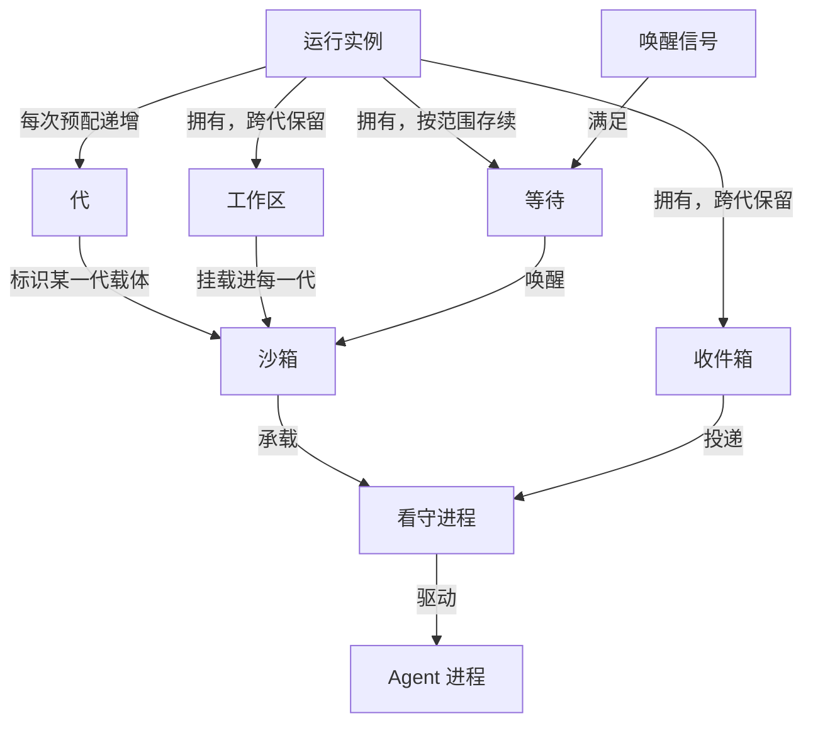
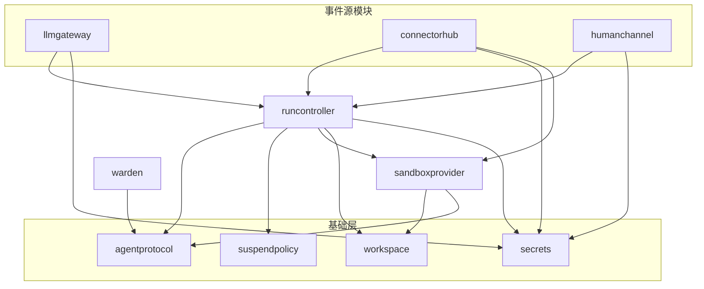
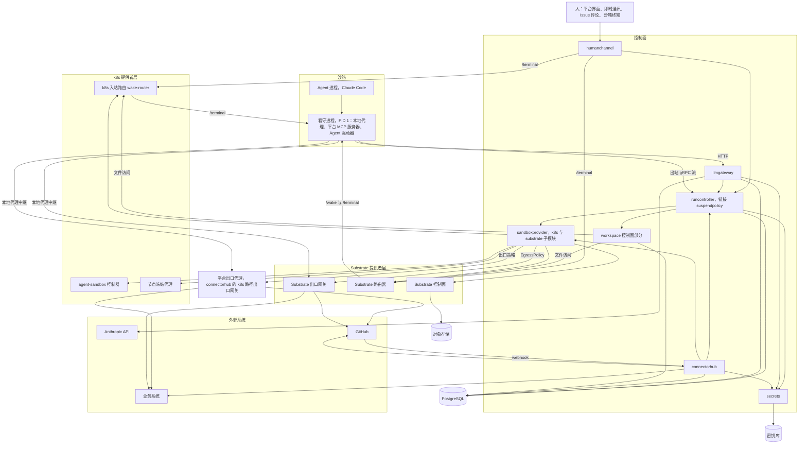
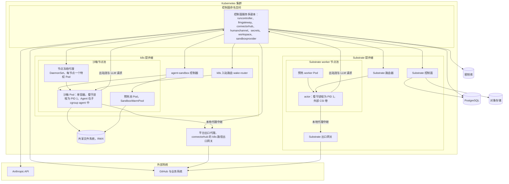
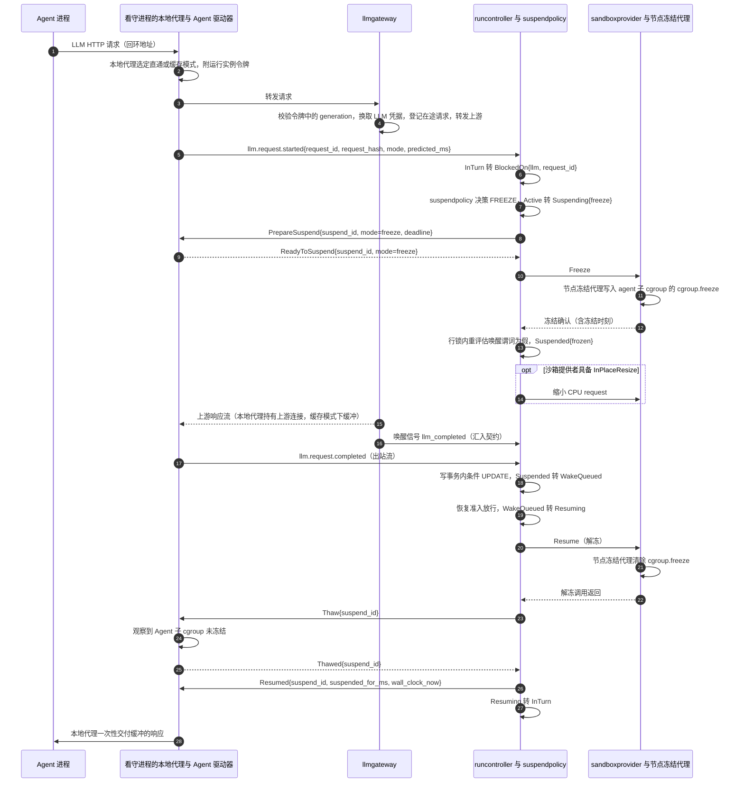
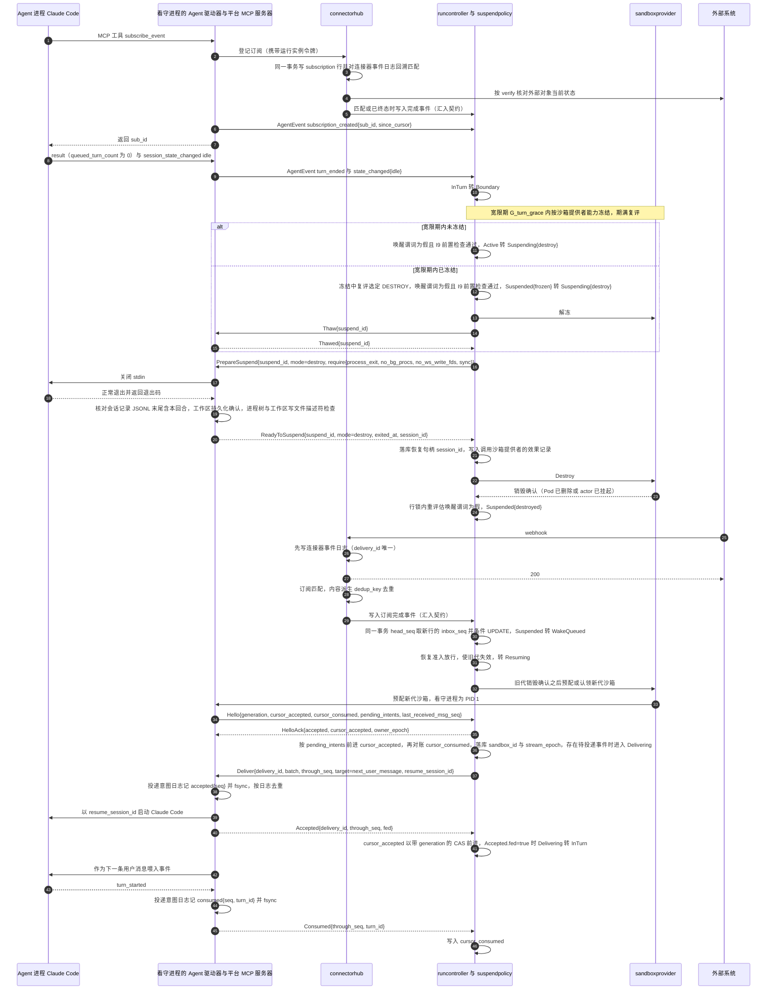
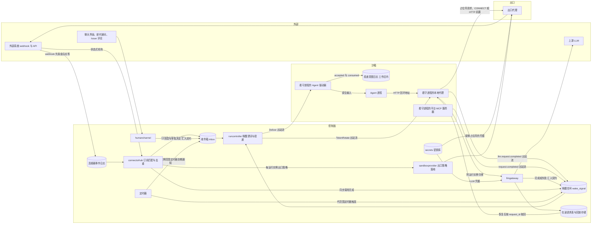
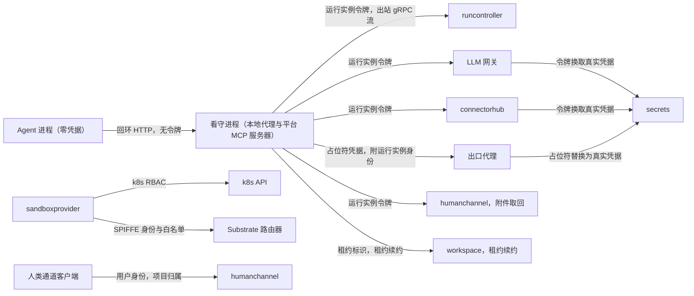

# 架构

## 概览

### 核心概念

castworks 把一次 Agent 任务表示为[运行实例](../glossary.md)。运行实例是持久主体，沙箱只是它某一代的执行载体（[ADR-run-outlives-sandbox](../adr/adr-run-outlives-sandbox.md)）。下表列出阅读后续章节所需的概念，以及它们之间的关系与存续范围；各术语在术语表中定义，按术语名查找。

| 概念 | 关系 | 生命周期与存续范围 |
| --- | --- | --- |
| 运行实例 | 拥有工作区、收件箱、等待、投递游标、回合位置与代 | 从创建到显式结束或放弃；跨越沙箱的多次创建与销毁 |
| 沙箱 | 承载看守进程与 Agent 进程，由代标识 | 一代一个；随挂起、销毁与重建出现和消失 |
| 工作区 | 挂载进每一代沙箱，承载 Agent 会话状态与投递意图日志 | 与运行实例同寿命，跨代保留 |
| 代 | 每次预配沙箱递增，标识沙箱所属的载体代次 | 只增不减；旧代在代递增后立即失效 |
| 收件箱 | 运行实例的可投递事件队列，由投递送入沙箱 | 跨代保留，按消费下界清理 |
| 唤醒信号 | 不进入收件箱，满足阻塞条件与代范围的等待条件 | 按代失效；运行实例范围的等待跨代保留 |
| 等待 | 由收件箱、唤醒信号与等待行推导，不依赖沙箱上报 | 按代范围或运行实例范围存续，在行锁内评估 |
| 回合位置 | 记录回合停在何处，决定恢复后进入哪个子状态 | 跨挂起保留，由控制面持久化 |

概念图的核心约束是运行实例与沙箱的分离：运行实例拥有的状态在沙箱消失后仍然可读，控制面据此评估唤醒谓词、选择投递批并判定恢复位置；沙箱只承载当前代的运行时状态，其存在与健康从沙箱提供者读取。等待在持久化收件箱与唤醒信号上推导（[ADR-wait-on-durable-inbox](../adr/adr-wait-on-durable-inbox.md)）；工作区的持久化方式按沙箱提供者选择（[ADR-workspace-persistence-per-provider](../adr/adr-workspace-persistence-per-provider.md)）；代对旧代消息与副作用的拒绝见失效判定（[ADR-generation-fencing](../adr/adr-generation-fencing.md)）。

### 设计主线

设计要解决的问题与对应的机制如下；每行的展开位置给出继续阅读的章节。

| 问题 | 机制 | 展开位置 |
| --- | --- | --- |
| 等待与唤醒 | 唤醒源全部由托管侧组件持有；等待由持久化收件箱、唤醒信号与等待行推导，唤醒谓词在运行实例行锁内求值 | [模块间调用关系](#模块间调用关系)、[runcontroller](modules/design-runcontroller.md) 的「唤醒谓词」 |
| 挂起 | 挂起机制按沙箱提供者能力分层；以挂起为目的的销毁只在安全点执行；机制与时长由 `suspendpolicy` 决策 | [顶层模块](#顶层模块) 的挂起机制与回合边界销毁段、[suspendpolicy](modules/design-suspendpolicy.md) |
| 投递 | 至少一次投递，收件箱以 `inbox_seq` 全序，`Accepted` 与 `Consumed` 分级确认，重建后从消费位置重投并由投递意图日志跨代去重 | [模块间调用关系](#模块间调用关系)、[runcontroller](modules/design-runcontroller.md) 的「投递与两级确认」 |
| 一致性 | 每运行实例单写者；状态转移与持久化点同事务；跨进程副作用经效果记录在提交后执行；纠正性对账以持久化状态为准 | [跨切面设计](#跨切面设计) 的「数据一致性与事务边界」与「并发模型」 |
| 失效判定 | 代单调递增；旧代沙箱的消息、令牌、工作区写入、游标推进与出口请求一律拒绝 | [跨切面设计](#跨切面设计) 的「认证与授权边界」、[架构不变量](#架构不变量) I7 |

### 顶层模块

castworks 是一个托管 AI Agent 环境。完整的第三方 Agent 作为进程运行在挂载持久化工作区的沙箱内，托管的 Agent 为 Claude Code，Agent 驱动器抽象可扩展到其他第三方 Agent；Agent 的 LLM 调用与外部系统流量全部经托管侧代理；托管环境在 Agent 等待 LLM、外部系统或人类时挂起沙箱以释放计算资源，并在依赖解除后恢复运行实例，以同时达到计算资源利用率与响应延迟的目标。外部系统以 GitHub 为参考实例，CRM 与 ERP 类业务系统通过 HTTP 加轮询型外部系统定义接入。

沙箱内完整第三方 Agent 与控制面外置循环并存，共用同一套 Agent 驱动器接口：沙箱内的进程驱动器以无头协议驱动 Claude Code（[REF-claude-code-headless](../references.md)），不暴露交互式 TUI；控制面循环驱动器在控制面运行原生 Agent 循环，通过看守进程的 `ToolExec` 接口使用沙箱。进程驱动器与控制面循环驱动器向 `runcontroller` 发出同一套事件；控制面循环驱动器只定义接口，其实现状态见 [warden](modules/warden/design-warden.md) 模块文档（[ADR-dual-agent-loop-location](../adr/adr-dual-agent-loop-location.md)）。

**统一等待原语。** 对托管环境而言，Agent 的每一次等待都归约为运行实例在持久化收件箱与唤醒信号上等待唤醒谓词成立。收件箱每个运行实例一个，按 `inbox_seq` 全序，`(run_id, dedup_key)` 唯一，只存放可投递事件；唤醒信号不进入收件箱，用于满足阻塞条件与代范围的等待条件（探测定时器、显式声明）；审批决定与订阅完成写入收件箱时，同一事务派生对应的唤醒信号。等待是控制面从持久化事实推导的对象，不是沙箱发来的消息：回合中为当前阻塞条件（代范围），回合边界上为活动订阅、人类消息与定时器的并集（运行实例范围）；L2 协作式 Agent 的 `WaitDeclared` 只向推导结果追加显式条件。唤醒谓词在运行实例行锁内评估（[ADR-wait-on-durable-inbox](../adr/adr-wait-on-durable-inbox.md)）。

**托管环境拥有全部唤醒源。** 唤醒源穷举为 LLM 网关与本地代理、连接器（webhook 与状态式轮询）、人类通道、定时器。Agent 可能阻塞的对外交互全部经托管侧组件（I1，见架构不变量）；沙箱内零长期凭据，凭据与出口的约束见安全边界（[ADR-host-owns-all-wake-sources](../adr/adr-host-owns-all-wake-sources.md)）。

**协作层级。** 协作层级是闭合集合：

| 层级 | 含义 | 托管环境可用的信号 | 允许的挂起机制 |
| --- | --- | --- | --- |
| L0 纯观测 | Agent 不配合托管环境 | 本地代理、LLM 网关与连接器的在途请求；沙箱活动度，例如 PSI（[REF-linux-psi](../references.md)）、进程态、限流计数 | 冻结，且必须附带探测定时器；显式结束时销毁 |
| L1 驱动器中介（Claude Code） | Agent 驱动器以无头协议驱动 Agent | L0 的全部信号，加上 Agent 驱动器提供的信号，例如回合开始与结束、`idle` 与 `requires_action` 状态（[REF-claude-agent-sdk-typescript](../references.md)）、工具开始与结束、权限询问、平台 MCP 工具调用（[REF-mcp](../references.md)）、hooks（[REF-claude-code-hooks](../references.md)） | 回合中冻结，有快照能力时可快照；回合边界销毁重建 |
| L2 协作式 | 平台原生 Agent 显式声明等待并保证状态已落盘 | 显式 `WaitDeclared` | 任意声明的等待点：回合中冻结或快照，回合边界可销毁重建 |

对 L1 Agent 的处理方式是把长等待转化为回合边界：等外部事件经 `subscribe_event` 登记订阅后结束回合，等审批经 `defer` 结束回合；销毁重建后以 Claude Code 的 `--resume` 在回合边界续接会话。回合中只允许冻结或快照，冻结临近上限时平台 MCP 工具返回等待已转为订阅的结果（[ADR-turn-boundary-destroy](../adr/adr-turn-boundary-destroy.md)）。

**挂起机制按提供者能力分层。** 挂起机制是闭合集合：不挂起、冻结（可附带原地缩小 CPU request，依赖 Kubernetes In-Place Pod Resize，[REF-k8s-in-place-pod-resize](../references.md)）、快照、销毁重建。沙箱提供者以能力集合 `{Freeze{cgroup | signal}, Snapshot, Destroy, InPlaceResize, WarmPool, EgressInject}` 自描述，挂起策略只在能力允许的机制中选择，`Freeze{signal}` 只允许短冻结（[ADR-capability-tiered-suspension](../adr/adr-capability-tiered-suspension.md)）。系统实现 k8s 提供者与 Substrate 提供者，共用看守进程、协议与控制面（[ADR-dual-sandbox-providers](../adr/adr-dual-sandbox-providers.md)）：k8s 提供者基于 kubernetes-sigs/agent-sandbox（[REF-agent-sandbox](../references.md)）与节点冻结代理，覆盖 `Freeze{cgroup | signal}`、`Destroy`、`WarmPool`、`InPlaceResize`，冻结由节点冻结代理对 Agent 子 cgroup（[REF-linux-cgroup-v2](../references.md)）执行，看守进程自身不冻结（[ADR-freeze-via-node-agent](../adr/adr-freeze-via-node-agent.md)）；Substrate 提供者基于 agent-substrate/substrate（[REF-substrate](../references.md)），覆盖 `Snapshot`、`WarmPool`、`Destroy`、`EgressInject`，不具备 `Freeze` 能力。

**回合边界销毁。** 以挂起为目的的销毁只在不变量 I9 规定的安全点执行：L1 与 L2 都只在回合边界，L0 不以挂起为目的销毁。人机交互默认为异步回合制；实时接入期间挂起策略切换为只冻结不销毁；实时接入的各通道中，只有终端或文件通道的接入会中止已开始的快照或销毁尝试，平台界面会话的接入不中止进行中的挂起尝试（[ADR-turn-boundary-destroy](../adr/adr-turn-boundary-destroy.md)）。

顶层模块、职责与运行位置的穷举清单：

| 模块 | 职责 | 运行位置 |
| --- | --- | --- |
| `runcontroller` | 运行实例状态机；收件箱、唤醒信号、等待与定时器的持久化；唤醒谓词评估；投递与 `Accepted`、`Consumed` 分级确认；代与失效判定；事件源的汇入契约；纠正性对账器 | 控制面 |
| `suspendpolicy` | 挂起决策函数；冻结中复评与升级梯（冻结时长达到上限后依次切换到快照或 `DRAIN` 的顺序）；策略参数；等待时长预测与置信度；抖动预算（每运行实例按机制成本记账的恢复时延预算，耗尽后只允许不挂起或冻结）；恢复准入与优先级；准入槽位到期后的重新取得；节点内存压力下升级对象的选取；定时类等待的随机抖动 | 库，链接进 `runcontroller` 进程（[ADR-suspendpolicy-as-library](../adr/adr-suspendpolicy-as-library.md)） |
| `agentprotocol` | 看守进程与控制面之间的协议：信封、消息、出站流与入站端点、重放与去重、协议版本 | 共享库，链接进控制面服务与看守进程 |
| `warden` | 看守进程：进程监督、Agent 驱动器、挂起与解冻的沙箱侧执行（含 `Freeze{signal}` 降级路径）、活动度采集、工作区租约续约、投递意图日志、本地代理、平台 MCP 服务器、`ToolExec` 接口、重连与状态上报 | 沙箱内，PID 1 |
| `sandboxprovider` | 沙箱提供者的能力自描述接口；沙箱预配、挂起、恢复与按代销毁，整代销毁之后拒绝该代及更早代的沙箱创建；冻结、解冻与缩小 CPU request 以 `freeze_id` 标识，已解冻的 `freeze_id` 不再接受冻结与缩小；运行实例结束或失败后按运行实例释放运行实例级资源，释放之后拒绝该运行实例的一切创建；按节点查询冻结态内存与可分配内存；预热池；出口策略在预配与认领沙箱时按代落地，按代撤销，撤销之后拒绝该代的落地与更新。子模块 k8s 负责 Sandbox CR、节点冻结代理、原地缩放、平台出口代理配置与 NetworkPolicy 落地、入站路由；子模块 substrate 负责 actor 模板、Suspend 与 Resume、路由器唤醒、EgressPolicy 与凭据提供者（credential provider）对接 | 控制面与节点，节点冻结代理为 DaemonSet |
| `llmgateway` | 以运行实例令牌换取 LLM 凭据、`generation` 校验、在途请求表与在途请求事实的登记、实例续租、回放存储、限流、计费与审计 | 控制面 |
| `connectorhub` | 外部系统定义与连接器：出口策略生成、k8s 路径的平台出口代理、同步与异步操作、webhook 落盘与状态式轮询、订阅登记与回溯匹配、预关联锚（平台操作返回时登记的运行实例与关联键值，带 TTL，匹配到的事件先暂存到运行实例的未认领区）、订阅完成事件写入收件箱 | 控制面 |
| `humanchannel` | 聊天界面、即时通讯与 Issue 评论到收件箱的适配，审批决定，在线与「正在输入」信号，实时接入状态 | 控制面 |
| `secrets` | 密钥库对接、运行实例令牌的签发与轮换、凭据换取与使用审计 | 控制面 |
| `workspace` | 工作区的绑定、持久化确认、沙箱外访问与工作区租约；按提供者区分的持久化实现；看守进程的文件 API | 控制面与看守进程 |

职责列为概要，模块的职责边界、非职责与外部接口契约以模块文档为准。

## 模块依赖图

箭头 A → B 表示 A 依赖 B 的外部接口契约：A 调用 B 导出的接口或引用 B 定义的类型，B 不感知 A。图中的边穷举允许的模块间代码依赖，图中没有的依赖不得出现在非测试代码中，测试代码的跨模块引用不受此图约束；依赖图是有向无环图。

方向约束：

- 基础层 `agentprotocol`、`suspendpolicy`、`secrets`、`workspace` 不依赖 `runcontroller`、`sandboxprovider`、`warden` 与事件源模块。`agentprotocol` 是控制面与看守进程共用的协议库；`suspendpolicy` 是库，链接进 `runcontroller` 进程。
- 事件源模块 `llmgateway`、`connectorhub`、`humanchannel` 只通过 `runcontroller` 的汇入契约写入收件箱事件、唤醒信号、运行实例事实（例如在途请求、实时接入状态）与事件源实例租约；`runcontroller` 不反向调用事件源模块，新增一个事件源不改动 `runcontroller`。
- `humanchannel` 通过 `secrets` 的令牌校验函数校验附件取回请求携带的运行实例令牌，这是它与 `connectorhub` 对 `secrets` 的直接依赖，不引入对 `runcontroller` 表的读取。
- `connectorhub` 通过 `sandboxprovider` 的出口策略接口推送每个运行实例的出口策略，`sandboxprovider` 在预配与认领沙箱时按代落地，并把推送的更新同步到尚未撤销的代；这是事件源模块对 `sandboxprovider` 的唯一依赖。
- `sandboxprovider` 依赖 `workspace`（预配与认领时绑定工作区）与 `agentprotocol`（恢复触发所用的入站端点 `/readyz` 与 `/wake`）。
- 没有模块依赖 `warden`，`warden` 只依赖 `agentprotocol`。本地代理与 LLM 网关之间、本地代理与出口代理之间、平台 MCP 服务器与 `connectorhub` 之间是运行时 HTTP 调用，不是代码依赖，不出现在图中。

## 逻辑部署架构

进程边界：

- 控制面模块 `runcontroller`、`llmgateway`、`connectorhub`、`humanchannel`、`secrets`、`workspace`、`sandboxprovider` 之间只经外部接口契约交互；`suspendpolicy` 链接进 `runcontroller` 进程，`agentprotocol` 链接进控制面服务与看守进程，都不单独成进程；其余模块到进程的映射由部署配置决定。
- 沙箱是一个进程树：看守进程是沙箱容器的 PID 1，Agent 进程是看守进程以管道驱动的子进程；看守进程崩溃即沙箱崩溃，运行实例走重建与「回合被中断」路径（[ADR-warden-is-pid1](../adr/adr-warden-is-pid1.md)）。Agent 进程能到达的网络端点受 I6 约束，见架构不变量。
- 看守进程与 `runcontroller` 之间只有出站流与入站端点；看守进程对 `llmgateway` 与 `connectorhub` 的调用是附运行实例令牌的运行时 HTTP 调用，不承载协议消息。消息、重放、状态对账与恢复触发方式见模块间调用关系。控制面按 `generation` 判定并拒绝过期沙箱的消息、令牌、工作区写入、游标推进与出口请求，出口路径的失效判定方式见认证与授权边界（[ADR-generation-fencing](../adr/adr-generation-fencing.md)）。
- LLM 路径：Agent 进程 → 本地代理 → LLM 网关 → Anthropic API。本地代理与 LLM 网关之间是 HTTP 调用，Anthropic API 只由 LLM 网关访问，凭据换取与代校验见认证与授权边界（[ADR-two-tier-llm-proxy](../adr/adr-two-tier-llm-proxy.md)）。
- 外部系统路径：Agent 进程 → 本地代理（CONNECT 或 HTTP 前置，附运行实例身份）→ 出口代理 → 允许主机。本地代理不做 MITM，出口策略的内容与落地见安全边界。平台出口代理属 `connectorhub`，是 k8s 路径的出口网关，`sandboxprovider` 的 k8s 子模块向其推送每运行实例出口策略并落地 NetworkPolicy；Substrate 路径的出口代理是 Substrate 出口网关。平台操作、状态式轮询与 webhook 接收由 `connectorhub` 在控制面完成。
- 提供者层：agent-sandbox 控制器、节点冻结代理、k8s 入站路由（wake-router）、Substrate 控制面、Substrate 路由器与 Substrate 出口网关都是控制面之外的进程，`sandboxprovider` 通过它们的 API 预配、挂起、恢复与销毁沙箱。
- 人：平台界面、即时通讯与 Issue 评论等经 `humanchannel` 进入收件箱。沙箱终端在 `humanchannel` 完成身份校验后经入站路由到达看守进程的 `/terminal`，界面对工作区文件的读取请求经同一入站路由到达看守进程的文件 API：k8s 提供者的入站路由只服务 `/terminal` 与界面文件访问，事件驱动的恢复由控制面直调沙箱提供者；Substrate 提供者的入站经 Substrate 路由器。平台界面会话活跃，终端已连接，或界面正在经沙箱读取工作区文件期间，运行实例处于实时接入状态。

各类状态的唯一事实源穷举如下：

- 运行实例的状态、代、运行实例所有者租约、收件箱、唤醒信号、等待、订阅、定时器、在途 LLM 请求、工作区租约与连接器事件日志只存于控制面的 PostgreSQL，唤醒谓词只在 PostgreSQL 的运行实例行锁内评估。控制面持久化自身决定的状态机状态与子状态（含 `frozen_since` 与 `sandbox_id`）；Pod 或 actor 的实际存在与健康状态从沙箱提供者读取，控制面只记录驱动状态转移与调度所需的观察结果（例如沙箱确认不存在的时刻、放置位置、原地放大进入 `Deferred` 的时刻、快照保留期限）。
- 投递去重状态（投递意图日志）与 Agent 的会话状态（`CLAUDE_CONFIG_DIR` 目录，[REF-claude-code-env-vars](../references.md)）随工作区持久化，跨代有效（[ADR-delivery-intent-log](../adr/adr-delivery-intent-log.md)）。
- 长期凭据只存于密钥库；沙箱内只有看守进程持有的运行实例令牌。
- 对象存储承载 Substrate 的快照与 `durableDir` 上传数据。

## 物理部署架构

Kubernetes 集群内的划分：

- 控制面命名空间：控制面服务多副本部署。`runcontroller` 的副本以运行实例所有者租约划分运行实例，租约规则见并发模型。
- k8s 提供者沙箱节点池：沙箱 Pod 由 agent-sandbox 的 Sandbox CR 管理，单容器，看守进程为 PID 1，Agent 进程树位于容器 cgroup 下的子 cgroup `agent` 中，节点冻结代理以写入 `agent/cgroup.freeze` 执行冻结与解冻。节点冻结代理为特权 DaemonSet，沙箱节点池的每个节点一个 Pod。预热池为 SandboxWarmPool 与 SandboxClaim：预热 Pod 在创建时挂载共享文件系统的项目根，认领时看守进程切换到运行实例子目录。沙箱 Pod 的 NetworkPolicy 默认拒绝出口，只放行控制面地址、LLM 网关与平台出口代理。Pod 规格与原地缩放、驱逐保护、cgroup 迁移与入站路由的机制见 [sandboxprovider 的 k8s 子模块](modules/sandboxprovider/design-sandboxprovider-k8s.md)。
- 平台出口代理：`connectorhub` 的 k8s 路径出口网关进程，部署在控制面命名空间之外，出口策略的落地方式见安全边界。
- Substrate worker 节点池：actor 由 Substrate 的 worker 承载，预热由预热 worker 承担，actor 镜像以看守进程为 PID 1。工作区优先为每 actor 一卷的外部 CSI 卷（例如 NFS CSI 驱动），CSI 不可用时退到 `durableDir`，退化配置下回合边界的销毁改用同步挂起、上传完成后才返回（[ADR-workspace-persistence-per-provider](../adr/adr-workspace-persistence-per-provider.md)）。Substrate 控制面、路由器与出口网关部署在集群内：恢复由路由器的入站请求触发，请求等待直到 `/readyz` 就绪；出口网关以 MITM 落地出口策略，actor 镜像信任网关 CA。actor 模板、唤醒探针、等待预算与 EgressPolicy 的细节见 [sandboxprovider 的 substrate 子模块](modules/sandboxprovider/design-sandboxprovider-substrate.md)。
- 共享文件系统：RWX 文件系统（例如 CephFS、JuiceFS、NFS、EFS 类），由沙箱节点池的每个节点挂载，无卷挂接步骤、无节点亲和；文件系统需 `no_root_squash`，或由看守进程 `seteuid` 后创建目录；目录权限、uid 与配额见安全边界。块存储（RWO PV）为退化配置，有节点或可用区亲和，不能预绑定预热池。Agent 二进制与依赖缓存放在镜像内，不放共享文件系统。

集群外：

- PostgreSQL：控制面数据模型与 Substrate 控制面的存储。
- 对象存储：Substrate 快照与 `durableDir` 数据的存储。
- 密钥库：Vault 类密钥库，凭据对象按项目作用域授权到外部系统，由 `secrets` 对接；Substrate 出口网关的凭据来源为其凭据提供者（credential provider），对接方式见 [secrets](modules/design-secrets.md)。

前提条件穷举：

- k8s 提供者：In-Place Pod Resize 可用（Kubernetes 1.35 及以上）；`sandboxprovider` 具有 `pods/resize` 子资源的 patch 权限；沙箱节点为 cgroup v2，`cgroup.freeze` 与 PSI 可用；集群允许部署特权 DaemonSet 并访问容器运行时；agent-sandbox 控制器已安装（API `v1beta1`）；RWX 共享文件系统，或退化配置的 RWO 块存储；NetworkPolicy 由集群网络实施。
- Substrate 提供者：k8s 具备 PodCertificateRequest 与 ClusterTrustBundle API；节点运行 gVisor，microVM 模式需要 KVM；节点内核 6.7 及以上；PostgreSQL；对象存储（GCS 原生支持，S3 经插件）。

## 模块间调用关系

全部协议消息经出站流传输：看守进程运行时始终维持一条主动外连控制面的 gRPC 双向流，信封含 `run_id`、`generation`、`msg_seq` 与 `ack_msg_seq`，发送方在重连后重放未确认消息，接收方按 `(generation, msg_seq)` 去重，`Hello` 与 `HelloAck` 交换 `last_received_msg_seq` 与全量状态摘要做状态对账。投递（`Deliver`）只在出站流上进行。看守进程在沙箱内监听 80 端口，其提供的入站端点 `/readyz`、`/wake` 与 `/terminal` 不承载事件内容。恢复的触发按沙箱提供者不同：Substrate 提供者的恢复是经路由器调用 `/wake`，路由器恢复 actor 并让请求等待直到 `/readyz` 就绪，`/wake` 返回即表示出站流已重建；k8s 提供者的恢复是节点冻结代理解冻，或把 Sandbox CR 改回 `Running`、从预热池认领，随后看守进程自行重连。消息定义见 [agentprotocol](modules/design-agentprotocol.md)。

回合中等待 LLM 走冻结路径。参与方为 Agent 进程、看守进程（本地代理与 Agent 驱动器）、`llmgateway`、`runcontroller`（链接 `suspendpolicy`）与 `sandboxprovider`（含节点冻结代理）。其他回合中的等待类型（例如经连接器的同步外部调用、实时接入中的审批）复用同样的消息与状态转移，只在唤醒源与冻结上限上不同。

冻结路径各转移的前置条件与持久化点（同一转移中由 `runcontroller` 写入 PostgreSQL 的持久化点在同一事务内写入；其他方的落盘单独标注）：

| 转移 | 前置条件 | 持久化点 |
| --- | --- | --- |
| InTurn 转 BlockedOn | 本地代理 `llm.request.started` 的 `generation` 与运行实例当前代一致；Agent 驱动器报告无运行中的工具；不存在已满足该条件的未消费唤醒信号 | `blocked_on{kind, ref, since, mode}`（`mode` 取 `llm.request.started.mode`），作用域为本代；LLM 网关侧的在途请求表 `llm_request`（`llmgateway` 自身事务） |
| Active 转 Suspending | 运行实例行锁内唤醒谓词为假；无后台作业；预测等待的保守值不低于 T_nofreeze；Freeze 在沙箱提供者能力集内；距上次恢复不少于 D_min | `state`、`suspend_id`、`suspend_mode`、`transition_deadline`、`freeze_cap`（`suspendpolicy` 决策返回的冻结上限时长） |
| Suspending 转 Suspended | 看守进程的 `ReadyToSuspend` 已到达；`Freeze{cgroup}` 路径另要求其处理事务已写入调用沙箱提供者的效果记录（[ADR-effect-record-after-commit](../adr/adr-effect-record-after-commit.md)）且沙箱提供者的冻结确认已到达；`Freeze{signal}` 路径以 `ReadyToSuspend` 为冻结确认；行锁内重评估唤醒谓词为假，为真则转 WakeQueued | `substate`、`frozen_since`（`Freeze{cgroup}` 路径取节点冻结代理的冻结确认时刻，`Freeze{signal}` 路径取看守进程在 `ReadyToSuspend` 中携带的 `frozen_at`）、`freeze_deadline`（`blocked_on.since` 加 `freeze_cap`：直通模式为 F_stream，缓存模式为 F_cap(llm)） |
| Suspended 转 WakeQueued | 唤醒信号 `llm_completed` 或 `llm_failed`（由本地代理的 `llm.request.completed`、`llm.request.failed` 与 LLM 网关的汇入写入产生）命中 `blocked_on.ref`；LLM 网关实例失联时的合成信号见故障与降级；冻结截止时间减安全余量已到时不经该条件 UPDATE，由运行实例所有者按冻结中复评处置（快照或 `DRAIN`） | `wake_signal` 行；同一写事务内的条件 UPDATE 写入 `wake_reason` 与 `queued_at`；网关侧的回放存储与 `llm_request` 状态（`llmgateway` 自身事务） |
| WakeQueued 转 Resuming | 恢复准入按机制限速与优先级放行（[ADR-single-recovery-admission](../adr/adr-single-recovery-admission.md)） | `resume_id`、`slot_lease`（`resume_mode` 已在入队时落库，放行时只读） |
| Resuming 转 InTurn | 沙箱提供者解冻完成且看守进程上报 `Thawed{suspend_id}`；`workspace` 报告的租约持有者仍为该沙箱 | `state`，`last_resumed_at` 作为 D_min 的计时起点 |

冻结期间看守进程自身不被冻结：被冻结的是 Agent 子 cgroup 中的进程树，看守进程继续应答探针、续约工作区租约、维持出站流并持有本地代理的上游连接。本地代理在请求开始时一次性选定模式：直通模式（`passthrough`）下该请求期间的冻结不超过 F_stream，且一旦已向 Agent 转发响应内容就不再延长；缓存模式（`hold`）下冻结不超过 F_cap(llm)，本地代理缓冲全部内容事件、只转发保活事件（[REF-anthropic-streaming](../references.md)），响应在解冻后一次性交付，客户端因看门狗中止并重发（[REF-claude-code-network-config](../references.md)）时按 `(run_id, generation, request_hash)` 命中单次回放缓存。LLM 网关与本地代理的完成信号命中同一阻塞条件，后到的信号在条件 UPDATE 中无效果。预测等待超过 T_snapshot 且沙箱提供者具备 Snapshot 能力时决策为快照，Freeze 与解冻换成 Snapshot 与快照恢复，本地代理在恢复后按 `request_id` 向 LLM 网关取回已完成响应。回合中冻结时长达到 F_cap 时的升级梯与全部参数值由 [suspendpolicy](modules/design-suspendpolicy.md) 定义。`Freeze{signal}` 与 `Freeze{cgroup}` 都以 `Thaw{suspend_id}` 触发看守进程上报 `Thawed`：`Freeze{signal}` 能力下冻结与解冻由看守进程对 Agent 进程树执行，看守进程收到 `Thaw` 后自行解冻；`Freeze{cgroup}` 能力下 `Thaw` 由控制面在沙箱提供者的解冻调用返回之后发送，看守进程观察到 Agent 子 cgroup 未冻结后上报（进程树从未冻结时立即上报）。冻结与解冻以冻结标识 `freeze_id` 区分，已执行过解冻的冻结标识不再接受冻结，迟到的冻结请求因而不会在解冻之后生效。决策依据见 [ADR-two-tier-llm-proxy](../adr/adr-two-tier-llm-proxy.md) 与 [ADR-freeze-via-node-agent](../adr/adr-freeze-via-node-agent.md)。

回合边界等待外部事件走销毁重建路径。参与方为 Agent 进程（Claude Code）、看守进程（Agent 驱动器与平台 MCP 服务器）、`connectorhub`、`runcontroller`（链接 `suspendpolicy`）、`sandboxprovider` 与外部系统。

销毁重建路径各步骤的前置条件与持久化点（同一步骤中由 `runcontroller` 写入 PostgreSQL 的持久化点在同一事务内写入；`connectorhub` 与看守进程侧的落盘单独标注）：

| 步骤 | 前置条件 | 持久化点 |
| --- | --- | --- |
| 订阅登记 | 平台 MCP 服务器调用 `connectorhub` 时携带的运行实例令牌 `generation` 与当前代一致 | `subscription` 行（过滤、关联键、`completes_on`、`lifetime`、`since_cursor`、`timeout_at`）与同一事务内对连接器事件日志的回溯匹配（`connectorhub` 自身事务）；匹配命中或 `verify` 核对到已终态时经汇入契约写入的完成事件 |
| InTurn 转 Boundary | `idle` 与 `result` 都已到齐且 `result.queued_turn_count` 为 0；`generation` 与 `turn_id` 匹配 | `turn_phase`、`last_turn_id`、`reason` |
| Active 转 Suspending（宽限期内冻结） | 行锁内唤醒谓词为假；预测等待的保守值不低于 T_nofreeze 且不超过 G_turn_grace；Freeze 在沙箱提供者能力集内；距上次恢复不少于 D_min；无后台作业（或策略给出超时终止 `force`） | `state`、`suspend_id`、`suspend_mode`、`transition_deadline`、`grace_deadline` |
| Active 转 Suspending（销毁） | 预测等待的保守值超过 G_turn_grace；行锁内唤醒谓词为假；Destroy 在沙箱提供者能力集内；距上次恢复不少于 D_min；I9 前置检查通过，检查项穷举为：协作层级不是 L0；`idle` 已到（回合边界）；无后台作业；本代无在途请求（本地代理、LLM 网关与连接器登记的在途行）；活动度静默不短于 Q_quiet；进程树中除 Agent 主进程外无其他进程 | `state`、`suspend_id`、`suspend_mode`、`transition_deadline` |
| Suspended{frozen} 转 Suspending（宽限期到期升级为销毁） | 冻结中复评选定 DESTROY；行锁内唤醒谓词为假；不处于实时接入；回合边界且 I9 前置检查通过（检查项同 Active 转 Suspending（销毁）） | `state`、`suspend_id`、`suspend_mode`、`suspend_origin=frozen`、`suspend_phase=thawing`、`transition_deadline` 与解冻的效果记录；`Thawed` 到达后行锁内重评估唤醒谓词并核对回合位置（[ADR-turn-position-persisted](../adr/adr-turn-position-persisted.md)）与终端、文件通道的接入，谓词为假，解冻期间回合未开始，且终端与文件通道的接入都无效时才发 `PrepareSuspend{destroy}`；谓词为真，解冻期间回合已开始（例如 Agent 自行开始回合），或终端或文件通道接入有效时回到 Active，不发 `PrepareSuspend` |
| PrepareSuspend 到 ReadyToSuspend（看守进程侧） | Agent 驱动器关闭 stdin 后 Agent 正常退出并取得退出码；会话记录 JSONL 末尾已含本回合记录；共享文件系统上的工作区 fsync 完成；无其他进程、无工作区写文件描述符，否则回 `Busy` | `ReadyToSuspend{suspend_id, mode, exited_at, session_id, procs_remaining, ws_write_fds}` 中的恢复句柄（`session_id`）非空时落入 `run` 行，为空时保留已落库的恢复句柄（例如本代未启动 Agent 进程的沙箱），同一事务写入调用沙箱提供者销毁的效果记录；看守进程侧无数据库写入 |
| Suspending 转 Suspended | 恢复句柄（`session_id`）已落库；沙箱提供者确认销毁，`durableDir` 退化配置下为同步挂起已返回（上传完成）；行锁内重评估唤醒谓词为假 | `substate` |
| webhook 接收 | 签名校验通过；`delivery_id` 未出现过 | 连接器事件日志行（`connectorhub` 自身事务），写入后才应答 200 |
| 订阅匹配与事件写入，Suspended 转 WakeQueued | 订阅匹配命中且 `(run_id, dedup_key)` 未出现过 | 收件箱行，`event_id` 由 `(sub_id, 终态)` 派生，原始 webhook 以附件引用（可取回的 URI 与内容哈希）放入载荷，载荷不超过投递批的字节上限 S_max（取值见 [runcontroller](modules/design-runcontroller.md)），大内容由 `connectorhub` 自行存放，Agent 经平台 MCP 服务器附运行实例令牌取回；同一事务内 `head_seq` 取新行的 `inbox_seq`，条件 UPDATE 写入 `wake_reason` 与 `queued_at` |
| WakeQueued 转 Resuming | 恢复准入放行 | `resume_id`、`slot_lease`（`resume_mode` 已在入队时落库，放行时只读）；重建类机制在同一事务递增代，见数据一致性与事务边界 |
| Resuming 转 Delivering | 旧代令牌已因代递增失效；`workspace` 已在旧租约到期，或沙箱提供者确认租约所属代的沙箱已删除（删除确认携带该代）之后把工作区租约转给新代；新代 `Hello.generation` 与 `run.generation` 一致，且 `workspace` 报告的租约持有者为该沙箱；新代 `Hello` 先按 `pending_intents` 前进 `cursor_accepted`，再对账 `cursor_consumed`（`on_suspend` 持久化语义下置为 `Hello` 报告的消费位置，允许回退）；存在待投递事件，重投起点取对账后的 `cursor_consumed`，其后已接受的事件带 `redelivery=true` 重投，重投区间超过一批时逐批续投；新代 `Hello` 不改写恢复句柄 `session_id` | `sandbox_id`、`stream_epoch`、`agent_state`、`last_resumed_at`、`cursor_accepted`、`cursor_consumed`、`redeliver_from`、`delivery_id`、`through_seq` |
| Delivering 转 InTurn | `Accepted{delivery_id, through_seq, fed}` 的 `generation` 与 `delivery_id` 匹配，且 `Accepted.fed=true`（本批按投递意图日志去重后仍有事件喂给 Agent）；L0 的回合位置恒为 idle，`fed=true` 时回到 Idle 或续投下一批，不进入 InTurn；`fed=false` 时不转 InTurn，回合边界上按进入规则继续投递，或回到 Boundary、Idle | `cursor_accepted` 以带 `generation` 的 CAS 前进、`turn_phase`、`pending_turn_delivery_id`；重投批的 `redeliver_from` 前移到 `through_seq`，越过 `cursor_accepted` 时清空；投递意图日志 `accepted{seq}`（看守进程侧，工作区内 fsync，不在数据库事务内） |
| Consumed 到达 | `Consumed{through_seq, turn_id}` 的 `generation` 匹配；`Consumed` 只针对以 `target=next_user_message` 送达的投递发出；不触发状态转移 | `cursor_consumed`；投递意图日志 `consumed{seq, turn_id}`（看守进程侧，工作区内 fsync 后才发 `Consumed`，不在数据库事务内） |

订阅的正确性不依赖事件与登记的先后（I2）：登记事务对连接器事件日志回溯匹配，带 `completes_on` 的订阅随即按 `verify` 核对外部对象状态，已终态则合成完成事件。webhook 先写连接器事件日志后应答，收件箱里写入的是订阅完成事件，内容派生的 `dedup_key` 唯一索引兜底 webhook 与状态式轮询的重复；`lifetime: once` 的订阅完成后，同对象的迟到事件由 `connectorhub` 丢弃并审计。I9 要求 Agent 进程正常退出，处于冻结态的进程树在 `PrepareSuspend{destroy}` 前先解冻；看守进程侧任一检查不满足即回 `Busy`，运行实例回到 `Active`，由 `suspendpolicy` 在 `retry_after` 之后复评：可再次选定冻结等机制，后台作业未结束时可给出超时终止（`force`）。控制面落库恢复句柄（`session_id`）后才调用沙箱提供者销毁：k8s 提供者把 Sandbox CR 的 `spec.operatingMode` 置为 `Suspended`，删 Pod、保留 PVC 与 Service，运行实例结束或失败后，由 `runcontroller` 的 `release_run` 效果按 `run_id` 释放 Sandbox CR、Service 与 PVC；Substrate 提供者挂起 actor，`durableDir` 退化配置下的同步挂起见物理部署架构。重建前旧代已失效（见数据一致性与事务边界），旧代沙箱重连时收到 `HelloAck{fenced{current_generation}}`。投递确认分级：以 `target=next_user_message` 送达的投递的 `Accepted` 推进控制面游标 `cursor_accepted`，并在 `Accepted.fed=true`（本批按投递意图日志去重后仍有事件喂给 Agent）时使 L1、L2 运行实例进入 InTurn（L0 的回合位置恒为 idle，`fed=true` 时回到 Idle 或续投下一批），`Consumed` 在 Agent 驱动器观察到 Agent 开始处理该输入且消费记录在工作区同步写入完成之后发出（以回合开始为准，不提供回合信号的 L0 Agent 以事件交给 Agent 为准），只推进 `cursor_consumed`；以权限决定或工具结果送达回合内等待点的事件，以及回合边界上以 `defer` 推迟的审批决定的续接，不推进 `cursor_accepted` 与 `cursor_consumed`，其消费只记入投递意图日志、不发 `Consumed`，重建后回合内定向投递的事件取消定向，随重投以常规投递送达；投递意图日志随工作区持久化、跨代有效；重建后由控制面从 `cursor_consumed` 之后重投，已接受的事件带 `redelivery=true`，重投区间超过一批时逐批续投，看守进程按日志去重。决策依据见 [ADR-turn-boundary-destroy](../adr/adr-turn-boundary-destroy.md)、[ADR-generation-fencing](../adr/adr-generation-fencing.md)、[ADR-delivery-intent-log](../adr/adr-delivery-intent-log.md)、[ADR-wait-on-durable-inbox](../adr/adr-wait-on-durable-inbox.md) 与 [ADR-warden-is-pid1](../adr/adr-warden-is-pid1.md)。

## 数据流

跨模块边界流动的数据有事件、唤醒信号、LLM 请求、外部系统请求、凭据、出口策略与运行实例令牌，穷举见数据形态表。事件从来源经连接器事件日志、订阅匹配与去重进入收件箱，由 `runcontroller` 投递，经看守进程的投递意图日志成为 Agent 输入；唤醒信号不进入收件箱，在运行实例行锁内满足阻塞条件与代范围的等待条件；LLM 请求从 Agent 进程经本地代理到 LLM 网关再到上游；外部系统请求从 Agent 进程经本地代理到出口代理再到允许主机；真实凭据不跨越沙箱边界，其分布见安全边界。

跨边界的数据形态与权威存储按数据项列出，表为穷举；控制面存储为 PostgreSQL，沙箱侧存储为工作区。

| 数据 | 跨越的边界 | 形态 | 权威存储 |
| --- | --- | --- | --- |
| 外部事件 | 外部系统到 `connectorhub` | 原始 webhook 负载与 `delivery_id`；状态式轮询只产生完成事件 | 连接器事件日志，`delivery_id` 唯一，保留期不短于最长订阅超时 |
| 订阅完成事件 | `connectorhub` 到 `runcontroller`（汇入契约） | `event_id` 由 `(sub_id, 终态)` 派生，内容派生 `dedup_key`；原始 webhook 以附件引用（可取回的 URI 与内容哈希）放入载荷，载荷不超过 S_max，大内容由 `connectorhub` 自行存放，Agent 经平台 MCP 服务器附运行实例令牌取回 | `inbox` 表，主键 `(run_id, inbox_seq)`，`(run_id, dedup_key)` 唯一 |
| 人类消息与审批决定 | `humanchannel` 到 `runcontroller`（汇入契约） | 收件箱事件，`kind` 为消息或审批决定；实时接入状态作为运行实例事实写入 | `inbox` 表与运行实例事实表（`run_fact`） |
| 投递批次 | `runcontroller` 到看守进程（出站流 `Deliver`） | 信封 `{run_id, generation, msg_seq, ack_msg_seq}` 加 `batch[{inbox_seq, event_id, dedup_key, kind, payload, occurred_at, redelivery}]`、`through_seq`、`target`、`resume_session_id` | 投递进度为 `run.cursor_accepted` 与 `run.cursor_consumed`；沙箱侧去重为工作区内的投递意图日志 `.platform/deliveries.jsonl` |
| Agent 输入 | 看守进程的 Agent 驱动器到 Agent 进程 | 按 `target` 翻译为 Agent 原生输入：下一条用户消息、工具结果或权限决定 | Agent 自身的会话记录，位于工作区内的 `CLAUDE_CONFIG_DIR` |
| 唤醒信号 | 看守进程的本地代理与平台 MCP 服务器（出站流）、`llmgateway`、`connectorhub`、定时器到 `runcontroller` | 引用阻塞条件或代范围等待条件的 `kind` 与 `ref`，带 `generation`，不进入收件箱 | `wake_signal` 表，在运行实例行锁内消费 |
| LLM 请求与响应 | Agent 进程到本地代理（回环 HTTP），本地代理到 LLM 网关（附运行实例令牌），LLM 网关到上游 | 流式响应；本地代理的单次回放缓存键为 `(run_id, generation, request_hash)`，网关回放存储按 `request_id` 取回 | `llm_request` 表与 LLM 网关的回放存储 |
| 外部系统请求 | Agent 进程到本地代理（CONNECT 或 HTTP 前置），本地代理到出口代理（附运行实例身份），出口代理到允许主机 | 携带凭据占位符的 HTTP 请求，出口代理替换占位符后转发；出口代理的请求头与响应头事件作为在途信号上报 | 不持久化 |
| 凭据 | 密钥库到 LLM 网关与 `connectorhub`（以运行实例令牌换取）、密钥库到出口代理（替换占位符） | 沙箱内只存在形如 `{{github.token}}` 的占位符与看守进程持有的运行实例令牌 | `secrets` 对接的密钥库 |
| 出口策略 | `connectorhub` 到 `sandboxprovider` 再到出口代理 | 每运行实例的允许主机与占位符替换规则；Substrate 为以（运行实例，代）为键的 EgressPolicy，由 `sandboxprovider` 在预配与认领沙箱时按代落地，撤销后该代拒绝再次落地与更新；k8s 为平台出口代理配置与 NetworkPolicy | `connectorhub` 生成的每运行实例出口策略；Substrate 的按代副本由 `sandboxprovider` 据它落地 |
| 运行实例令牌 | 控制面到看守进程（出站流 `TokenRotate`） | 短期 JWT，签发、持有与校验见认证与授权边界 | 只由看守进程持有 |

事件与唤醒信号的写入事务各自重评估唤醒谓词（I5）。LLM 流量不走占位符注入，凭据换取与在途跟踪在 LLM 网关完成；外部系统流量的占位符替换与默认拒绝见安全边界。决策依据见 [ADR-host-owns-all-wake-sources](../adr/adr-host-owns-all-wake-sources.md) 与 [ADR-wait-on-durable-inbox](../adr/adr-wait-on-durable-inbox.md)。

## 跨切面设计

### 错误模型

错误按发生的层次分为协议层错误、外部调用错误与状态机层错误；人可见的呈现单独约束。

**协议层错误**由 `agentprotocol` 定义，在看守进程与 `runcontroller` 之间的出站流上传递。带有重试语义的协议层错误穷举如下：

| 消息 | 发出方 | 含义 | 重试语义 |
| --- | --- | --- | --- |
| `Shutdown{graceful=false}` | `runcontroller` | 本代沙箱已被判定作废（`Degraded` 或销毁态）或运行实例已终态，代尚未递增因而不用 `Fenced`；本代作废的拒绝判定、销毁态连接与终态下的应答 | 不可重试，与 `Fenced` 和可重试关闭相区分。控制面对该消息不产生转移、不推进游标与 `in_msg_seq`、计入旧代拒绝计数，发出后关闭流，销毁态连接下另销毁该沙箱；看守进程的处置以 `agentprotocol` 对 `Shutdown` 的定义为准（[ADR-generation-fencing](../adr/adr-generation-fencing.md)） |
| `Fenced{current_generation}` 与 `HelloAck.fenced{current_generation}` | `runcontroller` | 发送方所在沙箱的代已过期 | 不可重试。收到的看守进程停止投递与副作用，对 Agent 进程树执行强制终止；控制面对该代的消息、令牌、工作区写入、游标推进与出口请求一律拒绝（[ADR-generation-fencing](../adr/adr-generation-fencing.md)） |
| 区别于 `Fenced` 与可重试关闭的不可重试认证失败关闭状态 | `runcontroller` | `Hello` 的令牌签名或 `run_id` 无效，或令牌中的代与信封 `generation` 不符 | 不可重试。不回 `HelloAck`、不携带当前代；看守进程停止重连并上报 |
| 区别于 `Fenced` 的可重试关闭状态 | `runcontroller` | 消息处理依赖的令牌校验或 `workspace.GetLease` 调用失败，控制面以该状态关闭出站流 | 可重试。该消息不处理、不推进 `ack_msg_seq`；看守进程不终止 Agent 进程树，退避重连后重放未确认消息 |
| `Busy{suspend_id, reason, retry_after}` | 看守进程 | `PrepareSuspend` 的前置条件当前不满足（存在后台进程、工作区写文件描述符未关闭、SIGSTOP 降级路径超出轮次上限），或以 `reason=cancelled` 确认 `CancelSuspend` | 可重试。运行实例回到 `Active`（`reason=cancelled` 除外），`suspendpolicy` 在 `retry_after` 之后重新评估，可再次选定冻结等机制，或对后台作业给出超时终止（`force`） |
| `DeliveryFailed{delivery_id, seqs, reason, retryable}` | 看守进程 | 一批投递未能喂给 Agent | `retryable` 为真时 `runcontroller` 以新的 `delivery_id` 按指数退避重投，重投批次带 `redelivery=true`，持续失败达到放弃上限后运行实例进入 `Degraded`；`retryable` 为假且 `reason=target_gone`（送达回合内等待点的投递，其目标调用已在沙箱内结束）时不放弃，事件取消定向、回退为常规投递；其余 `retryable` 为假的情形不再投递失败的事件，以内部通知告知 Agent 后继续投递其后的事件 |

**外部调用错误**的划分标准是重做同一调用是否会产生第二个外部副作用。托管侧只自动重试带幂等键的调用，其余调用的失败作为结果交回 Agent 决定。按该标准划分的举例：

- 可重试：LLM 请求，以 `(run_id, generation, request_hash)` 命中单次回放缓存，恢复后本地代理按 `request_id` 向 LLM 网关取回已完成响应（[ADR-two-tier-llm-proxy](../adr/adr-two-tier-llm-proxy.md)）；订阅的 `verify` 状态查询与状态式轮询，二者只读外部对象状态；入站 webhook 的接收，以 `delivery_id` 唯一约束吸收发送方的重发。
- 不可重试：会创建或改变外部对象的连接器操作（例如 `create_pull_request`），其失败作为操作结果返回 Agent；LLM 网关实例失联时在途请求不由托管侧重发，合成失败信号后由 Agent 自身的重试机制重新发起请求，合成规则见故障与降级。

**状态机层错误**只有 `Degraded` 与 `Failed`。不以挂起为目的的销毁（显式结束、进入 `Degraded`、放弃、本代沙箱作废、`fence_and_bump` 对旧代的销毁与各种单个沙箱的销毁）不受 I9 约束，被销毁的会话分别由恢复句柄、回合被中断通知与兜底摘要承接。预配或 `Resuming` 连续失败，Agent 进程以恢复句柄启动连续失败，或投递持续可重试失败，达到次数上限后进入 `Degraded`；`Degraded` 经兜底路径（经恢复准入重建，恢复句柄无法启动时改用新会话）回到 `Active`，或放弃进入终态 `Failed`。`Ended` 不是错误，只由显式结束触发。沙箱在回合中丢失（例如看守进程崩溃、冻结中的 Pod 被驱逐、工作区租约过期）不是状态机层错误，而是重建路径：`runcontroller` 写入内部可投递事件「回合被中断」（按 `generation` 与回合标识去重），经恢复准入放行时递增代。

**人可见错误的呈现**遵循的规则是：面向人的界面只呈现运行实例的状态与恢复进度，面向 Agent 的错误经工具结果、hook 消息或内部通知（作为下一条用户消息投递）呈现。设计中已定义的呈现穷举如下：预计恢复时长不低于 60 s 时，界面提示「恢复中」；`DRAIN` 把回合中的审批以「需人工批准，批准后以消息通知」拒绝，把 `wait_for` 以「等待已转为订阅，请结束本回合」返回，把阻塞型 `sleep_until` 以「已转为定时，请结束本回合」返回；投递不可重试失败时以内部通知告知 Agent 被放弃的事件；回合中或 L0 处理中丢失沙箱或 Agent 进程退出时以内部通知「回合被中断」告知；`Degraded` 的兜底以合成摘要告知 Agent 发生了中断。

### 认证与授权边界

图中每条边标注的是该边上的认证依据；图不表达的约束如下。

- **运行实例令牌**由 `secrets` 签发，只由看守进程持有，经出站流上的 `TokenRotate` 轮换。Agent 进程不持有任何令牌：它的 LLM 流量只能到达本地代理（`ANTHROPIC_BASE_URL` 指向回环地址），它的外部系统流量经本地代理前置，由本地代理附加运行实例身份。
- **LLM 网关与连接器的代校验**：LLM 网关与连接器用运行实例令牌向 `secrets` 换取真实凭据，并校验令牌中的 `generation` 等于运行实例当前代，当前代取自 `runcontroller` 的代查询接口，有外部副作用的连接器操作不使用缓存的代；代不匹配，运行实例已终态，或本代沙箱已被判定作废（已确认删除、判定丢失或进入 `Degraded`）的请求被拒绝并计入旧代拒绝计数。重建时代递增即令旧代令牌失效，见数据一致性与事务边界。
- **出口路径的失效判定**：k8s 路径上本地代理附加的运行实例身份为运行实例令牌，平台出口代理对每个请求经 `runcontroller` 的代查询接口校验令牌中的代、运行实例是否已终态与本代沙箱是否已被判定作废，不使用缓存的代，不通过的请求被拒绝并计入旧代拒绝计数。Substrate 路径的出口策略以（运行实例，代）为键，在为该代预配或认领沙箱时落地；本代沙箱作废、回合边界销毁的确认（提供者确认）、进入 `Degraded`、放弃、显式结束与代递增的事务同时写入撤销对应代（代递增时为递增前的代）出口策略的效果记录，撤销即墓碑，已撤销的代拒绝此后的落地与更新；撤销在其执行截止之前完成时，残余窗口不超过该截止，截止前未能生效时（例如 Substrate 控制面不可达），窗口延续到撤销生效或该代沙箱删除完成（[ADR-generation-fencing](../adr/adr-generation-fencing.md)）。
- **控制面与沙箱提供者**：`sandboxprovider` 的 k8s 子模块以其 k8s RBAC 身份操作 Sandbox CR 与 Pod，其中原地缩放需要 `pods/resize` 子资源的 patch 权限；`sandboxprovider` 的 Substrate 子模块经路由器调用 `/wake` 的身份是 SPIFFE 身份（[REF-spiffe](../references.md)），且必须在路由器的入站白名单内。
- **控制面与看守进程的出站认证**：看守进程主动外连 `runcontroller` 建立出站流，`Hello` 携带绑定代的运行实例令牌（协议字段 `resume_token`）与 `workspace_lease_id`；`runcontroller` 以 `HelloAck.accepted` 或 `HelloAck.fenced` 应答；令牌签名或 `run_id` 无效，或令牌中的代与信封 `generation` 不符时，以不可重试认证失败状态关闭流；依赖调用失败时以可重试状态关闭流；运行实例已终态时回 `Shutdown`。
- **入站端点的调用方**：Substrate 提供者下入站调用方必须持有 SPIFFE 身份且在白名单内；k8s 提供者下 `/readyz` 由 kubelet 探针调用，恢复不经入站端点，`/terminal` 与界面文件访问经 k8s 入站路由。`/terminal` 的实时接入只在 `humanchannel` 完成用户身份校验后建立。
- **人类通道的用户身份与项目归属**：`humanchannel` 在控制面校验人类用户的身份，并把消息、审批决定与实时接入归属到该用户有权访问的项目下的运行实例；写入收件箱的人类事件携带用户身份。
- **凭据作用域**：凭据对象按项目作用域授权到外部系统；外部系统定义的 `token_minting` 规定签发凭据的 `ttl` 与 `scopes`；每次凭据使用在审计记录中关联 `run_id`、`generation`、外部系统与操作。

### 数据一致性与事务边界

PostgreSQL 是运行实例状态的唯一事实源，事实源的划分见逻辑部署架构。必须在同一数据库事务内原子完成的操作穷举如下，每一项都对应一条架构不变量：

| 原子操作 | 内容 | 对应不变量 |
| --- | --- | --- |
| 事件或唤醒信号写入加唤醒谓词重评估 | 写入收件箱或 `wake_signal` 的事务内对 `run` 行执行条件 UPDATE，`Suspended` 且谓词中冻结截止时间以外的条件为真则转 `WakeQueued`；只有冻结截止时间已到时由运行实例所有者处置 | I5 |
| 挂起决策 | 在 `run` 行锁内评估唤醒谓词，为真则不写入 `Suspending` | I3 |
| 进入 `Suspended` 的重评估 | 处理 `ReadyToSuspend` 的事务在销毁模式下先落库恢复句柄；除 `Freeze{signal}` 外写调用沙箱提供者的效果记录；沙箱提供者确认后（`Freeze{signal}` 路径为 `ReadyToSuspend`）在行锁内重评估谓词，假则 `Suspended`，真则 `WakeQueued` | I5、I9 |
| 游标 CAS | `cursor_accepted` 按 `Accepted{delivery_id, through_seq}` 前进，CAS 条件含 `generation` | I4、I7 |
| `wait` 状态 CAS | `wait.status` 的每次变更以 CAS 完成；等待条件与唤醒信号的消费和离开该等待位置的状态转移在同一事务，`satisfied_by` 同事务写入 | I5 |
| 代递增 | 每次重建（销毁重建、沙箱丢失后的重建与预配明确失败后的重新预配）时 `generation` 加一，该事务提交即令旧代令牌失效（令牌有效的条件包含令牌中的代等于运行实例当前代），之后才预配新沙箱 | I7 |
| 订阅登记加回溯匹配 | 登记订阅与对连接器事件日志的回溯匹配在同一事务 | I2 |
| 状态转移加持久化点 | 运行实例状态机的每次转移与该转移的持久化字段（例如 `suspend_id`、`resume_id`、`delivery_id` 与恢复句柄 `session_id`）在同一事务 | I10 |

跨进程副作用不在数据库事务内直接执行：状态转移与效果记录在同一事务写入，提交后按幂等键执行（[ADR-effect-record-after-commit](../adr/adr-effect-record-after-commit.md)）。

工作区不在任何数据库事务内。工作区内唯一影响投递语义的状态是投递意图日志，其写入时机与重投判定见模块间调用关系（[ADR-delivery-intent-log](../adr/adr-delivery-intent-log.md)）。Agent 的会话记录与 `CLAUDE_CONFIG_DIR` 同样位于工作区内，但它们是 Agent 自身的状态，`runcontroller` 不读取其内容，只在 I9 安全点要求其持久化完成。各代沙箱以逐字一致的路径挂载工作区并以该路径为 Agent 的 cwd；Agent 状态目录、投递意图日志与已初始化标记都在工作区内，不放 rootfs。

投递语义是至少一次（[ADR-wait-on-durable-inbox](../adr/adr-wait-on-durable-inbox.md)）加跨代幂等（[ADR-delivery-intent-log](../adr/adr-delivery-intent-log.md)、[ADR-generation-fencing](../adr/adr-generation-fencing.md)）。幂等依据按层次穷举如下：收件箱以 `(run_id, dedup_key)` 唯一；协议消息以 `(generation, msg_seq)` 去重；连接器事件日志以 `delivery_id` 唯一，订阅完成事件的 `event_id` 由 `(sub_id, 终态)` 派生，内容派生的 `dedup_key` 唯一索引兜底 webhook 与状态式轮询的重复；内部事件「回合被中断」以 `(generation, 回合标识)` 去重，回合标识的取值（含已接受未开始的回合与 L0）见 [runcontroller](modules/design-runcontroller.md)；投递意图日志随工作区跨代有效。收件箱事件跨代保留；唤醒信号按代失效，代范围的等待与定时器按代作废，运行实例范围的等待与定时器跨代保留（[ADR-generation-scoped-waits](../adr/adr-generation-scoped-waits.md)）。

`runcontroller` 的纠正性对账器以持久化状态为准，不以事件历史为准（I10；[ADR-state-based-reconciliation](../adr/adr-state-based-reconciliation.md)）。出站流重连时 `Hello` 与 `HelloAck` 以状态对账补偿事件丢失。周期对账器的守卫规则穷举为：过渡态超过截止时间则以同一标识幂等重驱动；`Active` 处于回合边界且有事件超过阈值未投递则投递；`Suspended` 且唤醒谓词为真超过阈值则唤醒；回合中阻塞条件已被满足却未转出则转出；`WakeQueued` 不在准入队列中则以原排队时刻重新入队；事件源实例（含 LLM 网关实例）续租过期则为其在途请求合成失败信号；实时接入事实超过有效期未续写则视为断开并通知所有者；复评、退避与降级兜底等截止时间已过而未处理则执行对应的到期动作；本应存活的沙箱丢失则进入重建路径，提供者列举到属于已终态运行实例或更小代的沙箱时将其销毁；代范围的等待随代过期作废，运行实例范围的等待保留；效果记录滞留超过截止时间则按其标识幂等重执行。各守卫的条件、阈值与代价见 [runcontroller](modules/design-runcontroller.md)。

### 并发模型

**每运行实例单写者。** 任一时刻只有一个 `runcontroller` 副本是某个运行实例状态机的写者，由 `run` 行中的运行实例所有者租约与 `owner_epoch` 决定；`HelloAck` 把 `owner_epoch` 告知看守进程，持有旧 `owner_epoch` 的副本发出的转移被拒绝，出站流在所有者副本上终止。汇入契约的写事务与 `runcontroller` 同类的内部写入是唯一例外，内部写入穷举为：合成失败信号；实时接入到期的事实失效；「悬挂唤醒」守卫的条件 UPDATE，命中时同一事务写入通知所有者的效果记录，所有者租约已过期时通知无主运行实例的公共频道 `rc_unowned`；节点内存压力的复评请求，只写入通知所有者的效果记录；显式结束与运维裁决请求的登记。这些写事务任一副本可执行，只写入收件箱、唤醒信号、运行实例事实（含在途请求）与事件源实例租约，推进 `head_seq`；只登记在途请求或续租事件源实例的写入不改变状态与唤醒谓词，不加 `run` 行锁，其余在 `run` 行锁内执行，在同一事务写入通知所有者的效果记录，并执行唯一一条状态转移 `Suspended` 转 `WakeQueued`（条件 UPDATE，在唤醒谓词中冻结截止时间以外的条件为真时执行）；其余转移只由所有者执行，所有者经效果记录得知需要处理的运行实例，定时器的触发同样由所有者执行。全部状态转移在 `run` 行锁内执行（[ADR-single-writer-per-run](../adr/adr-single-writer-per-run.md)）。

**每运行实例工作区单写者。** 工作区租约归 `workspace`；看守进程周期续约，续约失败即冻结或杀死 Agent 进程树并上报 `LeaseLost{lease_id, expires_at}`；新代只在旧租约到期，或沙箱提供者确认租约所属代的沙箱已删除（删除确认携带被删除沙箱所属的代，且该代等于工作区租约所属的代）后接管工作区（[ADR-generation-fencing](../adr/adr-generation-fencing.md)、[ADR-workspace-persistence-per-provider](../adr/adr-workspace-persistence-per-provider.md)）。

**沙箱提供者操作按代校验、串行且幂等。** 对同一运行实例的 `Suspend`、`Resume`、`Destroy` 不并发；每个过渡态携带 `suspend_id` 或 `resume_id` 与截止时间，对账器以同一标识重驱动时沙箱提供者返回与首次相同的结果。整代销毁与单个销毁（参数为 `(generation, sandbox_id)`）都携带代，只作用于该代的沙箱实例，不作用于更新的代；新代沙箱不会被迟到执行的旧代销毁删除，依据是按代的销毁语义，而不是调用的到达顺序。整代销毁之后，沙箱提供者拒绝该代及更早代的沙箱创建，按运行实例释放之后拒绝该运行实例的一切创建，迟到到达的预配不会在删除确认或资源释放之后再创建沙箱或运行实例级资源。预配与恢复在调用沙箱提供者之前于运行实例行锁内复核运行实例未终态，代与尝试标识未变，完成事务的校验失败（调用期间显式结束、降级或代递增已提交）且提供者结果含 `sandbox_id` 时，同一事务写入销毁该沙箱的效果记录；执行者在提供者返回之后、完成事务之前崩溃时遗留的沙箱，由对账器按提供者列举结果回收（[ADR-generation-fencing](../adr/adr-generation-fencing.md)）。

**恢复准入队列。** `WakeQueued` 的放行由恢复准入控制：按机制（解冻、快照恢复、预热池认领、冷启动重建）独立限速；按唤醒原因排定优先级，次序为实时接入、异步人类回复、审批、LLM 完成、外部事件、定时、预测性恢复，同级 FIFO，对排队时长超过老化阈值的请求提升优先级；预热池容量按比例保留给实时接入与异步人类回复；低优先级的准入速率不超过 LLM 网关当前可用并发；节点冻结代理按节点 CPU 余量分批解冻。并发型限额（例如冷启动并发）按占用恢复槽位的运行实例计数，是近似上限：不同副本同时放行时彼此的计数不可见，超出量不超过同时执行放行的所有者副本数。各机制的限速值、并发上限、老化阈值与保留比例由 [suspendpolicy](modules/design-suspendpolicy.md) 定义（[ADR-single-recovery-admission](../adr/adr-single-recovery-admission.md)）。

**看守进程内部并发。** 看守进程在冻结期间继续运行的职责与本地代理按请求选定模式的规则见模块间调用关系。Agent 驱动器登记的后台作业与子代理未结束时运行实例视为活动，`suspendpolicy` 不对其挂起。

**事件源并发写入。** `llmgateway`、`connectorhub` 与 `humanchannel` 并发写入同一运行实例的收件箱，`inbox_seq` 在持有 `run` 行锁之后由数据库序列分配，收件箱的全序以 `inbox_seq` 为准，写入者之间不协调顺序；多个事件源同时触发的唤醒谓词重评估由 `run` 行锁串行化。

### 故障与降级

下表列出设计已明确处置路径的故障，各行是举例而不是穷举；判定任一故障处置是否完备的标准是，它能否由状态对账、幂等重驱动、至少一次投递与失效判定组合表达，而不引入运行实例状态之外的持久化状态（重试计数与退避时刻属于运行实例状态）。

| 故障 | 行为 |
| --- | --- |
| 看守进程崩溃 | 看守进程是沙箱 PID 1，其崩溃即沙箱崩溃；`runcontroller` 在出站流丢失且 Pod 消失或工作区租约过期后进入重建路径，回合中丢失时写入「回合被中断」事件，经恢复准入放行时递增代（[ADR-warden-is-pid1](../adr/adr-warden-is-pid1.md)） |
| `runcontroller` 副本崩溃 | 另一副本按运行实例所有者租约与 `owner_epoch` 接管；处于过渡态的运行实例由对账器按截止时间幂等重驱动，`WakeQueued` 的运行实例由新所有者按原排队时刻重建准入队列；看守进程的出站流重连后以 `Hello` 与 `HelloAck` 对账 |
| LLM 网关实例失联 | `llmgateway` 经汇入契约登记在途请求并按实例续租，续租过期后 `runcontroller` 对该实例的全部在途请求合成 `llm_failed` 唤醒信号（`reason=gateway_lost`）；已完成并持久化到回放存储的响应由本地代理按 `request_id` 取回 |
| webhook 丢失或乱序 | 状态式轮询按订阅遍历外部对象当前状态并合成完成事件；订阅登记时按 `verify` 核对外部对象状态；事件按 `occurred_at` 排序；`lifetime: once` 的订阅完成后，同对象的迟到事件由 `connectorhub` 丢弃并审计 |
| 冻结中的 Pod 被驱逐 | 状态机把「`Suspended{frozen}` 且沙箱已死」转入重建路径；`preStop` 先解冻再终止；`safe-to-evict=false` 标注（[REF-cluster-autoscaler-faq](../references.md)）只约束集群自动扩缩器，不阻止内存压力驱逐 |
| 原地放大进入 `Deferred` | 解冻与放大并行，不等待放大；`Deferred` 超过阈值且处于回合边界则销毁重建以迁移，回合中则以低权重继续运行 |
| 沙箱提供者缺少某项能力 | `suspendpolicy` 只在沙箱提供者自描述的能力集内选择机制；`Freeze{signal}` 只允许短冻结；Substrate 提供者没有冻结：回合中只有不挂起与快照，回合边界仍可销毁重建（[ADR-capability-tiered-suspension](../adr/adr-capability-tiered-suspension.md)） |
| `durableDir` 退化配置下回合中崩溃 | 上次快照之后的工作区写入丢失，投递意图日志随之回退；`runcontroller` 写入「回合被中断」事件，从回退后的消费位置之后重投，已接受的事件带 `redelivery=true`（[ADR-workspace-persistence-per-provider](../adr/adr-workspace-persistence-per-provider.md)） |
| `--resume` 失败 | `Resuming` 失败达到次数上限，或 Agent 进程以恢复句柄启动后在首个回合开始之前连续退出达到次数上限，进入 `Degraded`，处置见错误模型；`CLAUDE_CODE_RESUME_INTERRUPTED_TURN=1` 作为被中断回合的降级续接路径 |
| 预热池耗尽 | 恢复退化为冷启动重建，并发上限见并发模型；`pool_miss_rate` 上升；池容量按性能与容量目标中的公式重算 |

### 可观测性

设计要求的指标如下，实现可以增加指标但不得缺少其中任何一项：`idle_while_scheduled_ratio`（已调度却空闲的时间占比）、按机制统计的挂起与恢复次数及时延分布、`wakeup_latency`（事件到达至投递）、`resume_queue_depth` 与按优先级的排队时长、`pool_miss_rate`、按节点的 `frozen_mem_ratio`、`resize_deferred` 的计数与持续时间、在途请求数（LLM 网关与连接器）、订阅对账差异数、旧代拒绝计数、抖动预算耗尽次数。

LLM 网关与本地代理发出的追踪与指标遵循 OpenTelemetry 的 `gen_ai` 语义约定（[REF-otel-genai-semconv](../references.md)），使一次 LLM 请求在本地代理、LLM 网关与上游之间可以按同一追踪关联。

对账器是纠正性组件而不是告警源，其守卫规则见数据一致性与事务边界，每次纠正计数。告警只针对对账器纠正不了的状态，举例如下：运行实例进入 `Degraded` 或 `Failed`；订阅对账差异在连续的轮询周期内不收敛；旧代拒绝计数持续增长；预热池持续缺池。

### 性能与容量目标

下表穷举属于设计的时延与利用率目标。

| 目标 | 数值 | 前提 |
| --- | --- | --- |
| 解冻：恢复决策（准入放行）完成到 Agent 可接收 | p95 < 100 ms | 冻结机制 |
| 解冻：事件到达至 Agent 可接收 | p95 < 200 ms | 冻结机制 |
| 快照恢复：同节点本地快照且无在途请求 | p95 < 2 s | 快照机制 |
| 快照恢复：通用 | p95 < 5 s | 快照机制 |
| 预热池认领重建 | p95 < 10 s | 共享文件系统；Agent 二进制与依赖缓存在镜像内；启动期外联快速失败；池非空 |
| 冷启动重建 | p95 < 20 s | 共享文件系统 |
| 冷启动重建 | p95 < 60 s | 块存储 |
| `idle_while_scheduled_ratio` | < 10% | 全部机制 |

预热池容量按 `N = λL + z_ε·√(λL) + B` 计算，其中 λ 为峰值认领率，L 为补充前置时间，ε 为允许的缺池概率，B 为需吸收的最大相关唤醒突发；池按镜像、规格与节点池或可用区分片，分片的容量各自计算。

### 安全边界

- **沙箱边界。** Agent 以每运行实例的 uid 运行，uid 由控制器全局唯一分配并固定；Agent 进程启动时设置 `no_new_privs` 并清空 capability bounding set，镜像内没有 sudo 与 setuid 二进制；看守进程以 root 运行并作为 PID 1 监督 Agent。Agent 进程能到达的网络端点受 I6 约束。
- **网络出口。** 出口代理默认拒绝全部主机，只按运行实例的出口策略放行允许的主机；凭据只以占位符（例如 `{{github.token}}`）进入沙箱，由出口代理在发往允许主机时替换为真实凭据（[ADR-host-owns-all-wake-sources](../adr/adr-host-owns-all-wake-sources.md)）。Agent 进程的外部系统流量经本地代理前置到出口代理，本地代理对未放行的目标立即拒绝而不是黑洞。Substrate 提供者把出口策略落地为以（运行实例，代）为键的 EgressPolicy，k8s 提供者落地为平台出口代理配置加 NetworkPolicy，git 流量经平台反向代理重写。出口路径按代校验：k8s 路径的平台出口代理对每个请求按附带的运行实例令牌经代查询接口校验代、终态与作废状态，不使用缓存；Substrate 路径在本代沙箱作废、进入 `Degraded`、放弃、显式结束与代递增时撤销对应代的出口策略，残余窗口的上界见认证与授权边界（[ADR-generation-fencing](../adr/adr-generation-fencing.md)）。
- **凭据。** 真实凭据不跨越沙箱边界：沙箱内不持有任何长期凭据与 LLM 密钥，真实凭据只在托管侧进程（`secrets` 对接的密钥库、LLM 网关、`connectorhub`、出口代理）的内存中出现；运行实例令牌是沙箱内唯一的凭据，只由看守进程持有。
- **工作区隔离。** 运行实例子目录权限 0700，项目根 0711，每个运行实例目录设配额；认领过的预热 Pod 不回收复用；可选加固为在 `hostUsers: false` 下由看守进程以 mount namespace 只绑定本运行实例的子目录。
- **hooks 与权限设置。** Agent 的 hooks 与权限设置通过 Claude Code 的托管策略设置文件（[REF-claude-code-settings](../references.md)）注入，文件位于工作区之外，Agent 对工作区的写入改变不了它们；`PreToolUse` hook 显式设置 `timeout` 与 `onFailure: block`，超时放行的默认行为被覆盖。
- **多租户维度。** 数据模型保留 `tenant_id` 字段（租户维度），不实现跨租户配额与抢占；预热池与挂载根为单组织共享，工作区隔离对应单组织租户模型（[ADR-tenant-dimension-without-enforcement](../adr/adr-tenant-dimension-without-enforcement.md)）。

## 架构不变量

表中的不变量为穷举集合。

| 编号 | 不变量 | 违反的表现 |
| --- | --- | --- |
| I1 | Agent 每一次可能阻塞的对外交互经过本地代理、LLM 网关、连接器、Agent 驱动器之一 | 沙箱直连外部的阻塞调用 |
| I2 | 订阅登记时对已到达的连接器事件日志回溯匹配，并核对外部对象当前状态；正确性不依赖事件与登记的先后 | 事件先于订阅到达而丢失 |
| I3 | 挂起决策在运行实例行锁内评估唤醒谓词，为真则不挂起 | 事件已在收件箱中仍然挂起 |
| I4 | 可投递事件至少一次投递；去重状态随工作区持久化并跨代有效；`cursor_accepted` 按 `Accepted` 累计前进且 CAS 带 `generation` | 同一事件被 Agent 处理两次 |
| I5 | 唤醒谓词在每次事件或信号写入的事务内以及每次进入 Suspended 时重评估；纠正性对账器周期兜底 | 挂起与唤醒并发时唤醒丢失 |
| I6 | 沙箱内不持有任何长期凭据与 LLM 密钥；Agent 进程能到达的网络端点只有看守进程在回环地址上提供的本地代理与平台 MCP 服务器 | 沙箱环境变量中出现令牌，或 Agent 进程直连回环地址之外的端点 |
| I7 | 代 `generation` 单调递增；沙箱侧消息、令牌、工作区写入、游标推进与出口请求都按 `generation` 校验 | 旧代沙箱的 Ack 或副作用被接受 |
| I8 | 唤醒集合（条件或截止时间）为空的运行实例不得被挂起 | 看门狗冻结后无人唤醒 |
| I9 | 以挂起为目的的沙箱销毁仅在同时满足以下条件后执行：Agent 进程正常退出；无在途请求；无其他进程；工作区已持久化（共享文件系统为 fsync 完成，`durableDir` 为同步快照上传完成）；恢复句柄已落库。不以挂起为目的的销毁（显式结束、进入 `Degraded`、放弃、本代沙箱作废、`fence_and_bump` 对旧代的销毁、销毁态连接、`sandbox_id` 核对不符与完成事务校验失败的单个销毁、「沙箱丢失」守卫的反向求差）不受此约束，其会话分别由恢复句柄、回合被中断通知与兜底摘要承接 | `--resume` 丢失最后一回合 |
| I10 | 运行实例的所有过渡态有截止时间且可幂等重驱动；出站流断连后以状态对账而非事件历史恢复一致 | 控制面重启后运行实例卡在过渡态 |

I1 与 I6 的决策依据为 [ADR-host-owns-all-wake-sources](../adr/adr-host-owns-all-wake-sources.md)；I2、I3、I5 与 I8 为 [ADR-wait-on-durable-inbox](../adr/adr-wait-on-durable-inbox.md)；I4 为 [ADR-delivery-intent-log](../adr/adr-delivery-intent-log.md)；I7 为 [ADR-generation-fencing](../adr/adr-generation-fencing.md)，持久化事实的代范围划分为 [ADR-generation-scoped-waits](../adr/adr-generation-scoped-waits.md)；I9 为 [ADR-turn-boundary-destroy](../adr/adr-turn-boundary-destroy.md)，其中工作区持久化确认按沙箱提供者区分的依据为 [ADR-workspace-persistence-per-provider](../adr/adr-workspace-persistence-per-provider.md)；I10 为 [ADR-state-based-reconciliation](../adr/adr-state-based-reconciliation.md)。

## 实现状态

| 模块 | 状态 |
| --- | --- |
| [runcontroller](modules/design-runcontroller.md) | 未实现 |
| [suspendpolicy](modules/design-suspendpolicy.md) | 未实现 |
| [agentprotocol](modules/design-agentprotocol.md) | 未实现 |
| [warden](modules/warden/design-warden.md) | 未实现 |
| [sandboxprovider](modules/sandboxprovider/design-sandboxprovider.md) | 未实现 |
| [llmgateway](modules/design-llmgateway.md) | 未实现 |
| [connectorhub](modules/connectorhub/design-connectorhub.md) | 未实现 |
| [humanchannel](modules/design-humanchannel.md) | 未实现 |
| [secrets](modules/design-secrets.md) | 未实现 |
| [workspace](modules/design-workspace.md) | 未实现 |
