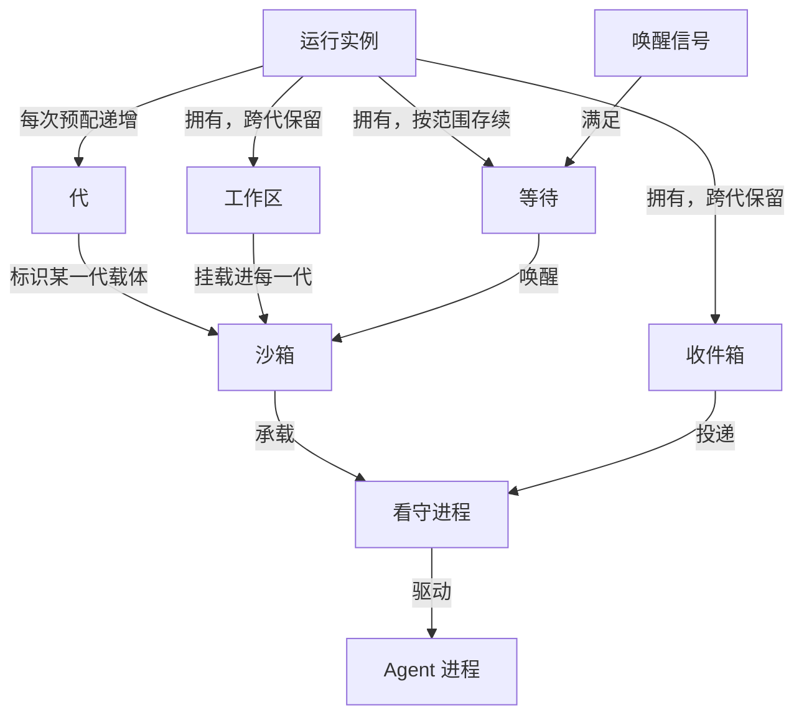
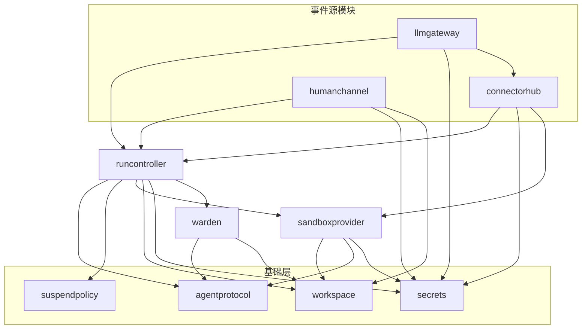
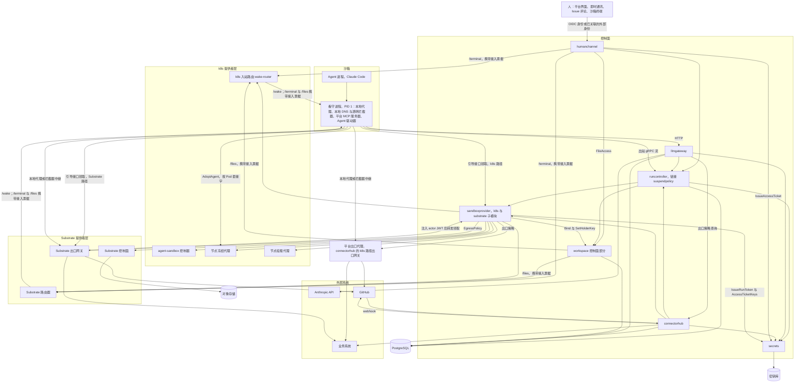
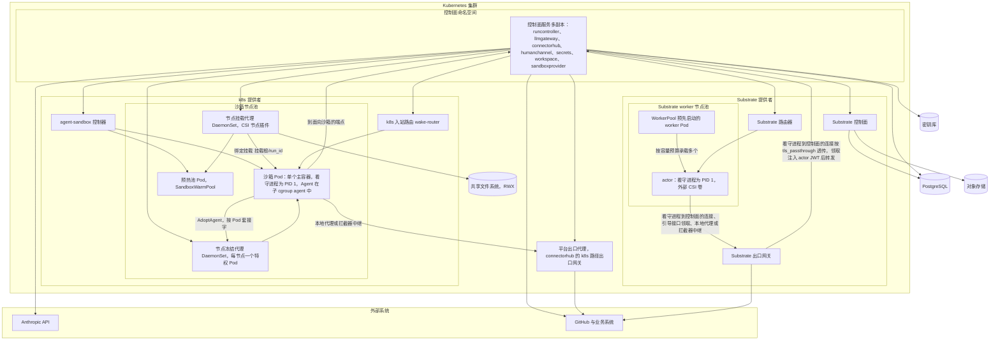
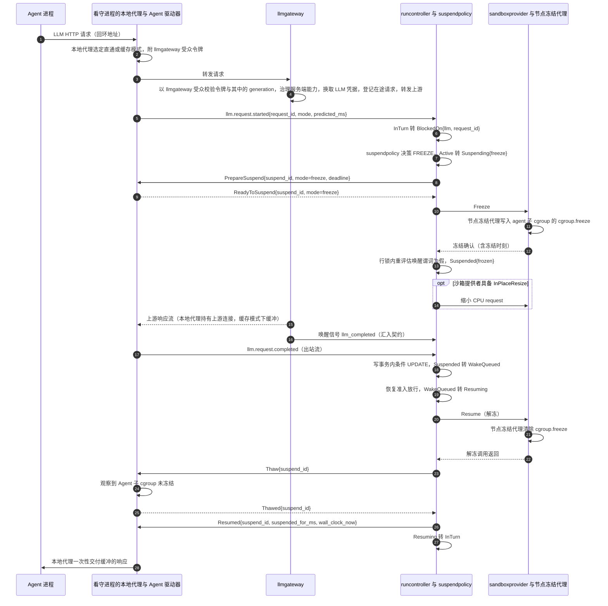
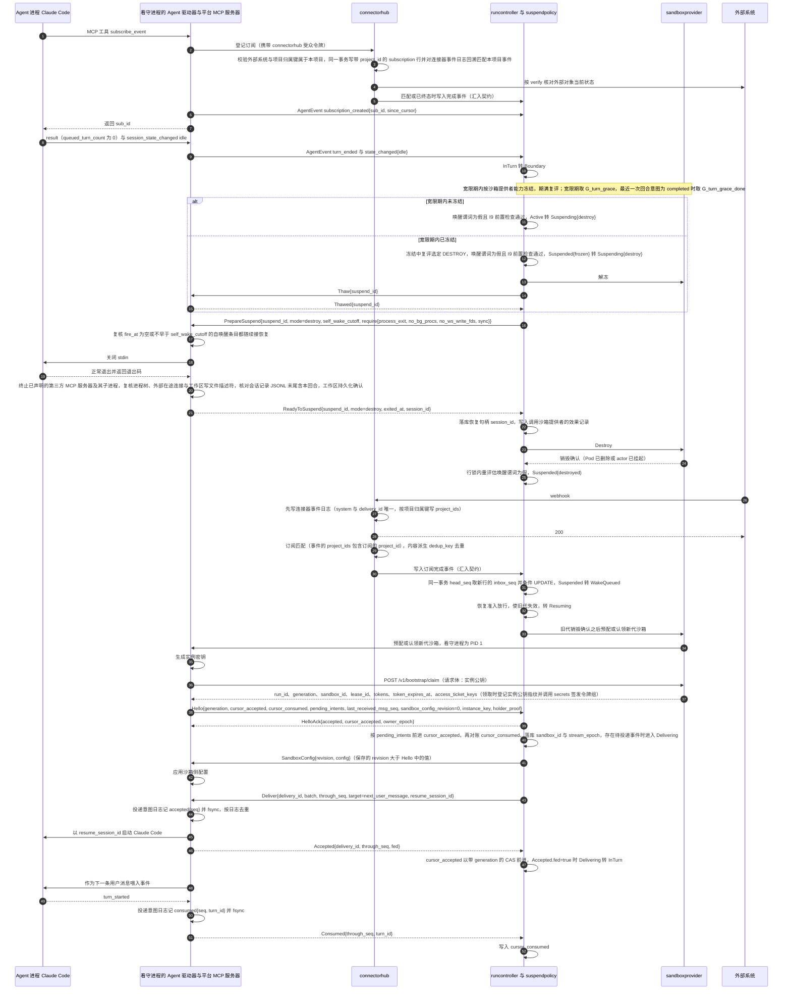
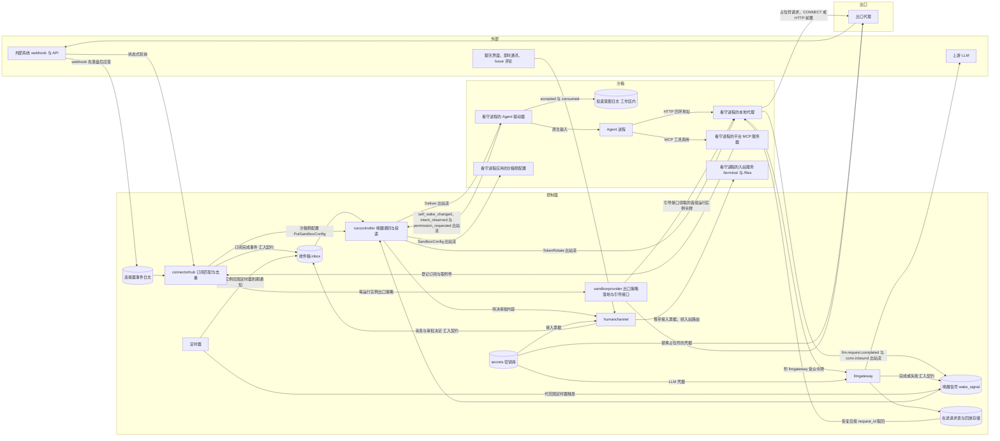
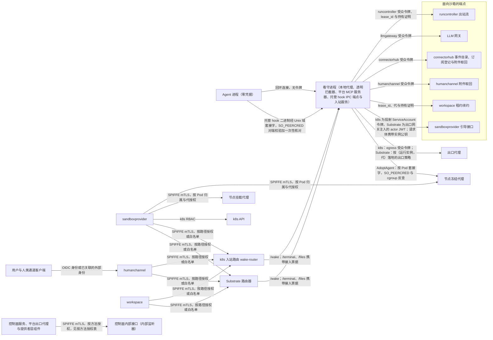

# 架构

## 概览

### 核心概念

castworks 把一次 Agent 任务表示为[运行实例](../glossary.md)。运行实例是持久主体，沙箱只是它某一代的执行载体（[ADR-run-outlives-sandbox](../adr/adr-run-outlives-sandbox.md)）。下表列出阅读后续章节所需的概念，以及它们之间的关系与存续范围；各术语在术语表中定义，按术语名查找。

| 概念 | 关系 | 生命周期与存续范围 |
| --- | --- | --- |
| 运行实例 | 拥有工作区、收件箱、等待、投递游标、回合位置与代 | 从创建到显式结束或放弃；跨越沙箱的多次创建与销毁 |
| 沙箱 | 承载看守进程与 Agent 进程，由代标识 | 同一代的沙箱实例以 `sandbox_id` 区分；快照恢复沿用同一实例，`sandbox_id` 与代不变；随挂起、销毁与重建出现和消失 |
| 工作区 | 挂载进每一代沙箱，承载 Agent 会话状态与投递意图日志 | 与运行实例同寿命，跨代保留 |
| 代 | 每次预配沙箱递增，标识沙箱所属的载体代次 | 只增不减；旧代在代递增后立即失效 |
| 收件箱 | 投递从中取批送入沙箱；订阅完成、人类消息与审批决定汇入其中 | 跨代保留，按消费下界清理 |
| 唤醒信号 | 由收件箱写入与外部完成信号派生，满足阻塞条件与代范围的等待条件 | 按代失效 |
| 等待 | 由收件箱、唤醒信号与等待行推导，不依赖沙箱上报 | 按代范围或运行实例范围存续，在行锁内评估 |
| 回合位置 | 记录回合停在何处，决定恢复后进入哪个子状态 | 跨挂起保留，由控制面持久化 |

概念图的核心约束是运行实例与沙箱的分离：运行实例拥有的状态在沙箱消失后仍然可读，控制面据此评估唤醒谓词、选择投递批并判定恢复位置；沙箱只承载当前代的运行时状态，其存在与健康从沙箱提供者读取。等待由持久化收件箱与唤醒信号推导（[ADR-wait-on-durable-inbox](../adr/adr-wait-on-durable-inbox.md)）；工作区的持久化方式按沙箱提供者选择（[ADR-workspace-persistence-per-provider](../adr/adr-workspace-persistence-per-provider.md)）；代对旧代消息与副作用的拒绝见失效判定（[ADR-generation-fencing](../adr/adr-generation-fencing.md)）。

### 设计主线

设计要解决的问题与对应的机制如下；每行的展开位置给出继续阅读的章节。

| 问题 | 机制 | 展开位置 |
| --- | --- | --- |
| 等待与唤醒 | 外部唤醒源全部由托管侧组件持有，Agent 的自唤醒源由 Agent 自行触发、托管侧镜像进唤醒集合；等待由持久化收件箱、唤醒信号与等待行推导，唤醒谓词在运行实例行锁内求值 | [模块间调用关系](#模块间调用关系)、[runcontroller](modules/design-runcontroller.md) 的“唤醒谓词”与“自唤醒到期” |
| 挂起 | 挂起机制按沙箱提供者能力分层；以挂起为目的的销毁只在[安全点](../glossary.md)执行；后台作业存活或回合中多个 Agent 循环并发时只在静止证据成立时冻结；机制与时长由 `suspendpolicy` 决策 | [顶层模块](#顶层模块) 的挂起机制与回合边界销毁段、[runcontroller](modules/design-runcontroller.md) 的“静止冻结”、[suspendpolicy](modules/design-suspendpolicy.md) |
| 机械层判不清的等待 | 机械层（静止冻结、入站数据唤醒、`sleep` 到期时刻的镜像）兜住当下这一次等待；Agent 驱动器从已有信号、平台 MCP 工具的可选自报参数与[等待签名](../glossary.md)匹配解析[等待意图](../glossary.md)，在工具结果旁附可以忽略的情境提示，让同类等待改用订阅或 `sleep_until`，从而改善下一次等待；意图只作软输入，进入等待时长预测与宽限期选择 | [顶层模块](#顶层模块) 的协作层级段、[Claude Code 驱动器](modules/warden/design-warden-driver-claude-code.md)、[suspendpolicy](modules/design-suspendpolicy.md) 的“等待时长预测与置信度”、[架构不变量](#架构不变量) I11 |
| 投递 | 至少一次投递，收件箱以 `inbox_seq` 全序，`Accepted` 与 `Consumed` 分级确认，重建后从消费位置重投并由投递意图日志跨代去重 | [模块间调用关系](#模块间调用关系)、[runcontroller](modules/design-runcontroller.md) 的“投递与两级确认” |
| 一致性 | 每运行实例单写者；状态转移与持久化点同事务；跨进程副作用经效果记录在提交后执行；纠正性对账以持久化状态为准 | [跨切面设计](#跨切面设计) 的“数据一致性与事务边界”与“并发模型” |
| 失效判定 | 代单调递增；旧代沙箱的消息、令牌、工作区写入、游标推进与出口请求一律拒绝 | [跨切面设计](#跨切面设计) 的“认证与授权边界”、[架构不变量](#架构不变量) I7 |
| 认证与授权 | 控制面内部调用以 SPIFFE（[REF-spiffe](../references.md)）mTLS 认证并按方法授权，[面向沙箱的端点](../glossary.md)分开监听且每个都要求 Agent 不持有的凭据；运行实例令牌按受众签发并绑定看守进程的[实例密钥](../glossary.md)；humanchannel 是唯一面向用户的入口，终端与文件访问以[接入票据](../glossary.md)端到端认证；审批决定绑定[审批内容摘要](../glossary.md) | [认证与授权边界](#认证与授权边界)、[架构不变量](#架构不变量) I6 与 I12 |

### 顶层模块

castworks 是托管 AI Agent 环境。完整的第三方 Agent 作为进程运行在挂载持久化工作区的沙箱内，托管的 Agent 为 Claude Code，Agent 驱动器抽象可扩展到其他第三方 Agent；Agent 的 LLM 调用与外部系统流量全部经托管侧代理；托管环境在 Agent 等待 LLM、外部系统或人类时挂起沙箱以释放计算资源，并在依赖解除后恢复运行实例，以兼顾计算资源利用率与响应延迟。外部系统以 GitHub 为参考实例，CRM 与 ERP 类业务系统通过 HTTP 加轮询型外部系统定义接入。

沙箱内完整第三方 Agent 与控制面外置循环并存，共用同一套 Agent 驱动器接口：沙箱内的进程驱动器以无头协议驱动 Claude Code（[REF-claude-code-headless](../references.md)），不暴露交互式 TUI；控制面循环驱动器在控制面运行原生 Agent 循环，通过看守进程的 `ToolExec` 接口使用沙箱；其接口的实现形式定为链接进 `runcontroller` 的库，`ToolExec` 帧经该运行实例已有的出站流往返，不持有运行实例令牌，也不建立第二条协议会话。进程驱动器与控制面循环驱动器向 `runcontroller` 发出同一套事件，自唤醒条目变化只由存在自唤醒源的进程驱动器发出；第一版只定义控制面循环驱动器的接口，实现状态见 [warden](modules/warden/design-warden.md) 模块文档（[ADR-dual-agent-loop-location](../adr/adr-dual-agent-loop-location.md)）。

**统一等待原语。** 对托管环境而言，Agent 的每一次等待都归约为运行实例在持久化收件箱与唤醒信号上等待唤醒谓词成立。收件箱每个运行实例一个，按 `inbox_seq` 全序，`(run_id, dedup_key)` 唯一，只存放可投递事件；唤醒信号不进入收件箱，用于满足阻塞条件与代范围的等待条件（探测定时器、显式声明、静止冻结登记的等待），冻结期间 Agent 外部系统连接上的入站数据同样记为唤醒信号；审批决定与订阅完成写入收件箱时，同一事务派生对应的唤醒信号。等待是控制面从持久化事实推导的对象，不是沙箱发来的消息：回合中为当前阻塞条件、探测定时器与静止冻结登记的等待（代范围），回合边界上为活动订阅、人类消息、定时器与以 hook 的 `defer`（[REF-claude-code-hooks](../references.md)）推迟的审批决定的并集（运行实例范围）；L2 协作式 Agent 的 `WaitDeclared` 只向推导结果追加显式条件。唤醒谓词在运行实例行锁内评估（[ADR-wait-on-durable-inbox](../adr/adr-wait-on-durable-inbox.md)）。

**外部唤醒源由托管侧持有，Agent 自唤醒源由托管侧镜像。** 外部唤醒源穷举为 LLM 网关与本地代理、连接器（webhook 与状态式轮询）、人类通道、定时器，以及冻结期间看守进程的本地代理与透明拦截器在 Agent 持有的连接上观察到的入站数据（`conn.inbound`）。Agent 可能阻塞的对外交互全部经托管侧组件（I1，见架构不变量）；沙箱内零长期凭据，凭据与出口的约束见安全边界。Agent 的[自唤醒源](../glossary.md)（例如 Claude Code 的会话内定时、`sleep` 进程、工具超时与 `Monitor` 截止）由 Agent 自行触发，托管侧观测其触发时刻并镜像进唤醒集合：进程驱动器维护自唤醒条目并以集合上报，看守进程识别到期时刻已知的 `sleep` 进程，`runcontroller` 据此保证到点时 Agent 进程可运行；存在触发时刻未知的自唤醒条目时运行实例不挂起，挂起过程中或冻结期间出现这类条目时运行实例随即唤醒。托管侧不以禁用、拦截或终止 Agent 功能换取可挂起性：会话内定时、`Monitor`、后台 Bash、后台子代理、workflow 与长 MCP 调用自动转后台照常可用；挂起路径中看守进程唯一终止的进程，是以挂起为目的的销毁路径上 Agent 正常退出之后的已声明第三方 MCP 服务器（含其子进程），后台作业、残留进程与孤儿进程在任何挂起路径中都不终止（[ADR-host-owns-external-wake-sources](../adr/adr-host-owns-external-wake-sources.md)）。

**协作层级。** 协作层级是闭合集合：

| 层级 | 含义 | 托管环境可用的信号 | 允许的挂起机制 |
| --- | --- | --- | --- |
| L0 纯观测 | Agent 不配合托管环境 | 本地代理、LLM 网关与连接器的在途请求；沙箱活动度，例如 per-cgroup PSI（[REF-linux-psi](../references.md)）、CPU 用量、进程态、限流计数 | 冻结，且必须附带探测定时器；显式结束时销毁 |
| L1 驱动器中介（Claude Code） | Agent 驱动器以无头协议驱动 Agent | L0 的全部信号，加上 Agent 驱动器提供的信号，例如回合开始与结束、`idle` 与 `requires_action` 状态（[REF-claude-agent-sdk-typescript](../references.md)）、工具开始与结束、权限询问、平台 MCP 工具调用（[REF-mcp](../references.md)）、hooks、后台任务集合（`background_tasks_changed`）与自唤醒条目；看守进程在冻结期间观察到的入站数据；等待意图（软输入） | 回合中冻结，有快照能力时可快照；回合边界销毁重建；后台作业存活或回合中多个 Agent 循环并发时，静止冻结（只冻结） |
| L2 协作式 | 平台原生 Agent 显式声明等待并保证状态已落盘 | 显式 `WaitDeclared` | 任意声明的等待点：回合中冻结或快照，回合边界可销毁重建；后台作业存活或回合中多个 Agent 循环并发时，静止冻结（只冻结） |

对 L1 Agent 的处理方式是把长等待转化为回合边界：等外部事件经 `subscribe_event` 登记订阅后结束回合，等审批经 `defer` 结束回合；销毁重建后以 Claude Code 的 `--resume` 在回合边界续接会话。回合中只允许冻结或快照，冻结临近上限时平台 MCP 工具返回等待已转为订阅的结果（[ADR-turn-boundary-destroy](../adr/adr-turn-boundary-destroy.md)）。后台作业存活的回合边界不构成安全点：后台任务结束时 Claude Code 注入由任务通知开始的回合，宽限期不起算，运行实例只在静止证据成立时[静止冻结](../glossary.md)，机制见模块间调用关系。机械层判不清的情形（在等什么、预计多久、某个进程是在工作、等待还是提供服务、回合是以提问还是以任务完成结束）由 Agent 驱动器解析[等待意图](../glossary.md)补足：意图来自工具输入、hook 输入、本地代理观察到的周期性连接、平台 MCP 等待工具的可选自报参数与[等待签名](../glossary.md)匹配，只作软输入进入等待时长预测、宽限期选择与提示决策（I11）；平台不向 Agent 提问，只在工具结果旁附可以忽略的情境提示，机制见 [Claude Code 驱动器](modules/warden/design-warden-driver-claude-code.md) 与 [suspendpolicy](modules/design-suspendpolicy.md)（[ADR-wait-intent-as-soft-input](../adr/adr-wait-intent-as-soft-input.md)）。

**挂起机制按提供者能力分层。** 挂起机制是闭合集合：不挂起、冻结（可附带原地缩小 CPU request，依赖 Kubernetes In-Place Pod Resize，[REF-k8s-in-place-pod-resize](../references.md)）、快照、销毁重建。沙箱提供者以能力集合 `{Freeze{cgroup | signal}, Snapshot, Destroy, InPlaceResize, WarmPool, EgressInject}` 自描述，挂起策略只在能力允许的机制中选择，`Freeze{signal}` 只允许短冻结（[ADR-capability-tiered-suspension](../adr/adr-capability-tiered-suspension.md)）。系统实现 k8s 提供者与 Substrate 提供者，共用看守进程、协议与控制面（[ADR-dual-sandbox-providers](../adr/adr-dual-sandbox-providers.md)）：k8s 提供者基于 kubernetes-sigs/agent-sandbox（[REF-agent-sandbox](../references.md)）与节点冻结代理，覆盖 `Freeze{cgroup | signal}`、`Destroy`、`WarmPool`、`InPlaceResize`，冻结由节点冻结代理对 Agent 子 cgroup（[REF-linux-cgroup-v2](../references.md)）执行，看守进程自身不冻结（[ADR-freeze-via-node-agent](../adr/adr-freeze-via-node-agent.md)）；Substrate 提供者基于 agent-substrate/substrate（[REF-substrate](../references.md)），覆盖 `Snapshot`、`Destroy`、`EgressInject`，不具备 `Freeze` 与 `WarmPool` 能力，新建 actor 从[模板快照](../glossary.md)恢复。

**回合边界销毁。** 以挂起为目的的销毁只在安全点执行：L1 与 L2 都只在回合边界，L0 不以挂起为目的销毁。人机交互默认为异步回合制；实时接入期间挂起策略切换为只冻结不销毁；实时接入的各通道中，只有终端或文件通道的接入会中止尚未发出提供者调用的快照或销毁尝试，平台界面会话的接入不中止进行中的挂起尝试（[ADR-turn-boundary-destroy](../adr/adr-turn-boundary-destroy.md)）。

顶层模块、职责与运行位置的穷举清单：

| 模块 | 职责 | 运行位置 |
| --- | --- | --- |
| `runcontroller` | 运行实例状态机；收件箱、唤醒信号、等待、定时器、Agent 自唤醒条目与等待意图的持久化；唤醒谓词评估；投递与 `Accepted`、`Consumed` 分级确认；代与失效判定；事件源的汇入契约；[沙箱侧配置](../glossary.md)（`SandboxConfig`）的按运行实例保存与在出站流上发给看守进程；待决审批内容（`approval_request`）的保存与只读查询；纠正性对账器 | 控制面 |
| `suspendpolicy` | 挂起决策函数；静止证据与空闲证据；冻结中复评与升级梯（冻结中按快照、回合边界销毁、回合中 `DRAIN` 的偏好顺序选择离开冻结的方式）；策略参数；等待时长预测与置信度（预测输入含 Agent 自报的预计等待与等待签名的时长先验）；抖动预算（每运行实例按机制成本记账的恢复时延预算，耗尽后只允许不挂起或冻结）；恢复准入与优先级；准入槽位到期后的重新取得；节点内存压力下升级对象的选取；定时类等待的随机抖动 | 库，链接进 `runcontroller` 进程（[ADR-suspendpolicy-as-library](../adr/adr-suspendpolicy-as-library.md)） |
| `agentprotocol` | 看守进程与控制面之间的协议：信封、消息、出站流与入站端点、重放与去重、协议版本 | 共享库，链接进控制面服务与看守进程 |
| `warden` | 看守进程：进程监督、Agent 驱动器（含后台作业登记、自唤醒源镜像、等待意图解析与情境提示）、挂起与解冻的沙箱侧执行（含 `Freeze{signal}` 降级路径）、活动度采集、实例密钥的生成与经[引导接口](../glossary.md)领取运行实例令牌组与 `lease_id`、沙箱侧配置的应用、附[持有证明](../glossary.md)的工作区租约续约、投递意图日志、本地代理、本地 DNS 与透明拦截器、平台 MCP 服务器、托管 hook 二进制、`ToolExec` 接口、入站端点的接入票据校验、重连与状态上报 | 沙箱内，PID 1；控制面循环驱动器子模块为库，链接进 `runcontroller` 进程 |
| `sandboxprovider` | 沙箱提供者的能力自描述接口；沙箱预配、挂起、恢复与按代销毁，整代销毁之后拒绝该代及更早代的沙箱创建；冻结、解冻与缩小 CPU request 以 `freeze_id` 标识，已解冻的 `freeze_id` 不再接受冻结与缩小；运行实例结束或失败后按运行实例释放运行实例级资源，释放之后拒绝该运行实例的一切创建；按节点查询冻结态内存与可分配内存；预热池；出口策略在预配与认领沙箱时按代落地，按代撤销，撤销之后拒绝该代的落地与更新；提供引导接口，供看守进程以沙箱实例身份一次性领取按受众划分的运行实例令牌组、`lease_id` 与接入票据公钥集合，领取时向 `workspace` 登记实例公钥指纹并调用 `secrets` 签发令牌组。子模块 k8s 负责 Sandbox CR、节点冻结代理（经按 Pod 的套接字接受看守进程的移入请求）、[节点挂载代理](../glossary.md)（工作区按运行实例的绑定挂载）、沙箱 Pod 安全基线与按 uid 的出站规则、原地缩放、平台出口代理配置与 NetworkPolicy 落地、入站路由、引导接口的投射 ServiceAccount 令牌认证与预热 Pod 被认领时的 `/wake` 通知；子模块 substrate 负责 actor 模板、Suspend 与 Resume、路由器唤醒、EgressPolicy 落地与引导接口的 actor JWT 认证；出口网关的凭据提供者（credential provider）协议由 `secrets` 实现，出口网关调用 | 控制面与节点，节点冻结代理与节点挂载代理为 DaemonSet |
| `llmgateway` | 以运行实例令牌与调用方身份换取 LLM 凭据、`generation` 校验、在途请求表与在途请求事实的登记、实例续租、回放存储、限流、计费与审计；服务端能力治理（外联类服务端工具与出口策略对齐） | 控制面 |
| `connectorhub` | 外部系统定义与连接器：出口策略生成、[工具接入声明](../glossary.md)的装载与校验、等待签名的装载校验、沙箱侧配置的生成与经 `runcontroller` 推送、k8s 路径的平台出口代理、webhook 落盘与状态式轮询、订阅登记与回溯匹配、完成条件目录、订阅完成事件写入收件箱；连接器事件与订阅按项目隔离、核对的合并与公平调度、出口策略查询（供 `llmgateway`）；不执行第三方操作 | 控制面 |
| `humanchannel` | 唯一面向用户的入口：用户身份认证、[项目角色](../glossary.md)授权、[外部身份关联](../glossary.md)；聊天界面、即时通讯与 Issue 评论到收件箱的适配，审批决定与审批内容呈现，在线与“正在输入”信号，实时接入状态，终端与文件访问的接入票据 | 控制面 |
| `secrets` | 密钥库对接、运行实例令牌的签发与轮换、凭据换取、调用方授权与使用审计；接入票据的签发与公钥集合、[凭据主体](../glossary.md)查询 | 控制面 |
| `workspace` | 工作区的绑定、[持久化确认](../glossary.md)、沙箱外访问与工作区租约（含实例公钥指纹的登记与持有证明校验）；按提供者区分的持久化实现；看守进程的文件 API | 控制面与看守进程 |

职责列为概要，模块的职责边界、非职责与外部接口契约以模块文档为准。

## 模块依赖图

箭头 `A → B` 表示 A 依赖 B 的外部接口契约：A 调用 B 导出的接口或引用 B 定义的类型，B 不感知 A。图中的边穷举允许的模块间代码依赖，图中没有的依赖不得出现在非测试代码中，测试代码的跨模块引用不受此图约束；依赖图是有向无环图。

方向约束：

- 基础层 `agentprotocol`、`suspendpolicy`、`secrets`、`workspace` 不依赖 `runcontroller`、`sandboxprovider`、`warden` 与事件源模块。`agentprotocol` 是控制面与看守进程共用的协议库；`suspendpolicy` 是库，链接进 `runcontroller` 进程。
- 事件源模块 `llmgateway`、`connectorhub`、`humanchannel` 只通过 `runcontroller` 的汇入契约写入收件箱事件、唤醒信号、运行实例事实（例如在途请求、实时接入状态）、事件源实例租约与沙箱侧配置（`connectorhub` 经 `PutSandboxConfig`）；`runcontroller` 不反向调用事件源模块，新增一个事件源不改动 `runcontroller`。`humanchannel` 另经 `runcontroller` 的 `RunService` 代用户创建、查询、结束与兜底运行实例，并读取待决审批内容。事件源模块之间唯一的依赖是 `llmgateway` 经 `connectorhub` 的出口策略查询接口读取运行实例的允许主机，`connectorhub` 不依赖 `llmgateway`。
- `humanchannel` 以 `humanchannel` 受众调用 `secrets` 的令牌校验函数，校验附件取回请求携带的运行实例令牌，并调用 `IssueAccessTicket` 申请接入票据、调用 `ListCredentialPrincipals` 查询凭据主体；`connectorhub` 以 `connectorhub` 受众调用同一令牌校验函数。这些是二者对 `secrets` 的直接依赖，不引入对 `runcontroller` 表的读取。
- `humanchannel` 经 `workspace` 的沙箱外读取接口代用户读取工作区文件，这是事件源模块对 `workspace` 的唯一依赖。
- `connectorhub` 通过 `sandboxprovider` 的出口策略接口推送每个运行实例的出口策略，`sandboxprovider` 在预配与认领沙箱时按代落地，并把推送的更新同步到尚未撤销的代；这是事件源模块对 `sandboxprovider` 的唯一依赖。沙箱侧配置不随出口策略推送，不经过 `sandboxprovider`。
- `sandboxprovider` 依赖 `workspace`（预配与认领时绑定工作区；引导接口在领取时调用 `SetHolderKey` 登记实例公钥指纹）、`agentprotocol`（恢复触发与预热认领通知所用的入站端点 `/readyz` 与 `/wake`）与 `secrets`（引导接口在领取时调用 `IssueRunToken` 签发按受众划分的令牌组并写入实例公钥指纹，调用 `AccessTicketKeys` 取接入票据公钥集合）。`IssueRunToken` 的调用方穷举为引导接口（首组令牌）与 `runcontroller` 的 `rotate_token` 效果（轮换）。
- `runcontroller` 是唯一依赖 `warden` 的模块，依赖只及于 `warden` 的控制面循环驱动器子模块：该子模块以库的形式链接进 `runcontroller` 进程，`runcontroller` 调用其 Agent 驱动器接口，并向它注入事件入口与 `ToolExecClient`；该子模块不引用 `runcontroller` 导出的接口或类型，不使 `warden` 反向依赖 `runcontroller`。`warden` 依赖 `agentprotocol`，并以链接进看守进程的 `workspace` 沙箱侧部分执行文件 API、持久化确认与租约续约；该沙箱侧部分是模块的实现位置，不使 `workspace` 反向依赖 `warden`。本地代理与 LLM 网关之间、本地代理与出口代理之间、平台 MCP 服务器与 `connectorhub`、`humanchannel` 之间是运行时 HTTP 调用，看守进程对引导接口的领取是运行时 HTTPS 调用，都不是代码依赖，不出现在图中；看守进程发往控制面的这些运行时调用都只到达面向沙箱的端点。

## 逻辑部署架构

进程边界：

- 控制面模块 `runcontroller`、`llmgateway`、`connectorhub`、`humanchannel`、`secrets`、`workspace`、`sandboxprovider` 之间只经外部接口契约交互；`suspendpolicy` 链接进 `runcontroller` 进程，`agentprotocol` 链接进控制面服务与看守进程，都不单独成进程；其余模块到进程的映射由部署配置决定。
- 沙箱是一个进程树：看守进程是沙箱容器的 PID 1，Agent 进程是看守进程以管道驱动的子进程；看守进程崩溃即沙箱崩溃，运行实例走重建与“回合被中断”路径（[ADR-warden-is-pid1](../adr/adr-warden-is-pid1.md)）。Agent 进程能到达的端点受 I6 约束，见架构不变量。
- 看守进程与 `runcontroller` 之间只有出站流与入站端点；控制面循环驱动器作为库链接进 `runcontroller`，其 `ToolExec` 帧经该运行实例的出站流往返，由 `runcontroller` 在写入前按所有权、代与终态校验，不经过沙箱地址或入站路由。看守进程对 `llmgateway`、`connectorhub` 与 `humanchannel` 的调用是附对应受众的运行实例令牌的运行时 HTTP 调用，不承载协议消息。消息、重放、状态对账与恢复触发方式见模块间调用关系。控制面按 `generation` 判定并拒绝过期沙箱的消息、令牌、工作区写入、游标推进与出口请求，出口路径的失效判定方式见认证与授权边界（[ADR-generation-fencing](../adr/adr-generation-fencing.md)）。
- 引导与沙箱侧配置：看守进程启动后先生成实例密钥，再经 `sandboxprovider` 的引导接口一次性领取：领取请求体携带实例公钥，领取响应为按受众划分的运行实例令牌组、`lease_id` 与接入票据公钥集合，三者与实例私钥只保存在看守进程的内存中；领取成功并首次续约工作区租约之后才发送 `Hello`，收到并应用 `SandboxConfig` 之后才启动 Agent 主进程，新代的 Agent 主进程在首个 `Deliver` 或 `StartAgent` 到达之前不启动。k8s 路径的领取请求直连控制面；Substrate 路径的领取请求经出口网关，由网关注入 actor JWT；认证方式见认证与授权边界。Substrate 路径上看守进程到控制面的其余连接（出站流、工作区租约续约、本地代理发往 `llmgateway` 的请求以及平台 MCP 服务器对 `connectorhub` 与 `humanchannel` 的请求）同样经出口网关，以 `tls_passthrough` 按 SNI 透传，不注入 actor JWT，只到达面向沙箱的端点主机名；上图按逻辑调用把这些连接画为直连，网络路径见物理部署架构。快照恢复的沙箱实例不重新领取，令牌组、`lease_id`、接入票据公钥集合与实例私钥已在快照的进程内存中。沙箱侧配置由 `connectorhub` 经 `runcontroller` 在出站流上推送给看守进程，不经过 `sandboxprovider`。
- LLM 路径：Agent 进程保持自身的默认网络配置，发往 [LLM 主机](../glossary.md)的连接由本地 DNS 指向透明拦截器，透明拦截器以[拦截 CA](../glossary.md)签发的证书在沙箱内终止 TLS，明文请求经本地代理到达 LLM 网关，再由 LLM 网关访问 Anthropic API；LLM 基地址与代理变量只作补充（[ADR-transparent-interception-by-default](../adr/adr-transparent-interception-by-default.md)）。本地代理与 LLM 网关之间是 HTTP 调用，Anthropic API 只由 LLM 网关访问，凭据换取与代校验见认证与授权边界（[ADR-two-tier-llm-proxy](../adr/adr-two-tier-llm-proxy.md)）。
- 外部系统路径：Agent 进程默认经透明拦截器（本地 DNS 指向），启用代理变量时经本地代理（CONNECT 或 HTTP 前置）到达出口代理，再由出口代理访问允许的主机。两者都不终止外部系统主机的 TLS：k8s 路径附 `egress` 受众令牌，Substrate 路径由出口网关按（运行实例，代）落地的出口策略识别运行实例；TLS 终止与凭据替换由出口代理承担，出口代理以鉴权确定的授权主机为唯一目的地。出口策略的内容与落地见安全边界。平台出口代理属 `connectorhub`，是 k8s 路径的出口网关，`sandboxprovider` 的 k8s 子模块向其推送每运行实例出口策略并落地 NetworkPolicy；Substrate 路径的出口代理是 Substrate 出口网关。状态式轮询、webhook 接收与订阅匹配由 `connectorhub` 在控制面完成。
- 提供者层：agent-sandbox 控制器、节点冻结代理、节点挂载代理、k8s 入站路由（wake-router）、Substrate 控制面、Substrate 路由器与 Substrate 出口网关都是控制面之外的进程，`sandboxprovider` 通过它们的 API 预配、挂起、恢复与销毁沙箱。
- 人：用户的全部操作经 `humanchannel`：平台界面只调用 `humanchannel`，即时通讯与 Issue 评论经其消息通道适配器进入收件箱，`humanchannel` 完成用户身份认证与项目角色授权后代用户调用 `runcontroller` 与 `workspace`。沙箱终端与界面对工作区文件的读取经入站路由到达看守进程的 `/terminal` 与 `/files`，请求携带 `secrets` 签发的接入票据：终端由 `humanchannel` 直接建立，文件读取由 `humanchannel` 经 `workspace` 的沙箱外读取接口发起，需经沙箱读取时由 `workspace` 转发到 `/files`。入站路由以 SPIFFE mTLS 按路径认证调用方（`/terminal` 只接受 `humanchannel`，`/files` 只接受 `workspace`，`/wake` 只接受 `sandboxprovider`）；k8s 提供者的入站路由服务 `/terminal`、`/files` 与 `sandboxprovider` 在预热 Pod 被认领时发出的 `/wake`，不承载事件投递，事件驱动的恢复由控制面直调沙箱提供者；Substrate 提供者的入站经 Substrate 路由器。平台界面会话活跃，终端已连接，或界面正在经沙箱读取工作区文件期间，运行实例处于实时接入状态。

各类状态的唯一事实源穷举如下：

- 运行实例的状态、代、运行实例所有者租约、收件箱、唤醒信号、等待、订阅、定时器、在途 LLM 请求、工作区租约、沙箱侧配置、待决审批内容（`approval_request`）与[连接器事件日志](../glossary.md)只存于控制面的 PostgreSQL，唤醒谓词只在 PostgreSQL 的运行实例行锁内评估。控制面持久化自身决定的状态机状态与子状态（含 `frozen_since` 与 `sandbox_id`）；Pod 或 actor 的实际存在与健康状态从沙箱提供者读取，控制面只记录驱动状态转移与调度所需的观察结果（例如沙箱确认不存在的时刻、放置位置、原地放大进入 `Deferred` 的时刻、快照保留期限）。
- 投递去重状态（投递意图日志）与 Agent 的会话状态（`CLAUDE_CONFIG_DIR` 目录，[REF-claude-code-env-vars](../references.md)）随工作区持久化，跨代有效（[ADR-delivery-intent-log](../adr/adr-delivery-intent-log.md)）。
- 长期凭据只存于密钥库；运行实例令牌组与实例密钥的私钥只存于看守进程的内存，不进入提供者的持久记录；引导记录与工作区租约只保存实例公钥指纹。
- 对象存储承载 Substrate 的快照与 `durableDir` 上传数据。

## 物理部署架构

Kubernetes 集群内的划分：

- 控制面命名空间：控制面服务多副本部署。`runcontroller` 的副本以运行实例所有者租约划分运行实例，租约规则见并发模型。
- k8s 提供者沙箱节点池：沙箱 Pod 由 agent-sandbox 的 Sandbox CR 管理，只有一个主容器（另有 init 容器 `uid-egress-filter`），看守进程为 PID 1，Agent 进程树位于容器 cgroup 下的子 cgroup `agent` 中。预热池为 SandboxWarmPool 与 SandboxClaim：预热 Pod 只带空的工作区挂载点，认领时由节点挂载代理把运行实例子目录绑定进去；冷启动的 Pod 在工作区卷发布时直接绑定运行实例子目录。Pod 注解 `castworks.io/generation`（代标注）、`castworks.io/run-id` 与 `castworks.io/run-uid` 在冷启动时写在 Sandbox CR 的 Pod 模板中，认领时由 `sandboxprovider` 在绑定工作区与写引导记录之前写入。沙箱 Pod 与预热 Pod 使用不绑定任何 RBAC 权限的专用 ServiceAccount，不自动挂载默认令牌，以投射卷挂载 audience 为 `castworks-bootstrap`、有效期 600 s 的 ServiceAccount 令牌，令牌文件只允许看守进程读取；预热 Pod 被认领时，`sandboxprovider` 先经节点挂载代理绑定工作区并写引导记录，再经 wake-router 调用该 Pod 的 `/wake` 通知看守进程领取，不等待其返回。Pod 规格与原地缩放、驱逐保护、cgroup 迁移、安全基线与入站路由的机制见 [sandboxprovider 的 k8s 子模块](modules/sandboxprovider/design-sandboxprovider-k8s.md)。
- 节点冻结代理：特权 DaemonSet，沙箱节点池的每个节点一个 Pod，以写入 `agent/cgroup.freeze` 执行冻结与解冻。`Freeze` 与 `Thaw` 只接受 `sandboxprovider` 的 SPIFFE mTLS 调用，目标授权要求 `PodUID` 是本节点上、沙箱命名空间内、带 castworks 沙箱标签的 Pod，Pod 的代标注等于请求的 `Generation`，`ContainerID` 属于该 Pod；cgroup 路径一律由代理经容器运行时解析，只写 `<容器 cgroup>/agent/cgroup.freeze`，不接受调用方给出的路径。移入方法 `AdoptAgent` 经按 Pod 的 Unix 域套接字提供：代理同时是 CSI 节点插件（驱动 `freeze.castworks.io`），以内联临时卷向每个沙箱 Pod 与预热 Pod 提供套接字 `/run/castworks/freeze/agent.sock`，目录属主 root、权限 0700，套接字属主 root、权限 0600，位于工作区之外，该套接字不承载 `Freeze` 与 `Thaw`；代理以 `SO_PEERCRED` 取对端宿主 pid，按 `/proc/<pid>/cgroup` 反查所属 Pod 与容器，只接受发布该套接字的 Pod 中容器的 PID 1 且 uid 为 0 的对端；请求只携带容器 PID 命名空间内的 pid，代理把它翻译为宿主 pid，核对该进程是对端的直接子进程、uid 等于 Pod 注解 `castworks.io/run-uid`、处于停止态、不是对端本身且尚不在 `agent` 子 cgroup，然后移入同一容器的 `agent` 子 cgroup（[ADR-freeze-via-node-agent](../adr/adr-freeze-via-node-agent.md)）。
- 节点挂载代理：特权 DaemonSet，同时是 CSI 节点插件（驱动 `workspace.castworks.io`），在节点上挂载共享文件系统的挂载根。沙箱 Pod 与预热 Pod 以 CSI 内联临时卷 `castworks-workspace` 挂载在工作区挂载路径（`Binding.MountPath`，各代逐字一致），`mountPropagation: HostToContainer`。冷启动 Pod 的卷属性携带 `run_id`、`generation`、`run_uid` 与 `quota_bytes`，`NodePublishVolume` 时执行 `Ensure` 并把 `<挂载根>/<run_id>` 直接发布到该卷；预热 Pod 创建时发布空挂载点，认领时 `sandboxprovider` 调用 `NodeMountAgent.BindWorkspace(ctx, BindTarget{PodUID, RunID, Generation, RunUID, QuotaBytes})`。`BindWorkspace` 只接受 `sandboxprovider`，目标须是本节点上、沙箱命名空间内、带沙箱标签且尚未绑定过的 Pod，其注解 `castworks.io/run-id` 与代标注等于请求；代理执行 `Ensure`（创建子目录、属主为运行实例 uid、权限 0700、设配额）后把 `<挂载根>/<run_id>` 绑定挂载到该 Pod 的卷发布目录，经挂载传播出现在容器内；以 `(pod_uid, run_id)` 幂等，Pod 删除时卷卸载随之解除绑定（[ADR-per-run-workspace-mount](../adr/adr-per-run-workspace-mount.md)）。
- 沙箱 Pod 安全基线与网络强制：Sandbox CR 的 Pod 模板与 SandboxWarmPool 模板满足同一基线。Pod 级 `seccompProfile` 为以 RuntimeDefault 为起点的 Localhost 定制 profile，Agent 功能所需的系统调用一律保留，保留 user namespace 时由 AppArmor 或 SELinux 收窄其内可达的高危子系统；容器配置 AppArmor profile 或 SELinux 类型；`privileged=false`、`allowPrivilegeEscalation=false`、`hostPID`/`hostIPC`/`hostNetwork=false`、`procMount=Default`；不使用 hostPath 卷，只允许 `freeze.castworks.io` 与 `workspace.castworks.io` 的内联临时卷与投射卷；主容器 capability 先 drop ALL，再添加看守进程所需集合 `SETUID`、`SETGID`、`KILL`、`CHOWN`、`FOWNER`、`DAC_OVERRIDE`、`SYS_PTRACE`、`NET_BIND_SERVICE`，Agent 进程树的 bounding set 清空。init 容器 `uid-egress-filter` 是沙箱 Pod 中唯一具备 `NET_ADMIN` 的容器，在 Pod 网络命名空间安装 nftables（或 iptables）规则后退出：uid 非 0 的进程发出的报文只允许目的地址为 `127.0.0.0/8` 与 `::1`，其余以拒绝结束，连接立即失败而不是黑洞；规则对 uid 0 不生效，不依赖具体的运行实例 uid，预热 Pod 同样安装。沙箱命名空间以 ValidatingAdmissionPolicy（或等价准入策略）强制以上要求，提供者启动时自检两类模板，不满足即拒绝启动，不静默降级。NetworkPolicy 对全部协议默认拒绝出口，只放行到 k8s 路径所用的面向沙箱的端点（`stream`、`bootstrap`、`lease`、`llm`、`connector`、`human`、`egress`）地址与端口的 TCP，不放行集群 DNS（53 端口）、节点冻结代理与节点挂载代理；控制面主机名经 Pod 的 `hostAliases` 写入固定地址，看守进程不经 DNS 解析控制面主机名；入站只放行 kubelet 探针与 wake-router 到 80 端口。
- 平台出口代理：`connectorhub` 的 k8s 路径出口网关进程，部署在控制面命名空间之外，出口策略只接受 `sandboxprovider` 落地，落地方式见安全边界。
- Substrate worker 节点池：actor 由 Substrate WorkerPool 预先启动的 worker 承载，一个 worker 按容量预算同时承载多个 actor，actor 的创建与恢复不经过 Kubernetes 调度；新 actor 从模板快照恢复，actor 模板尚无模板快照或快照与运行时不兼容时冷启动或降级为 `ROOTFS` 冷启动；actor 镜像以看守进程为 PID 1，容器按镜像的 `USER` 与 `WORKDIR` 运行，看守进程容器以 uid 0 运行。工作区优先为每 actor 一卷的外部 CSI 卷（例如 NFS CSI 驱动），CSI 不可用时退到 `durableDir`，退化配置下回合边界的销毁改用同步挂起、上传完成后才返回（[ADR-workspace-persistence-per-provider](../adr/adr-workspace-persistence-per-provider.md)）。Substrate 控制面、路由器与出口网关部署在集群内：恢复由路由器的入站请求触发，请求等待直到 `/readyz` 就绪；actor 除 DNS 之外的全部 TCP 出口都经出口网关，看守进程的出站流、`workspace` 续约、LLM 请求以及平台 MCP 服务器对 `connectorhub` 与 `humanchannel` 的请求同样经出口网关以 `tls_passthrough` 透传到达控制面的面向沙箱的端点，控制面主机的 `tls_passthrough` 规则只列 `stream`、`lease`、`llm`、`connector`、`human` 的主机名，看守进程按 actor 模板启动参数中配置的地址连接，不经 DNS 解析控制面主机名；引导接口使用只承载领取端点的独立主机名，按 `https` 注入规则处理；出口网关以 MITM 落地出口策略，actor 经 `systemInfo` 卷的 `trustBundle` 数据源取得网关 CA，CA 不预置进镜像；出口网关按 `sandboxprovider` 在每代 EgressPolicy 中追加的规则，为看守进程对引导接口的请求注入 actor JWT。actor 内 uid 非 0 的出站只到回环、对离开内部网络的目的地非 TCP 出站除 DNS 查询外不可用（UDP 静默丢弃，其他非 TCP/UDP 以 ICMP unreachable 拒绝）、DNS 中继不递归解析、出口网关在连接层核对 SNI 并在请求层核对 `Host` 与 `:authority`、ECH 的处理须实测、出口网关 CA 轮换保留新旧 CA 同时受信的重叠期，这些要求均为部署前提，见前提条件。actor 模板、唤醒探针、等待预算、EgressPolicy 以及引导接口认证与触发的细节见 [sandboxprovider 的 substrate 子模块](modules/sandboxprovider/design-sandboxprovider-substrate.md)。外部 CSI 仍为预览特性，需开启 ExternalVolumes 与 CSIDriverConfig；gVisor 下没有 Docker；`parked-request-budget` 只约束新的恢复重试，客户端被持有的上限是预算加 5 s，部署按恢复 p95 加 `/readyz` 余量设置，并同时设置 `drain-timeout` 与 `terminationGracePeriodSeconds`。
- 共享文件系统：RWX 文件系统（例如 CephFS、JuiceFS、NFS、EFS 类），挂载根只由节点挂载代理在沙箱节点池的每个节点上挂载，不进入任何沙箱 Pod 或预热 Pod，无卷挂接步骤、无节点亲和；文件系统需 `no_root_squash`，只为节点挂载代理以 root 创建运行实例子目录所需；目录权限、uid 与配额见安全边界。块存储（RWO PV）为退化配置，有节点或可用区亲和，不能预绑定预热池；块存储、外部 CSI 卷与 `durableDir` 的卷本身按运行实例划分，`Ensure` 由看守进程执行。Agent 二进制与依赖缓存放在镜像内，不放共享文件系统。

集群外：

- PostgreSQL：控制面数据模型与 Substrate 控制面的存储。
- 对象存储：Substrate 快照与 `durableDir` 数据的存储；由 in-tree `objectstore-plugin` sidecar 访问，atelet 与 ate-api-server 主进程不直接持有存储凭据。
- 密钥库：Vault 类密钥库，凭据对象按项目作用域授权到外部系统，由 `secrets` 对接；Substrate 出口网关的凭据来源为其凭据提供者（credential provider），对接方式见 [secrets](modules/design-secrets.md)。

前提条件穷举：

- k8s 提供者：In-Place Pod Resize 可用（Kubernetes 1.35 及以上）；`sandboxprovider` 具有 `pods/resize` 子资源的 patch 权限与 `tokenreviews` 的 `create` 权限；沙箱节点为 cgroup v2，`cgroup.freeze` 可写，`agent` 子 cgroup 的 `cpu.pressure`、`io.pressure`、`memory.pressure` 与 `cpu.stat` 可读；冻结完成以 `cgroup.events` 的 `frozen` 字段判定，不以进程态 T 判定；集群允许部署特权 DaemonSet 并访问容器运行时；agent-sandbox 控制器已安装（API `v1beta1`）；RWX 共享文件系统，或退化配置的 RWO 块存储；NetworkPolicy 由集群网络实施；节点支持 seccomp Localhost profile 与 AppArmor 或 SELinux；ValidatingAdmissionPolicy 可用；CSI 内联临时卷与挂载传播可用；Pod 网络命名空间支持 nftables 或 iptables 的按 uid 匹配；SPIFFE 工作负载身份覆盖控制面与提供者层组件。
- Substrate 提供者：k8s 具备 PodCertificateRequest 与 ClusterTrustBundle API；节点运行 gVisor，microVM 模式需要 KVM；节点内核 6.7 及以上；PostgreSQL；对象存储由 in-tree `objectstore-plugin` sidecar 访问，GCS 与 S3 都经该 sidecar。Substrate 部署前提如下，验证通过之前 Substrate 路径不上线：actor 模板以 uid 0 运行看守进程，容器按镜像的 `USER` 与 `WORKDIR` 运行，所需 capability 只能从白名单中选择；actor 网络为 IPv4-only；actor 内 uid 非 0 的出站只到回环；对离开内部网络的目的地，非 TCP 出站除 DNS 查询外不可用，UDP 静默丢弃，其他非 TCP/UDP 以 ICMP unreachable 拒绝；DNS 中继对有出口策略的 actor 只应答 EgressPolicy 所列主机与控制面主机，其余返回 NXDOMAIN，不递归解析；出口网关对 `https` 规则在连接层要求 SNI 匹配、请求层要求 `Host` 等于 `:authority`，对 `tls_passthrough` 规则要求 SNI 等于规则主机；ECH 的处理须实测；`/tmp` 与 `/dev/shm` 是 tmpfs，所有卷以 `nodev` 挂载；出口网关 CA 轮换保留不短于快照保留期上限的新旧 CA 同时受信重叠期。

## 模块间调用关系

全部协议消息经出站流传输：看守进程运行时始终维持一条主动外连控制面的 gRPC 双向流，信封含 `run_id`、`generation`、`msg_seq` 与 `ack_msg_seq`，发送方在重连后重放未确认消息，接收方按 `(generation, msg_seq)` 去重，`Hello` 与 `HelloAck` 交换 `last_received_msg_seq` 与全量状态摘要做状态对账。投递（`Deliver`）只在出站流上进行。沙箱侧配置同样只在出站流上下发：`connectorhub` 在为运行实例生成或更新出口策略的同一时机调用 `PutSandboxConfig`，每个运行实例都有 `revision ≥ 1` 的配置；`Hello` 携带看守进程已应用的 `sandbox_config_revision`（尚未应用为 0），`runcontroller` 回 `HelloAck{accepted}` 之后，若保存的 `sandbox_config_revision` 大于 `Hello.sandbox_config_revision`，在该流上发送 `SandboxConfig{revision, config}`；`PutSandboxConfig` 提高 `revision` 且运行实例有已接受的出站流时立即在该流上发送，运行实例挂起或没有流时只保存，下一次 `Hello` 时补发；`SandboxConfig` 沿用出站流的确认与重放，销毁态连接上不发送；看守进程按 `revision` 幂等应用，首次应用 `revision ≥ 1` 的配置之前不启动 Agent 主进程。看守进程在沙箱内监听 80 端口，其提供的入站端点 `/readyz`、`/wake`、`/terminal` 与 `/files` 不承载事件内容，`/readyz` 的应答不以领取为条件，`/wake` 在看守进程尚未领取时先领取再建立出站流；`ToolExec` 帧随出站流往返，由 `runcontroller` 从进程内控制面循环驱动器转发，不占用入站端点。恢复的触发按沙箱提供者不同：Substrate 提供者的恢复是经路由器调用 `/wake`，路由器恢复 actor 并让请求等待直到 `/readyz` 就绪，`/wake` 返回即表示出站流已重建；k8s 提供者的恢复是节点冻结代理解冻，或把 Sandbox CR 改回 `Running`、从预热池认领，随后看守进程自行重连；从预热池认领时，`sandboxprovider` 先经节点挂载代理绑定工作区并写引导记录，再经 wake-router 调用该 Pod 的 `/wake` 通知看守进程领取。消息定义见 [agentprotocol](modules/design-agentprotocol.md)。

回合中等待 LLM 走冻结路径。参与方为 Agent 进程、看守进程（本地代理与 Agent 驱动器）、`llmgateway`、`runcontroller`（链接 `suspendpolicy`）与 `sandboxprovider`（含节点冻结代理）。其他回合中的等待类型（例如阻塞型审批、`wait_for` 与阻塞型定时）复用同样的消息与状态转移，只在唤醒源与冻结上限上不同。第三方工具调用不是阻塞条件，不进入这条路径。等待方式的选择（短等待用 `wait_for`、长等待用 `subscribe_event` 并结束回合）由平台 MCP 工具契约给出，平台 MCP 服务器的 `instructions` 与工具描述承载同一规则，见 [warden](modules/warden/design-warden.md)。

冻结路径各转移的前置条件与持久化点（同一转移中由 `runcontroller` 写入 PostgreSQL 的持久化点在同一事务内写入；其他方的落盘单独标注）：

| 转移 | 前置条件 | 持久化点 |
| --- | --- | --- |
| InTurn 转 BlockedOn | 本地代理 `llm.request.started` 的 `generation` 与运行实例当前代一致；Agent 驱动器报告无运行中的工具；不存在已满足该条件的未消费唤醒信号 | `blocked_on{kind, ref, since, mode}`（`mode` 取 `llm.request.started.mode`），作用域为本代；LLM 网关侧的在途请求表 `llm_request`（`llmgateway` 自身事务） |
| Active 转 Suspending | 运行实例行锁内唤醒谓词为假；无后台作业（后台作业存活时只走静止冻结）；预测等待的保守值不低于 `T_nofreeze`；Freeze 在沙箱提供者能力集内；距上次恢复不少于 `D_min` | `state`、`suspend_id`、`suspend_mode`、`transition_deadline`、`freeze_cap`（`suspendpolicy` 决策返回的冻结上限时长）、`freeze_basis`（取 `condition`） |
| Suspending 转 Suspended | 看守进程的 `ReadyToSuspend` 已到达；`Freeze{cgroup}` 路径另要求其处理事务已写入调用沙箱提供者的效果记录（[ADR-effect-record-after-commit](../adr/adr-effect-record-after-commit.md)）且沙箱提供者的冻结确认已到达；`Freeze{signal}` 路径以 `ReadyToSuspend` 为冻结确认；行锁内重评估唤醒谓词为假，为真则转 WakeQueued | `substate`、`frozen_since`（`Freeze{cgroup}` 路径取节点冻结代理的冻结确认时刻，`Freeze{signal}` 路径取看守进程在 `ReadyToSuspend` 中携带的 `frozen_at`）、`freeze_deadline`（`blocked_on.since` 加 `freeze_cap`：[直通模式](../glossary.md)为 `F_stream`，[缓存模式](../glossary.md)为 `F_cap(llm)`）、`self_wake_at`（[有效自唤醒条目](../glossary.md)中最早的触发时刻减去按恢复机制的提前量 `L_self_wake(substate)`，无有效自唤醒条目时为空） |
| Suspended 转 WakeQueued | 唤醒信号 `llm_completed` 或 `llm_failed`（由本地代理的 `llm.request.completed`、`llm.request.failed` 与 LLM 网关的汇入写入产生）命中 `blocked_on.ref`；LLM 网关实例失联时的合成信号见故障与降级；冻结截止时间减安全余量已到时不经该条件 UPDATE，由运行实例所有者处置：静止冻结直接转 WakeQueued（`wake_reason=llm_completed`），其余按冻结中复评处置（快照或 `DRAIN`） | `wake_signal` 行；同一写事务内的条件 UPDATE 写入 `wake_reason` 与 `queued_at`；网关侧的回放存储与 `llm_request` 状态（`llmgateway` 自身事务） |
| WakeQueued 转 Resuming | 恢复准入按机制限速与优先级放行（[ADR-single-recovery-admission](../adr/adr-single-recovery-admission.md)） | `resume_id`、`slot_lease`（`resume_mode` 已在入队时落库，放行时只读） |
| Resuming 转 InTurn | 沙箱提供者解冻完成且看守进程上报 `Thawed{suspend_id}`；`workspace` 报告的租约持有者仍为该沙箱 | `state`，`last_resumed_at` 作为 `D_min` 的计时起点；`self_wake_at` 清空 |

冻结期间看守进程自身不被冻结：被冻结的是 Agent 子 cgroup 中的进程树，看守进程继续应答探针、续约工作区租约、维持出站流并持有本地代理的上游连接。本地代理在请求开始时一次性选定模式：直通模式下该请求期间的冻结不超过 `F_stream`，且一旦已向 Agent 转发响应内容就不再延长；缓存模式下冻结不超过 `F_cap(llm)`，客户端因看门狗中止并重发（[REF-claude-code-network-config](../references.md)）时按 `(run_id, generation, request_hash)` 命中单次回放缓存。LLM 网关与本地代理的完成信号命中同一阻塞条件，后到的信号在条件 UPDATE 中无效果。预测等待超过 `T_snapshot` 且沙箱提供者具备 Snapshot 能力时决策为快照，Freeze 与解冻换成 Snapshot 与快照恢复，本地代理在恢复后按 `request_id` 向 LLM 网关取回已完成响应。回合中冻结时长达到 `F_cap` 时的升级梯与全部参数值由 [suspendpolicy](modules/design-suspendpolicy.md) 定义。`Freeze{signal}` 与 `Freeze{cgroup}` 都以 `Thaw{suspend_id}` 触发看守进程上报 `Thawed`：`Freeze{signal}` 能力下冻结与解冻由看守进程对 Agent 进程树执行，看守进程收到 `Thaw` 后自行解冻；`Freeze{cgroup}` 能力下 `Thaw` 由控制面在沙箱提供者的解冻调用返回之后发送，看守进程观察到 Agent 子 cgroup 未冻结后上报（进程树从未冻结时立即上报）。冻结与解冻以冻结标识 `freeze_id` 区分，已执行过解冻的冻结标识不再接受冻结，迟到的冻结请求因而不会在解冻之后生效。决策依据见 [ADR-two-tier-llm-proxy](../adr/adr-two-tier-llm-proxy.md) 与 [ADR-freeze-via-node-agent](../adr/adr-freeze-via-node-agent.md)。

后台作业存活，或回合中多个 Agent 循环并发（运行中的工具不满足单一条件门控，或既无阻塞条件也无 L2 声明等待）时，上述冻结路径不适用，运行实例只在静止证据成立时静止冻结：`suspendpolicy` 依据活动度判定没有任何 Agent 循环能在不依赖托管侧唤醒的情况下推进，`runcontroller` 以 `trigger=quiesce` 决策，只取冻结（含缩小 CPU request 的冻结），同一事务登记代范围探测定时器与静止冻结的等待；本代任一 LLM 完成或失败信号、冻结期间的入站数据、探测定时器或冻结上限使运行实例恢复，静止冻结不升级为快照或销毁。任一冻结期间，看守进程的本地代理或透明拦截器在 Agent 持有的非 LLM 上游连接上收到载荷字节，或冻结确认时 Agent 进程树有套接字的接收队列非空，看守进程以 `conn.inbound{freeze_id}` 上报，`runcontroller` 写入 `conn_inbound` 唤醒信号并使运行实例恢复；看守进程不终止外部系统主机的 TLS，保活帧引起的误唤醒按普通唤醒处理。冻结确认时的接收队列检查排除 Agent 与看守进程组件之间承载平台内部交互的回环连接：Agent 到本地代理 LLM 端点的连接，以及 Agent 与平台 MCP 服务器之间的连接，二者的进展分别由 `llm.first_token`、`llm.request.completed`、`llm.request.failed` 与定向投递表达。检查同样排除两端都在 Agent 进程树内的回环连接，看守进程按套接字 inode 与对端地址判定对端也属于 Agent 进程树；`conn.inbound` 只表达外部输入，Agent 进程树内部的进展由活动度判据负责。经本地代理转发的外部系统连接（CONNECT 隧道与绝对 URI 转发）与透明拦截器接管的连接照常检查，本地代理按连接记录其用途（LLM 或外部转发），看守进程据此把 Agent 套接字映射到用途后过滤。挂起中的运行实例另以 `self_wake_at`（有效自唤醒条目中最早的触发时刻减去按恢复机制的提前量）为所有者侧截止时间，到期以 `wake_reason=timer` 唤醒；提前量 `L_self_wake(substate)` 为该形态恢复时延的 p95 加 `safety_margin`，取值见 [suspendpolicy](modules/design-suspendpolicy.md)。判定有效自唤醒条目时，界限中的 `substate` 取当前形态，挂起决策时取所选机制对应的形态；[过期自唤醒条目](../glossary.md)视为已触发、待驱动器对账，不参与 `self_wake_at`、`suspendpolicy` 的等待上界、探测定时器的触发时刻与 I9 的 `survives_resume` 检查，也不阻止挂起，驱动器下一次对账时更新或移除它们。`fire_at` 为空的条目表示触发时刻未知（例如驱动器无法解析的 cron 表达式），无法保证到点时 Agent 进程可运行：存在这类条目时 `suspendpolicy.decide` 返回 `NONE` 并计数，运行实例不挂起；挂起过程中（`Suspending` 的任一阶段）或冻结期间（`Suspended{frozen}` 与 `WakeQueued{frozen}`）经回合进展或自唤醒项更新写入这类条目时，运行实例按必须唤醒处理（`runcontroller` 的 `must_wake` 为真；`suspend_phase=await_ready` 时执行取消挂起，`Suspended` 转 `WakeQueued`），`wake_reason=timer`；这类条目在 I9 中照常检查 `survives_resume`。“本代沙箱作废”等使运行实例落为销毁形态的转移，在选择入队（`WakeQueued`）还是停在 `Suspended{destroyed}` 时，这类条目只计 `survives_resume=true` 的项：`survives_resume=false` 的条目随 Agent 进程消失，新代进入 Active 时删除，不构成重建理由。自唤醒条目非空而本代 Agent 进程未运行时，`runcontroller` 以 `StartAgent{resume_session_id}` 启动 Agent 主进程而不写入输入，会话内定时由 Claude Code 自行恢复并触发。转移与字段见 [runcontroller](modules/design-runcontroller.md) 的“静止冻结”与“自唤醒到期”，静止证据的判据与参数见 [suspendpolicy](modules/design-suspendpolicy.md)。

回合边界等待外部事件走销毁重建路径。参与方为 Agent 进程（Claude Code）、看守进程（Agent 驱动器与平台 MCP 服务器）、`connectorhub`、`runcontroller`（链接 `suspendpolicy`）、`sandboxprovider` 与外部系统。

销毁重建路径各步骤的前置条件与持久化点（同一步骤中由 `runcontroller` 写入 PostgreSQL 的持久化点在同一事务内写入；`connectorhub` 与看守进程侧的落盘单独标注）：

| 步骤 | 前置条件 | 持久化点 |
| --- | --- | --- |
| 订阅登记 | 平台 MCP 服务器调用 `connectorhub` 时携带的运行实例令牌受众为 `connectorhub`，其中的 `generation` 与当前代一致；外部系统属于运行实例所在项目，关联键含[项目归属键](../glossary.md)时其规范化取值属于本项目的绑定值 | `subscription` 行（`project_id`、过滤、关联键、`completes_on`、`lifetime`、`since_cursor`、`timeout_at`）与同一事务内对连接器事件日志的回溯匹配（`connectorhub` 自身事务）；匹配命中或 `verify` 核对到已终态时经汇入契约写入的完成事件 |
| InTurn 转 Boundary | `idle` 与 `result` 都已到齐且 `result.queued_turn_count` 为 0；`generation` 与 `turn_id` 匹配 | `turn_phase`、`last_turn_id`、`reason` |
| Active 转 Suspending（宽限期内冻结） | 行锁内唤醒谓词为假；预测等待的保守值不低于 `T_nofreeze` 且不超过宽限期（`G_turn_grace`，最近一次回合意图为 `completed` 时取 `G_turn_grace_done`）；Freeze 在沙箱提供者能力集内；距上次恢复不少于 `D_min`；无后台作业（后台作业存活的回合边界不起算宽限期，只可静止冻结；后台作业变为空时宽限期从该时刻起算） | `state`、`suspend_id`、`suspend_mode`、`transition_deadline`、`grace_deadline`、`freeze_basis`（取 `condition`） |
| Active 转 Suspending（销毁） | 预测等待的保守值超过宽限期；行锁内唤醒谓词为假；Destroy 在沙箱提供者能力集内；距上次恢复不少于 `D_min`；I9 前置检查通过，检查项穷举为：协作层级不是 L0；`idle` 已到（回合边界）；无后台作业；有效自唤醒条目（按 `destroyed` 形态判定）与 `fire_at` 为空的自唤醒条目中不存在 `survives_resume=false` 的项；本代无在途请求（本地代理与 LLM 网关登记的在途行，宿主侧分类请求不登记）；活动度静默不短于 `Q_quiet`；进程树中除 Agent 主进程与已声明的第三方 MCP 服务器进程外无其他进程 | `state`、`suspend_id`、`suspend_mode`、`transition_deadline`、`self_wake_cutoff`（`now − (L_self_wake(destroyed) + P_quiesce)`） |
| Suspended{frozen} 转 Suspending（宽限期到期升级为销毁） | 冻结中复评选定 DESTROY；行锁内唤醒谓词为假；不处于实时接入；回合边界且 I9 前置检查通过（检查项同 Active 转 Suspending（销毁）） | `state`、`suspend_id`、`suspend_mode`、`suspend_origin=frozen`、`suspend_phase=thawing`、`transition_deadline`、`self_wake_cutoff`（取值同 Active 转 Suspending（销毁））与解冻的效果记录；`Thawed` 到达后行锁内重评估唤醒谓词并核对回合位置（[ADR-turn-position-persisted](../adr/adr-turn-position-persisted.md)）与终端、文件通道的接入，谓词为假，解冻期间回合未开始，且终端与文件通道的接入都无效时才发 `PrepareSuspend{destroy}`；谓词为真，解冻期间回合已开始（例如 Agent 自行开始回合），或终端或文件通道接入有效时回到 Active，不发 `PrepareSuspend` |
| PrepareSuspend 到 ReadyToSuspend（看守进程侧） | Agent 驱动器的自唤醒条目中，`fire_at` 为空或不早于 `PrepareSuspend.self_wake_cutoff` 的条目里不存在 `survives_resume=false` 的项（`fire_at` 早于 `self_wake_cutoff` 的条目不检查，与控制面 I9 预检只看有效自唤醒条目与 `fire_at` 为空条目的口径一致）；Agent 驱动器关闭 stdin 后 Agent 正常退出并取得退出码；终止已声明的第三方 MCP 服务器（含其子进程）后进程树中无其他进程，这是挂起路径中看守进程唯一终止的进程，后台作业、残留进程与孤儿进程不终止；本地代理与透明拦截器无外部在途连接；会话记录 JSONL 末尾已含本回合记录；共享文件系统上的工作区 fsync 完成；无工作区写文件描述符；任一不满足时回 `Busy` | `ReadyToSuspend{suspend_id, mode, exited_at, session_id, procs_remaining, ws_write_fds}` 中的恢复句柄（`session_id`）非空时落入 `run` 行，为空时保留已落库的恢复句柄（例如本代未启动 Agent 进程的沙箱），同一事务写入调用沙箱提供者销毁的效果记录；看守进程侧无数据库写入 |
| Suspending 转 Suspended | 恢复句柄（`session_id`）已落库；沙箱提供者确认销毁，`durableDir` 退化配置下为同步挂起已返回（上传完成）；行锁内重评估唤醒谓词为假 | `substate`、`self_wake_at`（有效自唤醒条目中最早的触发时刻减去按恢复机制的提前量，无有效自唤醒条目时为空） |
| webhook 接收 | 签名校验通过；`(system, delivery_id)` 未出现过 | 连接器事件日志行，同一事务按项目归属键写入 `project_ids`（`connectorhub` 自身事务），写入后才应答 200 |
| 订阅匹配与事件写入，Suspended 转 WakeQueued | 订阅匹配命中，事件的 `project_ids` 包含订阅的 `project_id`，且 `(run_id, dedup_key)` 未出现过 | 收件箱行，`event_id` 由 `sub_id` 与[终态取值](../glossary.md)派生，原始 webhook 以附件引用（可取回的 URI 与内容哈希）放入载荷，载荷不超过投递批的字节上限 `S_max`（取值见 [runcontroller](modules/design-runcontroller.md)），大内容由 `connectorhub` 自行存放，Agent 经平台 MCP 服务器附 `connectorhub` 受众令牌取回；同一事务内 `head_seq` 取新行的 `inbox_seq`，条件 UPDATE 写入 `wake_reason` 与 `queued_at` |
| WakeQueued 转 Resuming | 恢复准入放行 | `resume_id`、`slot_lease`（`resume_mode` 已在入队时落库，放行时只读）；重建类机制在同一事务递增代，见数据一致性与事务边界 |
| Resuming 转 Delivering | 旧代令牌已因代递增失效；`workspace` 已在旧租约到期，或沙箱提供者确认租约所属代的沙箱已删除（删除确认携带该代）之后把工作区租约转给新代；新代 `Hello.generation` 与 `run.generation` 一致，持有证明有效且实例公钥指纹与令牌 `cnf.jkt`、租约 `holder_jkt` 相等，`workspace` 报告的租约持有者为该沙箱；新代 `Hello` 先按 `pending_intents` 前进 `cursor_accepted`，再对账 `cursor_consumed`（`on_suspend` 持久化语义下置为 `Hello` 报告的消费位置，允许回退）；存在待投递事件，重投起点取对账后的 `cursor_consumed`，其后已接受的事件带 `redelivery=true` 重投，重投区间超过一批时逐批续投；新代 `Hello` 不改写恢复句柄 `session_id` | `sandbox_id`、`stream_epoch`、`agent_state`、`last_resumed_at`、`cursor_accepted`、`cursor_consumed`、`redeliver_from`、`delivery_id`、`through_seq`；`self_wake` 删除 `survives_resume=false` 的条目，`self_wake_at` 清空 |
| Delivering 转 InTurn | `Accepted{delivery_id, through_seq, fed}` 的 `generation` 与 `delivery_id` 匹配，且 `Accepted.fed=true`（本批按投递意图日志去重后仍有事件喂给 Agent）；L0 的回合位置恒为 idle，`fed=true` 时回到 Idle 或续投下一批，不进入 InTurn；`fed=false` 时不转 InTurn，回合边界上按进入规则继续投递，或回到 Boundary、Idle | `cursor_accepted` 以带 `generation` 的 CAS 前进、`turn_phase`、`pending_turn_delivery_id`；重投批的 `redeliver_from` 前移到 `through_seq`，越过 `cursor_accepted` 时清空；投递意图日志 `accepted{seq}`（看守进程侧，工作区内 fsync，不在数据库事务内） |
| Consumed 到达 | `Consumed{through_seq, turn_id}` 的 `generation` 匹配；`Consumed` 只针对以 `target=next_user_message` 送达的投递发出；不触发状态转移 | `cursor_consumed`；投递意图日志 `consumed{seq, turn_id}`（看守进程侧，工作区内 fsync 后才发 `Consumed`，不在数据库事务内） |

订阅的正确性不依赖事件与登记的先后（I2）：订阅只匹配本项目的事件，登记事务对连接器事件日志回溯匹配，带 `completes_on` 的订阅随即按 `verify` 核对外部对象状态，已终态则合成完成事件。webhook 先写连接器事件日志后应答，收件箱里写入的是订阅完成事件，内容派生的 `dedup_key` 唯一索引兜底同一完成事件的重复写入与内容相同的重复 webhook，webhook 与状态式轮询对同一 `once` 订阅的并发完成由订阅状态 CAS 裁决；`lifetime: once` 的订阅完成后，同对象的迟到事件由 `connectorhub` 丢弃并审计。I9 要求 Agent 进程正常退出，处于冻结态的进程树在 `PrepareSuspend{destroy}` 前先解冻。看守进程不持有 `L_self_wake`，复核自唤醒条件时以 `PrepareSuspend` 携带的 `self_wake_cutoff` 为界限：该字段只在 `mode=destroy` 时非空，由 `runcontroller` 在发起销毁尝试或冻结中升级为销毁时取 `now − (L_self_wake(destroyed) + P_quiesce)`，与挂起尝试一起落库，重发 `PrepareSuspend` 时取同一值，因而看守进程与控制面预检对同一条目的取舍一致。看守进程侧任一检查不满足即回 `Busy`，运行实例回到 `Active`，由 `suspendpolicy` 在 `retry_after` 之后复评：可再次选定冻结等机制，后台作业未结束时只可静止冻结；除销毁路径上 Agent 正常退出之后的已声明第三方 MCP 服务器（含其子进程）外，看守进程在任何挂起路径中都不终止进程，后台作业、残留进程与孤儿进程都不终止。控制面落库恢复句柄（`session_id`）后才调用沙箱提供者销毁：k8s 提供者把 Sandbox CR 的 `spec.operatingMode` 置为 `Suspended`，删 Pod、保留 PVC 与 Service，运行实例结束或失败后，由 `runcontroller` 的 `release_run` 效果按 `run_id` 释放 Sandbox CR、Service 与 PVC；Substrate 提供者挂起 actor，`durableDir` 退化配置下的同步挂起见物理部署架构。重建前旧代已失效（见数据一致性与事务边界），旧代沙箱重连时收到 `HelloAck{fenced{current_generation}}`。投递确认分级：以 `target=next_user_message` 送达的投递的 `Accepted` 推进控制面游标 `cursor_accepted`，并在 `Accepted.fed=true`（本批按投递意图日志去重后仍有事件喂给 Agent）时使 L1、L2 运行实例进入 InTurn（L0 的回合位置恒为 idle，`fed=true` 时回到 Idle 或续投下一批），`Consumed` 在 Agent 驱动器观察到 Agent 开始处理该输入且消费记录在工作区同步写入完成之后发出（以回合开始为准，不提供回合信号的 L0 Agent 以事件交给 Agent 为准），只推进 `cursor_consumed`；以权限决定或工具结果送达回合内等待点的事件，以及回合边界上以 `defer` 推迟的审批决定的续接，不推进 `cursor_accepted` 与 `cursor_consumed`，其消费只记入投递意图日志、不发 `Consumed`，重建后回合内定向投递的事件取消定向，随重投以常规投递送达；投递意图日志随工作区持久化、跨代有效；重建后由控制面从 `cursor_consumed` 之后重投，已接受的事件带 `redelivery=true`，重投区间超过一批时逐批续投，看守进程按日志去重。决策依据见 [ADR-turn-boundary-destroy](../adr/adr-turn-boundary-destroy.md)、[ADR-generation-fencing](../adr/adr-generation-fencing.md)、[ADR-delivery-intent-log](../adr/adr-delivery-intent-log.md)、[ADR-wait-on-durable-inbox](../adr/adr-wait-on-durable-inbox.md) 与 [ADR-warden-is-pid1](../adr/adr-warden-is-pid1.md)。

## 数据流

跨模块边界流动的数据有事件、唤醒信号、自唤醒条目、等待意图、LLM 请求、外部系统请求、凭据、出口策略、沙箱侧配置、运行实例令牌、审批内容与接入票据，穷举见数据形态表。事件从来源经连接器事件日志、订阅匹配与去重进入收件箱，由 `runcontroller` 投递，经看守进程的投递意图日志成为 Agent 输入；唤醒信号不进入收件箱，在运行实例行锁内满足阻塞条件与代范围的等待条件；自唤醒条目由看守进程的 Agent 驱动器经出站流上报，由 `runcontroller` 跨代保存，作为挂起期间自唤醒截止时间的来源；等待意图由看守进程的 Agent 驱动器经出站流上报，由 `runcontroller` 按对象保存最近一次，只作 `suspendpolicy` 的软输入；LLM 请求从 Agent 进程经本地代理到 LLM 网关再到上游；外部系统请求从 Agent 进程经本地代理或透明拦截器到出口代理再到允许主机；出口策略从 `connectorhub` 经 `sandboxprovider` 落地到出口代理，沙箱侧配置从 `connectorhub` 经 `runcontroller` 的出站流到达看守进程；首组运行实例令牌由看守进程经引导接口领取，此后的令牌组经出站流轮换；审批内容由看守进程经出站流上报，由 `runcontroller` 保存，`humanchannel` 读取后呈现给[审批人](../glossary.md)；接入票据由 `secrets` 应 `humanchannel` 申请签发，经 `humanchannel` 或 `workspace` 与入站路由到达看守进程；真实凭据不跨越沙箱边界，其分布见安全边界。

跨边界的数据形态与权威存储按数据项列出，表为穷举；控制面存储为 PostgreSQL，沙箱侧存储为工作区。

| 数据 | 跨越的边界 | 形态 | 权威存储 |
| --- | --- | --- | --- |
| 外部事件 | 外部系统到 `connectorhub` | 原始 webhook 负载与 `delivery_id`；状态式轮询只产生完成事件 | 连接器事件日志，`(system, delivery_id)` 唯一，每条事件带 `project_ids`；保留期 `R_event_log`，被待投递完成事件引用的行在投递完成前保留 |
| 订阅完成事件 | `connectorhub` 到 `runcontroller`（汇入契约） | `event_id` 由 `(sub_id, 终态取值)` 派生，内容派生 `dedup_key`；原始 webhook 以附件引用（可取回的 URI 与内容哈希）放入载荷，载荷不超过 `S_max`，大内容由 `connectorhub` 自行存放，Agent 经平台 MCP 服务器附 `connectorhub` 受众令牌取回，`connectorhub` 核对附件所属事件的 `project_ids` 包含该运行实例的项目；`AppendInbox` 按每运行实例令牌桶发出，超出部分保持待投递 | `inbox` 表，主键 `(run_id, inbox_seq)`，`(run_id, dedup_key)` 唯一 |
| 人类消息与审批决定 | `humanchannel` 到 `runcontroller`（汇入契约） | 收件箱事件，`kind` 为消息或审批决定，`Actor` 为已关联的平台用户；审批决定的 `correlation` 携带 `permission_id` 与 `input_hash`；实时接入状态作为运行实例事实写入 | `inbox` 表与运行实例事实表（`run_fact`） |
| 投递批次 | `runcontroller` 到看守进程（出站流 `Deliver`） | 信封 `{run_id, generation, msg_seq, ack_msg_seq}` 加 `batch[{inbox_seq, event_id, dedup_key, kind, subkind, payload, occurred_at, redelivery}]`、`through_seq`、`target`、`resume_session_id` | 投递进度为 `run.cursor_accepted` 与 `run.cursor_consumed`；沙箱侧去重为工作区内的投递意图日志 `.platform/deliveries.jsonl` |
| Agent 输入 | 看守进程的 Agent 驱动器到 Agent 进程 | 按 `target` 翻译为 Agent 原生输入：下一条用户消息、工具结果或权限决定 | Agent 自身的会话记录，位于工作区内的 `CLAUDE_CONFIG_DIR` |
| 唤醒信号 | 看守进程的本地代理与透明拦截器（出站流，含冻结期间入站数据的 `conn.inbound`）、`llmgateway`、定时器到 `runcontroller`；审批决定与订阅完成对应的唤醒信号由 `runcontroller` 在写入收件箱的同一事务派生 | 引用阻塞条件、代范围等待条件或冻结尝试的 `kind` 与 `ref`，带 `generation`，不进入收件箱 | `wake_signal` 表，在运行实例行锁内消费 |
| 自唤醒条目 | 看守进程的 Agent 驱动器到 `runcontroller`（出站流 `self_wake_changed`） | 条目集合加 `crons_synced`：为真时集合整体替换；为假时（驱动器尚未取得本进程的 `session_crons`）整体替换 `kind≠cron` 的条目，`cron` 条目按 `entry_id` 合并，集合中出现的覆盖同 `entry_id` 的已有条目，未出现的保留；每项 `{entry_id, kind, fire_at, survives_resume}`，`fire_at` 为空表示触发时刻未知；可在没有进行中回合时发出，顺序由出站流的 `msg_seq` 保证，重复与乱序不改变结果 | `run.self_wake`，跨代保留，新代进入 Active 时删除不随续接恢复的条目 |
| 等待意图 | 看守进程的 Agent 驱动器到 `runcontroller`（出站流 `intent_observed`）；Agent 自报的预计等待随 `subscription_created` 与 `wait_started` 的 `agent_expected_ms` 上报，自报的原因只写入平台 MCP 服务器的结构化日志，不进入协议事件 | `{ref_kind, ref, class, target, expected_ms, prior, source, confidence}`，`ref_kind` 取 `call`、`job` 或 `turn`；`prior{p25, p50, p90}` 只在 `source=signature` 时非空，取等待签名的时长先验，`expected_ms` 此时取 `prior.p50`；`ref_kind`、`class` 或 `source` 越出闭集，或 `class` 不属于 `ref_kind` 对应的闭集时，接收方丢弃该事件并计数，不按协议违规终止传输；同一 `(ref_kind, ref)` 后到的覆盖先到的；可在没有进行中回合时发出；`agent_expected_ms` 与平台给出的 `predicted_ms` 分开上报；控制面循环驱动器不产生意图 | `run.intents`，按 `(ref_kind, ref)` 保存最近一次意图（含 `prior`）与所有者事务处理它的时刻 `observed_at`，调用结束、作业离开后台作业集合或下一回合开始时删除对应条目；`agent_expected_ms` 存于对应的 `wait` 行、`blocked_on` 与待定向目标（`run.pending_targets`） |
| LLM 请求与响应 | Agent 进程经透明拦截器到本地代理（回环 TLS，由透明拦截器以拦截 CA 签发的证书终止；启用 LLM 基地址时为回环 HTTP），本地代理到 LLM 网关（附 `llmgateway` 受众令牌），LLM 网关到上游；看守进程的宿主侧意图分类请求（可选，默认关闭）经本地代理到 LLM 网关，不经 Agent 进程 | 流式响应；本地代理不解析请求体，网关解析请求体顶层 `tools`、`mcp_servers`、`container` 字段与 `anthropic-beta` 请求头，按该运行实例的出口策略治理服务端能力，其余字段原样转发；本地代理的单次回放缓存键为 `(run_id, generation, request_hash)`，网关回放存储按 `request_id` 取回；宿主侧分类请求由本地代理附请求头 `x-castworks-purpose: classifier`（`purpose=classifier`），LLM 网关照常校验令牌并计费，但不登记在途请求事实、不写 `llm_completed` 或 `llm_failed` 唤醒信号，也不参与事件源实例租约，网关内部对它的跟踪按网关自身的超时处理，本地代理不为它发 `llm.request.*`，分类请求因而不影响 I9 预检的“本代无在途请求”，也不进入阻塞条件与静止证据；只有看守进程自身发起的分类请求可以带该标记，本地代理剥离来自 Agent 进程的请求中的同名请求头 | `llm_request` 表与 LLM 网关的回放存储 |
| 外部系统请求 | Agent 进程到透明拦截器（本地 DNS 指向），启用代理变量时到本地代理（CONNECT 或 HTTP 前置），两者到出口代理（k8s 路径附 `egress` 受众令牌），出口代理到允许主机 | 携带凭据占位符的 HTTP 请求，出口代理终止 TLS、替换占位符后转发，鉴权确定的授权主机是请求唯一的目的地；拦截器对外部系统主机只转发原始 TLS 字节，不终止 TLS；出口代理的请求头与响应头事件作为在途信号上报 | 不持久化 |
| 凭据 | 密钥库到 LLM 网关与 `connectorhub`（以运行实例令牌与调用方身份换取）、密钥库到出口代理（以运行实例令牌与调用方身份换取，替换占位符） | 沙箱内只存在形如 `{{github.token}}` 的占位符与看守进程持有的运行实例令牌 | `secrets` 对接的密钥库 |
| 出口策略 | `connectorhub` 到 `sandboxprovider` 再到出口代理 | 每运行实例的允许主机、占位符替换规则、按主机通道模式与明文主机集合 `PlaintextHosts`；Substrate 为以（运行实例，代）为键的 EgressPolicy，由 `sandboxprovider` 在为该代预配沙箱时按代落地，快照恢复沿用同代副本，撤销后该代拒绝再次落地与更新；k8s 为平台出口代理配置与 NetworkPolicy | `connectorhub` 生成的每运行实例出口策略；Substrate 的按代副本由 `sandboxprovider` 据它落地 |
| 沙箱侧配置 | `connectorhub` 到 `runcontroller`（汇入契约 `PutSandboxConfig`），`runcontroller` 到看守进程（出站流 `SandboxConfig`）；不经过 `sandboxprovider` | `{modes, tool_profile, wait_signatures, intent{hints, classifier}}`：按主机通道模式、工具接入声明、该运行实例可用外部系统的等待签名，以及情境提示与宿主侧分类的开关（均默认关闭）；不含密钥，凭据只以占位符出现；序列化后不超过 32 KiB；`revision` 取同一次生成的 `EgressPolicy.Revision`，单调递增，看守进程按 `revision` 幂等应用 | `run.sandbox_config` 与 `run.sandbox_config_revision` |
| 运行实例令牌 | `sandboxprovider` 的引导接口到看守进程（领取，首组令牌），`runcontroller` 到看守进程（出站流 `TokenRotate`，轮换） | 按受众划分的短期 JWT 组，受众闭集为 `runcontroller`、`llmgateway`、`connectorhub`、`humanchannel`、`egress`，各令牌携带实例公钥指纹 `cnf.jkt`；领取响应 `{run_id, generation, sandbox_id, lease_id, tokens, token_expires_at, access_ticket_keys}`，轮换 `TokenRotate{tokens, token_expires_at, access_ticket_keys}`；签发、持有与校验见认证与授权边界 | 只由看守进程在内存中持有，不进入提供者的持久记录 |
| 审批内容 | 看守进程到 `runcontroller`（出站流 `permission_requested.tool`），`runcontroller` 到 `humanchannel`（`GetPendingApproval`、`ListPendingApprovals`） | `tool{name, input, input_preview, input_hash, input_size}`：`input_hash` 为审批内容摘要，`input_size ≤ S_tool_input`（1 MiB）时 `input` 为完整规范 JSON，超过时 `input` 为空、`input_preview` 为规范编码的前 `S_tool_preview`（64 KiB）字节 | `approval_request` 表，主键 `(run_id, permission_id)` |
| 接入票据 | `secrets` 到 `humanchannel`（`IssueAccessTicket`），`humanchannel` 或 `workspace` 经入站路由到看守进程（请求头 `x-castworks-access-ticket`） | JWT，头部 `{alg: EdDSA, kid, typ: castworks-access-ticket}`，载荷 `{aud: warden, sub, project_id, run_id, generation, channel, iat, exp, jti}`，`channel ∈ {terminal, file}`，`exp − iat ≤ T_access_ticket`（60 s），每个入站请求一张 | 不持久化；看守进程按 `jti` 记录到过期 |

事件与唤醒信号的写入事务各自重评估唤醒谓词（I5）。LLM 流量不走占位符注入，凭据换取与在途跟踪在 LLM 网关完成；外部系统流量的占位符替换与默认拒绝见安全边界。决策依据见 [ADR-host-owns-external-wake-sources](../adr/adr-host-owns-external-wake-sources.md) 与 [ADR-wait-on-durable-inbox](../adr/adr-wait-on-durable-inbox.md)。

## 跨切面设计

### 错误模型

错误按发生的层次分为协议层错误、外部调用错误与状态机层错误；人可见的呈现单独约束。

**协议层错误**由 `agentprotocol` 定义，在看守进程与 `runcontroller` 之间的出站流上传递。带有重试语义的协议层错误穷举如下：

| 消息 | 发出方 | 含义 | 重试语义 |
| --- | --- | --- | --- |
| `Shutdown{graceful=false}` | `runcontroller` | 本代沙箱已被判定作废（`Degraded` 或销毁态）或运行实例已终态，代尚未递增因而不用 `Fenced`；本代作废的拒绝判定、销毁态连接与终态下的应答 | 不可重试，与 `Fenced` 和可重试关闭相区分。控制面对该消息不产生转移、不推进游标与 `in_msg_seq`、计入旧代拒绝计数，发出后关闭流，销毁态连接下另销毁该沙箱；看守进程的处置以 `agentprotocol` 对 `Shutdown` 的定义为准（[ADR-generation-fencing](../adr/adr-generation-fencing.md)） |
| `Fenced{current_generation}` 与 `HelloAck.fenced{current_generation}` | `runcontroller` | 发送方所在沙箱的代已过期 | 不可重试。收到的看守进程停止投递与副作用，对 Agent 进程树执行强制终止；控制面对该代的消息、令牌、工作区写入、游标推进与出口请求一律拒绝（[ADR-generation-fencing](../adr/adr-generation-fencing.md)） |
| 区别于 `Fenced` 与可重试关闭的不可重试认证失败关闭状态 | `runcontroller` | `Hello` 的令牌签名、受众或 `run_id` 无效；令牌中的代与信封 `generation` 不符；持有证明的签名或时窗无效，或实例公钥指纹与令牌 `cnf.jkt`、`run.instance_jkt`、租约 `holder_jkt` 不一致；令牌到期时刻早于 `run.token_accept_floor`；新代状态下令牌已过期 | 不可重试。不回 `HelloAck`、不携带当前代；看守进程停止重连并上报 |
| 区别于 `Fenced` 的可重试关闭状态 | `runcontroller` | 消息处理依赖的令牌校验或 `workspace.GetLease` 调用失败，控制面以该状态关闭出站流 | 可重试。该消息不处理、不推进 `ack_msg_seq`；看守进程不终止 Agent 进程树，退避重连后重放未确认消息 |
| `Busy{suspend_id, reason, retry_after}` | 看守进程 | `PrepareSuspend` 的前置条件当前不满足（存在后台作业、残留进程或孤儿进程，`fire_at` 为空或不早于 `self_wake_cutoff` 的自唤醒条目中存在不随续接恢复的项，工作区写文件描述符未关闭，SIGSTOP 降级路径超出轮次上限），或以 `reason=cancelled` 确认 `CancelSuspend` | 可重试。运行实例回到 `Active`（`reason=cancelled` 除外），`suspendpolicy` 在 `retry_after` 之后重新评估，可再次选定冻结等机制；看守进程不终止这些进程，挂起路径中唯一终止的进程是销毁路径上 Agent 正常退出之后的已声明第三方 MCP 服务器（含其子进程） |
| `DeliveryFailed{delivery_id, seqs, reason, retryable}` | 看守进程 | 一批投递未能喂给 Agent | `retryable` 为真时 `runcontroller` 以新的 `delivery_id` 按指数退避重投，重投批次带 `redelivery=true`，持续失败达到放弃上限后运行实例进入 `Degraded`；`retryable` 为假且 `reason=target_gone`（送达回合内等待点的投递，其目标调用已在沙箱内结束）时不放弃，事件取消定向、回退为常规投递；其余 `retryable` 为假的情形不再投递失败的事件，以内部通知告知 Agent 后继续投递其后的事件 |

**外部调用错误**的划分标准是重做同一调用是否会产生第二个外部副作用。托管侧只自动重试带幂等键的调用，其余调用的失败作为结果交回 Agent 决定。按该标准划分的举例：

- 可重试：LLM 请求，以 `(run_id, generation, request_hash)` 命中单次回放缓存，恢复后本地代理按 `request_id` 向 LLM 网关取回已完成响应（[ADR-two-tier-llm-proxy](../adr/adr-two-tier-llm-proxy.md)）；订阅的 `verify` 状态查询与状态式轮询，二者只读外部对象状态；入站 webhook 的接收，以 `(system, delivery_id)` 唯一约束吸收发送方的重发。
- 不可重试：第三方工具对有外部副作用的操作的重试由 Agent 决定，平台不代为重发；LLM 网关实例失联时在途请求不由托管侧重发，合成失败信号后由 Agent 自身的重试机制重新发起请求，合成规则见故障与降级。

**状态机层错误**只有 `Degraded` 与 `Failed`。不以挂起为目的的销毁（显式结束、进入 `Degraded`、放弃、本代沙箱作废、`fence_and_bump` 对旧代的销毁与各种单个沙箱的销毁）不受 I9 约束，被销毁的会话分别由恢复句柄、回合被中断通知与兜底摘要承接。预配或 `Resuming` 连续失败，Agent 进程以恢复句柄启动连续失败，或投递持续可重试失败，达到次数上限后进入 `Degraded`；`Degraded` 经兜底路径（经恢复准入重建，恢复句柄无法启动时改用新会话）回到 `Active`，或放弃进入终态 `Failed`。`Ended` 不是错误，只由显式结束触发。沙箱在回合中丢失（例如看守进程崩溃、冻结中的 Pod 被驱逐、工作区租约过期）不是状态机层错误，而是重建路径：`runcontroller` 写入内部可投递事件“回合被中断”（按 `generation` 与回合标识去重），经恢复准入放行时递增代。

**人可见错误的呈现**遵循的规则是：面向人的界面只呈现运行实例的状态、恢复进度与待决审批的工具调用内容（按审批内容呈现规则转义并标明由 Agent 产生），面向 Agent 的错误经工具结果、hook 消息或内部通知（作为下一条用户消息投递）呈现。设计中已定义的呈现穷举如下：预计恢复时长不低于 60 s 时，界面提示“恢复中”；`DRAIN` 把回合中的审批以“需人工批准，批准后以消息通知”拒绝，把 `wait_for` 以“已转为订阅，请结束本回合”返回，把阻塞型 `sleep_until` 以“已转为定时，请结束本回合”返回；审批用的 `PreToolUse` hook 查询驱动器失败时以“平台审批暂不可用”拒绝该次工具调用；审批用的 `PreToolUse` hook 在工具调用内容与审批时不一致时以“工具调用内容与审批时不一致”拒绝该次调用；投递不可重试失败时以内部通知告知 Agent 被放弃的事件；回合中或 L0 处理中丢失沙箱或 Agent 进程退出时以内部通知“回合被中断”告知；`Degraded` 的兜底以合成摘要告知 Agent 发生了中断。

### 认证与授权边界

图中每条边标注该边上的认证依据。看守进程发往控制面的调用都到达面向沙箱的端点；控制面服务、平台出口代理与提供者层组件之间的调用汇总为“控制面内部接口”一个节点，各方法允许的调用方见按方法授权表。

按方法授权表穷举每个服务与接口上允许的调用方。调用方以 SPIFFE 身份的名称指代，身份形式为 `spiffe://<spiffe_trust_domain>/castworks/<名称>`，名称闭集为 `runcontroller`、`llmgateway`、`connectorhub`、`egress-proxy`（平台出口代理）、`humanchannel`、`secrets`、`workspace`、`sandboxprovider`、`node-freeze-agent`、`node-mount-agent`、`wake-router`、`ops`（运维工具）；看守进程、外部系统与人类用户按所列凭据认证。不在表中的对端或方法以不可重试的未授权错误拒绝并写审计。

| 服务与接口 | 方法或端点 | 允许的调用方 |
| --- | --- | --- |
| `runcontroller` 汇入契约 | `AppendInbox`（`kind=message`、`approval_decision`） | `humanchannel` |
| `runcontroller` 汇入契约 | `AppendInbox`（`kind=subscription_completed`） | `connectorhub` |
| `runcontroller` 汇入契约 | `AppendWakeSignal`（`llm_completed`、`llm_failed`）、`SetRunFact{inflight_request}`、`RenewSourceLease` | `llmgateway` |
| `runcontroller` 汇入契约 | `SetRunFact{live_attach}`、`SetRunFact{wake_hint}`（`Origin=ui`） | `humanchannel` |
| `runcontroller` 汇入契约 | `PutSandboxConfig` | `connectorhub` |
| `runcontroller` `RunService` | `Create`、`End`、`Resolve`、`AdmissionState` | `humanchannel`、`ops` |
| `runcontroller` `RunService` | `Get` | `humanchannel`、`ops`、`connectorhub`、`llmgateway` |
| `runcontroller` `RunService` | `GetPendingApproval`、`ListPendingApprovals` | `humanchannel` |
| `runcontroller` `RunService` | `DeclareWait` | 不在网络监听器上提供，只在进程内供控制面循环驱动器调用 |
| `runcontroller` `Generations` | `Current` | `llmgateway`、`connectorhub`、`egress-proxy`、`humanchannel` |
| `runcontroller` 出站流（`stream`） | 建立出站流与 `Hello` | 看守进程：`runcontroller` 受众令牌、`workspace_lease_id` 与持有证明 |
| `sandboxprovider` `Provider` | 生命周期方法、只读查询、`RevokeEgressPolicy` | `runcontroller` |
| `sandboxprovider` `Provider` | `PutEgressPolicy` | `connectorhub` |
| `sandboxprovider` 引导接口（`bootstrap`） | `POST /v1/bootstrap/claim` | 看守进程：k8s 投射 ServiceAccount 令牌，Substrate actor JWT |
| `workspace` `LeaseService` | `CreateLease`、`TakeoverLease`、`HoldLease`、`ReleaseLease`、`ReleaseRunLease`、`GetLease` | `runcontroller` |
| `workspace` `LeaseService` | `SetHolderKey` | `sandboxprovider` |
| `workspace` `LeaseService`（`lease`） | `RenewLease` | 看守进程：`lease_id`、代与持有证明 |
| `workspace` `BindingService` | `Bind`、`Resolve` | `sandboxprovider` |
| `workspace` `BindingService` | `Unbind` | `sandboxprovider`、`runcontroller` |
| `workspace` `BindingService` | `Ensure` | 不经网络，由节点侧或沙箱侧部分本地执行 |
| `workspace` `Persistence` | `Confirm(Mode=suspend_upload)` | `sandboxprovider` |
| `workspace` `Persistence` | `Confirm(Mode=fsync)` | 不经网络，由看守进程内的沙箱侧部分本地执行 |
| `workspace` `FileAccess` | 全部方法 | `humanchannel` |
| `secrets` | `IssueRunToken` | `sandboxprovider`、`runcontroller` |
| `secrets` | `VerifyRunToken` | `runcontroller`、`llmgateway`、`connectorhub`、`egress-proxy`、`humanchannel`，各自只校验本身受众 |
| `secrets` | `ExchangeCredential` | `llmgateway`（`Kind=llm`）；`connectorhub`、`egress-proxy`（`Kind=external_system`） |
| `secrets` | `IssueAccessTicket` | `humanchannel` |
| `secrets` | `AccessTicketKeys` | `sandboxprovider`、`runcontroller` |
| `secrets` | `ListCredentialPrincipals` | `humanchannel` |
| `secrets` | `ReportDenial` | `llmgateway`、`connectorhub`、`egress-proxy`、`humanchannel` |
| `secrets` 凭据提供者 | `ResolveCredential` | Substrate 出口网关 |
| `connectorhub` `EgressPolicyQuery` | `AllowedHosts` | `llmgateway` |
| `connectorhub`（`connector`） | 事件目录、订阅登记、`GET /attachments/{attachment_id}` | 看守进程：`connectorhub` 受众令牌 |
| `connectorhub` webhook 接收 | webhook 端点 | 外部系统，按签名校验 |
| `llmgateway`（`llm`） | `POST /v1/messages`、`GET /v1/requests/{request_id}` | 看守进程：`llmgateway` 受众令牌 |
| `humanchannel`（`human`） | 附件取回 | 看守进程：`humanchannel` 受众令牌 |
| `humanchannel` | `UserService` 与消息通道适配器 | 人类用户：OIDC 身份或已关联的外部身份 |
| 平台出口代理（`egress`） | 监听端口 | 看守进程：`egress` 受众令牌（`Proxy-Authorization`） |
| 平台出口代理 | 出口策略落地 | `sandboxprovider` |
| 节点冻结代理 | `Freeze`、`Thaw` | `sandboxprovider` |
| 节点冻结代理 | `AdoptAgent` | 本 Pod 容器的 PID 1（uid 0），经按 Pod 的 Unix 域套接字 |
| 节点挂载代理 | `BindWorkspace` | `sandboxprovider` |
| wake-router | `/terminal` | `humanchannel` |
| wake-router | `/files` | `workspace` |
| wake-router | `/wake` | `sandboxprovider` |
| Substrate 路由器 | 入站请求 | 入站白名单为 `sandboxprovider`、`humanchannel`、`workspace`；路由器不按路径区分调用方时，`/terminal` 与 `/files` 的授权由看守进程的接入票据校验承担 |
| 看守进程入站服务（80 端口） | `/readyz` | 探针 |
| 看守进程入站服务（80 端口） | `/wake` | 入站路由 |
| 看守进程入站服务（80 端口） | `/terminal`、`/files` | 携带有效接入票据的入站路由请求 |

图与按方法授权表不表达的约束穷举如下。

- **运行实例令牌**（[ADR-run-token-audience-and-holder-binding](../adr/adr-run-token-audience-and-holder-binding.md)）：`secrets.IssueRunToken(ctx, runID, generation, instanceJKT) (IssuedTokenSet, error)` 一次签发同 `run_id`、同 `generation`、同 `exp`、同 `cnf.jkt`、按受众各一张的令牌组 `IssuedTokenSet{Tokens map[RunTokenAudience]string, ExpiresAt time.Time}`；载荷为 `{run_id, generation, aud, exp, cnf{jkt}}`，JOSE 头部为 `{kid, alg}`，受众闭集为 `aud ∈ {runcontroller, llmgateway, connectorhub, humanchannel, egress}`（类型 `RunTokenAudience`）。令牌组只由看守进程持有：首组经引导接口一次性领取，此后经出站流上的 `TokenRotate` 轮换，轮换不改变 `cnf.jkt`。看守进程按接收方取用对应受众的令牌：`Hello.resume_token` 取 `runcontroller` 令牌，本地代理发往 LLM 网关的 `x-castworks-run-token` 取 `llmgateway` 令牌，本地代理与透明拦截器的 `Proxy-Authorization: Bearer` 取 `egress` 令牌，平台 MCP 服务器对 `connectorhub` 取 `connectorhub` 令牌、对 `humanchannel` 附件取回取 `humanchannel` 令牌。接收方以 `secrets.VerifyRunToken(ctx, token, aud RunTokenAudience) (VerifyResult, error)` 校验，`VerifyResult{RunID, Generation, ExpiresAt, Expired, InstanceJKT}`，令牌的 `aud` 不等于期望受众时返回 `ErrInvalidToken`；各接收方只以自身受众调用（`runcontroller` 取 `runcontroller`，`llmgateway` 取 `llmgateway`，`connectorhub` 取 `connectorhub`，`egress-proxy` 取 `egress`，`humanchannel` 取 `humanchannel`），`secrets` 按调用方身份限定可校验的受众；`ExchangeCredential` 中携带的令牌按调用方的受众（`llmgateway`、`egress`）校验。令牌在签名、过期时间、`run_id` 与受众校验通过，令牌中的代等于运行实例当前代，运行实例未进入终态，本代未作废时有效。Agent 进程不持有任何令牌：它的 LLM 流量只能到达本地代理（`ANTHROPIC_BASE_URL` 指向回环地址），它的外部系统流量经本地代理或透明拦截器前置到出口代理，由所经组件附加对应受众的令牌。
- **控制面内部调用**（[ADR-control-plane-call-authentication](../adr/adr-control-plane-call-authentication.md)）：控制面服务、平台出口代理与提供者层组件之间的每条调用以 SPIFFE 工作负载身份做 mTLS，身份的信任域取部署配置 `spiffe_trust_domain`；Substrate 出口网关与 Substrate 路由器使用 Substrate 信任域中的身份，按部署白名单登记。控制面内部接口与提供者层组件的接口只在内部监听器上提供：内部监听器只接受 mTLS 对端，且对端身份在按方法授权表的允许集合内；不接受非 SPIFFE 对端，不对沙箱网段开放。调用方声明的来源类字段一律由服务端按对端身份写入（`InboxEvent.Source`、`RunFact.Source`、`SourceLease.Module`），请求中的同名值被忽略；`Actor` 只在对端为 `humanchannel` 时接受且必填。
- **面向沙箱的端点**：看守进程调用的控制面端点由部署配置 `sandbox_facing_endpoints` 给出，每个条目给出 `{host, port, addr}`，与内部监听器使用不同的主机名与端口，且都要求 Agent 进程不持有的凭据。条目闭集如下：
  - `stream`：`runcontroller` 出站流（gRPC），要求 `runcontroller` 受众令牌、`workspace_lease_id` 与持有证明；
  - `bootstrap`：`sandboxprovider` 引导接口 `POST /v1/bootstrap/claim`，使用独立主机名，要求 k8s 投射 ServiceAccount 令牌或 Substrate actor JWT；
  - `lease`：`workspace` 的 `RenewLease`，要求 `lease_id`、代与持有证明；
  - `llm`：`llmgateway` 的 `POST /v1/messages` 与 `GET /v1/requests/{request_id}`，要求 `llmgateway` 受众令牌；
  - `connector`：`connectorhub` 的事件目录、订阅登记与 `GET /attachments/{attachment_id}`，要求 `connectorhub` 受众令牌；
  - `human`：`humanchannel` 的附件取回，要求 `humanchannel` 受众令牌；
  - `egress`：平台出口代理监听端口，只用于 k8s 路径，要求 `egress` 受众令牌（`Proxy-Authorization`）。

  k8s 路径把这些主机名与固定地址写入 Pod 的 `hostAliases`，NetworkPolicy 只放行到这些地址与端口的 TCP；Substrate 路径的 `tls_passthrough` 规则只列 `stream`、`lease`、`llm`、`connector`、`human` 的主机名，引导接口主机按 `https` 注入规则处理。看守进程按配置的地址直连，不经 DNS 解析控制面主机名（k8s 为 `hostAliases`，Substrate 为 actor 模板的启动参数）。
- **LLM 网关与连接器的代校验**：LLM 网关与连接器分别以 `llmgateway` 与 `connectorhub` 受众校验运行实例令牌，以令牌与调用方身份向 `secrets` 换取真实凭据，并校验令牌中的 `generation` 等于运行实例当前代，当前代取自 `runcontroller` 的代查询接口，订阅登记与 k8s 路径的每个出口请求不使用缓存的代；代不匹配，运行实例已终态，或本代沙箱已被判定作废（已确认删除、判定丢失或进入 `Degraded`）的请求被拒绝并计入旧代拒绝计数。重建时代递增即令旧代令牌失效，见数据一致性与事务边界。连接器的状态式轮询在后台按周期执行，运行实例挂起期间同样执行，不持有运行实例令牌；其状态核对只以调用方身份向 `secrets` 换取凭据，不做令牌校验与令牌中的代比较，规则见 [secrets](modules/design-secrets.md)。
- **出口路径的失效判定**：k8s 路径上本地代理与透明拦截器附加的运行实例身份为 `egress` 受众令牌，平台出口代理以 `egress` 受众校验令牌，对每个请求经 `runcontroller` 的代查询接口校验令牌中的代、运行实例是否已终态与本代沙箱是否已被判定作废，不使用缓存的代，不通过的请求被拒绝并计入旧代拒绝计数。Substrate 路径的出口策略以（运行实例，代）为键，在为该代预配沙箱时落地，快照恢复沿用同代副本；本代沙箱作废、回合边界销毁的确认（提供者确认）、进入 `Degraded`、放弃、显式结束与代递增的事务同时写入撤销对应代（代递增时为递增前的代）出口策略的效果记录，撤销即墓碑，已撤销的代拒绝此后的落地与更新；撤销在其执行截止之前完成时，残余窗口不超过该截止，截止前未能生效时（例如 Substrate 控制面不可达），窗口延续到撤销生效或该代沙箱删除完成（[ADR-generation-fencing](../adr/adr-generation-fencing.md)）。
- **引导接口的认证与一次性领取**：看守进程启动后、领取之前生成 Ed25519 实例密钥对，私钥只在进程内存，快照恢复沿用，不写入任何文件或日志；公钥指纹 `instance_jkt` 为公钥 JWK 的成员 `crv`、`kty`、`x` 按键名排序、无空白序列化后的 SHA-256，再做 base64url 编码。看守进程以 `POST /v1/bootstrap/claim` 领取，请求体为 `{instance_key}`（实例公钥 JWK，不是凭据），请求体缺失或无法解析返回 400（不可重试），调用方身份只来自 `Authorization` 头。k8s 路径为绑定到 Pod、audience 为 `castworks-bootstrap` 的投射 ServiceAccount 令牌，引导接口以 `TokenReview`（`spec.audiences=["castworks-bootstrap"]`）校验并按 Pod UID 定位沙箱实例；Substrate 路径由出口网关以 `replaceHeaders` 把 `Authorization` 占位符替换为 audience 为 `castworks-bootstrap` 的 actor JWT，引导接口以部署配置固定的 Substrate 签发方经 OIDC 发现验签，校验 `iss`、`aud` 与 `exp`，按 actor 名定位沙箱实例并核对 actor UID。领取的处理顺序为：认证；按沙箱实例身份查引导记录；确认 `claimed` 为假；`workspace.SetHolderKey(run_id, lease_id, generation, instance_jkt)`；`secrets.IssueRunToken(run_id, generation, instance_jkt)`；取 `secrets.AccessTicketKeys`（可缓存）；同一事务置 `claimed`、写 `claimed_at` 与 `instance_jkt`；返回 `{run_id, generation, sandbox_id, lease_id, tokens, token_expires_at, access_ticket_keys}`，`tokens` 为按受众为键的对象 `{runcontroller, llmgateway, connectorhub, humanchannel, egress}`。同一沙箱实例至多领取成功一次，再次领取返回 409；看守进程在启动 Agent 主进程之前完成领取，Agent 进程此后请求引导接口也拿不到令牌。引导记录 `BootstrapRecord` 只保存 `instance_jkt`，不含令牌与私钥；令牌不进入提供者的持久记录。
- **控制面与沙箱提供者**：`sandboxprovider` 的 k8s 子模块以其 k8s RBAC 身份操作 Sandbox CR 与 Pod，其中原地缩放需要 `pods/resize` 子资源的 patch 权限，引导接口校验投射令牌需要 `tokenreviews` 的 `create` 权限。入站路由以 SPIFFE mTLS 按路径认证调用方并原样转发接入票据头：wake-router 的 `/terminal` 只接受 `humanchannel`，`/files` 只接受 `workspace`，`/wake` 只接受 `sandboxprovider`；Substrate 路由器的入站白名单为 `sandboxprovider`、`humanchannel` 与 `workspace`，路由器不按路径区分调用方时，`/terminal` 与 `/files` 的授权由看守进程的接入票据校验承担。节点冻结代理与节点挂载代理只接受 `sandboxprovider` 的控制面调用，规则见“节点冻结代理与节点挂载代理的调用方”。
- **控制面与看守进程的出站认证**：看守进程主动外连 `runcontroller` 的 `stream` 端点建立出站流，`Hello` 携带 `runcontroller` 受众令牌（协议字段 `resume_token`）、`workspace_lease_id`（取自领取响应的 `lease_id`）、实例公钥 `instance_key`（JWK）与持有证明 `holder_proof{iat, sig}`。持有证明的 `sig` 为实例私钥对 UTF-8 文本 `castworks-holder-proof\n<用途>\n<标识>\n<generation>\n<sandbox_id>\n<iat>` 的 Ed25519 签名（base64url）：用途为 `hello` 时标识取 `run_id`，为 `renew` 时取 `lease_id`；`iat` 为 Unix 秒，接收方要求 `|now − iat| ≤ T_proof_skew`（60 s）。`runcontroller` 要求 `instance_jkt(instance_key)` 等于令牌 `cnf.jkt`，`run.instance_jkt`（本代令牌绑定的实例公钥指纹）非空时三者相等，`lease.holder_jkt` 等于它，且签名与时窗有效，任一不满足以不可重试认证失败关闭流；令牌签名、受众或 `run_id` 无效，或令牌中的代与信封 `generation` 不符时同样以不可重试认证失败关闭流；依赖调用失败时以可重试状态关闭流；运行实例已终态时回 `Shutdown`；`runcontroller` 以 `HelloAck.accepted` 或 `HelloAck.fenced` 应答其余情形。令牌到期的接受规则：令牌 `exp < run.token_accept_floor` 时以不可重试认证失败关闭，不论是否已过期；令牌已过期时，只在状态属于同一沙箱实例延续集合（`active`、`suspending`、`suspended.frozen`、`wake_queued.frozen`、`resuming(thaw)`）或快照恢复集合（`resuming(snapshot_restore)`、`suspended.snapshotted`、`wake_queued.snapshotted`）时接受并写 `rotate_token`，新代状态下以不可重试认证失败关闭，销毁态连接照常按其规则应答。`run.token_expires_at` 取当前值与被接受令牌到期时刻的较大者，不回退；被接受令牌的到期时刻等于 `token_expires_at` 时 `run.token_accept_floor` 置为该值；`rotate_token` 以 `run.instance_jkt` 调用 `IssueRunToken`，其完成事务先把 `token_accept_floor` 置为写入前的 `token_expires_at`，再写新的 `token_expires_at`；新代进入 Active、`fence_and_bump` 与销毁确认清空 `instance_jkt`、`token_expires_at` 与 `token_accept_floor`。工作区租约续约 `RenewLease(ctx, leaseID, generation, sandboxID, proof HolderProof)` 携带 `HolderProof{InstanceKey, IAt, Sig}`，`workspace` 要求 `instance_jkt(InstanceKey) = lease.holder_jkt` 且签名与时窗有效，否则以不可重试错误拒绝。`LeaseService.SetHolderKey(ctx, runID, leaseID, generation, instanceJKT)` 的 CAS 条件为 `lease_id` 与代匹配、`released=false`、`holder_jkt` 为空或相等；`HoldLease` 清空 `holder` 但不清空 `holder_jkt`，`CreateLease` 与 `TakeoverLease` 建立的租约 `holder_jkt` 为空。快照恢复的沙箱实例沿用快照内存中的实例私钥；快照对象静态加密，读写只经 in-tree `objectstore-plugin` sidecar，atelet 与 ate-api-server 主进程不直接持有存储凭据。
- **入站端点的调用方**：k8s 提供者下 `/readyz` 由 kubelet 探针调用；`/wake`、`/terminal` 与 `/files` 经入站路由，路由器按路径认证调用方；事件驱动的恢复不经入站端点；控制面循环驱动器的 `ToolExec` 帧经出站流，不经过入站路由。`/terminal` 与 `/files` 以接入票据端到端认证。接入票据由 `secrets.IssueAccessTicket(ctx, AccessTicketClaims) (string, error)` 签发，调用方只有 `humanchannel`，签名密钥与运行实例令牌签名密钥分开，`kid` 不重叠；票据为 JWT，头部 `{alg: EdDSA, kid, typ: castworks-access-ticket}`，载荷 `{aud: warden, sub: <平台用户标识>, project_id, run_id, generation, channel, iat, exp, jti}`，`channel ∈ {terminal, file}`，`exp − iat ≤ T_access_ticket`（60 s），每个入站请求一张，一次性。票据经请求头 `x-castworks-access-ticket` 传递：`humanchannel` 建立 `/terminal` 时直接携带；文件读取时 `humanchannel` 把票据放进 `FileAccess` 请求的 `Ticket`，`workspace` 原样转发到看守进程的 `/files`；wake-router 与 Substrate 路由器原样转发。公钥集合由 `secrets.AccessTicketKeys(ctx) (JWKS, error)` 提供，随领取响应与 `TokenRotate` 的 `access_ticket_keys` 下发给看守进程；新签名密钥加入公钥集合不少于两个运行实例令牌有效期之后才用于签发，停止签发的旧密钥在集合中保留不少于 `T_access_ticket`。看守进程对 `/terminal` 与 `/files` 的校验穷举为：`alg`、`typ` 正确；`kid` 在 `access_ticket_keys` 中且签名有效；`aud=warden`；`run_id`、`generation` 等于本沙箱；`channel` 与端点相符（`/terminal` 对应 `terminal`，`/files` 对应 `file`）；未过期且 `exp − iat ≤ T_access_ticket`；`jti` 未出现过（记录到 `exp`）。不通过时返回 401，不启动 shell、不读文件，计数 `access_ticket_rejected`；`sub` 写入终端审计；租约持有者核对与 `file` 通道的实时接入要求照常执行。看守进程的入站服务只监听 Pod 地址，拒绝来源为回环或本 Pod 地址的连接；`/terminal` 的 shell 以停止态启动并经 `AdoptAgent` 移入 `agent` 子 cgroup，与 Agent 进程树一同受冻结约束。
- **面向用户接口的授权**（[ADR-user-facing-authorization](../adr/adr-user-facing-authorization.md)）：`humanchannel` 是唯一面向用户的入口：平台界面只调用 `humanchannel`，用户以部署对接的 IdP（OIDC）认证；`humanchannel` 以自身 SPIFFE 身份调用 `runcontroller` 与 `workspace`，并在请求中传递已认证的用户；`runcontroller` 与 `workspace` 不判定项目成员资格，只记录传入的用户并写审计。面向用户接口 `UserService` 的方法闭集为 `CreateRun`、`GetRun`（含准入状态）、`EndRun`、`ResolveRun`、`ListFiles`、`ReadFile`、`StreamFile`、`ListApprovals`、`GetApproval`、`SubmitApproval`、`AttachTerminal`；聊天界面、即时通讯与 Issue 评论的消息与审批决定经消息通道适配器进入。项目角色的取值闭集为 `member`、`approver`、`admin`，来自 IdP 组声明，映射规则为部署配置 `project_role_mapping`，`humanchannel` 缓存不超过 `T_role_cache`。权限矩阵穷举如下：
  - 创建运行实例：持有任一项目角色；
  - 查看运行实例状态与准入、读取工作区文件、发送消息、查看待决审批内容：持有任一项目角色；
  - 提交审批决定：[审批人](../glossary.md)，即[运行实例创建者](../glossary.md)或持有 `approver` 角色的用户；
  - 终端接入、结束、兜底与放弃：运行实例创建者或持有 `admin` 角色的用户。

  运行实例创建者取自 `CreateRun.CreatedBy`，持久化为 `run.created_by`，随 `RunView.created_by` 返回；`EndRun.RequestedBy` 与 `Resolution.RequestedBy` 记录发起用户，运维调用填 `ops:<操作者>`。即时通讯与 Issue 评论的外部账号必须经外部身份关联显式关联到平台用户：表 `identity_link(channel, external_account, user_id, link_method, linked_at)`，`link_method ∈ {oauth, signed_callback}`，`(channel, external_account)` 唯一；`Adapter.Verify` 返回已关联的平台用户，未关联的身份不产生任何事件，只计数 `unlinked_identity_rejected` 并审计；聊天界面用户直接以 OIDC 认证。`humanchannel` 经 `secrets.ListCredentialPrincipals` 取本项目的凭据主体，拒绝外部账号等于本项目任一凭据主体或本模块自身通道机器人的消息与审批决定，计数并审计；部署为项目凭据使用独立的机器账号，项目凭据使用某审批人的个人令牌时，该审批人在对应通道的决定被拒绝。部署配置 `approval_second_factor` 为可选加固，取值闭集为 `none`、`ui_confirm`、`signed_callback`、`oob_code`，缺省 `none`；开启后审批决定另需附带 Agent 取不到的因子。
- **审批内容绑定**（[ADR-approval-bound-to-tool-input](../adr/adr-approval-bound-to-tool-input.md)）：审批内容摘要（协议字段 `input_hash`）为 `tool_input` 规范 JSON 编码的 SHA-256 小写十六进制。规范 JSON 编码由 `agentprotocol` 提供的函数实现，看守进程在请求与交付决定时使用同一函数：对象成员按键名的 Unicode 码点序排序；不输出空白；字符串只转义 JSON 要求转义的字符；数字解析为双精度后以最短往返十进制表示输出；数组保持顺序；结果按 UTF-8 编码。`permission_requested{id, call_id, blocking, tool{name, input, input_preview, input_hash, input_size}}` 携带工具调用内容：`input_size` 为规范编码字节数，`input_size ≤ S_tool_input`（1 MiB）时 `input` 为完整规范 JSON、`input_preview` 为空，超过时 `input` 为空、`input_preview` 为规范编码的前 `S_tool_preview`（64 KiB）字节，呈现时明示截断，摘要仍对完整内容计算。`runcontroller` 在处理 `permission_requested` 的所有者事务写入 `approval_request`（主键 `(run_id, permission_id)`），该 `permission_id` 不再出现在 `pending_targets`、`run.permission_id` 与 `run.deferred_permission_id` 中时，在清除这些字段的同一事务写 `closed_at`；`RunService.GetPendingApproval` 与 `ListPendingApprovals` 只返回未关闭的行。`humanchannel` 呈现时转义控制字符、双向文本控制符与终端转义序列，完整展示或明示截断并提供完整查看，标明内容由 Agent 产生；`ApprovalDecision.InputHash` 为审批人所见内容的摘要，写入 `correlation.input_hash`；文本通道（即时通讯、Issue 评论）的决定须携带所见摘要的前缀（不少于 12 个十六进制字符），`humanchannel` 以 `GetPendingApproval` 返回的摘要按前缀匹配展开；写入前核对摘要，不一致时拒绝并提示刷新。审批决定事件的 `correlation` 携带 `permission_id` 与 `input_hash`，定向投递（`target_ready` 与续接决定）另要求 `correlation.input_hash` 等于 `approval_request.input_hash`，不等时不定向送达，按未定向事件处理，计数 `approval_input_mismatch` 并审计。`Deliver.target=permission_decision{id, input_hash}`；Claude Code 驱动器在首次 `PreToolUse` 时计算 `input_hash` 记入 `pending_permissions`，阻塞路径与续接路径交付决定前重算当前 hook 输入的 `input_hash`，不等于 `target.input_hash` 时输出 `deny`，原因为“工具调用内容与审批时不一致”，计数 `approval_input_mismatch` 并告警；续接进程的 `tool_input` 来自 Agent 可写的会话记录，按不可信处理；`updatedInput` 原样交给 Claude Code，比对以原始摘要为准。
- **节点冻结代理与节点挂载代理的调用方**：节点冻结代理的 `Freeze` 与 `Thaw` 只接受 `sandboxprovider` 的 SPIFFE mTLS 调用，按 Pod 归属与代授权目标，cgroup 路径一律由代理经容器运行时解析；`AdoptAgent` 只经按 Pod 的 Unix 域套接字接受本 Pod 容器的 PID 1（uid 0），代理以 `SO_PEERCRED` 与 `/proc/<pid>/cgroup` 反查确认对端，请求只携带容器 PID 命名空间内的 pid，不携带 cgroup 路径；目标核对见物理部署架构的节点冻结代理条目（[ADR-freeze-via-node-agent](../adr/adr-freeze-via-node-agent.md)）。看守进程以运行实例 uid 直接启动的进程都以停止态启动并经 `AdoptAgent` 移入 `agent` 子 cgroup，例如 Agent 主进程与 `/terminal` 的 shell；`AdoptAgent` 被拒绝或不可达时看守进程不让该进程继续执行，按退避重试，重试耗尽时回收这个尚未开始执行的进程并按启动失败上报。节点挂载代理的 `BindWorkspace` 只接受 `sandboxprovider` 的 SPIFFE mTLS 调用，目标授权与幂等见物理部署架构的节点挂载代理条目（[ADR-per-run-workspace-mount](../adr/adr-per-run-workspace-mount.md)）。两个代理以只读权限读取本节点 Pod 的注解，其地址不出现在沙箱 Pod 与预热 Pod 的 NetworkPolicy 放行列表中。
- **凭据授权范围**：凭据对象按项目作用域授权到外部系统；外部系统定义的 `token_minting` 规定签发凭据的 `ttl` 与 `scopes`；每次凭据使用在审计记录中关联调用方身份、`run_id`、`generation`、外部系统与操作。控制面调用方在 mTLS 客户端证书中携带 SPIFFE 调用方身份调用 `secrets`，`secrets` 在入口按部署白名单校验该身份，并按身份限制可换取的凭据类别、系统与认证方式；`secrets` 在目标不在允许集合时拒绝并写 `denied` 审计；`secrets` 全部方法的调用方白名单见按方法授权表的 `secrets` 行，其中 `IssueRunToken` 的调用方身份白名单穷举为 `sandboxprovider`（引导接口在领取时签发首组令牌）与 `runcontroller`（`rotate_token` 效果轮换）。凭据对象撤销（置 `disabled` 或提升版本）在部署配置 `T_cred_recheck`（撤销传播上界，缺省 5 min）内对全部托管侧缓存生效：`MintedCredential.RecheckAt` 取 `min(ExpiresAt, 本次核对时刻 + T_cred_recheck)`，调用方进程内缓存不得在 `min(ExpiresAt, RecheckAt)` 之后复用，凭据提供者协议不带 `recheck_at` 时以 `min(expires_at, recheck_at)` 作为到期时刻返回给出口网关。凭据对象带字段 `principal`，记录该凭据在外部系统中的主体，供 `humanchannel` 经 `ListCredentialPrincipals` 排除，该方法不返回凭据值。连接器事件、订阅与附件按项目隔离：外部系统定义以 `events.project_binding` 声明项目归属键，webhook 摄入在签名校验之后、写连接器事件日志的同一事务内按其规范化取值与项目作用域配置 `project_binding` 的绑定值计算事件的 `project_ids`，无法归属的事件只落盘审计、不参与匹配；订阅带 `project_id`（取自 `RunView.project_id`，不接受调用方传入），登记时校验外部系统属于本项目、项目归属键取值属于本项目的绑定值；回溯匹配、实时匹配与订阅对账扫描都要求事件的 `project_ids` 包含订阅的 `project_id`，附件取回另要求附件所属事件的 `project_ids` 包含令牌所属运行实例的项目（[ADR-connector-events-project-scoped](../adr/adr-connector-events-project-scoped.md)）。

### 数据一致性与事务边界

PostgreSQL 是运行实例状态的唯一事实源，事实源的划分见逻辑部署架构。必须在同一数据库事务内原子完成的操作穷举如下，每一项都对应一条架构不变量：

| 原子操作 | 内容 | 对应不变量 |
| --- | --- | --- |
| 事件或唤醒信号写入加唤醒谓词重评估 | 写入收件箱或 `wake_signal` 的事务内对 `run` 行执行条件 UPDATE，`Suspended` 且谓词中冻结截止时间以外的条件为真则转 `WakeQueued`；只有冻结截止时间已到时由运行实例所有者处置 | I5 |
| 挂起决策 | 在 `run` 行锁内评估唤醒谓词，为真则不写入 `Suspending` | I3 |
| 进入 `Suspended` 的重评估 | 处理 `ReadyToSuspend` 的事务在销毁模式下先落库恢复句柄；除 `Freeze{signal}` 外写调用沙箱提供者的效果记录；沙箱提供者确认后（`Freeze{signal}` 路径为 `ReadyToSuspend`）在行锁内重评估谓词，假则 `Suspended`，真则 `WakeQueued` | I5、I9 |
| 游标 CAS | `cursor_accepted` 按 `Accepted{delivery_id, through_seq}` 前进，CAS 条件含 `generation` | I4、I7 |
| `wait` 状态 CAS | `wait.status` 的每次变更以 CAS 完成；等待条件与唤醒信号的消费和离开该等待位置的状态转移在同一事务，`satisfied_by` 同事务写入 | I5 |
| 代递增 | 每次重建（销毁重建、沙箱丢失后的重建与预配明确失败后的重新预配）时 `generation` 加一，该事务提交即令旧代令牌失效（令牌有效的条件包含令牌中的代等于运行实例当前代），之后才预配新沙箱 | I7 |
| 订阅登记加回溯匹配 | 登记订阅与对连接器事件日志的回溯匹配在同一事务 | I2 |
| 状态转移加持久化点 | 运行实例状态机的每次转移与该转移的持久化字段（例如 `suspend_id`、`resume_id`、`delivery_id` 与恢复句柄 `session_id`）在同一事务 | I10 |

跨进程副作用不在数据库事务内直接执行：状态转移与效果记录在同一事务写入，提交后按幂等键执行（[ADR-effect-record-after-commit](../adr/adr-effect-record-after-commit.md)）。

工作区不在任何数据库事务内。工作区内唯一影响投递语义的状态是投递意图日志，其写入时机与重投判定见模块间调用关系（[ADR-delivery-intent-log](../adr/adr-delivery-intent-log.md)）。Agent 的会话记录与 `CLAUDE_CONFIG_DIR` 同样位于工作区内，但它们是 Agent 自身的状态，`runcontroller` 不读取其内容，只在安全点要求其持久化完成。各代沙箱以逐字一致的路径挂载工作区并以该路径为 Agent 的 cwd；Agent 状态目录、投递意图日志与已初始化标记都在工作区内，不放 rootfs。

投递语义是至少一次（[ADR-wait-on-durable-inbox](../adr/adr-wait-on-durable-inbox.md)）加跨代幂等（[ADR-delivery-intent-log](../adr/adr-delivery-intent-log.md)、[ADR-generation-fencing](../adr/adr-generation-fencing.md)）。幂等依据按层次穷举如下：收件箱以 `(run_id, dedup_key)` 唯一；协议消息以 `(generation, msg_seq)` 去重；连接器事件日志以 `(system, delivery_id)` 唯一，订阅完成事件的 `event_id` 由 `(sub_id, 终态取值)` 派生，内容派生的 `dedup_key` 唯一索引兜底同一完成事件的重复写入与内容相同的重复 webhook，webhook 与状态式轮询对同一 `once` 订阅的并发完成由订阅状态 CAS 裁决；内部事件“回合被中断”以 `(generation, 回合标识)` 去重，回合标识的取值（含已接受未开始的回合与 L0）见 [runcontroller](modules/design-runcontroller.md)；投递意图日志随工作区跨代有效。收件箱事件跨代保留；唤醒信号按代失效，代范围的等待与定时器按代作废，运行实例范围的等待与定时器跨代保留（[ADR-generation-scoped-waits](../adr/adr-generation-scoped-waits.md)）。

`runcontroller` 的纠正性对账器以持久化状态为准，不以事件历史为准（I10；[ADR-state-based-reconciliation](../adr/adr-state-based-reconciliation.md)）。出站流重连时 `Hello` 与 `HelloAck` 以状态对账补偿事件丢失。周期对账器的守卫规则穷举为：过渡态超过截止时间则以同一标识幂等重驱动；`Active` 处于回合边界且有事件超过阈值未投递则投递；`Suspended` 且唤醒谓词为真超过阈值则唤醒；回合中阻塞条件已被满足却未转出则转出；`WakeQueued` 不在准入队列中则以原排队时刻重新入队；事件源实例（含 LLM 网关实例）续租过期则为其在途请求合成失败信号；实时接入事实超过有效期未续写则视为断开并通知所有者；复评、退避、自唤醒与降级兜底等截止时间已过而未处理则执行对应的到期动作；本应存活的沙箱丢失则进入重建路径，提供者列举到属于已终态运行实例或更小代的沙箱时将其销毁；代范围的等待随代过期作废，运行实例范围的等待保留；效果记录滞留超过截止时间则按其标识幂等重执行。各守卫的条件、阈值与代价见 [runcontroller](modules/design-runcontroller.md)。

### 并发模型

**每运行实例单写者。** 任一时刻只有一个 `runcontroller` 副本是某个运行实例状态机的写者，由 `run` 行中的运行实例所有者租约与 `owner_epoch` 决定；`HelloAck` 把 `owner_epoch` 告知看守进程，持有旧 `owner_epoch` 的副本发出的转移被拒绝，出站流在所有者副本上终止。汇入契约的写事务与 `runcontroller` 同类的内部写入是唯一例外，内部写入穷举为：合成失败信号；实时接入到期的事实失效；“悬挂唤醒”守卫的条件 UPDATE，命中时同一事务写入通知所有者的效果记录，所有者租约已过期时通知无主运行实例的公共频道 `rc_unowned`；节点内存压力的复评请求，只写入通知所有者的效果记录；显式结束与运维裁决请求的登记。这些写事务任一副本可执行，只写入收件箱、唤醒信号、运行实例事实（含在途请求）、事件源实例租约与沙箱侧配置，推进 `head_seq`；只登记在途请求或续租事件源实例的写入不改变状态与唤醒谓词，不加 `run` 行锁，续租时对应的事件源实例租约不存在则按成功返回、不写入，其余在 `run` 行锁内执行，在同一事务写入通知所有者的效果记录，并执行唯一一条状态转移 `Suspended` 转 `WakeQueued`（条件 UPDATE，在唤醒谓词中冻结截止时间以外的条件为真时执行）；其余转移只由所有者执行，所有者经效果记录得知需要处理的运行实例，定时器的触发同样由所有者执行。全部状态转移在 `run` 行锁内执行（[ADR-single-writer-per-run](../adr/adr-single-writer-per-run.md)）。

**每运行实例工作区单写者。** 工作区租约归 `workspace`；看守进程周期续约，续约失败即冻结或杀死 Agent 进程树并上报 `LeaseLost{lease_id, expires_at}`；新代只在旧租约到期，或沙箱提供者确认租约所属代的沙箱已删除（删除确认携带被删除沙箱所属的代，且该代等于工作区租约所属的代）后接管工作区（[ADR-generation-fencing](../adr/adr-generation-fencing.md)、[ADR-workspace-persistence-per-provider](../adr/adr-workspace-persistence-per-provider.md)）。

**沙箱提供者操作按代校验、串行且幂等。** 对同一运行实例的 `Suspend`、`Resume`、`Destroy` 不并发；每个过渡态携带 `suspend_id` 或 `resume_id` 与截止时间，对账器以同一标识重驱动时沙箱提供者返回与首次相同的结果。整代销毁与单个销毁（参数为 `(generation, sandbox_id)`）都携带代，只作用于该代的沙箱实例，不作用于更新的代；新代沙箱不会被迟到执行的旧代销毁删除，依据是按代的销毁语义，而不是调用的到达顺序。整代销毁之后，沙箱提供者拒绝该代及更早代的沙箱创建，按运行实例释放之后拒绝该运行实例的一切创建，迟到到达的预配不会在删除确认或资源释放之后再创建沙箱或运行实例级资源。预配与恢复在调用沙箱提供者之前于运行实例行锁内复核运行实例未终态，代与尝试标识未变，完成事务的校验失败（调用期间显式结束、降级或代递增已提交）且提供者结果含 `sandbox_id` 时，同一事务写入销毁该沙箱的效果记录；执行者在提供者返回之后、完成事务之前崩溃时遗留的沙箱，由对账器按提供者列举结果回收（[ADR-generation-fencing](../adr/adr-generation-fencing.md)）。

**恢复准入队列。** `WakeQueued` 的放行由恢复准入控制：按机制（解冻、快照恢复、预热池认领、冷启动重建）独立限速；按唤醒原因排定优先级，次序为实时接入、异步人类回复、审批、LLM 完成、外部事件、定时、[预测性恢复](../glossary.md)，同级 FIFO，对排队时长超过老化阈值的请求提升优先级；预热池容量按比例保留给实时接入与异步人类回复；低优先级的准入速率不超过 LLM 网关当前可用并发；节点冻结代理按节点 CPU 余量分批解冻。并发型限额（例如冷启动并发）按占用恢复槽位的运行实例计数，是近似上限：不同副本同时放行时彼此的计数不可见，超出量不超过同时执行放行的所有者副本数。各机制的限速值、并发上限、老化阈值与保留比例由 [suspendpolicy](modules/design-suspendpolicy.md) 定义（[ADR-single-recovery-admission](../adr/adr-single-recovery-admission.md)）。

**看守进程内部并发。** 看守进程在冻结期间继续运行的职责与本地代理按请求选定模式的规则见模块间调用关系。Agent 驱动器以 Claude Code 报告的后台任务集合登记后台作业（含后台子代理与 workflow），后台作业存活时运行实例不以挂起为目的销毁，冻结只在静止证据成立时发生。

**事件源并发写入。** `llmgateway`、`connectorhub` 与 `humanchannel` 并发写入同一运行实例的收件箱，`inbox_seq` 在持有 `run` 行锁之后由数据库序列分配，收件箱的全序以 `inbox_seq` 为准，写入者之间不协调顺序；多个事件源同时触发的唤醒谓词重评估由 `run` 行锁串行化。

### 故障与降级

下表列出设计已明确处置路径的故障，各行是举例而不是穷举；判定任一故障处置是否完备的标准是，它能否由状态对账、幂等重驱动、至少一次投递与失效判定组合表达，而不引入运行实例状态之外的持久化状态（重试计数与退避时刻属于运行实例状态）。

| 故障 | 行为 |
| --- | --- |
| 看守进程崩溃 | 看守进程是沙箱 PID 1，其崩溃即沙箱崩溃；`runcontroller` 在出站流丢失且 Pod 消失或工作区租约过期后进入重建路径，回合中丢失时写入“回合被中断”事件，经恢复准入放行时递增代（[ADR-warden-is-pid1](../adr/adr-warden-is-pid1.md)） |
| `runcontroller` 副本崩溃 | 另一副本按运行实例所有者租约与 `owner_epoch` 接管；处于过渡态的运行实例由对账器按截止时间幂等重驱动，`WakeQueued` 的运行实例由新所有者按原排队时刻重建准入队列；看守进程的出站流重连后以 `Hello` 与 `HelloAck` 对账 |
| LLM 网关实例失联 | `llmgateway` 经汇入契约登记 Agent 请求（`purpose=agent`）的在途事实，只在本实例存在这类在途事实时按实例续租，宿主侧分类请求不登记在途事实、不参与续租；续租过期后 `runcontroller` 对该实例的全部在途请求合成 `llm_failed` 唤醒信号（`reason=gateway_lost`）；已完成并持久化到回放存储的响应由本地代理按 `request_id` 取回 |
| 第三方工具返回 401 或 403 | 工具未发送认证头时上游返回 401；占位符发往未允许主机或没有匹配注入规则时出口代理返回 403；错误作为工具结果返回 Agent，平台不补头、不重试 |
| 第三方 MCP 服务器崩溃或初始化超时 | 该服务器的工具返回错误结果并计数，服务器按声明重启或在下次启动时拉起；不改变运行实例状态 |
| 占位符未被替换 | 工具未把占位符放进请求头时上游收到占位符并返回错误；出口代理按头名与主机匹配规则，不感知工具身份 |
| webhook 丢失或乱序 | 状态式轮询按订阅遍历外部对象当前状态并合成完成事件；订阅登记时按 `verify` 核对外部对象状态；事件按 `occurred_at` 排序；`lifetime: once` 的订阅完成后，同对象的迟到事件由 `connectorhub` 丢弃并审计 |
| 冻结中的 Pod 被驱逐 | 状态机把“`Suspended{frozen}` 且沙箱已死”转入重建路径；`preStop` 先解冻再终止；`safe-to-evict=false` 标注（[REF-cluster-autoscaler-faq](../references.md)）只约束集群自动扩缩器，不阻止内存压力驱逐 |
| 原地放大进入 `Deferred` | 解冻与放大并行，不等待放大；`Deferred` 超过阈值且处于回合边界则销毁重建以迁移，回合中则以低权重继续运行 |
| 沙箱提供者缺少某项能力 | `suspendpolicy` 只在沙箱提供者自描述的能力集内选择机制；`Freeze{signal}` 只允许短冻结；Substrate 提供者没有冻结：回合中只有不挂起与快照，回合边界仍可销毁重建，后台作业存活期间没有静止冻结可用，不挂起（[ADR-capability-tiered-suspension](../adr/adr-capability-tiered-suspension.md)） |
| `durableDir` 退化配置下回合中崩溃 | 上次快照之后的工作区写入丢失，投递意图日志随之回退；`runcontroller` 写入“回合被中断”事件，从回退后的消费位置之后重投，已接受的事件带 `redelivery=true`（[ADR-workspace-persistence-per-provider](../adr/adr-workspace-persistence-per-provider.md)） |
| `--resume` 失败 | `Resuming` 失败达到次数上限，或 Agent 进程以恢复句柄启动后在首个回合开始之前连续退出达到次数上限，进入 `Degraded`，处置见错误模型；`CLAUDE_CODE_RESUME_INTERRUPTED_TURN=1` 作为被中断回合的降级续接路径 |
| 预热池耗尽（k8s 提供者） | 恢复退化为冷启动重建，并发上限见并发模型；`pool_miss_rate` 上升；池容量按性能与容量目标中的公式重算 |
| Substrate worker 容量耗尽 | 没有 worker 有余量时 `ResumeActor` 返回 `RESOURCE_EXHAUSTED`，`Provision` 与 `RestoreSnapshot` 返回暂时性错误，调用方按同一幂等键退避重试；Substrate 路径没有绕开 worker 的冷启动路径；WorkerPool 的容量是部署配置，见性能与容量目标 |
| 引导接口领取失败 | 看守进程按响应码处置，各响应码的判定见 [sandboxprovider](modules/sandboxprovider/design-sandboxprovider.md)：401 不可重试；404 与 503 退避重试，从 1 s 起翻倍，上限 30 s，k8s 的 `/wake` 与 Substrate 的 `actor-name` 变化触发立即领取；409 时停止领取、不启动 Agent 主进程，`runcontroller` 按沙箱丢失以新代重建；410 时退出 |
| 沙箱侧配置推送失败或无法应用 | `PutSandboxConfig` 调用失败时 `connectorhub` 以同一 `revision` 退避重试；运行实例已终态时 `runcontroller` 拒绝，`connectorhub` 丢弃并计数；`SandboxConfig` 序列化后超过 32 KiB 时首先把 `WaitSignatures` 置为空数组，仍超过时 `ToolProfile` 置空，均记录审计并计数，其余照常；看守进程无法解析配置内容时保留上一次成功应用的配置并计数，从未成功应用时按 `modes`、`tool_profile` 与 `wait_signatures` 均为空、`intent` 的开关均关闭处理，并启动 Agent 主进程 |
| 托管 hook 二进制查询驱动器失败（IPC 端点不可达、认证被拒、超时或应答无法解析） | 审批用的 `PreToolUse` hook 输出拒绝（`permissionDecision` 为 `deny`，原因为“平台审批暂不可用”），不放行，计数；其余托管 hook 以空输出、退出码 0 返回，不阻断工具调用与回合，计数；该次情境提示缺失，当下这一次等待照常由机械层兜住 |
| 节点挂载代理不可达或绑定失败（k8s 提供者） | `Provision` 与 `Claim` 返回暂时性错误，调用方按同一幂等键退避重试；引导记录在绑定成功之前不写入，看守进程因而领取不到令牌，不启动 Agent 主进程 |
| `AdoptAgent` 被拒绝或不可达 | 看守进程不让待移入的进程开始执行，按退避重试；重试耗尽时回收这个尚未开始执行的进程，按 Agent 启动失败处理，`/terminal` 的 shell 按终端建立失败处理 |
| `connectorhub` 出口策略查询不可达 | 只有含外联类服务端工具或 `mcp_servers` 的 LLM 请求返回 503，其余 LLM 请求照常转发 |
| 接入票据校验失败 | 看守进程返回 401，不建立终端、不读文件，计数 `access_ticket_rejected`；`humanchannel` 重新申请票据后重试 |

### 可观测性

设计要求的指标如下，实现可以增加指标但不得缺少其中任何一项：`idle_while_scheduled_ratio`（已调度却空闲的时间占比）、按机制统计的挂起与恢复次数及时延分布、`wakeup_latency`（事件到达至投递）、`resume_queue_depth` 与按优先级的排队时长、`pool_miss_rate`、按节点的 `frozen_mem_ratio`、`resize_deferred` 的计数与持续时间、在途请求数（LLM 网关、本地代理与透明拦截器观察到的外部连接）、订阅对账差异数、旧代拒绝计数、抖动预算耗尽次数、等待意图的分类分布（按 `ref_kind`、`class` 与 `source`）、命中等待签名的前台等待在全部前台等待中的时长占比、情境提示次数与采纳次数（按等待签名，纯定时等待单独计）、Agent 自报预计等待的命中率（实际等待落在自报值 ±50% 以内计命中）、`active_subscriptions`（每运行实例活动订阅数）、`verify_budget_exhausted`（状态式轮询核对预算耗尽次数）、`inbox_delivery_backpressure`（收件箱投递背压次数）。等待意图的分类分布由 `runcontroller` 按收到的 `intent_observed` 统计，Agent 驱动器另对全部判定结果计数（含不发出的 `unknown`）；命中等待签名的前台等待时长、情境提示与采纳的计数由 Agent 驱动器统计，与本地代理的指标经同一通道发出；Agent 自报的命中率取自 `suspendpolicy` 记入 `policy_state` 的命中记录；这些指标都不另设协议消息；`active_subscriptions`、`verify_budget_exhausted` 与 `inbox_delivery_backpressure` 由 `connectorhub` 统计。

LLM 网关与本地代理发出的追踪与指标遵循 OpenTelemetry 的 `gen_ai` 语义约定（[REF-otel-genai-semconv](../references.md)），使一次 LLM 请求在本地代理、LLM 网关与上游之间可以按同一追踪关联。

对账器是纠正性组件而不是告警源，其守卫规则见数据一致性与事务边界，每次纠正计数。告警只针对对账器纠正不了的状态，举例如下：运行实例进入 `Degraded` 或 `Failed`；订阅对账差异在连续的轮询周期内不收敛；旧代拒绝计数持续增长；预热池持续缺池。

### 性能与容量目标

下表穷举属于设计的时延与利用率目标。

| 目标 | 数值 | 前提 |
| --- | --- | --- |
| 解冻：恢复决策（准入放行）完成到 Agent 可接收 | p95 < 100 ms | 冻结机制 |
| 解冻：事件到达至 Agent 可接收 | p95 < 200 ms | 冻结机制 |
| 快照恢复：同节点本地快照且无在途请求 | p95 < 2 s | 快照机制 |
| 快照恢复：通用 | p95 < 5 s | 快照机制 |
| 预热池认领重建 | p95 < 10 s | 共享文件系统；Agent 二进制与依赖缓存在镜像内；启动期非必要外联已关闭（RST 与黑洞在启动期都约 5 s，不能只靠快速失败）；MCP 初始化超时已显式下调；池非空 |
| 冷启动重建 | p95 < 20 s | 共享文件系统 |
| 冷启动重建 | p95 < 60 s | 块存储 |
| `idle_while_scheduled_ratio` | < 10% | 全部机制 |

预热池容量按 `N = λL + z_{1−ε}·√(λL) + B` 计算，其中 λ 为峰值认领率，L 为补充前置时间，ε 为允许的缺池概率，`z_{1−ε}` 为标准正态分布的 `1−ε` 分位数，B 为需吸收的最大相关唤醒突发；池按镜像、规格与节点池或可用区分片，分片的容量各自计算。该公式只适用于具备 `WarmPool` 的提供者；Substrate WorkerPool 的 `replicas`、每个 worker 的容量预算与 `--max-actors` 是部署配置，按同时运行的 actor 数与规格确定。

### 安全边界

- **沙箱边界。** Agent 以每运行实例的 uid 运行，uid 由控制器全局唯一分配并固定；Agent 进程启动时设置 `no_new_privs` 并清空 capability bounding set，镜像内没有 sudo 与 setuid 二进制；看守进程以 root 运行并作为 PID 1 监督 Agent。k8s 路径的沙箱 Pod 满足安全基线：以 RuntimeDefault 为起点的 Localhost seccomp profile（Agent 功能所需的系统调用一律保留）、AppArmor 或 SELinux、非特权 securityContext、不使用 hostPath 卷、主容器 capability 只保留看守进程所需集合，由准入策略强制并在提供者启动时自检；init 容器 `uid-egress-filter` 使 uid 非 0 的进程只能连到回环地址；节点冻结代理的移入套接字属主 root、权限 0600，只对容器内 root 可达。k8s 路径不采用强隔离运行时：强隔离运行时与 `Freeze{cgroup}` 不兼容，需要时改走 Substrate 提供者或另立 ADR；`hostUsers: false` 为可选加固。基线细节见 [sandboxprovider 的 k8s 子模块](modules/sandboxprovider/design-sandboxprovider-k8s.md)。Agent 进程能到达的端点受 I6 约束。
- **网络出口。** 出口代理默认拒绝全部主机，只按运行实例的出口策略放行允许的主机，Substrate 出口网关另按 `sandboxprovider` 追加的规则放行引导接口主机与面向沙箱的端点主机；凭据只以占位符（例如 `{{github.token}}`）进入沙箱，由出口代理在发往允许主机时替换为真实凭据（[ADR-host-owns-external-wake-sources](../adr/adr-host-owns-external-wake-sources.md)）。Agent 进程的外部系统流量经本地代理或透明拦截器前置到出口代理，两者对未放行的目标立即拒绝而不是黑洞。Substrate 提供者把出口策略落地为以（运行实例，代）为键的 EgressPolicy，k8s 提供者落地为平台出口代理配置加 NetworkPolicy，git 流量经平台反向代理重写。出口路径按代校验：k8s 路径的平台出口代理对每个请求按附带的运行实例令牌经代查询接口校验代、终态与作废状态，不使用缓存；Substrate 路径在本代沙箱作废、进入 `Degraded`、放弃、显式结束与代递增时撤销对应代的出口策略，残余窗口的上界见认证与授权边界（[ADR-generation-fencing](../adr/adr-generation-fencing.md)）。网络通道由外部系统定义的 `access.mode` 与 `access.host_modes` 按主机选择，未声明时取 `mitm`：`mitm` 与 `passthrough` 由沙箱内本地 DNS 把域名解析到回环拦截器；`proxy` 依赖代理环境变量，代理环境变量只在运行实例的网络通道中存在 `proxy` 主机时注入 Agent 进程树。LLM 主机同样由本地 DNS 解析到回环拦截器，其 TLS 由看守进程以每沙箱实例的拦截 CA 在本地终止，拦截 CA 的私钥只在看守进程的内存中。出口强制覆盖全部传输层协议：k8s 路径的 NetworkPolicy 对全部协议默认拒绝，只放行到面向沙箱的端点的 TCP；Substrate 路径对离开内部网络的目的地，非 TCP 出站除 DNS 查询外不可用，UDP 静默丢弃，其他非 TCP/UDP 以 ICMP unreachable 拒绝，属部署前提。DNS 只由本地 DNS 应答出口策略允许的名字：`mitm` 与 `passthrough` 主机指向回环上的透明拦截器，`proxy` 主机返回 `127.0.0.1`，其余名字返回 NXDOMAIN，不向任何上游递归转发，查询名不出沙箱；控制面主机名不经 DNS。目的地一致性：k8s 路径的平台出口代理以鉴权确定的授权主机（CONNECT 目标，或绝对形式请求的 URI 主机）为请求唯一的目的地；绝对形式请求的 `Host` 头，`https` 档的客户端 SNI 与内层 `Host`、`:authority` 都必须等于授权主机；上游的域名解析、连接目标、SNI 与证书校验一律取授权主机；`tls_passthrough` 档要求 SNI 存在且等于 CONNECT 目标；不一致时拒绝并计数 `egress_destination_mismatch`，本地代理对绝对 URI 请求同样核对。Substrate 路径的出口网关在连接层要求 SNI 匹配某条 `https` 规则、请求层要求内层 `Host` 等于 `:authority` 且匹配规则，SNI 与内层 authority 可以指向不同的允许主机；拒绝以 `atenet.router.route.duration{outcome=denied}` 观测，没有 `egress_destination_mismatch` 计数；ECH 的处理须在目标集群实测。真实凭据只在 TLS 连接上注入，外部系统定义显式声明的明文主机（`access.plaintext_hosts`，出口策略的 `PlaintextHosts`）除外：`http` 档只对明文主机执行注入，对其他主机携带占位符的明文请求返回 403 并审计。经 LLM 上游服务端代发的外联（外联类服务端工具与 `mcp_servers` 远程连接）同受该运行实例出口策略约束，由 `llmgateway` 在转发前执行：`web_fetch` 的 `allowed_domains` 改写为与该运行实例 `AllowedHosts` 的交集，`mcp_servers` 中每个 URL 的主机须属于 `AllowedHosts`，服务端工具类型与 `anthropic-beta` 取值按允许清单放行，`AllowedHosts` 经 `connectorhub` 的出口策略查询接口取得（[ADR-llm-server-capability-egress-alignment](../adr/adr-llm-server-capability-egress-alignment.md)）。`mitm` 与需要注入凭据的 `proxy` 目标要求沙箱信任平台 CA，信任来源按提供者区分：k8s 路径的平台 CA 经镜像预置或运行时注入（只读投射卷）；Substrate 路径经 `systemInfo` 卷的 `trustBundle` 数据源运行时投射出口网关 CA，不预置进镜像（见 [sandboxprovider 的 substrate 子模块](modules/sandboxprovider/design-sandboxprovider-substrate.md)）。看守进程在工作区之外生成合并信任库 `/run/castworks/trust/ca-bundle.pem`（公共根证书加出口 CA），对 Agent 进程树、`ToolExec.exec` 命令与 `/terminal` 的 shell 设置 `SSL_CERT_FILE`、`NODE_EXTRA_CA_CERTS`、`GIT_SSL_CAINFO`、`REQUESTS_CA_BUNDLE`、`CURL_CA_BUNDLE` 指向它，在领取、快照恢复后与投射文件变化时重新生成，工具接入声明中的同名变量覆盖这些值。CA 轮换时新 CA 加入信任库不少于 `T_ca_overlap` 后才开始签发，旧 CA 在信任库中保留不少于 `T_ca_overlap`，`T_ca_overlap` 不短于快照保留期上限；轮换后仍持有旧信任库的进程连接 `mitm` 主机失败，按上游 TLS 失败处理。证书固定目标不支持凭据注入。
- **第三方工具接入。** 工具接入声明由 `connectorhub` 按项目装载与校验，与按主机通道模式组成沙箱侧配置，由 `connectorhub` 在生成或更新出口策略的同一时机经 `runcontroller` 的 `PutSandboxConfig` 汇入，`runcontroller` 在出站流上以 `SandboxConfig` 消息推送给看守进程，看守进程只读；沙箱侧配置不经过 `sandboxprovider`；`connectorhub` 在生成时校验 `SandboxConfig` 序列化后不超过 32 KiB，超限时首先把 `WaitSignatures` 置为空数组，仍超限时与声明校验不通过的处置相同：`ToolProfile` 置空，记录审计并计数，其余照常；看守进程首次应用沙箱侧配置之前不启动 Agent 主进程；声明位于工作区之外，Agent 只读；工作区 `.mcp.json` 被忽略。声明只携带凭据占位符，不携带真实凭据；第三方 MCP 服务器的可执行文件来自镜像内预置并固定版本与摘要，`allowed_hosts` 是出口策略允许主机的子集，由 `connectorhub` 在生成出口策略时校验。平台不按工具绑定网络通道，同一组环境变量可被多个工具共用。
- **凭据。** 真实凭据不跨越沙箱边界：沙箱内不持有任何长期凭据与 LLM 密钥，真实凭据只在托管侧进程（`secrets` 对接的密钥库、LLM 网关、`connectorhub`、出口代理）的内存中出现。沙箱内的凭据只有看守进程在内存中持有的运行实例令牌组与实例密钥的私钥，以及 k8s 路径上只允许看守进程读取的投射 ServiceAccount 令牌；实例私钥不写入任何文件或日志；投射令牌不绑定任何 RBAC 权限，audience 为 `castworks-bootstrap`，只用于引导接口领取。Substrate 路径的 actor JWT 由出口网关在请求途中注入，不进入沙箱。
- **工作区隔离。** 沙箱容器内只出现本运行实例的工作区子目录，挂载根只在节点上，不进入任何沙箱 Pod 或预热 Pod：k8s 共享文件系统模式由节点挂载代理在冷启动卷发布或认领时把运行实例子目录绑定挂载进 Pod（[ADR-per-run-workspace-mount](../adr/adr-per-run-workspace-mount.md)）。运行实例子目录权限 0700，项目根 0711，每个运行实例目录设配额；认领过的预热 Pod 不回收复用；`hostUsers: false` 为可选加固，启用条件是共享文件系统支持 idmapped mount。
- **事件源资源公平性。** `connectorhub` 的核对、凭据换取与收件箱投递按运行实例公平调度，单个运行实例不能拖慢其他运行实例的订阅完成或放大 `secrets` 审计写入：状态式轮询按 `(project_id, system, verify.api, 规范化后的身份键取值)` 合并核对，跨运行实例轮转并按 `verify_budget_per_run` 与 `verify_budget_per_project` 记预算，超出预算的订阅拉长有效核对周期；凭据换取同一周期按 `(run_id, system, auth_method)` 复用一次；越过 `subscription_soft_limit_per_run` 或 `subscription_register_soft_rate` 只计数告警并降低该运行实例的调度份额；`AppendInbox` 按每运行实例令牌桶 `inbox_delivery_rate_per_run` 发出，超出部分保持待投递并由订阅对账扫描按速率重投。手段只限合并、限速、背压与公平调度，不拒绝或取消 Agent 的订阅（与 I1、I11 一致）。
- **hooks 与权限设置。** Agent 的 hooks 与权限设置通过 Claude Code 的托管策略设置文件（[REF-claude-code-settings](../references.md)）注入，文件位于工作区之外，Agent 对工作区的写入改变不了它们；`PreToolUse` hook 显式设置 `timeout` 与 `onFailure: block`，超时放行的默认行为被覆盖。`PostToolUse`、`PostToolBatch` 与 `SubagentStart` hook 由看守进程提供的托管 hook 二进制实现，与审批 hook 同一机制，同受 `allowManagedHooksOnly` 约束；它们只返回 `additionalContext`，不返回拒绝、询问或让对话继续的输出；`PostToolUseFailure`、`Stop`、`SubagentStop` 与 `UserPromptSubmit` hook 只读取输入，不返回 `additionalContext`（I11）。托管策略设置中注册的 hook 命令写成 `exec <托管 hook 二进制路径>` 的形式：Claude Code 经 shell 执行 hook 时 shell 以 `exec` 让位，hook 二进制的父进程为 Agent 主进程。托管 hook 二进制经看守进程的托管 hook IPC 端点查询 Agent 驱动器，端点的认证由 `SO_PEERCRED` 对端校验与一次性核对共同承担（I6）。对端校验只接受可执行文件为托管 hook 二进制且父进程为 Agent 主进程的对端：运行实例 uid 下的任何进程都能连接该端点，Agent 进程树中更深层的进程（工具命令、后台作业与第三方 MCP 服务器派生的子进程）执行同一个二进制时不满足校验；工具命令同样可以 `exec` 该二进制而成为 Agent 主进程的直接子进程，父进程校验因而不足以区分真伪。一次性核对由看守进程按 Agent 驱动器观察到的 stream-json 事件执行：查询所指的事件须已由驱动器观察到且尚未应答，例如 `PreToolUse` 只接受已观察到 `tool_use`、尚未决定的调用，`PostToolBatch` 只接受已观察到结束的批次，`SubagentStart` 只在观察到对应子代理开始时接受，`Stop` 与 `SubagentStop` 只在回合或子代理的响应结束之后的窗口内接受；同一事件标识只接受一次。各 hook 事件的接受条件与事件标识穷举在 [Claude Code 驱动器](modules/warden/design-warden-driver-claude-code.md#托管-hook-查询的一次性核对)。对端校验或一次性核对不通过时，端点拒绝查询、计数并告警，hook 二进制按查询失败处理。查询失败（IPC 端点不可达、认证被拒、超时或应答无法解析）时，审批用的 `PreToolUse` hook 输出拒绝（`permissionDecision` 为 `deny`，原因为“平台审批暂不可用”），不放行；其余托管 hook 以空输出、退出码 0 返回，不阻塞工具调用。伪造查询的影响因而限于已存在、尚未应答的事件：伪造查询抢先占用某一事件标识时，真实 hook 的查询被拒绝并按查询失败处理，审批 hook 此时拒绝该次调用而不是放行；`PostToolUse`、`PostToolBatch` 与 `SubagentStart` 的伪造查询至多改变作为软输入的意图与提示。
- **多租户维度。** 数据模型保留 `tenant_id` 字段（租户维度），不实现跨租户配额与抢占；预热池与挂载根为单组织共享，挂载根不进入任何沙箱 Pod，工作区隔离对应单组织租户模型（[ADR-tenant-dimension-without-enforcement](../adr/adr-tenant-dimension-without-enforcement.md)）。

## 架构不变量

表中的不变量为穷举集合。

| 编号 | 不变量 | 违反的表现 |
| --- | --- | --- |
| I1 | Agent 每一次可能阻塞的对外交互经过本地代理、透明拦截器、LLM 网关、连接器、Agent 驱动器之一；中介不等于产生唤醒信号，第三方工具调用经本地代理或透明拦截器到出口代理，但不进入阻塞条件。Agent 的自唤醒源由 Agent 自行触发，托管侧把其触发时刻镜像进唤醒集合；托管侧不以禁用、拦截或终止 Agent 功能换取可挂起性 | 沙箱直连外部的阻塞调用；挂起中的运行实例在自唤醒条目到点时 Agent 进程不可运行；为挂起而关闭 Agent 功能、拒绝其工具调用或终止后台作业 |
| I2 | 订阅登记时对已到达的连接器事件日志回溯匹配，并核对外部对象当前状态；正确性不依赖事件与登记的先后，操作返回前到达的事件由回溯覆盖 | 事件先于订阅到达而丢失 |
| I3 | 挂起决策在运行实例行锁内评估唤醒谓词，为真则不挂起 | 事件已在收件箱中仍然挂起 |
| I4 | 可投递事件至少一次投递；去重状态随工作区持久化并跨代有效；`cursor_accepted` 按 `Accepted` 累计前进且 CAS 带 `generation` | 同一事件被 Agent 处理两次 |
| I5 | 唤醒谓词在每次事件或信号写入的事务内以及每次进入 Suspended 时重评估；纠正性对账器周期兜底 | 挂起与唤醒并发时唤醒丢失 |
| I6 | Agent 进程的网络出站只到回环地址：k8s 路径由沙箱 Pod 内的 init 容器 `uid-egress-filter` 强制，uid 非 0 的进程发出的报文只允许目的地址为回环，Substrate 路径以同等限制为部署前提。Agent 进程能直连的端点只有看守进程在回环地址上提供的本地代理、平台 MCP 服务器、本地 DNS 与透明拦截器，以及看守进程在工作区之外的 Unix 域套接字上提供的托管 hook IPC 端点；看守进程调用的控制面端点只有[面向沙箱的端点](../glossary.md)集合（`stream`、`bootstrap`、`lease`、`llm`、`connector`、`human`、`egress`），每个都要求 Agent 进程不持有的凭据；控制面内部接口与提供者层组件的接口只在内部监听器上提供，只接受按方法授权表中的 SPIFFE 对端，不对沙箱网段开放。沙箱内不持有任何长期凭据与 LLM 密钥，只持有占位符；运行实例令牌只由看守进程在内存中持有。托管 hook IPC 端点的认证由 `SO_PEERCRED` 对端校验与一次性核对共同承担：端点以 `SO_PEERCRED` 取得对端 pid，只接受可执行文件为镜像内托管 hook 二进制（路径在工作区之外，与托管策略设置中注册的路径一致）且父进程为 Agent 主进程的对端，查询所指的事件还须已由 Agent 驱动器在 stream-json 中观察到且尚未应答（各 hook 事件的核对条件见安全边界），同一事件标识只接受一次；任一项不满足时拒绝查询、计数并告警，伪造查询的影响因而限于已存在、尚未应答的事件；stdio 第三方 MCP 是 Agent 的本地子进程 | 沙箱环境变量中出现真实令牌，Agent 进程取得运行实例令牌，Agent 进程直连回环地址与托管 hook IPC 端点之外的端点，内部监听器接受非 SPIFFE 对端或按方法授权表之外的对端，或托管 hook IPC 端点应答了不满足对端校验或一次性核对的查询 |
| I7 | 代 `generation` 单调递增；沙箱侧消息、令牌、工作区写入、游标推进与出口请求都按 `generation` 校验 | 旧代沙箱的 Ack 或副作用被接受 |
| I8 | 唤醒集合（条件或截止时间）为空的运行实例不得被挂起 | 看门狗冻结后无人唤醒 |
| I9 | 以挂起为目的的沙箱销毁仅在同时满足以下条件后执行：Agent 进程正常退出；无在途请求（LLM 在途为空，且本地代理与透明拦截器无外部在途连接；看守进程自身发起的宿主侧分类请求不计在途）；看守进程在 Agent 正常退出之后终止已声明的第三方 MCP 服务器（含其子进程），此后无其他进程，且无后台作业（含 Agent 进程内的后台子代理与 workflow），其他进程与后台作业都不由看守进程终止；有效自唤醒条目与 `fire_at` 为空的自唤醒条目都随续接恢复（控制面预检按 `destroyed` 形态判定有效性，看守进程复核以 `self_wake_cutoff` 为界限）；工作区已持久化（共享文件系统为 fsync 完成，`durableDir` 为同步快照上传完成）；恢复句柄已落库。不以挂起为目的的销毁（显式结束、进入 `Degraded`、放弃、本代沙箱作废、`fence_and_bump` 对旧代的销毁、销毁态连接、`sandbox_id` 核对不符与完成事务校验失败的单个销毁、“沙箱丢失”守卫的反向求差）不受此约束，其会话分别由恢复句柄、回合被中断通知与兜底摘要承接 | `--resume` 丢失最后一回合；销毁丢失后台作业或不随续接恢复的自唤醒条目 |
| I10 | 运行实例的所有过渡态有截止时间且可幂等重驱动；出站流断连后以状态对账而非事件历史恢复一致 | 控制面重启后运行实例卡在过渡态 |
| I11 | 等待意图只作软输入：只进入等待时长预测、宽限期选择、提示决策与指标，不进入单一条件门控、静止证据、I9 与唤醒集合；平台不以提问、拦截或强制继续的方式向 Agent 索取意图，不为获取意图额外发起 Agent 的模型调用，情境提示只搭载在 Agent 本来就要发出的下一次模型请求上，Agent 可以忽略 | 单一条件门控、静止证据、I9 前置检查或唤醒集合的结论随意图取值变化；为索取意图向 Agent 投递消息、额外发起其模型调用或以 `deny`、`ask` 拦截工具调用；以 `Stop`、`SubagentStop` hook 让对话继续 |
| I12 | 审批决定绑定审批人所见的工具调用内容：`permission_requested` 携带完整工具输入与[审批内容摘要](../glossary.md)，`approval_request` 保存原始摘要，审批决定与定向投递携带审批人所见内容的摘要，定向投递只送达摘要相等的决定；看守进程在交付决定前重算当前工具输入的摘要，不一致即拒绝该次调用 | 放行的工具调用的 `input_hash` 与审批时的摘要不一致 |

I1 与 I6 的决策依据为 [ADR-host-owns-external-wake-sources](../adr/adr-host-owns-external-wake-sources.md)，I6 关于控制面内部调用与面向沙箱的端点的部分另依据 [ADR-control-plane-call-authentication](../adr/adr-control-plane-call-authentication.md)；I2、I3、I5 与 I8 为 [ADR-wait-on-durable-inbox](../adr/adr-wait-on-durable-inbox.md)；I4 为 [ADR-delivery-intent-log](../adr/adr-delivery-intent-log.md)；I7 为 [ADR-generation-fencing](../adr/adr-generation-fencing.md)，持久化事实的代范围划分为 [ADR-generation-scoped-waits](../adr/adr-generation-scoped-waits.md)；I9 为 [ADR-turn-boundary-destroy](../adr/adr-turn-boundary-destroy.md)，其中工作区持久化确认按沙箱提供者区分的依据为 [ADR-workspace-persistence-per-provider](../adr/adr-workspace-persistence-per-provider.md)；I10 为 [ADR-state-based-reconciliation](../adr/adr-state-based-reconciliation.md)；I11 为 [ADR-wait-intent-as-soft-input](../adr/adr-wait-intent-as-soft-input.md)；I12 为 [ADR-approval-bound-to-tool-input](../adr/adr-approval-bound-to-tool-input.md)。

## 实现状态

| 模块 | 状态 |
| --- | --- |
| [runcontroller](modules/design-runcontroller.md) | 未实现 |
| [suspendpolicy](modules/design-suspendpolicy.md) | 未实现 |
| [agentprotocol](modules/design-agentprotocol.md) | 未实现 |
| [warden](modules/warden/design-warden.md) | 未实现 |
| [sandboxprovider](modules/sandboxprovider/design-sandboxprovider.md) | 未实现 |
| [llmgateway](modules/design-llmgateway.md) | 未实现 |
| [connectorhub](modules/connectorhub/design-connectorhub.md) | 未实现 |
| [humanchannel](modules/design-humanchannel.md) | 未实现 |
| [secrets](modules/design-secrets.md) | 未实现 |
| [workspace](modules/design-workspace.md) | 未实现 |
