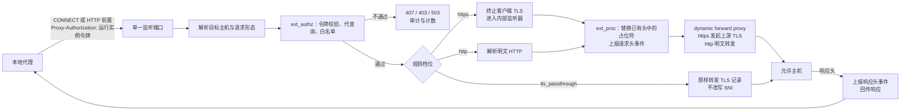
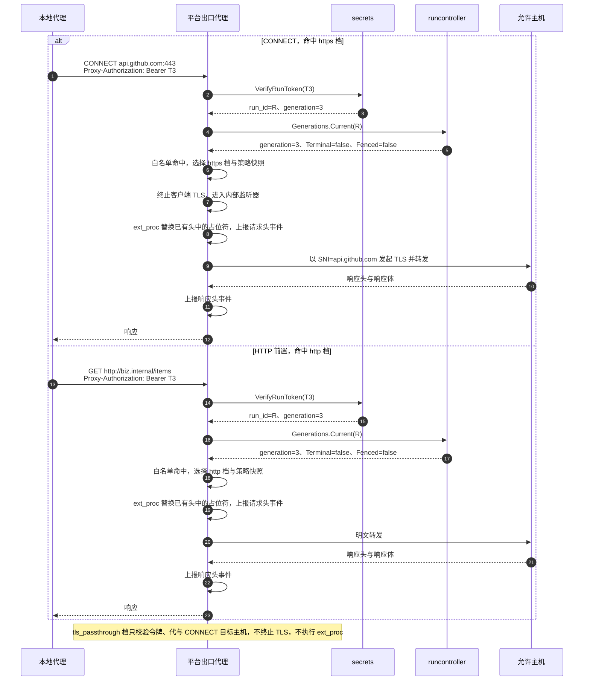
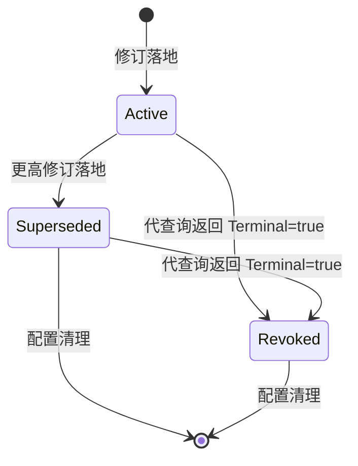

# 平台出口代理（k8s 路径）

`connectorhub` 的平台出口代理是 k8s 路径的出口网关进程，部署在控制面命名空间之外。它监听本地代理发起的 CONNECT 与 HTTP 前置请求，按[运行实例](../../../glossary.md)令牌与出口策略逐请求鉴权，在请求头中替换凭据占位符，再把请求转发到允许主机。它不生成出口策略，不落地 NetworkPolicy，不处理 LLM 流量，也不代理 Substrate 路径的出口。文档围绕凭据占位符替换这一机制组织。心智模型：出口策略是一张按运行实例给出的允许主机与请求头改写表，每个请求只有在该运行实例的当前代上通过一次新查询才被放行（[ADR-generation-fencing](../../../adr/adr-generation-fencing.md)）。

文档较长，不宜顺序通读。第一次阅读按以下顺序：核心概念、职责、规则档位、状态一览、走查、请求鉴权与规则选择、占位符替换、按代撤销与残余窗口；术语表、外部接口契约、依赖、UML 图与数据结构作为参考，在核对字段、状态码或配置调用时查阅。并发与事务边界末尾的竞态用例留到最后自测：先按前文规则判断每个交错序列的结果，再与表中结论核对。

## 核心概念

凭据占位符替换是本子模块的核心机制。需要凭据的请求头在沙箱内只携带占位符，例如 `Authorization: Bearer {{github.token}}`；代理在逐请求鉴权通过之后，按该运行实例的[出口策略](../../../glossary.md)匹配注入规则，以[运行实例令牌](../../../glossary.md)向 `secrets` 换取真实凭据，只替换请求中已存在的头里的占位符，再把请求发往上游。

系统需要它，是因为[沙箱](../../../glossary.md)内不存放真实凭据（[架构不变量](../../architecture.md#架构不变量) I6），而沙箱内的调用方只接触占位符；代理在最后一跳完成占位符到真实凭据的转换，调用方无需持有真实凭据，真实凭据只出现在代理进程内存中。替换要求代理看到请求头，因此有注入规则的 CONNECT 目标使用 `https` 档终止 TLS 后处理，没有注入规则的 CONNECT 目标使用 `tls_passthrough` 档按端到端 TLS 直通；证书固定目标不能接受 TLS 终止，故不为其声明注入规则。

## 职责

本子模块的职责穷举如下，每条先写执行的动作，再写产生的结果或边界；具体算法、字段与调用细节见后续章节。

- **CONNECT 终止与 HTTP 前置终止**：在单一监听端口上接受本地代理的 CONNECT 与绝对形式 HTTP 请求，解析目标主机与请求形态，把请求交给鉴权与替换阶段；无法解析目标主机的请求立即拒绝，不建立上游连接。
- **按运行实例白名单鉴权**：从代理认证头取运行实例令牌，经 `secrets` 校验签名、过期时间与 `run_id`，逐请求经 `runcontroller` 的 `Generations.Current` 校验代、终态与本代作废状态，并检查目标主机属于该运行实例出口策略的 `AllowedHosts`；任一条件不通过即拒绝，不向上游发送任何字节。
- **凭据占位符替换**：对命中的注入规则，只在请求已存在的头中把占位符替换为真实凭据；缺少该头时不注入，请求体、请求行与其他头保持不变；代理自身的认证头在转发前移除。真实凭据由 `secrets.ExchangeCredential` 以策略中的 `project_id`、`run_id`、`generation`、`system`、`auth_method` 与 `scopes` 换取，按 `(run_id, generation, system, auth_method, scopes)` 缓存在进程内直到 `ExpiresAt`；策略缺 `project_id`、凭据对象或作用域不足时该规则不生效，请求按未授权拒绝并审计。
- **规则档位选择**：按目标主机、请求形态与出口策略，把请求归入 `https`、`tls_passthrough`、`http` 档位；`https` 档终止客户端 TLS，`http` 档解析明文请求，两者都检查请求头；`tls_passthrough` 档保留端到端 TLS 并按目标主机放行。
- **上游 TLS 发起**：对 `https` 档，以目标主机名作为 SNI 发起向上游的 TLS 并校验证书；对 `http` 档以明文转发；对 `tls_passthrough` 档原样转发 TLS 记录，不改写 SNI。
- **在途请求事件上报**：在请求头阶段与响应头阶段各上报一次在途信号，携带运行实例、代、请求标识、目标主机与方法；该信号不进入收件箱、不形成持久化请求记录。
- **策略落地与版本治理**：按运行实例接收出口策略修订，校验字段与闭集，保持修订号单调，原子替换当前快照；更低或相同修订、已终态运行实例的落地被拒绝。
- **审计与计数**：记录凭据替换、未授权主机、旧代拒绝、占位符无法解析、上游 TLS 失败与配置拒绝；审计记录不包含凭据值。
- **默认拒绝与失败关闭**：未列入 `AllowedHosts` 的主机一律拒绝；令牌校验、代查询、凭据取得或配置不可用时拒绝请求，不放行也不降级为直连。

### 非职责

- 出口策略内容的生成、允许主机并集的合并、`Inject` 与 `Git` 规则的产出归 `connectorhub` 主文档的连接器部分；本子模块只消费已生成的策略。
- 平台出口代理配置与 NetworkPolicy 的落地、按代撤销墓碑与策略副本保存归 `sandboxprovider` 的 k8s 子模块；k8s 路径的按代撤销为空操作，本子模块不接收撤销墓碑。
- 本地代理的 CONNECT 与 HTTP 前置发起、运行实例令牌附加、LLM 流量转发与直通或缓存模式归看守进程的本地代理；本子模块不接触 LLM 请求。
- 运行实例令牌的签发、轮换与签名校验归 `secrets`；本子模块调用其校验函数，不签发也不轮换令牌。
- 运行实例状态机、代递增、终态与本代作废判定归 `runcontroller`；本子模块逐请求查询，不自行推导这些状态。
- Substrate 路径的出口策略落地、MITM 与 `replaceHeaders` 替换归 Substrate 出口网关（[REF-substrate](../../../references.md)）；本子模块只服务 k8s 路径。
- 密钥库中凭据的存储、项目作用域授权与全局使用审计归 `secrets`；本子模块在替换时取用短期凭据，并在自身的审计记录中关联运行实例与代。
- git 客户端的 URL 重写与客户端配置归连接器与本地代理；本子模块只处理重写后到达 `ProxyHost` 的请求。

## 术语表

| 术语 | 英文对照 | 适用范围 | 定义 |
| --- | --- | --- | --- |
| 出口规则 | egress rule | 平台出口代理 | 以目标主机为键的一条放行与改写规则，含规则档位与该主机的注入规则 |
| 规则档位 | rule mode | 平台出口代理 | 请求在出口代理内的处理形态，闭集为 `https`、`tls_passthrough`、`http` |
| 策略快照 | policy snapshot | 平台出口代理 | 某一修订的出口策略在代理内的不可变视图，一个请求从头到尾只使用一个快照 |
| 在途请求事件 | in-flight request event | 平台出口代理 | 请求头阶段或响应头阶段上报的一次信号，用于观察运行实例的在途出口请求，不持久化 |

## 外部接口契约

稳定性承诺按接口类别给出：本地代理到出口代理的监听接口、出口策略输入、对 `runcontroller` 的代查询。新增可选字段与新增允许主机是兼容变更；变更规则档位闭集、变更状态码语义或改变令牌载体不是兼容变更。

### 对本地代理的监听接口

- 单一监听端口同时接受 CONNECT（`CONNECT host:port`）与绝对形式 HTTP 请求。端口号由部署配置给出，不属于稳定承诺；稳定承诺是两种请求形态共用一个监听端点。
- 运行实例令牌放在 `Proxy-Authorization: Bearer <令牌>`。该头只用于代理鉴权，转发到上游之前移除；上游不会看到运行实例令牌。
- `https` 与 `http` 档成功时返回上游响应；`tls_passthrough` 档成功时建立隧道，失败时关闭连接，不返回 HTTP 状态码。拒绝时返回 `407`（令牌缺失、签名无效、过期或 `run_id` 不符）、`403`（主机未授权、代不符、运行实例终态或本代作废）或 `503`（令牌校验、代查询、凭据取得不可用）；`https` 与 `http` 档的上游 TLS 失败、连接失败或超时返回 `502` 或 `504`。这些状态码的语义是稳定承诺。
- CONNECT 成功后的隧道内容、HTTP 响应头与响应体对代理不透明；代理不解析响应体，不修改响应头，除非响应头事件上报需要读取头字段。
- 对 `tls_passthrough` 档，代理不终止 TLS，只按 CONNECT 目标主机放行并转发字节流；该档不执行请求头替换，也不产生请求头与响应头事件。

### 出口策略输入

出口策略由 `connectorhub` 生成，字段与语义以主文档的「对沙箱提供者的出口策略推送」为准（[design-connectorhub](design-connectorhub.md)）。k8s 路径上，策略内容经 `sandboxprovider` 的 k8s 子模块落地为本进程的配置副本；本进程不直接接受业务模块推送，只按字段语义消费。

本子模块消费的字段为 `RunID`、`ProjectID`、`Revision`、`AllowedHosts`、`Inject` 与 `Git`；`Inject` 的每条规则携带 `Host`、`Header`、`Placeholder`、`System`、`AuthMethod` 与 `Scopes`，用于向 `secrets` 换取凭据。稳定承诺：修订号按运行实例单调递增；同一修订重复落地幂等；更低或相同修订不覆盖当前快照；`AllowedHosts` 之外的主机默认拒绝；`Inject` 的每条规则只在请求已有对应头时生效。

### 对 `runcontroller` 的代查询

```go
type Generations interface {
    Current(ctx context.Context, id RunID) (CurrentGeneration, error)
}

type CurrentGeneration struct {
    Generation int
    Terminal   bool
    Fenced     bool
}
```

- 每个出口请求调用一次 `Generations.Current`，不使用缓存的代。返回的 `Generation` 必须等于令牌中的代，`Terminal` 与 `Fenced` 必须都为假，请求才继续。
- 查询失败、超时或 `runcontroller` 不可达时返回 `503`，不建立上游连接；本子模块不把查询失败当作放行。
- 查询结果只用于当前请求的鉴权与规则选择，不写回策略仓库；运行实例终态被观察到时，把该运行实例的策略置为 `revoked`，此后新请求继续逐请求查询并拒绝。
- 稳定承诺为方法名、字段名与字段语义；新增可选字段是兼容变更。

## 依赖

依赖穷举如下，方向与[模块依赖图](../../architecture.md#模块依赖图)一致：本子模块依赖 `runcontroller`、`secrets`、`sandboxprovider` 的 k8s 子模块与 Envoy 数据面（[REF-envoy](../../../references.md)）；本地代理是运行时 HTTP 调用方，不是代码依赖，不出现在模块依赖图中。

- `runcontroller`：代查询接口 `Generations.Current`，逐请求调用，不使用缓存。本子模块不读 `run` 表，不参与状态转移；`runcontroller` 不反向调用本子模块。
- `secrets`：运行实例令牌的签名、过期时间与 `run_id` 校验，以及占位符对应凭据的取得。凭据换取以策略中的 `project_id` 为项目范围、以 `(run_id, generation)` 定位运行实例与代、以 `system` 与 `auth_method` 选择凭据对象、以 `scopes` 约束授权；代理不使用缓存之外的代。真实凭据只在本进程内存中出现，不写入策略副本、审计记录或请求头事件。
- `sandboxprovider` 的 k8s 子模块：平台出口代理配置与 NetworkPolicy 的落地，出口策略副本的保存与按运行实例推送。k8s 路径的 `RevokeEgressPolicy` 为空操作，本子模块不依赖撤销墓碑；NetworkPolicy 默认拒绝沙箱出口，只放行控制面地址、LLM 网关与平台出口代理。
- `connectorhub` 主文档：出口策略的内容来源，包括 `AllowedHosts` 的并集、`Inject` 规则与 `GitRule`。本子模块与连接器同属 `connectorhub`，不构成跨模块依赖。
- Envoy：数据面。CONNECT 终止、TLS 终止与发起、内部监听器、`ext_authz`、`ext_proc` 与 dynamic forward proxy 由 Envoy 提供；本子模块实现 `ext_authz` 与 `ext_proc` 的策略逻辑。
- 运行时调用方：看守进程的本地代理经 CONNECT 或 HTTP 前置调用本进程，携带运行实例令牌。这是运行时调用，不是代码依赖。

架构不变量 I1 与 I6 要求全部外部系统流量经托管侧、沙箱零长期凭据；I7 要求出口请求按代校验（[ADR-host-owns-all-wake-sources](../../../adr/adr-host-owns-all-wake-sources.md)、[ADR-generation-fencing](../../../adr/adr-generation-fencing.md)）。本子模块的依赖方向满足这些约束：它只调用 `runcontroller`、`secrets` 与 `sandboxprovider` 的接口，三者不反向调用它。

## UML 图

请求处理流水线图固定各阶段的先后与失败关闭的位置；CONNECT 与 HTTP 前置时序图固定两种请求形态共享鉴权与替换阶段、在 TLS 处理处分叉；策略与撤销状态图固定策略仓库的状态闭集。图中不表达的约束由每张图后的正文给出。

### 请求处理流水线图



流水线的顺序约束是：鉴权在解析目标主机之后、任何上游字节发出之前完成；占位符替换在鉴权通过之后、上游连接建立之前完成；`tls_passthrough` 档跳过替换，只按 CONNECT 目标主机放行。任一鉴权或替换失败都走向拒绝，不存在绕过鉴权直接转发的分支。默认拒绝使未列入 `AllowedHosts` 的主机在 `ext_authz` 阶段即被拦截，不会到达上游。

### CONNECT 与 HTTP 前置时序图



CONNECT 分支与 HTTP 前置分支共享同一套鉴权与策略选择：令牌校验、代查询、白名单检查相同，差别只在 TLS 终止与请求头可见性。CONNECT 分支终止客户端 TLS 后才能看到请求头并执行替换；HTTP 前置分支天然可见请求头。`tls_passthrough` 档没有 HTTP 头可检查，只在 CONNECT 目标主机上做一次鉴权，因此也不产生请求头与响应头事件。

### 策略与撤销状态图



策略仓库按运行实例保存当前快照。更高修订落地时，旧修订转入 `superseded`，不再被新请求选中；已经在途的请求继续使用它自己的快照，直到请求结束。`revoked` 由逐请求的代查询惰性触发：观察到 `Terminal=true` 后，该运行实例的新请求一律拒绝，配置仅等待清理。`Revoked` 是终态，不因后续策略推送回到 `Active`；运行实例终态在 `runcontroller` 中不可逆。状态图只描述策略仓库的生命周期，不描述单个请求的鉴权结果；放行与否由每个请求的代查询与白名单检查决定，不由策略仓库的状态单独决定。

## 核心数据结构

### 规则档位

| 档位 | 客户端形态 | 代理行为 | 凭据注入 |
| --- | --- | --- | --- |
| `https` | CONNECT | 终止客户端 TLS，进入内部监听器，向上游重新发起 TLS | 是，只替换已有请求头 |
| `tls_passthrough` | CONNECT | 不终止 TLS，按 CONNECT 目标主机放行，原样转发字节流 | 否 |
| `http` | 绝对形式 HTTP 前置 | 解析明文请求，明文转发 | 是，只替换已有请求头 |

档位选择规则穷举如下：绝对形式 HTTP 请求使用 `http` 档；CONNECT 目标主机在该运行实例的策略中有注入规则时使用 `https` 档；CONNECT 目标主机没有注入规则时使用 `tls_passthrough` 档。证书固定的目标不能接受平台出口代理的 TLS 终止，因此不得为其声明注入规则；需要凭据的证书固定目标改用连接器操作（[ADR-host-owns-all-wake-sources](../../../adr/adr-host-owns-all-wake-sources.md)）。

### 策略与请求视图

| 结构 | 字段 | 约束与含义 |
| --- | --- | --- |
| `EgressRule` | `Host`、`Mode`、`Inject` | `Host` 必须属于 `AllowedHosts`；`Inject` 来自出口策略的 `Inject` 规则；`Mode` 是本次请求按档位选择规则确定的档位，不属于快照字段 |
| `PolicySnapshot` | `ProjectID`、`Revision`、`AllowedHosts`、`Rules`、`Git` | 不可变；`ProjectID` 用于凭据换取的项范围；`Revision` 单调递增；`Rules` 按 `Host` 索引；`Git` 保存 `ProxyHost` 与凭据引用 |
| `AuthDecision` | `RunID`、`Generation`、`Revision`、`Mode`、`Allowed`、`Reason` | 一次请求的鉴权结果；`Revision` 写入动态元数据，供 `ext_proc` 选择同一快照 |
| `RequestEvent` | `RunID`、`Generation`、`RequestID`、`Host`、`Method`、`Phase`、`OccurredAt` | `Phase` 闭集为 `request_headers`、`response_headers`；不持久化 |
| `InjectRule` | `Host`、`Header`、`Placeholder`、`System`、`AuthMethod`、`Scopes` | 与出口策略同名字段一致；`Header` 大小写不敏感匹配；只在请求已有该头时替换；后三项用于向 `secrets` 换取凭据 |

`PolicySnapshot` 是出口策略在代理内的派生视图，不改变 `EgressPolicy` 的字段。`EgressRule` 的 `Mode` 由请求形态与注入规则推导，不是出口策略的新字段。`AuthDecision.Revision` 把鉴权与替换绑定到同一快照：`ext_authz` 选定修订，`ext_proc` 只按该修订的注入规则替换，避免鉴权与替换之间策略更新造成混用。

### 状态一览

| 状态 | 一句话含义 | 当前动作 | 直觉画面 |
| --- | --- | --- | --- |
| `active` | 最新修订的策略在生效 | 平台出口代理按该修订做白名单检查与占位符替换 | 当前班次的通行证 |
| `superseded` | 已被更高修订取代 | 平台出口代理不再为新请求选择它，在途请求仍按各自的快照完成 | 过期的排班表 |
| `revoked` | 运行实例已终态，策略不再放行 | 平台出口代理拒绝该运行实例的新请求，配置等待清理 | 已注销的通行证 |

## 核心算法与流程

### 走查

初始状态：运行实例 `R` 的当前代为 3；出口策略修订 7 已落地，`AllowedHosts` 含 `api.github.com` 与 `pinned.example`；`api.github.com` 有注入规则 `Authorization: {{github.token}}`，`pinned.example` 没有注入规则；策略仓库中 `R` 的快照为 `active`，修订 7。代理没有持久化的请求状态。

1. 本地代理向平台出口代理发送 `CONNECT api.github.com:443`，携带 `Proxy-Authorization: Bearer T3`，`T3` 的 `run_id=R`、代 3。代理解析目标主机，尚未连接上游。状态不变。
2. `ext_authz` 调用 `secrets` 校验 `T3` 的签名、过期时间与 `run_id`，通过；调用 `Generations.Current(R)`，返回 `generation=3`、`Terminal=false`、`Fenced=false`。目标主机属于 `AllowedHosts`，选择 `https` 档与修订 7 的快照，把修订 7 写入动态元数据。状态不变。
3. 代理终止客户端 TLS，进入内部监听器。`ext_proc` 在请求头中看到 `Authorization: Bearer {{github.token}}`，按修订 7 的注入规则取回真实凭据并替换占位符，移除 `Proxy-Authorization`，上报请求头事件。审计新增一条记录，包含 `R`、代 3、`api.github.com`、头名 `Authorization` 与结果，不包含凭据值。
4. dynamic forward proxy 以 `SNI=api.github.com` 发起向上游的 TLS，校验证书，转发请求。上游返回响应头与响应体；`ext_proc` 上报响应头事件，响应经代理回传本地代理。状态不变，策略仍为修订 7 `active`。
5. 另一个请求携带 `T2`，其 `run_id=R`、代 2。`ext_authz` 校验令牌签名通过，但 `Generations.Current(R)` 返回代 3，与令牌中的代不符，返回 `403`，旧代拒绝计数加一，审计新增一条拒绝记录。代理不建立上游连接。策略仓库仍为修订 7 `active`。
6. 一个请求的目标为 `pinned.example`，令牌与代都有效。该主机没有注入规则，选择 `tls_passthrough` 档，按 CONNECT 目标主机放行，原样转发 TLS 记录，不执行替换，也不产生请求头与响应头事件。

走查后的状态：策略仓库中 `R` 为修订 7 `active`；旧代拒绝计数加一；审计新增凭据替换与旧代拒绝记录；没有请求级持久化状态。代理重启后只保留最后落地的策略修订，在途请求随连接消失，计数与审计按部署配置的保留策略保存。

### 请求鉴权与规则选择

1. 解析目标主机：CONNECT 取 `host:port` 的主机部分，绝对形式 HTTP 取请求 URI 的主机或 `Host` 头。解析失败返回 `400`。
2. 从 `Proxy-Authorization` 取运行实例令牌。缺失或格式不符返回 `407`。
3. 调用 `secrets` 校验令牌签名、过期时间与 `run_id`。校验失败返回 `407`，不查询代。
4. 调用 `runcontroller` 的 `Generations.Current`。查询失败返回 `503`；`Generation` 与令牌中的代不符、`Terminal=true` 或 `Fenced=true` 返回 `403` 并计入旧代拒绝计数。
5. 读取该运行实例的当前策略快照；目标主机不在 `AllowedHosts` 中返回 `403`，不查询上游。
6. 按「规则档位」的选择规则确定档位，把修订号写入动态元数据，交给后续阶段。

鉴权复杂度为按运行实例与主机的常数次哈希查找，加上一次令牌校验调用与一次代查询调用；不随运行实例数或允许主机数线性增长。策略快照的读取不加锁，读取到的是某一个完整修订。

### 占位符替换

1. 只处理 `https` 与 `http` 档；`tls_passthrough` 档不进入该流程。
2. 遍历该主机在选定修订中的注入规则。头名按大小写不敏感匹配请求头。git 的 Basic 或 Bearer 头按同一规则处理：头已存在时替换占位符，头不存在时不注入。
3. 请求没有该头时跳过该规则，不新增头，不把占位符写入新头。
4. 请求有该头且值包含占位符时，按注入规则的 `system`、`auth_method` 与 `scopes` 从 `secrets` 取得真实凭据，把占位符替换为该凭据，替换该头中出现的全部占位符；同一凭据在 `ExpiresAt` 之前复用于同一运行实例、同一代与同一凭据对象。
5. 请求有该头但值不含占位符时保持不变。
6. `https` 与 `http` 档中，请求头出现形如 `{{...}}` 的占位符，但没有匹配的注入规则时，返回 `403` 并审计；不把未解析的占位符发往上游。匹配规则但凭据换取失败（无凭据对象、作用域不足或密钥库不可用）时同样返回 `403` 或 `503`，不发送未替换的占位符。
7. 规则匹配但凭据不可取得时返回 `503`，不转发请求，审计记录包含运行实例、代、主机与头名。
8. 替换完成后移除 `Proxy-Authorization`；请求行、请求体与其他头保持不变。

替换只作用于请求头，不作用于响应头、URL、查询参数与请求体。审计只记录头名与是否替换，不记录凭据值或替换前后的完整头值。`tls_passthrough` 档不终止 TLS、不解析请求头，代理无法检测其中的占位符，因此该档不保证拦截未解析的占位符；证书固定目标需要凭据时改用连接器操作。

### 规则档位与 Substrate 映射

| 本子模块档位 | 客户端形态 | 平台出口代理行为 | Substrate 出口网关的对应形态 |
| --- | --- | --- | --- |
| `https` | CONNECT | 终止客户端 TLS，替换已有请求头，向上游重新发起 TLS | MITM 加 `replaceHeaders` |
| `tls_passthrough` | CONNECT | 不终止 TLS，按目标主机放行，原样转发 | 直通规则，无头替换 |
| `http` | 绝对形式 HTTP 前置 | 解析明文请求，替换已有请求头，明文转发 | 明文代理加 `replaceHeaders` |

k8s 路径与 Substrate 路径的语义一致：默认拒绝未列入的主机；只替换已有头，缺头不注入；`replaceHeaders` 与 `Inject` 都只作用于请求头。差异在凭据来源与失效判定：Substrate 路径的凭据来自凭据提供者，k8s 路径来自 `secrets`；Substrate 路径按（运行实例，代）落地并在代作废时撤销策略，k8s 路径逐请求查询代。映射只描述语义，不要求共用配置格式。

### 策略落地与原子替换

1. 接收一个运行实例的策略修订，校验 `ProjectID`、`Revision`、`AllowedHosts`、`Inject` 与 `Git`：`ProjectID` 非空、主机非空、注入规则的 `Host` 属于 `AllowedHosts`、`Header` 是合法头名、`Placeholder` 非空、`System` 与 `AuthMethod` 非空、`Scopes` 非空。
2. 读取当前快照的修订。新修订不大于当前修订时丢弃并计数，不改变当前快照。
3. 构建新的 `PolicySnapshot`，按主机建立索引，保存各主机的注入规则与 `Git` 规则；规则档位在请求到达时按请求形态选择，不在落地时固定。
4. 原子替换该运行实例的快照指针。替换之前开始的请求继续使用旧快照；替换之后开始的请求使用新快照。不存在部分字段来自新修订、部分来自旧修订的请求。
5. 校验失败时保留当前快照，拒绝该次落地并计数；没有可用快照时该运行实例的新请求一律拒绝。
6. 策略修订的推送与撤销在产生它们的持久化事务提交之后执行，不在事务内调用数据面（[ADR-effect-record-after-commit](../../../adr/adr-effect-record-after-commit.md)）。k8s 路径的按代撤销为空操作，数据面不接收撤销墓碑。

### 按代撤销与残余窗口

k8s 路径的放行不依赖按代策略副本，也不依赖撤销墓碑。每个请求在鉴权阶段调用一次 `Generations.Current`：代递增、运行实例进入终态或本代被判定作废的事务提交之后，新请求的下一次查询立即看到新值并被拒绝，不需要等待策略撤销生效。

残余窗口穷举如下：

- 已通过鉴权并建立上游连接的请求不因代变化而中断，窗口等于该请求从鉴权到上游响应结束的剩余时间。代理不在响应中途重新查询代。
- 鉴权查询在代递增事务提交之前返回旧代、上游副作用发生在提交之后：窗口上界为单次请求的鉴权查询到上游完成之间的时长，不使用缓存的代使该窗口最小。
- `runcontroller` 不可达时不放行新请求，窗口不因查询失败而扩大；在途请求继续完成。
- 与 Substrate 路径相比，k8s 路径以每请求一次代查询换取撤销立即生效，不承担撤销效果截止之前的窗口；代价是出口请求的放行依赖 `runcontroller` 的可用性与查询时延（[ADR-generation-fencing](../../../adr/adr-generation-fencing.md)）。

### 在途请求事件上报

- 请求头阶段在鉴权与替换完成之后上报 `request_headers` 事件；响应头阶段在上游响应头到达之后上报 `response_headers` 事件。
- 事件携带 `RunID`、`Generation`、`RequestID`、`Host`、`Method`、`Phase` 与 `OccurredAt`。`RequestID` 由代理为每个请求生成，只用于事件关联与审计。
- 事件不进入收件箱，不写持久化请求记录，不携带请求头值、请求体或响应体。事件丢失不改变请求结果；上报失败计数并告警，不阻塞请求。
- 在途信号用于控制面观察运行实例的在途出口请求，等待仍由持久化收件箱与唤醒信号推导（[ADR-wait-on-durable-inbox](../../../adr/adr-wait-on-durable-inbox.md)）。`tls_passthrough` 档只能观察到 CONNECT 建立与隧道结束，无法看到 HTTP 请求头与响应头，其信号粒度是隧道生命周期。
- 同一请求的 `request_headers` 与 `response_headers` 事件按发生顺序上报；不同请求之间不保证顺序。

## 错误与失败语义

下表列出已定义的失败类别；未列出的失败按拒绝请求、记录审计并计数处理。

| 失败 | 判定 | 处理 | 结果 |
| --- | --- | --- | --- |
| 令牌缺失或格式不符 | `Proxy-Authorization` 缺失或不是 Bearer 形式 | 返回 `407`，不查询代，不连接上游 | 请求被拒绝并审计 |
| 令牌签名无效、过期或 `run_id` 不符 | `secrets` 校验不通过 | 返回 `407`，不查询代，不连接上游 | 请求被拒绝并审计 |
| 代不符 | 令牌中的代与 `Generations.Current.Generation` 不同 | 返回 `403`，旧代拒绝计数加一，审计 | 请求被拒绝，不产生外部副作用 |
| 运行实例终态或本代作废 | `Terminal=true` 或 `Fenced=true` | 返回 `403`，计数并审计；观察到 `Terminal=true` 时把该运行实例策略置 `revoked` | 请求被拒绝，新请求继续被拒 |
| 未授权主机 | 目标主机不在 `AllowedHosts` | 返回 `403`，审计并计数，不查询上游 | 请求被拒绝 |
| 占位符无法解析 | `https` 或 `http` 档的请求头含 `{{...}}`，但没有匹配的注入规则 | `https` 与 `http` 档返回 `403`，审计并计数，不转发 | `https` 与 `http` 档的占位符不会到达上游；`tls_passthrough` 档不检查请求头，占位符可能原样到达上游 |
| 凭据不可用 | 注入规则匹配，但 `secrets` 取不到凭据 | 返回 `503`，审计；请求不转发 | 请求失败，Agent 决定是否重试 |
| 注入头缺失 | 规则指向的头不存在 | 不注入，请求照常转发 | 请求成功，替换规则空过 |
| 上游 TLS 失败 | `https` 档证书校验失败、握手超时或 SNI 与目标不符；`tls_passthrough` 档隧道内握手失败 | `https` 档返回 `502`；`tls_passthrough` 档关闭隧道并计数；都不重试，审计 | 请求失败，不产生第二个外部副作用 |
| 上游连接失败或超时 | 连接被拒绝、重置或超时 | `https` 与 `http` 档返回 `502` 或 `504`；`tls_passthrough` 档关闭隧道并计数；都不重试 | 请求失败，Agent 决定是否重试 |
| 策略修订非法 | 字段越出闭集、注入主机不在允许集合、头名或占位符非法 | 拒绝落地，保留当前快照，计数并告警 | 当前策略继续生效，新修订不生效 |
| Envoy 配置错误 | 启动时监听器、过滤器、证书或扩展配置无法加载，或运行时配置更新无法加载 | 启动错误使进程不就绪、不开放监听；运行时更新失败保持最后有效配置并标记不就绪 | 失败关闭，请求不被放行 |
| 鉴权依赖不可用 | `secrets`、`runcontroller` 或策略仓库不可达 | 返回 `503`，不连接上游，计数 | 新请求失败，在途请求继续 |
| 策略撤销竞态 | 请求鉴权与策略更新或代递增并发 | 请求使用鉴权时选定的快照；新请求使用新快照或新代 | 不产生新旧混用的请求；在途请求按残余窗口完成 |
| 审计或事件上报失败 | 审计存储或事件通道不可用 | 请求结果不变，计数并告警 | 请求继续，可观测性出现缺口 |
| 隧道中途断开 | 客户端或上游关闭连接 | 关闭另一侧，尽力上报隧道结束事件，不重试 | 请求失败，不产生第二个外部副作用 |

## 并发与事务边界

本子模块不持有数据库事务。策略仓库、请求鉴权与事件上报的边界如下。

| 操作 | 边界 | 幂等与一致性 |
| --- | --- | --- |
| 策略修订落地 | 按运行实例串行；校验后原子替换快照指针 | 修订号单调；相同或更低修订丢弃；快照不存在部分更新 |
| 请求鉴权与规则选择 | 单个请求内完成；读取一个完整快照，把修订号写入动态元数据 | 同一请求的鉴权与替换使用同一修订 |
| 占位符替换 | 单个请求内完成，使用鉴权阶段选定的修订 | 不跨请求共享可变的头视图 |
| 代查询 | 每个请求一次，不缓存，不在事务内 | 查询结果只作用于当前请求 |
| 在途事件上报 | 异步上报，不参与请求结果 | 同一请求内请求头事件先于响应头事件；跨请求无序 |
| 审计与计数 | 追加写与原子计数 | 审计失败不回滚请求；计数只增不减 |

竞态用例穷举如下。

| 交错 | 处置 | 结论 |
| --- | --- | --- |
| 策略更新与请求到达 | 请求在鉴权阶段选定一个快照；更新只影响之后开始的请求 | 请求不会混用两个修订 |
| 代递增与请求到达 | 查询在递增提交之前返回旧代则放行，之后返回新代则拒绝 | 新请求立即失效；在途请求按残余窗口完成 |
| 运行实例终态与请求到达 | 查询返回 `Terminal=true`，请求拒绝并把策略置 `revoked` | 终态后不再放行新请求 |
| 策略撤销与在途请求 | 在途请求不中断；新请求逐请求查询并拒绝 | 已授权请求完成，撤销不回溯 |
| 非法修订与当前快照 | 非法修订被拒绝，当前快照保留 | 已生效策略不被破坏 |
| 审计写入失败与请求 | 请求照常完成，失败计数并告警 | 请求结果不受可观测性故障影响 |
| 两个修订并发落地 | 按运行实例串行；较高修订胜出，较低修订丢弃 | 最终快照是最高修订的完整视图 |

## 扩展点

- **新增外部系统**：只在外部系统定义中增加 `upstreams` 与 `inject`，出口策略随之生成并落地；代理不需要修改代码。新增主机走同一套白名单与规则档位选择。
- **新增注入头**：在定义的 `access.inject` 中增加 `{host, header, placeholder}`，由 `connectorhub` 解析为带 `system`、`auth_method` 与 `scopes` 的规则；代理按同一替换与凭据换取规则处理，不新增代码。
- **新增允许主机**：只改变 `AllowedHosts`；未列入的主机仍默认拒绝。
- **新增规则档位**：规则档位是闭集，新增取值需要数据面支持并改变本子模块的档位选择与 Envoy 配置，不是兼容变更。
- **新增凭据类型**：由 `secrets` 扩展凭据取得与占位符映射；代理只按占位符替换，不感知凭据类型。
- **证书固定目标**：使用 `tls_passthrough` 档，不为该主机声明注入规则；需要凭据时改用连接器操作。

## 实现状态

| 能力 | 状态 | 代码 |
| --- | --- | --- |
| 单一监听端口的 CONNECT 与 HTTP 前置终止 | 未实现 | — |
| `ext_authz` 按运行实例白名单鉴权 | 未实现 | — |
| 逐请求代查询与旧代拒绝计数 | 未实现 | — |
| 请求头凭据占位符替换 | 未实现 | — |
| `https`、`tls_passthrough`、`http` 规则档位 | 未实现 | — |
| `tls_passthrough` 的 SNI 直通 | 未实现 | — |
| dynamic forward proxy 发起上游 TLS | 未实现 | — |
| 在途请求事件上报 | 未实现 | — |
| 策略修订落地与原子替换 | 未实现 | — |
| 审计与失败计数 | 未实现 | — |
