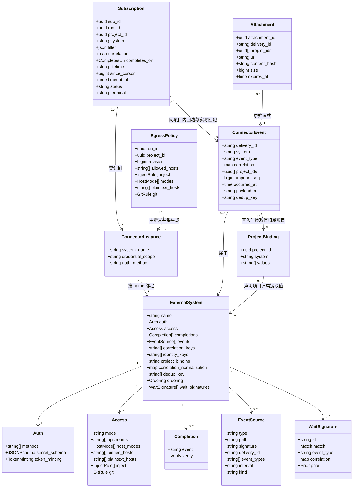
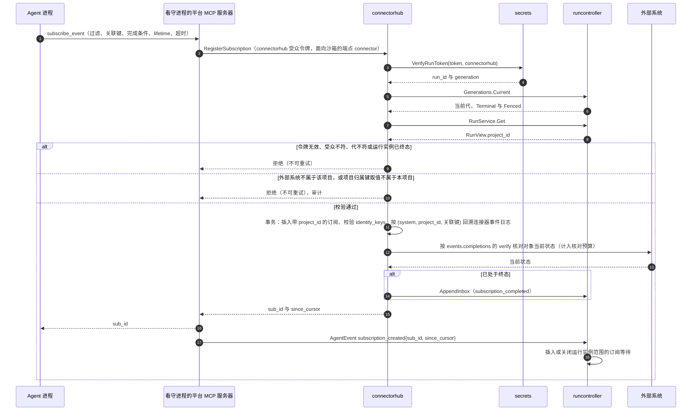
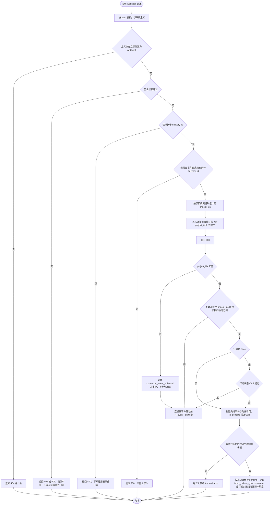
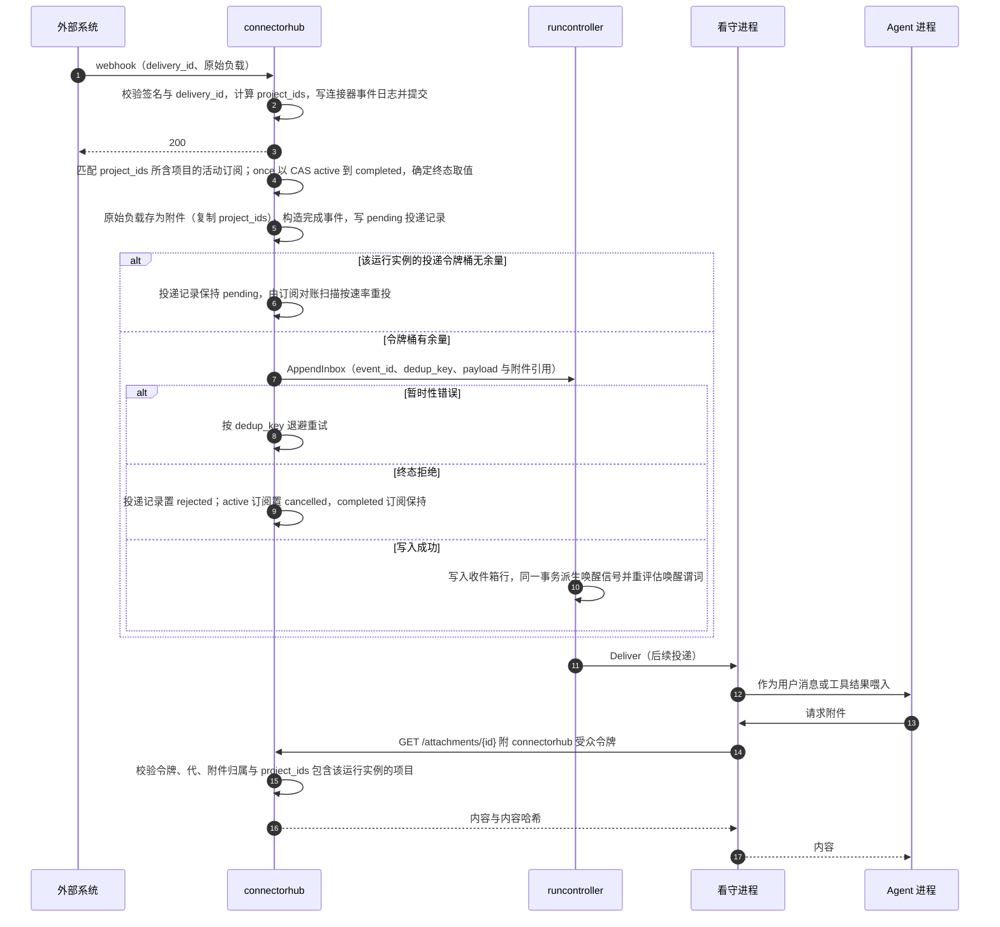

# connectorhub

`connectorhub` 坐在控制面，是外部系统与[运行实例](../../../glossary.md)之间的唯一入口。它拥有[外部系统定义](../../../glossary.md)、[连接器](../../../glossary.md)实例、[连接器事件日志](../../../glossary.md)、[订阅](../../../glossary.md)登记与订阅状态、[完成条件目录](../../../glossary.md)、[出口策略](../../../glossary.md)与[沙箱侧配置](../../../glossary.md)的生成与推送、[工具接入声明](../../../glossary.md)、[等待签名](../../../glossary.md)与项目绑定配置的装载与校验，以及 k8s 路径的平台出口代理子模块；它不执行第三方操作，不拥有[收件箱](../../../glossary.md)、[唤醒信号](../../../glossary.md)与运行实例状态，不拥有人类通道、LLM 流量、[沙箱](../../../glossary.md)生命周期与 Agent 的[等待意图](../../../glossary.md)。本模块向运行实例交付外部事件只有订阅完成事件一种形态，文档围绕连接器事件日志与订阅这对机制组织。

心智模型：webhook 先落盘再应答，订阅登记先回溯再等待；正确性不依赖事件与登记谁先到达（I2）；事件与订阅都带项目，匹配只发生在同一项目之内。

文档较长，不宜顺序通读。第一次阅读按以下顺序：核心概念、职责、状态一览、走查、订阅登记与回溯匹配、webhook 摄入、完成事件构造与投递、去重、出口策略生成与推送；外部系统定义、项目绑定配置、等待签名、外部接口契约、依赖、UML 图、核心数据结构与实现状态作为参考，在核对字段或调用时查阅。并发与事务边界末尾的竞态用例留到最后自测：先按下文规则判断每个交错序列的结果，再与表中结论核对。

## 核心概念

外部系统的每一次变化先成为连接器事件日志中的一条事实；订阅是运行实例在本项目事件上的持久查询，查询命中后产生订阅完成事件。连接器事件日志在存储上部署级共享，不按运行实例分区；每条事件在写入时按外部系统定义声明的[项目归属键](../../../glossary.md)归属一个或多个项目，订阅只匹配归属其所在项目的事件，项目边界因而不依赖关联键的精度（[ADR-connector-events-project-scoped](../../../adr/adr-connector-events-project-scoped.md)）。事件归属哪个运行实例不在写入时确定，由订阅登记时的关联键确定。事件的到达顺序不决定它是否交付：webhook 在连接器事件日志提交之后才应答 200，已接收的事件必然对之后的订阅可见；订阅登记以 `since_cursor` 回溯扫描连接器事件日志，操作返回之后、订阅登记之前到达的事件因而落在窗口内。

系统需要这些保证，是因为运行实例在订阅上等待、沙箱在等待期间挂起，而外部事件的到达时刻与订阅的登记时刻互不约束。没有它们，早于订阅到达的事件会丢失，运行实例只能等下去；有了它们，事件先到、订阅先到与两者并发收敛到同一结果（I2），不需要在操作返回时预先绑定事件归属。平台不执行第三方操作，外部操作由 Agent 通过第三方工具经出口代理执行（[ADR-platform-does-not-execute-external-operations](../../../adr/adr-platform-does-not-execute-external-operations.md)）。订阅完成事件经汇入契约写入收件箱，唤醒由收件箱派生（[ADR-wait-on-durable-inbox](../../../adr/adr-wait-on-durable-inbox.md)）。

## 职责

`connectorhub` 的职责穷举如下，每条先写本模块执行的动作，再写产生的结果或边界；具体算法、表结构与调用细节见后续章节。

- **外部系统定义与连接器实例**：装载并校验 `kind: ExternalSystem` 的外部系统定义（下文简称定义），按项目作用域绑定凭据并构造连接器实例；拒绝闭集外取值、缺失必填字段或引用不存在主机的定义，使该外部系统不可用。
- **连接器事件日志**：接收 webhook，先校验签名与投递标识，再按项目归属键计算事件所属项目，把原始事件与所属项目写入连接器事件日志并提交，提交后才应答；以 `(system, delivery_id)` 唯一吸收发送方重发，为每条事件分配单调递增的追加序号，并按追加序号与 `occurred_at` 排序；无法归属项目的事件只落盘审计，不参与匹配。
- **完成条件目录维护**：维护事件类型到 `verify` 的映射，供订阅按事件类型查找状态核对方式；目录属于事件语义，不绑定具体操作。
- **订阅登记与回溯匹配**：接收带运行实例令牌的订阅登记，校验外部系统与关联键中的项目归属键取值都属于该运行实例的项目，在同一事务写入带 `project_id` 的订阅行，并按关联键回溯匹配本项目的连接器事件日志；把命中的事件认领给订阅，返回 `sub_id` 与 `since_cursor`；登记不因订阅数量或登记速率被拒绝，越过软阈值只计数告警。
- **完成条件核对与合成完成事件**：对声明完成条件的订阅按 `events.completions` 中的 `verify` 核对外部对象当前状态；对象已处于终态时立即合成完成事件，不等待后续 webhook（I2）。
- **状态式轮询**：按外部系统定义的轮询周期核对活动订阅所指外部对象的当前状态，只产生完成事件，不产生普通事件，兜底丢失或乱序的 webhook；同一项目内引用同一外部对象的订阅合并为一次核对，跨运行实例轮转调度，每运行实例与每项目的核对次数受每周期预算约束，凭据换取按运行实例、外部系统与认证方法每周期复用一次，使对外部系统与 `secrets` 的调用量与合并后的对象数和运行实例数成正比，不随订阅数放大。
- **订阅完成事件投递**：把订阅完成事件经[汇入契约](../../../glossary.md)写入收件箱，`event_id` 由订阅与[终态取值](../../../glossary.md)派生，`dedup_key` 由订阅与外部事件标识派生，原始负载以附件引用表达，载荷不超过 `S_max`；按每运行实例令牌桶限速发出，超出部分保持待投递，不丢弃。
- **去重**：以内容派生的 `dedup_key` 与收件箱唯一索引兜底同一完成事件的重复写入与内容相同的重复 webhook，以 `delivery_id` 唯一兜底 webhook 重发，以 `once` 订阅的状态 CAS 裁决 webhook 与状态式轮询的并发完成，以认领记录与完成事件投递记录的唯一键兜底 `until_cancelled` 的重复。
- **订阅对账扫描**：按配置的扫描周期重新匹配归属订阅所在项目的留存事件，为命中且对该事件尚无认领记录的活动订阅补写认领，按每运行实例投递速率重投 `pending` 的完成事件投递记录，取消运行实例已终态的活动订阅，并把 `timeout_at` 已到期且仍为 `active` 的订阅置为 `expired` 并写入超时完成事件；以认领记录、投递记录的唯一键与订阅状态 CAS 幂等。
- **订阅生命周期**：维护 `active`、`completed`、`expired`、`cancelled`；`lifetime: once` 完成后丢弃同对象的迟到事件并审计；超时以 CAS 置 `expired` 并经汇入契约写入超时完成事件；运行实例终态，或 `active` 订阅的完成事件投递被终态拒绝时取消订阅；订阅数量与登记速率只设软阈值，越过时计数告警并降低该运行实例在核对调度中的份额，不拒绝登记，不取消订阅；按运行实例导出活动订阅数 `active_subscriptions`。
- **出口策略生成与推送**：为每个运行实例生成允许主机、占位符替换规则、明文主机与按主机通道模式，经 `PutEgressPolicy` 推送给沙箱提供者；未列入的主机默认拒绝；真实凭据只在 TLS 连接上注入，外部系统定义显式声明的明文主机除外；git 路径按 `reverse_proxy_rewrite` 生成重写规则；向 `llmgateway` 提供运行实例最新出口策略的允许主机只读查询。
- **沙箱侧配置生成与推送**：在生成或更新出口策略的同一时机，以按主机通道模式、工具接入声明、等待签名与项目的等待意图开关生成[沙箱侧配置](../../../glossary.md)（`SandboxConfig`），以同一次生成的 `Revision` 经 `runcontroller` 的 `PutSandboxConfig` 推送，由 `runcontroller` 在[出站流](../../../glossary.md)上发给[看守进程](../../../glossary.md)。
- **工具接入声明装载与校验**：按项目装载[工具接入声明](../../../glossary.md)，生成出口策略时按该运行实例的出口策略校验，把通过校验的声明与按主机通道模式一起放入沙箱侧配置；校验不通过，或置空等待签名之后 `SandboxConfig` 序列化仍超过 32 KiB 时，声明不进入沙箱侧配置，记录审计并计数。
- **等待签名装载与下发**：装载外部系统定义中的 `wait_signatures`，校验每条签名的匹配规则与关联键提取规则可解析、`event_type` 属于该外部系统的[事件目录](../../../glossary.md)（与 `list_events` 的投影一致）；生成沙箱侧配置时把运行实例可用外部系统的签名放入其中，供看守进程的 Agent 驱动器分类等待并给出订阅建议。校验不通过的签名不装载，记录审计并计数，定义的其余部分照常生效；`SandboxConfig` 序列化超过 32 KiB 时首先置空等待签名。
- **令牌代校验**：事件目录、订阅登记、附件取回与 k8s 路径的每个出口请求按[运行实例令牌](../../../glossary.md)校验签名、受众、[代](../../../glossary.md)、终态与作废状态；本模块的端点只接受 `connectorhub` 受众的令牌，平台出口代理只接受 `egress` 受众的令牌；订阅登记不使用缓存的代。
- **附件存放与取回**：存放超过 `S_max` 的原始负载，向平台 MCP 服务器提供附运行实例令牌的取回接口，只向附件所属项目的运行实例返回内容，按内容哈希校验内容；附件按独立保留期保存。
- **平台出口代理子模块（k8s 路径）**：终止 CONNECT 或 HTTP 前置请求，按运行实例白名单鉴权并核对目的地一致性，替换请求头中的凭据占位符，再转发到授权主机；实现细节见子文档。

### 非职责

非职责举例如下，判定标准为：职责清单之外、由其他模块拥有的事实与机制。

- 第三方工具的执行、命令行与 MCP 请求构造、工具进程生命周期归 Agent 与看守进程；本模块不执行外部操作，不代理工具流量。
- 人类消息、审批决定、聊天界面、即时通讯与 Issue 评论归 `humanchannel`；本模块不接收人类事件，不判断用户身份。
- LLM 请求、LLM 凭据换取、LLM 在途请求与回放归 `llmgateway`；本模块不代理 LLM 流量，不处理 `llm.request.*` 消息。
- 沙箱预配、[挂起](../../../glossary.md)、恢复、销毁与出口策略的按代落地、按代撤销归[沙箱提供者](../../../glossary.md)；本模块只生成并推送出口策略，不落地 NetworkPolicy 或 EgressPolicy；沙箱侧配置不经过沙箱提供者。
- 收件箱、唤醒信号、等待、运行实例状态机、投递游标，以及沙箱侧配置的按运行实例保存与在出站流上的发送归 `runcontroller`；沙箱侧配置的应用与工具接入声明的注入归看守进程；本模块只经汇入契约写入，不直接向看守进程发送沙箱侧配置，不读 `run`、`inbox`、`wake_signal`、`wait`、`timer`、`outbox`、`run_fact`、`source_request` 与 `source_lease` 表。
- 等待意图的解析、等待签名的匹配、情境提示与 `intent_observed` 的上报归看守进程的 [Claude Code 驱动器](../warden/design-warden-driver-claude-code.md)；意图在等待时长预测与宽限期选择中的使用归 `suspendpolicy`，`run.intents` 的保存归 `runcontroller`。本模块只定义并下发等待签名与等待意图开关，不接收等待意图，不向 Agent 发出提示，不按签名登记订阅。
- 运行实例令牌的签发、轮换与签名校验归 `secrets`；本模块调用其校验函数，并读取代查询结果。
- [工作区](../../../glossary.md)、[工作区租约](../../../glossary.md)与附件之外的持久文件归 `workspace`。
- webhook 发送方的重试策略、外部系统的可用性与限流不在本模块控制范围内；本模块只保证已接收事件的落盘、幂等与可重驱动。

## 术语表

| 术语 | 英文对照 | 适用范围 | 定义 |
| --- | --- | --- | --- |
| 连接器实例 | connector instance | connectorhub | 一个外部系统定义与一组项目作用域凭据的运行时绑定，承载该外部系统的事件源、订阅匹配与出口策略生成 |
| 订阅对账扫描 | subscription reconcile scan | connectorhub | 本模块的纠正性后台扫描，按持久化记录重新匹配留存事件，为命中且对该事件尚无认领记录的活动订阅补写认领，并重驱动未完成的完成事件投递；与 `runcontroller` 的对账器相互独立 |
| 完成条件 | completion condition | connectorhub | 订阅的 `completes_on` 所声明的外部事件条件，或在缺少事件时按 `events.completions` 的 `verify` 判定外部对象已处于终态的等价条件 |
| 共享关联键订阅 | shared-correlation subscription | connectorhub | 同一 `(system, correlation)` 上共存、所属项目都在命中事件归属项目之中的活动订阅；它们都会收到命中事件，是发布-订阅的正常形态，写入审计与计数 |
| 订阅完成事件 | subscription completion event | connectorhub | 订阅命中完成条件后经汇入契约写入收件箱的事件，`kind` 为 `subscription_completed`，携带订阅标识、订阅状态、关联键、终态取值与附件引用；本模块简称完成事件 |

## 外部接口契约

对外稳定承诺按以下类别给出：外部系统定义 schema（含等待签名的结构与匹配语义）、项目绑定配置、对 `runcontroller` 的调用、对沙箱提供者的出口策略推送、沙箱侧配置的字段与语义、对平台 MCP 服务器的事件目录接口与附件取回接口、对 `llmgateway` 的出口策略查询接口。新增可选字段与新增闭集取值为兼容变更；删除字段、改变既有字段语义或改变既有闭集取值的含义不是兼容变更，需要新字段名。订阅标识 `sub_id`、回溯游标 `since_cursor`、完成事件标识 `event_id` 与去重键 `dedup_key` 的派生规则同样属于稳定承诺。

本模块对外提供的接口按调用方授权，完整的按方法授权表见[架构的认证与授权边界](../../architecture.md#认证与授权边界)。本模块的行穷举如下：

| 服务与接口 | 方法或端点 | 允许的调用方 |
| --- | --- | --- |
| connectorhub 出口策略查询 | `EgressPolicyQuery.AllowedHosts` | `llmgateway` |
| connectorhub [面向沙箱的端点](../../../glossary.md) `connector` | 事件目录、订阅登记、`GET /attachments/{attachment_id}` | 看守进程（携带 `connectorhub` 受众的运行实例令牌） |
| connectorhub webhook 接收 | `events.sources[].path` | 外部系统，按签名校验 |

事件目录、订阅登记与附件取回部署在[面向沙箱的端点](../../../glossary.md) `connector` 上，与只接受 SPIFFE 对端的内部监听器使用不同的主机名与端口（[REF-spiffe](../../../references.md)）；端点只接受 `connectorhub` 受众的运行实例令牌，令牌由 `secrets.VerifyRunToken(token, connectorhub)` 校验，受众不是 `connectorhub` 的令牌按令牌无效拒绝。出口策略查询只在内部监听器上提供，只接受对端身份为 `llmgateway` 的 SPIFFE mTLS 调用，不对沙箱网段开放。不在上表中的对端或方法以不可重试的未授权错误拒绝并写审计。

### 外部系统定义

外部系统定义以 `kind: ExternalSystem` 的声明给出，字段闭集如下。定义中的 `...` 表示由具体外部系统填充的结构，不表示本模块的默认值。

```yaml
kind: ExternalSystem
name: github
auth:
  methods: [github_app_installation, personal_access_token]
  secret_schema: {...}
  token_minting: {ttl: 1h, scopes: [...]}
access:
  mode: mitm
  upstreams: [api.github.com, github.com]
  host_modes: [{host: github.com, mode: passthrough}]
  pinned_hosts: []
  plaintext_hosts: []
  inject: [{host: api.github.com, header: Authorization, placeholder: "{{github.token}}", auth_method: github_app_installation}]
  git: {mode: reverse_proxy_rewrite}
events:
  sources:
    - type: webhook
      path: /hooks/github
      signature: hmac-sha256
      delivery_id: X-GitHub-Delivery
      event_types: [check_suite.completed, workflow_run.completed, pull_request_review.submitted, ...]
    - {type: poll, interval: 60s, kind: state_reconcile}
  correlation_keys: [repository.full_name, pull_request.number, check_suite.head_sha, workflow_run.id]
  identity_keys: [pull_request.number, check_suite.head_sha, workflow_run.id]
  project_binding: repository.full_name
  correlation_normalization: {repository.full_name: lowercase}
  dedup_key: [event_type, repository.full_name, check_suite.id, conclusion]
  ordering: {occurred_at: updated_at}
  completions:
    - event: check_suite.completed
      verify: {api: check-suites, terminal: [success, failure, ...]}
    - event: workflow_run.completed
      verify: {api: workflow-runs, terminal: [success, failure, cancelled, ...]}
wait_signatures:
  - id: gh-run-watch
    match: {command: '\bgh\s+run\s+watch\s+(?P<run_id>\d+)'}
    event_type: workflow_run.completed
    correlation: {workflow_run.id: '${run_id}'}
    prior: {p25: 2m, p50: 6m, p90: 20m}
  - id: gh-pr-checks-watch
    match: {command: '\bgh\s+pr\s+checks\s+(?P<pr>\d+)\b.*\s--watch\b'}
    event_type: check_suite.completed
    correlation: {pull_request.number: '${pr}'}
    prior: {p25: 3m, p50: 8m, p90: 25m}
  - id: gh-pr-review-poll
    match: {command: '\buntil\s+gh\s+pr\s+view\s+(?P<pr>\d+)\b.*;\s*do\s+sleep\b'}
    event_type: pull_request_review.submitted
    correlation: {pull_request.number: '${pr}'}
    prior: {p25: 20m, p50: 2h, p90: 24h}
  - id: gh-api-run-poll
    match: {request: {host: api.github.com, method: GET, path_regex: '^/repos/(?P<owner>[^/]+)/(?P<repo>[^/]+)/actions/runs/(?P<run_id>\d+)$'}}
    event_type: workflow_run.completed
    correlation: {repository.full_name: '${owner}/${repo}', workflow_run.id: '${run_id}'}
    prior: {p25: 2m, p50: 6m, p90: 20m}
```

| 字段 | 类型 | 约束与含义 |
| --- | --- | --- |
| `name` | string | 已装载定义中唯一；作为连接器实例、连接器事件日志与订阅的系统命名空间 |
| `auth.methods` | string[] | 非空；每种认证方法在 `auth.secret_schema` 中有一个 JSON Schema；认证方法决定凭据在外部系统中的主体，见表后说明 |
| `auth.secret_schema` | map[string]JSONSchema | 认证方法到凭据结构的映射；凭据本身不写入定义 |
| `auth.token_minting` | object | 短期凭据的 `ttl` 与 `scopes`；由 `secrets` 使用 |
| `access.mode` | string | 闭集 `proxy`、`mitm`、`passthrough`；该外部系统默认的网络通道 |
| `access.upstreams` | string[] | 非空，只含主机名；出口策略的允许主机集合，未列入的主机默认拒绝 |
| `access.host_modes` | `{host, mode}[]` | 可选；按主机覆盖 `access.mode`，`host` 必须属于 `upstreams`，`mode` 取同一闭集 |
| `access.inject` | InjectRule[] | 每条为 `{host, header, placeholder, auth_method, scopes}`；`host` 必须属于 `upstreams`，`auth_method` 必须属于 `auth.methods`，`scopes` 可选、为空时沿用 `token_minting.scopes` 或凭据对象的授权范围；只替换请求头 |
| `access.git.mode` | string | 闭集当前只有 `reverse_proxy_rewrite`；存在时 git 主机必须属于 `upstreams` |
| `access.pinned_hosts` | string[] | 可选；证书固定的主机；必须属于 `upstreams`，对应通道必须是 `passthrough`，且不得有注入规则 |
| `access.plaintext_hosts` | string[] | 可选；必须属于 `upstreams`，不得与 `pinned_hosts` 重叠；允许以明文 HTTP 访问并注入凭据的主机；未列入的主机只在 TLS 连接上注入凭据 |
| `events.sources[].type` | string | 闭集 `webhook`、`poll` |
| `events.sources[].path` | string | webhook 的接收路径；同一路径只属于一个外部系统 |
| `events.sources[].signature` | string | 闭集当前只有 `hmac-sha256`；签名密钥由 `secrets` 提供 |
| `events.sources[].delivery_id` | string | 投递标识在请求头或负载中的字段路径；缺失时拒绝请求 |
| `events.sources[].event_types` | string[] | webhook 事件源产生的规范化事件类型；事件目录据此投影没有完成条件的事件，等待签名的 `event_type` 据此校验 |
| `events.sources[].interval` | duration | poll 的轮询周期 |
| `events.sources[].kind` | string | poll 的闭集当前只有 `state_reconcile`；只产生完成事件 |
| `events.correlation_keys` | string[] | 非空；关联键在原始负载中的字段路径 |
| `events.identity_keys` | string[] | 非空；`correlation_keys` 的子集；一次性订阅的关联键必须至少包含其中一个 |
| `events.project_binding` | string | 必须属于 `correlation_keys`；带 `webhook` 事件源时必填；声明[项目归属键](../../../glossary.md)，连接器事件按它的规范化取值与项目绑定配置确定所属项目 |
| `events.correlation_normalization` | map[string]string | 可选；关联键到规范化函数的映射，事件抽取与订阅登记使用同一函数 |
| `events.dedup_key` | string[] | 非空；去重键的字段路径；订阅登记时复制为 `dedup_spec` |
| `events.ordering.occurred_at` | string | 非空；事件发生时间在原始负载中的字段路径 |
| `events.completions[].event` | string | 事件类型；与 `events.sources` 产生的事件类型对应 |
| `events.completions[].verify` | object | `{api, terminal}`；`api` 是只读状态查询，`terminal` 是终态取值的闭集 |
| `wait_signatures` | WaitSignature[] | 可选；等待签名列表，结构与语义见[等待签名](#等待签名) |
| `wait_signatures[].id` | string | 定义内唯一；与定义名组成签名标识 `(system, id)` |
| `wait_signatures[].match` | object | `command` 与 `request` 二选一：`command` 是对 Bash 命令的正则；`request` 为 `{host, method, path_regex}`，`host` 必须属于 `upstreams` |
| `wait_signatures[].event_type` | string | 必须属于该外部系统事件目录投影的事件类型 |
| `wait_signatures[].correlation` | map[string]string | 关联键字段路径到提取模板；键必须属于 `correlation_keys`，且至少包含一个 `identity_keys` |
| `wait_signatures[].prior` | `{p25, p50, p90}` | 该类等待的时长先验；均为正的时长，`p25 ≤ p50 ≤ p90` |

定义在装载时校验。闭集外取值、缺失必填字段、`inject.host` 或 `host_modes.host` 不在 `upstreams` 中、`inject.auth_method` 不在 `auth.methods` 中、`passthrough` 主机声明注入规则、`pinned_hosts` 的主机不在 `upstreams` 中或对应通道不是 `passthrough` 或存在注入规则、`identity_keys` 为空或不是 `correlation_keys` 的子集、带 `webhook` 事件源的定义缺少 `events.project_binding` 或其不属于 `correlation_keys`、`plaintext_hosts` 的主机不在 `upstreams` 中或与 `pinned_hosts` 重叠、`completions[].event` 为空或 `verify` 不成对时，该定义不装载，其 webhook 路径返回未找到。等待签名逐条校验，校验规则见[等待签名](#等待签名)；不通过的签名不装载，不影响定义的其余部分。定义变更后，新登记使用新定义；已登记订阅保留登记时的 `dedup_spec`，不因字段路径变化而改变去重结果；出口策略与沙箱侧配置按新定义重新生成并推送。

认证方法决定项目凭据在外部系统中代表的账号，即[凭据主体](../../../glossary.md)：`personal_access_token` 的凭据主体是令牌持有人，`github_app_installation` 的凭据主体是该 GitHub App 的机器人账号。凭据主体记录在 `secrets` 凭据对象的 `principal` 字段中，本模块不保存。外部系统与人类通道并用时（例如 GitHub 同时承载 Issue 评论通道），Agent 能以注入的项目凭据代该主体发言，因此 [humanchannel](../design-humanchannel.md) 拒绝该主体在本项目通道中发出的消息与审批决定；部署为项目凭据使用独立的机器账号，项目凭据若使用某[审批人](../../../glossary.md)的个人访问令牌，该审批人在对应通道的决定被拒绝。

### 项目绑定配置

项目绑定配置按项目从配置装载，与工具接入声明一样位于工作区之外，每条为 `project_binding(project_id, system, values[])`：声明项目 `project_id` 在外部系统 `system` 上拥有的项目归属键取值。示例：`project_binding(P, github, [acme/repo, acme/infra])` 表示 `repository.full_name` 为 `acme/repo` 或 `acme/infra` 的 GitHub 事件归属项目 `P`。

- `system` 必须是已装载且声明了 `events.project_binding` 的定义；`values` 在装载时按该定义对项目归属键的 `correlation_normalization` 规范化，与事件抽取、订阅登记使用同一函数。
- 同一取值出现在多个项目的配置中即为显式共享，该取值的事件同时归属这些项目；没有任何项目声明的取值，其事件不归属任何项目。
- 项目绑定配置只作用于此后写入的事件，已写入事件的 `project_ids` 不改写；移除某取值之前写入的事件在 `R_event_log` 内仍按原归属匹配。
- 项目在某外部系统上没有项目绑定配置时，该外部系统的 webhook 事件不归属该项目，项目内的订阅只能经 `verify` 与状态式轮询完成。

### 等待签名

[等待签名](../../../glossary.md)把 Agent 以第三方工具表达的一类等待对应到该外部系统事件目录中的一个事件类型，并给出关联键的提取规则与该类等待的时长先验。看守进程的 [Claude Code 驱动器](../warden/design-warden-driver-claude-code.md)以签名判定一次前台工具调用或后台作业在等待哪个外部对象；签名命中是情境提示中订阅建议的唯一依据，没有签名命中的等待只作分类，不给订阅建议。签名与由它得出的[等待意图](../../../glossary.md)只作软输入，不进入单一条件门控、静止证据、I9 与唤醒集合（[架构不变量](../../architecture.md#架构不变量) I11，[ADR-wait-intent-as-soft-input](../../../adr/adr-wait-intent-as-soft-input.md)）；签名匹配、提示与意图上报的规则见驱动器文档，先验在等待时长预测中的使用见 [suspendpolicy](../design-suspendpolicy.md#等待时长预测与置信度)。

每条签名的字段语义如下。

- `id`：在定义内唯一，`(system, id)` 标识一条签名；驱动器的提示频率与采纳判定按它归并，同一类等待在定义变更前后保持同一 `id`。
- `match.command`：对 Bash 命令全文求值的正则，Claude Code 中取 Bash 工具输入的 `command`（[REF-claude-code-hooks](../../../references.md)）；未锚定时按子串匹配。正则按线性时间求值，不允许反向引用与环视；命名分组写作 `(?P<name>...)`，供 `correlation` 引用。
- `match.request`：`{host, method, path_regex}`，按出口请求的目标主机、请求方法与请求路径（不含查询串）匹配；`host` 必须属于该定义的 `access.upstreams`，`path_regex` 的约束与 `match.command` 相同。沙箱侧对经 CONNECT 的请求只看到目标主机，请求路径只在终止 TLS 或解析明文请求的出口路径上可见，沙箱内的驱动器只对 `Monitor` 工具输入中的 URL 按 `host` 与 `path_regex` 匹配；出口流量上的路径级匹配是出口代理的可选能力（见[平台出口代理的扩展点](design-connectorhub-egress.md#扩展点)），提供条件见[实施路线与技术验证](../../../roadmap.md)。
- `event_type`：必须属于事件目录对该外部系统投影的事件类型（`events.completions[].event` 与 `events.sources[].event_types` 的并集），与 `EventDescriptor.Event` 的取值规则一致；订阅建议中的事件类型因而总能经 `list_events` 查到。
- `correlation`：关联键字段路径到提取模板的映射；模板由字面文本与 `${name}` 组成，`${name}` 引用 `match` 中的命名分组。键必须属于 `events.correlation_keys`，且至少包含一个[关联键身份键](../../../glossary.md)；提取值作为订阅建议中 `subscribe_event` 的 `correlation`，订阅登记时按 `correlation_normalization` 规范化。运行时某个被引用的分组未捕获时省略该键；省略后不含关联键身份键时，该次命中只作分类，不给订阅建议。
- `prior`：`{p25, p50, p90}`，该类等待的时长先验，进入等待时长预测，不替代平台给出的单点预测。

等待签名在装载定义时逐条校验，不通过的条件穷举为：`id` 在定义内重复；`match` 未声明 `command` 与 `request`，或两者同时声明；正则无法编译或含反向引用、环视；`request.host` 不属于 `access.upstreams`，或 `request.method` 不是 HTTP 方法名；`event_type` 不属于事件目录投影的事件类型；`correlation` 的键不属于 `correlation_keys`、不含关联键身份键，或模板引用了 `match` 中不存在的命名分组；`prior` 的取值不为正或不满足 `p25 ≤ p50 ≤ p90`。不通过的签名不装载，记录审计并计数；签名只作软输入，单条签名的错误不使该外部系统不可用，定义的其余部分照常装载。

生成沙箱侧配置时，本模块取运行实例可用外部系统已装载签名的并集，每条附所属外部系统名，放入 `SandboxConfig` 的 `wait_signatures`；可用集合与出口策略、事件目录的投影相同。签名与工具接入声明走同一通道，看守进程按 `revision` 幂等应用；定义变更后签名随沙箱侧配置重新生成并推送。

上文 GitHub 定义中的签名是参考实例：`gh run watch <id>` 对应 `workflow_run.completed`，按 `workflow_run.id` 关联；`gh pr checks <pr> --watch` 对应 `check_suite.completed`，按 `pull_request.number` 关联；`until gh pr view <pr> ...; do sleep` 形态的轮询循环对应 `pull_request_review.submitted`，按 `pull_request.number` 关联；`gh-api-run-poll` 是 `request` 形态，对 `Monitor` 的 URL 由驱动器匹配，对出口流量只在路径级匹配可用时生效。纯定时等待（`sleep N`，或循环体只有定时）不需要签名，驱动器对它建议改用 `sleep_until`。

### 对 runcontroller 的汇入调用

本模块只经汇入契约写入收件箱事件与沙箱侧配置，另以只读查询取得当前代与运行实例所属项目，不读 `runcontroller` 的表，`runcontroller` 不反向调用本模块。全部调用以 `connectorhub` 的 SPIFFE 身份经 mTLS 发往 `runcontroller` 的内部监听器，`runcontroller` 按对端身份授权，`InboxEvent.Source` 由 `runcontroller` 按对端身份写入，请求中的同名值被忽略。调用穷举如下。

| 调用 | 触发 | 关键字段 | 幂等与错误 |
| --- | --- | --- | --- |
| `AppendInbox` | 订阅完成或订阅超时 | `RunID`、`EventID`、`DedupKey`、`Kind=subscription_completed`、`SubscriptionID`、`SubscriptionStatus`、`Correlation`、`OccurredAt`、`Payload` | 以 `(run_id, dedup_key)` 幂等；按每运行实例令牌桶 `inbox_delivery_rate_per_run` 发出；暂时性错误按同一键退避重试；不可重试的终态拒绝使完成事件投递记录置 `rejected`，`active` 订阅置 `cancelled` |
| `PutSandboxConfig` | 为运行实例生成或更新出口策略，包括运行实例的首次生成 | `run_id`、`revision`、`config` | 同一 `(run_id, revision)` 重复调用幂等成功；小于已保存 `revision` 的调用忽略并成功返回；调用失败时以同一 `revision` 退避重试；运行实例已终态时拒绝，本模块丢弃该修订并计数 |
| `Generations.Current` | 事件目录、订阅登记、附件取回、状态式轮询、订阅对账扫描与 k8s 路径的每个出口请求 | `RunID` | 返回 `Generation`、`Terminal` 与 `Fenced`；订阅登记与附件取回不使用缓存 |
| `RunService.Get` | 订阅登记、事件目录、附件取回与出口策略生成时取运行实例所属项目 | `RunID` | 返回 `RunView`，本模块只取 `project_id`；运行实例的项目不变，结果可按 `run_id` 缓存；不可达时按暂时性错误拒绝当前请求 |

`AppendInbox` 的 `Payload` 不超过 `S_max`（取值见 [runcontroller](../design-runcontroller.md) 的载荷上限），超过上限的内容由本模块存放为附件，`Payload` 内只放可取回的 URI 与内容哈希。订阅完成事件的写入使 `runcontroller` 在同一事务派生对应的唤醒信号并重评估唤醒谓词，本模块不另写该信号。

### 对沙箱提供者的出口策略推送

本模块为每个运行实例生成一份出口策略，并以运行实例为键幂等推送；最新一次成功推送的出口策略生效。

```go
type EgressPolicy struct {
    RunID          RunID
    ProjectID      string
    Revision       int64
    AllowedHosts   []string
    Inject         []InjectRule // {Host, Header, Placeholder, System, AuthMethod, Scopes}
    Modes          []HostMode   // {Host, Mode: proxy|mitm|passthrough}
    PlaintextHosts []string     // 允许以明文 HTTP 注入凭据的主机，AllowedHosts 的子集
    Git            GitRule      // {Mode: reverse_proxy_rewrite, ProxyHost, System, AuthMethod, Scopes}
}

type EgressPolicySink interface {
    PutEgressPolicy(ctx context.Context, p EgressPolicy) error
}
```

- `ProjectID` 是运行实例所属项目；出口路径以 `ProjectID` 与 `Inject`、`Git` 规则中的 `System`、`AuthMethod`、`Scopes` 向 `secrets` 换取凭据。
- `AllowedHosts` 是运行实例可用的外部系统定义的 `access.upstreams` 并集；未列入的主机默认拒绝，[本地代理](../../../glossary.md)与[透明拦截器](../../../glossary.md)对未放行目标立即拒绝而不是黑洞。
- `Inject` 是各定义 `access.inject` 的并集，`System` 取定义名；每条规则只在请求头中把 `Placeholder` 替换为真实凭据，缺少该头的请求不注入。
- `PlaintextHosts` 是各定义 `access.plaintext_hosts` 的并集。出口路径只对这些主机的明文 HTTP 请求执行注入；其他主机的真实凭据只在 TLS 连接上注入，携带占位符的明文请求被拒绝并审计，不带占位符的明文请求照常放行。各沙箱提供者按同一语义落地，见[平台出口代理的规则档位](design-connectorhub-egress.md#规则档位与-substrate-映射)。
- `Git` 存在时，`reverse_proxy_rewrite` 使 git 客户端把目标主机重写为平台 git 代理；git 的 Basic 或 Bearer 头同样由出口路径注入。
- `Modes` 是各主机的网络通道，同一修订的 `Modes` 也进入沙箱侧配置。`EgressPolicySink` 的适配层只把 `EgressPolicy` 序列化为 [sandboxprovider](../sandboxprovider/design-sandboxprovider.md#与-connectorhub-的出口策略接口) `EgressPolicyDocument` 的 `Policy`，沙箱提供者不解释其内容；沙箱侧配置不随出口策略推送，见[沙箱侧配置推送](#沙箱侧配置推送)。
- 推送以 `connectorhub` 的 SPIFFE 身份调用 `sandboxprovider` 的 `PutEgressPolicy`，`sandboxprovider` 只接受该身份的调用。推送以运行实例幂等，`Revision` 递增；沙箱提供者在预配与认领沙箱时按代落地，并把推送的更新同步到该运行实例尚未撤销的代。按代撤销由 `runcontroller` 的 `revoke_egress` 效果驱动，本模块不撤销出口策略。
- Substrate 路径把出口策略映射为以（运行实例，代）为键的 `EgressPolicy`，以 `replaceHeaders` 替换占位符（[REF-substrate](../../../references.md)）；k8s 路径由 `sandboxprovider` 的 k8s 子模块落地为平台出口代理配置与 NetworkPolicy，k8s 路径的按代撤销为空操作。代理的鉴权、替换与转发细节见[平台出口代理（k8s 路径）](design-connectorhub-egress.md)。
- 推送遇到沙箱提供者不可达或超时时，沙箱提供者保留上一次成功推送的出口策略，本模块按运行实例与 `Revision` 重试；运行实例已释放时的释放墓碑拒绝为确定性，不重试；新代预配前以已保存的出口策略落地，未列入的主机仍被拒绝。

### 沙箱侧配置推送

本模块在为运行实例生成或更新出口策略的同一时机生成沙箱侧配置，经汇入契约的 `PutSandboxConfig` 交给 `runcontroller`；`runcontroller` 按运行实例保存并在出站流上发给看守进程。沙箱侧配置不经过沙箱提供者。

```go
type SandboxConfig struct {
    Modes          []HostMode      // 同一修订 EgressPolicy 的 Modes
    ToolProfile    *ToolProfile    // 项目作用域的工具接入声明；未配置、校验不通过或置空 WaitSignatures 后序列化仍超过 32 KiB 时为空
    WaitSignatures []WaitSignature // 运行实例可用外部系统已装载等待签名的并集；序列化超过 32 KiB 时首先置空
    Intent         IntentConfig    // 等待意图开关
}

type ToolProfile struct {
    CredentialEnv map[string]string // 环境变量名到凭据占位符，例如 GH_TOKEN 到 {{github.token}}
    ConfigEnv     map[string]string // 非秘密配置环境变量
    MCPServers    []MCPServer       // {Name, Command, Args, Env, Digest}；Command 为镜像内预置的可执行文件，Digest 为其固定摘要
    AllowedHosts  []string          // 第三方工具使用的主机
}

type WaitSignature struct {
    System      string            // 所属外部系统名
    ID          string            // 定义内唯一；(System, ID) 标识一条签名
    Command     string            // match.command；与 Request 二选一
    Request     *RequestMatch     // match.request：{Host, Method, PathRegex}
    EventType   string            // 属于该外部系统的事件目录
    Correlation map[string]string // 关联键字段路径到提取模板
    Prior       WaitPrior         // {P25, P50, P90}，序列化为毫秒
}

type IntentConfig struct {
    Hints      bool // 情境提示开关
    Classifier bool // 宿主侧分类模型开关
}
```

- `SandboxConfig` 序列化为 `{modes, tool_profile, wait_signatures, intent}`，序列化后不超过 32 KiB；不含密钥，凭据只以占位符出现。超限时首先置空 `wait_signatures`，记录审计并计数；仍超限时的处置与工具接入声明校验不通过一致，见[出口策略生成与推送](#出口策略生成与推送)。
- `wait_signatures` 中每条签名序列化为 `{system, id, match, event_type, correlation, prior}`，`match` 为 `{command}` 或 `{request: {host, method, path_regex}}`，字段语义见[等待签名](#等待签名)。
- `intent` 序列化为 `{hints, classifier}`，取运行实例所属项目的配置，未配置时均为 `false`：`hints` 控制看守进程是否向 Agent 发出情境提示，`classifier` 控制看守进程是否经本地代理向 `llmgateway` 发出宿主侧分类请求。等待意图的解析与 `intent_observed` 的上报不受这两个开关控制。
- 推送调用为 `PutSandboxConfig(run_id, revision, config)`：`config` 为序列化后的 `SandboxConfig`，`revision` 取同一次生成的 `EgressPolicy.Revision`，单调递增；幂等与错误见[对 runcontroller 的汇入调用](#对-runcontroller-的汇入调用)。
- 每次生成或更新出口策略都推送，包括运行实例的首次生成；没有工具接入声明与等待签名的运行实例也推送，`tool_profile` 为 `null`，`wait_signatures` 为空数组，每个运行实例因而都有 `revision ≥ 1` 的沙箱侧配置。
- `runcontroller` 不解释 `config`，以出站流消息 `SandboxConfig{revision, config}` 发给看守进程；看守进程的应用规则见 [warden](../warden/design-warden.md#沙箱侧配置)。沙箱侧配置的字段与语义由本模块定义，字段变更须同步修改 warden。

### 对平台 MCP 服务器的事件目录接口

平台 MCP 服务器的 `list_events` 经此接口取得当前运行实例可订阅的事件。接口只读，部署在面向沙箱的端点 `connector` 上，调用方附 `connectorhub` 受众的运行实例令牌；本模块以 `secrets.VerifyRunToken(token, connectorhub)` 校验签名、过期时间、`run_id` 与受众，经 `Generations.Current` 校验代与终态，按 `RunView.project_id` 所指项目的可用外部系统投影；不读取 `runcontroller` 的表。订阅登记校验外部系统是否可用时使用同一投影。

```go
type EventDescriptor struct {
    System          string   // 外部系统名
    Event           string   // 事件类型
    Description     string   // 面向 Agent 的说明
    CorrelationKeys []string // 可用于 correlation 的字段路径
    IdentityKeys    []string // once 订阅必须至少包含其中一个
    Terminal        []string // 完成条件的终态取值
    Lifetime        []string // once、until_cancelled
    Verify          bool     // 是否有状态兜底
}

type EventCatalogue interface {
    ListEvents(ctx context.Context, runID RunID, system string) ([]EventDescriptor, error)
}
```

- `system` 为空时返回该运行实例可用的全部外部系统事件。
- `Event` 取 `events.completions[].event`；没有完成条件的 `until_cancelled` 事件取 `events.sources[].event_types`。等待签名的 `event_type` 按同一投影装载时校验，见[等待签名](#等待签名)。
- `CorrelationKeys` 取 `events.correlation_keys`，`IdentityKeys` 取 `events.identity_keys`。
- `Terminal` 取对应 `verify.terminal`；没有 `verify` 时为空，表示只依赖 webhook。
- `Lifetime` 取该事件支持的生命周期；有完成条件的事件只支持 `once`。
- `Description` 由定义名、事件类型与终态取值生成，面向 Agent 说明事件何时产生、哪些结论算完成。
- `subscribe_event` 的 `correlation` 键必须是 `CorrelationKeys` 的子集；`lifetime: once` 必须至少包含一个 `IdentityKeys`；`filter` 不参与索引，只做内容过滤。

### 对平台 MCP 服务器的附件取回接口

平台 MCP 服务器把附件 URI 返回给 Agent，Agent 通过平台 MCP 服务器取回内容；Agent 进程不直连本模块。接口部署在面向沙箱的端点 `connector` 上。

```http
GET /attachments/{attachment_id}
Authorization: Bearer <connectorhub 受众的运行实例令牌>
```

- 响应体为原始内容，响应头携带 `content_hash` 与 `size`；调用方按 `content_hash` 校验内容。
- 本模块以 `secrets.VerifyRunToken(token, connectorhub)` 校验令牌签名、过期时间、`run_id` 与受众，经 `Generations.Current` 校验令牌中的代、运行实例终态与本代作废状态；再校验该附件属于该运行实例的某个订阅完成事件，且附件所属事件的 `project_ids` 包含令牌所属运行实例的项目（`RunView.project_id`）。令牌无效或受众不是 `connectorhub` 时返回 401；附件不存在、不属于该运行实例或不属于该运行实例的项目时返回 404，不泄露附件是否存在。
- 附件超过保留期 `R_attachment` 时返回 410。取回请求不使用缓存的代。
- 稳定承诺为路径格式、令牌位置、内容哈希校验与响应状态码语义；内容本身不透明，不承诺可解析。

### 对 llmgateway 的出口策略查询接口

`llmgateway` 经此接口取得运行实例的允许主机，用于约束 LLM 上游服务端代发的外联（[ADR-llm-server-capability-egress-alignment](../../../adr/adr-llm-server-capability-egress-alignment.md)）。

```go
type EgressPolicyQuery interface {
    AllowedHosts(ctx context.Context, runID RunID) (AllowedHostsView, error)
}

type AllowedHostsView struct {
    RunID        RunID
    Revision     int64    // 最新成功推送的出口策略修订号
    AllowedHosts []string // 该修订的 AllowedHosts
}
```

- 接口只读，返回该运行实例最新一次成功推送的出口策略修订的 `Revision` 与 `AllowedHosts`；与推送给沙箱提供者的 `EgressPolicy.AllowedHosts` 是同一份数据，不另行计算。
- 只在内部监听器上提供，只接受对端身份为 `llmgateway` 的 SPIFFE mTLS 调用；其他对端以不可重试的未授权错误拒绝并写审计。
- 运行实例没有出口策略时返回不存在错误；查询不校验代与终态，这两项由 `llmgateway` 的请求准入负责。
- 调用方按 `run_id` 缓存结果，缓存时长由 `llmgateway` 的部署配置 `T_egress_view_cache` 约束。
- 稳定承诺为方法签名与字段语义；新增可选字段是兼容变更。

## 依赖

依赖穷举如下，方向与[模块依赖图](../../architecture.md#模块依赖图)一致：本模块依赖 `runcontroller`、`secrets`、`sandboxprovider` 与外部系统，存储为 PostgreSQL 与附件存储；`runcontroller` 不反向调用本模块，本模块不依赖 `warden`、`llmgateway`、`humanchannel` 与 `workspace`。本模块对 `runcontroller`、`secrets` 与 `sandboxprovider` 的调用都以 `connectorhub` 的 SPIFFE 身份经 mTLS 发往对方的内部监听器，由被调用方按对端身份与方法授权。

- `runcontroller`：汇入契约的 `AppendInbox`（只写 `kind=subscription_completed`）与 `PutSandboxConfig`，代查询接口 `Generations.Current`，以及 `RunService.Get`（只取 `RunView.project_id`）。本模块不读 `runcontroller` 的表；订阅完成事件只以 `subscription_completed` 写入，超时只以 `subscription_status=expired` 写入；沙箱侧配置只经 `PutSandboxConfig` 交给 `runcontroller`，由其在出站流上发给看守进程。
- `secrets`：以 `VerifyRunToken(token, connectorhub)` 校验运行实例令牌的签名、过期时间、`run_id` 与受众，只校验 `connectorhub` 受众；以 `ExchangeCredential`（`Kind=external_system`）换取外部系统凭据（状态式轮询不携带运行实例令牌，只以调用方身份换取）；读取 webhook 签名密钥。真实凭据只在控制面进程内存中出现，不写入定义、连接器事件日志、收件箱或附件，进程内复用不超过 `min(ExpiresAt, RecheckAt)`。代不匹配、运行实例终态与本代作废等拒绝路径调用 `secrets.ReportDenial` 写 `denied` 记录。
- `sandboxprovider`：出口策略接口 `PutEgressPolicy`，该接口只接受 `connectorhub` 的调用。出口策略的按代落地、按代撤销、平台出口代理配置与 NetworkPolicy 的落地归该模块；沙箱侧配置不经过该模块；本模块不预配、不挂起、不销毁沙箱。
- 外部系统：HTTP API 的只读查询与 webhook 发送方。具体操作由 Agent 的第三方工具经出口代理执行；外部系统的可用性、限流与重试策略不在本模块控制范围内。
- PostgreSQL：保存本模块的订阅、连接器事件日志、认领记录与附件元数据，提供唯一索引、行锁与事务。
- 附件存储：保存超过 `S_max` 的原始负载；存储实现由部署配置决定，接口约束见附件取回一节。
- 运行时调用方：[看守进程](../../../glossary.md)的本地代理、透明拦截器与平台 MCP 服务器调用本模块：本地代理经 CONNECT 或 HTTP 前置、透明拦截器经 CONNECT 调用平台出口代理，只到面向沙箱的端点 `egress`，携带 `egress` 受众的运行实例令牌；平台 MCP 服务器经 HTTP 调用，只到面向沙箱的端点 `connector`，携带 `connectorhub` 受众的运行实例令牌。这是运行时调用，不是代码依赖，不出现在模块依赖图中。

架构不变量 I1 要求全部外部系统流量经托管侧，I6 约束沙箱内的凭据与 Agent 进程可达的端点（[ADR-host-owns-external-wake-sources](../../../adr/adr-host-owns-external-wake-sources.md)、[ADR-control-plane-call-authentication](../../../adr/adr-control-plane-call-authentication.md)）；I2 要求订阅登记回溯匹配并核对对象当前状态；I7 要求出口请求与订阅登记按代校验（[ADR-generation-fencing](../../../adr/adr-generation-fencing.md)）。本模块的依赖方向满足这些约束。`llmgateway` 依赖本模块的出口策略查询接口 `EgressPolicyQuery`，是被依赖方向，方向为 `llmgateway → connectorhub`；本模块不依赖 `llmgateway`，不调用它。

## UML 图

类图固定外部系统定义、连接器实例与订阅相关实体的关系；时序图分别固定订阅登记与订阅完成投递的消息顺序；活动图固定 webhook 摄入的分支。图中不表达的约束由每张图后的正文给出。

### 类图



类图只列键字段与关系字段，全部列见核心数据结构。`ExternalSystem` 是定义，`ConnectorInstance` 是定义与凭据作用域的运行时绑定；多个运行实例可共享同一连接器实例，但订阅与出口策略按运行实例归属。`Subscription` 归属一个运行实例、该运行实例的项目与一个外部系统，跨沙箱重建保留；`ConnectorEvent` 是跨运行实例共享的日志事实，写入时按 `ProjectBinding` 确定 `project_ids`，订阅只与 `project_ids` 包含其 `project_id` 的事件匹配，并通过认领记录与它关联。`Completion` 按事件类型声明 `verify`，订阅按事件类型查找，不绑定操作。`WaitSignature` 的 `event_type` 取自 `Completion.event` 与 `EventSource.event_types` 的并集，签名不引用订阅，也不产生订阅。`Attachment` 按事件归属，不按运行实例复制，写入时复制所属事件的 `project_ids`，取回时据此核对项目。图中不表达唯一索引、状态 CAS 与事务边界，这些约束见并发与事务边界。

### 订阅登记与回溯匹配时序图



图中的先后不表示正确性依赖事件与登记的顺序。项目校验在登记事务之前完成，`project_id` 只取 `RunView.project_id`，不接受调用方传入；登记事务在提交前完成回溯匹配，只认领 `project_ids` 包含该 `project_id` 的事件；`verify` 在事务外按事件类型查找，已终态时合成完成事件，该运行实例或项目的核对预算已耗尽时跳过，留给状态式轮询。`AppendInbox` 与订阅插入不在同一事务：订阅行先提交为 `active`，匹配或 `verify` 命中后以状态事务置 `completed` 并写投递记录，随后调用 `AppendInbox`；汇入调用失败时按投递记录的 `event_id` 与 `dedup_key` 重驱动。`subscription_created` 由看守进程在 `sub_id` 返回后发出，`runcontroller` 据此插入运行实例范围的订阅[等待](../../../glossary.md)；若完成事件已先到达，`runcontroller` 在登记等待时直接关闭它，不产生丢失。

### webhook 摄入活动图



活动图固定 webhook 的应答顺序：连接器事件日志提交之后才返回 200，签名失败、缺少投递标识或定义不存在时不写连接器事件日志。`project_ids` 与日志行在同一事务写入；`project_ids` 为空的事件照常落盘，不参与任何匹配。匹配发生在 200 之后，只在事件 `project_ids` 所含项目的订阅中进行；匹配失败不改变已应答的结果，连接器事件日志保留，由状态式轮询与订阅对账扫描重驱动。重复的 `delivery_id` 返回 200 但不重复匹配。未命中任何订阅的事件只留在连接器事件日志中，不进入收件箱。令牌桶无余量时投递记录保持 `pending`，不丢弃。

### 订阅完成与投递时序图



图中的 `CAS active 到 completed` 是 `once` 订阅并发完成的唯一裁决点：webhook 与状态式轮询都只能通过该 CAS 构造完成事件，失败的一方不写收件箱；`until_cancelled` 的每次命中各写一条投递记录，由 `(sub_id, dedup_key)` 吸收重复。`AppendInbox` 在订阅状态事务提交之后执行，按每运行实例令牌桶 `inbox_delivery_rate_per_run` 发出，令牌桶无余量时投递记录保持 `pending`，由订阅对账扫描按速率重投；暂时性失败按同一 `dedup_key` 重试；`runcontroller` 返回终态或运行实例不存在时，投递记录置 `rejected`，不再重试；订阅若仍为 `active` 则置 `cancelled`，已 `completed` 的保持 `completed`。附件取回发生在投递之后，Agent 通过平台 MCP 服务器取回，不直连本模块。

## 核心数据结构

### 状态一览

订阅的生命周期状态闭集为 `active`、`completed`、`expired`、`cancelled`。`lifetime: until_cancelled` 的订阅在每次匹配后仍为 `active`，完成事件携带 `subscription_status=active`；`completed` 只用于 `lifetime: once` 的完成，`verify` 合成只出现在该生命周期。

| 状态 | 一句话含义 | 当前动作 | 直觉画面 |
| --- | --- | --- | --- |
| `active` | 订阅已登记，等待完成条件 | connectorhub 让 webhook 匹配与状态式轮询对它的完成条件生效 | 候车厅里亮着的号牌 |
| `completed` | 完成条件已满足，完成事件进入投递 | connectorhub 不再匹配该订阅，同对象的迟到事件丢弃并审计 | 已检票出站的乘客 |
| `expired` | 超过 `timeout_at` 仍未完成 | connectorhub 把超时完成事件置入投递，不再匹配 | 过了发车时刻的车票 |
| `cancelled` | 运行实例终态，或 `active` 订阅的完成事件投递被终态拒绝 | connectorhub 停止匹配，不写完成事件 | 被注销的号牌 |

### 外部系统定义与连接器实例

| 字段 | 类型 | 约束 | 含义 |
| --- | --- | --- | --- |
| `name` | string | 唯一 | 外部系统标识，连接器实例、连接器事件日志与订阅的命名空间 |
| `auth` | object | `methods` 非空，每种方法有 `secret_schema` | 认证方法与短期凭据签发参数 |
| `access` | object | `mode` 属于 `proxy`、`mitm`、`passthrough`，`upstreams` 非空；`plaintext_hosts` 属于 `upstreams` 且不与 `pinned_hosts` 重叠 | 网络通道、出口允许主机、占位符注入规则、明文主机与 git 重写 |
| `events` | object | `correlation_keys`、`identity_keys`、`dedup_key`、`ordering.occurred_at` 非空；带 `webhook` 事件源时 `project_binding` 非空且属于 `correlation_keys` | webhook 与 poll 事件源及 webhook 产生的事件类型、关联键、[关联键身份键](../../../glossary.md)、[项目归属键](../../../glossary.md)、规范化、完成条件目录、去重键与时间字段 |
| `wait_signatures` | WaitSignature[] | 可选；逐条校验，不通过的签名不装载 | [等待签名](../../../glossary.md)：匹配规则、事件类型、关联键提取模板与时长先验 |
| `credential_scope` | string | 连接器实例字段 | 项目作用域的凭据授权范围；凭据由 `secrets` 换取 |
| `auth_method` | string | 属于定义的 `auth.methods` | 该连接器实例选用的认证方法 |

### 工具接入声明

工具接入声明按项目从配置装载，位于工作区之外；校验规则见出口策略生成与推送。

| 字段 | 类型 | 约束 | 含义 |
| --- | --- | --- | --- |
| `project_id` | uuid | 唯一 | 声明所属项目 |
| `credential_env` | map[string]string | 值为 `` 形式的占位符 | 凭据占位符环境变量 |
| `config_env` | map[string]string | 只含非秘密值 | 非秘密配置环境变量 |
| `mcp_servers` | MCPServer[] | 每条 `{name, command, args, env, digest}`；只含 stdio 服务器；可执行文件来自镜像内预置并固定版本与摘要 | 已批准的第三方 MCP 服务器 |
| `allowed_hosts` | string[] | 生成出口策略时须为 `AllowedHosts` 的子集 | 第三方工具使用的主机 |

### 项目绑定配置表

项目绑定配置按项目从配置装载，位于工作区之外；语义见外部接口契约中的[项目绑定配置](#项目绑定配置)。

| 字段 | 类型 | 约束 | 含义 |
| --- | --- | --- | --- |
| `project_id` | uuid | 与 `system` 组成唯一键 | 声明绑定值的项目 |
| `system` | string | 属于已装载且声明 `events.project_binding` 的定义 | 外部系统 |
| `values` | string[] | 装载时按项目归属键的规范化函数规范化 | 该项目拥有的项目归属键取值；同一取值出现在多个项目即为显式共享 |

### 连接器事件日志

| 字段 | 类型 | 约束 | 含义 |
| --- | --- | --- | --- |
| `system` | string | 与 `delivery_id` 组成唯一键 | 事件所属外部系统 |
| `delivery_id` | string | 唯一键的一部分 | webhook 投递标识；重复投递不新增行 |
| `event_type` | string | 由连接器规范化 | 事件类型；`events.completions[].event` 与 `dedup_key` 使用该字段 |
| `correlation` | map[string]string | 由 `events.correlation_keys` 提取 | 关联键到值的映射 |
| `project_ids` | uuid[] | 非空列，可为空数组；与日志行同一事务写入，写入后不改写 | 事件所属项目：项目归属键的规范化取值出现在其项目绑定配置中的全部项目；空数组表示无法归属项目，该事件不参与匹配 |
| `append_seq` | bigint | 非空，写入时分配且单调递增 | 日志追加序号；回溯扫描以它与 `since_cursor` 比较 |
| `occurred_at` | time | 由 `events.ordering.occurred_at` 提取 | 事件发生时间；`once` 订阅在命中事件中按它取最早的一条 |
| `received_at` | time | 写入时刻 | 本模块接收时间 |
| `payload_ref` | string | 附件 URI | 原始负载的取回地址；内容哈希另存 |
| `content_hash` | string | 与 `payload_ref` 成对 | 原始负载的内容哈希 |
| `dedup_key` | string | 由 `events.dedup_key` 的字段值派生 | 内容派生的去重键 |
| `claimed_by_sub` | uuid[] | 可空 | 已认领该事件的订阅集合；由认领记录投影 |

### 订阅

| 字段 | 类型 | 约束 | 含义 |
| --- | --- | --- | --- |
| `sub_id` | uuid | 主键 | 订阅标识；完成事件与 `wait_for` 的 `ref` 使用它 |
| `run_id` | uuid | 非空 | 所属运行实例；订阅跨沙箱重建保留 |
| `project_id` | uuid | 非空；登记时取令牌所属运行实例的 `RunView.project_id`，不接受调用方传入 | 订阅所属项目；只与 `project_ids` 包含它的事件匹配 |
| `system` | string | 属于已装载定义，且属于 `project_id` 所指项目的可用外部系统集合 | 外部系统 |
| `filter` | json | 字段路径到期望值的映射，多条为合取 | 只匹配满足过滤条件的事件 |
| `correlation` | json | 字段路径到值 | 关联键；回溯与实时匹配使用 |
| `completes_on` | json | `{event, match}`，可空；非空只与 `once` 组合 | 完成条件；`until_cancelled` 的该字段为空，按 `filter` 与 `correlation` 逐事件匹配 |
| `verify` | json | `{api, terminal}`，取自 `events.completions` 中该事件的条目，可空 | 登记时与轮询时核对对象当前状态；只用于 `once` 订阅 |
| `lifetime` | string | 闭集 `once`、`until_cancelled` | `once` 完成后终止匹配；`until_cancelled` 每次匹配继续 |
| `since_cursor` | bigint | 回溯游标 | 取登记事务开始时连接器事件日志的下一个追加序号；回溯扫描 `append_seq < since_cursor` 的事件，实时匹配从 `append_seq >= since_cursor` 开始 |
| `timeout_at` | time | 可空 | 为空表示无订阅超时；非空时到期置 `expired` |
| `dedup_spec` | json | 登记时 `events.dedup_key` 的副本 | 定义变更不影响已登记订阅的去重字段 |
| `status` | string | 闭集见状态一览 | 订阅生命周期状态 |
| `terminal` | string | 可空 | 完成时的终态取值；未完成时为空 |
| `created_at` | time | 非空 | 登记时刻 |
| `completed_at` | time | 可空 | 完成、超时或取消时刻 |

### 认领记录与完成事件投递记录

| 字段 | 类型 | 约束 | 含义 |
| --- | --- | --- | --- |
| `sub_id` | uuid | 与 `delivery_id` 组成唯一键 | 认领事件的订阅 |
| `system` | string | 非空 | 外部系统 |
| `delivery_id` | string | 与 `sub_id` 组成唯一键 | 被认领的事件投递 |
| `claimed_at` | time | 非空 | 认领时刻 |
| `terminal` | string | 可空 | 认领时确定的终态取值；事件尚未构造完成事件时为空 |

认领记录是 `(sub_id, delivery_id)` 唯一的事实来源；连接器事件日志的 `claimed_by_sub` 由它投影，去重、审计与订阅对账扫描都以它为准。

| 字段 | 类型 | 约束 | 含义 |
| --- | --- | --- | --- |
| `delivery_id` | uuid | 主键 | 完成事件投递记录标识 |
| `sub_id` | uuid | 由 `(sub_id, dedup_key)` 唯一 | 产生该完成事件的订阅 |
| `run_id` | uuid | 非空 | 目标运行实例 |
| `event_id` | string | 非空 | 完成事件标识 |
| `dedup_key` | string | 与 `sub_id` 组成唯一键 | 完成事件去重键 |
| `payload_ref` | string | 可空 | 附件 URI 与内容哈希 |
| `status` | string | 闭集 `pending`、`delivered`、`rejected` | 投递状态 |
| `attempts` | int | 非空 | `AppendInbox` 尝试次数 |
| `created_at` | time | 非空 | 写入时刻 |
| `delivered_at` | time | 可空 | 投递成功或终态拒绝时刻 |

完成事件投递记录由匹配事务或订阅状态事务在同一本模块事务内写入，`AppendInbox` 在事务提交之后执行；订阅对账扫描按 `pending` 记录以 `event_id` 与 `dedup_key` 幂等重投，成功后置 `delivered`，终态拒绝置 `rejected`。`until_cancelled` 的每次完成各写一条记录，不依赖订阅状态。

### 出口策略

| 字段 | 类型 | 约束 | 含义 |
| --- | --- | --- | --- |
| `run_id` | uuid | 主键 | 出口策略所属运行实例 |
| `project_id` | uuid | 非空 | 运行实例所属项目；出口代理以它向 `secrets` 换取凭据 |
| `revision` | int64 | 不小于 1，每次推送递增 | 推送修订号；最新成功推送生效；同时作为同一次生成的沙箱侧配置的 `revision` |
| `allowed_hosts` | string[] | 各定义 `upstreams` 的并集 | 允许出口的主机；未列入默认拒绝 |
| `inject` | InjectRule[] | 每条 `{host, header, placeholder, system, auth_method, scopes}` | 请求头占位符替换规则；`system` 取定义名，`auth_method` 与 `scopes` 来自注入规则 |
| `modes` | HostMode[] | 每条 `{host, mode}`，`mode` 取 `proxy`、`mitm`、`passthrough` | 沙箱侧本地 DNS 与透明拦截器的按主机通道选择 |
| `plaintext_hosts` | string[] | 各定义 `access.plaintext_hosts` 的并集，`allowed_hosts` 的子集 | 允许以明文 HTTP 注入凭据的主机；其他主机只在 TLS 连接上注入 |
| `tool_profile` | ToolProfile | 可空；未配置、校验不通过或置空 `wait_signatures` 后 `SandboxConfig` 序列化仍超过 32 KiB 时为空 | 本次生成的项目作用域工具接入声明；与 `modes`、`wait_signatures`、`intent` 一起组成该修订的沙箱侧配置，经 `PutSandboxConfig` 推送，不进入推送给沙箱提供者的出口策略 |
| `wait_signatures` | WaitSignature[] | 可为空数组；`SandboxConfig` 序列化超过 32 KiB 时为空数组 | 本次生成的运行实例可用外部系统等待签名并集，每条附所属外部系统名；只进入沙箱侧配置 |
| `intent` | `{hints, classifier}` | 两项均为布尔值，未配置时为 `false` | 本次生成时项目的等待意图开关；只进入沙箱侧配置 |
| `git` | GitRule | `{mode, proxy_host, system, auth_method, scopes}` | git 反向代理重写规则及其凭据引用 |
| `updated_at` | time | 非空 | 最近一次成功推送时刻 |

### 附件

| 字段 | 类型 | 约束 | 含义 |
| --- | --- | --- | --- |
| `attachment_id` | uuid | 主键 | 附件标识；出现在取回 URI 中 |
| `system` | string | 非空 | 外部系统 |
| `delivery_id` | string | 可空；webhook 触发时为所属连接器事件日志行的投递标识，该行清理后附件照常保留 | 原始负载所属投递；`verify` 合成的附件为空 |
| `project_ids` | uuid[] | 非空；写入时复制所属事件的 `project_ids`，`verify` 合成的附件取订阅的 `project_id` | 附件所属项目；取回时要求包含令牌所属运行实例的项目 |
| `uri` | string | 非空 | 可取回的 URI |
| `content_hash` | string | 与 `uri` 成对 | 内容哈希；取回时校验 |
| `size` | int64 | 非空 | 内容字节数 |
| `created_at` | time | 非空 | 写入时刻 |
| `expires_at` | time | 等于 `created_at` 加 `R_attachment`；`R_attachment` 不短于收件箱保留期 `R_inbox`，与连接器事件日志行的保留无关 | 过期后取回返回 410 |

## 核心算法与流程

### 走查

初始状态：运行实例 `R` 属于项目 `P`，当前代为 3；`github` 定义的项目归属键为 `repository.full_name`，项目绑定配置为 `project_binding(P, github, [acme/repo])`，`github` 属于 `P` 的可用外部系统；Agent 通过第三方工具（例如 `gh pr create`）经出口代理创建 PR，返回 `pull_request.number=42` 与 `head.sha=abc123`；连接器事件日志、订阅与收件箱中都没有对应记录。Agent 先调用 `list_events(system=github)`，取得 `check_suite.completed` 的 `correlation_keys`、`identity_keys` 与 `terminal`，得知 `lifetime: once` 至少需要 `check_suite.head_sha` 或 `pull_request.number`。

1. Agent 调用 `subscribe_event`，参数为 `event=check_suite.completed`、`correlation={repository.full_name=acme/repo, check_suite.head_sha=abc123}`、`lifetime=once` 与超时 `T`；平台 MCP 服务器附 `connectorhub` 受众的令牌发往面向沙箱的端点 `connector`。`connectorhub` 以 `VerifyRunToken(token, connectorhub)` 校验令牌，经 `Generations.Current` 校验代，经 `RunService.Get` 取得 `RunView.project_id=P`；校验 `github` 属于 `P` 的可用外部系统、项目归属键取值 `acme/repo` 属于 `P` 的绑定值、关联键身份键（`check_suite.head_sha` 属于 `identity_keys`），事务插入订阅 `S`，`project_id=P`，`status=active`，`since_cursor` 取登记事务开始时连接器事件日志的下一个追加序号 `e0`；按 `(github, P, 关联键路径, 规范化值)` 回溯连接器事件日志未命中。落库：`subscription(S, project_id=P, active, since_cursor=e0)`。
2. `connectorhub` 按 `events.completions` 中 `check_suite.completed` 的 `verify` 查询检查套件，返回 `queued`，不属于 `verify.terminal`；不写完成事件。看守进程把 `sub_id` 返回给 Agent，Agent 结束本回合。落库状态不变。
3. 外部系统投递 webhook `D1`：`check_suite.completed`、`conclusion=success`、`repository.full_name=Acme/Repo`、`check_suite.head_sha=abc123`。`connectorhub` 校验签名，`delivery_id=D1` 未出现；项目归属键取值规范化为 `acme/repo`，出现在 `P` 的绑定值中，`project_ids={P}`；与日志行同一事务写入并提交，返回 200，追加序号为 `e0`。落库：`event(D1, project_ids={P}, append_seq=e0, claimed_by_sub=∅)`。
4. 匹配事务：`D1` 的 `project_ids` 包含 `S` 的 `project_id=P`，关联键命中订阅 `S`；同一事务把 `S` 从 `active` CAS 到 `completed`，写入 `terminal=success`。CAS 成功后把原始负载写入附件 `ATT1`，复制 `project_ids={P}`，`content_hash` 为内容哈希；构造完成事件：`event_id=(S, success)`，`dedup_key=H(S, H(D1 的 dedup_spec 字段值))`，`subscription_status=completed`，`payload` 含 `ATT1` 的 URI、内容哈希与大小，长度不超过 `S_max`；同一事务写入状态为 `pending` 的完成事件投递记录。落库：`subscription(S, completed, success)`、`attachment(ATT1, project_ids={P}, expires_at=created_at+R_attachment)`、`completion_delivery(S, event_id=(S,success), dedup_key=…, pending)`。
5. 事务提交。
6. 提交后，`R` 的投递令牌桶有余量，调用 `AppendInbox`。`runcontroller` 写入收件箱行，同一事务派生唤醒信号并重评估唤醒谓词，返回 `inbox_seq`；完成事件投递记录置 `delivered`。落库：`inbox(R, inbox_seq, event_id=(S,success), dedup_key=…)` 与对应的 `wake_signal`。
7. `runcontroller` 在下一回合把该事件作为用户消息投递给 Agent，载荷含附件引用。Agent 经平台 MCP 服务器调用 `GET /attachments/ATT1`，附 `connectorhub` 受众的令牌；`connectorhub` 校验令牌、受众、代与归属，并确认 `ATT1` 的 `project_ids` 包含 `P`，返回内容与内容哈希。`D1` 的日志行此后不再被 `pending` 投递记录引用，超过 `R_event_log` 即清理；`ATT1` 保留到 `expires_at`。
8. 同一 `check_suite` 的重复 webhook `D2` 到达：`delivery_id` 不同但内容相同；订阅已 `completed`，`D2` 作为迟到事件丢弃并审计；即使构造完成事件，`AppendInbox` 也按 `(run_id, dedup_key)` 幂等，收件箱不新增行。

### 外部系统定义装载与连接器实例

定义从配置装载，按 `name` 建立连接器实例。装载时校验字段闭集、必填字段、`inject.host` 与 `host_modes.host` 属于 `upstreams`、`plaintext_hosts` 属于 `upstreams` 且不与 `pinned_hosts` 重叠、`identity_keys` 是 `correlation_keys` 的子集、带 `webhook` 事件源的定义声明 `events.project_binding` 且其属于 `correlation_keys`、`completions[].event` 非空且 `verify` 成对、`events` 的 `correlation_keys`、`identity_keys`、`dedup_key` 与 `ordering.occurred_at` 非空。校验失败的定义不装载，其 webhook 路径返回未找到，并计数。项目绑定配置在定义之后装载，`system` 不是已装载定义或该定义未声明 `events.project_binding` 的配置条目不装载，记录审计并计数；`values` 按项目归属键的规范化函数规范化后保存。定义通过校验后再逐条校验 `wait_signatures`，规则见[等待签名](#等待签名)；不通过的签名不装载，记录审计并计数，不影响定义与其余签名。连接器实例按项目作用域从 `secrets` 换取凭据；定义文件、连接器事件日志、订阅与附件都不保存真实凭据。

定义变更后，新订阅使用新定义；已登记订阅保留 `dedup_spec` 副本。出口策略按新定义重新生成，以递增的 `Revision` 推送，沙箱提供者把更新同步到尚未撤销的代；同一次生成的沙箱侧配置以同一 `Revision` 经 `PutSandboxConfig` 推送。

### 订阅登记与回溯匹配

登记输入为运行实例令牌、外部系统、`filter`、`correlation`、`completes_on`、`lifetime` 与 `timeout_at`；`verify` 取 `events.completions` 中与 `completes_on.event` 匹配的条目，没有 `completes_on` 时为空。处理顺序如下。

1. 校验令牌：`secrets.VerifyRunToken(token, connectorhub)` 验证签名、过期时间、`run_id` 与受众，受众不是 `connectorhub` 时按令牌无效拒绝；`Generations.Current` 比较代、终态与本代作废状态。订阅登记不使用缓存的代。经 `RunService.Get` 取得 `RunView.project_id`，作为订阅的 `project_id`；请求中携带的项目标识被忽略。
2. 校验定义与订阅参数：`system` 属于 `project_id` 所指项目的可用外部系统集合（与 `list_events`、出口策略同一投影），否则拒绝并审计；`correlation` 含该定义的项目归属键时，其规范化取值必须属于本项目在该外部系统上的绑定值，否则拒绝并审计；`lifetime` 属于 `once`、`until_cancelled`；`completes_on` 非空只与 `once` 组合，`until_cancelled` 的 `completes_on` 为空；`completes_on.event` 在 `events.completions` 中有对应条目时才执行 `verify`；`lifetime: once` 的 `correlation` 至少包含一个 `identity_keys`，否则拒绝并审计；`filter` 与 `correlation` 的字段路径可解析。
3. 开启本模块事务。插入订阅行，`project_id` 取第 1 步的值，`status=active`，`dedup_spec` 取登记时的 `events.dedup_key` 副本。`since_cursor` 取登记事务开始时连接器事件日志的下一个追加序号。
4. 扫描连接器事件日志中 `project_ids` 包含订阅 `project_id`、关联键匹配且 `append_seq < since_cursor` 的事件，逐条应用 `filter` 与 `completes_on`；命中事件以 `(sub_id, delivery_id)` 认领。`lifetime: once` 取 `occurred_at` 最早的一条作为完成事件；`until_cancelled` 把命中事件逐条构造为完成事件。
5. 提交事务。
6. 若 `completes_on` 非空且事务内没有命中，按 `events.completions` 的 `verify` 核对对象当前状态。该核对与状态式轮询共用合并键、核对预算与按周期复用的凭据：同一对象本周期已核对时直接复用结果；该运行实例或项目本周期的核对预算已耗尽时跳过核对，订阅保持 `active`，由状态式轮询核对。对象已处于 `verify.terminal` 时，CAS `active` 到 `completed` 并合成完成事件；核对不可达时保持 `active`，由状态式轮询重试。`completes_on` 为空的 `until_cancelled` 订阅不执行该核对。
7. 返回 `sub_id` 与 `since_cursor`。看守进程随后发出 `subscription_created{sub_id, since_cursor}`；`since_cursor` 是实时匹配的起点，Agent 不解析其数值。

订阅与事件匹配，当且仅当事件的 `project_ids` 包含订阅的 `project_id`，订阅 `correlation` 的键集是事件 `correlation` 键集的子集，且每个公共键按 `correlation_normalization` 规范化后的值相等；`filter` 与 `completes_on` 在此基础上再做合取判定。回溯匹配、webhook 实时匹配与订阅对账扫描执行同一判定。连接器事件日志按 `(system, project_id, 关联键路径, 规范化值)` 建立倒排索引，`project_ids` 含多个项目的事件在每个项目下各有一组索引项；回溯与实时匹配都先按订阅的 `project_id` 与每一对关联键定位候选事件，再求交集。

订阅数量与登记速率只设软阈值：运行实例的活动订阅数超过 `subscription_soft_limit_per_run`，或登记速率超过 `subscription_register_soft_rate` 时，登记照常执行，本模块计数并告警，并在越过期间降低该运行实例在状态式轮询公平调度中的份额；登记不因阈值被拒绝，已有订阅不因阈值被取消。每运行实例活动订阅数以 `active_subscriptions` 导出。

回溯匹配以该倒排索引与 `append_seq < since_cursor` 定位候选事件，复杂度与候选事件数和命中订阅数成正比，不随连接器事件日志总量线性增长。登记事务提交后重扫 `append_seq >= since_cursor` 且本订阅尚无认领记录的匹配事件并认领，覆盖登记读取游标后、提交前到达的 webhook；已被其他订阅认领的事件同样在重扫范围内。认领记录的唯一键使同一条事件被同一订阅重复认领时无额外效果。

### webhook 摄入

1. 按请求路径解析外部系统与事件源定义。路径未注册或事件源不是 webhook 时返回 404。
2. 按定义的 `signature` 校验请求签名。签名不通过返回 401；签名密钥不可用返回 503；任一情况都不写连接器事件日志，记录审计与计数。
3. 读取 `delivery_id`。缺失时返回 400，不写连接器事件日志。
4. 计算项目归属：取原始负载中 `events.project_binding` 所指字段的值，按 `correlation_normalization` 规范化，`project_ids` 为项目绑定配置中 `system` 相同且 `values` 含该取值的全部项目。字段缺失或没有项目声明该取值时 `project_ids` 为空：事件照常落盘，不参与任何匹配，计数 `connector_event_unbound` 并审计。
5. 以 `(system, delivery_id)` 插入连接器事件日志，`project_ids` 与日志行同一事务写入。唯一键冲突表示重复投递，返回 200，不重复写入、不重复匹配。
6. 提交事务后返回 200。
7. 匹配活动订阅：在事件 `project_ids` 所含项目内，以 `(system, project_id, 关联键路径, 规范化值)` 定位候选订阅，逐条应用 `filter` 与 `completes_on`，以 `(sub_id, delivery_id)` 认领；`project_ids` 为空的事件跳过本步。`once` 订阅通过状态 CAS 完成；`until_cancelled` 订阅保持 `active`，每条命中事件各自构造完成事件并各写一条 `pending` 投递记录。投递记录提交后按「完成事件构造与投递」的每运行实例令牌桶发出，令牌桶无余量的记录保持 `pending`，由订阅对账扫描按速率重投。
8. 未命中任何订阅的事件留在连接器事件日志中，按 `R_event_log` 保存。

webhook 的匹配复杂度与关联键命中的订阅数成正比，不对全部订阅做扫描。匹配失败不回滚已返回的 200；连接器事件日志保留，由状态式轮询与订阅对账扫描重驱动。

### 状态式轮询

状态式轮询按外部系统定义的 `interval` 运行周期，只对带 `completes_on` 与 `verify` 的 `once` 订阅工作。每个订阅有一个有效核对周期，初值为 `interval`；轮询以合并、公平调度与预算约束对外部系统与 `secrets` 的调用量，不拒绝、不取消订阅。每个周期的处理如下。

1. 选取状态为 `active`、`completes_on` 非空、`verify` 可用且已到达有效核对时刻的订阅，按核对对象分组：合并键为 `(project_id, system, verify.api, 规范化后的身份键取值)`，身份键取值为订阅 `correlation` 中属于 `identity_keys` 的键值按 `correlation_normalization` 规范化的结果。同一核对对象在一个周期内只调用一次 `verify.api`。
2. 对本周期涉及的每个运行实例调用一次 `Generations.Current`；返回终态或运行实例不存在时，以 CAS 把该运行实例的 `active` 订阅置为 `cancelled`，不查询外部系统。
3. 公平调度：周期内按运行实例轮转，每轮从每个运行实例取一个尚未核对的核对对象；越过订阅软阈值的运行实例份额减半，每两轮取一个。每次 `verify.api` 调用计入发起核对的运行实例与其项目的本周期预算 `verify_budget_per_run`、`verify_budget_per_project`；本周期已核对过的对象直接复用结果，不再计入预算。运行实例或项目的预算耗尽后，其余待核对的订阅本周期不核对，有效核对周期按指数拉长，上限为订阅对账扫描周期的 `verify_backoff_cap_factor` 倍；订阅状态保持 `active`，计数 `verify_budget_exhausted`。订阅完成一次核对后，有效核对周期恢复为 `interval`。
4. 凭据换取：每个周期按 `(run_id, system, auth_method)` 以调用方身份调用一次 `secrets.ExchangeCredential`，不携带运行实例令牌：`Token` 为空；`ProjectID` 取 `RunView.project_id`；`Target` 为 `{Kind=external_system, System, AuthMethod}`，`AuthMethod` 取该外部系统连接器实例的 `auth_method`，`Scopes` 为空；`Usage.RunID` 取 `run_id`，`Usage.Generation` 取本周期 `Generations.Current` 返回的 `Generation`，`Usage.Operation` 取 `verify:batch`，`Usage.UsageID` 取 `run_id`、`system` 与本周期开始时刻拼接。换取结果只在本周期内复用，且不超过 `min(ExpiresAt, RecheckAt)`。换取失败时该运行实例本周期不调用 `verify.api`，其订阅保持 `active`，按核对不可达处理。
5. 以发起核对的运行实例换取的凭据调用只读的 `verify.api`，取得外部对象当前状态；结果扇出到本周期引用该对象的全部订阅，包括同一项目其他运行实例的订阅。
6. 状态属于 `verify.terminal` 时，对每个引用该对象的订阅各自以 CAS 把 `active` 置为 `completed`，确定 `terminal`，构造完成事件，写入 `pending` 投递记录后按每运行实例令牌桶投递。
7. 状态不属于 `verify.terminal` 时不写任何事件；核对不可达时按退避重试并计数。
8. 轮询不写连接器事件日志，不产生普通事件；它只产生完成事件，字段按「完成事件构造与投递」的规则构造。

每个周期的 `verify.api` 调用数与合并后的核对对象数成正比，并受 `verify_budget_per_run`、`verify_budget_per_project` 约束；凭据换取次数与 `secrets` 审计写入与本周期涉及的运行实例数成正比，与订阅数无关；结果扇出与引用订阅数成正比，只是本模块内的 CAS。同一 `once` 订阅的 webhook 完成与轮询完成由状态 CAS 裁决，只有一个成功；失败的一方不写完成事件与投递记录。

订阅对账扫描按配置的扫描周期纠正以下差异：仍在活动订阅匹配窗口内的留存事件按与回溯匹配相同的判定重新匹配，只匹配 `project_ids` 包含订阅 `project_id` 的事件，为命中且对该事件尚无认领记录的活动订阅补写认领；`pending` 的完成事件投递记录按 `event_id` 与 `dedup_key`、每运行实例令牌桶的速率重投；活动订阅经 `Generations.Current` 检查，运行实例终态或不存在时置 `cancelled`，覆盖没有完成事件也不参与状态式轮询的 `until_cancelled` 订阅；`timeout_at` 已到期且仍为 `active` 的订阅按「订阅取消与超时」的规则 CAS 置 `expired` 并写入超时完成事件。各纠正分别以认领记录的 `(sub_id, delivery_id)`、投递记录的 `(sub_id, dedup_key)` 与订阅状态 CAS 幂等；每次纠正计数，差异数计入 `subscription_reconcile_diff` 指标。该扫描不读取 `runcontroller` 的表，只调用其代查询接口。

### 完成事件构造与投递

完成事件以 `AppendInbox` 写入，`Kind=subscription_completed`。字段构造规则如下。

- `终态取值`：`verify` 合成取核对到的外部对象状态；webhook 事件取事件中的结论字段；`until_cancelled` 的事件没有结论字段时取事件类型；超时为 `expired`。
- `EventID`：`lifetime: once`（含 `verify` 合成）、`lifetime: until_cancelled` 的每次匹配与超时都使用 `(sub_id, 终态取值)`，超时为 `(sub_id, expired)`。`until_cancelled` 的多次完成由 `dedup_key` 区分，`event_id` 只标识终态取值；等待方按收件箱序号游标取尚未通知的完成，游标由 `runcontroller` 在该订阅的等待行上维护，不依赖 `event_id` 唯一。
- `DedupKey`：webhook 触发与 `until_cancelled` 的每次匹配使用 `H(sub_id, 外部事件标识)`，外部事件标识由 `dedup_spec` 的字段值派生；`once` 的 `verify` 合成为 `H(sub_id, verify, 终态取值)`；超时为 `H(sub_id, expired)`。内容相同的 webhook 即使 `delivery_id` 不同也得到同一 `dedup_key`。
- `SubscriptionStatus`：`once` 为 `completed`；`until_cancelled` 为 `active`；超时为 `expired`；取消不写事件。
- `Correlation`：订阅的关联键与终态取值。
- `OccurredAt`：webhook 事件取连接器事件日志的 `occurred_at`；`verify` 合成取核对时刻；超时取 `timeout_at`。
- `Payload`：含订阅标识、终态取值、关联键、事件摘要与附件引用 `{uri, content_hash, size}`；长度不超过 `S_max`。webhook 触发的完成事件把原始负载总是存为附件；`verify` 合成的完成事件携带紧凑状态，超过 `S_max` 时同样存为附件。

`event_id` 与 `dedup_key` 的规范化编码固定为：元组元素按声明顺序排列；`dedup_spec` 的字段按定义的字段路径顺序取值；缺失值编码为空串；字符串按 UTF-8 编码；元组编码为 JSON 数组；`H(...)` 表示对 JSON 数组求 SHA-256 并输出小写十六进制。实现不得改变元素顺序、编码方式或哈希算法。

写入按至少一次执行。`AppendInbox` 按每运行实例令牌桶发出，速率为 `inbox_delivery_rate_per_run`：令牌桶有余量时投递记录提交后立即调用；无余量时投递记录保持 `pending`，计数 `inbox_delivery_backpressure`，由订阅对账扫描按同一速率重投，不丢弃，也不改变订阅状态。一条 webhook 命中同一运行实例的多个订阅时照常各写投递记录，背压只推迟它们进入收件箱的时刻。暂时性错误按同一 `dedup_key` 退避重试；`runcontroller` 返回运行实例终态或运行实例不存在时，投递记录置 `rejected`，订阅若仍为 `active` 则置 `cancelled`，不再重试；已 `completed` 的订阅保持 `completed`，不因投递终态拒绝改写状态。写入成功后由 `runcontroller` 在同一事务派生唤醒信号，本模块不重复写。

### 去重

去重按层次穷举如下。

1. **投递层**：连接器事件日志以 `(system, delivery_id)` 唯一，吸收 webhook 发送方的重发。
2. **认领层**：`(sub_id, delivery_id)` 唯一，保证同一订阅对同一投递只认领一次。
3. **收件箱层**：`(run_id, dedup_key)` 唯一，吸收同一完成事件的重复写入（`AppendInbox` 的退避重试与订阅对账扫描的重投），也吸收 `delivery_id` 不同但内容相同的重复 webhook；webhook 与状态式轮询对同一 `once` 订阅的并发完成只由状态层裁决，两条路径的 `dedup_key` 按「完成事件构造与投递」的派生规则互不相同，本层不参与该裁决。
4. **状态层**：`once` 订阅的状态 CAS 保证并发完成只有一个成功者；`until_cancelled` 的每次完成由认领记录与完成事件投递记录的唯一键保证同一外部事件只投递一次；`once` 的迟到事件在状态已 `completed` 后丢弃并审计。

`dedup_key` 由 `dedup_spec` 的字段值派生，`dedup_spec` 是登记时的副本。外部系统定义改变去重字段后，已登记订阅仍按旧副本计算。同一 `dedup_key` 对应不同内容时，先写入者胜出，后到者丢弃并审计。

### 出口策略生成与推送

出口策略的输入是运行实例可用的外部系统定义集合。可用集合由该运行实例的项目作用域凭据授权决定，本模块不扩大授权范围。对每个定义，取其 `access.upstreams`、`access.mode`、`access.host_modes`、`access.inject`、`access.plaintext_hosts` 与 `access.git`：

- `AllowedHosts` 是所有定义 `upstreams` 的并集。未列入的主机默认拒绝；本地代理与透明拦截器对未放行目标立即拒绝而不是黑洞。
- `Modes` 是各定义 `access.mode` 与 `access.host_modes` 的展开，`host_modes` 覆盖默认；`Modes` 同时进入沙箱侧配置，经 `runcontroller` 推送给看守进程，看守进程的本地 DNS 与透明拦截器据此选择通道。
- `Inject` 是所有定义 `inject` 的并集，每条为 `{host, header, placeholder, system, auth_method, scopes}`；`system` 取定义名，`auth_method` 与 `scopes` 取注入规则，`scopes` 为空时由 `secrets` 按 `token_minting.scopes` 或凭据对象授权范围解析；只替换已有请求头，缺头不注入。
- `Git` 存在 `reverse_proxy_rewrite` 时，git 客户端的目标主机重写为平台 git 代理，git 的 Basic 或 Bearer 头由出口路径注入；`system`、`auth_method` 与 `scopes` 同样随规则携带。
- `PlaintextHosts` 是所有定义 `plaintext_hosts` 的并集，是 `AllowedHosts` 的子集。出口路径只对这些主机的明文 HTTP 请求注入凭据；其他主机的携带占位符的明文请求被拒绝并审计，真实凭据只在 TLS 连接上注入。
- `project_id` 取运行实例所属项目（`RunView.project_id`）。出口代理以调用方身份调用 `secrets.ExchangeCredential`：`ProjectID` 取 `project_id`，`Target` 为 `{Kind=external_system, System, AuthMethod, Scopes}`，`Usage` 为 `{RunID, Generation, Operation, UsageID}`；其中 `System`、`AuthMethod` 与 `Scopes` 取注入规则，`Usage.Operation` 取占位符、请求方法与目标主机，`Usage.UsageID` 取 `RequestID` 与规则标识（目标主机、头名与占位符）拼接。凭据只在出口代理内存中持有到 `min(ExpiresAt, RecheckAt)`，与 `secrets` 的撤销传播上界 `T_cred_recheck` 一致，不写入出口策略、配置或日志。缺失 `project_id`、凭据对象未配置或认证方式不匹配时返回 `503`；请求的授权范围超出凭据对象的授权范围时返回 `403`；出口请求被拒绝并计入审计。
- `WaitSignatures` 是运行实例可用外部系统已装载 `wait_signatures` 的并集，每条附所属外部系统名；可用集合与 `AllowedHosts` 的来源相同。
- `Intent` 取运行实例所属项目的等待意图开关 `{hints, classifier}`，未配置时均为 `false`。
- `ToolProfile` 取运行实例所属项目的工具接入声明，生成时校验：`allowed_hosts` 是本次 `AllowedHosts` 的子集；`credential_env` 的每个占位符等于本次 `Inject` 中某条规则的 `placeholder`。校验不通过时 `ToolProfile` 为空，记录审计并计数，出口策略与沙箱侧配置的其余字段照常推送。
- 组装后的 `SandboxConfig` 序列化超过 32 KiB 时，首先把 `WaitSignatures` 置为空数组，记录审计并计数；仍超过时 `ToolProfile` 置空，按工具接入声明校验不通过处置。等待签名只作软输入，先于工具接入声明让出空间。

出口策略以运行实例为键生成，`Revision` 递增，经 `PutEgressPolicy` 推送给沙箱提供者。沙箱提供者在预配与认领沙箱时按代落地，并把更新同步到尚未撤销的代；按代撤销由 `runcontroller` 的 `revoke_egress` 效果驱动。同一时机，本模块以同一 `Revision` 调用 `PutSandboxConfig` 推送沙箱侧配置，包括运行实例的首次生成；调用失败时以同一 `revision` 退避重试，运行实例已终态时丢弃该修订并计数。工具接入声明或项目的等待意图开关变更后，该项目运行实例的出口策略与沙箱侧配置重新生成，以递增的 `Revision` 推送。推送遇到沙箱提供者不可达或超时时保留上一次成功推送的出口策略，按运行实例与 `Revision` 重试；默认拒绝使未列入的主机不会因推送失败而放行。

Substrate 路径把出口策略映射为以（运行实例，代）为键的 `EgressPolicy`，以 `replaceHeaders` 替换占位符；`project_id`、`run_id`、`generation`、`system`、`auth_method` 与 `scopes` 编码在 `credential_uri` 的 `ate-secret://<provider-class>/<provider-name>/...` 路径段中，由 Substrate 出口网关按 URI 的 host 路由到已配置的凭据提供者；`PlaintextHosts` 中的主机落地为带注入规则的 `http` 规则，其余有注入规则的主机只落地 `https` 规则，无注入规则的主机落地 `tls_passthrough` 规则并显式列出端口；`Modes` 只经沙箱侧配置到达看守进程，不进入 Substrate 的 EgressPolicy。k8s 路径落地为平台出口代理配置与 NetworkPolicy，代理逐请求校验 `egress` 受众令牌中的代，并以策略中的同一组字段向 `secrets` 换取凭据。

### 平台出口代理（k8s 路径）

平台出口代理是 k8s 路径的出口网关进程，部署在控制面命名空间之外，监听面向沙箱的端点 `egress`。它终止本地代理的 CONNECT 或 HTTP 前置请求与透明拦截器的 CONNECT 隧道，按 `egress` 受众的运行实例令牌与出口策略鉴权，确定授权主机并要求请求的全部目的地标识与之一致，替换请求头中的凭据占位符，再转发到授权主机。代理逐请求经 `Generations.Current` 校验代、终态与本代作废状态，不使用缓存；不通过的请求被拒绝并计入旧代拒绝计数。

代理的监听与证书、CONNECT 终止、目的地一致性核对、SNI 核对与直通、明文主机的注入范围、请求头与响应头事件、平台出口代理配置与 NetworkPolicy 的落地方式见[平台出口代理（k8s 路径）](design-connectorhub-egress.md)。本模块主文档只固定它与出口策略生成、令牌代校验的边界。

### 附件存放与取回

webhook 触发的完成事件把原始负载存为附件；`verify` 合成的完成事件在超过 `S_max` 时也存为附件。附件记录保存 `uri`、`content_hash`、`size`、`expires_at`、`project_ids` 与所属 `delivery_id`；`project_ids` 在写入时复制所属事件的 `project_ids`，`verify` 合成的附件取订阅的 `project_id`。内容写入附件存储后，附件元数据与订阅完成状态的匹配事务在同一事务提交。连接器事件日志行在此前已经提交。

连接器事件日志行与附件的保留规则如下：

- 连接器事件日志行的保留期为 `R_event_log`，覆盖从工具调用返回到 Agent 登记订阅的最大往返，回溯匹配只需要这一窗口内的事件。
- 被状态为 `pending` 的完成事件投递记录引用的日志行受保护，不清理；其余日志行超过 `R_event_log` 即清理，与活动订阅无关。
- 附件保留期 `R_attachment` 独立给出，自附件写入起计算，不短于收件箱保留期 `R_inbox`，使收件箱中的完成事件在保留期内总能取回附件；附件不随连接器事件日志行清理，到期后取回返回 410。

取回接口为 `GET /attachments/{attachment_id}`，部署在面向沙箱的端点 `connector` 上，调用方为平台 MCP 服务器，附 `connectorhub` 受众的运行实例令牌。`connectorhub` 以 `secrets.VerifyRunToken(token, connectorhub)` 校验令牌签名、过期时间、`run_id` 与受众，经 `Generations.Current` 校验令牌中的代、运行实例终态与本代作废状态，校验该附件属于该运行实例的某个订阅完成事件，并校验附件的 `project_ids` 包含令牌所属运行实例的项目（`RunView.project_id`）。通过后返回内容、`content_hash` 与 `size`；令牌无效或受众不符返回 401，附件不存在、不属于该运行实例或附件所属事件的 `project_ids` 不含该运行实例的项目返回 404，超过保留期返回 410。内容哈希由调用方校验，不匹配时调用方拒绝使用。

### 令牌代校验

令牌有效的条件穷举为：`secrets.VerifyRunToken` 校验签名、过期时间、`run_id` 与受众通过，受众等于接收方的期望受众（事件目录、订阅登记与附件取回为 `connectorhub`，k8s 路径的平台出口代理为 `egress`）；令牌中的代等于 `runcontroller` 的当前代；运行实例非终态；本代未作废。其他受众的令牌即使签名有效也按无效处理，`VerifyRunToken` 返回 `ErrInvalidToken`。订阅登记、附件取回与 k8s 路径的平台出口代理对每个出口请求经 `Generations.Current` 校验，不使用缓存。

Substrate 路径的出口网关不逐请求查询代，按以（运行实例，代）为键的 `EgressPolicy` 放行；本代作废、提供者确认（销毁落地）、运行实例终态、进入降级、放弃、显式结束与代递增时，由 `runcontroller` 写 `revoke_egress` 效果撤销对应代的出口策略，撤销之后该代拒绝落地与更新。这一[失效判定](../../../glossary.md)边界见 [ADR-generation-fencing](../../../adr/adr-generation-fencing.md)。

订阅登记被拒绝时返回不可重试错误并审计。已登记的订阅不按代递增自动取消：订阅是运行实例范围的等待，跨沙箱重建保留；只有 `active` 订阅在 `AppendInbox` 返回运行实例终态或代查询返回终态时才置 `cancelled`。本代作废但运行实例未终态时，订阅保持 `active`，由重建后的运行实例继续匹配。

### 订阅取消与超时

- **超时**：`timeout_at` 非空且已到期时，以 CAS 把 `active` 置为 `expired`，确定 `terminal=expired`，在同一事务写入投递记录，再经 `AppendInbox` 写入 `subscription_status=expired` 的完成事件，`event_id=(sub_id, expired)`，`dedup_key=H(sub_id, expired)`。超时完成事件不携带附件。
- **终态**：`AppendInbox` 返回运行实例终态或运行实例不存在，或 `Generations.Current` 返回 `Terminal=true` 时，完成事件投递记录置 `rejected`；订阅若仍为 `active` 则 CAS 置 `cancelled`，已 `completed` 的订阅保持 `completed`；不写收件箱事件。
- **显式结束**：运行实例显式结束由 `runcontroller` 置终态；本模块在终态拒绝或下一次代查询时取消订阅。
- **`until_cancelled`**：单次完成不取消订阅；订阅保持 `active` 直到超时、运行实例终态或取消。
- **取消之后**：订阅不再匹配，连接器事件日志保留，迟到事件不进入收件箱；`once` 已完成的迟到事件按去重与审计规则处置。

## 错误与失败语义

下表列出已定义的失败类别；未列出的失败按不可重试错误拒绝、记录审计并计数。

| 失败 | 判定 | 处理 | 结果 |
| --- | --- | --- | --- |
| 签名校验失败 | 请求签名与定义的 `signature` 不符 | 返回 401，不写连接器事件日志，记录审计与计数 | 发送方按自身策略重试；事件未进入系统 |
| 签名密钥不可用 | `secrets` 不可达或无该系统的密钥 | 返回 503，不写连接器事件日志 | 发送方重试；事件未进入系统 |
| `delivery_id` 缺失 | 定义指定的字段不存在 | 返回 400，不写连接器事件日志 | 事件被拒绝并审计 |
| 重复 `delivery_id` | 连接器事件日志已有同一 `(system, delivery_id)` | 返回 200，不重复写入、不重复匹配 | 发送方停止重发 |
| 连接器事件日志写入失败 | 数据库不可用或事务回滚 | 返回 5xx，不返回 200 | 发送方重发，`delivery_id` 吸收重复 |
| 无法归属项目的事件 | 原始负载缺少项目归属键字段，或其规范化取值不在任何项目的项目绑定配置中 | 照常写入连接器事件日志，`project_ids` 为空数组；返回 200；计数 `connector_event_unbound` 并审计 | 事件不参与回溯匹配、实时匹配与订阅对账扫描，不进入任何收件箱 |
| 订阅登记令牌无效 | 签名、`run_id`、受众、代、终态或作废状态不通过 | 返回不可重试错误，不插入订阅，审计 | Agent 收到工具错误 |
| 外部系统不属于运行实例项目 | 订阅的 `system` 不在 `RunView.project_id` 所指项目的可用外部系统集合中 | 返回不可重试错误，不插入订阅，审计 | Agent 收到工具错误；与 `list_events` 的投影一致 |
| 关联键中的项目归属键取值不属于本项目 | 订阅 `correlation` 含项目归属键，其规范化取值不在本项目该外部系统的绑定值中 | 返回不可重试错误，不插入订阅，审计 | Agent 收到工具错误；其他项目的对象不可订阅 |
| `RunService.Get` 不可达 | 取 `RunView.project_id` 时 `runcontroller` 超时或返回暂时性错误 | 订阅登记、事件目录与附件取回返回可重试错误，不插入订阅、不返回内容 | 调用方重试；不以缺省项目代替 |
| `verify` 不可达 | 外部系统超时或返回 5xx，或状态式轮询向 `secrets` 换取凭据失败 | 订阅保持 `active`，由状态式轮询重试；不合成完成事件 | 订阅不因核对失败而丢失 |
| `verify` 报告终态 | 当前状态属于 `verify.terminal` | 合成完成事件并经汇入契约写入 | 不等待后续 webhook |
| 核对预算耗尽 | 运行实例或项目本周期的 `verify.api` 调用数达到 `verify_budget_per_run` 或 `verify_budget_per_project` | 其余待核对订阅本周期不核对，有效核对周期按指数拉长，上限为订阅对账扫描周期的 `verify_backoff_cap_factor` 倍；计数 `verify_budget_exhausted` | 订阅保持 `active`，webhook 匹配照常生效；不拒绝、不取消订阅 |
| 投递背压 | 运行实例的投递令牌桶（`inbox_delivery_rate_per_run`）无余量 | 投递记录保持 `pending`，计数 `inbox_delivery_backpressure`，由订阅对账扫描按速率重投 | 完成事件推迟进入收件箱，不丢弃 |
| 订阅越过软阈值 | 活动订阅数超过 `subscription_soft_limit_per_run`，或登记速率超过 `subscription_register_soft_rate` | 登记照常执行；计数并告警，降低该运行实例在核对调度中的份额 | 订阅照常登记与匹配 |
| 订阅超时 | `timeout_at` 已到且状态为 `active` | CAS `active` 到 `expired`；`AppendInbox` 写入 `subscription_status=expired` | 运行实例收到超时完成事件 |
| 终态拒绝 | `AppendInbox` 返回运行实例终态或运行实例不存在 | 投递记录置 `rejected`，不再重试；`active` 订阅置 `cancelled`，已 `completed` 的订阅保持 `completed` | 运行实例不再有活动订阅 |
| 迟到事件 | `lifetime: once` 的订阅已 `completed`，同对象事件到达 | 不写收件箱，记录审计与计数 | 连接器事件日志保留，订阅不再投递 |
| webhook 与轮询重复 | 两者对同一 `once` 订阅得出同一终态取值 | 订阅状态 CAS 只有一个成功，失败的一方不构造完成事件 | 收件箱只有一条完成事件 |
| 出口策略撤销 | 运行实例终态、本代作废、提供者确认（销毁落地）、进入降级、放弃、显式结束或代递增（`fence_and_bump`） | `runcontroller` 写 `revoke_egress` 效果；沙箱提供者按代撤销，已撤销的代拒绝落地与更新 | 该代出口请求被拒绝 |
| 出口策略推送失败 | 沙箱提供者不可达或超时 | 保留上一次成功推送的出口策略，按运行实例与 `Revision` 重试 | 已推送的修订继续生效，未列入主机仍拒绝 |
| 出口策略推送被释放墓碑拒绝 | 运行实例级资源已由沙箱提供者释放 | 确定性，不重试；丢弃该修订并计数 | 该运行实例不再落地出口策略 |
| 等待签名校验不通过 | 装载定义时某条签名命中[等待签名](#等待签名)所列的不通过条件 | 该签名不装载，记录审计并计数；定义与其余签名照常装载 | 该类等待只作分类，不给订阅建议；外部系统照常可用 |
| 沙箱侧配置超限 | 组装后的 `SandboxConfig` 序列化超过 32 KiB | `WaitSignatures` 置为空数组，记录审计并计数；仍超限时按工具接入声明校验不通过处置 | 该运行实例的等待只作分类，不给订阅建议；工具接入声明在置空签名后不超限时照常注入 |
| 工具接入声明校验不通过 | 生成出口策略时工具接入声明未通过校验，或置空 `WaitSignatures` 后 `SandboxConfig` 序列化仍超过 32 KiB | `ToolProfile` 置空，记录审计并计数；出口策略与沙箱侧配置的其余字段照常推送 | 该运行实例的看守进程不注入工具接入声明 |
| 沙箱侧配置推送失败 | `PutSandboxConfig` 返回暂时性错误或超时 | 以同一 `revision` 退避重试 | 看守进程保持已应用的修订；首次推送成功之前看守进程不启动 Agent 主进程 |
| 沙箱侧配置推送被终态拒绝 | `PutSandboxConfig` 返回运行实例已终态 | 确定性，不重试；丢弃该修订并计数 | 该修订不发给看守进程 |
| 附件过期 | 取回时超过 `expires_at` | 返回 410 | Agent 收到附件不可取回 |
| 附件哈希不符 | 取回内容与 `content_hash` 不匹配 | 调用方拒绝内容并记录审计 | 取回失败 |
| 附件取回无权限 | 令牌无效、受众不是 `connectorhub`、运行实例终态、附件不属于该运行实例，或附件的 `project_ids` 不含该运行实例的项目 | 令牌类失败返回 401，归属类失败返回 404 | 不泄露附件存在性 |
| 出口策略查询未授权 | `EgressPolicyQuery.AllowedHosts` 的对端身份不是 `llmgateway` | 返回不可重试的未授权错误，写审计 | 不返回允许主机 |
| 出口策略查询无策略 | 运行实例尚无成功推送的出口策略 | 返回不存在错误 | `llmgateway` 按其规则处理依赖该查询的请求 |

## 并发与事务边界

本模块的事务边界按操作穷举如下。

| 操作 | 事务边界 | 幂等与去重 |
| --- | --- | --- |
| webhook 连接器事件日志写入 | 本模块 PostgreSQL 事务，`project_ids` 与日志行同一事务写入；提交后才应答 200 | `(system, delivery_id)` 唯一 |
| 订阅登记与回溯匹配 | 同一本模块事务：插入订阅、扫描连接器事件日志、写入认领记录 | `sub_id` 与 `(sub_id, delivery_id)` 认领记录 |
| 订阅完成状态 CAS | 本模块事务：状态从 `active` 到 `completed` 或 `expired`，并写入 `pending` 的完成事件投递记录；`until_cancelled` 的每次命中在同一事务写投递记录 | 状态 CAS 只用于 `once`；投递记录以 `(sub_id, dedup_key)` 唯一 |
| 完成事件投递 | 汇入契约调用在订阅状态事务提交之后，不在本模块事务内，按每运行实例令牌桶发出；`pending` 记录由订阅对账扫描按速率重驱动 | `event_id` 与 `dedup_key`；至少一次重试 |
| 状态式轮询核对 | 每个引用对象的订阅各自一个状态 CAS 事务；核对与凭据换取不在事务内 | 同一对象每周期一次 `verify.api`，结果扇出后各订阅独立 CAS |
| 订阅对账扫描 | 独立后台周期；每次纠正为单独的数据库事务 | 认领记录的 `(sub_id, delivery_id)` 与投递记录的 `(sub_id, dedup_key)` |
| 出口策略推送 | 本模块事务提交策略修订号后推送；沙箱提供者按代落地 | 按运行实例幂等，最新成功修订生效 |
| 沙箱侧配置推送 | 本模块事务提交策略修订号后调用 `PutSandboxConfig`，不在本模块事务内 | 同一 `(run_id, revision)` 幂等；`runcontroller` 忽略小于已保存 `revision` 的调用 |
| 附件写入 | 附件元数据与订阅完成状态同一事务；内容写入附件存储后提交 | 附件标识与内容哈希 |

订阅登记事务把订阅行与回溯认领写入同一本模块事务；匹配或状态 CAS 与完成事件投递记录在同一事务内写入，`AppendInbox` 则在提交之后调用，这些写入分属本模块与 `runcontroller`。跨模块写入的原子性由投递记录补偿：投递记录携带重新构造完成事件所需的 `event_id`、`dedup_key` 与载荷引用，订阅对账扫描按它们幂等重投，直到成功或记录置 `rejected`；`until_cancelled` 的每次完成各有一条投递记录，不依赖订阅行的状态。这一提交后重驱动原则与[效果记录](../../../glossary.md)的提交后执行一致（[ADR-effect-record-after-commit](../../../adr/adr-effect-record-after-commit.md)）。

去重依赖以下唯一索引：连接器事件日志的 `(system, delivery_id)`；认领记录的 `(sub_id, delivery_id)`；完成事件投递记录的 `(sub_id, dedup_key)`；收件箱的 `(run_id, dedup_key)`，由 `runcontroller` 维护。索引冲突按幂等命中处理，不产生重复行。

对 `once` 订阅，webhook 匹配与状态式轮询的竞态由订阅状态 CAS 裁决：两者都从 `active` 出发，只有一个能把状态改为 `completed`；失败的一方不构造完成事件，连接器事件日志中的记录仍保留。订阅登记与 webhook 匹配的竞态按关联键串行化：登记事务对其 `correlation` 的每一对 `(system, 关联键路径, 规范化值)` 建立咨询锁，匹配事务对事件 `correlation` 的每一对建立咨询锁，两组按同一字典序加锁以避免死锁；子集订阅与超集事件因而至少共享一把锁。也可退化为按 `system` 的粗粒度咨询锁。登记事务提交后重扫 `append_seq >= since_cursor` 且本订阅尚无认领记录的匹配事件。订阅对账扫描按周期重新匹配仍在连接器事件日志保留期内的事件，为命中且对该事件尚无认领记录的活动订阅补写认领，作为兜底；最坏纠正时延不超过一个扫描周期。

对 `once` 订阅，订阅超时与完成同时发生时，CAS 只允许一个成功：完成先成功则超时不再写事件；超时先成功则后续 webhook 作为已终止订阅的事件丢弃并审计。`until_cancelled` 订阅的匹配与超时以订阅行锁串行，超时先提交则后续匹配看到 `expired` 并丢弃。订阅取消与完成同时发生时，取消先成功则完成事件不写入；完成先成功则取消不改写订阅状态，已记录的完成事件保留。

### 竞态用例

| 交错 | 处置 | 结论 |
| --- | --- | --- |
| webhook 先于订阅登记 | webhook 先提交连接器事件日志；订阅登记事务回溯匹配命中 | 完成事件写入收件箱，I2 成立 |
| 订阅登记先于 webhook | 订阅登记事务未命中；webhook 匹配事务看到已提交订阅 | 完成事件写入收件箱 |
| 登记与匹配并发 | 登记与匹配按 `(system, 关联键路径, 规范化值)` 逐对咨询锁串行，子集订阅与超集事件至少共享一把锁；登记提交后重扫，订阅对账扫描兜底 | 后开始的一方看到先提交的一方，不丢事件 |
| 跨项目订阅 | 项目 `B` 的运行实例以项目 `A` 的对象登记订阅，项目 `A` 的 webhook 先于或晚于登记到达：关联键含项目归属键时登记校验拒绝；关联键不含项目归属键时，事件的 `project_ids` 不含 `B`，回溯、实时与对账匹配都不命中 | `B` 收不到 `A` 的事件，也取不回其附件；两种到达顺序结论相同 |
| 同一对象被多个订阅引用时的轮询核对 | 同一周期按合并键只调用一次 `verify.api`，结果扇出后各订阅独立 CAS | 每个订阅至多完成一次，`verify.api` 调用数不随订阅数增长 |
| webhook 与状态式轮询同时完成 | 对同一 `once` 订阅，两者都 CAS `active` 到 `completed`，只有一个成功 | 成功者写完成事件，失败者不写 |
| 订阅超时与完成同时 | `once` 订阅两者都以状态 CAS 竞争 `active`；`until_cancelled` 的匹配与超时以订阅行锁串行 | 完成先成功则超时不再写；超时先成功则后续事件丢弃并审计 |
| 订阅取消与完成同时 | `once` 订阅两者都以状态 CAS 竞争 `active`；`until_cancelled` 的匹配读取订阅状态 | 取消先成功则不写完成事件；完成先成功则取消不改写订阅状态 |
| 出口策略更新与按代撤销 | 推送按运行实例幂等；撤销由 `runcontroller` 按代写效果 | 已撤销的代拒绝落地与更新，未撤销的代接受最新修订 |
| 沙箱侧配置的较早修订重试晚于较新修订到达 | `runcontroller` 忽略小于已保存 `revision` 的 `PutSandboxConfig` 并成功返回 | `runcontroller` 保存并发送的始终是已到达的最大修订 |

## 扩展点

- **新增外部系统**：只新增 `ExternalSystem` 定义，不需要修改本模块代码；前提是认证方法、事件源类型、完成条件与网络通道都在闭集内。
- **新增认证方法**：在 `auth.methods` 与 `auth.secret_schema` 中增加条目，并在连接器实例中实现凭据适配；定义文件不携带凭据。
- **新增事件完成条件**：在 `events.completions` 中增加事件类型与 `verify`；订阅按事件类型查找，不绑定操作。
- **新增事件源类型**：超出 `webhook` 与 `poll` 的类型需要本模块实现新的摄入路径；闭集外的定义不装载。
- **新增等待签名**：只在外部系统定义的 `wait_signatures` 中增加条目，不需要修改本模块与看守进程代码；前提是 `event_type` 属于该外部系统的事件目录，匹配形态属于 `command`、`request`。
- **新增签名匹配形态**：超出 `command` 与 `request` 的形态需要同时扩展装载校验、`SandboxConfig` 的序列化与看守进程的匹配实现；闭集外形态的签名不装载。
- **新增出口落地方式**：由沙箱提供者的能力集合决定；本模块只生成并推送 `EgressPolicy`，不感知落地机制。
- **新增附件存储**：实现附件取回接口、内容哈希与保留期约束；附件 URI 对 Agent 不透明。
- **新增订阅生命周期取值**：需要同时扩展状态闭集、完成事件语义与 `runcontroller` 的订阅等待关闭规则；闭集外的取值不装载。

## 实现状态

| 能力 | 状态 | 代码 |
| --- | --- | --- |
| 外部系统定义装载与连接器实例 | 未实现 | — |
| webhook 摄入与签名校验 | 未实现 | — |
| 连接器事件日志与 `delivery_id` 去重 | 未实现 | — |
| 项目归属键、项目绑定配置与按项目匹配 | 未实现 | — |
| 订阅登记与回溯匹配 | 未实现 | — |
| `events.completions` 的 `verify` 与合成完成事件 | 未实现 | — |
| 状态式轮询 | 未实现 | — |
| 核对合并、公平调度与核对预算 | 未实现 | — |
| 完成事件投递的每运行实例令牌桶 | 未实现 | — |
| 关联键身份键与规范化 | 未实现 | — |
| 共享关联键订阅审计 | 未实现 | — |
| 内容派生 `dedup_key` 去重 | 未实现 | — |
| 订阅完成事件投递与附件引用 | 未实现 | — |
| 订阅取消与超时 | 未实现 | — |
| 订阅对账扫描 | 未实现 | — |
| 运行实例令牌代校验 | 未实现 | — |
| 出口策略生成与推送 | 未实现 | — |
| 出口策略查询接口 | 未实现 | — |
| 沙箱侧配置推送 | 未实现 | — |
| 工具接入声明装载与校验 | 未实现 | — |
| 等待签名装载校验与下发 | 未实现 | — |
| 附件存放与取回接口 | 未实现 | — |
