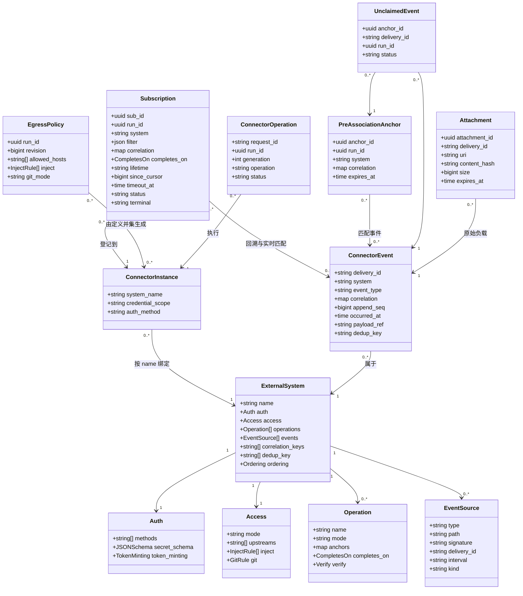
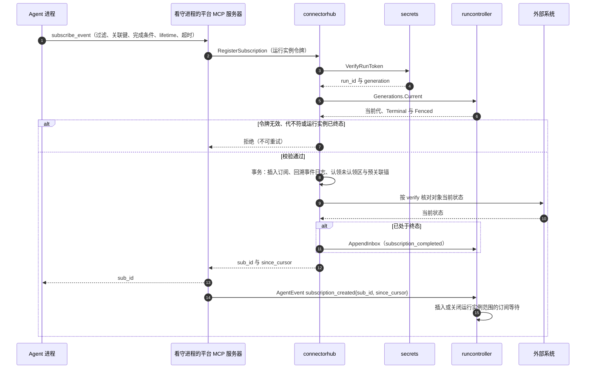
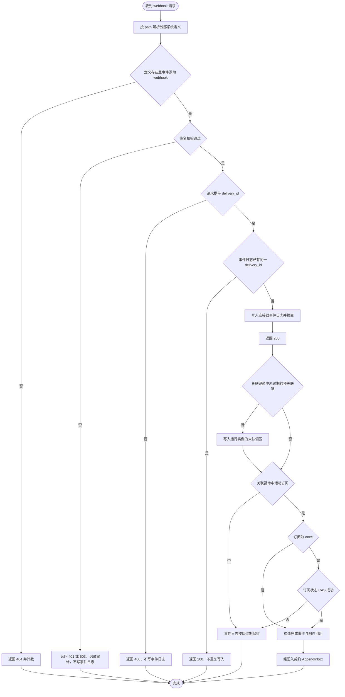
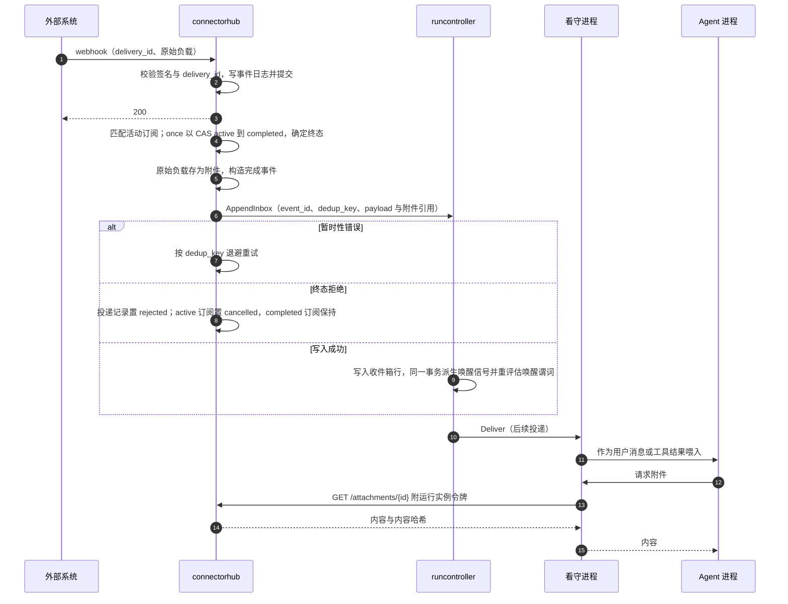

# connectorhub

`connectorhub` 坐在控制面，是外部系统与[运行实例](../../../glossary.md)之间的唯一入口。它拥有[外部系统定义](../../../glossary.md)、[连接器](../../../glossary.md)实例、连接器事件日志、[订阅](../../../glossary.md)登记与订阅状态、预关联锚与未认领区、同步操作的执行与在途登记请求、[出口策略](../../../glossary.md)的生成与推送，以及 k8s 路径的平台出口代理子模块；它不拥有[收件箱](../../../glossary.md)、[唤醒信号](../../../glossary.md)与运行实例状态，不拥有人类通道、LLM 流量与[沙箱](../../../glossary.md)生命周期。本模块向运行实例交付外部事件只有订阅完成事件一种形态，文档围绕连接器事件日志与订阅这对机制组织。

心智模型：webhook 先落盘再应答，订阅登记先回溯再等待；正确性不依赖事件与登记谁先到达（I2）。

文档较长，不宜顺序通读。第一次阅读按以下顺序：核心概念、职责、状态一览、走查、订阅登记与回溯匹配、webhook 摄入、完成事件构造与投递、去重、预关联锚与未认领区、出口策略生成与推送；外部系统定义、外部接口契约、依赖、UML 图、核心数据结构与实现状态作为参考，在核对字段或调用时查阅。并发与事务边界末尾的竞态用例留到最后自测：先按下文规则判断每个交错序列的结果，再与表中结论核对。

## 核心概念

外部系统的每一次变化先成为连接器事件日志中的一条事实；订阅是这张日志上的持久查询，查询命中后产生订阅完成事件。事件的到达顺序不决定它是否交付：webhook 在事件日志提交之后才应答 200，已接收的事件必然对之后的订阅可见；平台操作返回时按 `anchors` 登记预关联锚，操作返回之后、订阅登记之前到达的事件先进入该运行实例的未认领区，登记事务再把它并入回溯匹配。

系统需要这些保证，是因为运行实例在订阅上等待、沙箱在等待期间挂起，而外部事件的到达时刻与订阅的登记时刻互不约束。没有它们，早于订阅到达的事件会丢失，运行实例只能等下去；有了它们，事件先到、订阅先到与两者并发收敛到同一结果（I2）。订阅完成事件经汇入契约写入收件箱，唤醒由收件箱派生（[ADR-wait-on-durable-inbox](../../../adr/adr-wait-on-durable-inbox.md)）。

## 职责

`connectorhub` 的职责穷举如下，每条先写本模块执行的动作，再写产生的结果或边界；具体算法、表结构与调用细节见后续章节。

- **外部系统定义与连接器实例**：装载并校验 `kind: ExternalSystem` 的外部系统定义（下文简称定义），按项目作用域绑定凭据并构造连接器实例；拒绝闭集外取值、缺失必填字段或引用不存在主机的定义，使该外部系统不可用。
- **连接器事件日志**：接收 webhook，先校验签名与投递标识，再把原始事件写入连接器事件日志并提交，提交后才应答；以 `(system, delivery_id)` 唯一吸收发送方重发，为每条事件分配单调递增的追加序号，并按追加序号与 `occurred_at` 排序。
- **订阅登记与回溯匹配**：接收带运行实例令牌的订阅登记，在同一事务写入订阅行，并对事件日志与未认领区回溯匹配；把命中的事件认领给订阅，返回 `sub_id` 与 `since_cursor`。
- **完成条件核对与合成完成事件**：对带 `completes_on` 的订阅按 `verify` 核对外部对象当前状态；对象已处于终态时立即合成完成事件，不等待后续 webhook（I2）。
- **状态式轮询**：按外部系统定义的轮询周期遍历活动订阅，查询外部对象当前状态，只产生完成事件，不产生普通事件；兜底丢失或乱序的 webhook。
- **订阅完成事件投递**：把订阅完成事件经[汇入契约](../../../glossary.md)写入收件箱，`event_id` 由订阅与终态派生，`dedup_key` 由订阅与外部事件标识派生，原始负载以附件引用表达，载荷不超过 `S_max`。
- **去重**：以内容派生的 `dedup_key` 与收件箱唯一索引兜底 webhook 与轮询的重复，以 `delivery_id` 唯一兜底 webhook 重发，以 `once` 订阅的状态 CAS 兜底并发完成，以认领记录与完成事件投递记录的唯一键兜底 `until_cancelled` 的重复。
- **预关联锚与未认领区**：平台操作返回时按 `anchors` 登记 `run_id`、关联键值与 TTL；匹配到锚的事件先写入运行实例的未认领区，订阅登记时并入回溯匹配。
- **订阅对账扫描**：按配置的扫描周期重新匹配未被认领的留存事件、重投 `pending` 的完成事件投递记录，取消运行实例已终态的活动订阅，并把 `timeout_at` 已到期且仍为 `active` 的订阅置为 `expired` 并写入超时完成事件；以认领记录、投递记录的唯一键与订阅状态 CAS 幂等。
- **订阅生命周期**：维护 `active`、`completed`、`expired`、`cancelled`；`lifetime: once` 完成后丢弃同对象的迟到事件并审计；超时以 CAS 置 `expired` 并经汇入契约写入超时完成事件；运行实例终态，或 `active` 订阅的完成事件投递被终态拒绝时取消订阅。
- **同步操作**：接收[平台 MCP 服务器](../../../glossary.md)（[REF-mcp](../../../references.md)）转发的同步外部系统操作，校验运行实例令牌中的代，以 `(run_id, generation, request_id)` 持久化操作记录并经 `SetRunFact{inflight_request}` 登记在途事实，同一 `request_id` 只首次执行外部调用，其余返回已存结果或拒绝，执行结果返回 Agent；完成或失败经 `AppendWakeSignal` 写入同一 `request_id` 的唤醒信号。
- **出口策略生成与推送**：为每个运行实例生成允许主机与占位符替换规则，推送给沙箱提供者；未列入的主机默认拒绝；git 路径按 `reverse_proxy_rewrite` 生成重写规则。
- **令牌代校验**：订阅登记、同步操作与 k8s 路径的每个出口请求按[运行实例令牌](../../../glossary.md)校验签名、[代](../../../glossary.md)、终态与作废状态；有外部副作用的操作不使用缓存的代。
- **附件存放与取回**：存放超过 `S_max` 的原始负载，向平台 MCP 服务器提供附运行实例令牌的取回接口，按内容哈希校验内容。
- **平台出口代理子模块（k8s 路径）**：终止 CONNECT 或 HTTP 前置请求，按运行实例白名单鉴权，替换请求头中的凭据占位符，再转发到允许主机；实现细节见子文档。

### 非职责

- 人类消息、审批决定、聊天界面、即时通讯与 Issue 评论归 `humanchannel`；本模块不接收人类事件，不判断用户身份。
- LLM 请求、LLM 凭据换取、LLM 在途请求与回放归 `llmgateway`；本模块不代理 LLM 流量，不处理 `llm.request.*` 消息。
- 沙箱预配、[挂起](../../../glossary.md)、恢复、销毁与出口策略的按代落地、按代撤销归[沙箱提供者](../../../glossary.md)；本模块只生成并推送出口策略，不落地 NetworkPolicy 或 EgressPolicy。
- 收件箱、唤醒信号、等待、运行实例状态机与投递游标归 `runcontroller`；本模块只经汇入契约写入，不读 `run`、`inbox`、`wake_signal`、`wait`、`timer`、`outbox`、`run_fact`、`source_request` 与 `source_lease` 表。
- 运行实例令牌的签发、轮换与签名校验归 `secrets`；本模块调用其校验函数，并读取代查询结果。
- [工作区](../../../glossary.md)、[工作区租约](../../../glossary.md)与附件之外的持久文件归 `workspace`。
- webhook 发送方的重试策略、外部系统的可用性与限流不在本模块控制范围内；本模块只保证已接收事件的落盘、幂等与可重驱动。

## 术语表

| 术语 | 英文对照 | 适用范围 | 定义 |
| --- | --- | --- | --- |
| 连接器实例 | connector instance | connectorhub | 一个外部系统定义与一组项目作用域凭据的运行时绑定，承载该外部系统的操作、事件源与出口策略生成 |
| 连接器事件日志 | connector event log | connectorhub | 外部系统事件的追加写日志，以 `delivery_id` 唯一标识一次投递；webhook 与轮询的匹配都以它为事实源；本模块简称事件日志 |
| 预关联锚 | pre-association anchor | connectorhub | 平台操作返回时登记的 `run_id` 与关联键值组合，带 TTL，使操作返回后、订阅登记前到达的事件先归属到运行实例的未认领区；本模块简称锚 |
| 未认领区 | unclaimed area | connectorhub | 已匹配预关联锚、尚未被任何订阅认领的事件暂存区；订阅登记事务把它并入回溯匹配 |
| 订阅对账扫描 | subscription reconcile scan | connectorhub | 本模块的纠正性后台扫描，按持久化记录重新匹配未被认领的事件并重驱动未完成的完成事件投递；与 `runcontroller` 的对账器相互独立 |
| 完成条件 | completion condition | connectorhub | 订阅的 `completes_on` 所声明的外部事件条件，或在缺少事件时 `verify` 判定外部对象已处于终态的等价条件 |
| 终态 | terminal outcome | connectorhub | 外部对象在订阅关注维度上的结束取值集合，由外部系统定义的 `verify.terminal` 给出；完成事件的 `event_id` 以它与 `sub_id` 派生 |
| 订阅完成事件 | subscription completion event | connectorhub | 订阅命中完成条件后经汇入契约写入收件箱的事件，`kind` 为 `subscription_completed`，携带订阅标识、订阅状态、关联键、终态与附件引用；本模块简称完成事件 |

## 外部接口契约

对外稳定承诺按以下类别给出：外部系统定义 schema、对 `runcontroller` 的汇入调用、对沙箱提供者的出口策略推送、对平台 MCP 服务器的附件取回接口。新增可选字段与新增闭集取值为兼容变更；删除字段、改变既有字段语义或改变既有闭集取值的含义不是兼容变更，需要新字段名。订阅标识 `sub_id`、回溯游标 `since_cursor`、完成事件标识 `event_id` 与去重键 `dedup_key` 的派生规则同样属于稳定承诺。

### 外部系统定义

外部系统定义以 `kind: ExternalSystem` 的声明给出，字段闭集如下。定义中的 `...` 表示由具体外部系统填充的结构，不表示本模块的默认值。

```yaml
kind: ExternalSystem
name: github
auth:
  methods: [github_app_installation, personal_access_token]
  secret_schema: {...}
  token_minting: {ttl: 1h, scopes: [...]}
access:
  mode: proxied
  upstreams: [api.github.com, github.com]
  inject: [{host: api.github.com, header: Authorization, placeholder: "{{github.token}}"}]
  git: {mode: reverse_proxy_rewrite}
anchors: {ttl: 10m}
operations:
  - {name: create_pull_request, mode: sync, anchors: {pull_request.number: number, repository.full_name: base.repo.full_name, check_suite.head_sha: head.sha}}
  - {name: wait_for_checks, mode: async, completes_on: {event: check_suite.completed, match: check_suite.head_sha}, verify: {api: check-suites, terminal: [success, failure, ...]}}
events:
  sources:
    - {type: webhook, path: /hooks/github, signature: hmac-sha256, delivery_id: X-GitHub-Delivery}
    - {type: poll, interval: 60s, kind: state_reconcile}
  correlation_keys: [repository.full_name, pull_request.number, check_suite.head_sha]
  dedup_key: [event_type, repository.full_name, check_suite.id, conclusion]
  ordering: {occurred_at: updated_at}
```

| 字段 | 类型 | 约束与含义 |
| --- | --- | --- |
| `name` | string | 已装载定义中唯一；作为连接器实例、事件日志与订阅的系统命名空间 |
| `auth.methods` | string[] | 非空；每种认证方法在 `auth.secret_schema` 中有一个 JSON Schema |
| `auth.secret_schema` | map[string]JSONSchema | 认证方法到凭据结构的映射；凭据本身不写入定义 |
| `auth.token_minting` | object | 短期凭据的 `ttl` 与 `scopes`；由 `secrets` 使用 |
| `access.mode` | string | 闭集当前只有 `proxied`；其他取值使定义不装载 |
| `access.upstreams` | string[] | 非空，只含主机名；出口策略的允许主机集合，未列入的主机默认拒绝 |
| `access.inject` | InjectRule[] | 每条为 `{host, header, placeholder}`；`host` 必须属于 `upstreams`，只替换请求头 |
| `access.git.mode` | string | 闭集当前只有 `reverse_proxy_rewrite`；存在时 git 主机必须属于 `upstreams` |
| `anchors.ttl` | duration | 非空，正时长；预关联锚的存活时间，锚登记后经过该时长不再参与匹配 |
| `operations[].name` | string | 操作标识；平台 MCP 服务器以它选择操作 |
| `operations[].mode` | string | 闭集 `sync`、`async`；`async` 必须同时给出 `completes_on` 与 `verify` |
| `operations[].anchors` | map[string]string | 关联键路径到操作响应字段路径的映射；键必须是 `events.correlation_keys` 的子集，值从响应中取值后写入锚的关联键 |
| `operations[].completes_on` | object | `{event, match}`；`event` 是事件类型，`match` 是字段路径到值的匹配 |
| `operations[].verify` | object | `{api, terminal}`；`api` 是只读状态查询，`terminal` 是终态闭集 |
| `events.sources[].type` | string | 闭集 `webhook`、`poll` |
| `events.sources[].path` | string | webhook 的接收路径；同一路径只属于一个外部系统 |
| `events.sources[].signature` | string | 闭集当前只有 `hmac-sha256`；签名密钥由 `secrets` 提供 |
| `events.sources[].delivery_id` | string | 投递标识在请求头或负载中的字段路径；缺失时拒绝请求 |
| `events.sources[].interval` | duration | poll 的轮询周期 |
| `events.sources[].kind` | string | poll 的闭集当前只有 `state_reconcile`；只产生完成事件 |
| `events.correlation_keys` | string[] | 非空；关联键在原始负载中的字段路径 |
| `events.dedup_key` | string[] | 非空；去重键的字段路径；订阅登记时复制为 `dedup_spec` |
| `events.ordering.occurred_at` | string | 非空；事件发生时间在原始负载中的字段路径 |

定义在装载时校验。闭集外取值、缺失必填字段、`inject.host` 不在 `upstreams` 中、`anchors` 的键不在 `correlation_keys` 中、`anchors.ttl` 不是正时长、`async` 操作缺 `completes_on` 或 `verify` 时，该定义不装载，其 webhook 路径返回未找到，其操作返回不可用。定义变更后，新登记使用新定义；已登记订阅保留登记时的 `dedup_spec`，不因字段路径变化而改变去重结果；出口策略按新定义重新生成并推送。

### 对 runcontroller 的汇入调用

本模块只经汇入契约写入收件箱事件、唤醒信号与运行实例事实，不读 `runcontroller` 的表，`runcontroller` 不反向调用本模块。调用如下。

| 调用 | 触发 | 关键字段 | 幂等与错误 |
| --- | --- | --- | --- |
| `AppendInbox` | 订阅完成或订阅超时 | `RunID`、`EventID`、`DedupKey`、`Kind=subscription_completed`、`SubscriptionID`、`SubscriptionStatus`、`Correlation`、`OccurredAt`、`Payload` | 以 `(run_id, dedup_key)` 幂等；暂时性错误按同一键退避重试；不可重试的终态拒绝使完成事件投递记录置 `rejected`，`active` 订阅置 `cancelled` |
| `AppendWakeSignal` | 同步操作完成或失败 | `RunID`、`Generation`、`Kind=request_completed` 或 `request_failed`、`Ref=request_id`、`Reason`、`OccurredAt` | 以 `(run_id, generation, kind, ref)` 幂等；旧代的信号被 `runcontroller` 拒绝，不重试到新代 |
| `SetRunFact{inflight_request}` | 同步操作执行之前 | `RunID`、`Generation`、`RequestID`、`Kind=request`、`Instance`、`InitialTTL` | 按 `(run_id, generation, request_id, source)` 以插入登记；同一事务登记事件源实例租约 |
| `RenewSourceLease` | 长同步操作期间 | `Module=connectorhub`、`Instance`、`TTL` | 只延长租约；实例标识对每次进程启动唯一 |
| `Generations.Current` | 订阅登记、同步操作、k8s 路径的每个出口请求 | `RunID` | 返回 `Generation`、`Terminal` 与 `Fenced`；有外部副作用的操作与订阅登记不使用缓存 |

`AppendInbox` 的 `Payload` 不超过 `S_max`（取值见 [runcontroller](../design-runcontroller.md) 的载荷上限），超过上限的内容由本模块存放为附件，`Payload` 内只放可取回的 URI 与内容哈希。订阅完成事件的写入使 `runcontroller` 在同一事务派生对应的唤醒信号并重评估唤醒谓词，本模块不另写该信号。

### 对沙箱提供者的出口策略推送

本模块为每个运行实例生成一份出口策略，并以运行实例为键幂等推送；最新一次成功推送的出口策略生效。

```go
type EgressPolicy struct {
    RunID        RunID
    Revision     int64
    AllowedHosts []string
    Inject       []InjectRule   // {Host, Header, Placeholder}
    Git          GitRule        // {Mode: reverse_proxy_rewrite, ProxyHost}
}

type EgressPolicySink interface {
    PutEgressPolicy(ctx context.Context, p EgressPolicy) error
}
```

- `AllowedHosts` 是运行实例可用的外部系统定义的 `access.upstreams` 并集；未列入的主机默认拒绝，[本地代理](../../../glossary.md)对未放行目标立即拒绝而不是黑洞。
- `Inject` 是各定义 `access.inject` 的并集；每条规则只在请求头中把 `Placeholder` 替换为真实凭据，缺少该头的请求不注入。
- `Git` 存在时，`reverse_proxy_rewrite` 使 git 客户端把目标主机重写为平台 git 代理；git 的 Basic 或 Bearer 头同样由出口路径注入。
- 推送以运行实例幂等，`Revision` 递增；沙箱提供者在预配与认领沙箱时按代落地，并把推送的更新同步到该运行实例尚未撤销的代。按代撤销由 `runcontroller` 的 `revoke_egress` 效果驱动，本模块不撤销出口策略。
- Substrate 路径把出口策略映射为以（运行实例，代）为键的 `EgressPolicy`，以 `replaceHeaders` 替换占位符（[REF-substrate](../../../references.md)）；k8s 路径由 `sandboxprovider` 的 k8s 子模块落地为平台出口代理配置与 NetworkPolicy，k8s 路径的按代撤销为空操作。代理的鉴权、替换与转发细节见[平台出口代理（k8s 路径）](design-connectorhub-egress.md)。
- 推送失败时，沙箱提供者保留上一次成功推送的出口策略，本模块按运行实例与 `Revision` 重试；新代预配前以已保存的出口策略落地，未列入的主机仍被拒绝。

### 对平台 MCP 服务器的附件取回接口

平台 MCP 服务器把附件 URI 返回给 Agent，Agent 通过平台 MCP 服务器取回内容；Agent 进程不直连本模块。

```
GET /attachments/{attachment_id}
Authorization: Bearer <运行实例令牌>
```

- 响应体为原始内容，响应头携带 `content_hash` 与 `size`；调用方按 `content_hash` 校验内容。
- 本模块校验令牌签名与 `run_id`（`secrets`）、令牌中的代、运行实例终态与本代作废状态（`Generations.Current`），并校验该附件属于该运行实例的某个订阅完成事件；任一不通过时返回 401 或 404，不泄露附件是否存在。
- 附件超过保留期时返回 410。取回请求不使用缓存的代。
- 稳定承诺为路径形状、令牌位置、内容哈希校验与响应状态码语义；内容本身不透明，不承诺可解析。

## 依赖

依赖穷举如下，方向与[模块依赖图](../../architecture.md#模块依赖图)一致：本模块依赖 `runcontroller`、`secrets`、`sandboxprovider` 与外部系统，存储为 PostgreSQL 与附件存储；`runcontroller` 不反向调用本模块，本模块不依赖 `warden`、`llmgateway`、`humanchannel` 与 `workspace`。

- `runcontroller`：汇入契约的 `AppendInbox`、`AppendWakeSignal`、`SetRunFact{inflight_request}` 与 `RenewSourceLease`，以及代查询接口 `Generations.Current`。本模块不读 `runcontroller` 的表；订阅完成事件只以 `subscription_completed` 写入，超时只以 `subscription_status=expired` 写入。
- `secrets`：运行实例令牌的签名与过期校验、外部系统凭据的换取、webhook 签名密钥的读取。真实凭据只在控制面进程内存中出现，不写入定义、事件日志、收件箱或附件。代不匹配、运行实例终态与本代作废等拒绝路径调用 `secrets.AppendAudit` 写 `denied` 记录。
- `sandboxprovider`：出口策略接口 `PutEgressPolicy`。出口策略的按代落地、按代撤销、平台出口代理配置与 NetworkPolicy 的落地归该模块；本模块不预配、不挂起、不销毁沙箱。
- 外部系统：HTTP API 的只读查询、同步操作与 webhook 发送方。外部系统的可用性、限流与重试策略不在本模块控制范围内。
- PostgreSQL：保存本模块的订阅、事件日志、认领记录、预关联锚、未认领区、同步操作与附件元数据，提供唯一索引、行锁与事务。
- 附件存储：保存超过 `S_max` 的原始负载；存储实现由部署配置决定，接口约束见附件取回一节。
- 运行时调用方：[看守进程](../../../glossary.md)的本地代理与平台 MCP 服务器经 HTTP 调用本模块，携带运行实例令牌；这是运行时调用，不是代码依赖，不出现在模块依赖图中。

架构不变量 I1 与 I6 要求全部外部系统流量经托管侧、沙箱零长期凭据（[ADR-host-owns-all-wake-sources](../../../adr/adr-host-owns-all-wake-sources.md)）；I2 要求订阅登记回溯匹配并核对对象当前状态；I7 要求出口请求与订阅登记按代校验（[ADR-generation-fencing](../../../adr/adr-generation-fencing.md)）。本模块的依赖方向满足这些约束。

## UML 图

类图固定外部系统定义、连接器实例与订阅相关实体的关系；时序图分别固定订阅登记与订阅完成投递的消息顺序；活动图固定 webhook 摄入的分支。图中不表达的约束由每张图后的正文给出。

### 类图



类图只列键字段与关系字段，全部列见核心数据结构。`ExternalSystem` 是定义，`ConnectorInstance` 是定义与凭据作用域的运行时绑定；多个运行实例可共享同一连接器实例，但订阅与出口策略按运行实例归属。`Subscription` 归属一个运行实例与一个外部系统，跨沙箱重建保留；`ConnectorEvent` 是跨运行实例共享的日志事实，订阅通过认领记录与它关联。`PreAssociationAnchor` 把平台操作的返回值与后续事件连起来，`UnclaimedEvent` 是锚与事件之间的暂存关系。`Attachment` 按事件归属，不按运行实例复制。图中不表达唯一索引、状态 CAS 与事务边界，这些约束见并发与事务边界。

### 订阅登记与回溯匹配时序图



图中的先后不表示正确性依赖事件与登记的顺序。登记事务在提交前完成回溯匹配并认领预关联锚；`verify` 在事务外执行，已终态时合成完成事件。`AppendInbox` 与订阅插入不在同一事务：订阅行先提交为 `active`，匹配或 `verify` 命中后以状态事务置 `completed` 并写投递记录，随后调用 `AppendInbox`；汇入调用失败时按投递记录的 `event_id` 与 `dedup_key` 重驱动。`subscription_created` 由看守进程在 `sub_id` 返回后发出，`runcontroller` 据此插入运行实例范围的订阅[等待](../../../glossary.md)；若完成事件已先到达，`runcontroller` 在登记等待时直接关闭它，不产生丢失。

### webhook 摄入活动图



活动图固定 webhook 的应答顺序：事件日志提交之后才返回 200，签名失败、缺少投递标识或定义不存在时不写日志。匹配发生在 200 之后；匹配失败不改变已应答的结果，事件日志保留，由状态式轮询与订阅对账扫描重驱动。重复的 `delivery_id` 返回 200 但不重复匹配。未命中任何订阅或锚的事件只留在日志中，不进入收件箱。

### 订阅完成与投递时序图



图中的 `CAS active 到 completed` 是 `once` 订阅并发完成的唯一裁决点：webhook 与状态式轮询都只能通过该 CAS 构造完成事件，失败的一方不写收件箱；`until_cancelled` 的每次命中各写一条投递记录，由 `(sub_id, dedup_key)` 吸收重复。`AppendInbox` 在订阅状态事务提交之后执行，暂时性失败按同一 `dedup_key` 重试；`runcontroller` 返回终态或运行实例不存在时，投递记录置 `rejected`，不再重试；订阅若仍为 `active` 则置 `cancelled`，已 `completed` 的保持 `completed`。附件取回发生在投递之后，Agent 通过平台 MCP 服务器取回，不直连本模块。

## 核心数据结构

### 状态一览

订阅的生命周期状态闭集为 `active`、`completed`、`expired`、`cancelled`。`lifetime: until_cancelled` 的订阅在每次匹配后仍为 `active`，完成事件携带 `subscription_status=active`；`completed` 只用于 `lifetime: once` 的完成，`verify` 合成只出现在该生命周期。

| 状态 | 一句话含义 | 当前动作 | 直觉画面 |
| --- | --- | --- | --- |
| `active` | 订阅已登记，等待完成条件 | connectorhub 让 webhook 匹配与状态式轮询对它的完成条件生效 | 候车厅里亮着的号牌 |
| `completed` | 完成条件已满足，完成事件进入投递 | connectorhub 不再匹配该订阅，同对象的迟到事件丢弃并审计 | 已检票出站的乘客 |
| `expired` | 超过 `timeout_at` 仍未完成 | connectorhub 把超时完成事件置入投递，不再匹配 | 过了发车时刻的车票 |
| `cancelled` | 运行实例终态，或 `active` 订阅的完成事件投递被终态拒绝 | connectorhub 停止匹配，不写完成事件 | 被注销的号牌 |

### 外部系统定义与连接器实例

| 字段 | 类型 | 约束 | 含义 |
| --- | --- | --- | --- |
| `name` | string | 唯一 | 外部系统标识，连接器实例、事件日志与订阅的命名空间 |
| `auth` | object | `methods` 非空，每种方法有 `secret_schema` | 认证方法与短期凭据签发参数 |
| `access` | object | `mode=proxied`，`upstreams` 非空 | 出口允许主机、占位符注入规则与 git 重写 |
| `operations` | Operation[] | `mode` 属于 `sync`、`async` | 同步操作与异步完成条件 |
| `events` | object | `correlation_keys`、`dedup_key`、`ordering.occurred_at` 非空 | webhook 与 poll 事件源、关联键、去重键与时间字段 |
| `credential_scope` | string | 连接器实例字段 | 项目作用域的凭据授权范围；凭据由 `secrets` 换取 |
| `auth_method` | string | 属于定义的 `auth.methods` | 该连接器实例选用的认证方法 |

### 连接器事件日志

| 字段 | 类型 | 约束 | 含义 |
| --- | --- | --- | --- |
| `system` | string | 与 `delivery_id` 组成唯一键 | 事件所属外部系统 |
| `delivery_id` | string | 唯一键的一部分 | webhook 投递标识；重复投递不新增行 |
| `event_type` | string | 由连接器规范化 | 事件类型；`completes_on.event` 与 `dedup_key` 使用该字段 |
| `correlation` | map[string]string | 由 `events.correlation_keys` 提取 | 关联键到值的映射 |
| `append_seq` | bigint | 非空，写入时分配且单调递增 | 日志追加序号；回溯扫描以它与 `since_cursor` 比较 |
| `occurred_at` | time | 由 `events.ordering.occurred_at` 提取 | 事件发生时间；`once` 订阅在命中事件中按它取最早的一条 |
| `received_at` | time | 写入时刻 | 本模块接收时间 |
| `payload_ref` | string | 附件 URI | 原始负载的取回地址；内容哈希另存 |
| `content_hash` | string | 与 `payload_ref` 成对 | 原始负载的内容哈希 |
| `dedup_key` | string | 由 `events.dedup_key` 的字段值派生 | 内容派生的去重键 |
| `claimed_by_sub` | uuid[] | 可空 | 已认领该事件的订阅集合；由认领记录投影 |

### 订阅

| 字段 | 类型 | 约束 | 含义 |
| --- | --- | --- | --- |
| `sub_id` | uuid | 主键 | 订阅标识；完成事件与 `wait_for` 的 `ref` 使用它 |
| `run_id` | uuid | 非空 | 所属运行实例；订阅跨沙箱重建保留 |
| `system` | string | 属于已装载定义 | 外部系统 |
| `filter` | json | 字段路径到期望值的映射，多条为合取 | 只匹配满足过滤条件的事件 |
| `correlation` | json | 字段路径到值 | 关联键；回溯与实时匹配使用 |
| `completes_on` | json | `{event, match}`，可空；非空只与 `once` 组合 | 完成条件；`until_cancelled` 的该字段为空，按 `filter` 与 `correlation` 逐事件匹配 |
| `verify` | json | `{api, terminal}`，与 `completes_on` 配套 | 登记时与轮询时核对对象当前状态；只用于 `once` 订阅 |
| `lifetime` | string | 闭集 `once`、`until_cancelled` | `once` 完成后终止匹配；`until_cancelled` 每次匹配继续 |
| `since_cursor` | bigint | 回溯游标 | 取登记事务开始时事件日志的下一个追加序号；回溯扫描 `append_seq < since_cursor` 的事件，实时匹配从 `append_seq >= since_cursor` 开始。带锚的订阅另把锚下的未认领事件并入候选集，不改变游标 |
| `timeout_at` | time | 可空 | 为空表示无订阅超时；非空时到期置 `expired` |
| `dedup_spec` | json | 登记时 `events.dedup_key` 的副本 | 定义变更不影响已登记订阅的去重字段 |
| `status` | string | 闭集见状态一览 | 订阅生命周期状态 |
| `terminal` | string | 可空 | 完成时的终态取值；未完成时为空 |
| `created_at` | time | 非空 | 登记时刻 |
| `completed_at` | time | 可空 | 完成、超时或取消时刻 |

### 预关联锚与未认领区

| 字段 | 类型 | 约束 | 含义 |
| --- | --- | --- | --- |
| `anchor_id` | uuid | 主键 | 预关联锚标识 |
| `run_id` | uuid | 非空 | 锚所属运行实例 |
| `system` | string | 属于已装载定义 | 外部系统 |
| `correlation` | json | 由 `operations[].anchors` 的返回值按关联键映射构造 | 关联键到值 |
| `expires_at` | time | 由定义的 `anchors.ttl` 决定 | 过期后不参与匹配 |
| `claimed_by_sub` | uuid | 可空 | 已认领该锚的订阅 |
| `unclaimed` | UnclaimedEvent[] | 由锚匹配产生 | 暂存到运行实例未认领区的事件 |

`UnclaimedEvent` 以 `(anchor_id, delivery_id)` 唯一，`status` 闭集为 `unclaimed`、`claimed`、`discarded`。订阅登记事务按 `run_id` 与关联键认领锚及其未认领事件；锚过期或订阅不再需要时，未认领事件置 `discarded` 并审计。

### 认领记录与完成事件投递记录

| 字段 | 类型 | 约束 | 含义 |
| --- | --- | --- | --- |
| `sub_id` | uuid | 与 `delivery_id` 组成唯一键 | 认领事件的订阅 |
| `system` | string | 非空 | 外部系统 |
| `delivery_id` | string | 与 `sub_id` 组成唯一键 | 被认领的事件投递 |
| `claimed_at` | time | 非空 | 认领时刻 |
| `terminal` | string | 可空 | 认领时确定的终态；事件尚未构造完成事件时为空 |

认领记录是 `(sub_id, delivery_id)` 唯一的事实来源；事件日志的 `claimed_by_sub` 由它投影，去重、审计与订阅对账扫描都以它为准。

| 字段 | 类型 | 约束 | 含义 |
| --- | --- | --- | --- |
| `delivery_id` | uuid | 主键 | 完成事件投递记录标识 |
| `sub_id` | uuid | 由 `(sub_id, dedup_key)` 唯一 | 产生该完成事件的订阅 |
| `run_id` | uuid | 非空 | 目标运行实例 |
| `event_id` | string | 非空 | 完成事件标识 |
| `dedup_key` | string | 与 `sub_id` 组成唯一键 | 完成事件去重键 |
| `payload_ref` | string | 可空 | 附件 URI 与内容哈希 |
| `status` | string | 闭集 `pending`、`delivered`、`rejected` | 投递状态 |
| `attempts` | int | 非空 | `AppendInbox` 尝试次数 |
| `created_at` | time | 非空 | 写入时刻 |
| `delivered_at` | time | 可空 | 投递成功或终态拒绝时刻 |

完成事件投递记录由匹配事务或订阅状态事务在同一本模块事务内写入，`AppendInbox` 在事务提交之后执行；订阅对账扫描按 `pending` 记录以 `event_id` 与 `dedup_key` 幂等重投，成功后置 `delivered`，终态拒绝置 `rejected`。`until_cancelled` 的每次完成各写一条记录，不依赖订阅状态。

### 出口策略

| 字段 | 类型 | 约束 | 含义 |
| --- | --- | --- | --- |
| `run_id` | uuid | 主键 | 出口策略所属运行实例 |
| `project_id` | uuid | 非空 | 运行实例所属项目；出口代理以它向 `secrets` 换取凭据 |
| `revision` | int64 | 每次推送递增 | 推送修订号；最新成功推送生效 |
| `allowed_hosts` | string[] | 各定义 `upstreams` 的并集 | 允许出口的主机；未列入默认拒绝 |
| `inject` | InjectRule[] | 每条 `{host, header, placeholder, system, auth_method, scopes}` | 请求头占位符替换规则；后三项是出口代理换取凭据所需的凭据对象定位与作用域 |
| `git` | GitRule | `{mode, proxy_host, system, auth_method, scopes}` | git 反向代理重写规则及其凭据引用 |
| `updated_at` | time | 非空 | 最近一次成功推送时刻 |

### 同步操作

| 字段 | 类型 | 约束 | 含义 |
| --- | --- | --- | --- |
| `request_id` | string | 与 `run_id`、`generation` 组成唯一键 | 平台 MCP 服务器随请求携带的标识；在途事实与唤醒信号使用它 |
| `run_id` | uuid | 非空 | 所属运行实例 |
| `generation` | int | 非空 | 请求登记时的代；唤醒信号只写该代 |
| `system` | string | 属于已装载定义 | 外部系统 |
| `operation` | string | 属于定义的 `operations` 且 `mode=sync` | 操作名 |
| `status` | string | 闭集 `in_flight`、`completed`、`failed` | 操作状态 |
| `failure_reason` | string | 可空；闭集 `registration_failed`、`instance_lost`、`external_error` | 失败分类；决定能否自动恢复执行 |
| `result` | json | 可空 | 完成时的结果或失败原因；重复请求直接返回该记录 |
| `source_instance` | string | 对每次进程启动唯一 | 事件源实例标识；用于租约与失联判定 |
| `lease_expires_at` | time | `in_flight` 时非空 | 实例租约到期时刻；过期后行可被判定为 `instance_lost` |
| `started_at` | time | 非空 | 开始时刻 |
| `finished_at` | time | 可空 | 完成或失败时刻 |

### 附件

| 字段 | 类型 | 约束 | 含义 |
| --- | --- | --- | --- |
| `attachment_id` | uuid | 主键 | 附件标识；出现在取回 URI 中 |
| `system` | string | 非空 | 外部系统 |
| `delivery_id` | string | 指向事件日志行 | 原始负载所属投递 |
| `uri` | string | 非空 | 可取回的 URI |
| `content_hash` | string | 与 `uri` 成对 | 内容哈希；取回时校验 |
| `size` | int64 | 非空 | 内容字节数 |
| `created_at` | time | 非空 | 写入时刻 |
| `expires_at` | time | 不早于引用它的事件日志行的保留期 | 过期后取回返回 410 |

## 核心算法与流程

### 走查

初始状态：运行实例 `R` 的当前代为 3；Agent 已调用 `github.create_pull_request`，外部系统返回 `pull_request.number=42` 与 `head.sha=abc123`；`connectorhub` 按定义的映射已登记预关联锚 `A`，关联键为 `repository.full_name=acme/repo`、`pull_request.number=42`、`check_suite.head_sha=abc123`，TTL 未到期。事件日志、订阅与收件箱中都没有对应记录。

1. Agent 经平台 MCP 服务器调用 `wait_for`，参数为 `event=check_suite.completed`、`match=check_suite.head_sha=abc123`、`lifetime=once` 与超时 `T`。`connectorhub` 校验令牌，事务插入订阅 `S`，`status=active`，`since_cursor` 取登记事务开始时事件日志的下一个追加序号 `e0`；回溯事件日志与未认领区未命中；认领锚 `A`。落库：`subscription(S, active, since_cursor=e0)`、`anchor(A, claimed_by_sub=S)`。
2. `connectorhub` 调用 `verify` 按 API 的 `head_sha=abc123` 查询检查套件，返回 `queued`，不属于 `verify.terminal`；不写完成事件。落库状态不变。
3. 外部系统投递 webhook `D1`：`check_suite.completed`、`conclusion=success`、`check_suite.head_sha=abc123`。`connectorhub` 校验签名，`delivery_id=D1` 未出现，写入连接器事件日志并提交，返回 200，追加序号为 `e0`。落库：`event(D1, append_seq=e0, claimed_by_sub=∅)`。
4. 匹配事务：`D1` 的关联键命中订阅 `S`；同一事务把 `S` 从 `active` CAS 到 `completed`，写入 `terminal=success`。CAS 成功后把原始负载写入附件 `ATT1`，`content_hash` 为内容哈希；构造完成事件：`event_id=(S, success)`，`dedup_key=H(S, H(D1 的 dedup_spec 字段值))`，`subscription_status=completed`，`payload` 含 `ATT1` 的 URI、内容哈希与大小，长度不超过 `S_max`；同一事务写入状态为 `pending` 的完成事件投递记录。落库：`subscription(S, completed, success)`、`attachment(ATT1)`、`completion_delivery(S, event_id=(S,success), dedup_key=…, pending)`。
5. 事务提交。
6. 提交后调用 `AppendInbox`。`runcontroller` 写入收件箱行，同一事务派生唤醒信号并重评估唤醒谓词，返回 `inbox_seq`；完成事件投递记录置 `delivered`。落库：`inbox(R, inbox_seq, event_id=(S,success), dedup_key=…)` 与对应的 `wake_signal`。
7. `runcontroller` 投递该事件；Agent 收到 `wait_for` 的工具结果，载荷含附件引用。Agent 经平台 MCP 服务器调用 `GET /attachments/ATT1`，附运行实例令牌；`connectorhub` 校验令牌、代与归属，返回内容与内容哈希。
8. 同一 `check_suite` 的重复 webhook `D2` 到达：`delivery_id` 不同但内容相同；订阅已 `completed`，`D2` 作为迟到事件丢弃并审计；即使构造完成事件，`AppendInbox` 也按 `(run_id, dedup_key)` 幂等，收件箱不新增行。

### 外部系统定义装载与连接器实例

定义从配置装载，按 `name` 建立连接器实例。装载时校验字段闭集、必填字段、`inject.host` 属于 `upstreams`、`anchors` 的键属于 `correlation_keys`、`anchors.ttl` 为正时长、`async` 操作的 `completes_on` 与 `verify` 成对出现、`events` 的 `correlation_keys`、`dedup_key` 与 `ordering.occurred_at` 非空。校验失败的定义不装载，其 webhook 路径返回未找到，其操作返回不可用，并计数。连接器实例按项目作用域从 `secrets` 换取凭据；定义文件、事件日志、订阅与附件都不保存真实凭据。

定义变更后，新订阅使用新定义；已登记订阅保留 `dedup_spec` 副本。出口策略按新定义重新生成，以递增的 `Revision` 推送；沙箱提供者把更新同步到尚未撤销的代。

### 订阅登记与回溯匹配

登记输入为运行实例令牌、外部系统、`filter`、`correlation`、`completes_on`、`lifetime` 与 `timeout_at`；`verify` 取 `completes_on` 所引用 `async` 操作的 `verify`，没有 `completes_on` 时为空。处理顺序如下。

1. 校验令牌：`secrets` 验证签名、过期时间与 `run_id`；`Generations.Current` 比较代、终态与本代作废状态。订阅登记不使用缓存的代。
2. 校验定义与订阅参数：`lifetime` 属于 `once`、`until_cancelled`；`completes_on` 非空只与 `once` 组合，`until_cancelled` 的 `completes_on` 为空；`completes_on` 引用定义中带 `verify` 的 `async` 操作；`filter` 与 `correlation` 的字段路径可解析。
3. 开启本模块事务。插入订阅行，`status=active`，`dedup_spec` 取登记时的 `events.dedup_key` 副本。`since_cursor` 取登记事务开始时事件日志的下一个追加序号。
4. 在事务内认领与该运行实例和关联键匹配、未过期的预关联锚，把锚下的未认领事件并入候选集。
5. 扫描事件日志中关联键匹配且 `append_seq < since_cursor` 的事件，逐条应用 `filter` 与 `completes_on`；命中事件以 `(sub_id, delivery_id)` 认领。`lifetime: once` 取 `occurred_at` 最早的一条作为完成事件；`until_cancelled` 把命中事件逐条构造为完成事件。
6. 提交事务。
7. 若 `completes_on` 非空且事务内没有命中，调用 `verify` 核对对象当前状态。对象已处于 `verify.terminal` 时，CAS `active` 到 `completed` 并合成完成事件；核对不可达时保持 `active`，由状态式轮询重试。`completes_on` 为空的 `until_cancelled` 订阅不执行该核对。
8. 返回 `sub_id` 与 `since_cursor`。看守进程随后发出 `subscription_created{sub_id, since_cursor}`；`since_cursor` 是实时匹配的起点，Agent 不解析其数值。

回溯匹配以 `(system, correlation)` 上的索引与 `append_seq < since_cursor` 定位候选事件，复杂度与候选事件数和命中订阅数成正比，不随事件日志总量线性增长。认领记录的唯一键使同一条事件被同一订阅重复认领时无额外效果。

### webhook 摄入

1. 按请求路径解析外部系统与事件源定义。路径未注册或事件源不是 webhook 时返回 404。
2. 按定义的 `signature` 校验请求签名。签名不通过返回 401；签名密钥不可用返回 503；任一情况都不写事件日志，记录审计与计数。
3. 读取 `delivery_id`。缺失时返回 400，不写事件日志。
4. 以 `(system, delivery_id)` 插入事件日志。唯一键冲突表示重复投递，返回 200，不重复写入、不重复匹配。
5. 提交事务后返回 200。
6. 匹配未过期的预关联锚：命中的事件写入对应运行实例的未认领区。
7. 匹配活动订阅：以关联键索引定位候选订阅，逐条应用 `filter` 与 `completes_on`，以 `(sub_id, delivery_id)` 认领。`once` 订阅通过状态 CAS 完成；`until_cancelled` 订阅保持 `active`，每条命中事件各自构造完成事件并各写一条投递记录。
8. 未命中任何锚或订阅的事件留在日志中，按保留期保存。

webhook 的匹配复杂度与关联键命中的订阅数成正比，不对全部订阅做扫描。匹配失败不回滚已返回的 200；事件日志保留，由状态式轮询与订阅对账扫描重驱动。

### 状态式轮询

状态式轮询按外部系统定义的 `interval` 遍历活动订阅，只对带 `completes_on` 与 `verify` 的 `once` 订阅工作。

1. 选取状态为 `active`、`completes_on` 非空且 `verify` 可用的订阅，按外部系统分组。
2. 对每个订阅调用 `Generations.Current`；返回终态或运行实例不存在时，以 CAS 把 `active` 置为 `cancelled`，不查询外部系统，继续下一个订阅。
3. 调用只读的 `verify.api`，取得外部对象当前状态。
4. 状态属于 `verify.terminal` 时，以 CAS 把订阅置为 `completed`，确定 `terminal`，构造完成事件，写入 `pending` 投递记录后投递。
5. 状态不属于终态时不写任何事件；核对不可达时按退避重试并计数。
6. 轮询不写连接器事件日志，不产生普通事件；它只产生完成事件。完成事件的 `occurred_at` 取外部对象状态中的 `events.ordering.occurred_at` 字段，不可用时取核对时刻。

轮询复杂度与活动订阅数成正比。同一 `once` 订阅的 webhook 完成与轮询完成由状态 CAS 裁决，只有一个成功；失败的一方不写完成事件与投递记录。

订阅对账扫描按配置的扫描周期纠正以下差异：未被任何认领记录认领、仍在活动订阅匹配窗口内的留存事件按关联键重新匹配并认领；`pending` 的完成事件投递记录按 `event_id` 与 `dedup_key` 重投；活动订阅经 `Generations.Current` 检查，运行实例终态或不存在时置 `cancelled`，覆盖没有完成事件也不参与状态式轮询的 `until_cancelled` 订阅；`timeout_at` 已到期且仍为 `active` 的订阅按「订阅取消与超时」的规则 CAS 置 `expired` 并写入超时完成事件。各纠正分别以认领记录的 `(sub_id, delivery_id)`、投递记录的 `(sub_id, dedup_key)` 与订阅状态 CAS 幂等；每次纠正计数，差异数计入 `subscription_reconcile_diff` 指标。该扫描不读取 `runcontroller` 的表，只调用其代查询接口。

### 完成事件构造与投递

完成事件以 `AppendInbox` 写入，`Kind=subscription_completed`。字段构造规则如下。

- `终态`：`verify` 合成取核对到的终态；webhook 事件取事件中的结论字段；`until_cancelled` 的事件没有结论字段时取事件类型；超时为 `expired`。
- `EventID`：`lifetime: once`（含 `verify` 合成）、`lifetime: until_cancelled` 的每次匹配与超时都使用 `(sub_id, 终态)`，超时为 `(sub_id, expired)`。`until_cancelled` 的多次完成由 `dedup_key` 区分，`event_id` 只标识终态；等待方按收件箱序号游标取尚未通知的完成，游标由 `runcontroller` 在该订阅的等待行上维护，不依赖 `event_id` 唯一。
- `DedupKey`：webhook 触发与 `until_cancelled` 的每次匹配使用 `H(sub_id, 外部事件标识)`，外部事件标识由 `dedup_spec` 的字段值派生；`once` 的 `verify` 合成为 `H(sub_id, verify, 终态)`；超时为 `H(sub_id, expired)`。内容相同的 webhook 即使 `delivery_id` 不同也得到同一 `dedup_key`。
- `SubscriptionStatus`：`once` 为 `completed`；`until_cancelled` 为 `active`；超时为 `expired`；取消不写事件。
- `Correlation`：订阅的关联键与终态。
- `OccurredAt`：webhook 事件取日志的 `occurred_at`；`verify` 合成取核对时刻；超时取 `timeout_at`。
- `Payload`：含订阅标识、终态、关联键、事件摘要与附件引用 `{uri, content_hash, size}`；长度不超过 `S_max`。webhook 触发的完成事件把原始负载总是存为附件；`verify` 合成的完成事件携带紧凑状态，超过 `S_max` 时同样存为附件。

`event_id` 与 `dedup_key` 的规范化编码固定为：元组元素按声明顺序排列；`dedup_spec` 的字段按定义的字段路径顺序取值；缺失值编码为空串；字符串按 UTF-8 编码；元组编码为 JSON 数组；`H(...)` 表示对 JSON 数组求 SHA-256 并输出小写十六进制。实现不得改变元素顺序、编码方式或哈希算法。

写入按至少一次执行。暂时性错误按同一 `dedup_key` 退避重试；`runcontroller` 返回运行实例终态或运行实例不存在时，投递记录置 `rejected`，订阅若仍为 `active` 则置 `cancelled`，不再重试；已 `completed` 的订阅保持 `completed`，不因投递终态拒绝改写状态。写入成功后由 `runcontroller` 在同一事务派生唤醒信号，本模块不重复写。

### 去重

去重按层次穷举如下。

1. **投递层**：连接器事件日志以 `(system, delivery_id)` 唯一，吸收 webhook 发送方的重发。
2. **认领层**：`(sub_id, delivery_id)` 唯一，保证同一订阅对同一投递只认领一次。
3. **收件箱层**：`(run_id, dedup_key)` 唯一，吸收 webhook 与状态式轮询对同一订阅完成条件的重复结果，也吸收 `delivery_id` 不同但内容相同的重复 webhook。
4. **状态层**：`once` 订阅的状态 CAS 保证并发完成只有一个成功者；`until_cancelled` 的每次完成由认领记录与完成事件投递记录的唯一键保证同一外部事件只投递一次；`once` 的迟到事件在状态已 `completed` 后丢弃并审计。

`dedup_key` 由 `dedup_spec` 的字段值派生，`dedup_spec` 是登记时的副本。外部系统定义改变去重字段后，已登记订阅仍按旧副本计算。同一 `dedup_key` 对应不同内容时，先写入者胜出，后到者丢弃并审计。

### 预关联锚与未认领区

平台操作返回时，`connectorhub` 按 `operations[].anchors` 的映射从响应路径提取字段值，以映射键写入关联键，登记预关联锚：`run_id`、外部系统、关联键值与 `expires_at`。TTL 取定义的 `anchors.ttl`；锚只属于该运行实例。

webhook 事件到达时，若关联键命中未过期的锚，事件写入该运行实例的未认领区。同一事件命中多个锚时，为每个锚各写一条未认领记录。订阅登记事务按 `run_id` 与关联键认领锚及其未认领事件，把它们并入回溯匹配；认领后事件对该订阅可见。锚过期后不再匹配，其未认领事件置 `discarded` 并审计。未认领区只对所属运行实例的订阅可见，不跨运行实例共享。

### 同步操作

1. 平台 MCP 服务器把运行实例令牌、`system`、`operation`、参数与 `request_id` 转发给 `connectorhub`。
2. `connectorhub` 校验令牌的签名、代、终态与作废状态；操作必须属于定义的 `operations` 且 `mode=sync`；参数由连接器实现校验。
3. 以 `(run_id, generation, request_id)` 插入同步操作行，`status=in_flight`，`lease_expires_at` 取登记时刻加 `InitialTTL`。插入冲突时读取已有行并按状态处置：
   - `completed`：直接返回已存结果。
   - `failed` 且 `failure_reason=registration_failed`：该行尚未发起外部调用，以 CAS 置回 `in_flight` 并重置 `lease_expires_at`，从第 4 步继续。
   - `failed` 且 `failure_reason=instance_lost`：只读操作以 CAS 置回 `in_flight` 并重新执行；有外部副作用的操作返回该失败，不自动重执行，由 Agent 决定是否以新的 `request_id` 重试。
   - `failed` 的其他原因：返回同一失败。
   - `in_flight` 且 `lease_expires_at > now()`：返回重复请求错误。
   - `in_flight` 且 `lease_expires_at ≤ now()`：以 CAS 置为 `failed`、`failure_reason=instance_lost`，再按上一条处置。该行可能已发起外部调用，故有外部副作用的操作不自动重执行。
4. 首次执行或从 `registration_failed` 恢复时，在外部调用之前以 `SetRunFact{inflight_request}` 登记在途事实，携带 `Generation`、`RequestID`、`Instance` 与 `InitialTTL`。登记失败（暂时性错误）时以 CAS 把该行置为 `failed`、`failure_reason=registration_failed`，返回 `503`；不换取凭据、不发起外部调用、不写唤醒信号。长操作期间以 `RenewSourceLease` 续租并以同一周期刷新 `lease_expires_at`。
5. 从 `secrets` 换取真实凭据，执行外部调用。有外部副作用的操作不自动重试；只读操作可重试。
6. 成功时把结果写入操作记录并返回平台 MCP 服务器，经 `AppendWakeSignal` 写入 `request_completed`，`Ref=request_id`。失败时写入 `failed`、`failure_reason=external_error` 与失败原因，返回工具错误，并写入 `request_failed`。
7. 完成信号只在请求登记时的代上写入。`Generations.Current` 显示当前代已变化时，不写旧代信号；旧代沙箱此时已被替换，结果不再交付旧代，新代由 Agent 重新发起或读取外部状态。

`request_id` 由平台 MCP 服务器对每次请求生成，在同一运行实例、同一代内唯一。`(run_id, generation, request_id)` 上的操作记录是执行幂等键：只有首次插入或从 `registration_failed` 恢复的操作行发起外部调用，同一 `request_id` 的后续请求返回已存结果或失败，不重复调用外部系统；`SetRunFact` 吸收同一在途事实的重复登记。`failure_reason` 的闭集为 `registration_failed`、`instance_lost` 与 `external_error`，恢复规则只对前两者中的无副作用情形生效。

### 出口策略生成与推送

出口策略的输入是运行实例可用的外部系统定义集合。可用集合由该运行实例的项目作用域凭据授权决定，本模块不扩大授权范围。对每个定义，取其 `access.upstreams`、`access.inject` 与 `access.git`：

- `AllowedHosts` 是所有定义 `upstreams` 的并集。未列入的主机默认拒绝；本地代理对未放行目标立即拒绝而不是黑洞。
- `Inject` 是所有定义 `inject` 的并集，每条为 `{host, header, placeholder, system, auth_method, scopes}`；后三项取该定义 `auth.methods` 中与占位符对应的凭据对象，作用域取 `token_minting.scopes`；只替换已有请求头，缺头不注入。
- `Git` 存在 `reverse_proxy_rewrite` 时，git 客户端的目标主机重写为平台 git 代理，git 的 Basic 或 Bearer 头由出口路径注入；`system`、`auth_method` 与 `scopes` 同样随规则携带。
- `project_id` 取运行实例所属项目（`RunView.project_id`），出口代理以 `(project_id, run_id, generation)`、`system`、`auth_method` 与 `scopes` 向 `secrets` 换取凭据；凭据只在出口代理内存中持有到 `ExpiresAt`，不写入出口策略、配置或日志。缺失 `project_id`、凭据对象或作用域不足时，该条注入规则不生效并按默认拒绝处置，出口请求被拒绝并计入审计。

出口策略以运行实例为键生成，`Revision` 递增，经 `PutEgressPolicy` 推送给沙箱提供者。沙箱提供者在预配与认领沙箱时按代落地，并把更新同步到尚未撤销的代；按代撤销由 `runcontroller` 的 `revoke_egress` 效果驱动。推送失败时保留上一次成功推送的出口策略，按运行实例与 `Revision` 重试；默认拒绝使未列入的主机不会因推送失败而放行。

Substrate 路径把出口策略映射为以（运行实例，代）为键的 `EgressPolicy`，以 `replaceHeaders` 替换占位符；`project_id` 与每条规则的 `system`、`auth_method`、`scopes` 一并写入策略文档，由 Substrate 出口网关的凭据提供者按同一组标识取得真实凭据。k8s 路径落地为平台出口代理配置与 NetworkPolicy，代理逐请求校验运行实例令牌中的代，并以策略中的同一组字段向 `secrets` 换取凭据。

### 平台出口代理（k8s 路径）

平台出口代理是 k8s 路径的出口网关进程，部署在控制面命名空间之外。它终止本地代理的 CONNECT 或 HTTP 前置请求，按运行实例令牌与出口策略鉴权，替换请求头中的凭据占位符，再转发到允许主机。代理逐请求经 `Generations.Current` 校验代、终态与本代作废状态，不使用缓存；不通过的请求被拒绝并计入旧代拒绝计数。

代理的监听与证书、CONNECT 终止、SNI 直通、请求头与响应头事件、平台出口代理配置与 NetworkPolicy 的落地方式见[平台出口代理（k8s 路径）](design-connectorhub-egress.md)。本模块主文档只固定它与出口策略生成、令牌代校验的边界。

### 附件存放与取回

webhook 触发的完成事件把原始负载存为附件；`verify` 合成的完成事件在超过 `S_max` 时也存为附件。附件记录保存 `uri`、`content_hash`、`size`、`expires_at` 与所属 `delivery_id`；内容写入附件存储后，附件元数据与订阅完成状态的匹配事务在同一事务提交。事件日志行在此前已经提交。

附件保留期不短于引用它的事件日志行；事件日志行的保留期由本模块配置给出，且不短于配置的最大订阅超时，与当前活动订阅无关。清理任务不删除仍被活动订阅引用的事件日志行，也不提前删除其附件。

取回接口为 `GET /attachments/{attachment_id}`，调用方为平台 MCP 服务器，附运行实例令牌。`connectorhub` 校验令牌签名与 `run_id`、令牌中的代、运行实例终态与本代作废状态，并校验该附件属于该运行实例的某个订阅完成事件。通过后返回内容、`content_hash` 与 `size`；令牌无效返回 401，附件不存在或不属于该运行实例返回 404，超过保留期返回 410。内容哈希由调用方校验，不匹配时调用方拒绝使用。

### 令牌代校验

令牌有效的条件穷举为：`secrets` 校验签名、过期时间与 `run_id` 通过；令牌中的代等于 `runcontroller` 的当前代；运行实例非终态；本代未作废。订阅登记与有外部副作用的同步操作不使用缓存的代；k8s 路径的平台出口代理对每个出口请求经 `Generations.Current` 校验，不使用缓存。

Substrate 路径的出口网关不逐请求查询代，按以（运行实例，代）为键的 `EgressPolicy` 放行；本代作废、提供者确认（销毁落地）、运行实例终态、进入降级、放弃、显式结束与代递增时，由 `runcontroller` 写 `revoke_egress` 效果撤销对应代的出口策略，撤销之后该代拒绝落地与更新。这一[失效判定](../../../glossary.md)边界见 [ADR-generation-fencing](../../../adr/adr-generation-fencing.md)。

订阅登记被拒绝时返回不可重试错误并审计。已登记的订阅不按代递增自动取消：订阅是运行实例范围的等待，跨沙箱重建保留；只有 `active` 订阅在 `AppendInbox` 返回运行实例终态或代查询返回终态时才置 `cancelled`。本代作废但运行实例未终态时，订阅保持 `active`，由重建后的运行实例继续匹配。

### 订阅取消与超时

- **超时**：`timeout_at` 非空且已到期时，以 CAS 把 `active` 置为 `expired`，确定 `terminal=expired`，在同一事务写入投递记录，再经 `AppendInbox` 写入 `subscription_status=expired` 的完成事件，`event_id=(sub_id, expired)`，`dedup_key=H(sub_id, expired)`。超时完成事件不携带附件。
- **终态**：`AppendInbox` 返回运行实例终态或运行实例不存在，或 `Generations.Current` 返回 `Terminal=true` 时，完成事件投递记录置 `rejected`；订阅若仍为 `active` 则 CAS 置 `cancelled`，已 `completed` 的订阅保持 `completed`；不写收件箱事件。
- **显式结束**：运行实例显式结束由 `runcontroller` 置终态；本模块在终态拒绝或下一次代查询时取消订阅。
- **`until_cancelled`**：单次完成不取消订阅；订阅保持 `active` 直到超时、运行实例终态或取消。
- **取消之后**：订阅不再匹配，事件日志保留，迟到事件不进入收件箱；`once` 已完成的迟到事件按去重与审计规则处置。

## 错误与失败语义

下表列出已定义的失败类别；未列出的失败按不可重试错误拒绝、记录审计并计数。

| 失败 | 判定 | 处理 | 结果 |
| --- | --- | --- | --- |
| 签名校验失败 | 请求签名与定义的 `signature` 不符 | 返回 401，不写事件日志，记录审计与计数 | 发送方按自身策略重试；事件未进入系统 |
| 签名密钥不可用 | `secrets` 不可达或无该系统的密钥 | 返回 503，不写事件日志 | 发送方重试；事件未进入系统 |
| `delivery_id` 缺失 | 定义指定的字段不存在 | 返回 400，不写事件日志 | 事件被拒绝并审计 |
| 重复 `delivery_id` | 事件日志已有同一 `(system, delivery_id)` | 返回 200，不重复写入、不重复匹配 | 发送方停止重发 |
| 事件日志写入失败 | 数据库不可用或事务回滚 | 返回 5xx，不返回 200 | 发送方重发，`delivery_id` 吸收重复 |
| 订阅登记令牌无效 | 签名、`run_id`、代、终态或作废状态不通过 | 返回不可重试错误，不插入订阅，审计 | Agent 收到工具错误 |
| `verify` 不可达 | 外部系统超时或返回 5xx | 订阅保持 `active`，由状态式轮询重试；不合成完成事件 | 订阅不因核对失败而丢失 |
| `verify` 报告终态 | 当前状态属于 `verify.terminal` | 合成完成事件并经汇入契约写入 | 不等待后续 webhook |
| 订阅超时 | `timeout_at` 已到且状态为 `active` | CAS `active` 到 `expired`；`AppendInbox` 写入 `subscription_status=expired` | 运行实例收到超时完成事件 |
| 终态拒绝 | `AppendInbox` 返回运行实例终态或运行实例不存在 | 投递记录置 `rejected`，不再重试；`active` 订阅置 `cancelled`，已 `completed` 的订阅保持 `completed` | 运行实例不再有活动订阅 |
| 迟到事件 | `lifetime: once` 的订阅已 `completed`，同对象事件到达 | 不写收件箱，记录审计与计数 | 事件日志保留，订阅不再投递 |
| webhook 与轮询重复 | 两者对同一 `once` 订阅得出同一终态 | 订阅状态 CAS 只有一个成功；`event_id` 与 `dedup_key` 唯一吸收重复 | 收件箱只有一条完成事件 |
| 出口策略撤销 | 运行实例终态、本代作废、提供者确认（销毁落地）、进入降级、放弃、显式结束或代递增（`fence_and_bump`） | `runcontroller` 写 `revoke_egress` 效果；沙箱提供者按代撤销，已撤销的代拒绝落地与更新 | 该代出口请求被拒绝 |
| 出口策略推送失败 | 沙箱提供者不可达或拒绝 | 保留上一次成功推送的出口策略，按运行实例与 `Revision` 重试 | 已推送的修订继续生效，未列入主机仍拒绝 |
| 同步操作失败 | 外部系统返回错误或超时 | 有外部副作用的操作不自动重试；结果作为工具错误返回 Agent；写入 `request_failed` | Agent 决定是否重试 |
| 同步操作在途登记失败 | `SetRunFact` 返回暂时性错误 | 行置 `failed`、`failure_reason=registration_failed`，返回 `503`；同一 `request_id` 重试可恢复，不发起外部调用 | 调用方退避重试 |
| 同步操作实例租约过期 | 行仍为 `in_flight` 且 `lease_expires_at` 到期 | 行置 `failed`、`failure_reason=instance_lost`；只读操作可自动重执行，有外部副作用的操作返回失败 | 有副作用的操作由 Agent 决定是否以新 `request_id` 重试 |
| 同步操作完成时已换代 | `Generations.Current` 的当前代与请求的代不同 | 不写旧代唤醒信号，结果不交付旧代 | 新代由 Agent 重新发起或读取外部状态 |
| 附件过期 | 取回时超过 `expires_at` | 返回 410 | Agent 收到附件不可取回 |
| 附件哈希不符 | 取回内容与 `content_hash` 不匹配 | 调用方拒绝内容并记录审计 | 取回失败 |
| 附件取回无权限 | 令牌无效、运行实例终态或附件不属于该运行实例 | 返回 401 或 404 | 不泄露附件存在性 |

## 并发与事务边界

本模块的事务边界按操作穷举如下。

| 操作 | 事务边界 | 幂等与去重 |
| --- | --- | --- |
| webhook 事件日志写入 | 本模块 PostgreSQL 事务；提交后才应答 200 | `(system, delivery_id)` 唯一 |
| 订阅登记、回溯匹配与锚认领 | 同一本模块事务：插入订阅、扫描事件日志、认领未认领区、认领预关联锚 | `sub_id` 与 `(sub_id, delivery_id)` 认领记录 |
| 订阅完成状态 CAS | 本模块事务：状态从 `active` 到 `completed` 或 `expired`，并写入 `pending` 的完成事件投递记录；`until_cancelled` 的每次命中在同一事务写投递记录 | 状态 CAS 只用于 `once`；投递记录以 `(sub_id, dedup_key)` 唯一 |
| 完成事件投递 | 汇入契约调用在订阅状态事务提交之后，不在本模块事务内；`pending` 记录由订阅对账扫描重驱动 | `event_id` 与 `dedup_key`；至少一次重试 |
| 订阅对账扫描 | 独立后台周期；每次纠正为单独的数据库事务 | 认领记录的 `(sub_id, delivery_id)` 与投递记录的 `(sub_id, dedup_key)` |
| 同步操作在途登记 | `SetRunFact` 在外部调用之前，不在外部调用事务内 | `(run_id, generation, request_id, source)` |
| 同步操作唤醒信号 | 外部调用完成后经 `AppendWakeSignal` | `(run_id, generation, kind, ref)` |
| 出口策略推送 | 本模块事务提交策略修订号后推送；沙箱提供者按代落地 | 按运行实例幂等，最新成功修订生效 |
| 附件写入 | 附件元数据与订阅完成状态同一事务；内容写入附件存储后提交 | 附件标识与内容哈希 |

订阅登记事务把订阅行、回溯认领与锚认领写入同一本模块事务；匹配或状态 CAS 与完成事件投递记录在同一事务内写入，`AppendInbox` 则在提交之后调用，这些写入分属本模块与 `runcontroller`。跨模块写入的原子性由投递记录补偿：投递记录携带重新构造完成事件所需的 `event_id`、`dedup_key` 与载荷引用，订阅对账扫描按它们幂等重投，直到成功或记录置 `rejected`；`until_cancelled` 的每次完成各有一条投递记录，不依赖订阅行的状态。这一提交后重驱动原则与[效果记录](../../../glossary.md)的提交后执行一致（[ADR-effect-record-after-commit](../../../adr/adr-effect-record-after-commit.md)）。

去重依赖以下唯一索引：连接器事件日志的 `(system, delivery_id)`；认领记录的 `(sub_id, delivery_id)`；完成事件投递记录的 `(sub_id, dedup_key)`；收件箱的 `(run_id, dedup_key)`，由 `runcontroller` 维护。索引冲突按幂等命中处理，不产生重复行。

对 `once` 订阅，webhook 匹配与状态式轮询的竞态由订阅状态 CAS 裁决：两者都从 `active` 出发，只有一个能把状态改为 `completed`；失败的一方不构造完成事件，事件日志中的记录仍保留。订阅登记与 webhook 匹配的竞态按关联键串行化：同一 `(system, correlation)` 的登记事务与匹配事务以行锁或咨询锁串行，后开始的一方看到先提交的订阅或事件；订阅对账扫描按周期重新匹配未被任何认领记录认领、仍在活动订阅匹配窗口内的事件，作为兜底。

对 `once` 订阅，订阅超时与完成同时发生时，CAS 只允许一个成功：完成先成功则超时不再写事件；超时先成功则后续 webhook 作为已终止订阅的事件丢弃并审计。`until_cancelled` 订阅的匹配与超时以订阅行锁串行，超时先提交则后续匹配看到 `expired` 并丢弃。订阅取消与完成同时发生时，取消先成功则完成事件不写入；完成先成功则取消不改写订阅状态，已记录的完成事件保留。

### 竞态用例

| 交错 | 处置 | 结论 |
| --- | --- | --- |
| webhook 先于订阅登记 | webhook 先提交事件日志；订阅登记事务回溯匹配命中 | 完成事件写入收件箱，I2 成立 |
| 订阅登记先于 webhook | 订阅登记事务未命中；webhook 匹配事务看到已提交订阅 | 完成事件写入收件箱 |
| 登记与匹配并发 | 同一 `(system, correlation)` 的登记与匹配以行锁或咨询锁串行；订阅对账扫描兜底 | 后开始的一方看到先提交的一方，不丢事件 |
| webhook 与状态式轮询同时完成 | 对同一 `once` 订阅，两者都 CAS `active` 到 `completed`，只有一个成功 | 成功者写完成事件，失败者不写 |
| 订阅超时与完成同时 | `once` 订阅两者都以状态 CAS 竞争 `active`；`until_cancelled` 的匹配与超时以订阅行锁串行 | 完成先成功则超时不再写；超时先成功则后续事件丢弃并审计 |
| 订阅取消与完成同时 | `once` 订阅两者都以状态 CAS 竞争 `active`；`until_cancelled` 的匹配读取订阅状态 | 取消先成功则不写完成事件；完成先成功则取消不改写订阅状态 |
| 出口策略更新与按代撤销 | 推送按运行实例幂等；撤销由 `runcontroller` 按代写效果 | 已撤销的代拒绝落地与更新，未撤销的代接受最新修订 |

## 扩展点

- **新增外部系统**：只新增 `ExternalSystem` 定义，不需要修改本模块代码；前提是认证方法、事件源类型、操作模式与出口模式都在闭集内。
- **新增认证方法**：在 `auth.methods` 与 `auth.secret_schema` 中增加条目，并在连接器实例中实现凭据适配；定义文件不携带凭据。
- **新增操作**：在 `operations` 中增加条目；`mode` 决定同步调用或订阅路径，`anchors` 决定返回时登记的关联键。
- **新增事件源类型**：超出 `webhook` 与 `poll` 的类型需要本模块实现新的摄入路径；闭集外的定义不装载。
- **新增出口落地方式**：由沙箱提供者的能力集合决定；本模块只生成并推送 `EgressPolicy`，不感知落地机制。
- **新增附件存储**：实现附件取回接口、内容哈希与保留期约束；附件 URI 对 Agent 不透明。
- **新增订阅生命周期取值**：需要同时扩展状态闭集、完成事件语义与 `runcontroller` 的订阅等待关闭规则；闭集外的取值不装载。

## 实现状态

| 能力 | 状态 | 代码 |
| --- | --- | --- |
| 外部系统定义装载与连接器实例 | 未实现 | — |
| webhook 摄入与签名校验 | 未实现 | — |
| 连接器事件日志与 `delivery_id` 去重 | 未实现 | — |
| 订阅登记与回溯匹配 | 未实现 | — |
| `completes_on` 的 `verify` 与合成完成事件 | 未实现 | — |
| 状态式轮询 | 未实现 | — |
| 预关联锚与未认领区 | 未实现 | — |
| 内容派生 `dedup_key` 去重 | 未实现 | — |
| 订阅完成事件投递与附件引用 | 未实现 | — |
| 订阅取消与超时 | 未实现 | — |
| 订阅对账扫描 | 未实现 | — |
| 同步操作与 `SetRunFact` 登记 | 未实现 | — |
| 运行实例令牌代校验 | 未实现 | — |
| 出口策略生成与推送 | 未实现 | — |
| 平台出口代理（k8s 路径） | 未实现 | — |
| 附件存放与取回接口 | 未实现 | — |
