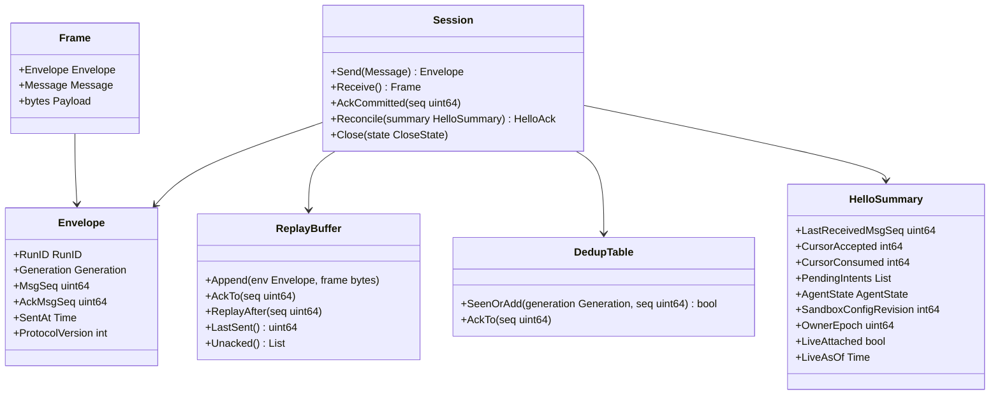
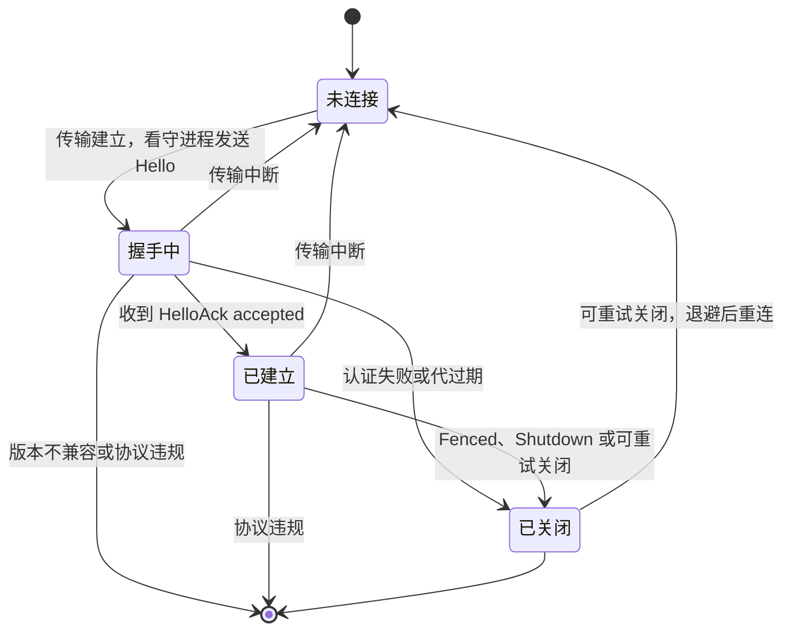
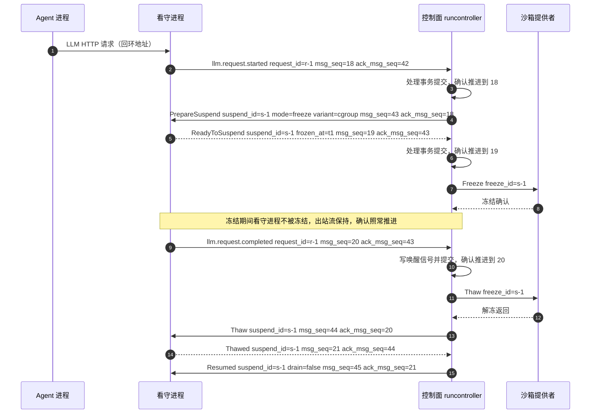
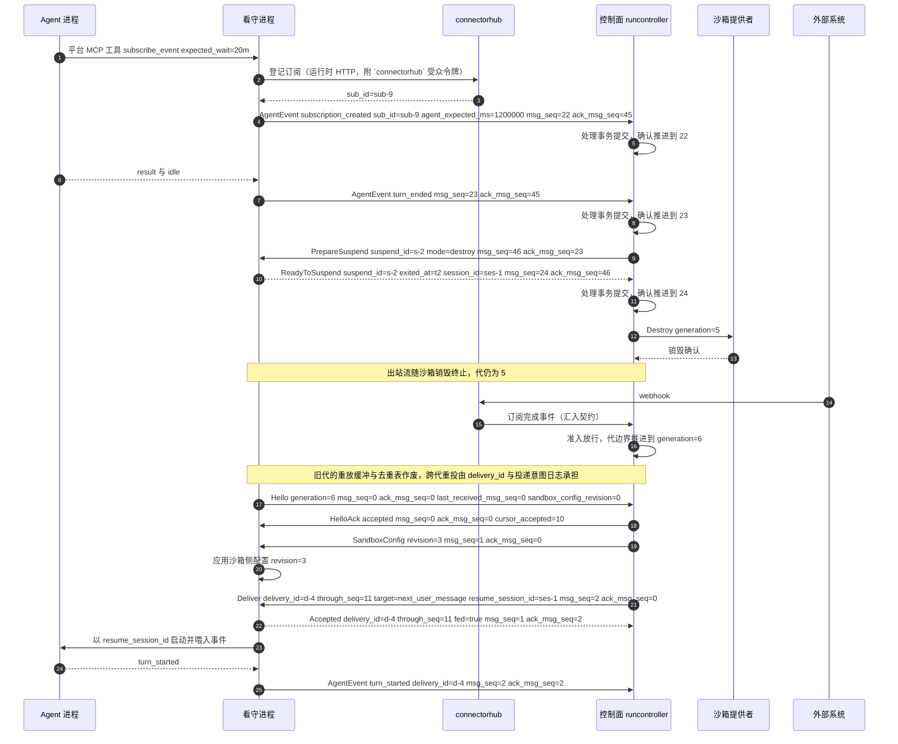
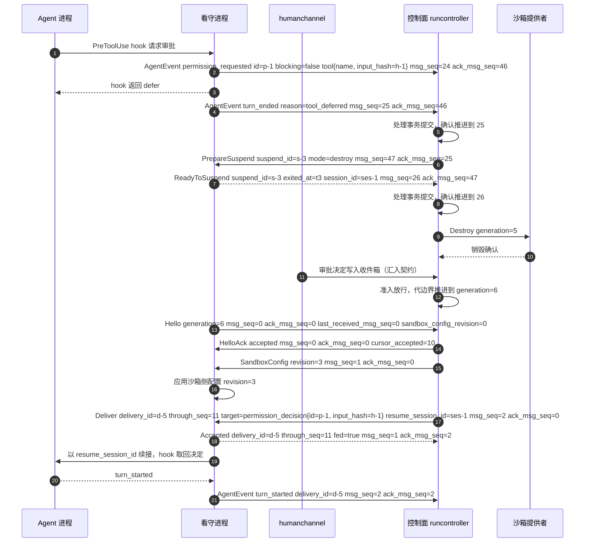
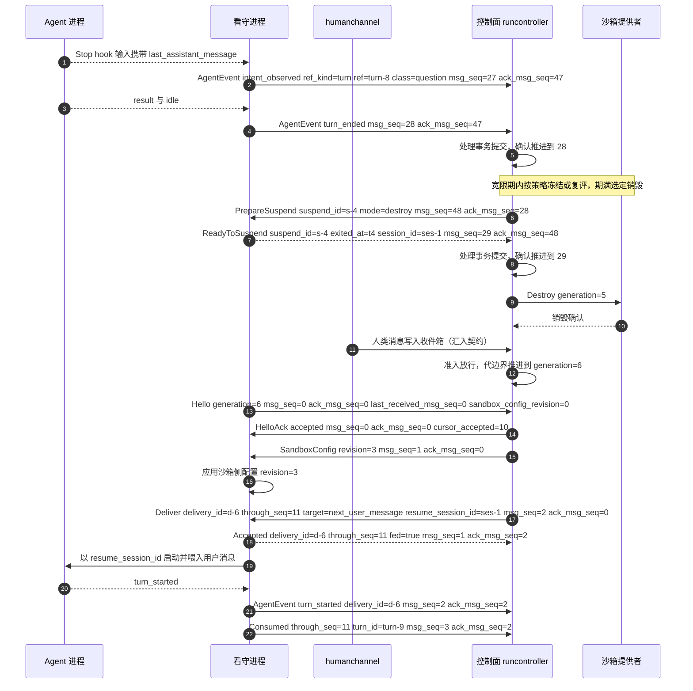
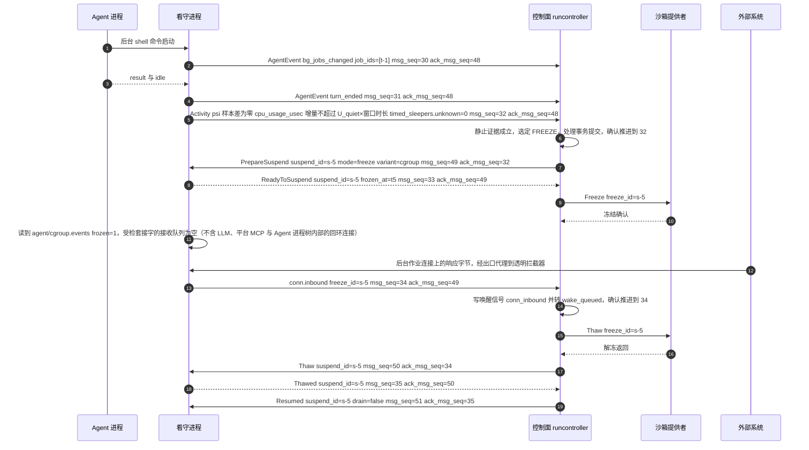
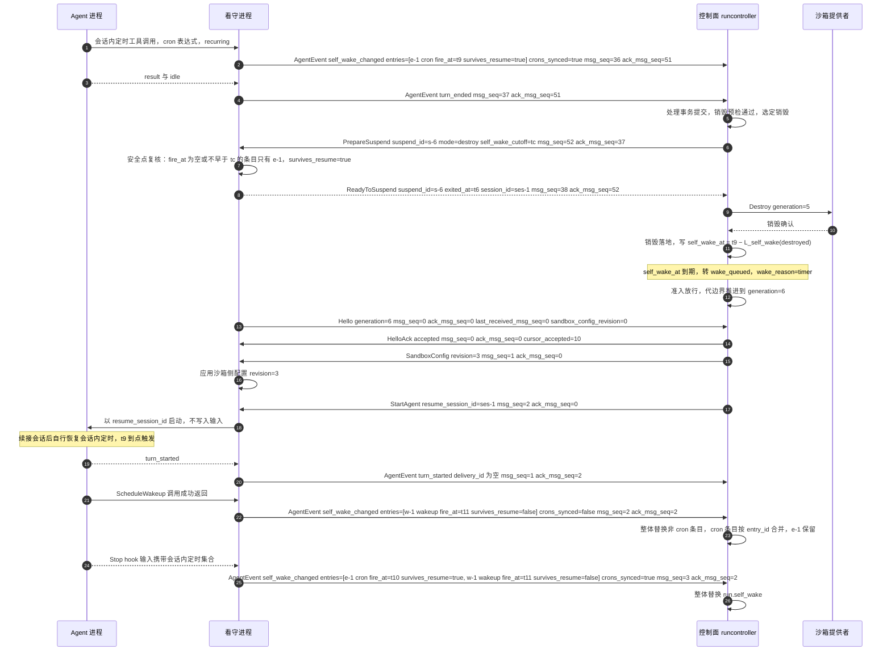

# agentprotocol

`agentprotocol` 是控制面与[看守进程](../../glossary.md)共用的协议库，链接进控制面服务与看守进程，不单独成进程。它拥有[出站流](../../glossary.md)上的信封、消息闭集、流序号与确认、重放、去重、状态对账、协议版本与入站端点契约；它不拥有消息对[运行实例](../../glossary.md)状态机的作用、投递批的选择、[沙箱](../../glossary.md)的创建与销毁、[运行实例令牌](../../glossary.md)的签发与校验。心智模型：协议库只保证一条流上的消息完整、按序、去重后交给状态机，不解释消息对运行实例做了什么。

文档较长，不宜顺序通读。第一次阅读按核心概念、职责、核心数据结构中的信封与消息闭集、核心算法与流程中的走查与场景的顺序；术语表、外部接口契约、依赖与 UML 图在核对字段、接口或实体关系时查阅；错误与失败语义、并发与事务边界留到实现核对时阅读，并作为最后的自测。场景时序图从协议层表达消息顺序、流序号、确认与重放，运行实例状态机转移的完整说明见 [runcontroller](design-runcontroller.md)。

## 核心概念

`agentprotocol` 围绕[出站流](../../glossary.md)上的可靠消息通道组织。控制面与看守进程之间的连接会因沙箱销毁重建、控制面所有权切换与网络中断而反复重建，而消息既不能丢，也不能让同一条消息重复作用于运行实例状态机。信封给每条消息带上运行实例、代与序号；每个方向、每个代独立分配流序号，接收方只确认处理事务已提交的连续前缀；发送方在重放缓冲中保留未确认消息，流重建后按原序号与原内容补发；接收方按 `(generation, msg_seq)` 去重，已提交的重复消息不再派发。握手帧交换持久化状态摘要，使双方在重建后对齐到同一位置而不重放事件历史（[ADR-state-based-reconciliation](../../adr/adr-state-based-reconciliation.md)）。投递语义为至少一次，传输层先做到完整、按序与去重，应用层按消息标识幂等吸收重复才有意义。

## 职责

`agentprotocol` 是看守进程与控制面之间唯一的协议定义与共享实现。职责穷举如下，每条先写本模块执行的动作，再写产生的结果或边界。

- **定义并校验公共信封**：为每条消息生成 `{run_id, generation, msg_seq, ack_msg_seq, sent_at, protocol_version}`；拒绝缺少字段、[代](../../glossary.md)不符、序号越界、消息超过尺寸上限或版本不支持的消息，非法帧不进入派发。
- **维护按代单调的流序号与确认**：每个方向、每个代独立分配 `msg_seq`；接收方以 `ack_msg_seq` 确认连续已提交前缀，确认只在消息的处理事务提交之后推进。
- **保留并重放未确认消息**：发送方在重放缓冲中保留 `ack_msg_seq` 之后的已发送消息；流重建后按原序号与原内容重放，未确认消息不因连接中断而丢弃。
- **按 `(generation, msg_seq)` 去重与按序派发**：接收方丢弃已提交的重复帧，缓存序号不连续的帧直到重放补齐；未提交的消息在重放时重新派发，效果由应用层幂等吸收。
- **以 `Hello` 与 `HelloAck` 做状态对账**：交换 `last_received_msg_seq`、`cursor_accepted`、`pending_intents`、`agent_state`、`sandbox_config_revision`、`owner_epoch` 与 `live_attached`，使双方在流重建后以持久化状态恢复一致，不重放事件历史（[ADR-state-based-reconciliation](../../adr/adr-state-based-reconciliation.md)）。
- **定义消息闭集与字段语义**：按方向穷举应用消息种类、字段与语义，定义共用的确认帧，约束字段取值闭集；消息种类不在当前协议版本闭集内的帧按协议违规处理。
- **定义关闭状态闭集**：`Fenced`、可重试关闭、不可重试认证失败与 `Shutdown`；规定每种状态的触发、确认推进与看守进程动作，并与协议违规造成的传输终止相区分。
- **协商协议版本**：按双方支持的连续版本区间选择版本，版本在协商完成后不变；版本决定信封字段、消息闭集与字段语义。
- **定义出站流与入站端点契约**：出站流的服务端与客户端行为、两个方向的消息尺寸上限与附件引用；看守进程在 80 端口提供的 `/readyz`、`/wake`、`/terminal` 与 `/files` 的路径与语义，以及 `/terminal` 与 `/files` 的[接入票据](../../glossary.md)请求头与校验规则。
- **提供共享库 API**：编码与解码、信封校验、重放缓冲、去重表、版本协商与会话抽象；链接方只经这些 API 收发协议消息，不自行解析信封。

### 非职责

非职责举例如下，判定标准为：职责清单之外、由其他模块拥有的事实与机制。

- 每条消息对运行实例状态机的作用、持久化点与效果记录归 `runcontroller`。本模块只把消息按序、去重后交给它。
- 投递批的选择、`delivery_id`、`Accepted` 与 `Consumed` 的游标语义归 `runcontroller`。协议层的 `ack_msg_seq` 只确认消息已处理，不是投递确认（[ADR-wait-on-durable-inbox](../../adr/adr-wait-on-durable-inbox.md)）。
- 沙箱的预配、挂起、解冻、快照、销毁与恢复触发归 `sandboxprovider`；`/readyz`、`/wake`、`/terminal` 与 `/files` 的 HTTP 服务归看守进程，入站路由归 `sandboxprovider` 的提供者子模块。
- 运行实例令牌的签发、签名校验、轮换与有效期归 `secrets`；接入票据的签发与公钥集合同样归 `secrets`。本模块只承载 `resume_token`、`TokenRotate` 的按受众令牌组、接入票据公钥集合与请求头常量，并定义认证失败的关闭状态。首个令牌组与工作区租约的 `lease_id` 由看守进程经 `sandboxprovider` 的[引导接口](../../glossary.md)领取，不经过出站流。
- [沙箱侧配置](../../glossary.md)的生成归 `connectorhub`，按运行实例保存与发送时机归 `runcontroller`，应用归看守进程。本模块只承载 `SandboxConfig` 消息与 `Hello.sandbox_config_revision`，不解析配置内容。
- [收件箱](../../glossary.md)、[唤醒信号](../../glossary.md)、[等待](../../glossary.md)、定时器、[订阅](../../glossary.md)、在途请求与自唤醒条目的持久化归 `runcontroller` 与事件源模块。本模块只承载 `Hello` 中的状态摘要、`Deliver` 中的投递批与 `self_wake_changed` 中的条目集合及其 `crons_synced`。
- 本地代理与 LLM 网关之间的 HTTP、连接器与外部系统之间的 HTTP、MCP 工具调用都不归本模块；它们与出站流是并行的运行时调用。
- 看守进程对 Agent 的进程监督、[投递意图日志](../../glossary.md)、活动度采集、冻结期间入站数据的观测与本地代理归 `warden` 模块的对应子模块；后台作业集合与自唤醒条目（Agent 各[自唤醒源](../../glossary.md)的下一次触发）的维护归 Agent 驱动器。本模块只定义承载这些事实的消息字段与语义，不规定采集与识别方法。
- [等待意图](../../glossary.md)的解析、[等待签名](../../glossary.md)的匹配与向 Agent 发出的情境提示归 Agent 驱动器与看守进程；按对象保存最近一次等待意图归 `runcontroller`，等待意图对等待时长预测与宽限期选择的作用归 `suspendpolicy`。本模块只承载 `intent_observed` 事件与 `agent_expected_ms` 字段（`subscription_created`、`wait_started`），并原样传输 `SandboxConfig.config` 中的 `wait_signatures` 与 `intent`，不规定等待意图的识别方法与用途。

## 术语表

| 术语 | 英文对照 | 适用范围 | 定义 |
| --- | --- | --- | --- |
| 信封 | envelope | agentprotocol | 每条消息前的固定头部，含 `run_id`、`generation`、`msg_seq`、`ack_msg_seq`、`sent_at` 与 `protocol_version` |
| 流序号 | stream sequence | agentprotocol | 每个方向、每个代内单调递增的 `msg_seq`；握手帧与确认帧不占用该序号空间 |
| 确认序号 | acknowledgment sequence | agentprotocol | `ack_msg_seq`，接收方已处理的连续最大流序号；只在处理事务提交后推进 |
| 状态对账 | state reconciliation | agentprotocol | 流重建后以 `Hello` 与 `HelloAck` 交换的状态摘要恢复一致，不重放事件历史 |
| 重放窗口 | replay window | agentprotocol | 发送方重放缓冲中 `ack_msg_seq` 之后、尚未确认的消息集合 |
| 关闭状态 | close state | agentprotocol | 语义化关闭的闭集：`Fenced`、可重试关闭、不可重试认证失败与 `Shutdown` |
| 握手帧 | handshake frame | agentprotocol | `Hello` 与 `HelloAck`；`msg_seq` 为 0，不进入流序号空间，不去重、不重放 |
| 确认帧 | acknowledgment frame | agentprotocol | 只承载信封 `ack_msg_seq`、`msg_seq` 为 0 的帧；两个方向共用，不占流序号空间，不重放、不去重 |

## 外部接口契约

共享库对链接方提供下列 API。签名只保留承载设计意义的部分，实现可增加辅助方法，但不得改变信封字段、消息闭集与本节声明的语义。链接方包括控制面服务与看守进程；`sandboxprovider` 只使用入站端点常量与路径语义，不链接消息处理逻辑。

```go
type Envelope struct {
    RunID           RunID
    Generation      Generation
    MsgSeq          uint64
    AckMsgSeq       uint64
    SentAt          time.Time
    ProtocolVersion int
}

type Codec interface {
    Encode(env Envelope, msg Message) ([]byte, error)
    Decode(frame []byte) (Envelope, Message, error)
    Validate(env Envelope, msg Message, limits Limits) error
}

type Frame struct {
    Envelope Envelope
    Message  Message
    Payload  []byte
}

type ReplayBuffer interface {
    Append(env Envelope, frame []byte) error
    AckTo(seq uint64)
    ReplayAfter(seq uint64, emit func(Envelope, []byte) error) error
    LastSent() uint64
    Unacked() []Frame
}

type DedupTable interface {
    SeenOrAdd(generation Generation, seq uint64) bool
    AckTo(seq uint64)
}

type Session interface {
    Send(msg Message) (Envelope, error)      // 窗口未满时分配流序号并写入重放缓冲
    Receive() (Frame, error)                 // 按序去重；握手帧与确认帧单独返回
    AckCommitted(seq uint64)                 // 处理事务提交后调用
    Reconcile(summary HelloSummary) (HelloAck, error)
    Close(state CloseState)
}

func Negotiate(local VersionRange, peer int) (int, error)

type HolderProof struct {
    InstanceKey json.RawMessage // 实例公钥 JWK；RenewLease 的持有证明携带它
    IAt         int64           // 签名时刻，Unix 秒
    Sig         string          // 实例私钥对规范签名文本的 Ed25519 签名，base64url
}

func InstanceJKT(instanceKey json.RawMessage) (string, error)
func HolderProofMessage(purpose string, id string, generation Generation, sandboxID string, iat int64) []byte
func CanonicalJSON(v any) ([]byte, error)
func ApprovalInputHash(toolInput json.RawMessage) (string, error)

const (
    PathReadyz   = "/readyz"
    PathWake     = "/wake"
    PathTerminal = "/terminal"
    PathFiles    = "/files"

    HeaderAccessTicket = "x-castworks-access-ticket"

    S_tool_input   = 1 << 20  // 1 MiB
    S_tool_preview = 64 << 10 // 64 KiB
)
```

- **编解码**：`Encode` 生成信封与消息体；`Decode` 先解析信封，再按消息种类解析消息体，返回握手帧与确认帧标记；`Validate` 校验字段闭集、代、序号、尺寸与版本；`intent_observed` 的 `ref_kind`、`class` 与 `source` 是字段闭集校验的例外，越出闭集不构成非法帧，由接收方丢弃该事件并计数（见[错误与失败语义](#错误与失败语义)）。非法帧返回错误，调用方不得派发。
- **重放缓冲**：`Send` 在分配序号前检查窗口容量；`Append` 写入已分配的序号；`AckTo` 删除不高于确认序号的条目；`ReplayAfter` 按原序号升序重放；`LastSent` 返回本方向已写入重放缓冲的最后序号；`Unacked` 返回当前重放窗口。窗口已满时 `Send` 在分配序号前返回背压错误，不分配序号；已分配序号的 `Append` 不因容量失败。发送方停止产生新应用消息，不丢弃未确认消息。
- **去重表**：`SeenOrAdd` 以 `(generation, msg_seq)` 为键，区分已提交与已接收未提交：序号不高于已提交前缀时返回真，调用方只重发确认、不再派发；未提交的序号返回假，调用方派发，重放时重新派发，重复效果由应用层幂等吸收。`AckTo` 在消息处理事务提交后推进已提交前缀并删除不高于它的条目。去重表只保留未确认窗口内的条目，旧代条目随代变化丢弃。
- **会话**：`Send` 在窗口未满时分配序号、写入重放缓冲并交给传输；`Receive` 完成信封校验、按序与去重后返回消息；`AckCommitted` 由链接方在处理事务提交后调用，库据此生成确认，有应用消息可搭载时搭载、没有时按周期发送确认帧；`Reconcile` 处理 `Hello` 与 `HelloAck`；`Close` 产生语义化关闭状态。
- **版本协商**：`Negotiate` 以本地的连续支持区间与对端声明的版本计算共同版本；没有公共版本时返回错误，调用方终止连接。
- **实例公钥指纹与[持有证明](../../glossary.md)**：`InstanceJKT` 对公钥 JWK 的成员 `crv`、`kty`、`x` 按键名排序、无空白序列化后求 SHA-256，再做 base64url 编码。[持有证明](../../glossary.md)的签名文本为 UTF-8 的 `castworks-holder-proof\n<用途>\n<标识>\n<generation>\n<sandbox_id>\n<iat>`：用途为 `hello` 时标识取 `run_id`，为 `renew` 时取 `lease_id`；`iat` 为 Unix 秒；`sig` 为实例私钥对该文本的 Ed25519 签名，base64url 编码；接收方要求 `|now − iat| ≤ T_proof_skew`（60 s）。`HolderProofMessage` 生成该文本，`InstanceJKT` 计算指纹。`Hello.holder_proof` 只携带 `{iat, sig}`，公钥由同帧的 `instance_key` 给出；`workspace.RenewLease` 的 `HolderProof` 另携带 `InstanceKey`，因为 `workspace` 只保存指纹 `holder_jkt`。
- **规范 JSON 编码与[审批内容摘要](../../glossary.md)**：`CanonicalJSON` 对对象成员按键名的 Unicode 码点序排序，不输出空白，字符串只转义 JSON 要求转义的字符，数字解析为双精度后以最短往返十进制表示输出，数组保持顺序，结果按 UTF-8 编码。`ApprovalInputHash` 返回 `tool_input` 规范 JSON 编码的 SHA-256 小写十六进制，即[审批内容摘要](../../glossary.md)（协议字段 `input_hash`）；看守进程在首次 `PreToolUse` 与交付决定前使用同一函数，保证摘要可比（[ADR-approval-bound-to-tool-input](../../adr/adr-approval-bound-to-tool-input.md)）。

稳定性承诺按接口类别给出。信封字段、消息名称、字段名称与取值闭集在同一个 `protocol_version` 内稳定；新增消息种类或改变既有字段语义必须递增协议版本。同一版本内可以新增可选字段，接收方忽略不认识的字段，不得据其改变既有语义。入站端点的路径与语义稳定，接入票据的请求头名称与校验规则随端点契约稳定；新增端点按扩展点的条件处理。库的公开签名稳定，链接方不依赖未导出的实现细节。库不引入任何业务模块的类型，`Message`、`HelloSummary` 与 `Frame` 以本模块定义的类型或字节载荷表达。

## 依赖

依赖穷举如下，方向与[模块依赖图](../architecture.md#模块依赖图)一致：本模块只依赖 Go 标准库与 gRPC，不依赖 `runcontroller`、`sandboxprovider`、`warden`、事件源模块或任何业务模块；控制面服务与看守进程依赖本模块，`sandboxprovider` 只使用入站端点契约。

- **Go 标准库**：字节编码、时间、上下文与 HTTP 服务端抽象。入站端点的处理器由看守进程实现，本模块只定义路径、语义与处理器契约。
- **gRPC**：出站流的传输。库提供出站流的服务端与客户端适配层：服务端接受流、完成 `Hello` 校验并把流绑定到 `Session`；客户端建立流、处理重连并按重放规则恢复。
- **无业务模块依赖**：本模块不读取数据库、不调用[沙箱提供者](../../glossary.md)、不校验令牌、不写[工作区](../../glossary.md)。`Hello` 的令牌校验、状态摘要的持久化与消息效果都由链接方在调用本模块之后执行。该方向满足基础层不依赖上层模块的约束，依赖图无环。

## UML 图

类图固定信封、帧、会话、重放缓冲、去重表与对账摘要的关系；状态图固定一条出站流的生命周期。图中不表达的约束由每张图后的正文给出。

### 类图



会话按方向各持一个重放缓冲，接收方向另持一个去重表；握手帧与确认帧只经过会话，不写入重放缓冲与去重表。`HelloSummary` 是 `Hello` 与 `HelloAck` 交换的状态摘要的合并视图，字段按方向出现在其一侧；字段的持久化归 `runcontroller`。重放缓冲与去重表都以 `(run_id, generation)` 为作用域，代变化即丢弃。

### 状态图



状态图只描述一条出站流。`Closed` 是语义化关闭的汇合点，各类关闭状态的触发与对端动作见错误与失败语义；传输中断回到 `Disconnected` 时不产生关闭状态，发送方保留重放缓冲，等待下一次握手。可重试关闭保留重放缓冲与去重表，退避后回到 `Disconnected` 重连；其余关闭状态终止重连。协议违规直接终止传输并计数，不产生关闭状态消息。

## 核心数据结构

### 信封

信封是每条消息的固定头部，两个方向使用同一结构。字段为闭集，顺序与编码由 `protocol_version` 固定。

| 字段 | 类型 | 语义 |
| --- | --- | --- |
| `run_id` | 运行实例标识 | 消息所属的运行实例；与出站流绑定的运行实例不一致时拒绝 |
| `generation` | 整数 | 消息所属的代；接收方以它做[失效判定](../../glossary.md)与去重作用域（[ADR-generation-fencing](../../adr/adr-generation-fencing.md)） |
| `msg_seq` | 无符号整数 | 本方向、本代内的流序号；握手帧与确认帧为 0，应用消息从 1 起严格递增 |
| `ack_msg_seq` | 无符号整数 | 发送方已处理的、对向消息的连续最大流序号；只在处理事务提交后推进 |
| `sent_at` | 时间戳 | 发送时刻，只用于测量与诊断；排序、确认与失效判定都不依赖它 |
| `protocol_version` | 正整数 | 本条消息使用的协议版本；协商完成后不变 |

信封校验穷举为：`run_id` 与流绑定一致；`generation` 与当前代一致（否则按失效判定处理）；应用消息的 `msg_seq` 不小于 1，握手帧与确认帧为 0；`ack_msg_seq` 不回退，且不超过接收该帧的一方已发送的 `LastSent`；`sent_at` 可解析；`Hello` 的 `protocol_version` 只校验为正整数，`HelloAck` 与后续消息的 `protocol_version` 等于协商结果；编码后的消息不超过尺寸上限。任一不满足即拒绝该帧，不派发、不推进确认。重复帧与乱序帧不在此拒绝，按去重与乱序规则处理。

### 消息闭集

下表按方向穷举当前协议版本的应用消息种类，是应用消息种类的闭集。`Hello` 与 `HelloAck` 是握手帧，`Ack` 是确认帧，三者的 `msg_seq` 均为 0；应用消息按流序号规则编号。新增或删除应用消息种类须递增协议版本，并同时扩展或收缩编解码、两端处理器与本节表格。

两个方向共用确认帧 `Ack`：帧体为空，只以信封的 `ack_msg_seq` 确认对向消息；不占流序号、不写入重放缓冲、不去重，也不需要被确认。没有应用消息可搭载确认时，发送方按配置周期发送确认帧。

#### 看守进程到控制面

| 消息 | 字段 | 语义 |
| --- | --- | --- |
| `Hello` | `generation`、`session_epoch`、`resume_token`、`workspace_lease_id`、`sandbox_id`、`instance_key`、`holder_proof{iat, sig}`、`agent_state{phase, turn_id, blocked_on, frozen, freeze_id, frozen_since, session_id}`、`cursor_accepted`、`cursor_consumed`、`pending_intents[]`、`last_received_msg_seq`、`sandbox_config_revision` | 出站流首帧。`resume_token` 取 `runcontroller` 受众的令牌；`instance_key` 为看守进程[实例密钥](../../glossary.md)的公钥 JWK；`holder_proof` 为以实例私钥对用途 `hello`、`run_id`、信封 `generation`、`sandbox_id` 与 `iat` 所作的[持有证明](../../glossary.md)。控制面要求 `instance_jkt(instance_key)` 等于令牌 `cnf.jkt`，`run.instance_jkt` 非空时三者相等，`lease.holder_jkt` 等于它，且签名与时窗有效，任一不满足以不可重试认证失败关闭。控制面据 `generation`、令牌中的代与租约决定 `accepted`、`fenced`、不可重试认证失败、可重试关闭或 `Shutdown`；`last_received_msg_seq` 是看守进程已处理的控制面消息序号，控制面从它之后重放；`sandbox_config_revision` 是看守进程已应用的[沙箱侧配置](../../glossary.md)版本，尚未应用为 0。 |
| `AgentEvent` | `turn_id`、`event_seq`、`kind`：`turn_started{session_id, delivery_id}`、`turn_ended{reason, agent_exited, bg_procs}`、`tool_started{call_id}`、`tool_ended{call_id}`、`permission_requested{id, call_id, blocking, tool{name, input, input_preview, input_hash, input_size}}`、`subscription_created{sub_id, since_cursor, agent_expected_ms}`、`timer_requested{timer_id, fire_at, scope}`、`wait_started{call_id, kind: wait_for\|timer, ref, fire_at, predicted_ms, agent_expected_ms}`、`bg_jobs_changed{job_ids}`、`self_wake_changed{entries, crons_synced}`、`intent_observed{ref_kind, ref, class, target, expected_ms, prior{p25, p50, p90}, source, confidence}`、`state_changed{idle\|requires_action}` | 驱动器把 Agent 原生信号翻译为事件；回合内事件的 `event_seq` 在同一回合内单调，用于丢弃重复与乱序事件；没有进行中回合时发出的事件，其 `turn_id` 与 `event_seq` 为空，见表后说明。`turn_ended` 只在回合结果与 `idle` 齐备且 `queued_turn_count` 为 0 后发出；`turn_started.delivery_id` 为本回合消费的投递，Agent 自行开始的回合（任务通知回合、会话内定时触发的回合）为空；`timer_requested` 只以 `scope=run` 发出，`scope=generation` 由 `WaitDeclared` 的 `deadline` 表达。`bg_jobs_changed` 与 `self_wake_changed` 携带完整集合：`bg_jobs_changed` 按替换语义处理，`self_wake_changed` 按 `crons_synced` 整体替换或合并 `cron` 条目，条目与发送时机见表后说明。`intent_observed` 报告驱动器观察到的[等待意图](../../glossary.md)，同一 `(ref_kind, ref)` 后到的覆盖先到的，字段越出闭集时由接收方丢弃并计数；`subscription_created` 与 `wait_started` 的 `agent_expected_ms` 是 Agent 自报的预计等待时长，与 `predicted_ms` 分开承载；字段、取值闭集与处理规则见表后说明。 |
| `WaitDeclared` | `wait_id`、`scope: run\|generation`、`conditions[{cond_id, kind, ref}]`、`deadline`、`safe_to` | 仅 L2 协作式 Agent 使用；沙箱内的 L2 进程驱动器经出站流发送，控制面循环驱动器经宿主 `runcontroller` 注入的事件入口提交同一组字段，由宿主调用 `RunService.DeclareWait`。向控制面追加显式等待条件。`kind=timer` 的条件必须引用已存在且同范围的 `timer` 行，否则整条声明被拒绝并计数；带 `deadline` 时登记同范围的 `declared_deadline` 定时器。 |
| `Activity` | `psi{cpu, io, mem}`、`procs{R, D, S, T, Z}`、`timed_sleepers{known_earliest_expiry, unknown}`、`mcp_procs`、`throttled_usec`、`cpu_usage_usec`、`last_fork_at`、`ws_write_fds`、`io_bytes`、`net_bytes`、`llm_last_request_at`、`llm_last_retryable_failure_at`、`frozen`、`freeze_id` | 按固定周期发送的活动度摘要。`procs` 计 Agent 进程树的全部进程；`mcp_procs` 为其中已声明的第三方 MCP 服务器进程及其子进程的数量；`procs` 各态计数之和减 `mcp_procs` 为 Agent 主进程与其他进程的数量，控制面据此判定进程树中除 Agent 主进程与已声明的第三方 MCP 服务器进程外是否还有其他进程。`frozen` 为 Agent 子 cgroup 的冻结状态；`Active` 中 `frozen=true` 且 `freeze_id` 不等于 `aborted_suspend_id` 时控制面判定本代沙箱作废。`psi`、`cpu_usage_usec`、`timed_sleepers` 与两个 LLM 时刻字段的取值见表后说明，它们作为忙信号的解释归 [suspendpolicy](design-suspendpolicy.md)。 |
| `Accepted` | `delivery_id`、`through_seq`、`fed` | 接受记录同步写入[工作区](../../glossary.md)[投递意图日志](../../glossary.md)后才发送。`fed` 报告本批按日志去重后是否仍有事件喂给 Agent；`fed=false` 时不为本批启动 Agent，控制面不转 `InTurn`。 |
| `Consumed` | `through_seq`、`turn_id` | 只针对 `target=next_user_message` 的常规投递；消费记录同步写入投递意图日志后才发送；`through_seq` 取已开始处理的常规批的序号。定向投递与回合边界续接不发 `Consumed`。 |
| `DeliveryFailed` | `delivery_id`、`seqs`、`reason`、`retryable` | 一批投递未能喂给 Agent。`reason` 含 `target_gone`；`retryable` 为真时由 `runcontroller` 以新 `delivery_id` 退避重投；`retryable` 为假且 `reason=target_gone` 时不放弃，事件取消定向并回退为常规投递；其余 `retryable` 为假的情形放弃失败的事件并通知 Agent。 |
| `ReadyToSuspend` | `suspend_id`、`mode`、`frozen_at \| exited_at`、`session_id`、`procs_remaining`、`ws_write_fds` | 看守进程侧的挂起前置条件已满足，`mode=destroy` 时即看守进程对[安全点](../../glossary.md)的复核已通过。冻结模式报告 `frozen_at`，销毁模式报告 `exited_at`；`session_id` 为[恢复句柄](../../glossary.md)，空值不覆盖已落库的值。 |
| `Busy` | `suspend_id`、`reason`、`retry_after` | 挂起前置条件不满足；`reason=cancelled` 是 `CancelSuspend` 的确认；`retry_after` 给出复评时刻。 |
| `Thawed` | `suspend_id` | `suspend_id` 取冻结标识 `freeze_id`；按 `freeze_id` 幂等。`signal` 变体在自行解冻进程树之后上报，`cgroup` 变体在观察到 Agent 子 cgroup 未冻结之后上报，进程树从未冻结时立即上报。 |
| `conn.inbound` | `freeze_id` | 冻结期间入站数据的通知，由看守进程发出；只表达来自 Agent 进程树之外的输入，Agent 进程树内部的进展由基于 `Activity` 的活动度判据识别。触发为下列之一（穷举）：Agent 进程树处于冻结状态时，本地代理或透明拦截器在 Agent 持有的非 LLM 上游连接上收到载荷字节；冻结确认时 Agent 进程树中受检套接字的接收队列非空（有未读数据）。受检套接字的排除范围穷举为：Agent 与看守进程组件之间承载平台内部交互的回环连接，即承载 LLM 请求的连接（Agent 到本地代理的 LLM 端点）与 Agent 和平台 MCP 服务器之间的连接，它们的进展分别由 `llm.first_token`、`llm.request.completed`、`llm.request.failed` 与定向投递表达；两端都在 Agent 进程树内的回环连接，按套接字 inode 与对端地址判定对端也属于 Agent 进程树。经本地代理转发的外部系统连接（CONNECT 隧道与绝对 URI 转发）与透明拦截器接管的连接照常检查。`freeze_id` 取该冻结尝试的 `suspend_id`；看守进程对每个 `freeze_id` 至多发出一次。TCP 保活等无载荷报文不计；看守进程不终止 TLS，不区分应用层保活帧与业务数据，由此产生的误唤醒按普通唤醒处理。冻结确认的判定与接收队列的检查方法见 [warden](warden/design-warden.md)，控制面对它的处理见 [runcontroller](design-runcontroller.md)。 |
| `LeaseLost` | `lease_id`、`expires_at` | [工作区租约](../../glossary.md)续约失败后上报；看守进程冻结或杀死 Agent 进程树并停止写入。 |
| `llm.request.started` | `request_id`、`mode: passthrough\|hold`、`predicted_ms` | 本地代理获得上游响应头，或确认同一逻辑请求在途之后上报；看守进程自身发起的宿主侧分类请求不上报 `llm.request.*`。`mode` 决定阻塞条件的冻结上限取 `F_stream` 或 `F_cap(llm)`；`predicted_ms` 是等待时长的单点预测，`suspendpolicy` 按来源先验把它展开为分位区间与置信度。 |
| `llm.first_token` | `request_id` | 收到首个内容事件后上报，保活事件不计入；每个逻辑请求至多一次。控制面据此写 `wake_hint` 事实供[预测性恢复](../../glossary.md)，并按已等待时长重估同一 `request_id` 的剩余等待；不单独满足阻塞条件。 |
| `llm.request.completed`、`llm.request.failed` | `request_id`；失败另带 `reason` | LLM 请求完成或失败；满足同一 `request_id` 的阻塞条件。`failed` 可以在 `started` 之前发出（网关不可达、准入失败），此时只写失败信号并关闭该 `request_id` 的在途行。`reason` 取 `upstream_error`、`upstream_timeout`、`stream_interrupted`、`admission_failed`、`replay_missing`。 |
| `ToolExecResponse` | `exec_id`、`status`、`exit_code`、`result`、`error` | 工具执行请求的终态应答；`status` 取 `completed`、`failed`、`cancelled`，`error` 只在失败时非空。按 `(run_id, generation, exec_id)` 匹配请求。 |
| `ToolExecData` | `exec_id`、`stream: stdout\|stderr`、`offset`、`data`、`eof` | 工具执行输出分片；`offset` 从该流起点计，接收方按偏移续传，重复或乱序分片被丢弃。`eof` 表示该流结束。 |

- `permission_requested.tool` 携带待批工具调用的内容与[审批内容摘要](../../glossary.md)：`name` 为工具名；`input_size` 为工具输入规范 JSON 编码的字节数；`input_size ≤ S_tool_input`（1 MiB）时 `input` 为完整规范 JSON，`input_preview` 为空；超过时 `input` 为空，`input_preview` 为规范编码的前 `S_tool_preview`（64 KiB）字节，呈现时明示截断，`input_hash` 仍对完整内容计算。`Validate` 要求 `input` 与 `input_preview` 恰有一个非空，且 `input_size` 与 `input_hash` 同所携带的内容相符；不一致的帧不派发。
- `session_epoch` 由看守进程按进程启动生成，用于识别同一代内看守进程的重启，不参与失效判定；失效判定只以 `generation` 为依据。
- `agent_state.phase` 的取值为 `starting`、`in_turn`、`blocked`、`boundary`、`exited`；`blocked_on` 与 `turn_id` 描述回合位置，`blocked_on` 为空或为 `{kind, ref, call_id, since, predicted_ms, agent_expected_ms, mode}`，`kind` 取 `llm`、`timer`、`approval`、`wait_for`，字段语义与 `runcontroller` 的 `run.blocked_on` 列相同；新代 `Hello` 的 `session_id` 只用于核对，不改写控制面的恢复句柄。
- `cursor_accepted` 与 `cursor_consumed` 只计常规投递的已接受与已消费前缀，不含定向投递与回合边界续接。
- `pending_intents[]` 携带投递意图日志中尚未被控制面确认的记录；控制面按其中常规投递的最大已接受序号前进 `cursor_accepted`（[ADR-delivery-intent-log](../../adr/adr-delivery-intent-log.md)）。
- 没有进行中回合时发出的 `AgentEvent`（下称回合外事件，例如回合边界上的 `bg_jobs_changed`、`self_wake_changed`、`intent_observed` 与 `state_changed`）的 `turn_id` 与 `event_seq` 为空；`event_seq` 的单调约束与按 `event_seq` 丢弃重复、乱序事件的规则只适用于回合内事件。回合外事件的顺序由出站流的 `msg_seq` 保证，接收方按 `msg_seq` 顺序派发，不依赖 `event_seq`；集合类事件按替换语义处理（`self_wake_changed` 按 `crons_synced` 的合并规则），`intent_observed` 按 `(ref_kind, ref)` 覆盖，重复与重放不改变结果。
- `bg_jobs_changed.job_ids` 是完整集合，按替换语义处理：接收方以最近一次收到的集合整体替换前值，不按差量合并；空集合表示没有存活的后台作业，重复或重放的同一集合不改变结果。后台作业集合由 Agent 驱动器维护，Claude Code 驱动器以 Agent 自身的后台任务集合为准（见 [Claude Code 驱动器](warden/design-warden-driver-claude-code.md)）。
- `self_wake_changed.entries` 是完整集合，每一项为 `{entry_id, kind, fire_at, survives_resume}`，`entry_id` 在集合内唯一。`kind` 的取值闭集为 `cron`（会话内定时作业）、`wakeup`（一次性自唤醒）、`tool_timeout`（进行中工具调用的超时）与 `monitor_deadline`（监视任务的截止）；`fire_at` 为该项下一次触发的绝对时刻，可以为空，表示触发时刻未知，例如驱动器无法解析 cron 表达式时把 `fire_at` 置空并计数告警；`survives_resume` 表示沙箱销毁重建后，该项随 Agent 以恢复句柄续接而由 Agent 自行恢复，`cron` 为真，其余为假。没有自唤醒源的驱动器不发 `self_wake_changed`。
- `self_wake_changed.crons_synced` 为真表示 `entries` 中的 `cron` 条目已按本进程的会话内定时集合（Claude Code 驱动器为 `session_crons`）对账；为假表示驱动器尚未取得本进程的会话内定时集合，`entries` 中的 `cron` 条目可能不完整。驱动器在本代 Agent 进程启动后即可发送 `self_wake_changed`，不必等待首次取得会话内定时集合：取得之前 `crons_synced` 为假，取得之后为真；同代 Agent 进程重启后重新从 `crons_synced=false` 起算。接收方按 `crons_synced` 处理：为真时以 `entries` 整体替换前值；为假时整体替换 `kind≠cron` 的条目，`cron` 条目按 `entry_id` 合并，`entries` 中出现的 `cron` 条目覆盖同 `entry_id` 的已有条目，已有而 `entries` 中未出现的 `cron` 条目保留。进程重启后以 `crons_synced=false` 发出的集合因此清除上一进程遗留的 `wakeup`、`tool_timeout` 与 `monitor_deadline` 条目，保留 `cron` 条目。两种处理下重复或重放的同一集合都不改变结果；控制面的处理见 [runcontroller](design-runcontroller.md) 的“自唤醒项更新”与“非 Active 回合进展”。
- 控制面只以[有效自唤醒条目](../../glossary.md)推算自唤醒时刻；[过期自唤醒条目](../../glossary.md)视为已触发、待驱动器下一次对账时更新或移除：它们不参与等待上界、所有者侧截止时间 `self_wake_at` 与探测定时器触发时刻的计算，不参与销毁预检，也不阻止挂起。存在 `fire_at` 为空的条目时运行实例不挂起，挂起过程中或冻结期间出现这类条目时按必须唤醒处理（`wake_reason=timer`）；这类条目在销毁预检中按 `survives_resume` 照常检查。有效自唤醒条目的界限参数 `L_self_wake(substate)` 与 `P_quiesce` 见 [suspendpolicy](design-suspendpolicy.md)，必须唤醒与 `self_wake_at` 的写入见 [runcontroller](design-runcontroller.md)。
- `intent_observed` 报告驱动器观察到的[等待意图](../../glossary.md)，来源与识别方法见 [Claude Code 驱动器](warden/design-warden-driver-claude-code.md)。`ref_kind` 与 `ref` 指明等待意图所属的对象，`ref_kind` 的取值闭集为 `call`（前台工具调用，`ref` 为 `call_id`）、`job`（后台作业，`ref` 为 `job_id`）与 `turn`（回合，`ref` 为 `turn_id`）。`class` 的取值闭集随 `ref_kind` 而定：`call` 与 `job` 取 `waiting`、`working`、`serving`、`unknown`，`turn` 取 `question`、`completed`、`unknown`。`target` 是等待对象的描述性标识（例如 `github:workflow_run:1234`），可以为空；`expected_ms` 是预计等待时长（毫秒），可以为空。`source` 的取值闭集为 `signature`（命中[等待签名](../../glossary.md)）、`self_report`（Agent 经平台 MCP 工具的可选参数自报）、`keyword`（等待签名以外的规则判定，例如命令、描述与最后一条消息中的关键词）与 `classifier`（宿主侧分类模型）。`prior` 是可选的时长分位 `{p25, p50, p90}`（毫秒）：驱动器只在 `source=signature` 时取命中签名的时长先验 `prior` 填入，其余来源时为空；`source=signature` 时 `expected_ms` 取 `prior.p50`。控制面随等待意图保存 `prior`，非空时等待时长预测按其中的 `p25`、`p50` 与 `p90` 扣除已等待时长使用，已等待时长超过 `p90`（`prior` 为空时为 `expected_ms` 的 1.5 倍）后该意图退出候选（见 [runcontroller](design-runcontroller.md) 与 [suspendpolicy](design-suspendpolicy.md)）。`confidence` 取 0～1，按 `source` 取值：`signature` 为 0.9，`self_report` 取 0.7 与该运行实例自报历史命中率中的较小者，没有历史时为 0.5，`keyword` 为 0.3，`classifier` 为 0.6。自报历史命中率由控制面记录（见 [suspendpolicy](design-suspendpolicy.md)），驱动器发出的 `self_report` 事件取没有历史时的 0.5，控制面使用时按命中率校准；Claude Code 驱动器的自报只经 `agent_expected_ms` 上报，不另以 `source=self_report` 发出 `intent_observed`。`ref_kind`、`class` 或 `source` 越出闭集，或 `class` 不属于 `ref_kind` 对应闭集的事件，接收方丢弃并计数，不按协议违规终止传输；这是字段闭集校验规则的例外，见[错误与失败语义](#错误与失败语义)。没有等待意图来源的驱动器不发 `intent_observed`；控制面循环驱动器的等待由 `WaitDeclared` 显式表达，同样不发。
- 同一 `(ref_kind, ref)` 的 `intent_observed` 以后到的覆盖先到的：接收方按出站流的 `msg_seq` 顺序处理，每个对象只保留最近一次的等待意图，重复与重放的同一事件不改变结果。驱动器不为对象结束发送撤销事件，接收方按对象的生命周期清除等待意图（见 [runcontroller](design-runcontroller.md)）。`intent_observed` 可以作为回合外事件发出，例如回合边界上存活后台作业的等待意图，或回合结束之后才得出的回合等待意图，其 `turn_id` 与 `event_seq` 为空，规则同其他回合外事件；回合外的 `ref_kind=turn` 事件以 `ref` 指明所属回合。等待意图只作软输入：只进入等待时长预测、宽限期选择、提示决策与指标，不进入单一条件门控、静止证据、[I9](../architecture.md#架构不变量) 与唤醒集合（[ADR-wait-intent-as-soft-input](../../adr/adr-wait-intent-as-soft-input.md)）；本模块不据等待意图改变任何协议行为。
- `subscription_created.agent_expected_ms` 与 `wait_started.agent_expected_ms` 是 Agent 经平台 MCP 工具 `subscribe_event`、`wait_for`、`sleep_until` 的可选参数 `expected_wait` 自报的预计等待时长（毫秒），随该调用产生的 `subscription_created` 或 `wait_started` 上报，Agent 未填时为空；`agent_state.blocked_on.agent_expected_ms` 取同一值。它与平台给出的 `wait_started.predicted_ms` 来源不同，分开承载，接收方不以其一填充或改写另一个。控制面把它写入对应的等待行与 `blocked_on`，作为等待时长预测的输入，见 [runcontroller](design-runcontroller.md) 与 [suspendpolicy](design-suspendpolicy.md)。
- `Activity.psi` 的 `cpu`、`io`、`mem` 分别取 Agent 子 cgroup 的 `cpu.pressure`、`io.pressure`、`memory.pressure` 中 `some` 行的 `total` 累计微秒值（[REF-linux-psi](../../references.md)）；相邻样本之差为零表示该采样窗口内无停滞。`avg10` 等指数平均值不进入 `Activity`：其平滑窗口与 `suspendpolicy` 的静默窗口 `Q_quiet` 粒度不匹配。
- `Activity.cpu_usage_usec` 取 Agent 子 cgroup 的 `cpu.stat` 中 `usage_usec` 的累计微秒值（[REF-linux-cgroup-v2](../../references.md)）；相邻样本之差为该采样窗口内 Agent 进程树消耗的 CPU 时间。它与 `psi` 互补：`psi` 的 `total` 累计的是停滞时间，独占空闲 CPU 的进程不产生压力，它的 CPU 用量只体现在 `usage_usec` 中。静止证据据此判定的阈值 `U_quiet` 归 [suspendpolicy](design-suspendpolicy.md)。
- `Activity.timed_sleepers` 描述 Agent 进程树中处于定时睡眠的进程，判定依据为 `/proc/<pid>/wchan` 属 nanosleep、hrtimer 类。`comm` 为 `sleep` 且参数可按 coreutils 的时长语法解析的进程，到期时刻为进程启动时刻（`/proc/<pid>/stat` 的 `starttime`）加参数时长，其中最早者为 `known_earliest_expiry`，没有这类进程时为空；其余定时睡眠进程的数量为 `unknown`。
- `Activity.llm_last_request_at` 与 `llm_last_retryable_failure_at` 分别为本地代理最近一次发出 LLM 请求、最近一次收到可重试失败（429、5xx、`overloaded`）的时刻，尚未发生时为空；宿主侧分类请求不计入。

#### 控制面到看守进程

| 消息 | 字段 | 语义 |
| --- | --- | --- |
| `HelloAck` | `accepted \| fenced{current_generation}`、`desired_state{running\|frozen}`、`last_received_msg_seq`、`cursor_accepted`、`owner_epoch`、`live_attached`、`live_as_of` | `Hello` 的应答。`accepted` 表示所有权已接管并完成状态对账；`fenced{current_generation}` 表示代已过期；认证失败不回 `HelloAck`。`desired_state` 让看守进程对齐 Agent 进程树的冻结状态；`last_received_msg_seq` 让看守进程裁剪重放缓冲并从其后重放；`cursor_accepted`、`owner_epoch`、`live_attached` 与 `live_as_of` 是状态对账字段。 |
| `Deliver` | `delivery_id`、`batch[{inbox_seq, event_id, dedup_key, kind, subkind, payload, occurred_at, redelivery}]`、`through_seq`、`target: next_user_message \| tool_result{call_id} \| permission_decision{id, input_hash}`、`resume_session_id` | 只在出站流上，投递语义为至少一次。`batch` 按 `inbox_seq` 升序，`through_seq` 为批内最后一条；`subkind` 只在 `kind=internal_notice` 时非空，取值为 `turn_interrupted`、`timer_due`、`degraded_summary` 或 `delivery_abandoned`；`target` 决定喂入 Agent 的方式，`permission_decision.input_hash` 取待决审批保存的[审批内容摘要](../../glossary.md)，看守进程交付决定前对当前工具输入重算并比对，不等时拒绝该次调用；`resume_session_id` 为空表示新会话；`payload` 超过 `S_max` 时以附件引用表达。 |
| `StartAgent` | `resume_session_id` | 以恢复句柄启动 Agent 主进程，不写入任何输入；Agent 进程已在运行时为空操作，重复与重放的 `StartAgent` 因而幂等。由 `runcontroller` 以 `send` 效果发出，用于本代 Agent 进程未运行而自唤醒条目非空的回合边界；`resume_session_id` 取落库的恢复句柄。以它启动的进程处于回合边界，Agent 续接会话后自行恢复会话内定时，到点时自行开始回合，该回合的 `turn_started.delivery_id` 为空。启动同样受“首次应用沙箱侧配置之前不启动 Agent 主进程”约束；新代看守进程在收到首个 `Deliver` 或 `StartAgent` 之前不启动 Agent 主进程。 |
| `PrepareSuspend` | `suspend_id`、`mode: freeze\|freeze_shrink\|snapshot\|destroy`、`variant: cgroup\|signal`、`deadline`、`self_wake_cutoff`、`require{process_exit, no_bg_procs, no_ws_write_fds, sync}` | 请求看守进程满足挂起前置条件。`variant` 只在冻结类模式（`freeze`、`freeze_shrink`）时非空；`self_wake_cutoff` 是绝对时刻，只在 `mode=destroy` 时非空，取 `now − (L_self_wake(destroyed) + P_quiesce)`（`now` 为写入时刻），即 `destroyed` 形态下有效自唤醒条目的界限，由 `runcontroller` 在“发起挂起”与升级为销毁的“冻结中升级”中写入，与挂起尝试一同落库，重发同一 `suspend_id` 的 `PrepareSuspend` 时取同一值；看守进程复核安全点时，“自唤醒条目都随续接恢复”一步只检查 `fire_at` 为空或不早于 `self_wake_cutoff` 的条目中是否存在 `survives_resume=false` 的项，与控制面 I9 预检只看有效自唤醒条目与 `fire_at` 为空的条目的口径一致（复核步骤见 [Claude Code 驱动器](warden/design-warden-driver-claude-code.md)）；`require` 列出必须满足的条件，任一不满足时看守进程回 `Busy`；看守进程不为满足前置条件而终止进程，唯一的例外是 `mode=destroy` 时在 Agent 主进程正常退出之后终止已声明的第三方 MCP 服务器（含其子进程，见 [warden](warden/design-warden.md)）；后台作业、残留进程与孤儿进程都不终止，`process_exit` 只由 Agent 主进程的正常退出满足；`deadline` 用于对账器重驱动。 |
| `CancelSuspend` | `suspend_id` | 撤销挂起尝试。确认载体为 `Busy{suspend_id, reason=cancelled}`；看守进程已越过不可撤销点时照常回 `ReadyToSuspend`。 |
| `Thaw` | `suspend_id` | `suspend_id` 取冻结标识 `freeze_id`。`signal` 变体由看守进程收到后自行解冻；`cgroup` 变体由控制面在沙箱提供者的解冻调用返回之后发送。看守进程以 `Thawed` 应答。 |
| `Resumed` | `suspend_id`、`suspended_for_ms`、`wall_clock_now`、`drain` | 恢复完成通知；按 `suspend_id` 幂等。`drain=true` 按 `T_drain` 周期重发；看守进程收到后，已在等待的与之后发起的阻塞型审批、`wait_for` 与阻塞型 `sleep_until` 都按 DRAIN 规则立即返回。 |
| `LiveState` | `attached`、`as_of` | [实时接入](../../glossary.md)状态推送；`as_of` 单调，看守进程只接受更新的值。`HelloAck` 携带同一对字段。 |
| `Shutdown` | `graceful`、`reason`、`deadline` | 本代作废或运行实例已终态时关闭流；`graceful` 决定关闭 stdin 让 Agent 正常退出，还是强制终止；`deadline` 取发出时刻加 `T_shutdown_grace`。 |
| `Fenced` | `current_generation` | 已建立的流上收到旧代非 `Hello` 消息时应答，每条流每个旧代一次，随后关闭该流。看守进程停止投递与副作用，强制终止 Agent 进程树。 |
| `TokenRotate` | `tokens`、`token_expires_at`、`access_ticket_keys` | 轮换运行实例令牌组与接入票据公钥集合。`tokens` 与领取响应相同，为按受众为键的对象 `{runcontroller, llmgateway, connectorhub, humanchannel, egress}`，同 `run_id`、同代、同 `exp`、同 `cnf.jkt`，`cnf.jkt` 与轮换前相同；`access_ticket_keys` 为接入票据的公钥集合。看守进程收到后按受众替换各令牌，此前不向对应服务发起需要运行实例令牌的请求；令牌已过期而重连时，收到它之前不发起这类请求。 |
| `SandboxConfig` | `revision`、`config` | 推送[沙箱侧配置](../../glossary.md)。`config` 是 `connectorhub` 生成的 `{modes, tool_profile, wait_signatures, intent{hints, classifier}}` 的序列化字节，不含密钥，凭据只以占位符出现，序列化后不超过 32 KiB；其中 `wait_signatures` 是该运行实例可用外部系统的[等待签名](../../glossary.md)，`intent.hints` 与 `intent.classifier` 分别是情境提示与宿主侧分类的开关；这两项与其余各项一样由 `connectorhub` 生成，由看守进程应用。本模块按字节原样传输、不解析，内容无法解析不构成协议违规。`revision` 取同一次生成的 `EgressPolicy.Revision`，单调递增。控制面只在下列时机发出：被接受的 `Hello`（[runcontroller](design-runcontroller.md) 的“销毁态连接”除外）在 `run.sandbox_config_revision` 大于 `Hello.sandbox_config_revision` 时，于 `HelloAck` 之后随应答在同一流上发出；`PutSandboxConfig` 提高 `revision` 且本代沙箱有已接受的出站流时，由控制面在该流上发出。运行实例挂起或没有已接受的出站流时只保存，下一次被接受的 `Hello` 时补发。消息沿用出站流的确认与重放，看守进程按 `revision` 幂等应用，小于等于已应用版本的忽略；首次应用之前不启动 Agent 主进程，应用规则见 [warden](warden/design-warden.md)。 |
| `ToolExecRequest` | `exec_id`、`op: exec\|read_file\|write_file\|stream\|list_jobs\|get_job\|terminate_job`、`args`、`deadline` | 工具执行请求。由链接进 `runcontroller` 的控制面循环驱动器发起，经本运行实例的出站流转发；`exec_id` 在同一代内唯一，`args` 与截止时间按操作定义。 |
| `ToolExecCancel` | `exec_id` | 取消一次工具执行或输出流；看守进程按 `exec_id` 幂等，已结束的执行返回已完成。 |

`HelloAck` 的 `last_received_msg_seq` 是控制面已处理的看守进程消息序号，与 `Hello` 的 `last_received_msg_seq` 方向相反；两者都只用于裁剪重放缓冲与启动对账，不替代投递游标。

`ToolExec` 帧由 `runcontroller` 在进程内从控制面循环驱动器接收后写入该运行实例的出站流，并以同一 `(run_id, generation, exec_id)` 把响应与数据帧交回驱动器。控制面循环驱动器不持有运行实例令牌、不发送 `Hello`，也不建立第二条协议会话；帧的认证由出站流承担，代与终态由 `runcontroller` 在写入前复核。`ToolExec` 帧不进入投递、唤醒谓词或运行实例状态机。

### 实例密钥与持有证明

看守进程在启动后、领取之前生成 Ed25519 的[实例密钥](../../glossary.md)对，私钥只在进程内存，快照恢复沿用，不写入任何文件或日志。公钥以 JWK 形式随 `Hello.instance_key` 与引导领取请求体提交；公钥指纹 `instance_jkt` 按 `InstanceJKT` 计算，写入运行实例令牌的 `cnf.jkt` 与工作区租约的 `holder_jkt`。[持有证明](../../glossary.md)的签名文本与校验规则见外部接口契约中 `HolderProofMessage` 与 `HolderProof` 的说明；`Hello` 的 `holder_proof` 只携带 `{iat, sig}`，公钥取同一帧的 `instance_key`。

### 审批内容与摘要

`permission_requested.tool` 的字段为闭集：

| 字段 | 语义 |
| --- | --- |
| `name` | 工具名 |
| `input` | 完整工具输入的规范 JSON；`input_size ≤ S_tool_input`（1 MiB）时非空 |
| `input_preview` | 规范编码的前 `S_tool_preview`（64 KiB）字节；超过 `S_tool_input` 时非空，呈现时明示截断 |
| `input_hash` | [审批内容摘要](../../glossary.md)：完整工具输入规范 JSON 编码的 SHA-256 小写十六进制 |
| `input_size` | 规范编码的字节数 |

规范 JSON 编码与摘要的计算见外部接口契约中 `CanonicalJSON` 与 `ApprovalInputHash` 的说明。`input` 与 `input_preview` 恰有一个非空；摘要始终对完整内容计算，超限时呈现的截断预览不参与摘要。`permission_requested` 所在的所有者事务把 `tool` 写入 `runcontroller` 的待决审批记录，`permission_decision{id, input_hash}` 的 `input_hash` 取该记录保存的摘要。

### 入站端点契约

看守进程在沙箱内监听 80 端口，提供下列端点。端点不承载协议消息与投递事件；投递只在出站流上。

| 路径 | 调用方 | 语义 | 内容约束 |
| --- | --- | --- | --- |
| `/readyz` | [沙箱提供者](../../glossary.md)的唤醒探针、k8s 的就绪探针 | 就绪探针，不以领取为条件。看守进程尚未领取时，可服务即返回就绪；领取之后，k8s 路径上看守进程可服务且出站流已建立时返回就绪，否则返回未就绪；Substrate 路径上可服务即返回就绪，不以出站流为条件 | 无请求体与事件内容 |
| `/wake` | `sandboxprovider`：Substrate 路径的快照恢复经路由器调用，k8s 路径的预热认领经 wake-router 调用 | 看守进程已领取时为恢复触发入口，返回即表示出站流已重建；尚未领取时为领取通知，看守进程先经[引导接口](../../glossary.md)领取，再建立出站流，出站流建立之后返回。调用幂等，并发的重复调用合并 | 无事件内容，不返回投递批 |
| `/terminal` | `humanchannel` 完成用户身份校验并签发接入票据后的终端接入，经入站路由 | 人类 shell 终端接入；建立后为双向字节流；看守进程领取成功之前返回 503，不启动 shell | 请求头 `x-castworks-access-ticket` 携带接入票据；不承载协议消息、收件箱事件或投递批 |
| `/files` | `humanchannel` 把接入票据放进 `FileAccess` 请求的 `Ticket`、由 `workspace` 原样转发的读取请求，经入站路由 | 文件 API 的列表、读取、下载与流式读取；路径限定在运行实例子目录内；看守进程领取成功之前返回 503 | 请求头 `x-castworks-access-ticket` 携带接入票据；不承载协议消息、收件箱事件或投递批 |

`/terminal` 与 `/files` 以[接入票据](../../glossary.md)端到端认证。票据由 `secrets` 应 `humanchannel` 申请签发，是短期一次性 JWT，经请求头 `x-castworks-access-ticket` 传递：`humanchannel` 建立 `/terminal` 时直接携带；文件读取时把票据放进 `workspace` 的 `FileAccess` 请求的 `Ticket`，由 `workspace` 原样转发到 `/files`；wake-router 与 Substrate 路由器原样转发。票据头部为 `{alg: EdDSA, kid, typ: castworks-access-ticket}`，载荷为 `{aud: warden, sub: <平台用户标识>, project_id, run_id, generation, channel, iat, exp, jti}`，`channel ∈ {terminal, file}`，`exp − iat ≤ T_access_ticket`（60 s），每个入站请求一张。公钥集合由引导响应与 `TokenRotate.access_ticket_keys` 下发；新签名密钥加入公钥集合不少于两个运行实例令牌有效期之后才用于签发，停止签发的旧密钥在集合中保留不少于 `T_access_ticket`。

看守进程对每一张票据的校验穷举为：`alg`、`typ` 正确；`kid` 在公钥集合中且签名有效；`aud=warden`；`run_id`、`generation` 等于本沙箱；`channel` 与端点相符（`/terminal` 对应 `terminal`，`/files` 对应 `file`）；未过期且 `exp − iat ≤ T_access_ticket`；`jti` 未出现过（记录到 `exp`）。任一项不通过时返回 401，不启动 shell、不读文件，计数 `access_ticket_rejected`；`sub` 写入终端审计。租约持有者核对与 `file` 通道的实时接入要求照常执行（[ADR-user-facing-authorization](../../adr/adr-user-facing-authorization.md)）。

`/readyz` 不以领取为条件：看守进程尚未领取时可服务即返回就绪，尚未领取的沙箱实例（例如 k8s 的预热 Pod 与 Substrate 构建[模板快照](../../glossary.md)的 actor）据此通过探针。领取之后，k8s 路径的就绪状态以出站流为准：流未建立或握手未完成时返回未就绪，使提供者与探针不把流量送入尚未接通的看守进程。Substrate 路径的 `/readyz` 是 `wakeupProbe`，不以出站流为条件：看守进程到控制面的连接经 Substrate 出口网关，出口网关接纳 `RESUMING` 与 `RUNNING` 状态的 actor，actor 在分配 worker 后即可出站；`ResumeActor` 在探针返回 200 之后才把 actor 置为运行态，快照恢复的出站流在此之后重建，路由器随后转发的 `/wake` 等出站流重建完成再返回。`/wake` 在出站流建立或重建完成之前不得返回成功。快照恢复路径上的调用失败由提供者按恢复失败处理；预热认领路径上的调用只作通知，提供者不等待其返回，调用失败由看守进程的退避领取兜底。`/terminal` 与 `/files` 的接入身份由接入票据承载，校验规则见上；看守进程只接受已通过入站路由的请求。

### 消息尺寸与附件引用

出站流双向的最大消息尺寸相同，配置为不小于 `S_max` 加信封与编码余量。`S_max` 是 `runcontroller` 定义的单批载荷上限，取值为 3 MiB；单批条数上限为 `B_max=100`。协议层不为单条消息分片；超过尺寸上限的内容不得作为单条消息发送。

`Deliver.batch[].payload` 不超过 `S_max`。超过上限的内容由事件源自行存放，`payload` 内只放附件引用，引用由可取回的 URI 与内容哈希组成。本模块原样传输引用，不解析、不取回；Agent 经平台 MCP 服务器附运行实例令牌向存放方取回，不直连存放方。

### 状态一览

状态图说明一条出站流存在哪些状态；下表说明每个状态在运行中的含义。`runcontroller` 的运行实例状态机不在本表内。

| 状态 | 一句话含义 | 当前动作（协议会话） | 直觉画面 |
| --- | --- | --- | --- |
| 未连接 | 没有传输，双方保留各自的重放缓冲与最后确认序号 | 等待重连，不分配新流序号，不丢弃未确认消息 | 信件压在发件箱，等下一次邮路 |
| 握手中 | 传输已建立，`Hello` 已发出或已收到，只处理握手帧 | 交换 `last_received_msg_seq` 与状态摘要，决定 `accepted`、`fenced` 或认证失败；传输中断时保留缓冲，等待重连 | 双方把对账本摊开，逐项核对 |
| 已建立 | `HelloAck accepted` 已产生，两个方向按流序号收发 | 分配序号、确认已提交前缀、去重与重放 | 双轨列车按站号前行，各自记录到站 |
| 已关闭 | 关闭状态之一已产生 | 按关闭类别处理：`Fenced`、`Shutdown` 与不可重试认证失败丢弃连接的缓冲与去重表并停止重连；可重试关闭只丢弃连接级传输状态，保留重放缓冲与去重表，退避后回到未连接 | 闸门落下，轨道清空 |

版本不兼容与协议违规直接终止会话，不进入已关闭状态；版本不兼容按配置错误处理，协议违规按部署缺陷处理。

## 核心算法与流程

### 走查

走查把一次断流前后的序号、确认与重放落到具体值上。初始条件：`generation=5`；控制面已发送 `Deliver` 41 与 42，最后收到的看守进程确认是 40；看守进程最后收到的控制面确认是 17，已处理 41 并发出 `Accepted` 18，`Accepted` 18 的 `ack_msg_seq` 为 41，42 已收到但尚未处理；`Accepted` 18 在控制面收到之前流中断。握手帧与确认帧的 `msg_seq` 为 0。

| 步骤 | 事件或动作 | 控制面到看守进程：重放缓冲 / 对端确认 | 看守进程到控制面：重放缓冲 / 对端确认 |
| --- | --- | --- | --- |
| 1 | 控制面已发送 41、42；看守进程已处理 41 并发出 18；流中断 | `[41, 42] / 40` | `[18] / 17` |
| 2 | 看守进程重连，发送 `Hello{generation=5, msg_seq=0, ack_msg_seq=41, last_received_msg_seq=41}`；控制面处理 `Hello` 后删除 41 | `[42] / 41` | `[18] / 17` |
| 3 | 控制面回 `HelloAck{accepted, msg_seq=0, ack_msg_seq=17, last_received_msg_seq=17, cursor_accepted}` | `[42] / 41` | `[18] / 17` |
| 4 | 看守进程重放 18；控制面按 `(5, 18)` 首次收到，派发给状态机并在事务提交后把待发确认置为 18 | `[42] / 41` | `[18] / 17` |
| 5 | 控制面重放 42，信封携带 `ack_msg_seq=18`；看守进程删除 18，首次处理 42，提交后发出 `Accepted` 19 `ack_msg_seq=42` | `[42] / 41` | `[19] / 18` |
| 6 | 控制面收到 19 并提交，对端确认变为 42；删除 42 | `[] / 42` | `[19] / 18` |
| 7 | 控制面下一次发往看守进程的消息携带 `ack_msg_seq=19`；看守进程删除 19 | `[] / 42` | `[] / 19` |

走查结束时控制面最后收到看守进程的确认 42，看守进程最后收到控制面的确认 19；两个方向的重放缓冲最终为空。协议层把 18 与 42 各派发一次；应用层的 `delivery_id` 与游标 CAS 保证重复的 `Accepted` 不重复推进游标。`Hello.last_received_msg_seq=41` 让控制面在应用确认 18 丢失时仍能裁剪 41，42 因未被确认而保留并重放。协议确认与投递确认是两层：`ack_msg_seq` 确认消息已处理，`Accepted` 与 `Consumed` 确认投递与消费。

### 发送、确认与重放

- **序号分配**：每个方向、每个代独立编号。握手帧与确认帧 `msg_seq=0`；第一个应用消息为 1，此后每条加一。序号在发送前分配，重放时保留原序号。
- **发送与保留**：消息分配序号后先写入重放缓冲，再交给传输。未确认消息不因发送失败或连接中断而删除。
- **确认推进**：接收方按 `msg_seq` 顺序派发；`ack_msg_seq` 取连续已提交的最大序号。处理事务失败时不确认，消息留在对向的重放缓冲中等待重放。批量确认取连续前缀的最高值，不跳号；没有应用消息可搭载时，确认帧独立发送，不等待反向消息。
- **重放**：流重建后先发送 `Hello` 与 `HelloAck`，再按 `ack_msg_seq+1` 升序重放。接收方在握手后丢弃旧流的乱序缓存，从对端重放的序号重新接收。重放完成之前不分配新的应用序号；重放保持原 `msg_seq`、原消息体与原 `sent_at`，信封的 `ack_msg_seq` 取重放时的当前确认序号。
- **背压**：重放窗口达到配置上限时，发送方在分配序号前返回背压错误并暂停产生新应用消息；确认帧与确认推进不受背压影响，窗口随确认回收；已处理的消息随确认帧离开窗口，关键事件不被已处理未确认的消息阻塞。已分配的序号一定已写入重放缓冲，窗口内未确认消息不被丢弃。
- **代变化**：新代清空两个方向的重放缓冲与去重表，流序号从 1 重新开始。旧代消息不重放、不跨代复用 `msg_seq`；跨代重投由 `runcontroller` 生成新的 `Deliver` 与 `delivery_id`，并置 `redelivery=true`（[ADR-delivery-intent-log](../../adr/adr-delivery-intent-log.md)）。
- **时钟**：`sent_at` 只用于测量与诊断；序号、确认、重放与去重都不依赖墙钟。冻结与解冻造成的时钟跳变不影响协议状态。

### 去重与乱序

- **去重键**：`(run_id, generation, msg_seq)`。同一代内已提交的重复消息不再次派发；未提交的消息在重放时重新派发，由应用层按消息标识幂等。不同代的相同序号是不同消息。
- **重复确认**：重复帧可以再次确认，确认值不因重复而回退。低于已发送确认的迟到帧直接丢弃，不视为错误。
- **乱序**：接收方不为序号不连续的消息建立新前缀，也不跳过缺口派发后续消息。缺口由重放补齐；重连并完成状态对账之后仍不连续时，按可重试关闭处理。
- **去重表裁剪**：不高于已发送确认的条目删除；高于确认的条目保留到被确认或代变化。去重表的大小由重放窗口与背压约束，不随运行时长增长。
- **幂等边界**：协议去重只覆盖传输层的重复投递。应用层重复由 `runcontroller` 的 `delivery_id`、`suspend_id`、`freeze_id` 与带代的游标 CAS 处理，`conn.inbound` 以 `freeze_id` 标识。重复的 `SandboxConfig` 由看守进程按 `revision` 吸收；重复的 `StartAgent` 在 Agent 进程已运行时为空操作；`bg_jobs_changed` 以完整集合替换前值；`self_wake_changed` 按 `crons_synced` 整体替换或按 `entry_id` 合并 `cron` 条目，重复的同一集合不改变结果；`intent_observed` 按 `(ref_kind, ref)` 以后到的覆盖先到的，重复的同一事件不改变结果。按 `event_seq` 丢弃重复与乱序只适用于回合内事件，回合外事件不带 `event_seq`。本模块不解释这些标识。

### 状态对账

- **看守进程到控制面**：`Hello` 携带 `last_received_msg_seq`、`cursor_accepted`、`cursor_consumed`、`pending_intents`、`agent_state` 与 `sandbox_config_revision`。控制面以 `last_received_msg_seq` 裁剪控制面到看守进程的重放缓冲，从其后重放；以 `pending_intents` 前进 `cursor_accepted`，再对账 `cursor_consumed`，选择恢复后的进入点；`sandbox_config_revision` 小于 `run.sandbox_config_revision` 时，在 `HelloAck{accepted}` 之后随应答发送 `SandboxConfig`（“销毁态连接”除外，见[控制面到看守进程](#控制面到看守进程)）。对账以持久化状态为准，不重放事件历史（[ADR-state-based-reconciliation](../../adr/adr-state-based-reconciliation.md)）。
- **控制面到看守进程**：`HelloAck` 携带 `last_received_msg_seq`、`cursor_accepted`、`owner_epoch`、`live_attached` 与 `live_as_of`。看守进程以 `last_received_msg_seq` 裁剪自己的重放缓冲并从其后重放；以 `desired_state` 对齐 Agent 进程树的冻结状态；以 `live_as_of` 只接受更新的实时接入状态。
- **确认与对账的分工**：信封的 `ack_msg_seq` 是流内的连续确认；`Hello` 与 `HelloAck` 的 `last_received_msg_seq` 是流重建时的对账起点。两者都不替代投递游标，也不使控制面跳过未提交的消息处理。
- **跨所有者副本**：控制面副本崩溃后，新所有者以 `Hello.last_received_msg_seq` 与持久化的流状态继续出站序号，并以 `Hello` 与 `HelloAck` 的状态对账恢复一致。出站序号跨所有者副本单调；控制面出站序号与未确认消息由本模块的会话状态持有，不在 `runcontroller` 的数据模型中持久化，旧副本未确认的消息不按事件历史重放，由状态机按持久化状态重新产生（[ADR-single-writer-per-run](../../adr/adr-single-writer-per-run.md)、[ADR-state-based-reconciliation](../../adr/adr-state-based-reconciliation.md)）。

### 版本协商

- **取值与区间**：`protocol_version` 为正整数，双方各自支持一个连续的版本区间。看守进程以自身支持的最高版本发送 `Hello`。
- **选择规则**：控制面在该版本落在自身区间内时以同一版本应答；高于自身上限时以自身上限应答，看守进程支持该版本时按它继续，不支持时终止连接并上报；低于自身下限时终止连接、不回 `HelloAck`，并计入配置错误。版本只降不升，协商完成后不再变化。
- **版本的作用域**：版本决定信封字段、消息闭集与字段语义。新增消息种类或改变既有字段语义必须递增版本；同一版本内新增可选字段不改变既有语义，接收方忽略不认识的字段。
- **无公共版本**：双方没有公共版本时连接终止，看守进程停止重连并上报；该情形按部署配置错误处理，不产生关闭状态。

### 场景：等 LLM 时的冻结与恢复



图固定冻结与恢复期间的消息顺序：`PrepareSuspend` 与 `ReadyToSuspend` 以 `suspend_id` 幂等，`Thaw` 与 `Thawed` 以 `freeze_id` 幂等；看守进程在冻结期间继续收发协议消息，控制面的确认只在消息处理事务提交后推进。各场景图中控制面对沙箱提供者的调用由 `runcontroller` 写入的效果记录在事务提交后执行，确认推进不等待提供者返回（[ADR-effect-record-after-commit](../../adr/adr-effect-record-after-commit.md)）。流在冻结期间中断时，双方按走查的规则重连、对账与重放；`PrepareSuspend`、`ReadyToSuspend`、`Thaw` 与 `Thawed` 的重放不重复执行效果，因为链接方按 `suspend_id` 与 `freeze_id` 幂等。

### 场景：等 PR 门禁的订阅与销毁重建

PR 由第三方工具经出口代理创建，本场景从 `subscribe_event` 开始，不经过平台的外部操作工具。



Agent 以可选参数 `expected_wait` 自报预计等待时长时，`subscription_created.agent_expected_ms` 携带该值；它只作等待时长预测的输入，订阅的登记与完成不依赖它。图固定销毁重建前后的代边界：旧代流上的确认与重放随代递增作废，`Deliver` 不复用旧代 `msg_seq`；新代 `Hello` 以状态对账恢复游标，投递以新的 `delivery_id` 与 `redelivery` 标记重投。新代沙箱的看守进程先经[引导接口](../../glossary.md)领取令牌与 `lease_id`，再发送 `Hello`；领取不经过出站流，图中省略。新代看守进程尚未应用[沙箱侧配置](../../glossary.md)，`Hello.sandbox_config_revision=0`，控制面在 `HelloAck` 之后发送 `SandboxConfig`，看守进程应用之后才启动 Agent 主进程；审批与等人场景的新代流按同一顺序开始。旧代沙箱在代递增之后发来的非 `Hello` 消息收到 `Fenced{current_generation=6}`，随后流关闭（[ADR-generation-fencing](../../adr/adr-generation-fencing.md)）。订阅完成事件按[汇入契约](../../glossary.md)进入收件箱；收件箱与 `Deliver` 的选择归 `runcontroller` 与 `connectorhub`，本模块只承载消息与序号。

### 场景：审批 defer 与续接



图固定回合边界续接的定向投递：`target=permission_decision{id, input_hash}`，`input_hash` 为待决审批保存的[审批内容摘要](../../glossary.md)，`resume_session_id` 为上一代落库的恢复句柄。定向投递不推进 `cursor_accepted`，其消费只写入投递意图日志、不发送 `Consumed`。决定在销毁之前到达时，`Deliver` 在同一代的已建立流上发送，序号与重放规则不变；决定在销毁之后到达时，按图示在新代发送。运行实例状态机的转移与持久化字段见 [runcontroller](design-runcontroller.md)。

### 场景：等人并销毁重建



图固定等人路径的两级确认：`Accepted` 表示接受记录已写入投递意图日志，`Consumed` 表示 Agent 已开始处理该常规投递；`Consumed` 在消费记录同步写入之后发送，只推进 `cursor_consumed`。人类消息的写入与 `WakeQueued` 转移归 `runcontroller`，本模块只保证 `Deliver` 的消息、序号与确认按图推进。图中驱动器在回合结束之前按 `Stop` hook 输入中的最后一条消息得出该回合的[等待意图](../../glossary.md)，以回合内事件 `intent_observed{ref_kind=turn}` 先于 `turn_ended` 发出；宿主侧分类等在回合结束之后才得出的结果以回合外事件发出，`ref` 仍为该回合的 `turn_id`。回合等待意图对宽限期与等待时长先验的作用见 [suspendpolicy](design-suspendpolicy.md)。

### 场景：后台作业存活时的冻结与入站数据唤醒



图固定[静止冻结](../../glossary.md)与入站数据唤醒的消息顺序。后台作业存活时回合边界不构成安全点，控制面只在 `Activity` 给出的静止证据成立时选定冻结，不快照、不销毁；`PrepareSuspend` 与冻结、解冻的消息顺序与等 LLM 场景相同。冻结确认之后看守进程检查 Agent 进程树套接字的接收队列，承载 LLM 请求的连接、Agent 和平台 MCP 服务器之间的连接与两端都在 Agent 进程树内的回环连接不在检查范围内，`conn.inbound` 只表达来自 Agent 进程树之外的输入；接收队列检查发现未读数据，或冻结期间本地代理与透明拦截器在 Agent 持有的非 LLM 上游连接上收到载荷字节时，看守进程发出 `conn.inbound`，同一 `freeze_id` 至多一次；看守进程不为冻结终止后台作业。静止证据的判据、探测定时器与冻结上限见 [suspendpolicy](design-suspendpolicy.md) 与 [runcontroller](design-runcontroller.md)。

### 场景：会话内定时跨销毁重建



图固定自唤醒条目跨销毁重建的消息顺序。第 5 代 Agent 进程已取得会话内定时集合，`self_wake_changed` 以 `crons_synced=true` 携带完整集合；`PrepareSuspend` 的 `self_wake_cutoff=tc` 取销毁尝试发起时刻减 `L_self_wake(destroyed) + P_quiesce`，看守进程按它复核安全点，口径与控制面的销毁预检一致；控制面在销毁落地时以有效自唤醒条目中最早的 `fire_at` 减按恢复机制的提前量写所有者侧截止时间，到期时以 `wake_reason=timer` 排队并推进代边界；新代流在 `HelloAck` 与 `SandboxConfig` 之后由 `StartAgent` 启动 Agent 主进程，不发 `Deliver`；Agent 续接会话后自行触发定时，该回合的 `turn_started.delivery_id` 为空。新代 Agent 进程取得会话内定时集合之前，驱动器以 `crons_synced=false` 发出集合，控制面整体替换非 `cron` 条目、按 `entry_id` 合并 `cron` 条目，跨代保留的 `e-1` 因而留在集合中；`Stop` hook 带来会话内定时集合之后，集合以 `crons_synced=true` 发出并整体替换，`e-1` 的 `fire_at` 随之更新为 `t10`。有效自唤醒条目或 `fire_at` 为空的条目中存在 `survives_resume=false` 的项（例如图末的 `w-1`）时，销毁预检不通过，运行实例不以挂起为目的销毁。所有者侧截止时间、提前量与转移见 [runcontroller](design-runcontroller.md)，驱动器对会话内定时的镜像见 [Claude Code 驱动器](warden/design-warden-driver-claude-code.md)。

## 错误与失败语义

关闭状态为闭集：`Fenced`、可重试关闭、不可重试认证失败与 `Shutdown`。下表按触发穷举关闭状态与看守进程的动作；协议违规造成的传输终止不产生关闭状态，单独列出。

| 情形 | 关闭状态 | 产生方 | 触发与判定 | 看守进程动作 | 确认与重放 |
| --- | --- | --- | --- | --- | --- |
| `Hello` 的令牌签名、受众或 `run_id` 无效，令牌中的代与信封 `generation` 不符，持有证明无效，实例公钥指纹不一致，或令牌到期时刻低于接受下界 | 不可重试认证失败 | 控制面 | `Hello` 公共校验（到期接受规则见 [runcontroller](design-runcontroller.md) 的 Hello 处理） | 停止重连并上报；不再发送协议消息 | 不回 `HelloAck`、不携带当前代；不重放 |
| `Hello.generation` 与当前代不符 | `HelloAck.fenced{current_generation}` | 控制面 | 代校验 | 停止投递与副作用，强制终止 Agent 进程树，停止重连 | 不重放 |
| 已建立流上的非 `Hello` 消息的 `generation` 与当前代不符 | `Fenced{current_generation}` | 控制面 | 失效判定；每条流每个旧代一次 | 停止投递与副作用，强制终止 Agent 进程树，停止重连 | 不推进确认；不重放 |
| 运行实例已终态 | `Shutdown{graceful=false}` | 控制面 | `Hello` 或消息处理前 | 停止；不再重连 | 不推进确认 |
| 本代已作废而代尚未递增 | `Shutdown{graceful=false}` | 控制面 | 非 `Hello` 消息；`degraded` 或 `destroyed` 的作废状态 | 停止；不再重连 | 不推进确认 |
| 消息处理依赖的令牌校验或 `workspace.GetLease` 调用失败 | 可重试关闭 | 控制面 | 处理前的事务外调用 | 不终止 Agent 进程树；退避重连后重放未确认消息 | 该消息不处理、不推进确认；重放 |
| 双方没有公共协议版本 | 传输终止，不产生关闭状态 | 控制面或看守进程 | 版本协商：`Hello` 的版本低于控制面下限时，控制面终止连接，不回 `HelloAck`；`Hello` 的版本高于控制面上限时，控制面以自身上限应答 `HelloAck`，看守进程不支持该版本时由看守进程终止连接 | 停止重连并上报 | 不重放；按配置错误处理 |
| 帧格式非法、消息种类未知、字段取值越出闭集（例如 `self_wake_changed` 条目的 `kind`；`intent_observed` 的等待意图字段除外，单列一行）、新帧的确认序号低于已记录值、重连后仍有序号缺口 | 传输终止，不产生关闭状态 | 接收方 | 编解码与顺序校验 | 计数；重连后仍失败则停止并上报 | 不派发；按部署缺陷处理 |
| `intent_observed` 的 `ref_kind`、`class` 或 `source` 越出闭集，或 `class` 不属于 `ref_kind` 对应的闭集 | 无关闭 | 接收方 | 消息处理；`Validate` 不对等待意图字段做闭集校验 | 继续正常收发 | 照常派发；接收方丢弃该事件并计数，不写入等待意图，处理完成后照常推进确认 |
| 重复的 `(generation, msg_seq)` | 无关闭 | 接收方 | 去重表 | 继续正常收发 | 已提交的不重复派发；未提交的重放重新派发；确认不回退 |
| 低于已发送确认的迟到帧 | 无关闭 | 接收方 | 序号校验 | 继续正常收发 | 丢弃并保持确认 |

入站端点的接入票据校验失败不产生关闭状态：看守进程返回 401、不启动 shell、不读文件，计数 `access_ticket_rejected`，规则见入站端点契约。语义化关闭与协议违规的区别：关闭状态是对端可据此决定停止或重连的信号；协议违规不产生关闭状态消息，连接被终止并计数，需按部署缺陷处理。可重试关闭可经重连与重放恢复；`Fenced` 表示代已过期，重连不会恢复该代。`intent_observed` 的等待意图字段是字段闭集校验的例外：等待意图只作软输入（[ADR-wait-intent-as-soft-input](../../adr/adr-wait-intent-as-soft-input.md)），丢弃一条事件只影响等待时长预测与宽限期选择，传输与运行实例状态机照常进行。

## 并发与事务边界

- **确认与提交**：库的 `AckCommitted` 只在消息处理事务提交后调用；库不自行确认。链接方在提交前崩溃时消息未被确认，对端重放，接收方对已提交序号只重发确认、未提交的重新派发，应用层按消息标识幂等。
- **派发顺序**：每个方向的入站消息按 `msg_seq` 顺序派发；链接方可以在前一条提交之前开始下一条，但确认只推进连续已提交前缀，不跳号。乱序到达的帧缓存在接收侧，不进入状态机。
- **单写者**：看守进程侧同时只有一条出站流，序号分配由该流的写者串行执行。控制面侧同一运行实例同一时刻只有一个所有者副本是状态机写者，出站序号跨所有者副本单调，新所有者以 `Hello.last_received_msg_seq` 与持久化的流状态继续；重放缓冲与未确认消息由本模块的会话状态持有，不归 `runcontroller` 持久化（[ADR-single-writer-per-run](../../adr/adr-single-writer-per-run.md)）。
- **代变化**：代递增与旧代作废的事务提交后，旧代的重放缓冲、去重表与未发送消息全部丢弃；旧代流上的消息按 `Fenced` 拒绝。新代从空缓冲与序号 1 开始，不复用旧代的协议状态。
- **冻结期间**：看守进程不被冻结，出站流、确认与活动度上报继续；Agent 进程树的冻结状态经 `agent_state.frozen`、`freeze_id` 与 `Activity` 表达，Agent 持有的外部系统连接上到达的入站数据经 `conn.inbound` 上报，每个 `freeze_id` 至多一次；承载 LLM 请求与平台 MCP 调用的回环连接、两端都在 Agent 进程树内的回环连接都不经 `conn.inbound` 表达。协议状态不依赖墙钟，冻结造成的时钟跳变不影响序号与去重。
- **入站端点**：`/wake` 的并发调用合并为同一次处理，看守进程尚未领取时为一次领取与一次流建立，已领取时为一次恢复与一次流重建，返回时握手已完成；`/readyz` 读取领取状态，k8s 路径另读取当前流状态，不加协议序号；`/terminal` 的字节流与协议序号无关，不推进确认。
- **背压与内存**：重放缓冲与去重表的大小由重放窗口约束；窗口满时停止分配新的应用消息序号，不丢弃未确认消息。去重表随确认推进裁剪，不随运行时长增长。

## 扩展点

### 新增消息种类

新增消息种类必须递增协议版本，并同时修改消息闭集、编解码、两个方向的处理器与本节表格。新消息必须携带信封，遵守流序号、确认、重放与去重规则；涉及运行实例状态的字段必须声明所属代与幂等标识。消息种类不递增版本而直接发送时，对端按协议违规终止连接。

### 新增可选字段

同一协议版本内可以新增可选字段，条件是既有字段的语义与消息闭集不变，接收方忽略不认识的字段。新增字段改变既有语义、改变取值闭集或使旧接收方产生不同行为时，必须递增协议版本。新增字段不改变信封结构；信封本身增删字段一律视为新版本。

### 新增自唤醒条目种类

控制面的唤醒集合、所有者侧截止时间、销毁预检、等待时长预测的上界与看守进程按 `self_wake_cutoff` 的安全点复核只读取条目的 `fire_at` 与 `survives_resume`，不依赖 `kind`；`kind` 只在 `crons_synced=false` 的合并中区分 `cron` 条目与其余条目。新驱动器的自唤醒源能归入现有 `kind` 时沿用该取值；不能归入时按取值闭集的变化递增协议版本，并为新取值规定 `survives_resume`，新取值在 `crons_synced=false` 的合并中与其余非 `cron` 条目一样整体替换。新自唤醒源的触发时刻无法确定时，驱动器把 `fire_at` 置空。

### 新增等待意图来源或分类取值

`intent_observed` 的 `ref_kind`、`class` 与 `source` 是取值闭集；`target` 只作描述，不设闭集，新的标识形式不涉及协议版本。新驱动器的[等待意图](../../glossary.md)来源能归入现有 `source` 时沿用该取值；不能归入时按取值闭集的变化递增协议版本，并为新取值规定 `confidence`。`class` 与 `ref_kind` 的新取值同样递增协议版本：`class` 的新取值须声明适用的 `ref_kind`；`ref_kind` 的新取值须声明 `ref` 的标识种类、适用的 `class` 取值与接收方清除该等待意图的时机。驱动器观察到而无法归入现有 `class` 的情形取 `unknown`。接收方丢弃取值越出其闭集的事件并计数，不终止传输（见[错误与失败语义](#错误与失败语义)）。新增[等待签名](../../glossary.md)只改变 `SandboxConfig.config` 的内容，不涉及协议版本。

### 新增入站端点

新增入站端点须满足：不承载协议消息与投递事件；声明调用方身份与幂等语义；路径与语义加入入站端点契约；由 `sandboxprovider` 的入站路由按提供者路径转发；以接入票据认证的端点须声明 `channel` 取值，并在校验中加入该端点对应的通道。端点需要唤醒沙箱时，返回时机必须晚于出站流重建与 `Hello` 对账；端点需要传输事件内容时，应改为出站流消息，不在入站端点扩展。

## 实现状态

| 能力 | 状态 | 代码 |
| --- | --- | --- |
| 信封与编解码 | 未实现 | — |
| 消息闭集与字段校验 | 未实现 | — |
| 流序号、确认与重放缓冲 | 未实现 | — |
| 去重表 | 未实现 | — |
| `Hello` 与 `HelloAck` 状态对账 | 未实现 | — |
| 协议版本协商 | 未实现 | — |
| 出站流服务端与客户端适配层 | 未实现 | — |
| 入站端点契约 | 未实现 | — |
| 实例密钥、持有证明与审批内容摘要 | 未实现 | — |
