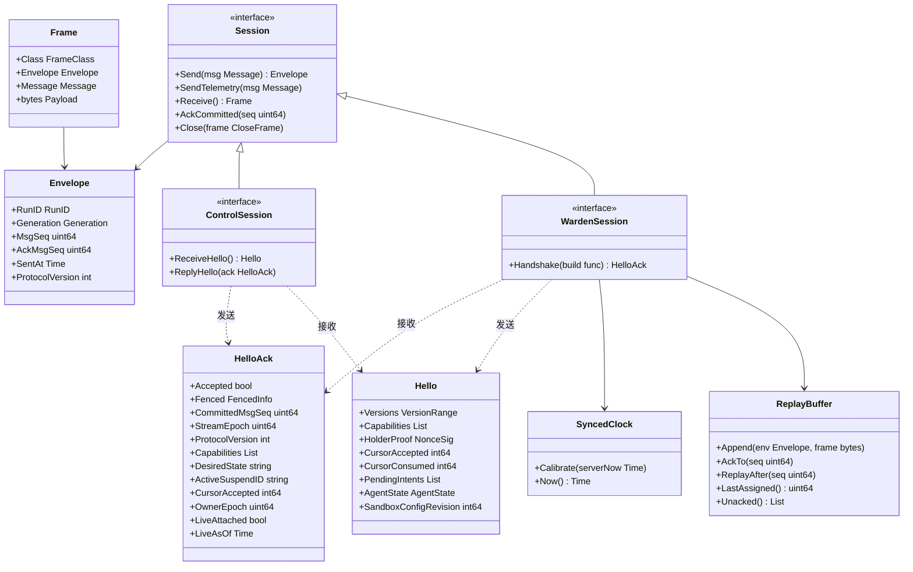
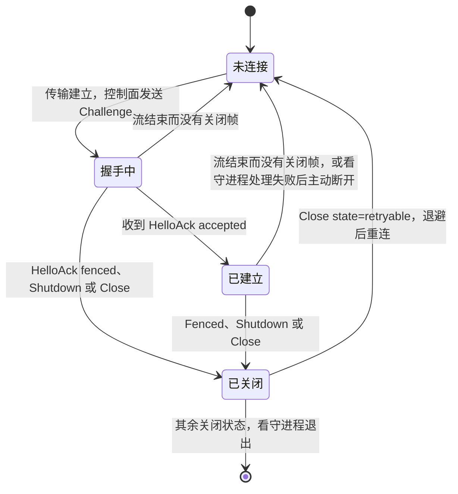
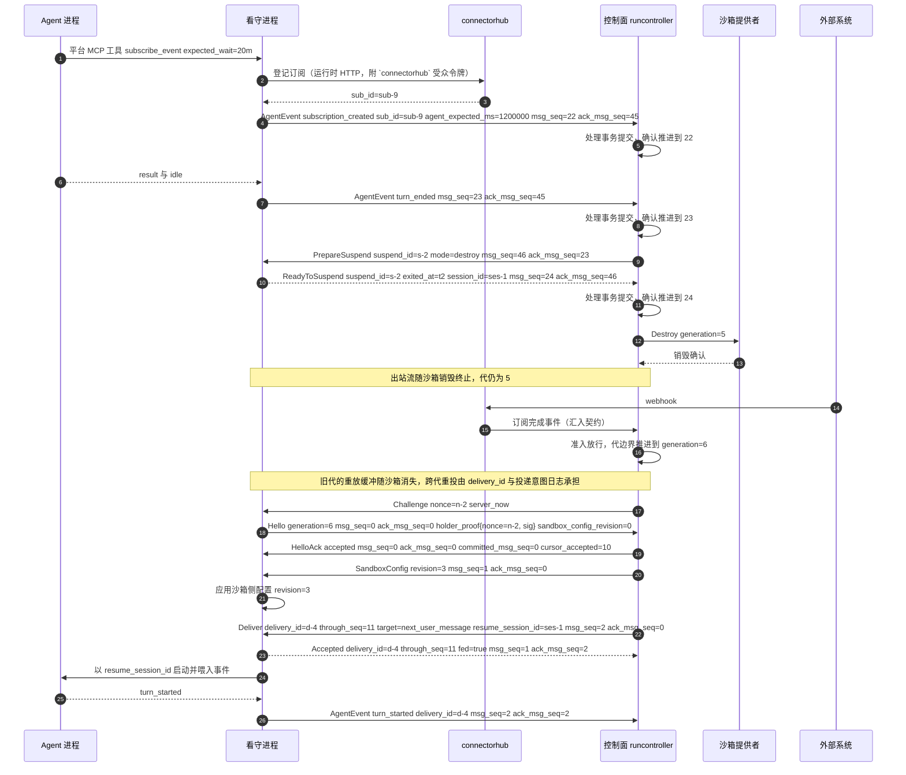
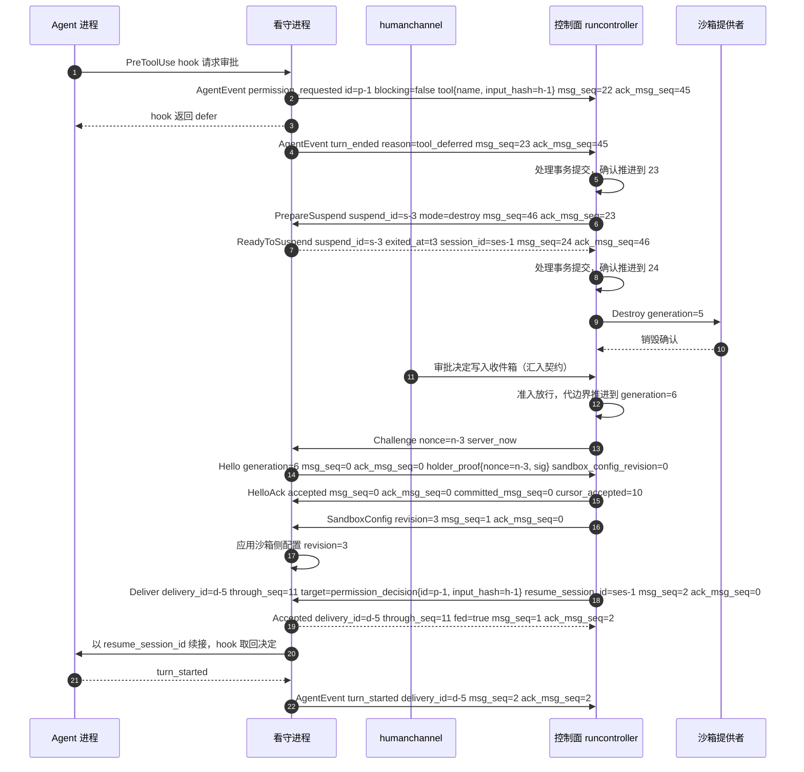
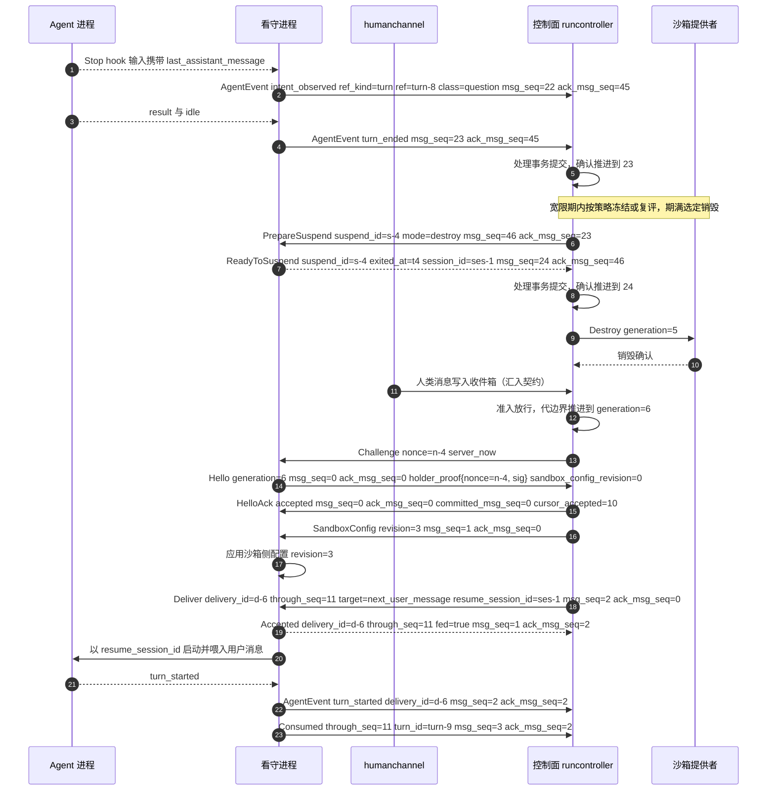
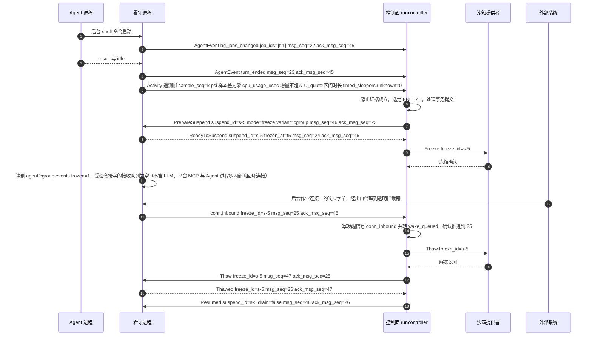
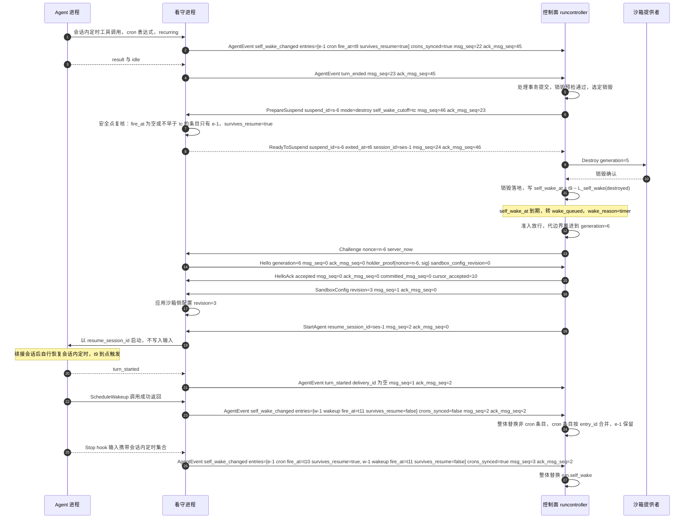

# agentprotocol

`agentprotocol` 是控制面与[看守进程](../../glossary.md)共用的协议库，链接进控制面服务与看守进程，不单独成进程。它拥有[出站流](../../glossary.md)上的帧分类、信封、消息闭集、序号与确认、看守进程一侧的重放、接收规则、握手与状态对账、协议版本与能力、关闭状态与入站端点契约；它不拥有消息对[运行实例](../../glossary.md)状态机的作用、控制面到看守进程消息在断流后的重新产生、投递批的选择、[沙箱](../../glossary.md)的创建与销毁、[运行实例令牌](../../glossary.md)的签发与校验。心智模型：看守进程到控制面的消息由看守进程保留到控制面提交为止，断流后补发；控制面到看守进程的消息只在一条连接内可靠，断流后由 `runcontroller` 按持久化状态重新产生；协议库不解释消息对运行实例做了什么。

文档较长，不宜顺序通读。第一次阅读按核心概念、职责、核心数据结构中的帧分类与线路编码、信封与消息闭集、核心算法与流程中的走查、握手与校时与场景的顺序；术语表、外部接口契约、依赖与 UML 图在核对字段、接口或实体关系时查阅，参数在核对取值时查阅；错误与失败语义、并发与事务边界留到实现核对时阅读，并作为最后的自测。场景时序图从协议层表达消息顺序、序号、确认与握手，运行实例状态机转移的完整说明见 [runcontroller](design-runcontroller.md)。

## 核心概念

`agentprotocol` 围绕[出站流](../../glossary.md)上的消息通道组织。控制面与看守进程之间的连接会因沙箱销毁重建、快照恢复、控制面所有权切换与网络中断而反复重建，而消息既不能丢，也不能让同一条消息重复作用于运行实例状态机。两个方向以不同的方式做到这一点（[ADR-asymmetric-stream-replay](../../adr/adr-asymmetric-stream-replay.md)）。

看守进程到控制面的应用消息按代编号：本代内从 1 起连续递增，换连接不重新开始。看守进程把未确认的消息留在重放缓冲中；控制面把已提交的序号与该消息的处理事务同事务写入运行实例行，流重建时在握手应答中告知这个位置，看守进程从其后按原序号、原内容补发。控制面只派发恰好接在已提交位置之后的帧，已提交的重复帧丢弃，序号缺口只可能来自实现缺陷。

控制面到看守进程的应用消息只在一条已接受的连接内编号与确认，不跨连接重放。连接中断时这条连接上未确认的消息作废，`runcontroller` 在下一次接受 `Hello` 时按持久化状态与 `Hello` 携带的状态摘要重新产生仍然需要的消息，看守进程按消息自带的幂等标识吸收重复（[ADR-state-based-reconciliation](../../adr/adr-state-based-reconciliation.md)）。控制面因此不为运行实例保存跨连接的发送状态，所有者副本切换时也没有协议状态需要交接。

两个方向都串行处理：前一条消息的处理事务提交之后才派发下一条，确认只覆盖已提交的连续前缀。投递语义为至少一次，传输层保证不丢、按序，应用层按消息标识幂等吸收重复。握手由控制面发出的一次性挑战开始，看守进程以[实例密钥](../../glossary.md)对挑战签名，证明自己是领取时登记的实例，并以挑战携带的服务端时刻校准自己的时钟；握手帧与关闭帧使用不随协议版本变化的固定格式，任何版本的两端都能完成握手，并得知协商结果或关闭原因。

## 职责

`agentprotocol` 是看守进程与控制面之间唯一的协议定义与共享实现。职责穷举如下，每条先写本模块执行的动作，再写产生的结果或边界。

- **定义帧分类与公共信封**：把出站流上的帧分为握手帧、关闭帧、确认帧、遥测帧与应用消息；为每帧生成 `{run_id, generation, msg_seq, ack_msg_seq, sent_at, protocol_version}`；拒绝缺少字段、[代](../../glossary.md)不符、序号越界、超过尺寸上限或版本不符的帧，非法帧不进入派发。
- **分配序号并确认已提交前缀**：看守进程到控制面的应用消息以 `(run_id, generation)` 为作用域从 1 起编号、跨连接连续；控制面到看守进程的应用消息以一条已接受的连接为作用域从 1 起编号；接收方以 `ack_msg_seq` 确认已提交的连续前缀，确认只在处理事务提交之后推进。
- **在看守进程一侧保留并重放未确认消息**：看守进程在重放缓冲中保留未确认的应用消息，流重建后按 `HelloAck.committed_msg_seq` 裁剪并从其后按原序号与原内容重放；控制面到看守进程的消息不跨连接重放。
- **按接收位置派发**：接收方逐帧比较 `msg_seq` 与已提交位置，丢弃已提交的重复帧并重发确认，派发恰好接续的帧，把序号缺口判为协议违规。
- **以握手完成持有证明、校时与状态对账**：控制面以 `Challenge` 下发一次性随机数与服务端时刻；看守进程以 `Hello` 提交对该随机数的[持有证明](../../glossary.md)、版本区间、能力标识与状态摘要（`cursor_accepted`、`cursor_consumed`、`pending_intents`、`agent_state`、`sandbox_config_revision`）；控制面以 `HelloAck` 返回 `committed_msg_seq`、`stream_epoch`、协议版本与能力、`cursor_accepted`、`owner_epoch` 与实时接入状态，使双方在流重建后以持久化状态恢复一致，不重放事件历史（[ADR-state-based-reconciliation](../../adr/adr-state-based-reconciliation.md)）。
- **定义消息闭集与字段语义**：按方向穷举消息种类、字段与语义，划分取值闭集与开放集合；消息种类不在本代协商的版本与能力之内的帧按协议违规处理。
- **定义关闭状态闭集**：代失效、关停、可重试关闭、认证失败、版本不支持与协议违规，每种都有关闭帧；规定每种状态的触发、确认与两端动作，不可恢复的状态以作废本代沙箱并重建收场（[ADR-unrecoverable-stream-failure-rebuilds-sandbox](../../adr/adr-unrecoverable-stream-failure-rebuilds-sandbox.md)）。
- **协商协议版本与能力**：按双方支持的连续版本区间与能力标识，在本代首次接受 `Hello` 时选定版本与能力，一代内不变（[ADR-protocol-version-pinned-per-generation](../../adr/adr-protocol-version-pinned-per-generation.md)）；版本决定确认帧、遥测帧与应用消息的信封、消息闭集与字段语义。
- **定义出站流与入站端点契约**：出站流的线路编码、流参数与消息尺寸上限；看守进程在 80 端口提供的 `/readyz`、`/wake`、`/terminal` 与 `/files` 的路径与语义，以及 `/terminal` 与 `/files` 的[接入票据](../../glossary.md)请求头与校验规则。
- **提供共享库 API**：编码与解码、信封校验、重放缓冲、握手两侧的会话、校时时钟、版本协商、持有证明与规范 JSON 编码；链接方只经这些 API 收发协议消息，不自行解析信封。

### 非职责

非职责举例如下，判定标准为：职责清单之外、由其他模块拥有的事实与机制。

- 每条消息对运行实例状态机的作用、持久化点与效果记录归 `runcontroller`。本模块只把消息按序交给它。
- 控制面到看守进程的消息在连接中断后的重新产生归 `runcontroller`，每种消息的规则见其“Hello 的处理”中的“下行消息的重新产生”。本模块只规定这些消息不跨连接重放，以及看守进程据以吸收重复的幂等标识。
- 投递批的选择、`delivery_id`、`Accepted` 与 `Consumed` 的游标语义归 `runcontroller`。协议层的 `ack_msg_seq` 只确认消息已处理，不是投递确认（[ADR-wait-on-durable-inbox](../../adr/adr-wait-on-durable-inbox.md)）。
- 沙箱的预配、挂起、解冻、快照、销毁与恢复触发归 `sandboxprovider`；`/readyz`、`/wake`、`/terminal` 与 `/files` 的 HTTP 服务归看守进程，入站路由归 `sandboxprovider` 的提供者子模块。
- 运行实例令牌的签发、签名校验、轮换与有效期归 `secrets`；接入票据的签发与公钥集合同样归 `secrets`。本模块只承载 `resume_token`、`TokenRotate` 的按受众令牌组、接入票据公钥集合与请求头常量，并定义认证失败的关闭状态。首个令牌组与工作区租约的 `lease_id` 由看守进程经 `sandboxprovider` 的[引导接口](../../glossary.md)领取，不经过出站流。
- [沙箱侧配置](../../glossary.md)的生成归 `connectorhub`，按运行实例保存与发送时机归 `runcontroller`，应用归看守进程。本模块只承载 `SandboxConfig` 消息与 `Hello.sandbox_config_revision`，不解析配置内容。
- [收件箱](../../glossary.md)、[唤醒信号](../../glossary.md)、[等待](../../glossary.md)、定时器、[订阅](../../glossary.md)、在途请求与自唤醒条目的持久化归 `runcontroller` 与事件源模块。本模块只承载 `Hello` 中的状态摘要、`Deliver` 中的投递批与 `self_wake_changed` 中的条目集合及其 `crons_synced`。
- 本地代理与 LLM 网关之间的 HTTP、连接器与外部系统之间的 HTTP、MCP 工具调用都不归本模块；它们与出站流是并行的运行时调用。
- 看守进程对 Agent 的进程监督、[投递意图日志](../../glossary.md)、活动度采集、冻结期间入站数据的观测、本地代理、待发队列与背压冻结、不可恢复时的退出原因归 `warden` 模块的对应子模块；后台作业集合与自唤醒条目（Agent 各[自唤醒源](../../glossary.md)的下一次触发）的维护归 Agent 驱动器。本模块只定义承载这些事实的消息字段与语义、窗口语义与关闭状态，不规定采集与识别方法。
- [等待意图](../../glossary.md)的解析、[等待签名](../../glossary.md)的匹配与向 Agent 发出的情境提示归 Agent 驱动器与看守进程；按对象保存最近一次等待意图归 `runcontroller`，等待意图的置信度及其对等待时长预测与宽限期选择的作用归 `suspendpolicy`。本模块只承载 `intent_observed` 事件与 `agent_expected_ms` 字段（`subscription_created`、`wait_started`），并原样传输 `SandboxConfig.config` 中的 `wait_signatures` 与 `intent`，不规定等待意图的识别方法与用途。
- Agent 的输出正文（助手消息与工具输出）不经出站流传输，本模块不定义承载它的消息。

## 术语表

| 术语 | 英文对照 | 适用范围 | 定义 |
| --- | --- | --- | --- |
| 信封 | envelope | agentprotocol | 每帧的固定头部，含 `run_id`、`generation`、`msg_seq`、`ack_msg_seq`、`sent_at` 与 `protocol_version` |
| 应用消息 | application message | agentprotocol | 握手帧、关闭帧、确认帧与遥测帧以外的消息；`msg_seq` 从 1 起编号 |
| 流序号 | stream sequence | agentprotocol | 应用消息的 `msg_seq`：看守进程到控制面按代编号、跨连接连续，控制面到看守进程按一条已接受的连接编号；其余帧为 0 |
| 确认序号 | acknowledgment sequence | agentprotocol | `ack_msg_seq`，发送方已提交的对向应用消息的连续最大流序号；只在处理事务提交后推进 |
| 接收位置 | receive position | agentprotocol | 接收方已提交的对向应用消息的最大流序号：控制面一侧为 `run.in_msg_seq`，看守进程一侧为本连接内的值，每条新连接从 0 起 |
| 状态对账 | state reconciliation | agentprotocol | 流重建后以 `Hello` 与 `HelloAck` 交换的状态摘要恢复一致，不重放事件历史 |
| 重放窗口 | replay window | agentprotocol | 发送方已分配流序号、对端尚未确认的应用消息集合；看守进程到控制面方向保存在重放缓冲中，控制面到看守进程方向只计条数与字节数 |
| 关闭状态 | close state | agentprotocol | 以关闭帧表达的连接结束原因，取值闭集为代失效、关停、可重试关闭、认证失败、版本不支持与协议违规 |
| 固定格式 | fixed format | agentprotocol | 流消息外层、握手帧与关闭帧的编码；字段只增不改，不随 `protocol_version` 变化 |
| 握手帧 | handshake frame | agentprotocol | `Challenge`、`Hello` 与 `HelloAck`；固定格式，`msg_seq` 与 `ack_msg_seq` 为 0，不进重放缓冲 |
| 关闭帧 | close frame | agentprotocol | `Fenced`、`Shutdown` 与 `Close`；固定格式，`msg_seq` 与 `ack_msg_seq` 为 0，不进重放缓冲 |
| 确认帧 | acknowledgment frame | agentprotocol | `Ack`，只以信封 `ack_msg_seq` 确认对向应用消息、`msg_seq` 为 0 的帧；两个方向共用，不进重放缓冲 |
| 遥测帧 | telemetry frame | agentprotocol | `Activity`；`msg_seq` 为 0，不进重放缓冲、无须确认、不重放，流不可用时丢弃 |
| 能力标识 | capability | agentprotocol | 标识一种可选消息种类或可选行为的字符串，开放集合；只有 `HelloAck.capabilities[]` 中出现的能力才可使用 |

## 外部接口契约

共享库对链接方提供下列 API。签名只保留承载设计意义的部分，实现可增加辅助方法，但不得改变信封字段、消息闭集与本节声明的语义。链接方包括控制面服务与看守进程；`sandboxprovider` 只使用入站端点常量与路径语义，不链接消息处理逻辑。

```go
type Envelope struct {
    RunID           RunID
    Generation      Generation
    MsgSeq          uint64
    AckMsgSeq       uint64
    SentAt          time.Time
    ProtocolVersion int // 握手帧与关闭帧为 0
}

type FrameClass int // Handshake、Close、Ack、Telemetry、Application

type Codec interface {
    Encode(env Envelope, msg Message) ([]byte, error)
    Decode(frame []byte) (FrameClass, Envelope, Message, error)
    Validate(env Envelope, msg Message, limits Limits) error
}

type Frame struct {
    Class    FrameClass
    Envelope Envelope
    Message  Message
    Payload  []byte
}

// 只在看守进程一侧，保存看守进程到控制面的未确认应用消息
type ReplayBuffer interface {
    Append(env Envelope, frame []byte) error
    AckTo(seq uint64)
    ReplayAfter(seq uint64, emit func(Envelope, []byte) error) error
    LastAssigned() uint64
    Unacked() []Frame
}

type Session interface {
    Send(msg Message) (Envelope, error) // 应用消息；窗口满时返回 ErrBackpressure，不分配序号
    SendTelemetry(msg Message) error    // 遥测帧；不编号、不缓冲，流不可用时返回错误，样本丢弃
    Receive() (Frame, error)            // 按接收规则返回下一条待派发的应用消息或遥测帧
    AckCommitted(seq uint64)            // 处理事务提交后调用
    Close(frame CloseFrame) error       // 发送关闭帧并结束流
}

type WardenSession interface { // 看守进程一侧
    Session
    Handshake(ctx context.Context, build func(Challenge) (Hello, error)) (HelloAck, error)
}

type ControlSession interface { // 控制面一侧
    Session
    ReceiveHello(ctx context.Context) (Hello, error)
    ReplyHello(ack HelloAck) error
}

type VersionRange struct{ Min, Max int }

func Negotiate(local, peer VersionRange, localCaps, peerCaps []string) (version int, caps []string, err error)

type SyncedClock interface {
    Calibrate(serverNow time.Time) // 记录服务端时刻减本地单调时钟的偏移
    Now() time.Time                // 本地单调时钟加偏移
}

type HolderProof struct { // workspace.RenewLease 的持有证明
    InstanceKey json.RawMessage // 实例公钥 JWK
    IAt         int64           // 签名时刻，Unix 秒，取 SyncedClock.Now
    Sig         string          // 实例私钥对签名文本的 Ed25519 签名，base64url
}

func InstanceJKT(instanceKey json.RawMessage) (string, error)
func HolderProofMessage(purpose, id string, generation Generation, sandboxID, binding string) []byte
func CanonicalJSON(input json.RawMessage) ([]byte, error)
func ApprovalInputHash(toolInput json.RawMessage) (string, error)

const (
    PathReadyz   = "/readyz"
    PathWake     = "/wake"
    PathTerminal = "/terminal"
    PathFiles    = "/files"

    HeaderAccessTicket = "x-castworks-access-ticket"

    S_tool_input   = 1 << 20  // 1 MiB
    S_tool_preview = 64 << 10 // 64 KiB
    S_tool_summary = 256      // 字节
)
```

- **编解码**：`Decode` 先以固定格式的外层识别帧类别，握手帧与关闭帧按固定格式解码，其余帧按本代协商的版本解码；`Encode` 生成信封与消息体。`Validate` 校验信封、取值闭集字段、尺寸上限、`permission_requested.tool` 的一致性（见[审批内容与摘要](#审批内容与摘要)）与 `tool_started.summary` 的长度；开放集合字段不做取值校验，不认识的取值由接收方按该字段规定的默认处理（见[消息闭集](#消息闭集)）。非法帧返回错误，调用方不得派发，并按协议违规关闭流。
- **重放缓冲**：只存在于看守进程一侧，承载看守进程到控制面的应用消息，作用域为 `(run_id, generation)`。`Send` 在未连接、握手中与重放中都分配序号并写入重放缓冲，只是暂不发送；`Append` 写入已分配的序号，已分配序号的 `Append` 不因容量失败；`AckTo` 删除不高于确认序号的条目；`ReplayAfter` 按原序号升序重放；`LastAssigned` 返回本代已分配的最大序号；`Unacked` 返回当前重放窗口。窗口满是 `Send` 唯一拒绝分配序号的情形：此时返回背压错误，看守进程把消息放进未编号的待发队列（见 [warden](warden/design-warden.md)）。控制面一侧没有重放缓冲，只按连接计控制面到看守进程方向的未确认条数与字节数。
- **会话**：`Send` 分配序号后交给传输；`SendTelemetry` 发送遥测帧，流不可用时样本丢弃；`Receive` 完成信封校验并按[接收规则](#接收规则)返回待派发的帧；`AckCommitted` 由链接方在处理事务提交后调用，库据此生成确认：确认搭载在任何按协商版本编码的帧的信封上，没有可搭载的帧时在 `T_ack` 内发送确认帧，已提交而未确认的消息达到 `W_replay_msgs` 的一半时立即发送；`Close` 发送关闭帧并结束流。握手由两侧各自的方法完成。看守进程一侧的 `Handshake` 收 `Challenge` 并校时，以 `build` 生成携带持有证明的 `Hello` 并发送，再收 `HelloAck` 或关闭帧；`accepted` 时按 `committed_msg_seq` 裁剪重放缓冲并重放，重放完成后再发送此后分配的消息。控制面一侧的 `ReceiveHello` 发送 `Challenge`，收 `Hello` 并核对 `holder_proof.nonce` 等于本流发出的值，令牌、签名与状态摘要由链接方校验与处理；`ReplyHello` 发送 `HelloAck`，`accepted` 时把 `committed_msg_seq` 作为看守进程到控制面的接收位置，控制面到看守进程的序号从 1 起，`fenced` 时发送后结束流；其余拒绝由链接方以 `Close` 发送关闭帧。
- **版本协商**：`Negotiate` 取双方区间交集的最大值与双方能力标识的交集，没有公共版本时返回错误。控制面只在本代首次接受 `Hello` 时调用它，结果由 `runcontroller` 落库，同代此后的 `Hello` 沿用已落库的值（见[版本协商](#版本协商)）。
- **校时**：`SyncedClock` 由看守进程持有。`Calibrate` 以 `Challenge.server_now` 或 `workspace` 拒绝续约时返回的服务端时刻记录偏移，`Now` 返回本地单调时钟加偏移；看守进程对外使用的时刻（`RenewLease` 的 `iat`、`Activity.sampled_at`、自唤醒条目的时刻换算）都取 `Now`（见[握手与校时](#握手与校时)）。
- **实例公钥指纹与[持有证明](../../glossary.md)**：`InstanceJKT` 对公钥 JWK 的成员 `crv`、`kty`、`x` 按键名排序、无空白序列化后求 SHA-256，再做 base64url 编码。`HolderProofMessage` 生成 UTF-8 签名文本 `castworks-holder-proof\n<purpose>\n<id>\n<generation>\n<sandbox_id>\n<binding>`：`purpose` 为 `hello` 时 `id` 取 `run_id`、`binding` 取本流 `Challenge.nonce`；为 `renew` 时 `id` 取 `lease_id`、`binding` 取十进制的 `iat`。签名为实例私钥对该文本的 Ed25519 签名，base64url 编码。两种用途的校验规则见[实例密钥与持有证明](#实例密钥与持有证明)。
- **规范 JSON 编码与[审批内容摘要](../../glossary.md)**：`CanonicalJSON` 采用 RFC 8785（JSON Canonicalization Scheme，[REF-rfc8785](../../references.md)）的字符串转义、成员排序（按键名的 UTF-16 码元序）与空白规则，数组保持顺序，结果按 UTF-8 编码。与 RFC 8785 的差别在数字：数字不经双精度，解析时保留原始字面量；双精度能精确表示的数（按 RFC 8785 的规则序列化后再解析，数值与原字面量相等）按 RFC 8785 输出，不能的输出其精确十进制值的规范形式：去掉正号与前导零，展开指数，去掉小数部分的尾随零，没有小数部分时不带小数点。数值不同的两个输入因此得到不同的规范编码。对象中有重复键时 `CanonicalJSON` 返回错误。`ApprovalInputHash` 返回 `tool_input` 规范编码的 SHA-256 小写十六进制，即审批内容摘要（协议字段 `input_hash`）；看守进程在首次 `PreToolUse` 与交付决定前使用同一函数，摘要因而可比（[ADR-approval-bound-to-tool-input](../../adr/adr-approval-bound-to-tool-input.md)）。

稳定性承诺按接口类别给出。流消息的外层、握手帧与关闭帧使用固定格式，字段只增不改，不随 `protocol_version` 变化。确认帧、遥测帧与应用消息的信封、消息名称、字段名称与取值闭集在同一个 `protocol_version` 内稳定；改变既有消息的语义、删除消息或改变信封必须递增协议版本；新增可选消息种类、可选行为或闭集字段的新取值以能力标识引入，不递增版本（见[版本协商](#版本协商)）。同一版本内可以新增可选字段，接收方忽略不认识的字段，不得据其改变既有语义。入站端点的路径与语义稳定，接入票据的请求头名称与校验规则随端点契约稳定；新增端点按扩展点的条件处理。库的公开签名稳定，链接方不依赖未导出的实现细节。库不引入任何业务模块的类型，`Message`、`Hello`、`HelloAck` 与 `Frame` 以本模块定义的类型或字节载荷表达。

## 依赖

依赖穷举如下，方向与[模块依赖图](../architecture.md#模块依赖图)一致：本模块只依赖 Go 标准库、gRPC 与 Protocol Buffers，不依赖 `runcontroller`、`sandboxprovider`、`warden`、事件源模块或任何业务模块；控制面服务与看守进程依赖本模块，`sandboxprovider` 只使用入站端点契约。

- **Go 标准库**：字节编码、时间、上下文与 HTTP 服务端抽象。入站端点的处理器由看守进程实现，本模块只定义路径、语义与处理器契约。
- **gRPC 与 Protocol Buffers**：出站流的传输与线路编码。库提供出站流的服务端与客户端适配层：服务端接受流、发送 `Challenge`、完成握手步骤并把流绑定到控制面一侧的会话；客户端建立流、按 `T_reconnect_min` 至 `T_reconnect_max` 退避重连、校时并按重放规则恢复。两端都开启 gRPC keepalive，参数见[参数](#参数)。
- **无业务模块依赖**：本模块不读取数据库、不调用[沙箱提供者](../../glossary.md)、不校验令牌、不写[工作区](../../glossary.md)。`Hello` 的令牌校验、状态摘要的持久化与消息效果都由链接方在调用本模块之后执行。该方向满足基础层不依赖上层模块的约束，依赖图无环。

## UML 图

类图固定信封、帧、握手两侧的会话、重放缓冲、校时时钟与握手消息的关系；状态图固定一条出站流的生命周期。图中不表达的约束由每张图后的正文给出。

### 类图



看守进程一侧的会话持有重放缓冲与校时时钟；控制面一侧的会话没有重放缓冲，只按连接计控制面到看守进程方向的未确认条数与字节数。握手帧、关闭帧、确认帧与遥测帧都不写入重放缓冲。`Hello` 与 `HelloAck` 的字段持久化归 `runcontroller`。重放缓冲以 `(run_id, generation)` 为作用域，代变化即丢弃；控制面到看守进程方向的序号、窗口与看守进程一侧的接收位置以一条已接受的连接为作用域，连接结束即丢弃。

### 状态图



状态图只描述一条出站流。没有收到任何关闭帧而流结束一律视为传输中断，回到未连接：看守进程保留重放缓冲，丢弃这条连接的接收位置，退避后重连；控制面丢弃这条连接上未确认的消息。已关闭是关闭帧的汇合点；只有 `Close{state=retryable}` 回到未连接，其余关闭状态之后看守进程终止 Agent 进程树并退出进程。各关闭状态的触发与两端动作见[错误与失败语义](#错误与失败语义)。

## 核心数据结构

### 帧分类与线路编码

出站流上的帧分为下列类别，类别是闭集：

| 类别 | 帧 | `msg_seq` | 重放缓冲 | 编码 |
| --- | --- | --- | --- | --- |
| 握手帧 | `Challenge`（控制面到看守进程）、`Hello`（看守进程到控制面）、`HelloAck`（控制面到看守进程） | 0 | 不进入 | 固定格式 |
| 关闭帧 | `Fenced`、`Shutdown`（控制面到看守进程）、`Close`（双向） | 0 | 不进入 | 固定格式 |
| 确认帧 | `Ack`（双向） | 0 | 不进入 | 协商版本 |
| 遥测帧 | `Activity`（看守进程到控制面，[ADR-activity-outside-reliable-sequence](../../adr/adr-activity-outside-reliable-sequence.md)） | 0 | 不进入 | 协商版本 |
| 应用消息 | 消息闭集中的其余消息 | 从 1 起 | 看守进程到控制面的进入，控制面到看守进程的不进入 | 协商版本 |

线路编码为 gRPC 双向流上的 Protocol Buffers（proto3），每条流消息承载一帧。流消息的外层是固定格式，区分固定格式帧与按协商版本编码的帧，接收方因而在协商之前或版本不一致时仍能识别握手帧与关闭帧。固定格式的字段只增不改，任何版本的两端都能解码；握手帧与关闭帧的信封 `msg_seq`、`ack_msg_seq` 与 `protocol_version` 都为 0。

字段类型约定：时刻为 `google.protobuf.Timestamp`；以 `_ms`、`_usec` 结尾的字段是 64 位整数的毫秒数、微秒数；标识为字符串；可以为空的标量以 `optional` 声明；`retry_after` 是绝对时刻。本文的表格是字段语义的权威，`.proto` 文件与之一致。

### 信封

信封是每帧的固定头部，两个方向使用同一结构。字段为闭集。

| 字段 | 类型 | 语义 |
| --- | --- | --- |
| `run_id` | 运行实例标识 | 帧所属的运行实例；与出站流绑定的运行实例不一致时拒绝，看守进程对握手帧与关闭帧不校验它（见下文的信封校验）。`Hello` 被接受之前控制面发出的握手帧与关闭帧为空，`Hello` 被接受之后的关闭帧填实际值 |
| `generation` | 整数 | 帧所属的代；接收方以它做[失效判定](../../glossary.md)，看守进程对握手帧与关闭帧不校验它（见下文的信封校验）；它也是看守进程到控制面流序号的作用域（[ADR-generation-fencing](../../adr/adr-generation-fencing.md)）。`Hello` 被接受之前控制面发出的握手帧与关闭帧为 0，`Hello` 被接受之后的关闭帧填实际值 |
| `msg_seq` | 无符号整数 | 应用消息的流序号：看守进程到控制面在本代内从 1 起严格递增、跨连接连续，控制面到看守进程在一条已接受的连接内从 1 起严格递增；其余帧为 0 |
| `ack_msg_seq` | 无符号整数 | 发送方已提交的对向应用消息的连续最大流序号，只在处理事务提交后推进；握手帧与关闭帧为 0 |
| `sent_at` | 时间戳 | 发送时刻，只用于测量与诊断；排序、确认与失效判定都不依赖它 |
| `protocol_version` | 整数 | 确认帧、遥测帧与应用消息为本代协商的协议版本；握手帧与关闭帧为 0 |

信封校验穷举为：`run_id` 与流绑定一致（流在 `Hello` 处绑定运行实例）；`generation` 与当前代一致；看守进程对握手帧与关闭帧不校验这两个字段，`Hello` 被接受之后填了实际值的关闭帧同样不校验；应用消息的 `msg_seq` 不小于 1，其余帧为 0；握手帧与关闭帧的 `ack_msg_seq` 为 0，其余帧的 `ack_msg_seq` 在同一连接内不回退，且不超过接收该帧的一方已发送的最大序号（控制面一侧按本连接计，看守进程一侧按本代计）；`sent_at` 可解析；`protocol_version` 符合上表；编码后的帧不超过尺寸上限。`run_id` 与 `generation` 之外的任一项不满足即拒绝该帧，不派发、不推进确认，按协议违规处理。`generation` 不符按失效判定处理，控制面回 `Fenced{reason=generation}`（见[错误与失败语义](#错误与失败语义)）；`run_id` 与流绑定不一致时拒绝该帧，不派发、不推进确认，不按协议违规处理。已提交的重复帧与序号缺口不在此判定，按[接收规则](#接收规则)处理。

### 消息闭集

下表按方向穷举当前协议版本的消息种类，是闭集；帧所属的类别见[帧分类与线路编码](#帧分类与线路编码)。改变既有消息的语义、删除消息或改变信封须递增协议版本；新增可选消息种类以能力标识引入（见[版本协商](#版本协商)）。各消息中的 `freeze_id` 都是冻结类挂起尝试的 `suspend_id`。

字段取值分两类（[ADR-protocol-version-pinned-per-generation](../../adr/adr-protocol-version-pinned-per-generation.md)）。接收方据以改变传输、确认或运行实例状态机行为的字段是取值闭集，越出闭集按协议违规处理；只影响预测、指标、呈现等软输入的字段是开放集合（`suspendpolicy` 按 `class`、`source` 区分权重属于软输入），表中列出的是已知取值，不认识的取值按该字段规定的默认处理，不构成协议违规。开放集合的新取值在接收方认识之前按不认识的取值处理，它要表达的区分随之丢弃（`intent_observed` 整条丢弃），因此新取值先随控制面发布，再进入看守进程镜像。表中列出取值的字段默认是取值闭集，开放集合在说明中注明并给出默认处理，例如 `self_wake_changed.entries[].kind`、`turn_ended.origin`，以及 `intent_observed` 的 `ref_kind`、`class` 与 `source`。

两个方向共用确认帧 `Ack`：帧体为空，只以信封的 `ack_msg_seq` 确认对向应用消息；不占流序号、不进重放缓冲，本身无须确认。确认帧、遥测帧与应用消息的信封都携带发送时的确认序号；没有可搭载确认的帧时，发送方在 `T_ack` 内发送确认帧，已提交而未确认的对向消息达到 `W_replay_msgs` 的一半时立即发送。

#### 看守进程到控制面

| 消息 | 字段 | 语义 |
| --- | --- | --- |
| `Hello` | `generation`、`resume_token`、`workspace_lease_id`、`sandbox_id`、`instance_key`、`holder_proof{nonce, sig}`、`versions{min, max}`、`capabilities[]`、`agent_state{phase, turn_id, blocked_on, frozen, freeze_id, frozen_since, session_id}`、`cursor_accepted`、`cursor_consumed`、`pending_intents[]`、`sandbox_config_revision` | 握手帧，看守进程收到 `Challenge` 之后发出，信封 `ack_msg_seq` 恒为 0。`resume_token` 取 `runcontroller` 受众的令牌；`instance_key` 为看守进程[实例密钥](../../glossary.md)的公钥 JWK；`holder_proof` 是对本流 `Challenge.nonce` 所作的[持有证明](../../glossary.md)，校验见[实例密钥与持有证明](#实例密钥与持有证明)。`versions` 是看守进程支持的连续版本区间，`capabilities[]` 是它支持的能力标识，用法见[版本协商](#版本协商)。控制面据令牌、代、持有证明、租约与版本回 `HelloAck{accepted}`、`HelloAck.fenced` 或一个关闭帧，判定顺序见 [runcontroller](design-runcontroller.md) 的“Hello 的处理”，各拒绝对应的关闭状态见[错误与失败语义](#错误与失败语义)。状态摘要字段见表后说明；`sandbox_config_revision` 是看守进程已应用的[沙箱侧配置](../../glossary.md)版本，尚未应用为 0。 |
| `AgentEvent` | `turn_id`、`event_seq`、`kind`：`turn_started{session_id, delivery_id}`、`turn_ended{reason, origin, agent_exited, bg_procs}`、`tool_started{call_id, name, summary}`、`tool_ended{call_id, status: ok\|error}`、`permission_requested{id, call_id, blocking, tool{name, input, input_preview, input_hash, input_size}}`、`subscription_created{sub_id, since_cursor, agent_expected_ms}`、`timer_requested{timer_id, fire_at, scope}`、`wait_started{call_id, kind: wait_for\|timer, ref, fire_at, predicted_ms, agent_expected_ms}`、`bg_jobs_changed{job_ids}`、`self_wake_changed{entries, crons_synced}`、`intent_observed{ref_kind, ref, class, target, expected_ms, prior{p25, p50, p90}, source}`、`state_changed{idle\|requires_action}` | 驱动器把 Agent 原生信号翻译为事件；回合内事件的 `event_seq` 在同一回合内单调，用于丢弃重复与乱序事件；没有进行中回合时发出的事件，其 `turn_id` 与 `event_seq` 为空，见表后说明。`turn_ended` 只在回合结果与 `idle` 齐备且 `queued_turn_count` 为 0 后发出，`reason` 与 `origin` 见表后说明；`turn_started.delivery_id` 为本回合消费的投递，Agent 自行开始的回合（任务通知回合、会话内定时触发的回合）为空；`tool_started` 与 `tool_ended` 的字段见表后说明；`timer_requested` 只以 `scope=run` 发出，`scope=generation` 由 `WaitDeclared` 的 `deadline` 表达。`bg_jobs_changed` 与 `self_wake_changed` 携带完整集合：`bg_jobs_changed` 按替换语义处理，`self_wake_changed` 按 `crons_synced` 整体替换或合并 `cron` 条目，条目与发送时机见表后说明。`intent_observed` 报告驱动器观察到的[等待意图](../../glossary.md)，同一 `(ref_kind, ref)` 后到的覆盖先到的；`subscription_created` 与 `wait_started` 的 `agent_expected_ms` 是 Agent 自报的预计等待时长，与 `predicted_ms` 分开承载；字段、取值与处理规则见表后说明。 |
| `WaitDeclared` | `wait_id`、`scope: run\|generation`、`conditions[{cond_id, kind, ref}]`、`deadline`、`safe_to` | 仅 L2 协作式 Agent 使用；沙箱内的 L2 进程驱动器经出站流发送，控制面循环驱动器经宿主 `runcontroller` 注入的事件入口提交同一组字段，由宿主调用 `RunService.DeclareWait`。向控制面追加显式等待条件。`kind=timer` 的条件必须引用已存在且同范围的 `timer` 行，否则整条声明被拒绝并计数；带 `deadline` 时登记同范围的 `declared_deadline` 定时器。 |
| `Activity` | `sample_seq`、`sampled_at`、`psi{cpu, io, mem}`、`procs{R, D, S, T, Z}`、`timed_sleepers{known_earliest_expiry, unknown}`、`mcp_procs`、`throttled_usec`、`cpu_usage_usec`、`last_fork_at`、`ws_write_fds`、`io_bytes`、`net_bytes`、`llm_last_request_at`、`llm_last_retryable_failure_at`、`frozen`、`frozen_by`、`freeze_id` | 遥测帧，看守进程每 `T_activity` 采样一次并发送的活动度摘要；不占流序号、不进重放缓冲、无须确认、不重放，流不可用时丢弃，重连后从下一个周期继续。`sample_seq` 在看守进程进程内单调递增，接收方丢弃 `sample_seq` 不大于已收到最大值的样本；`sampled_at` 是采样时刻，取校时后的时刻。累计量字段（`psi`、`cpu_usage_usec`、`throttled_usec`、`io_bytes`、`net_bytes`）相邻两个已收到样本之差除以 `sampled_at` 之差即区间速率，中间丢失的样本不影响结果。`procs` 计 Agent 进程树的全部进程；`mcp_procs` 为其中已声明的第三方 MCP 服务器进程及其子进程的数量；`procs` 各态计数之和减 `mcp_procs` 为 Agent 主进程与其他进程的数量，控制面据此判定进程树中除 Agent 主进程与已声明的第三方 MCP 服务器进程外是否还有其他进程。`frozen` 与 `freeze_id` 只反映挂起尝试的冻结：`frozen` 表示该冻结是否生效，`freeze_id` 为生效冻结所属的挂起尝试。`frozen_by` 独立表示背压冻结是否生效，取值闭集只有 `backpressure`，表示看守进程因待发队列达到 `Q_pending_bytes` 自行冻结了 Agent 进程树，背压冻结未生效时为空；两种冻结可以同时成立（见 [warden](warden/design-warden.md)）。控制面对 `frozen=true` 的处置见 [runcontroller](design-runcontroller.md)，`frozen_by=backpressure` 不构成本代沙箱作废。`psi`、`cpu_usage_usec`、`timed_sleepers` 与两个 LLM 时刻字段的取值见表后说明，它们作为忙信号的解释归 [suspendpolicy](design-suspendpolicy.md)。 |
| `Accepted` | `delivery_id`、`through_seq`、`fed` | 接受记录同步写入[工作区](../../glossary.md)[投递意图日志](../../glossary.md)后才发送。`fed` 报告本批按日志去重后是否仍有事件喂给 Agent；`fed=false` 时不为本批启动 Agent，控制面不转 `InTurn`。 |
| `Consumed` | `through_seq`、`turn_id` | 只针对 `target=next_user_message` 的常规投递；消费记录同步写入投递意图日志后才发送；`through_seq` 取已开始处理的常规批的序号。定向投递与回合边界续接不发 `Consumed`。 |
| `DeliveryFailed` | `delivery_id`、`seqs`、`reason`、`retryable` | 一批投递未能喂给 Agent。`reason` 是开放集合，接收方只区分 `target_gone` 与其余取值；`retryable` 为真时由 `runcontroller` 以新 `delivery_id` 退避重投；`retryable` 为假且 `reason=target_gone` 时不放弃，事件取消定向并回退为常规投递；其余 `retryable` 为假的情形放弃失败的事件并通知 Agent。 |
| `ReadyToSuspend` | `suspend_id`、`mode`、`frozen_at \| exited_at`、`session_id`、`procs_remaining`、`ws_write_fds` | 看守进程侧的挂起前置条件已满足，`mode=destroy` 时即看守进程对[安全点](../../glossary.md)的复核已通过。冻结模式报告 `frozen_at`，销毁模式报告 `exited_at`；`session_id` 为[恢复句柄](../../glossary.md)，空值不覆盖已落库的值。 |
| `Busy` | `suspend_id`、`reason`、`retry_after` | 挂起前置条件不满足。`reason` 是开放集合，接收方只区分 `cancelled`（`CancelSuspend` 的确认）与其余取值；`retry_after` 给出复评时刻。 |
| `Thawed` | `freeze_id` | 按 `freeze_id` 幂等。`signal` 变体在自行解冻进程树之后上报，`cgroup` 变体在观察到 Agent 子 cgroup 未冻结之后上报，进程树从未冻结时立即上报。 |
| `conn.inbound` | `freeze_id` | 冻结期间入站数据的通知，由看守进程发出；只表达来自 Agent 进程树之外的输入，Agent 进程树内部的进展由基于 `Activity` 的活动度判据识别。触发为下列之一（穷举）：Agent 进程树处于冻结状态时，本地代理或透明拦截器在 Agent 持有的非 LLM 上游连接上收到载荷字节；冻结确认时 Agent 进程树中受检套接字的接收队列非空（有未读数据）。受检套接字的排除范围穷举为：Agent 与看守进程组件之间承载平台内部交互的回环连接，即承载 LLM 请求的连接（Agent 到本地代理的 LLM 端点）与 Agent 和平台 MCP 服务器之间的连接，它们的进展分别由 `llm.first_token`、`llm.request.completed`、`llm.request.failed` 与定向投递表达；两端都在 Agent 进程树内的回环连接，按套接字 inode 与对端地址判定对端也属于 Agent 进程树。经本地代理转发的外部系统连接（CONNECT 隧道与绝对 URI 转发）与透明拦截器接管的连接照常检查。看守进程对每个 `freeze_id` 至多发出一次。TCP 保活等无载荷报文不计；看守进程不终止外部系统主机的 TLS，不区分应用层保活帧与业务数据，由此产生的误唤醒按普通唤醒处理。冻结确认的判定与接收队列的检查方法见 [warden](warden/design-warden.md)，控制面对它的处理见 [runcontroller](design-runcontroller.md)。 |
| `LeaseLost` | `lease_id`、`expires_at` | [工作区租约](../../glossary.md)续约失败后上报；看守进程冻结或杀死 Agent 进程树并停止写入。首次续约（初次领取之后、快照恢复与长时间冻结之后，发送 `Hello` 之前）的不可重试失败不经它上报，见[握手与校时](#握手与校时)。 |
| `llm.request.started` | `request_id`、`mode: passthrough\|hold`、`predicted_ms` | 本地代理获得上游响应头，或确认同一逻辑请求在途之后上报；看守进程自身发起的宿主侧分类请求不上报 `llm.request.*`。`mode` 决定阻塞条件的冻结上限取 `F_stream` 或 `F_cap(llm)`；`predicted_ms` 是等待时长的单点预测，`suspendpolicy` 按来源先验把它展开为分位区间与置信度。 |
| `llm.first_token` | `request_id` | 收到首个内容事件后上报，保活事件不计入；每个逻辑请求至多一次。控制面据此写 `wake_hint` 事实供[预测性恢复](../../glossary.md)，并按已等待时长重估同一 `request_id` 的剩余等待；不单独满足阻塞条件。 |
| `llm.request.completed`、`llm.request.failed` | `request_id`；失败另带 `reason` | LLM 请求完成或失败；满足同一 `request_id` 的阻塞条件。`failed` 可以在 `started` 之前发出（网关不可达、准入失败），此时只写失败信号并关闭该 `request_id` 的在途行。`reason` 取 `upstream_error`、`upstream_timeout`、`stream_interrupted`、`admission_failed`、`replay_missing`。 |
| `ToolExecResponse` | `exec_id`、`status`、`exit_code`、`result`、`error` | 工具执行请求的终态应答；`status` 取 `completed`、`failed`、`cancelled`，`error` 只在失败时非空，同一 `exec_id` 的请求内容冲突时为 `exec_id_conflict`。按 `(run_id, generation, exec_id)` 匹配请求；看守进程按 `exec_id` 保留终态应答到本代结束，重复的请求得到同一应答。 |
| `ToolExecData` | `exec_id`、`stream: stdout\|stderr`、`offset`、`data`、`eof` | 工具执行输出分片；`offset` 从该流起点计，接收方按偏移续传，重复或乱序分片被丢弃。`eof` 表示该流结束。 |
| `Close` | `state`、`reason`、`msg_seq` | 关闭帧；看守进程只以 `state=protocol_violation` 发出，`msg_seq` 为触发违规的控制面到看守进程帧的序号，没有时为 0；字段语义同控制面到看守进程的 `Close`。 |

- `permission_requested.tool` 携带待批工具调用的内容与[审批内容摘要](../../glossary.md)，字段、尺寸上限与校验见[审批内容与摘要](#审批内容与摘要)。
- `agent_state.phase` 的取值为 `starting`、`in_turn`、`blocked`、`boundary`、`exited`；`blocked_on` 与 `turn_id` 描述回合位置，`blocked_on` 为空或为 `{kind, ref, call_id, since, predicted_ms, agent_expected_ms, mode}`，`kind` 取 `llm`、`timer`、`approval`、`wait_for`，字段语义与 `runcontroller` 的 `run.blocked_on` 列相同。`phase`、`turn_id` 与 `blocked_on` 不领先于看守进程已交给出站流的回合进展事件：看守进程先发出事件，再更新这些字段。`frozen` 与 `freeze_id` 只反映挂起尝试的冻结；看守进程的背压冻结不写入这两个字段，只经 `Activity.frozen_by` 表达，重连后下一个 `T_activity` 周期即上报。新代 `Hello` 的 `session_id` 只用于核对，不改写控制面的恢复句柄。
- `cursor_accepted` 与 `cursor_consumed` 只计常规投递的已接受与已消费前缀，不含定向投递与回合边界续接。
- `pending_intents[]` 携带投递意图日志中尚未被控制面确认的记录；控制面按其中常规投递的最大已接受序号前进 `cursor_accepted`（[ADR-delivery-intent-log](../../adr/adr-delivery-intent-log.md)）。
- 没有进行中回合时发出的 `AgentEvent`（下称回合外事件，例如回合边界上的 `bg_jobs_changed`、`self_wake_changed`、`intent_observed` 与 `state_changed`）的 `turn_id` 与 `event_seq` 为空；`event_seq` 的单调约束与按 `event_seq` 丢弃重复、乱序事件的规则只适用于回合内事件。回合外事件的顺序由出站流的 `msg_seq` 保证，接收方按 `msg_seq` 顺序派发，不依赖 `event_seq`；集合类事件按替换语义处理（`self_wake_changed` 按 `crons_synced` 的合并规则），`intent_observed` 按 `(ref_kind, ref)` 覆盖，重复与重放不改变结果。
- `turn_ended.reason` 的取值为空（正常结束）与 `tool_deferred`（回合因工具调用的审批推迟而结束），`runcontroller` 据它分支。`turn_ended.origin` 是开放的描述性标签：空表示没有更具体的来源标签，由投递引起的回合与会话内定时触发的回合都可能为空；`task_notification` 表示任务通知回合；不认识的取值照常记录。`runcontroller` 只把它写入指标与回合事实，不据以分支，Agent 自行开始的回合已由 `turn_started.delivery_id` 为空表达。
- `tool_started.name` 为工具名；`summary` 是驱动器生成的单行描述（例如命令的首行、文件路径），不超过 `S_tool_summary`（256 字节），可以为空，只用于呈现。`tool_ended.status` 取 `ok` 或 `error`。`runcontroller` 以 `call_id` 维护进行中的工具调用，`{call_id, name, summary}` 供界面呈现正在执行的工具（见 [runcontroller](design-runcontroller.md)）。
- `bg_jobs_changed.job_ids` 是完整集合，按替换语义处理：接收方以最近一次收到的集合整体替换前值，不按差量合并；空集合表示没有存活的后台作业，重复或重放的同一集合不改变结果。后台作业集合由 Agent 驱动器维护，Claude Code 驱动器以 Agent 自身的后台任务集合为准（见 [Claude Code 驱动器](warden/design-warden-driver-claude-code.md)）。
- `self_wake_changed.entries` 是完整集合，每一项为 `{entry_id, kind, fire_at, survives_resume}`，`entry_id` 在集合内唯一。`kind` 是开放的描述性标签，接收方只区分 `cron`（会话内定时作业）与其余取值，不认识的取值按非 `cron` 处理；已知取值还有 `wakeup`（一次性自唤醒）、`tool_timeout`（进行中工具调用的超时）与 `monitor_deadline`（监视任务的截止），新驱动器新增取值不递增协议版本。`fire_at` 为该项下一次触发的绝对时刻，可以为空，表示触发时刻未知，例如驱动器无法解析 cron 表达式时把 `fire_at` 置空并计数告警；`survives_resume` 表示沙箱销毁重建后，该项随 Agent 以恢复句柄续接而由 Agent 自行恢复，已知取值中 `cron` 为真，其余为假。没有自唤醒源的驱动器不发 `self_wake_changed`。
- `self_wake_changed.crons_synced` 为真表示 `entries` 中的 `cron` 条目已按本进程的会话内定时集合（Claude Code 驱动器为 `session_crons`）对账；为假表示驱动器尚未取得本进程的会话内定时集合，`entries` 中的 `cron` 条目可能不完整。驱动器在本代 Agent 进程启动后即可发送 `self_wake_changed`，不必等待首次取得会话内定时集合：取得之前 `crons_synced` 为假，取得之后为真；同代 Agent 进程重启后重新从 `crons_synced=false` 起算。接收方按 `crons_synced` 处理：为真时以 `entries` 整体替换前值；为假时整体替换 `kind≠cron` 的条目，`cron` 条目按 `entry_id` 合并，`entries` 中出现的 `cron` 条目覆盖同 `entry_id` 的已有条目，已有而 `entries` 中未出现的 `cron` 条目保留。进程重启后以 `crons_synced=false` 发出的集合因此清除上一进程遗留的非 `cron` 条目，保留 `cron` 条目。两种处理下重复或重放的同一集合都不改变结果；控制面的处理见 [runcontroller](design-runcontroller.md) 的“自唤醒项更新”与“非 Active 回合进展”。
- 控制面只以[有效自唤醒条目](../../glossary.md)与 `fire_at` 为空的条目参与等待上界、所有者侧截止时间与销毁预检，规则见 [runcontroller](design-runcontroller.md) 的 `run.self_wake` 与 [suspendpolicy](design-suspendpolicy.md) 的有效自唤醒条目界限。
- `intent_observed` 报告驱动器观察到的[等待意图](../../glossary.md)，来源与识别方法见 [Claude Code 驱动器](warden/design-warden-driver-claude-code.md)。`ref_kind` 与 `ref` 指明等待意图所属的对象，`ref_kind` 的已知取值为 `call`（前台工具调用，`ref` 为 `call_id`）、`job`（后台作业，`ref` 为 `job_id`）与 `turn`（回合，`ref` 为 `turn_id`）。`class` 的已知取值随 `ref_kind` 而定：`call` 与 `job` 取 `waiting`、`working`、`serving`、`unknown`，`turn` 取 `question`、`completed`、`unknown`。`target` 是等待对象的描述性标识（例如 `github:workflow_run:1234`），可以为空；`expected_ms` 是预计等待时长（毫秒），可以为空。`source` 的已知取值为 `signature`（命中[等待签名](../../glossary.md)）、`self_report`（Agent 经平台 MCP 工具的可选参数自报）、`keyword`（等待签名以外的规则判定，例如命令、描述与最后一条消息中的关键词）与 `classifier`（宿主侧分类模型）。`prior` 是可选的时长分位 `{p25, p50, p90}`（毫秒）：驱动器只在 `source=signature` 时取命中签名的时长先验填入，其余来源时为空；`source=signature` 时 `expected_ms` 取 `prior.p50`。`ref_kind`、`class` 与 `source` 是开放集合：取值越出已知取值，或 `class` 不属于 `ref_kind` 对应的已知取值时，接收方丢弃该事件并计数，处理完成后照常确认。置信度由 [suspendpolicy](design-suspendpolicy.md) 按 `source` 查表得到，等待意图对等待时长预测的作用（含已等待时长越过界限后退出候选）同样见 suspendpolicy。Claude Code 驱动器的自报只经 `agent_expected_ms` 上报，不另以 `source=self_report` 发出 `intent_observed`。没有等待意图来源的驱动器不发 `intent_observed`；控制面循环驱动器的等待由 `WaitDeclared` 显式表达，同样不发。
- 同一 `(ref_kind, ref)` 的 `intent_observed` 以后到的覆盖先到的：接收方按出站流的 `msg_seq` 顺序处理，每个对象只保留最近一次的等待意图，重复与重放的同一事件不改变结果。驱动器不为对象结束发送撤销事件，接收方按对象的生命周期清除等待意图（见 [runcontroller](design-runcontroller.md)）。`intent_observed` 可以作为回合外事件发出，例如回合边界上存活后台作业的等待意图，或回合结束之后才得出的回合等待意图，其 `turn_id` 与 `event_seq` 为空，规则同其他回合外事件；回合外的 `ref_kind=turn` 事件以 `ref` 指明所属回合。等待意图只作软输入：只进入等待时长预测、宽限期选择、提示决策与指标，不进入单一条件门控、静止证据、[I9](../architecture.md#架构不变量) 与唤醒集合（[ADR-wait-intent-as-soft-input](../../adr/adr-wait-intent-as-soft-input.md)）；本模块不据等待意图改变任何协议行为。
- `subscription_created.agent_expected_ms` 与 `wait_started.agent_expected_ms` 是 Agent 经平台 MCP 工具 `subscribe_event`、`wait_for`、`sleep_until` 的可选参数 `expected_wait` 自报的预计等待时长（毫秒），随该调用产生的 `subscription_created` 或 `wait_started` 上报，Agent 未填时为空；`agent_state.blocked_on.agent_expected_ms` 取同一值。它与平台给出的 `wait_started.predicted_ms` 来源不同，分开承载，接收方不以其一填充或改写另一个。控制面把它写入对应的等待行与 `blocked_on`，作为等待时长预测的输入，见 [runcontroller](design-runcontroller.md) 与 [suspendpolicy](design-suspendpolicy.md)。
- `Activity.psi` 的 `cpu`、`io`、`mem` 分别取 Agent 子 cgroup 的 `cpu.pressure`、`io.pressure`、`memory.pressure` 中 `some` 行的 `total` 累计微秒值（[REF-linux-psi](../../references.md)）；相邻样本之差为零表示该区间内无停滞。`avg10` 等指数平均值不进入 `Activity`：其平滑窗口与 `suspendpolicy` 的静默窗口 `Q_quiet` 粒度不匹配。
- `Activity.cpu_usage_usec` 取 Agent 子 cgroup 的 `cpu.stat` 中 `usage_usec` 的累计微秒值（[REF-linux-cgroup-v2](../../references.md)）；相邻样本之差为该区间内 Agent 进程树消耗的 CPU 时间。它与 `psi` 互补：`psi` 的 `total` 累计的是停滞时间，独占空闲 CPU 的进程不产生压力，它的 CPU 用量只体现在 `usage_usec` 中。静止证据据此判定的阈值 `U_quiet` 归 [suspendpolicy](design-suspendpolicy.md)。
- `Activity.timed_sleepers` 描述 Agent 进程树中处于定时睡眠的进程，判定依据为 `/proc/<pid>/wchan` 属 nanosleep、hrtimer 类。`comm` 为 `sleep` 且参数可按 coreutils 的时长语法解析的进程，到期时刻为进程启动时刻（`/proc/<pid>/stat` 的 `starttime`）加参数时长，其中最早者为 `known_earliest_expiry`，没有这类进程时为空；其余定时睡眠进程的数量为 `unknown`。
- `Activity.llm_last_request_at` 与 `llm_last_retryable_failure_at` 分别为本地代理最近一次发出 LLM 请求、最近一次收到可重试失败（429、5xx、`overloaded`）的时刻，尚未发生时为空；宿主侧分类请求不计入。

#### 控制面到看守进程

| 消息 | 字段 | 语义 |
| --- | --- | --- |
| `Challenge` | `nonce`、`server_now` | 握手帧，传输建立后控制面发出的首帧。`nonce` 是控制面为这条流生成的 32 字节随机数，base64url 编码，一条流一个，只能用于本流的一次 `Hello`；`server_now` 是控制面的当前时刻，看守进程据此校时（见[握手与校时](#握手与校时)）。 |
| `HelloAck` | `accepted \| fenced{current_generation, reason}`、`desired_state{running\|frozen}`、`active_suspend_id`、`committed_msg_seq`、`stream_epoch`、`protocol_version`、`capabilities[]`、`cursor_accepted`、`owner_epoch`、`live_attached`、`live_as_of` | 握手帧，`Hello` 的应答。`accepted` 表示所有权已接管并完成状态对账；`fenced` 表示代失效，`current_generation` 与 `reason` 的含义同 `Fenced`；认证失败、版本不支持等其余拒绝以关闭帧表达，不回 `HelloAck`。`committed_msg_seq` 是控制面已提交的看守进程到控制面最大序号，取 `run.in_msg_seq`，看守进程据此裁剪重放缓冲并从其后重放；`stream_epoch` 是本次接受的连接编号，取自 `run.stream_epoch`，控制面到看守进程的序号在这条连接上从 1 起；`protocol_version` 与 `capabilities[]` 是本代选定的版本与能力；`desired_state` 只用于让看守进程对齐 Agent 进程树的冻结状态；`active_suspend_id` 是控制面尚未结束的挂起尝试的 `suspend_id`，即该尝试已登记，尚未以 `Resumed` 结束，也尚未中止，冻结中升级的解冻期间为被升级的冻结所属的尝试，没有这样的尝试时为空，各状态下的取值归 [runcontroller](design-runcontroller.md#hello-的处理)；看守进程以它判断本地已就绪且 `ReadyToSuspend` 已被提交的挂起尝试在控制面是否已经结束，不相等时结束该尝试，规则见 [warden](warden/design-warden.md#出站流建立重连与状态对账)；`cursor_accepted`、`owner_epoch`、`live_attached` 与 `live_as_of` 是状态对账字段。 |
| `Deliver` | `delivery_id`、`batch[{inbox_seq, event_id, dedup_key, kind, subkind, payload, occurred_at, redelivery}]`、`through_seq`、`target: next_user_message \| tool_result{call_id} \| permission_decision{id, input_hash}`、`resume_session_id` | 只在出站流上，投递语义为至少一次。`batch` 按 `inbox_seq` 升序，`through_seq` 为批内最后一条；`subkind` 只在 `kind=internal_notice` 时非空，取值为 `turn_interrupted`、`timer_due`、`degraded_summary` 或 `delivery_abandoned`；`target` 决定喂入 Agent 的方式，`permission_decision.input_hash` 取待决审批保存的[审批内容摘要](../../glossary.md)，看守进程交付决定前对当前工具输入重算并比对，不等时拒绝该次调用；`resume_session_id` 为空表示新会话；`payload` 超过 `S_max` 时以附件引用表达。 |
| `StartAgent` | `resume_session_id` | 以恢复句柄启动 Agent 主进程，不写入任何输入；Agent 进程已在运行时为空操作，重复的 `StartAgent` 因而幂等。由 `runcontroller` 以 `send` 效果发出，用于本代 Agent 进程未运行而自唤醒条目非空的回合边界；`resume_session_id` 取落库的恢复句柄。以它启动的进程处于回合边界，Agent 续接会话后自行恢复会话内定时，到点时自行开始回合，该回合的 `turn_started.delivery_id` 为空。启动同样受“首次应用沙箱侧配置之前不启动 Agent 主进程”约束；新代看守进程在收到首个 `Deliver` 或 `StartAgent` 之前不启动 Agent 主进程。 |
| `PrepareSuspend` | `suspend_id`、`mode: freeze\|freeze_shrink\|snapshot\|destroy`、`variant: cgroup\|signal`、`deadline`、`self_wake_cutoff`、`require{process_exit, no_bg_procs, no_ws_write_fds, sync}` | 请求看守进程满足挂起前置条件。`variant` 只在冻结类模式（`freeze`、`freeze_shrink`）时非空；`self_wake_cutoff` 是绝对时刻，只在 `mode=destroy` 时非空，取 `now − (L_self_wake(destroyed) + P_quiesce)`（`now` 为写入时刻），即 `destroyed` 形态下有效自唤醒条目的界限，由 `runcontroller` 在“发起挂起”与升级为销毁的“冻结中升级”中写入，与挂起尝试一同落库，重发同一 `suspend_id` 的 `PrepareSuspend` 时取同一值；看守进程复核安全点时，“自唤醒条目都随续接恢复”一步只检查 `fire_at` 为空或不早于 `self_wake_cutoff` 的条目中是否存在 `survives_resume=false` 的项，与控制面 I9 预检只看有效自唤醒条目与 `fire_at` 为空的条目的口径一致（复核步骤见 [Claude Code 驱动器](warden/design-warden-driver-claude-code.md)）；`require` 列出必须满足的条件，任一不满足时看守进程回 `Busy`；看守进程不为满足前置条件而终止进程，唯一的例外是 `mode=destroy` 时在 Agent 主进程正常退出之后终止已声明的第三方 MCP 服务器（含其子进程，见 [warden](warden/design-warden.md)）；后台作业、残留进程与孤儿进程都不终止，`process_exit` 只由 Agent 主进程的正常退出满足；`deadline` 用于对账器重驱动。 |
| `CancelSuspend` | `suspend_id` | 撤销挂起尝试。确认载体为 `Busy{suspend_id, reason=cancelled}`；看守进程已越过不可撤销点时照常回 `ReadyToSuspend`。 |
| `Thaw` | `freeze_id` | `signal` 变体由看守进程收到后自行解冻；`cgroup` 变体由控制面在沙箱提供者的解冻调用返回之后发送。看守进程按 `freeze_id` 幂等，以 `Thawed` 应答。 |
| `Resumed` | `suspend_id`、`suspended_for_ms`、`wall_clock_now`、`drain` | 恢复完成通知；按 `suspend_id` 幂等。`wall_clock_now` 只用于看守进程核对校时偏移：与校时后的时刻偏差超过 `T_proof_skew` 时计数告警，不作为校时来源。`drain=true` 按 `T_drain` 周期重发；看守进程收到后，已在等待的与之后发起的阻塞型审批、`wait_for` 与阻塞型 `sleep_until` 都按 DRAIN 规则立即返回。 |
| `LiveState` | `attached`、`as_of` | [实时接入](../../glossary.md)状态推送；`as_of` 单调，看守进程只接受更新的值。`HelloAck` 携带同一对字段。 |
| `Shutdown` | `graceful`、`reason`、`deadline` | 关闭帧，握手期间与已建立之后都可以发。运行实例已终态、本代已作废或运行实例结束时关闭流；`graceful` 决定关闭 stdin 让 Agent 正常退出，还是强制终止；`reason` 是开放的描述性字符串；`deadline` 取发出时刻加 `T_shutdown_grace`。 |
| `Fenced` | `current_generation`、`reason` | 关闭帧，表示本连接对应的沙箱不是当前代的有效沙箱；握手期间以 `HelloAck.fenced` 表达。`reason` 取 `generation`（代已过期）、`lease`（同代内租约标识、持有者或到期时刻对不上）、`sandbox`（同代内 `sandbox_id` 对不上）；`reason` 不是 `generation` 时 `current_generation` 等于看守进程自己的代。已建立的流上收到旧代非 `Hello` 消息时以 `reason=generation` 应答，每条流每个旧代一次，随后关闭该流。看守进程停止投递与副作用，强制终止 Agent 进程树。 |
| `Close` | `state`、`reason`、`retry_after`、`supported{min, max}`、`msg_seq` | 关闭帧，双向。`state` 取 `retryable`（可重试关闭，对端不早于 `retry_after` 并按退避重连，`retry_after` 为空时只按退避）、`auth_failed`（认证失败）、`version_unsupported`（版本不支持，情形见[版本协商](#版本协商)，`supported` 为发出关闭的副本支持的区间）、`protocol_violation`（协议违规，`msg_seq` 为触发违规的对向帧序号，没有时为 0）；`retryable` 之外的状态不可重试。`reason` 是开放的描述性字符串。各状态的触发与两端动作见[错误与失败语义](#错误与失败语义)。 |
| `TokenRotate` | `tokens`、`token_expires_at`、`access_ticket_keys` | 轮换运行实例令牌组与接入票据公钥集合。`tokens` 与领取响应相同，为按受众为键的对象 `{runcontroller, llmgateway, connectorhub, humanchannel, egress}`，同 `run_id`、同代、同 `exp`、同 `cnf.jkt`，`cnf.jkt` 与轮换前相同；`access_ticket_keys` 为接入票据的公钥集合。看守进程收到后按受众替换各令牌，此前不向对应服务发起需要运行实例令牌的请求；令牌已过期而重连时，收到它之前不发起这类请求。 |
| `SandboxConfig` | `revision`、`config` | 推送[沙箱侧配置](../../glossary.md)。`config` 是 `connectorhub` 生成的 `{modes, tool_profile, wait_signatures, intent{hints, classifier}}` 的序列化字节，不含密钥，凭据只以占位符出现，序列化后不超过 32 KiB；其中 `wait_signatures` 是该运行实例可用外部系统的[等待签名](../../glossary.md)，`intent.hints` 与 `intent.classifier` 分别是情境提示与宿主侧分类的开关；这两项与其余各项一样由 `connectorhub` 生成，由看守进程应用。本模块按字节原样传输、不解析，内容无法解析不构成协议违规。`revision` 取同一次生成的 `EgressPolicy.Revision`，单调递增。控制面只在下列时机发出：被接受的 `Hello`（[runcontroller](design-runcontroller.md) 的“销毁态连接”除外）在 `run.sandbox_config_revision` 大于 `Hello.sandbox_config_revision` 时，于 `HelloAck` 之后在同一流上发出；`PutSandboxConfig` 提高 `revision` 且本代沙箱有已接受的出站流时，由控制面在该流上发出。运行实例挂起或没有已接受的出站流时只保存，下一次被接受的 `Hello` 时补发；连接中断时尚未处理的 `SandboxConfig` 同样在控制面下一次接受 `Hello` 时按版本比较补发。看守进程按 `revision` 幂等应用，小于等于已应用版本的忽略；首次应用之前不启动 Agent 主进程，应用规则见 [warden](warden/design-warden.md)。 |
| `ToolExecRequest` | `exec_id`、`op: exec\|read_file\|write_file\|stream\|list_jobs\|get_job\|terminate_job\|get_exec`、`args`、`deadline` | 工具执行请求。由链接进 `runcontroller` 的控制面循环驱动器发起，经本运行实例的出站流转发；各 `op` 的 `args`、结果与错误见 [warden](warden/design-warden.md#toolexec-api)。`exec_id` 在同一代内唯一，看守进程按它幂等：同一 `exec_id` 的重复请求在执行仍在进行时附着到已有执行、不再启动，已结束时重发已记录的 `ToolExecResponse`，`op` 或 `args` 与首次不同时返回 `failed`、`error=exec_id_conflict`。`get_exec` 按 `exec_id` 查询一次执行的状态，未知标识返回未找到。`read_file` 的文件内容经 `ToolExecData` 以 `stream=stdout` 分片返回。驱动器对未收到终态应答的调用以同一 `exec_id` 重新发出；所有者副本切换后的续接见 [native 驱动器](warden/design-warden-driver-native.md)。 |
| `ToolExecCancel` | `exec_id` | 取消一次工具执行或输出流；看守进程按 `exec_id` 幂等，执行已结束时重发已记录的终态应答，`status` 可能是 `completed`、`failed` 或 `cancelled`（见 [warden](warden/design-warden.md#toolexec-api)）。 |

`ToolExec` 帧由 `runcontroller` 在进程内从控制面循环驱动器接收后写入该运行实例的出站流，并以同一 `(run_id, generation, exec_id)` 把响应与数据帧交回驱动器。控制面循环驱动器不持有运行实例令牌、不发送 `Hello`，也不建立第二条协议会话；帧的认证由出站流承担，代与终态由 `runcontroller` 在写入前复核。`ToolExec` 帧不进入投递、唤醒谓词或运行实例状态机。

### 实例密钥与持有证明

看守进程在启动后、领取之前生成 Ed25519 的[实例密钥](../../glossary.md)对，私钥只在进程内存，快照恢复沿用，不写入任何文件或日志。公钥以 JWK 形式随 `Hello.instance_key` 与引导领取请求体提交；公钥指纹 `instance_jkt` 按 `InstanceJKT` 计算，写入运行实例令牌的 `cnf.jkt` 与工作区租约的 `holder_jkt`。[持有证明](../../glossary.md)的签名文本由 `HolderProofMessage` 生成，两种用途的校验如下：

- `hello`：`binding` 取控制面为本流生成的 `Challenge.nonce`，`Hello.holder_proof` 携带 `{nonce, sig}`，公钥取同一帧的 `instance_key`。控制面核对 `nonce` 等于本流发出的值、签名有效，且 `instance_jkt(instance_key)` 等于令牌的 `cnf.jkt`，`run.instance_jkt` 非空时与之相等，`lease.holder_jkt` 与之相等；任一不满足以认证失败关闭。`nonce` 一条流一个、只能使用一次，`Hello` 的持有证明因而不设时窗，不依赖沙箱时钟（[ADR-run-token-audience-and-holder-binding](../../adr/adr-run-token-audience-and-holder-binding.md)）。
- `renew`：`workspace.RenewLease` 是一次性调用，没有挑战，`binding` 取十进制的 `iat`（Unix 秒，取校时后的时刻）；`HolderProof` 另携带 `InstanceKey`，因为 `workspace` 只保存指纹 `holder_jkt`。`workspace` 要求 `|now − iat| ≤ T_proof_skew`，以时窗不符拒绝时返回服务端当前时刻，错误可重试；看守进程据此校时后重试：周期续约重试一次，重试仍失败才按无法续约处理；首次续约连续被拒时按可重试错误退避重试，不按无法续约处理。

### 审批内容与摘要

`permission_requested.tool` 的字段为闭集：

| 字段 | 语义 |
| --- | --- |
| `name` | 工具名 |
| `input` | 完整工具输入的规范 JSON；`input_size ≤ S_tool_input`（1 MiB）时非空 |
| `input_preview` | 规范编码的前 `S_tool_preview`（64 KiB）字节；超过 `S_tool_input` 时非空，呈现时明示截断 |
| `input_hash` | [审批内容摘要](../../glossary.md)：完整工具输入规范 JSON 编码的 SHA-256 小写十六进制 |
| `input_size` | 规范编码的字节数 |

规范 JSON 编码与摘要的计算见外部接口契约中 `CanonicalJSON` 与 `ApprovalInputHash` 的说明。`input` 与 `input_preview` 恰有一个非空；摘要始终对完整内容计算，超限时呈现的截断预览不参与摘要。呈现给审批人的 `input` 是规范编码，其中的数值与实际执行的输入逐位相同。工具输入无法规范编码（例如对象中有重复键）时，看守进程不发起审批，拒绝该次工具调用并计数 `approval_input_uncanonical`。`Validate` 在携带 `input` 时核对 `input_size` 等于其字节数、`input_hash` 等于其摘要；只携带 `input_preview` 时无法核对 `input_hash`，只核对 `input_size` 超过 `S_tool_input` 且 `input_preview` 的长度为 `S_tool_preview`。`permission_requested` 所在的所有者事务把 `tool` 写入 `runcontroller` 的待决审批记录，`permission_decision{id, input_hash}` 的 `input_hash` 取该记录保存的摘要。

### 入站端点契约

看守进程在沙箱内监听 80 端口，提供下列端点。端点不承载协议消息与投递事件；投递只在出站流上。

| 路径 | 调用方 | 语义 | 内容约束 |
| --- | --- | --- | --- |
| `/readyz` | [沙箱提供者](../../glossary.md)的唤醒探针、k8s 的就绪探针 | 就绪探针，不以领取为条件。看守进程尚未领取时，可服务即返回就绪；领取之后，k8s 路径上看守进程可服务且出站流已建立时返回就绪，否则返回未就绪；Substrate 路径上可服务即返回就绪，不以出站流为条件 | 无请求体与事件内容 |
| `/wake` | `sandboxprovider`：Substrate 路径的快照恢复经路由器调用，k8s 路径的预热认领经 wake-router 调用 | 看守进程已领取时为恢复触发入口，返回即表示出站流已重建；尚未领取时为领取通知，看守进程先经[引导接口](../../glossary.md)领取，再建立出站流，出站流建立之后返回。调用幂等，并发的重复调用合并 | 无事件内容，不返回投递批 |
| `/terminal` | `humanchannel` 完成用户身份校验并签发接入票据后的终端接入，经入站路由 | 人类 shell 终端接入；建立后为双向字节流；看守进程领取成功之前返回 503，不启动 shell | 请求头 `x-castworks-access-ticket` 携带接入票据；不承载协议消息、收件箱事件或投递批 |
| `/files` | `humanchannel` 把接入票据放进 `FileAccess` 请求的 `Ticket`、由 `workspace` 原样转发的读取请求，经入站路由 | 文件 API 的列表、读取、下载与流式读取，只读；路径限定在运行实例子目录内；看守进程领取成功之前返回 503 | 请求头 `x-castworks-access-ticket` 携带接入票据；不承载协议消息、收件箱事件或投递批 |

工作区没有面向用户的上传或写入接口：`/files` 只读，`ToolExecRequest` 的 `write_file` 只供控制面循环驱动器使用，不是面向用户的上传途径。

`/terminal` 与 `/files` 以[接入票据](../../glossary.md)端到端认证。票据由 `secrets` 应 `humanchannel` 申请签发，是短期 JWT，经请求头 `x-castworks-access-ticket` 传递：`humanchannel` 建立 `/terminal` 时直接携带；文件读取时把票据放进 `workspace` 的 `FileAccess` 请求的 `Ticket`，由 `workspace` 原样转发到 `/files`；wake-router 与 Substrate 路由器原样转发。票据头部为 `{alg: EdDSA, kid, typ: castworks-access-ticket}`，载荷为 `{aud: warden, sub: <平台用户标识>, project_id, run_id, generation, channel, iat, exp, jti}`，`channel ∈ {terminal, file}`，`exp − iat ≤ T_access_ticket`（60 s）。`channel=terminal` 的票据一次性，每次终端接入一张；`channel=file` 的票据在有效期内可用于同一 `sub`、同一 `run_id`、同一 `generation` 的多次只读请求，`humanchannel` 在票据剩余有效期不足以完成一次请求时重新申请（[ADR-user-facing-authorization](../../adr/adr-user-facing-authorization.md)）。公钥集合由引导响应与 `TokenRotate.access_ticket_keys` 下发；新签名密钥加入公钥集合不少于两个运行实例令牌有效期之后才用于签发，停止签发的旧密钥在集合中保留不少于 `T_access_ticket`。

看守进程对每一张票据的校验穷举为：`alg`、`typ` 正确；`kid` 在公钥集合中且签名有效；`aud=warden`；`run_id`、`generation` 等于本沙箱；`channel` 与端点相符（`/terminal` 对应 `terminal`，`/files` 对应 `file`）；未过期且 `exp − iat ≤ T_access_ticket`；`channel=terminal` 时 `jti` 未出现过（记录到 `exp`），`channel=file` 不做 `jti` 的一次性检查。任一项不通过时返回 401，不启动 shell、不读文件，计数 `access_ticket_rejected`；`sub` 写入终端审计。租约持有者核对与 `file` 通道的实时接入要求照常执行（[ADR-user-facing-authorization](../../adr/adr-user-facing-authorization.md)）。

`/readyz` 不以领取为条件：看守进程尚未领取时可服务即返回就绪，尚未领取的沙箱实例（例如 k8s 的预热 Pod 与 Substrate 构建[模板快照](../../glossary.md)的 actor）据此通过探针。领取之后，k8s 路径的就绪状态以出站流为准：流未建立或握手未完成时返回未就绪，使提供者与探针不把流量送入尚未接通的看守进程。Substrate 路径的 `/readyz` 是路由器的 `wakeupProbe`，不以出站流为条件：actor 在探针通过之前已可出站，快照恢复的出站流在探针通过之后经转发来的 `/wake` 重建，actor 状态与出口网关的接纳规则见 [Substrate 子模块](sandboxprovider/design-sandboxprovider-substrate.md)。`/wake` 在出站流建立或重建完成之前不得返回成功。快照恢复路径上的调用失败由提供者按恢复失败处理；预热认领路径上的调用只作通知，提供者不等待其返回，调用失败由看守进程的退避领取兜底。`/terminal` 与 `/files` 的接入身份由接入票据承载，校验规则见上；看守进程只接受已通过入站路由的请求。

### 消息尺寸与附件引用

出站流双向的最大消息尺寸相同，配置为不小于 `S_max` 加信封与编码余量。`S_max` 是 `runcontroller` 定义的单批载荷上限，取值为 3 MiB；单批条数上限为 `B_max=100`。协议层不为单条消息分片；超过尺寸上限的内容不得作为单条消息发送。

`Deliver.batch[].payload` 不超过 `S_max`。超过上限的内容由事件源自行存放，`payload` 内只放附件引用，引用由可取回的 URI 与内容哈希组成。本模块原样传输引用，不解析、不取回；Agent 经平台 MCP 服务器附运行实例令牌向存放方取回，不直连存放方。

### 状态一览

状态图说明一条出站流存在哪些状态；下表说明每个状态在运行中的含义。`runcontroller` 的运行实例状态机不在本表内。

| 状态 | 一句话含义 | 当前动作（协议会话） | 直觉画面 |
| --- | --- | --- | --- |
| 未连接 | 没有传输；看守进程保留重放缓冲，控制面不为这个运行实例保留连接状态 | 看守进程照常分配序号并写入重放缓冲，按退避重连；遥测帧丢弃 | 信件压在发件箱，等下一次邮路 |
| 握手中 | 传输已建立，只处理握手帧与关闭帧 | 控制面发 `Challenge`；看守进程校时后发 `Hello`；控制面认证与对账，回 `HelloAck` 或关闭帧 | 双方把对账本摊开，逐项核对 |
| 已建立 | `HelloAck accepted` 已产生，两个方向按流序号收发 | 看守进程先重放 `committed_msg_seq` 之后的消息再发新消息；两端串行处理，确认已提交前缀 | 双轨列车按站号前行，各自记录到站 |
| 已关闭 | 关闭帧已收到或已发出 | 可重试关闭退避后回到未连接；其余关闭状态下看守进程终止 Agent 进程树并退出 | 闸门落下，轨道清空 |

## 核心算法与流程

### 走查

走查分两段，把一次断流前后两个方向的序号、确认与持久化状态落到具体值上。握手帧与确认帧的 `msg_seq` 为 0。

#### 看守进程到控制面：断流后的重放与确认

初始条件：`generation=5`，当前连接 `stream_epoch=7`。看守进程已发出 18（`Accepted`）与 19（`AgentEvent turn_started`），最后收到的确认是 17。控制面收到 18 并提交，`run.in_msg_seq=18`；携带 `ack_msg_seq=18` 的确认帧到达看守进程之前流中断，19 在途丢失。

| 步骤 | 事件或动作 | 控制面 `run` 行 | 看守进程：重放缓冲 / 已收到的确认 |
| --- | --- | --- | --- |
| 1 | 流中断 | `stream_epoch=7`，`in_msg_seq=18` | `[18, 19]` / 17 |
| 2 | 未连接期间驱动器产生 `tool_started`，`Send` 分配 20 并写入重放缓冲，暂不发送 | 不变 | `[18, 19, 20]` / 17 |
| 3 | 看守进程退避后重建传输；控制面发 `Challenge{nonce=n-8, server_now}`，看守进程校时后发 `Hello{generation=5, msg_seq=0, ack_msg_seq=0, holder_proof{nonce=n-8, sig}}` | 不变 | 不变 |
| 4 | 控制面在行锁内处理 `Hello`，认证与对账通过，回 `HelloAck{accepted, committed_msg_seq=18, stream_epoch=8}` | `stream_epoch=8`，`in_msg_seq=18` | 不变 |
| 5 | 看守进程删除不高于 18 的条目，按原序号与原内容重放 19、20，信封 `ack_msg_seq=0` | 不变 | `[19, 20]` / 18 |
| 6 | 控制面收到 19：等于 `in_msg_seq+1`，派发，处理事务提交 | `in_msg_seq=19` | 不变 |
| 7 | 控制面收到 20：派发并提交；`T_ack` 内没有可搭载的帧，发确认帧 `Ack{ack_msg_seq=20}` | `in_msg_seq=20` | 不变 |
| 8 | 看守进程收到确认 20，删除 19、20；此后分配的消息从 21 起 | 不变 | `[]` / 20 |

18 只派发一次：控制面在流中断之前已提交它，`committed_msg_seq=18` 使看守进程不再重放它，确认帧的丢失没有造成重复派发。若 18 的处理事务在流中断时尚未提交，`run.in_msg_seq` 仍为 17，`committed_msg_seq=17`，18 随重放重新派发，未提交的处理没有留下效果。20 在未连接期间分配，与 19 一样按原序号进入重放；重放完成之前看守进程不发送 21 及以后的消息。重放到达的帧若 `msg_seq` 不大于 `in_msg_seq`，控制面丢弃并重发确认。

#### 控制面到看守进程：新连接上的重新产生

初始条件：接上一段，`generation=5`，`stream_epoch=8`，`run.in_msg_seq=20`，`cursor_accepted=30`；看守进程的重放缓冲为空，下一个序号是 21。此后连接 8 上控制面又发出 1～3，看守进程已提交并确认 3。`runcontroller` 选出常规投递批 `d-7`（`inbox_seq` 31～32）。

| 步骤 | 事件或动作 | 控制面 `run` 行 | 控制面：本连接未确认 | 看守进程：本连接接收位置 | 看守进程：重放缓冲 |
| --- | --- | --- | --- | --- | --- |
| 1 | 控制面在连接 8 上发出 `Deliver{delivery_id=d-7, through_seq=32}`，`msg_seq=4`、`ack_msg_seq=20`；帧到达看守进程之前流中断 | `delivery_id=d-7` 尚未 `Accepted`，`cursor_accepted=30` | `[4]` | 3 | `[]` |
| 2 | 两端结束连接 8：控制面丢弃该连接的未确认消息，看守进程丢弃该连接的接收位置 | 不变 | 无 | 无 | `[]` |
| 3 | `Challenge` 之后，看守进程发 `Hello{generation=5, cursor_accepted=30, pending_intents=[]}`，新连接的接收位置置 0 | 不变 | 无 | 0 | `[]` |
| 4 | 控制面接受 `Hello`，回 `HelloAck{accepted, committed_msg_seq=20, stream_epoch=9}`；按重新产生规则，`d-7` 尚无 `Accepted`，以同一 `delivery_id` 重新发出 `Deliver`，在连接 9 上为 `msg_seq=1`、`ack_msg_seq=20` | `stream_epoch=9` | `[1]` | 0 | `[]` |
| 5 | 看守进程收到 1：等于接收位置加 1，派发；接受记录同步写入投递意图日志后提交，发 `Accepted{delivery_id=d-7, through_seq=32, fed=true}`，`msg_seq=21`、`ack_msg_seq=1` | 不变 | `[1]` | 1 | `[21]` |
| 6 | 控制面收到 21：确认 1 使本连接未确认为空；21 等于 `in_msg_seq+1`，派发，同一事务推进游标并写入序号 | `cursor_accepted=32`，`in_msg_seq=21` | `[]` | 1 | `[21]` |
| 7 | 控制面的下一帧携带 `ack_msg_seq=21`，看守进程删除 21 | 不变 | `[]` | 1 | `[]` |

`d-7` 在连接 8 上是 4，在连接 9 上是 1：控制面到看守进程的序号只在一条连接内有意义，投递的身份是 `delivery_id`。若第 1 步的帧已经到达并处理完，`Accepted` 以 21 留在看守进程的重放缓冲中，控制面仍可能以同一 `delivery_id` 重新发出 `Deliver`；看守进程按 `delivery_id` 与投递意图日志处理重复的批（见 [warden](warden/design-warden.md)），控制面以 `delivery_id` 与带代的游标 CAS 吸收重复的 `Accepted`。协议确认与投递确认是两层：`ack_msg_seq` 确认消息已处理，`Accepted` 与 `Consumed` 确认投递与消费。

### 握手与校时

- **顺序**：传输建立后控制面先发 `Challenge{nonce, server_now}`，看守进程收到之后发 `Hello`，控制面回 `HelloAck` 或一个关闭帧。看守进程收到 `Challenge` 之前不发送任何帧，控制面收到 `Hello` 之前不接受其他帧；违反这一顺序是握手完成之前的协议违规。
- **与消息处理串行**：看守进程在发送 `Hello` 之前，先让上一条连接上正在处理的控制面消息处理完或中止，`Hello` 的状态摘要因而反映它；中止只针对尚未达到处理完成点（见[接收规则](#接收规则)）的处理，即放弃本次处理、不确认，由 `runcontroller` 重新产生；控制面对 `Hello` 与消息处理都取运行实例行锁，二者串行。
- **校时**：看守进程以每次 `Challenge.server_now`，以及 `workspace` 以时窗不符拒绝 `RenewLease` 时返回的服务端时刻校时，维护服务端时刻减本地单调时钟的偏移；对外使用的时刻（`RenewLease` 的 `iat`、`Activity.sampled_at`、自唤醒条目的时刻换算）都取本地单调时钟加偏移。`Resumed.wall_clock_now` 只用于核对偏移，偏差超过 `T_proof_skew` 时计数告警，不作为校时来源。
- **续约先于 `Hello`**：首次续约成功之后才发 `Hello`，初次领取之后、快照恢复与长时间冻结之后都适用，唯一的例外是下文的首次续约不可重试失败。快照恢复与长时间冻结之后，看守进程按固定顺序恢复：先调用 `RenewLease`，`workspace` 以时窗不符拒绝时按返回的服务端时刻校时后重试，连续被拒时按可重试错误退避重试，这一步同时完成校时；续约成功、租约持有者恢复为本沙箱之后重建传输；收到 `Challenge` 并按 `server_now` 再校时；发 `Hello`。首次续约以可重试错误失败时，看守进程退避重试，不建立传输；以不可重试错误失败时，看守进程停止工作区写入、冻结 Agent 进程树（初次领取之后 Agent 进程树尚未启动，无进程可冻结），仍然建立传输并发送 `Hello`，由控制面的租约核对回 `HelloAck.fenced{reason=lease}`，看守进程按代失效退出，这一情形不经 `LeaseLost` 上报（见 [warden](warden/design-warden.md)）。新代看守进程在领取之后同样先以首次 `RenewLease` 绑定租约持有者，再建立出站流（见 [warden](warden/design-warden.md)）。`Hello` 的租约核对要求租约持有者等于 `Hello.sandbox_id`，判定见 [runcontroller](design-runcontroller.md) 的“Hello 的处理”。
- **握手之后**：`HelloAck{accepted}` 之后流进入已建立。看守进程先重放 `committed_msg_seq` 之后的消息，再发送此后分配的消息；控制面在 `HelloAck` 之后发出需要补发的 `SandboxConfig` 与 `runcontroller` 重新产生的消息，序号从 1 起。

### 发送、确认与重放

- **序号分配**：看守进程到控制面的作用域是 `(run_id, generation)`，本代内从 1 起严格递增、跨连接连续；`Send` 在未连接、握手中与重放中都分配序号并写入重放缓冲，只是暂不发送，窗口满是唯一拒绝分配的情形。控制面到看守进程的作用域是一条已接受的连接 `(run_id, generation, stream_epoch)`，控制面每次接受 `Hello` 后从 1 起，没有已接受的连接时不分配。握手帧、关闭帧、确认帧与遥测帧的 `msg_seq` 为 0。
- **确认推进**：接收方在处理事务提交之后推进确认，`ack_msg_seq` 取连续已提交的最大序号，不跳号。控制面对看守进程到控制面消息的确认等于 `run.in_msg_seq`，该列与消息的处理事务同事务写入。看守进程对控制面到看守进程消息的确认只在本连接内有效，用于窗口回收与诊断。处理事务失败时不确认：看守进程到控制面的消息留在重放缓冲中等待重放，控制面到看守进程的消息随连接作废后重新产生。
- **重放**：只有看守进程到控制面方向重放。流重建后看守进程删除不高于 `HelloAck.committed_msg_seq` 的条目，从其后按原序号、原消息体与原 `sent_at` 重放，信封的 `ack_msg_seq` 取重放时的当前确认，新连接上从 0 起；重放完成后再发送此后分配的消息。控制面到看守进程的消息不跨连接重放：连接结束时这条连接上未确认的消息作废，由 `runcontroller` 在下一次接受 `Hello` 时重新产生（见[状态对账](#状态对账)）。
- **窗口与背压**：每个方向的重放窗口受 `W_replay_msgs` 条与 `W_replay_bytes` 字节约束，任一达到上限即窗口满。看守进程一侧窗口满时 `Send` 返回背压错误、不分配序号，此时产生的消息进入未编号的待发队列，窗口回收后按入队顺序分配序号发送；待发队列只按协议已规定的替换与覆盖语义合并消息，合并规则与 `Q_pending_bytes` 的处置见 [warden](warden/design-warden.md)。控制面一侧窗口满时，新的应用消息留在该连接的发送队列中，确认回收后按序发送，连接结束时与未确认消息一同作废。确认帧与遥测帧不受窗口约束；已分配的序号一定已写入重放缓冲，窗口内的未确认消息不丢弃。
- **代变化**：代递增时两个方向的重放缓冲、窗口与接收位置全部丢弃，序号从 1 重新开始。旧代消息不重放、不跨代复用 `msg_seq`；跨代重投由 `runcontroller` 生成新的 `Deliver` 与 `delivery_id`，并置 `redelivery=true`（[ADR-delivery-intent-log](../../adr/adr-delivery-intent-log.md)）。
- **时钟**：`sent_at` 只用于测量与诊断；序号、确认、重放与接收规则都不依赖时钟，冻结与解冻造成的时钟跳变不影响协议状态。

### 接收规则

- **串行处理**：接收方按到达顺序逐帧处理应用消息，前一条的处理事务提交之后才判定与派发下一条。处理事务提交的时刻即该消息的处理完成点，由链接方按消息定义，看守进程一侧见 [warden](warden/design-warden.md)：耗时的动作可以在处理完成之后继续，其结果以后续应用消息上报，例如 `PrepareSuspend` 在看守进程登记挂起尝试并开始动作时即算处理完成，冻结或等待 Agent 退出的结果随后以 `ReadyToSuspend` 或 `Busy` 上报。
- **接收位置**：控制面一侧是 `run.in_msg_seq`，跨连接与所有者副本保持；看守进程一侧是本连接上已提交的最大序号，每条新连接从 0 起，上一条连接的接收状态全部丢弃。
- **判定**：`msg_seq` 不大于接收位置的帧丢弃并重发确认；`msg_seq` 等于接收位置加 1 的帧派发；大于它的帧是序号缺口，按协议违规处理。传输有序，重放从已提交序号之后开始，缺口只能来自实现缺陷。
- **遥测帧**：不经接收位置判定；接收方丢弃 `sample_seq` 不大于已收到最大值的样本。
- **幂等边界**：接收规则只吸收重放造成的重复。跨连接的重复效果由应用层的消息标识吸收：`delivery_id`、`suspend_id`、`freeze_id`、`exec_id`、`revision`、`timer_id`、`sub_id`、`wait_id`、`request_id` 与带代的游标 CAS。看守进程一侧，`Deliver` 按 `delivery_id` 与投递意图日志，`PrepareSuspend`、`CancelSuspend` 与 `Resumed` 按 `suspend_id`，`Thaw` 按 `freeze_id`，`SandboxConfig` 按 `revision`，`ToolExecRequest` 与 `ToolExecCancel` 按 `exec_id`；`StartAgent` 在 Agent 进程已运行时为空操作，`LiveState` 只接受更新的 `as_of`，`TokenRotate` 按受众整体替换。控制面一侧，`bg_jobs_changed` 以完整集合替换前值，`self_wake_changed` 按 `crons_synced` 整体替换或按 `entry_id` 合并 `cron` 条目，`intent_observed` 按 `(ref_kind, ref)` 以后到的覆盖先到的，重复的同一内容都不改变结果；按 `event_seq` 丢弃重复与乱序只适用于回合内事件。本模块不解释这些标识。

### 状态对账

- **看守进程到控制面**：`Hello` 携带 `resume_token`、`cursor_accepted`、`cursor_consumed`、`pending_intents`、`agent_state` 与 `sandbox_config_revision`。控制面以 `pending_intents` 前进 `cursor_accepted`，再对账 `cursor_consumed`，选择恢复后的进入点；`sandbox_config_revision` 小于 `run.sandbox_config_revision` 时，在 `HelloAck{accepted}` 之后发送 `SandboxConfig`（“销毁态连接”除外，见[控制面到看守进程](#控制面到看守进程)）。对账以持久化状态为准，不重放事件历史（[ADR-state-based-reconciliation](../../adr/adr-state-based-reconciliation.md)）。
- **控制面到看守进程**：`HelloAck` 携带 `committed_msg_seq`、`stream_epoch`、`protocol_version`、`capabilities[]`、`desired_state`、`active_suspend_id`、`cursor_accepted`、`owner_epoch`、`live_attached` 与 `live_as_of`。看守进程以 `committed_msg_seq` 裁剪重放缓冲并从其后重放；以 `active_suspend_id` 了结本地已就绪且应答已提交的挂起尝试：等于该尝试的 `suspend_id` 时保持它；为空时结束它，效果等同于收到随断流丢失的 `Resumed{drain=false}`；非空而不等于时控制面的新尝试已取代该尝试，看守进程按新尝试登记时结束旧尝试的规则结束它，此时不交付本地代理的缓冲内容，留到取代者了结时交付（取代者收到 `Resumed`，或以 `Busy` 了结；规则见 [warden](warden/design-warden.md#出站流建立重连与状态对账)）；以 `desired_state` 对齐 Agent 进程树的冻结状态；以 `live_as_of` 只接受更新的实时接入状态。
- **重新产生控制面到看守进程的消息**：每次接受同代 `Hello`（含所有者副本切换后的首次接受）时，`runcontroller` 按持久化状态与 `Hello` 的状态摘要重新产生仍然需要的控制面到看守进程消息；每种控制面到看守进程的应用消息都有一条规则，清单见 [runcontroller](design-runcontroller.md)“Hello 的处理”中的“下行消息的重新产生”。`LiveState` 由 `HelloAck` 的 `live_attached`、`live_as_of` 覆盖，`Shutdown` 与 `Fenced` 由 `Hello` 的处理按当前状态直接产生。看守进程按[接收规则](#接收规则)中的幂等标识吸收重新产生的消息。
- **确认与对账的分工**：信封的 `ack_msg_seq` 是连接内的连续确认；`HelloAck.committed_msg_seq` 是流重建时看守进程到控制面方向的重放起点。两者都不替代投递游标，也不使控制面跳过未提交的消息处理。
- **跨所有者副本**：控制面副本崩溃后，新所有者以 `run.in_msg_seq` 为看守进程到控制面的接收位置，控制面到看守进程的消息在新连接上从 1 编号并按上一条重新产生。控制面不持久化控制面到看守进程的序号，也不交接旧副本的未确认消息（[ADR-single-writer-per-run](../../adr/adr-single-writer-per-run.md)、[ADR-state-based-reconciliation](../../adr/adr-state-based-reconciliation.md)）。

### 版本协商

- **区间与能力**：`protocol_version` 为正整数。`Hello` 携带 `versions{min, max}`，即看守进程支持的连续区间，与 `capabilities[]`。
- **选择规则**：一代内版本固定。本代首次接受 `Hello` 时，控制面取双方区间交集的最大值，与双方能力标识的交集一起写入 `run.protocol_version` 与 `run.protocol_caps`（代递增时清空），由 `HelloAck.protocol_version`、`HelloAck.capabilities[]` 返回。同代此后的 `Hello` 一律沿用已落库的值：落库版本高于本副本支持的上限，或本副本不支持落库能力中的某一项（滚动升级期间本副本较旧）时，以 `Close{state=retryable}` 关闭，不接管，看守进程重连到其他副本；落库版本低于本副本支持的下限，或不在 `Hello.versions` 之内时，按版本不支持处理。
- **版本不支持**：判定排在 `Hello` 认证通过之后，情形穷举为本代首次协商时双方区间没有交集、落库版本低于本副本支持的下限（控制面已不再支持该版本）与 `Hello.versions` 不含落库版本。控制面发 `Close{state=version_unsupported, supported{min, max}}`（`supported` 为本副本支持的区间），接管所有权并以当前镜像重建沙箱：同代状态执行“本代沙箱作废”，连续作废的代数受 `N_proto_void` 约束；新代状态（新代沙箱的 `Hello` 尚未被接受）按恢复失败处理，计入 `resume_attempts`，受 `N_resume` 约束，见 [runcontroller](design-runcontroller.md) 的“Hello 的处理”。看守进程收到后退出，退出原因 `version_unsupported`。
- **支持窗口**：控制面与看守进程各自支持当前版本 N 与前一版本 N−1。控制面先升级到支持 N，之后才发布最高版本为 N 的镜像。本代落库版本早于 N−1，或看守进程支持的区间早于 N−1 时（例如从旧快照恢复出来的看守进程），走版本不支持的重建路径，运行实例不终止。
- **版本与能力的作用域**：改变既有消息的语义、删除消息或改变信封才递增版本。新增可选消息种类或可选行为以能力标识引入，不递增版本，只有 `HelloAck.capabilities[]` 中出现的能力才可使用。能力标识是开放集合的字符串，当前版本没有已定义的能力标识。握手帧与关闭帧使用固定格式，不随版本变化。

### 参数

| 参数 | 默认 | 含义 |
| --- | --- | --- |
| `T_activity` | 2 s | `Activity` 采样与发送周期 |
| `W_replay_msgs` | 1024 条 | 未确认应用消息条数上限，每个方向各自计 |
| `W_replay_bytes` | 16 MiB | 未确认应用消息编码字节数上限，每个方向各自计 |
| `T_ack` | 1 s | 没有应用消息可搭载时确认帧的最长间隔；已提交而未确认的对向消息达到 `W_replay_msgs` 的一半时立即确认 |
| `T_reconnect_min`、`T_reconnect_max` | 1 s、15 s | 重连退避：从下限起每次翻倍，带抖动，不超过上限；`/wake` 触发的重建不等退避 |
| `T_keepalive`、`T_keepalive_timeout` | 10 s、10 s | gRPC keepalive 的探测间隔与应答超时，两端都开启 |
| `Q_pending_bytes` | 64 MiB | 看守进程待发队列的字节上限 |
| `N_handler_retry` | 3 | 控制面消息处理事务遇到暂时性错误时的本地重试次数上限 |
| `T_proof_skew` | 60 s | `RenewLease` 持有证明中 `iat` 与服务端时刻的允许偏差；`Resumed.wall_clock_now` 与校时后时刻的偏差超过它时计数告警 |

一端发现连接失效最长需要 `T_keepalive + T_keepalive_timeout`（20 s），看守进程发现失效后的首次重连在 `T_reconnect_min` 之后；`runcontroller` 的持流所有者只在 keepalive 未判定连接失效时刷新 `stream_seen_at`，二者之和落在 `T_stream_loss`（30 s）之内，`T_reconnect_max` 同样不超过 `T_stream_loss`（见 [runcontroller](design-runcontroller.md)）。

### 场景：等 LLM 时的冻结与恢复


图中的序号属于第 5 代的同一条连接：看守进程到控制面的序号按代连续，控制面到看守进程的序号按这条连接连续。其余场景图都从本图结束时的位置开始：看守进程到控制面已提交到 21，本连接上控制面到看守进程已收到 45。图固定冻结与恢复期间的消息顺序：`PrepareSuspend` 与 `ReadyToSuspend` 以 `suspend_id` 幂等，`Thaw` 与 `Thawed` 以 `freeze_id` 幂等；看守进程在冻结期间继续收发协议消息，控制面的确认只在消息处理事务提交后推进。各场景图中控制面对沙箱提供者的调用由 `runcontroller` 写入的效果记录在事务提交后执行，确认推进不等待提供者返回（[ADR-effect-record-after-commit](../../adr/adr-effect-record-after-commit.md)）。流在冻结期间中断时，看守进程到控制面的消息按走查第一段重放；控制面到看守进程的消息在新连接上从 1 编号，仍然需要的 `Thaw` 与 `Resumed` 由 `runcontroller` 在接受 `Hello` 时以同一 `freeze_id`、`suspend_id` 重新产生，看守进程按这些标识幂等，不重复执行效果。

### 场景：等 PR 门禁的订阅与销毁重建

PR 由第三方工具经出口代理创建，本场景从 `subscribe_event` 开始，不经过平台的外部操作工具。



Agent 以可选参数 `expected_wait` 自报预计等待时长时，`subscription_created.agent_expected_ms` 携带该值；它只作等待时长预测的输入，订阅的登记与完成不依赖它。图固定销毁重建前后的代边界：旧代的重放缓冲随沙箱消失，新代两个方向的序号都从 1 开始，`Deliver` 不复用旧代 `msg_seq`；新代 `Hello` 以状态对账恢复游标，投递以新的 `delivery_id` 与 `redelivery` 标记重投。新代沙箱的看守进程先经[引导接口](../../glossary.md)领取令牌与 `lease_id`，以首次续约绑定租约持有者，再建立出站流；领取与续约不经过出站流，图中省略。看守进程收到 `Challenge` 后校时，以对其 `nonce` 的持有证明发送 `Hello`。新代看守进程尚未应用[沙箱侧配置](../../glossary.md)，`Hello.sandbox_config_revision=0`，控制面在 `HelloAck` 之后发送 `SandboxConfig`，看守进程应用之后才启动 Agent 主进程；审批与等人场景的新代流按同一顺序开始。旧代沙箱在代递增之后发来的非 `Hello` 消息收到 `Fenced{current_generation=6, reason=generation}`，随后流关闭（[ADR-generation-fencing](../../adr/adr-generation-fencing.md)）。订阅完成事件按[汇入契约](../../glossary.md)进入收件箱；收件箱与 `Deliver` 的选择归 `runcontroller` 与 `connectorhub`，本模块只承载消息与序号。

### 场景：审批 defer 与续接



图固定回合边界续接的定向投递：`target=permission_decision{id, input_hash}`，`input_hash` 为待决审批保存的[审批内容摘要](../../glossary.md)，`resume_session_id` 为上一代落库的恢复句柄。定向投递不推进 `cursor_accepted`，其消费只写入投递意图日志、不发送 `Consumed`。决定在销毁之前到达时，`Deliver` 在同一代的已建立流上发送，序号按该连接连续；决定在销毁之后到达时，按图示在新代发送。运行实例状态机的转移与持久化字段见 [runcontroller](design-runcontroller.md)。

### 场景：等人并销毁重建



图固定等人路径的两级确认：`Accepted` 表示接受记录已写入投递意图日志，`Consumed` 表示 Agent 已开始处理该常规投递；`Consumed` 在消费记录同步写入之后发送，只推进 `cursor_consumed`。人类消息的写入与 `WakeQueued` 转移归 `runcontroller`，本模块只保证 `Deliver` 的消息、序号与确认按图推进。图中驱动器在回合结束之前按 `Stop` hook 输入中的最后一条消息得出该回合的[等待意图](../../glossary.md)，以回合内事件 `intent_observed{ref_kind=turn}` 先于 `turn_ended` 发出；宿主侧分类等在回合结束之后才得出的结果以回合外事件发出，`ref` 仍为该回合的 `turn_id`。回合等待意图对宽限期与等待时长先验的作用见 [suspendpolicy](design-suspendpolicy.md)。

### 场景：后台作业存活时的冻结与入站数据唤醒



图固定[静止冻结](../../glossary.md)与入站数据唤醒的消息顺序。`Activity` 是遥测帧，不占流序号，图中看守进程到控制面的序号因而在它前后连续。后台作业存活时回合边界不构成安全点，控制面只在 `Activity` 给出的静止证据成立时选定冻结，不快照、不销毁；`PrepareSuspend` 与冻结、解冻的消息顺序与等 LLM 场景相同。冻结确认之后看守进程检查 Agent 进程树套接字的接收队列，承载 LLM 请求的连接、Agent 和平台 MCP 服务器之间的连接与两端都在 Agent 进程树内的回环连接不在检查范围内，`conn.inbound` 只表达来自 Agent 进程树之外的输入；接收队列检查发现未读数据，或冻结期间本地代理与透明拦截器在 Agent 持有的非 LLM 上游连接上收到载荷字节时，看守进程发出 `conn.inbound`，同一 `freeze_id` 至多一次；看守进程不为冻结终止后台作业。静止证据的判据、探测定时器与冻结上限见 [suspendpolicy](design-suspendpolicy.md) 与 [runcontroller](design-runcontroller.md)。

### 场景：会话内定时跨销毁重建



图固定自唤醒条目跨销毁重建的消息顺序。第 5 代 Agent 进程已取得会话内定时集合，`self_wake_changed` 以 `crons_synced=true` 携带完整集合；`PrepareSuspend` 的 `self_wake_cutoff=tc` 取销毁尝试发起时刻减 `L_self_wake(destroyed) + P_quiesce`，看守进程按它复核安全点，口径与控制面的销毁预检一致；控制面在销毁落地时以有效自唤醒条目中最早的 `fire_at` 减按恢复机制的提前量写所有者侧截止时间，到期时以 `wake_reason=timer` 排队并推进代边界；新代流在 `HelloAck` 与 `SandboxConfig` 之后由 `StartAgent` 启动 Agent 主进程，不发 `Deliver`；Agent 续接会话后自行触发定时，该回合的 `turn_started.delivery_id` 为空。新代 Agent 进程取得会话内定时集合之前，驱动器以 `crons_synced=false` 发出集合，控制面整体替换非 `cron` 条目、按 `entry_id` 合并 `cron` 条目，跨代保留的 `e-1` 因而留在集合中；`Stop` hook 带来会话内定时集合之后，集合以 `crons_synced=true` 发出并整体替换，`e-1` 的 `fire_at` 随之更新为 `t10`。有效自唤醒条目或 `fire_at` 为空的条目中存在 `survives_resume=false` 的项（例如图末的 `w-1`）时，销毁预检不通过，运行实例不以挂起为目的销毁。所有者侧截止时间、提前量与转移见 [runcontroller](design-runcontroller.md)，驱动器对会话内定时的镜像见 [Claude Code 驱动器](warden/design-warden-driver-claude-code.md)。

## 错误与失败语义

关闭状态为闭集：代失效、关停、可重试关闭、认证失败、版本不支持与协议违规，每种都以关闭帧表达，帧与字段见[消息闭集](#消息闭集)。没有收到任何关闭帧而流结束一律视为传输中断，不是关闭状态。看守进程在可重试关闭之外的关闭状态下按关闭状态分别处理：`Shutdown{graceful=true}` 先关闭 Agent 的 stdin，到 `deadline` 仍未退出才强制终止 Agent 进程树；其余关闭状态强制终止 Agent 进程树。两种情形都在停止工作区写入之后以对应的退出原因退出进程，各状态的动作以下表为准；看守进程是 PID 1，退出即沙箱退出（[ADR-warden-is-pid1](../../adr/adr-warden-is-pid1.md)），沙箱提供者观察到后按沙箱丢失上报，控制面以新代重建（[ADR-unrecoverable-stream-failure-rebuilds-sandbox](../../adr/adr-unrecoverable-stream-failure-rebuilds-sandbox.md)）。退出原因闭集归 [warden](warden/design-warden.md)，下表只写原因名。`Hello` 各拒绝的判定顺序与 [runcontroller](design-runcontroller.md) 的“Hello 的处理”一致。

| 情形 | 关闭状态与帧 | 产生方与判定 | 看守进程动作 | 控制面动作、确认与重放 |
| --- | --- | --- | --- | --- |
| `Hello` 处理依赖的事务外调用（令牌校验、`workspace.GetLease`）失败 | 可重试关闭 `Close{state=retryable}` | 控制面，`Hello` 的事务外调用 | 退避后重连 | 不开事务、不接管、不作失效判定 |
| 令牌的签名、受众或 `run_id` 无效，或令牌中的代与信封 `generation` 不符 | 认证失败 `Close{state=auth_failed}` | 控制面，`Hello` 公共校验 | 退出，原因 `auth_failed` | 只关闭这条流并计数，不改运行实例状态，不携带当前代 |
| `Hello.generation` 不等于当前代 | 代失效 `HelloAck.fenced{reason=generation}` | 控制面，代校验 | 停止投递与副作用，强制终止 Agent 进程树，退出，原因 `fenced` | 计数，关闭流 |
| 运行实例已终态 | 关停 `Shutdown{graceful=false}` | 控制面，`Hello` 或消息处理之前 | 强制终止 Agent 进程树，退出，原因 `shutdown` | 不推进确认 |
| 持有证明不成立：`nonce` 不等于本流发出的值、签名无效，或实例公钥指纹与令牌 `cnf.jkt`、`run.instance_jkt`、`lease.holder_jkt` 不一致 | 认证失败 `Close{state=auth_failed}` | 控制面，`Hello` 的持有证明校验 | 退出，原因 `auth_failed` | 只关闭这条流并计数，不改运行实例状态 |
| 同代内租约标识、持有者或到期时刻对不上，或 `sandbox_id` 对不上 | 代失效 `HelloAck.fenced{reason=lease}` 或 `reason=sandbox`，`current_generation` 等于看守进程自己的代 | 控制面，`Hello` 的租约与沙箱校验 | 停止投递与副作用，强制终止 Agent 进程树，退出，原因 `fenced` | 计数，关闭流 |
| 租约持有者为空，租约未释放且未到期 | 可重试关闭 `Close{state=retryable}` | 控制面，`Hello` 的租约校验 | 退避重连，下一次 `RenewLease` 重新绑定持有者 | 不作失效判定 |
| 令牌到期时刻早于接受下界，或新代状态下令牌已过期 | 认证失败 `Close{state=auth_failed}` | 控制面，`Hello` 的令牌到期校验 | 退出，原因 `auth_failed` | 只关闭这条流并计数，不改运行实例状态 |
| 本代已落库的版本高于本副本支持的上限，或本副本不支持落库能力中的某一项（滚动升级期间本副本较旧） | 可重试关闭 `Close{state=retryable}` | 控制面，版本协商 | 退避后重连，可落到其他副本 | 不接管，不改运行实例状态 |
| 本代首次协商时双方区间没有交集，落库版本低于本副本支持的下限，或 `Hello.versions` 不含落库版本 | 版本不支持 `Close{state=version_unsupported, supported}` | 控制面，`Hello` 认证通过之后 | 退出，原因 `version_unsupported` | 接管所有权，以当前镜像重建：同代状态执行“本代沙箱作废”，连续作废的代数受 `runcontroller` 的 `N_proto_void` 约束；新代状态按恢复失败处理，计入 `resume_attempts`，受 `N_resume` 约束（见 [runcontroller](design-runcontroller.md)） |
| 本代已作废而代尚未递增 | 关停 `Shutdown{graceful=false}` | 控制面：`Hello` 按“销毁态连接”，非 `Hello` 消息按本代作废的拒绝判定 | 强制终止 Agent 进程树，退出，原因 `shutdown` | 不推进确认 |
| 显式结束运行实例 | 关停 `Shutdown{graceful=true}` | 控制面，`destroy` 效果在销毁之前发出 | 关闭 stdin 让 Agent 正常退出，到 `deadline` 仍未退出则强制终止，退出，原因 `shutdown` | 随后销毁沙箱 |
| `destroy` 效果的其余来源（放弃、进入降级、本代沙箱作废、`fence_and_bump`） | 关停 `Shutdown`，`graceful` 取效果参数 | 控制面，`destroy` 效果在销毁之前发出 | 同上 | 随后销毁沙箱 |
| 已建立的流上，非 `Hello` 消息属于旧代 | 代失效 `Fenced{reason=generation}` | 控制面，失效判定；每条流每个旧代一次 | 停止投递与副作用，强制终止 Agent 进程树，退出，原因 `fenced` | 不推进确认，关闭流 |
| 消息处理依赖的事务外调用（令牌校验、`workspace.GetLease`）失败 | 可重试关闭 `Close{state=retryable}` | 控制面，处理之前 | 不终止 Agent 进程树，退避重连后重放未确认消息 | 该消息不处理、不推进确认 |
| 消息处理事务遇到暂时性错误（数据库不可用、超时、锁等待超时） | 本地重试至多 `N_handler_retry` 次，仍失败时可重试关闭 `Close{state=retryable}` | 控制面，处理事务 | 退避重连后重放未确认消息 | 该消息未确认 |
| 握手完成之前的协议违规：帧无法解码、首帧不是 `Hello`、握手顺序或握手帧字段非法 | 协议违规 `Close{state=protocol_violation}` | 控制面，`Hello` 认证通过之前 | 退出，原因 `protocol_violation` | 只关闭这条流并计数，不改运行实例状态：这条连接可能不是本代沙箱发起的 |
| 已认证的流上，看守进程到控制面的帧违反协议：帧格式非法、消息种类不在本代协商的版本与能力之内、闭集字段越出闭集（例如 `turn_ended.reason`、`tool_ended.status`）、信封校验失败（`run_id` 与 `generation` 两项除外，见[信封](#信封)）、序号缺口 | 协议违规 `Close{state=protocol_violation, reason, msg_seq}` | 控制面，编解码与接收规则 | 退出，原因 `protocol_violation` | 执行“本代沙箱作废”并重建，运行实例在新代按状态对账继续；连续作废的代数受 `runcontroller` 的 `N_proto_void` 约束 |
| 控制面到看守进程的帧违反协议（判据同上，例如 `PrepareSuspend.mode` 越出闭集） | 协议违规 `Close{state=protocol_violation, reason, msg_seq}` | 看守进程，编解码与接收规则 | 能发时发出 `Close`，随后退出，原因 `protocol_violation` | 收到时按已认证流上的协议违规处理 |
| 看守进程处理一条控制面消息失败（已有专门应答的情形除外，例如投递意图日志写入失败以 `DeliveryFailed{retryable=true}` 应答） | 无关闭帧，传输中断 | 看守进程 | 不确认该消息，主动断开并退避重连 | 该连接上未确认的消息作废，在下一次接受 `Hello` 时重新产生 |
| 流结束而没有关闭帧（网络中断、keepalive 判定失效、对端崩溃） | 传输中断 | 任一端 | 保留重放缓冲，丢弃本连接的接收位置，按 `T_reconnect_min` 至 `T_reconnect_max` 退避重连；`/wake` 触发的重建不等退避 | 本连接上未确认的消息作废 |
| 开放集合字段出现不认识的取值，例如 `intent_observed` 的 `ref_kind`、`class`、`source`，或自唤醒条目的 `kind` | 无关闭 | 接收方，消息处理 | 继续正常收发 | 按该字段规定的默认处理：`intent_observed` 丢弃该事件并计数，自唤醒条目按非 `cron` 处理；处理完成后照常推进确认 |
| `msg_seq` 不大于接收位置的重复帧 | 无关闭 | 接收方，接收规则 | 继续正常收发 | 丢弃并重发确认 |

入站端点的接入票据校验失败不产生关闭状态：看守进程返回 401、不启动 shell、不读文件，计数 `access_ticket_rejected`，规则见入站端点契约。关闭状态是对端据以决定重连或退出的信号：可重试关闭经重连与重放恢复；代失效表示重连不会恢复该代；其余关闭状态不可重试，`runcontroller` 以重建沙箱继续运行实例。开放集合字段的不认识取值不构成协议违规：例如等待意图只作软输入（[ADR-wait-intent-as-soft-input](../../adr/adr-wait-intent-as-soft-input.md)），丢弃一条 `intent_observed` 只影响等待时长预测与宽限期选择，传输与运行实例状态机照常进行。

## 并发与事务边界

- **确认与提交**：库的 `AckCommitted` 只在消息处理事务提交后调用；库不自行确认。链接方在提交前崩溃时消息得不到确认：看守进程到控制面的消息在重连后重放，控制面以 `run.in_msg_seq` 判定，已提交的只重发确认、未提交的重新派发；控制面到看守进程的消息随连接作废并重新产生，应用层按消息标识幂等。
- **派发顺序**：每个方向的应用消息按 `msg_seq` 逐条处理，前一条的处理事务提交之后才派发下一条，确认只推进连续已提交前缀，不跳号。
- **`Hello` 与消息处理**：控制面对 `Hello` 与消息处理都取运行实例行锁，二者串行；看守进程在发送 `Hello` 之前，上一条连接上正在处理的控制面消息已处理完或已中止。
- **单写者**：看守进程侧同时只有一条出站流，序号分配由该流的写者串行执行。控制面侧同一运行实例同一时刻只有一个所有者副本是状态机写者；看守进程到控制面的接收位置持久化为 `run.in_msg_seq`，跨所有者副本保持；控制面到看守进程的序号与窗口只属于一条连接，不持久化，所有者副本切换时不交接（[ADR-single-writer-per-run](../../adr/adr-single-writer-per-run.md)）。
- **代变化**：代递增与旧代作废的事务提交后，旧代的重放缓冲、窗口、接收位置与未发送消息全部丢弃；旧代流上的消息按 `Fenced` 拒绝。新代从空缓冲与序号 1 开始，不复用旧代的协议状态。
- **冻结期间**：看守进程不被冻结，出站流、确认与活动度上报继续；Agent 进程树的冻结状态经 `agent_state.frozen`、`freeze_id` 与 `Activity` 表达，Agent 持有的外部系统连接上到达的入站数据经 `conn.inbound` 上报，每个 `freeze_id` 至多一次；承载 LLM 请求与平台 MCP 调用的回环连接、两端都在 Agent 进程树内的回环连接都不经 `conn.inbound` 表达。协议状态不依赖时钟，冻结造成的时钟跳变不影响序号与接收规则。
- **入站端点**：`/wake` 的并发调用合并为同一次处理，看守进程尚未领取时为一次领取与一次流建立，已领取时为一次恢复与一次流重建，返回时握手已完成；`/readyz` 读取领取状态，k8s 路径另读取当前流状态，不加协议序号；`/terminal` 的字节流与协议序号无关，不推进确认。
- **背压与内存**：重放缓冲与控制面一侧的窗口由 `W_replay_msgs` 与 `W_replay_bytes` 约束，看守进程的待发队列由 `Q_pending_bytes` 约束；窗口满时停止分配新的应用消息序号，不丢弃未确认消息。

## 扩展点

### 新增消息种类

改变既有消息的语义、删除消息或改变信封必须递增协议版本，并同时修改消息闭集、编解码、两个方向的处理器与本节表格。新增可选消息种类以能力标识引入：只有该能力出现在 `HelloAck.capabilities[]` 中时才可发送，对端未选定的能力的消息按协议违规处理。新消息必须携带信封，遵守流序号、确认、重放与接收规则；控制面到看守进程的新应用消息必须在 `runcontroller` 的重新产生清单中有一条规则；涉及运行实例状态的字段必须声明所属代与幂等标识。

### 新增可选字段

同一协议版本内可以新增可选字段，条件是既有字段的语义与消息闭集不变，接收方忽略不认识的字段。新增字段改变既有语义或使旧接收方产生不同行为时，必须递增协议版本。给取值闭集增加取值是新增可选行为，以能力标识引入，只有对端选定该能力时才发送新取值；开放集合增加取值不涉及版本与能力。确认帧、遥测帧与应用消息的信封增删字段一律视为新版本；固定格式只增不改。

### 新增自唤醒条目种类

控制面的唤醒集合、所有者侧截止时间、销毁预检、等待时长预测的上界与看守进程按 `self_wake_cutoff` 的安全点复核只读取条目的 `fire_at` 与 `survives_resume`，不依赖 `kind`；`kind` 只在 `crons_synced=false` 的合并中区分 `cron` 条目与其余条目。`kind` 是开放的描述性标签，新驱动器的自唤醒源能归入已知取值时沿用该取值，不能归入时直接使用新取值，不递增协议版本；新取值的条目必须照实给出 `survives_resume`，在 `crons_synced=false` 的合并中与其余非 `cron` 条目一样整体替换。新自唤醒源的触发时刻无法确定时，驱动器把 `fire_at` 置空。

### 新增等待意图来源或分类取值

`intent_observed` 的 `ref_kind`、`class` 与 `source` 是开放集合，`target` 只作描述；新的取值与新的标识形式都不涉及协议版本，接收方在认识新取值之前丢弃该事件并计数。新驱动器的[等待意图](../../glossary.md)来源能归入已知 `source` 时沿用该取值；新的 `source` 取值须在 [suspendpolicy](design-suspendpolicy.md) 的置信度表中有对应的行，`class` 的新取值须声明适用的 `ref_kind`，`ref_kind` 的新取值须声明 `ref` 的标识种类、适用的 `class` 取值与接收方清除该等待意图的时机。驱动器观察到而无法归入已知 `class` 的情形取 `unknown`。新增[等待签名](../../glossary.md)只改变 `SandboxConfig.config` 的内容，不涉及协议版本。

### 新增入站端点

新增入站端点须满足：不承载协议消息与投递事件；声明调用方身份与幂等语义；路径与语义加入入站端点契约；由 `sandboxprovider` 的入站路由按提供者路径转发；以接入票据认证的端点须声明 `channel` 取值与票据是否一次性，并在校验中加入该端点对应的通道。端点需要唤醒沙箱时，返回时机必须晚于出站流重建与 `Hello` 对账；端点需要传输事件内容时，应改为出站流消息，不在入站端点扩展。

## 实现状态

| 能力 | 状态 | 代码 |
| --- | --- | --- |
| 帧分类、信封与编解码 | 未实现 | — |
| 消息闭集与字段校验 | 未实现 | — |
| 流序号、确认与重放缓冲 | 未实现 | — |
| 接收规则 | 未实现 | — |
| 握手、校时与状态对账 | 未实现 | — |
| 协议版本与能力协商 | 未实现 | — |
| 出站流服务端与客户端适配层 | 未实现 | — |
| 入站端点契约 | 未实现 | — |
| 实例密钥、持有证明与审批内容摘要 | 未实现 | — |
