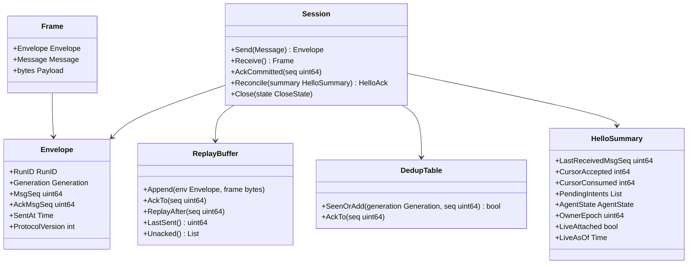
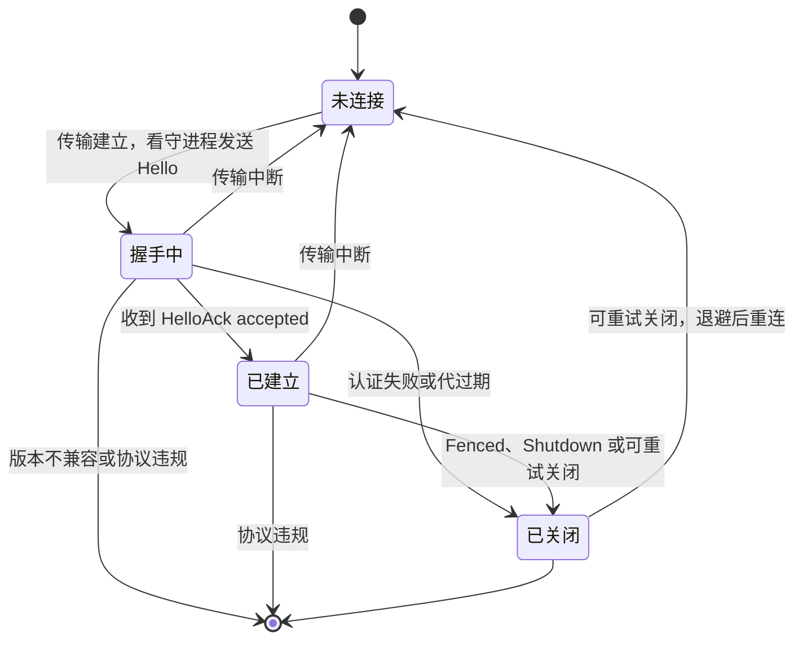
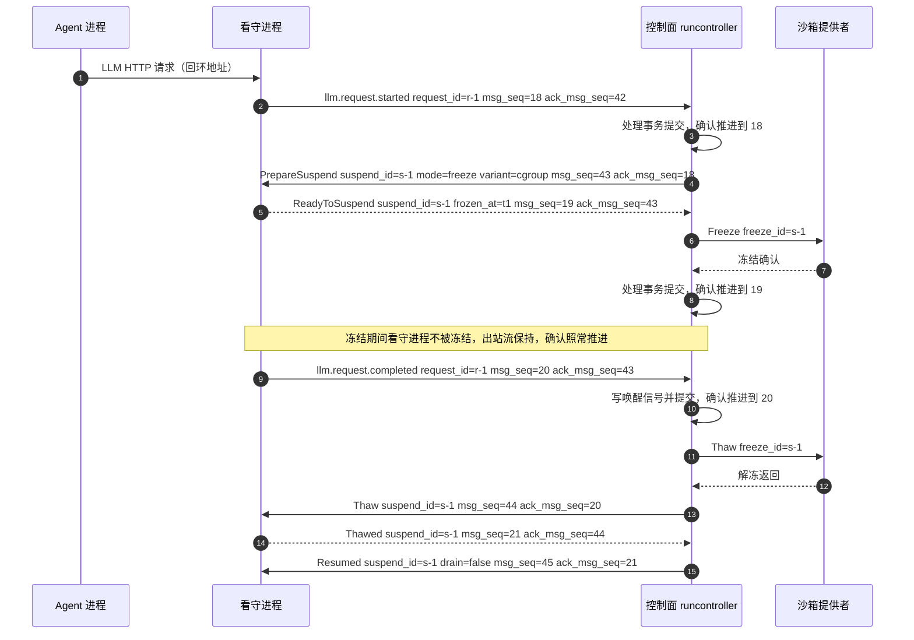
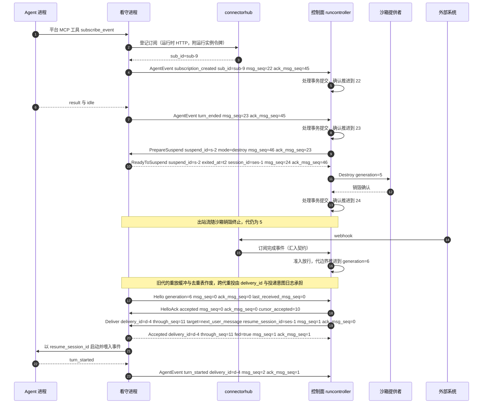
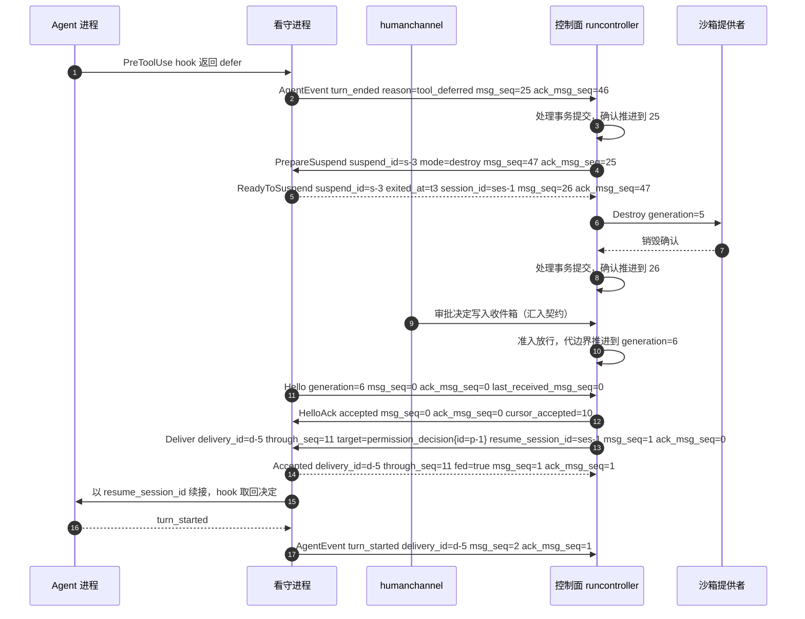
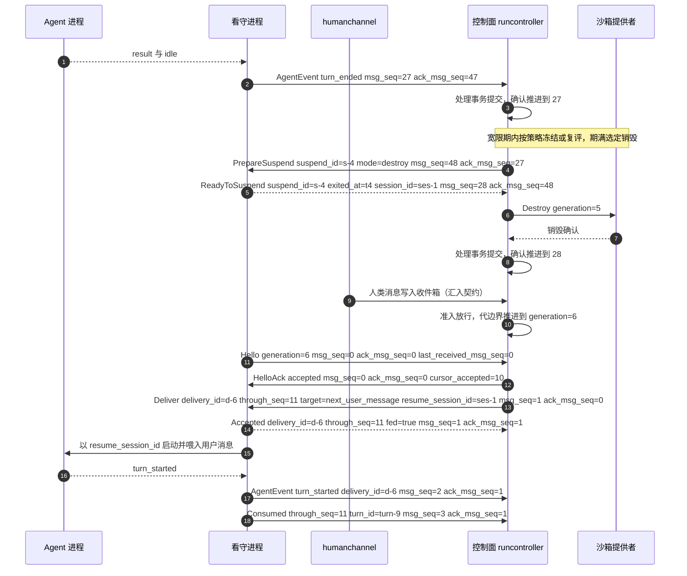

# agentprotocol

`agentprotocol` 是控制面与[看守进程](../../glossary.md)共用的协议库，链接进控制面服务与看守进程，不单独成进程。它拥有[出站流](../../glossary.md)上的信封、消息闭集、流序号与确认、重放、去重、状态对账、协议版本与入站端点契约；它不拥有消息对[运行实例](../../glossary.md)状态机的作用、投递批的选择、[沙箱](../../glossary.md)的创建与销毁、[运行实例令牌](../../glossary.md)的签发与校验。心智模型：协议库只保证一条流上的消息完整、按序、去重后交给状态机，不解释消息对运行实例做了什么。

文档较长，不宜顺序通读。第一次阅读按核心概念、职责、核心数据结构中的信封与消息闭集、核心算法与流程中的走查与场景的顺序；术语表、外部接口契约、依赖与 UML 图在核对字段、接口或实体关系时查阅；错误与失败语义、并发与事务边界留到实现核对时阅读，并作为最后的自测。场景时序图从协议层表达消息顺序、流序号、确认与重放，运行实例状态机转移的完整说明见 [runcontroller](design-runcontroller.md)。

## 核心概念

`agentprotocol` 围绕[出站流](../../glossary.md)上的可靠消息通道组织。控制面与看守进程之间的连接会因沙箱销毁重建、控制面所有权切换与网络中断而反复重建，而消息既不能丢，也不能让同一条消息重复作用于运行实例状态机。信封给每条消息带上运行实例、代与序号；每个方向、每个代独立分配流序号，接收方只确认处理事务已提交的连续前缀；发送方在重放缓冲中保留未确认消息，流重建后按原序号与原内容补发；接收方按 `(generation, msg_seq)` 去重，已提交的重复消息不再派发。握手帧交换持久化状态摘要，使双方在重建后对齐到同一位置而不重放事件历史（[ADR-state-based-reconciliation](../../adr/adr-state-based-reconciliation.md)）。投递按至少一次发送，传输层先做到完整、按序与去重，应用层按消息标识幂等吸收重复才有意义。

## 职责

`agentprotocol` 是看守进程与控制面之间唯一的协议定义与共享实现。职责穷举如下，每条先写本模块执行的动作，再写产生的结果或边界。

- **定义并校验公共信封**：为每条消息生成 `{run_id, generation, msg_seq, ack_msg_seq, sent_at, protocol_version}`；拒绝缺少字段、[代](../../glossary.md)不符、序号越界、消息超过尺寸上限或版本不支持的消息，非法帧不进入派发。
- **维护按代单调的流序号与确认**：每个方向、每个代独立分配 `msg_seq`；接收方以 `ack_msg_seq` 确认连续已提交前缀，确认只在消息的处理事务提交之后推进。
- **保留并重放未确认消息**：发送方在重放缓冲中保留 `ack_msg_seq` 之后的已发送消息；流重建后按原序号与原内容重放，未确认消息不因连接中断而丢弃。
- **按 `(generation, msg_seq)` 去重与按序派发**：接收方丢弃已提交的重复帧，缓存序号不连续的帧直到重放补齐；未提交的消息在重放时重新派发，效果由应用层幂等吸收。
- **以 `Hello` 与 `HelloAck` 做状态对账**：交换 `last_received_msg_seq`、`cursor_accepted`、`pending_intents`、`agent_state`、`owner_epoch` 与 `live_attached`，使双方在流重建后以持久化状态恢复一致，不重放事件历史（[ADR-state-based-reconciliation](../../adr/adr-state-based-reconciliation.md)）。
- **定义消息闭集与字段语义**：按方向穷举应用消息种类、字段与语义，定义共用的确认帧，约束字段取值闭集；消息种类不在当前协议版本闭集内的帧按协议违规处理。
- **定义关闭状态闭集**：`Fenced`、可重试关闭、不可重试认证失败与 `Shutdown`；规定每种状态的触发、确认推进与看守进程动作，并与协议违规造成的传输终止相区分。
- **协商协议版本**：按双方支持的连续版本区间选择版本，版本在协商完成后不变；版本决定信封字段、消息闭集与字段语义。
- **定义出站流与入站端点契约**：出站流的服务端与客户端行为、两个方向的消息尺寸上限与附件引用；看守进程在 80 端口提供的 `/readyz`、`/wake` 与 `/terminal` 的路径与语义。
- **提供共享库 API**：编码与解码、信封校验、重放缓冲、去重表、版本协商与会话抽象；链接方只经这些 API 收发协议消息，不自行解析信封。

### 非职责

非职责举例如下，判定标准为：职责清单之外、由其他模块拥有的事实与机制。

- 每条消息对运行实例状态机的作用、持久化点与效果记录归 `runcontroller`。本模块只把消息按序、去重后交给它。
- 投递批的选择、`delivery_id`、`Accepted` 与 `Consumed` 的游标语义归 `runcontroller`。协议层的 `ack_msg_seq` 只确认消息已处理，不是投递确认（[ADR-wait-on-durable-inbox](../../adr/adr-wait-on-durable-inbox.md)）。
- 沙箱的预配、挂起、解冻、快照、销毁与恢复触发归 `sandboxprovider`；`/readyz`、`/wake` 与 `/terminal` 的 HTTP 服务归看守进程，入站路由归 `sandboxprovider` 的提供者子模块。
- 运行实例令牌的签发、签名校验、轮换与有效期归 `secrets`。本模块只承载 `resume_token` 与 `TokenRotate`，并定义认证失败的关闭状态。
- [收件箱](../../glossary.md)、[唤醒信号](../../glossary.md)、[等待](../../glossary.md)、定时器、[订阅](../../glossary.md)与在途请求的持久化归 `runcontroller` 与事件源模块。本模块只承载 `Hello` 中的状态摘要与 `Deliver` 中的投递批。
- 本地代理与 LLM 网关之间的 HTTP、连接器与外部系统之间的 HTTP、MCP 工具调用都不归本模块；它们与出站流是并行的运行时调用。
- 看守进程对 Agent 的进程监督、[投递意图日志](../../glossary.md)、活动度采集与本地代理归 `warden` 模块的对应子模块。

## 术语表

| 术语 | 英文对照 | 适用范围 | 定义 |
| --- | --- | --- | --- |
| 信封 | envelope | agentprotocol | 每条消息前的固定头部，含 `run_id`、`generation`、`msg_seq`、`ack_msg_seq`、`sent_at` 与 `protocol_version` |
| 流序号 | stream sequence | agentprotocol | 每个方向、每个代内单调递增的 `msg_seq`；握手帧与确认帧不占用该序号空间 |
| 确认序号 | acknowledgment sequence | agentprotocol | `ack_msg_seq`，接收方已处理的连续最大流序号；只在处理事务提交后推进 |
| 状态对账 | state reconciliation | agentprotocol | 流重建后以 `Hello` 与 `HelloAck` 交换的状态摘要恢复一致，不重放事件历史 |
| 重放窗口 | replay window | agentprotocol | 发送方重放缓冲中 `ack_msg_seq` 之后、尚未确认的消息集合 |
| 关闭状态 | close state | agentprotocol | 语义化关闭的闭集：`Fenced`、可重试关闭、不可重试认证失败与 `Shutdown` |
| 握手帧 | handshake frame | agentprotocol | `Hello` 与 `HelloAck`；`msg_seq` 为 0，不进入流序号空间，不去重、不重放 |
| 确认帧 | acknowledgment frame | agentprotocol | 只承载信封 `ack_msg_seq`、`msg_seq` 为 0 的帧；两个方向共用，不占流序号空间，不重放、不去重 |

## 外部接口契约

共享库对链接方提供下列 API。签名只保留承载设计意义的部分，实现可增加辅助方法，但不得改变信封字段、消息闭集与本节声明的语义。链接方包括控制面服务与看守进程；`sandboxprovider` 只使用入站端点常量与路径语义，不链接消息处理逻辑。

```go
type Envelope struct {
    RunID           RunID
    Generation      Generation
    MsgSeq          uint64
    AckMsgSeq       uint64
    SentAt          time.Time
    ProtocolVersion int
}

type Codec interface {
    Encode(env Envelope, msg Message) ([]byte, error)
    Decode(frame []byte) (Envelope, Message, error)
    Validate(env Envelope, msg Message, limits Limits) error
}

type Frame struct {
    Envelope Envelope
    Message  Message
    Payload  []byte
}

type ReplayBuffer interface {
    Append(env Envelope, frame []byte) error
    AckTo(seq uint64)
    ReplayAfter(seq uint64, emit func(Envelope, []byte) error) error
    LastSent() uint64
    Unacked() []Frame
}

type DedupTable interface {
    SeenOrAdd(generation Generation, seq uint64) bool
    AckTo(seq uint64)
}

type Session interface {
    Send(msg Message) (Envelope, error)      // 窗口未满时分配流序号并写入重放缓冲
    Receive() (Frame, error)                 // 按序去重；握手帧与确认帧单独返回
    AckCommitted(seq uint64)                 // 处理事务提交后调用
    Reconcile(summary HelloSummary) (HelloAck, error)
    Close(state CloseState)
}

func Negotiate(local VersionRange, peer int) (int, error)

const (
    PathReadyz   = "/readyz"
    PathWake     = "/wake"
    PathTerminal = "/terminal"
)
```

- **编解码**：`Encode` 生成信封与消息体；`Decode` 先解析信封，再按消息种类解析消息体，返回握手帧与确认帧标记；`Validate` 校验字段闭集、代、序号、尺寸与版本。非法帧返回错误，调用方不得派发。
- **重放缓冲**：`Send` 在分配序号前检查窗口容量；`Append` 写入已分配的序号；`AckTo` 删除不高于确认序号的条目；`ReplayAfter` 按原序号升序重放；`LastSent` 返回本方向已写入重放缓冲的最后序号；`Unacked` 返回当前重放窗口。窗口已满时 `Send` 在分配序号前返回背压错误，不分配序号；已分配序号的 `Append` 不因容量失败。发送方停止产生新应用消息，不丢弃未确认消息。
- **去重表**：`SeenOrAdd` 以 `(generation, msg_seq)` 为键，区分已提交与已接收未提交：序号不高于已提交前缀时返回真，调用方只重发确认、不再派发；未提交的序号返回假，调用方派发，重放时重新派发，重复效果由应用层幂等吸收。`AckTo` 在消息处理事务提交后推进已提交前缀并删除不高于它的条目。去重表只保留未确认窗口内的条目，旧代条目随代变化丢弃。
- **会话**：`Send` 在窗口未满时分配序号、写入重放缓冲并交给传输；`Receive` 完成信封校验、按序与去重后返回消息；`AckCommitted` 由链接方在处理事务提交后调用，库据此生成确认，有应用消息可搭载时搭载、没有时按周期发送确认帧；`Reconcile` 处理 `Hello` 与 `HelloAck`；`Close` 产生语义化关闭状态。
- **版本协商**：`Negotiate` 以本地的连续支持区间与对端声明的版本计算共同版本；没有公共版本时返回错误，调用方终止连接。

稳定性承诺按接口类别给出。信封字段、消息名称、字段名称与取值闭集在同一个 `protocol_version` 内稳定；新增消息种类或改变既有字段语义必须递增协议版本。同一版本内可以新增可选字段，接收方忽略不认识的字段，不得据其改变既有语义。入站端点的路径与语义稳定；新增端点按扩展点的条件处理。库的公开签名稳定，链接方不依赖未导出的实现细节。库不引入任何业务模块的类型，`Message`、`HelloSummary` 与 `Frame` 以本模块定义的类型或字节载荷表达。

## 依赖

依赖穷举如下，方向与[模块依赖图](../architecture.md#模块依赖图)一致：本模块只依赖 Go 标准库与 gRPC，不依赖 `runcontroller`、`sandboxprovider`、`warden`、事件源模块或任何业务模块；控制面服务与看守进程依赖本模块，`sandboxprovider` 只使用入站端点契约。

- **Go 标准库**：字节编码、时间、上下文与 HTTP 服务端抽象。入站端点的处理器由看守进程实现，本模块只定义路径、语义与处理器契约。
- **gRPC**：出站流的传输。库提供出站流的服务端与客户端适配层：服务端接受流、完成 `Hello` 校验并把流绑定到 `Session`；客户端建立流、处理重连并按重放规则恢复。
- **无业务模块依赖**：本模块不读取数据库、不调用[沙箱提供者](../../glossary.md)、不校验令牌、不写[工作区](../../glossary.md)。`Hello` 的令牌校验、状态摘要的持久化与消息效果都由链接方在调用本模块之后执行。该方向满足基础层不依赖上层模块的约束，依赖图无环。

## UML 图

类图固定信封、帧、会话、重放缓冲、去重表与对账摘要的关系；状态图固定一条出站流的生命周期。图中不表达的约束由每张图后的正文给出。

### 类图



会话按方向各持一个重放缓冲，接收方向另持一个去重表；握手帧与确认帧只经过会话，不写入重放缓冲与去重表。`HelloSummary` 是 `Hello` 与 `HelloAck` 交换的状态摘要的合并视图，字段按方向出现在其一侧；字段的持久化归 `runcontroller`。重放缓冲与去重表都以 `(run_id, generation)` 为作用域，代变化即丢弃。

### 状态图



状态图只描述一条出站流。`Closed` 是语义化关闭的汇合点，各类关闭状态的触发与对端动作见错误与失败语义；传输中断回到 `Disconnected` 时不产生关闭状态，发送方保留重放缓冲，等待下一次握手。可重试关闭保留重放缓冲与去重表，退避后回到 `Disconnected` 重连；其余关闭状态终止重连。协议违规直接终止传输并计数，不产生关闭状态消息。

## 核心数据结构

### 信封

信封是每条消息的固定头部，两个方向使用同一结构。字段为闭集，顺序与编码由 `protocol_version` 固定。

| 字段 | 类型 | 语义 |
| --- | --- | --- |
| `run_id` | 运行实例标识 | 消息所属的运行实例；与出站流绑定的运行实例不一致时拒绝 |
| `generation` | 整数 | 消息所属的代；接收方以它做[失效判定](../../glossary.md)与去重作用域（[ADR-generation-fencing](../../adr/adr-generation-fencing.md)） |
| `msg_seq` | 无符号整数 | 本方向、本代内的流序号；握手帧与确认帧为 0，应用消息从 1 起严格递增 |
| `ack_msg_seq` | 无符号整数 | 发送方已处理的、对向消息的连续最大流序号；只在处理事务提交后推进 |
| `sent_at` | 时间戳 | 发送时刻，只用于测量与诊断；排序、确认与失效判定都不依赖它 |
| `protocol_version` | 正整数 | 本条消息使用的协议版本；协商完成后不变 |

信封校验穷举为：`run_id` 与流绑定一致；`generation` 与当前代一致（否则按失效判定处理）；应用消息的 `msg_seq` 不小于 1，握手帧与确认帧为 0；`ack_msg_seq` 不回退，且不超过接收该帧的一方已发送的 `LastSent`；`sent_at` 可解析；`Hello` 的 `protocol_version` 只校验为正整数，`HelloAck` 与后续消息的 `protocol_version` 等于协商结果；编码后的消息不超过尺寸上限。任一不满足即拒绝该帧，不派发、不推进确认。重复帧与乱序帧不在此拒绝，按去重与乱序规则处理。

### 消息闭集

下表按方向穷举当前协议版本的应用消息种类，是应用消息种类的闭集。`Hello` 与 `HelloAck` 是握手帧，`Ack` 是确认帧，三者的 `msg_seq` 均为 0；应用消息按流序号规则编号。新增应用消息种类须递增协议版本，并同时扩展编解码、两端处理器与本节表格。

两个方向共用确认帧 `Ack`：帧体为空，只以信封的 `ack_msg_seq` 确认对向消息；不占流序号、不写入重放缓冲、不去重，也不需要被确认。没有应用消息可搭载确认时，发送方按配置周期发送确认帧。

#### 看守进程到控制面

| 消息 | 字段 | 语义 |
| --- | --- | --- |
| `Hello` | `generation`、`session_epoch`、`resume_token`、`workspace_lease_id`、`sandbox_id`、`agent_state{phase, turn_id, blocked_on, frozen, freeze_id, frozen_since, session_id}`、`cursor_accepted`、`cursor_consumed`、`pending_intents[]`、`last_received_msg_seq` | 出站流首帧。以 `resume_token` 认证并声明代与工作区租约，提交状态摘要。控制面据 `generation`、令牌中的代与租约决定 `accepted`、`fenced`、不可重试认证失败、可重试关闭或 `Shutdown`；`last_received_msg_seq` 是看守进程已处理的控制面消息序号，控制面从它之后重放。 |
| `AgentEvent` | `turn_id`、`event_seq`、`kind`：`turn_started{session_id, delivery_id}`、`turn_ended{reason, agent_exited, bg_procs}`、`tool_started{call_id}`、`tool_ended{call_id}`、`permission_requested{id, call_id, blocking}`、`subscription_created{sub_id, since_cursor}`、`timer_requested{timer_id, fire_at, scope}`、`wait_started{call_id, kind: wait_for\|request\|timer, ref, fire_at, predicted_ms}`、`bg_jobs_changed{job_ids}`、`state_changed{idle\|requires_action}` | 驱动器把 Agent 原生信号翻译为回合事件；`event_seq` 在同一回合内单调，用于丢弃重复与乱序事件。`turn_ended` 只在回合结果与 `idle` 齐备且 `queued_turn_count` 为 0 后发出；`turn_started.delivery_id` 为本回合消费的投递，Agent 自行开始的回合为空；`timer_requested` 只以 `scope=run` 发出，`scope=generation` 由 `WaitDeclared` 的 `deadline` 表达。 |
| `WaitDeclared` | `wait_id`、`scope: run\|generation`、`conditions[{cond_id, kind, ref}]`、`deadline`、`safe_to` | 仅 L2 协作式 Agent 使用；沙箱内的 L2 进程驱动器经出站流发送，控制面循环驱动器经 `runcontroller` 的 `RunService.DeclareWait` 提交同一组字段。向控制面追加显式等待条件。`kind=timer` 的条件必须引用已存在且同范围的 `timer` 行，否则整条声明被拒绝并计数；带 `deadline` 时登记同范围的 `declared_deadline` 定时器。 |
| `Activity` | `psi{cpu, io, mem}`、`procs{R, D, S, T, Z}`、`throttled_usec`、`last_fork_at`、`ws_write_fds`、`io_bytes`、`net_bytes`、`frozen`、`freeze_id` | 按固定周期发送的活动度摘要。`frozen` 为 Agent 子 cgroup 的冻结状态；`Active` 中 `frozen=true` 且 `freeze_id` 不等于 `aborted_suspend_id` 时控制面判定本代沙箱作废。 |
| `Accepted` | `delivery_id`、`through_seq`、`fed` | 接受记录同步写入[工作区](../../glossary.md)[投递意图日志](../../glossary.md)后才发送。`fed` 报告本批按日志去重后是否仍有事件喂给 Agent；`fed=false` 时不为本批启动 Agent，控制面不转 `InTurn`。 |
| `Consumed` | `through_seq`、`turn_id` | 只针对 `target=next_user_message` 的常规投递；消费记录同步写入投递意图日志后才发送；`through_seq` 取已开始处理的常规批的序号。定向投递与回合边界续接不发 `Consumed`。 |
| `DeliveryFailed` | `delivery_id`、`seqs`、`reason`、`retryable` | 一批投递未能喂给 Agent。`reason` 含 `target_gone`；`retryable` 为真时由 `runcontroller` 以新 `delivery_id` 退避重投；`retryable` 为假且 `reason=target_gone` 时不放弃，事件取消定向并回退为常规投递；其余 `retryable` 为假的情形放弃失败的事件并通知 Agent。 |
| `ReadyToSuspend` | `suspend_id`、`mode`、`frozen_at \| exited_at`、`session_id`、`procs_remaining`、`ws_write_fds` | 看守进程侧安全点已满足。冻结模式报告 `frozen_at`，销毁模式报告 `exited_at`；`session_id` 为[恢复句柄](../../glossary.md)，空值不覆盖已落库的值。 |
| `Busy` | `suspend_id`、`reason`、`retry_after` | 挂起前置条件不满足；`reason=cancelled` 是 `CancelSuspend` 的确认；`retry_after` 给出复评时刻。 |
| `Thawed` | `suspend_id` | `suspend_id` 取冻结标识 `freeze_id`；按 `freeze_id` 幂等。`signal` 变体在自行解冻进程树之后上报，`cgroup` 变体在观察到 Agent 子 cgroup 未冻结之后上报，进程树从未冻结时立即上报。 |
| `LeaseLost` | `lease_id`、`expires_at` | [工作区租约](../../glossary.md)续约失败后上报；看守进程冻结或杀死 Agent 进程树并停止写入。 |
| `llm.request.started` | `request_id`、`request_hash`、`mode: passthrough\|hold`、`predicted_ms` | 本地代理向上游发起请求后上报；`mode` 决定阻塞条件的冻结上限取 `F_stream` 或 `F_cap(llm)`。 |
| `llm.first_token` | `request_id` | 收到首个响应事件；用于预测性恢复提示与等待时长重估，不单独满足阻塞条件。 |
| `llm.request.completed`、`llm.request.failed` | `request_id`；失败另带 `reason` | LLM 请求完成或失败；满足同一 `request_id` 的阻塞条件。 |
| `request.completed`、`request.failed` | `request_id`；失败另带 `reason` | 经[平台 MCP 服务器](../../glossary.md)发起的同步连接器操作完成或失败；与同一 `request_id` 的等待条件匹配。 |
| `ToolExecResponse` | `exec_id`、`status`、`exit_code`、`result`、`error` | 工具执行请求的终态应答；`status` 取 `completed`、`failed`、`cancelled`，`error` 只在失败时非空。按 `(run_id, generation, exec_id)` 匹配请求。 |
| `ToolExecData` | `exec_id`、`stream: stdout\|stderr`、`offset`、`data`、`eof` | 工具执行输出分片；`offset` 从该流起点计，接收方按偏移续传，重复或乱序分片被丢弃。`eof` 表示该流结束。 |

- `session_epoch` 由看守进程按进程启动生成，用于识别同一代内看守进程的重启，不参与失效判定；失效判定只以 `generation` 为依据。
- `agent_state.phase` 的取值为 `starting`、`in_turn`、`blocked`、`boundary`、`exited`；`blocked_on` 与 `turn_id` 描述回合位置；新代 `Hello` 的 `session_id` 只用于核对，不改写控制面的恢复句柄。
- `cursor_accepted` 与 `cursor_consumed` 只计常规投递的已接受与已消费前缀，不含定向投递与回合边界续接。
- `pending_intents[]` 携带投递意图日志中尚未被控制面确认的记录；控制面按其中常规投递的最大已接受序号前进 `cursor_accepted`（[ADR-delivery-intent-log](../../adr/adr-delivery-intent-log.md)）。

#### 控制面到看守进程

| 消息 | 字段 | 语义 |
| --- | --- | --- |
| `HelloAck` | `accepted \| fenced{current_generation}`、`desired_state{running\|frozen}`、`last_received_msg_seq`、`cursor_accepted`、`owner_epoch`、`live_attached`、`live_as_of` | `Hello` 的应答。`accepted` 表示所有权已接管并完成状态对账；`fenced{current_generation}` 表示代已过期；认证失败不回 `HelloAck`。`desired_state` 让看守进程对齐 Agent 进程树的冻结状态；`last_received_msg_seq` 让看守进程裁剪重放缓冲并从其后重放；`cursor_accepted`、`owner_epoch`、`live_attached` 与 `live_as_of` 是状态对账字段。 |
| `Deliver` | `delivery_id`、`batch[{inbox_seq, event_id, dedup_key, kind, subkind, payload, occurred_at, redelivery}]`、`through_seq`、`target: next_user_message \| tool_result{call_id} \| permission_decision{id}`、`resume_session_id` | 只在出站流上，投递语义为至少一次。`batch` 按 `inbox_seq` 升序，`through_seq` 为批内最后一条；`subkind` 只在 `kind=internal_notice` 时非空，取值为 `turn_interrupted`、`timer_due`、`degraded_summary` 或 `delivery_abandoned`；`target` 决定喂入 Agent 的方式；`resume_session_id` 为空表示新会话；`payload` 超过 `S_max` 时以附件引用表达。 |
| `PrepareSuspend` | `suspend_id`、`mode: freeze\|freeze_shrink\|snapshot\|destroy`、`variant: cgroup\|signal`、`deadline`、`require{process_exit, no_bg_procs, no_ws_write_fds, sync}`、`force` | 请求看守进程到达安全点。`variant` 只在冻结类模式（`freeze`、`freeze_shrink`）时非空；`require` 列出必须满足的条件；`force` 允许终止 Agent 主进程之外的进程；`deadline` 用于对账器重驱动。 |
| `CancelSuspend` | `suspend_id` | 撤销挂起尝试。确认载体为 `Busy{suspend_id, reason=cancelled}`；看守进程已越过不可撤销点时照常回 `ReadyToSuspend`。 |
| `Thaw` | `suspend_id` | `suspend_id` 取冻结标识 `freeze_id`。`signal` 变体由看守进程收到后自行解冻；`cgroup` 变体由控制面在沙箱提供者的解冻调用返回之后发送。看守进程以 `Thawed` 应答。 |
| `Resumed` | `suspend_id`、`suspended_for_ms`、`wall_clock_now`、`drain` | 恢复完成通知；按 `suspend_id` 幂等。`drain=true` 按 `T_drain` 周期重发；看守进程收到后，已在等待的与之后发起的阻塞型审批、`wait_for` 与阻塞型 `sleep_until` 都按 DRAIN 规则立即返回。 |
| `LiveState` | `attached`、`as_of` | [实时接入](../../glossary.md)状态推送；`as_of` 单调，看守进程只接受更新的值。`HelloAck` 携带同一对字段。 |
| `Shutdown` | `graceful`、`reason`、`deadline` | 本代作废或运行实例已终态时关闭流；`graceful` 决定关闭 stdin 让 Agent 正常退出，还是强制终止；`deadline` 取发出时刻加 `T_shutdown_grace`。 |
| `Fenced` | `current_generation` | 已建立的流上收到旧代非 `Hello` 消息时应答，每条流每个旧代一次，随后关闭该流。看守进程停止投递与副作用，强制终止 Agent 进程树。 |
| `TokenRotate` | `token` | 轮换运行实例令牌。看守进程收到后用于 LLM 网关与连接器请求；令牌已过期而重连时，收到它之前不发起这类请求。 |
| `ToolExecRequest` | `exec_id`、`op: exec\|read_file\|write_file\|stream\|list_jobs\|get_job\|terminate_job`、`args`、`deadline` | 工具执行请求。由链接进 `runcontroller` 的控制面循环驱动器发起，经本运行实例的出站流转发；`exec_id` 在同一代内唯一，`args` 与截止时间按操作定义。 |
| `ToolExecCancel` | `exec_id` | 取消一次工具执行或输出流；看守进程按 `exec_id` 幂等，已结束的执行返回已完成。 |

`HelloAck` 的 `last_received_msg_seq` 是控制面已处理的看守进程消息序号，与 `Hello` 的 `last_received_msg_seq` 方向相反；两者都只用于裁剪重放缓冲与启动对账，不替代投递游标。

`ToolExec` 帧由 `runcontroller` 在进程内从控制面循环驱动器接收后写入该运行实例的出站流，并以同一 `(run_id, generation, exec_id)` 把响应与数据帧交回驱动器。控制面循环驱动器不持有运行实例令牌、不发送 `Hello`，也不建立第二条协议会话；帧的认证由出站流承担，代与终态由 `runcontroller` 在写入前复核。`ToolExec` 帧不进入投递、唤醒谓词或运行实例状态机。

### 入站端点契约

看守进程在沙箱内监听 80 端口，提供下列端点。端点不承载协议消息与投递事件；投递只在出站流上。

| 路径 | 调用方 | 语义 | 内容约束 |
| --- | --- | --- | --- |
| `/readyz` | [沙箱提供者](../../glossary.md)的唤醒探针、k8s 的就绪探针 | 就绪探针。看守进程可服务且出站流已建立时返回就绪，否则返回未就绪 | 无请求体与事件内容 |
| `/wake` | `sandboxprovider` 的恢复路径，Substrate 路径经路由器 | 恢复触发入口。返回即表示出站流已重建；调用幂等，并发的重复调用合并 | 无事件内容，不返回投递批 |
| `/terminal` | `humanchannel` 完成用户身份校验后的终端接入，经入站路由 | 人类 shell 终端接入；建立后为双向字节流 | 不承载协议消息、收件箱事件或投递批 |

`/readyz` 的就绪状态以出站流为准：流未建立或握手未完成时返回未就绪，使提供者与探针不把流量送入尚未接通的看守进程。`/wake` 在出站流重建完成之前不得返回成功；调用失败时由提供者按恢复失败处理。`/terminal` 的接入身份由 `humanchannel` 校验，看守进程只接受已通过入站路由的请求。

### 消息尺寸与附件引用

出站流双向的最大消息尺寸相同，配置为不小于 `S_max` 加信封与编码余量。`S_max` 是 `runcontroller` 定义的单批载荷上限，取值为 3 MiB；单批条数上限为 `B_max=100`。协议层不为单条消息分片；超过尺寸上限的内容不得作为单条消息发送。

`Deliver.batch[].payload` 不超过 `S_max`。超过上限的内容由事件源自行存放，`payload` 内只放附件引用，引用由可取回的 URI 与内容哈希组成。本模块原样传输引用，不解析、不取回；Agent 经平台 MCP 服务器附运行实例令牌向存放方取回，不直连存放方。

### 状态一览

状态图回答一条出站流存在哪些状态；下表回答每个状态在运行中的含义。`runcontroller` 的运行实例状态机不在本表内。

| 状态 | 一句话含义 | 当前动作（协议会话） | 直觉画面 |
| --- | --- | --- | --- |
| 未连接 | 没有传输，双方保留各自的重放缓冲与最后确认序号 | 等待重连，不分配新流序号，不丢弃未确认消息 | 信件压在发件箱，等下一次邮路 |
| 握手中 | 传输已建立，`Hello` 已发出或已收到，只处理握手帧 | 交换 `last_received_msg_seq` 与状态摘要，决定 `accepted`、`fenced` 或认证失败；传输中断时保留缓冲，等待重连 | 双方把对账本摊开，逐项核对 |
| 已建立 | `HelloAck accepted` 已产生，两个方向按流序号收发 | 分配序号、确认已提交前缀、去重与重放 | 双轨列车按站号前行，各自记录到站 |
| 已关闭 | 关闭状态之一已产生 | 按关闭类别处理：`Fenced`、`Shutdown` 与不可重试认证失败丢弃连接的缓冲与去重表并停止重连；可重试关闭只丢弃连接级传输状态，保留重放缓冲与去重表，退避后回到未连接 | 闸门落下，轨道清空 |

版本不兼容与协议违规直接终止会话，不进入已关闭状态；版本不兼容按配置错误处理，协议违规按部署缺陷处理。

## 核心算法与流程

### 走查

走查把一次断流前后的序号、确认与重放落到具体值上。初始条件：`generation=5`；控制面已发送 `Deliver` 41 与 42，最后收到的看守进程确认是 17；看守进程已处理 41 并发出 `Accepted` 18，`Accepted` 18 的 `ack_msg_seq` 为 41，42 已收到但尚未处理；`Accepted` 18 在控制面收到之前流中断。握手帧与确认帧的 `msg_seq` 为 0。

| 步骤 | 事件或动作 | 控制面到看守进程：重放缓冲 / 对端确认 | 看守进程到控制面：重放缓冲 / 对端确认 |
| --- | --- | --- | --- |
| 1 | 控制面已发送 41、42；看守进程已处理 41 并发出 18；流中断 | `[41, 42] / 17` | `[18] / 17` |
| 2 | 看守进程重连，发送 `Hello{generation=5, msg_seq=0, ack_msg_seq=41, last_received_msg_seq=41}`；控制面处理 `Hello` 后删除 41 | `[42] / 41` | `[18] / 17` |
| 3 | 控制面回 `HelloAck{accepted, msg_seq=0, ack_msg_seq=17, last_received_msg_seq=17, cursor_accepted}` | `[42] / 41` | `[18] / 17` |
| 4 | 看守进程重放 18；控制面按 `(5, 18)` 首次收到，派发给状态机并在事务提交后把待发确认置为 18 | `[42] / 41` | `[18] / 17` |
| 5 | 控制面重放 42；看守进程首次处理 42，提交后发出 `Accepted` 19 `ack_msg_seq=42` | `[42] / 41` | `[18, 19] / 17` |
| 6 | 控制面收到 19 并提交，对端确认变为 42；删除 42 | `[] / 42` | `[18, 19] / 17` |
| 7 | 控制面下一次发往看守进程的消息携带 `ack_msg_seq=19`；看守进程删除 18 与 19 | `[] / 42` | `[] / 19` |

走查结束时控制面最后收到看守进程的确认 42，看守进程最后收到控制面的确认 19；两个方向的重放缓冲最终为空。协议层把 18 与 42 各派发一次；应用层的 `delivery_id` 与游标 CAS 保证重复的 `Accepted` 不重复推进游标。`Hello.last_received_msg_seq=41` 让控制面在应用确认 18 丢失时仍能裁剪 41，42 因未被确认而保留并重放。协议确认与投递确认是两层：`ack_msg_seq` 确认消息已处理，`Accepted` 与 `Consumed` 确认投递与消费。

### 发送、确认与重放

- **序号分配**：每个方向、每个代独立编号。握手帧与确认帧 `msg_seq=0`；第一个应用消息为 1，此后每条加一。序号在发送前分配，重放时保留原序号。
- **发送与保留**：消息分配序号后先写入重放缓冲，再交给传输。未确认消息不因发送失败或连接中断而删除。
- **确认推进**：接收方按 `msg_seq` 顺序派发；`ack_msg_seq` 取连续已提交的最大序号。处理事务失败时不确认，消息留在对向的重放缓冲中等待重放。批量确认取连续前缀的最高值，不跳号；没有应用消息可搭载时，确认帧独立发送，不等待反向消息。
- **重放**：流重建后先发送 `Hello` 与 `HelloAck`，再按 `ack_msg_seq+1` 升序重放。接收方在握手后丢弃旧流的乱序缓存，从对端重放的序号重新接收。重放完成之前不分配新的应用序号；重放保持原 `msg_seq`、原消息体与原 `sent_at`。
- **背压**：重放窗口达到配置上限时，发送方在分配序号前返回背压错误并暂停产生新应用消息；确认帧与确认推进不受背压影响，窗口随确认回收；已处理的消息随确认帧离开窗口，关键事件不被已处理未确认的消息阻塞。已分配的序号一定已写入重放缓冲，窗口内未确认消息不被丢弃。
- **代变化**：新代清空两个方向的重放缓冲与去重表，流序号从 1 重新开始。旧代消息不重放、不跨代复用 `msg_seq`；跨代重投由 `runcontroller` 生成新的 `Deliver` 与 `delivery_id`，并置 `redelivery=true`（[ADR-delivery-intent-log](../../adr/adr-delivery-intent-log.md)）。
- **时钟**：`sent_at` 只用于测量与诊断；序号、确认、重放与去重都不依赖墙钟。冻结与解冻造成的时钟跳变不影响协议状态。

### 去重与乱序

- **去重键**：`(run_id, generation, msg_seq)`。同一代内已提交的重复消息不再次派发；未提交的消息在重放时重新派发，由应用层按消息标识幂等。不同代的相同序号是不同消息。
- **重复确认**：重复帧可以再次确认，确认值不因重复而回退。低于已发送确认的迟到帧直接丢弃，不视为错误。
- **乱序**：接收方不为序号不连续的消息建立新前缀，也不跳过缺口派发后续消息。缺口由重放补齐；重连并完成状态对账之后仍不连续时，按可重试关闭处理。
- **去重表裁剪**：不高于已发送确认的条目删除；高于确认的条目保留到被确认或代变化。去重表的大小由重放窗口与背压约束，不随运行时长增长。
- **幂等边界**：协议去重只覆盖传输层的重复投递。应用层重复由 `runcontroller` 的 `delivery_id`、`suspend_id`、`freeze_id` 与带代的游标 CAS 处理；本模块不解释这些标识。

### 状态对账

- **看守进程到控制面**：`Hello` 携带 `last_received_msg_seq`、`cursor_accepted`、`cursor_consumed`、`pending_intents` 与 `agent_state`。控制面以 `last_received_msg_seq` 裁剪控制面到看守进程的重放缓冲，从其后重放；以 `pending_intents` 前进 `cursor_accepted`，再对账 `cursor_consumed`，选择恢复后的进入点。对账以持久化状态为准，不重放事件历史（[ADR-state-based-reconciliation](../../adr/adr-state-based-reconciliation.md)）。
- **控制面到看守进程**：`HelloAck` 携带 `last_received_msg_seq`、`cursor_accepted`、`owner_epoch`、`live_attached` 与 `live_as_of`。看守进程以 `last_received_msg_seq` 裁剪自己的重放缓冲并从其后重放；以 `desired_state` 对齐 Agent 进程树的冻结状态；以 `live_as_of` 只接受更新的实时接入状态。
- **确认与对账的分工**：信封的 `ack_msg_seq` 是流内的连续确认；`Hello` 与 `HelloAck` 的 `last_received_msg_seq` 是流重建时的对账起点。两者都不替代投递游标，也不使控制面跳过未提交的消息处理。
- **跨所有者副本**：控制面副本崩溃后，新所有者以 `Hello.last_received_msg_seq` 与持久化的流状态继续出站序号，并以 `Hello` 与 `HelloAck` 的状态对账恢复一致。出站序号跨所有者副本单调；控制面出站序号与未确认消息由本模块的会话状态持有，不在 `runcontroller` 的数据模型中持久化，旧副本未确认的消息不按事件历史重放，由状态机按持久化状态重新产生（[ADR-single-writer-per-run](../../adr/adr-single-writer-per-run.md)、[ADR-state-based-reconciliation](../../adr/adr-state-based-reconciliation.md)）。

### 版本协商

- **取值与区间**：`protocol_version` 为正整数，双方各自支持一个连续的版本区间。看守进程以自身支持的最高版本发送 `Hello`。
- **选择规则**：控制面在该版本落在自身区间内时以同一版本应答；高于自身上限时以自身上限应答，看守进程支持该版本时按它继续，不支持时终止连接并上报；低于自身下限时终止连接、不回 `HelloAck`，并计入配置错误。版本只降不升，协商完成后不再变化。
- **版本的作用域**：版本决定信封字段、消息闭集与字段语义。新增消息种类或改变既有字段语义必须递增版本；同一版本内新增可选字段不改变既有语义，接收方忽略不认识的字段。
- **无公共版本**：双方没有公共版本时连接终止，看守进程停止重连并上报；该情形按部署配置错误处理，不产生语义化关闭状态。

### 场景：等 LLM 时的冻结与恢复



图固定冻结与恢复期间的消息顺序：`PrepareSuspend` 与 `ReadyToSuspend` 以 `suspend_id` 幂等，`Thaw` 与 `Thawed` 以 `freeze_id` 幂等；看守进程在冻结期间继续收发协议消息，控制面的确认只在消息处理事务提交后推进。流在冻结期间中断时，双方按走查的规则重连、对账与重放；`PrepareSuspend`、`ReadyToSuspend`、`Thaw` 与 `Thawed` 的重放不重复执行效果，因为链接方按 `suspend_id` 与 `freeze_id` 幂等。

### 场景：等 PR 门禁的订阅与销毁重建



图固定销毁重建前后的代边界：旧代流上的确认与重放随代递增作废，`Deliver` 不复用旧代 `msg_seq`；新代 `Hello` 以状态对账恢复游标，投递以新的 `delivery_id` 与 `redelivery` 标记重投。旧代沙箱在代递增之后发来的非 `Hello` 消息收到 `Fenced{current_generation=6}`，随后流关闭（[ADR-generation-fencing](../../adr/adr-generation-fencing.md)）。订阅完成事件按[汇入契约](../../glossary.md)进入收件箱；收件箱与 `Deliver` 的选择归 `runcontroller` 与 `connectorhub`，本模块只承载消息与序号。

### 场景：审批 defer 与续接



图固定回合边界续接的定向投递：`target=permission_decision{id}`，`resume_session_id` 为上一代落库的恢复句柄。定向投递不推进 `cursor_accepted`，其消费只写入投递意图日志、不发送 `Consumed`。决定在销毁之前到达时，`Deliver` 在同一代的已建立流上发送，序号与重放规则不变；决定在销毁之后到达时，按图示在新代发送。运行实例状态机的转移与持久化字段见 [runcontroller](design-runcontroller.md)。

### 场景：等人并销毁重建



图固定等人路径的两级确认：`Accepted` 表示接受记录已写入投递意图日志，`Consumed` 表示 Agent 已开始处理该常规投递；`Consumed` 在消费记录同步写入之后发送，只推进 `cursor_consumed`。人类消息的写入与 `WakeQueued` 转移归 `runcontroller`，本模块只保证 `Deliver` 的消息、序号与确认按图推进。

## 错误与失败语义

关闭状态为闭集：`Fenced`、可重试关闭、不可重试认证失败与 `Shutdown`。下表按触发穷举关闭状态与看守进程的动作；协议违规造成的传输终止不产生关闭状态，单独列出。

| 情形 | 关闭状态 | 产生方 | 触发与判定 | 看守进程动作 | 确认与重放 |
| --- | --- | --- | --- | --- | --- |
| `Hello` 的令牌签名或 `run_id` 无效，或令牌中的代与信封 `generation` 不符 | 不可重试认证失败 | 控制面 | `Hello` 公共校验 | 停止重连并上报；不再发送协议消息 | 不回 `HelloAck`、不携带当前代；不重放 |
| `Hello.generation` 与当前代不符 | `HelloAck.fenced{current_generation}` | 控制面 | 代校验 | 停止投递与副作用，强制终止 Agent 进程树，停止重连 | 不重放 |
| 已建立流上的非 `Hello` 消息的 `generation` 与当前代不符 | `Fenced{current_generation}` | 控制面 | 失效判定；每条流每个旧代一次 | 停止投递与副作用，强制终止 Agent 进程树，停止重连 | 不推进确认；不重放 |
| 运行实例已终态 | `Shutdown{graceful=false}` | 控制面 | `Hello` 或消息处理前 | 停止；不再重连 | 不推进确认 |
| 本代已作废而代尚未递增 | `Shutdown{graceful=false}` | 控制面 | 非 `Hello` 消息；`degraded` 或 `destroyed` 的作废状态 | 停止；不再重连 | 不推进确认 |
| 消息处理依赖的令牌校验或 `workspace.GetLease` 调用失败 | 可重试关闭 | 控制面 | 处理前的事务外调用 | 不终止 Agent 进程树；退避重连后重放未确认消息 | 该消息不处理、不推进确认；重放 |
| 双方没有公共协议版本 | 无 `HelloAck`，传输终止 | 控制面 | 版本协商 | 停止重连并上报 | 不重放；按配置错误处理 |
| 帧格式非法、消息种类未知、新帧的确认序号低于已记录值、重连后仍有序号缺口 | 传输终止，不产生语义关闭状态 | 接收方 | 编解码与顺序校验 | 计数；重连后仍失败则停止并上报 | 不派发；按部署缺陷处理 |
| 重复的 `(generation, msg_seq)` | 无关闭 | 接收方 | 去重表 | 继续正常收发 | 已提交的不重复派发；未提交的重放重新派发；确认不回退 |
| 低于已发送确认的迟到帧 | 无关闭 | 接收方 | 序号校验 | 继续正常收发 | 丢弃并保持确认 |

语义化关闭与协议违规的区别：关闭状态是对端可据此决定停止或重连的信号，携带足够的判定信息；协议违规不产生关闭状态消息，连接被终止并计数，需按部署缺陷处理。可重试关闭可经重连与重放恢复；`Fenced` 表示代已过期，重连不会恢复该代。

## 并发与事务边界

- **确认与提交**：库的 `AckCommitted` 只在消息处理事务提交后调用；库不自行确认。链接方在提交前崩溃时消息未被确认，对端重放，接收方对已提交序号只重发确认、未提交的重新派发，应用层按消息标识幂等。
- **派发顺序**：每个方向的入站消息按 `msg_seq` 顺序派发；链接方可以在前一条提交之前开始下一条，但确认只推进连续已提交前缀，不跳号。乱序到达的帧缓存在接收侧，不进入状态机。
- **单写者**：看守进程侧同时只有一条出站流，序号分配由该流的写者串行执行。控制面侧同一运行实例同一时刻只有一个所有者副本是状态机写者，出站序号跨所有者副本单调，新所有者以 `Hello.last_received_msg_seq` 与持久化的流状态继续；重放缓冲与未确认消息由本模块的会话状态持有，不归 `runcontroller` 持久化（[ADR-single-writer-per-run](../../adr/adr-single-writer-per-run.md)）。
- **代变化**：代递增与旧代作废的事务提交后，旧代的重放缓冲、去重表与未发送消息全部丢弃；旧代流上的消息按 `Fenced` 拒绝。新代从空缓冲与序号 1 开始，不复用旧代的协议状态。
- **冻结期间**：看守进程不被冻结，出站流、确认与活动度上报继续；Agent 进程树的冻结状态经 `agent_state.frozen`、`freeze_id` 与 `Activity` 表达。协议状态不依赖墙钟，冻结造成的时钟跳变不影响序号与去重。
- **入站端点**：`/wake` 的并发调用合并为一次恢复与一次流重建，返回时握手已完成；`/readyz` 读取当前流状态，不加协议序号；`/terminal` 的字节流与协议序号无关，不推进确认。
- **背压与内存**：重放缓冲与去重表的大小由重放窗口约束；窗口满时停止分配新的应用消息序号，不丢弃未确认消息。去重表随确认推进裁剪，不随运行时长增长。

## 扩展点

### 新增消息种类

新增消息种类必须递增协议版本，并同时修改消息闭集、编解码、两个方向的处理器与本节表格。新消息必须携带信封，遵守流序号、确认、重放与去重规则；涉及运行实例状态的字段必须声明所属代与幂等标识。消息种类不递增版本而直接发送时，对端按协议违规终止连接。

### 新增可选字段

同一协议版本内可以新增可选字段，条件是既有字段的语义与消息闭集不变，接收方忽略不认识的字段。新增字段改变既有语义、改变取值闭集或使旧接收方产生不同行为时，必须递增协议版本。新增字段不改变信封结构；信封本身增删字段一律视为新版本。

### 新增入站端点

新增入站端点须满足：不承载协议消息与投递事件；声明调用方身份与幂等语义；路径与语义加入入站端点契约；由 `sandboxprovider` 的入站路由按提供者路径转发。端点需要唤醒沙箱时，返回时机必须晚于出站流重建与 `Hello` 对账；端点需要传输事件内容时，应改为出站流消息，不在入站端点扩展。

## 实现状态

| 能力 | 状态 | 代码 |
| --- | --- | --- |
| 信封与编解码 | 未实现 | — |
| 消息闭集与字段校验 | 未实现 | — |
| 流序号、确认与重放缓冲 | 未实现 | — |
| 去重表 | 未实现 | — |
| `Hello` 与 `HelloAck` 状态对账 | 未实现 | — |
| 协议版本协商 | 未实现 | — |
| 出站流服务端与客户端适配层 | 未实现 | — |
| 入站端点契约 | 未实现 | — |
