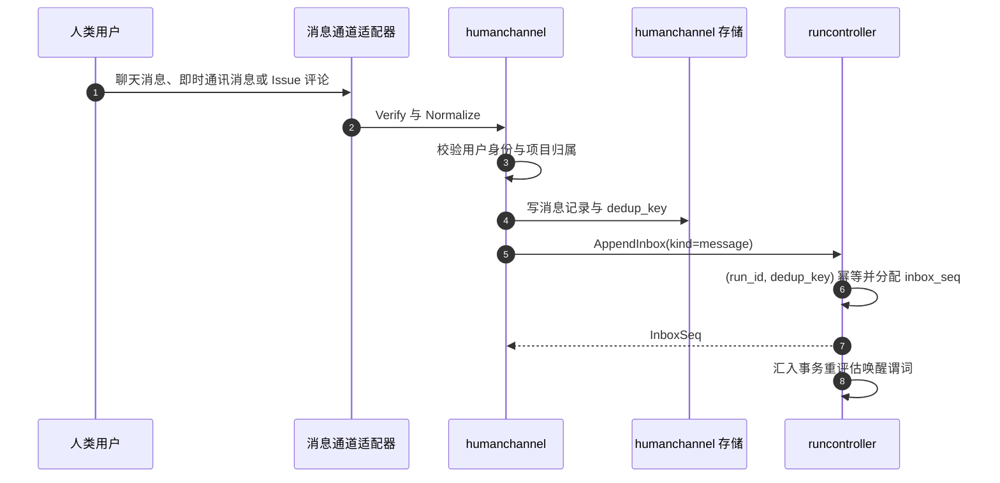
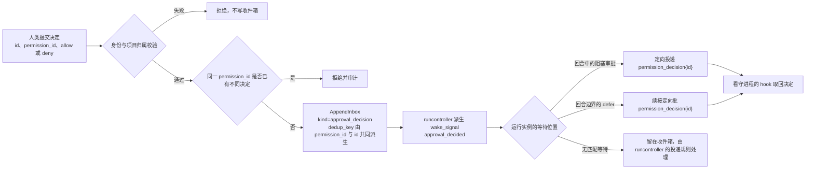
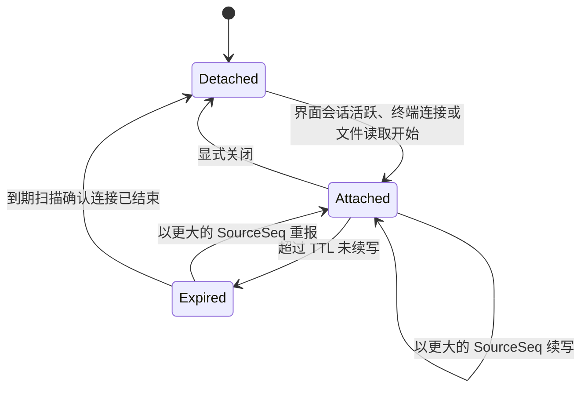
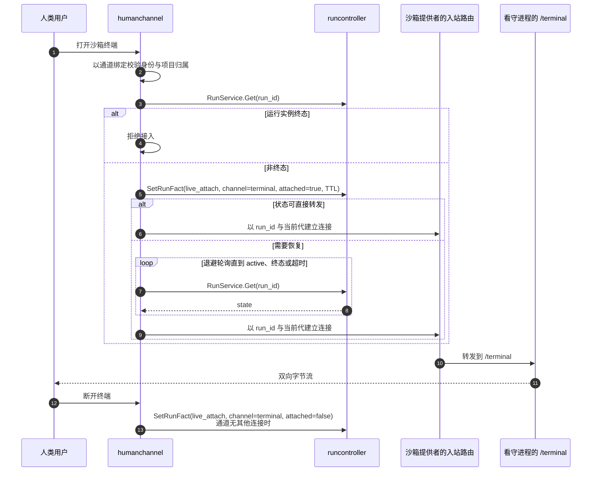

# humanchannel

`humanchannel` 是控制面中的人类通道（[人类通道](../../glossary.md)）模块，也是事件源模块之一。聊天界面、即时通讯与 Issue 评论的人类输入经它进入运行实例（[运行实例](../../glossary.md)）的收件箱（[收件箱](../../glossary.md)）；平台界面的会话活跃、终端连接与工作区（[工作区](../../glossary.md)）文件读取经它登记为实时接入（[实时接入](../../glossary.md)）。终端请求与文件访问在身份校验之后经[沙箱提供者](../../glossary.md)的入站路由到达看守进程（[看守进程](../../glossary.md)）的 `/terminal` 与文件 API。模块不拥有收件箱与状态机，不执行审批 hook（[REF-claude-code-hooks](../../references.md)），不落地[出口策略](../../glossary.md)。心智模型：人类侧的动作先被适配为与外部系统事件相同的收件箱事件与运行实例事实，`runcontroller` 再据这些持久化事实唤醒、投递与决策；Agent 进程从不直接接触 `humanchannel`。

文档较长，不宜顺序通读。第一次阅读按以下顺序：职责、外部接口契约、UML 图、走查、审批决定的写入与送达、实时接入的写入与到期、终端接入；核心数据结构、错误与失败语义、并发与事务边界作为参考，在核对具体字段或交错序列时查阅。

## 职责

职责穷举如下，每条先写本模块执行的动作，再写产生的结果或边界。

- **消息摄入与适配**：接收聊天界面、即时通讯与 Issue 评论的原始请求，完成用户身份与项目归属校验，把每个输入规范化为收件箱事件（`kind=message`），填充 `Actor`、`occurred_at` 与由通道消息标识派生的 `event_id`、`dedup_key`，经汇入契约（[汇入契约](../../glossary.md)）调用 `AppendInbox` 写入；重复投递命中同一 `dedup_key`，不产生重复事件。
- **审批决定写入**：接收人类对权限询问的决定，决定携带标识 `id`、`correlation.permission_id`、`allow | deny` 与可选的 `updatedInput`；校验决定标识、`permission_id` 与决定取值，以 `permission_id` 与决定标识共同派生唯一 `dedup_key`，以 `kind=approval_decision` 写入收件箱。权限询问是否处于等待由 `runcontroller` 的定向投递匹配判定，本模块不查询待定权限。同一 `permission_id` 的另一决定且决定标识不同时，本模块在写入前拒绝并审计；决定如何送达 Agent 由 `runcontroller` 的定向投递规则确定，本模块不执行 `allow` 或 `deny`。
- **在线与「正在输入」信号**：维护平台界面会话的活跃状态，以 `ui_session` 接入通道写入接入事实；活跃状态由用户活动或心跳判定，空闲超过短于 `TTL` 的空闲超时后写接入值为假，会话打开而长时间无操作不视为实时接入。把界面产生的「正在输入」事件作为预测性恢复提示经 `SetRunFact{wake_hint}` 写入，载荷为 `WakeHint{Generation, RequestID}`，是否据此提前恢复由 `suspendpolicy` 批准。活跃状态不改变运行实例状态，只约束挂起决策。
- **实时接入状态**：为 `ui_session`、`terminal`、`file` 接入通道写入 `SetRunFact{live_attach}` 事实，给出 `Channel`、`Attached`、`TTL` 与单调递增的 `SourceSeq`；接入期间按小于 `TTL` 的周期续写，该通道无其他有效连接时写接入值为假，进程重启后以更大的 `SourceSeq` 重报仍有效的接入。`runcontroller` 据此唤醒、取消挂起或约束挂起决策；本模块不判定挂起机制。
- **终端接入**：身份校验与以通道绑定判定的项目归属校验通过后写入 `terminal` 接入事实，按 `RunService.Get` 返回的状态决定直接转发或以退避轮询等待进入 `active`，再以 `run_id` 与运行实例的当前代（[代](../../glossary.md)）为目标经入站路由建立到看守进程 `/terminal` 的双向流；流内字节不在本模块解析，该通道无其他有效连接时写接入值为假。
- **界面文件访问的接入门控**：工作区只在[沙箱](../../glossary.md)内可读时，身份与以通道绑定判定的项目归属校验通过后，界面先经本模块写入 `file` 接入事实；本模块按终端相同的条件，以退避轮询 `RunService.Get` 等到运行实例可接收后应答界面，文件内容由 `workspace` 的文件访问接口经同一入站路由读取，不经过本模块。
- **附件存放与取回**：超过 [`S_max`](design-runcontroller.md)（`runcontroller` 的单批载荷上限，3 MiB）的载荷由本模块存放，收件箱事件载荷只携带附件引用（可取回的 URI、内容哈希与字节数）；向平台 MCP 服务器（[平台 MCP 服务器](../../glossary.md)）提供取回接口，以运行实例令牌（[运行实例令牌](../../glossary.md)）与代查询校验请求方。
- **用户身份与项目归属校验**：在控制面校验人类用户身份，把消息、审批决定与接入归属到该用户有权访问的项目下的运行实例；写入收件箱的事件携带 `Actor`，越权请求不产生事件、不建立接入。
- **通道侧状态维护**：保存通道绑定、人类消息与决定的去重记录、接入会话与附件对象；以本地记录重驱动未完成的汇入写入，保证至少一次写入而不产生重复事件。

### 非职责

- 收件箱、唤醒信号（[唤醒信号](../../glossary.md)）、等待、投递游标与运行实例状态机归 `runcontroller`；本模块只经汇入契约与 `RunService` 调用，不读写其表。
- 审批 hook 的注册与执行归看守进程的 [Agent 驱动器](../../glossary.md)与 Claude Code 托管策略设置；本模块只写入决定事件，不决定 hook 如何返回、何时续接回合。
- 出口策略的生成、落地与撤销归 `connectorhub` 与 `sandboxprovider`；本模块不生成出口主机集合，也不替换凭据占位符。
- 终端字节流与文件内容通道归入站路由、看守进程的 `/terminal` 与文件 API、`workspace`；本模块只建立接入事实并按条件转发，不解析或缓存流内内容。
- 挂起决策、恢复准入（[恢复准入](../../glossary.md)）与实时接入的机制切换归 `suspendpolicy` 与 `runcontroller`；本模块只提供接入事实。
- 工作区的持久化实现与沙箱外读取能力判断归 `workspace`；本模块不判断某提供者能否外部读取。
- 运行实例令牌的签发、轮换与签名校验归 `secrets`；本模块只调用校验函数，不签发或缓存令牌。

## 术语表

| 术语 | 英文对照 | 适用范围 | 定义 |
| --- | --- | --- | --- |
| 消息通道 | message channel | humanchannel | 人类输入的来源类别，闭集为 `chat_ui`、`im` 与 `issue_comment`；每种通道实现同一适配器接口。 |
| 接入通道 | attach channel | humanchannel | 实时接入的通道类别，闭集为 `ui_session`、`terminal` 与 `file`；与消息通道相互独立。 |
| 接入事实 | live attach fact | humanchannel | 写入 `run_fact` 的 `live_attach` 行，含接入通道、接入值、有效期与来源序号。 |
| 附件引用 | attachment reference | humanchannel | 收件箱事件载荷中指向超过 `S_max` 内容的可取回 URI、内容哈希与字节数；内容由 humanchannel 存放。 |

## 外部接口契约

稳定性承诺按接口类别给出：汇入契约、控制面服务接口与代查询接口由 `runcontroller` 定义并对事件源稳定；人类输入适配器接口对新增消息通道稳定；令牌校验与附件取回接口对 `secrets` 与平台 MCP 服务器稳定。本模块不读取 `runcontroller` 的表，也不向 `runcontroller` 反向提供接口。

### 人类输入适配器

```go
type Adapter interface {
    Channel() MessageChannel
    Verify(ctx context.Context, req RawRequest) (Identity, error)
    Normalize(ctx context.Context, req RawRequest, id Identity) ([]HumanInput, error)
}

type HumanInput struct {
    Channel          MessageChannel   // chat_ui、im、issue_comment
    ConversationRef  string           // 会话或 Issue 线程标识，绑定查找的键
    MessageRef       string           // 通道内的消息标识
    ProjectID        ProjectID
    RunID            RunID
    Actor            string
    Kind             InputKind        // message、approval_decision
    OccurredAt       time.Time
    Text             string
    Decision         *ApprovalDecision
    Attachments      []AttachmentRef
}

type ApprovalDecision struct {
    ID           string          // 决定标识，通道内唯一
    PermissionID string          // 写入 correlation.permission_id
    Decision     string          // allow、deny
    UpdatedInput json.RawMessage // allow 时可选
    Message      string          // deny 时的说明
}
```

- 每种消息通道实现 `Adapter`。`Verify` 返回用户身份与项目，`Normalize` 只做规范化，不写收件箱；新增消息通道不修改摄入核心。
- `ApprovalDecision.Decision` 的取值闭集为 `allow`、`deny`。`allow` 可携带 `updatedInput`，`deny` 可携带 `message`。
- `Channel` 与 `MessageRef` 共同派生消息的 `event_id` 与 `dedup_key`；审批决定的 `dedup_key` 由 `PermissionID` 与 `ID` 共同派生。重试必须复用同一组标识。

### 对 runcontroller 的汇入调用

```go
type Ingest interface {
    AppendInbox(ctx context.Context, ev InboxEvent) (InboxSeq, error)
    SetRunFact(ctx context.Context, fact RunFact) error
}

type InboxEvent struct {
    RunID             RunID
    EventID, DedupKey string
    Kind              EventKind           // message、approval_decision
    Source, Actor     string              // Source=humanchannel；Actor 为用户身份
    Correlation       map[string]string   // approval_decision 携带 permission_id
    OccurredAt        time.Time
    Payload           json.RawMessage     // 合法 JSON，不超过 S_max
}

type RunFact struct {
    RunID      RunID
    Kind       FactKind                   // live_attach、wake_hint
    Source     string
    SourceSeq  int64
    ObservedAt time.Time
    LiveAttach *LiveAttach                // {Channel, Attached, TTL}
    WakeHint   *WakeHint                  // {Generation, RequestID}
}

type WakeHint struct {
    Generation int
    RequestID  string
}
```

- `AppendInbox` 以 `(run_id, dedup_key)` 幂等；命中且关联键（`permission_id`）相同时返回已分配的序号，本模块按成功处理并停止重试；命中而关联键不同时按不可重试冲突拒绝并审计，不写第二行。不可重试错误丢弃并审计；暂时性错误以同一 `dedup_key` 退避重试。
- `SetRunFact{live_attach}` 只接受更大的 `SourceSeq`；接入值为真的实时接入事实以写入时刻加 `LiveAttach.TTL` 为有效期，接入值为假的事实没有有效期。`SetRunFact{wake_hint}` 按 `(run_id, generation, request_id)` 幂等；`request_id` 由界面为每次「正在输入」事件给出，同一次事件的重复上报复用同一值，不同输入事件使用新值。
- 汇入契约是写入收件箱事件与运行实例事实的唯一入口，`runcontroller` 不反向调用本模块（[ADR-wait-on-durable-inbox](../../adr/adr-wait-on-durable-inbox.md)）。

### 控制面服务与代查询

```go
type RunService interface {
    Get(ctx context.Context, id RunID) (RunView, error)
}

type Generations interface {
    Current(ctx context.Context, id RunID) (CurrentGeneration, error)
}

type CurrentGeneration struct {
    Generation int
    Terminal   bool
    Fenced     bool
}
```

- `Get` 用于终端与文件接入的转发判定与等待；`RunView` 提供 `state`、`substate`、`suspend_mode`、`generation` 等字段，不提供项目归属。项目归属由通道绑定判定。
- `Current` 用于附件取回时判定令牌中的代、运行实例是否终态与本代沙箱是否作废。
- `RunService` 与 `Generations` 对平台界面、运维接口与事件源模块稳定；本模块不假定其实现读取哪张表。

### 令牌校验与附件取回

```go
type RunTokenVerifier interface {
    VerifyRunToken(ctx context.Context, token string) (VerifyResult, error)
}

type AttachmentStore interface {
    Retrieve(ctx context.Context, ref AttachmentRef, token string) (Content, error)
}
```

- `VerifyRunToken` 由 `secrets` 提供，校验令牌的签名、过期时间与 `run_id`；过期单独返回，不视为签名无效。本模块另以 `Generations.Current` 校验令牌中的代、运行实例是否终态与本代沙箱是否作废。
- `AttachmentStore.Retrieve` 面向平台 MCP 服务器：请求携带看守进程持有的运行实例令牌与附件引用；校验通过且内容哈希匹配时返回内容，否则拒绝。该接口对平台 MCP 服务器稳定。
- 新增附件存放后端不改变上述接口；令牌的签发与轮换不经过本模块。

### 终端与文件访问的入站转发

终端与文件访问不以代码依赖进入 `warden` 或 `sandboxprovider`。本模块以 `run_id` 与当前代为目标，经沙箱提供者的入站路由到达该代看守进程的 `/terminal`；k8s 提供者的入站路由与 Substrate 路由器在接口之后，本模块不区分提供者。文件内容由 `workspace` 的文件访问接口经同一入站路由读取，本模块只负责接入门控。转发是运行时调用，不出现在模块依赖图中。

## 依赖

依赖穷举如下，方向与[模块依赖图](../architecture.md#模块依赖图)一致。

- `runcontroller`：汇入契约（`AppendInbox`、`SetRunFact`）、`RunService.Get` 与 `Generations.Current`。本模块是事件源，只经这些接口写入与读取，`runcontroller` 不反向调用本模块。
- `secrets`：`VerifyRunToken` 与拒绝路径的 `AppendAudit`。附件取回请求携带运行实例令牌，本模块直接依赖 `secrets` 的校验函数，不引入对 `runcontroller` 表的读取。
- PostgreSQL：本模块自己的通道绑定、消息与决定记录、接入会话与附件对象；这些写入在本模块自身事务内完成，与汇入调用不在同一事务。
- 不依赖 `workspace`、`sandboxprovider`、`warden`、`connectorhub` 与 `llmgateway`：文件内容由 `workspace` 读取，终端流经入站路由，二者都是运行时调用而非代码依赖。人类通道是托管环境拥有的唤醒源之一（[ADR-host-owns-all-wake-sources](../../adr/adr-host-owns-all-wake-sources.md)）。
- 审批决定在异步渠道以 `defer` 推迟到回合边界（[回合边界](../../glossary.md)），决定到达后以恢复句柄续接；实时接入中审批阻塞等待，策略切换见 [ADR-turn-boundary-destroy](../../adr/adr-turn-boundary-destroy.md)。

## UML 图

下列图分别固定消息摄入的写入顺序、审批决定的流转路径、接入通道的状态与终端接入的时序。图中不能表达的顺序约束与通道差异由每张图后的正文给出。

### 消息摄入时序图

顺序图固定消息从通道到收件箱的写入顺序：身份与归属校验先于任何持久化，通道侧记录先于汇入调用，汇入调用成功后才把本地记录标记为已写入。`occurred_at` 只随事件交给 Agent，不参与收件箱排序；同一 `dedup_key` 的重试由 `runcontroller` 吸收，通道侧不因返回已有序号而写第二行。



### 审批决定流转图

流转图固定一个审批决定从提交到送达的路径。决定先成为收件箱事件，`runcontroller` 在同一事务派生 `approval_decided` 唤醒信号；送达目标是回合中的阻塞审批还是回合边界的 defer 续接，由运行实例的回合位置决定，`humanchannel` 不参与该判定，也不执行 hook。同一决定的重试命中 `dedup_key`；同一 `permission_id` 的另一决定且决定标识不同时，本模块在写入前拒绝并审计。



### 实时接入状态图

状态图固定本模块 `attach_session` 在单个接入通道上的本地状态。状态按通道独立维护；运行实例的实时接入有效值为任一通道的接入值为真且未过期，该有效值与到期由 `runcontroller` 的 `run_fact` 维护，到期守卫只改写 `run_fact`，不写本模块的表。`ui_session` 只约束挂起决策；`terminal` 与 `file` 另触发唤醒与挂起中止。`attach_session` 的 `expired` 由本模块的到期扫描判定；下一次上报按连接是否仍有效转 `attached` 或 `detached`。



### 终端接入时序图

顺序图固定终端接入的顺序：身份与归属校验、状态判定、接入事实、入站路由与断开。归属由通道绑定判定并先于接入事实；接入事实先于建立连接，运行实例在连接建立前已知道有人要接入；快照态与销毁态由该事实触发唤醒，`humanchannel` 需要恢复时以退避轮询 `Get` 等到 `active` 后再建立连接。入站路由按提供者不同，本模块不区分提供者，也不解析终端字节。



## 核心数据结构

人类通道自己的持久化状态如下。运行实例的实时接入事实由 `runcontroller` 的 `run_fact` 保存，本模块只保存通道侧的接入会话与续写序号。

### 通道绑定（`channel_binding`）

| 列 | 说明 |
| --- | --- |
| `binding_id` | 主键 |
| `channel` | 消息通道，闭集 `chat_ui`、`im`、`issue_comment` |
| `conversation_ref` | 通道内的会话或 Issue 线程标识 |
| `project_id` | 绑定所属项目 |
| `run_id` | 绑定的运行实例 |
| `user_id` | 发起绑定的用户身份 |
| `created_at` | 绑定建立时刻 |

唯一约束 `(channel, conversation_ref)`。绑定把通道内的会话或 Issue 线程映射到项目与运行实例；项目归属校验以绑定记录判定。

### 人类消息与决定（`human_message`）

| 列 | 说明 |
| --- | --- |
| `message_id` | 主键 |
| `channel`、`message_ref` | 消息通道与通道内消息标识 |
| `run_id`、`project_id` | 所属运行实例与项目 |
| `actor` | 用户身份，写入收件箱事件的 `Actor` |
| `kind` | 闭集 `message`、`approval_decision` |
| `event_id`、`dedup_key` | 收件箱事件标识与去重键 |
| `decision_id` | 审批决定的 `id`，消息行为空 |
| `permission_id` | 审批决定关联的权限询问，消息行为空 |
| `occurred_at` | 通道事件发生时刻 |
| `received_at` | 本模块接收时刻 |
| `ingest_state` | 闭集 `recorded`、`written`、`abandoned` |
| `attachment_refs` | 附件引用数组，可为空 |

唯一约束 `(run_id, dedup_key)`；审批决定行另以 `(run_id, permission_id) WHERE ingest_state <> 'abandoned'` 唯一，保证每个权限询问至多一个未放弃的决定，已放弃行不阻止新决定。`ingest_state=recorded` 表示本地已记录、汇入未确认；`written` 表示 `AppendInbox` 成功；`abandoned` 表示汇入返回不可重试错误，行保留供审计。

### 接入会话（`attach_session`）

| 列 | 说明 |
| --- | --- |
| `attach_id` | 主键 |
| `run_id`、`channel` | 所属运行实例与接入通道，闭集 `ui_session`、`terminal`、`file` |
| `connection_ref` | 通道内的连接标识，同一通道的并发接入各占一行 |
| `actor` | 建立接入的用户身份 |
| `state` | 闭集 `attached`、`detached`、`expired` |
| `opened_at`、`closed_at` | 接入建立与关闭时刻 |
| `last_reported_at` | 最近一次写入接入事实的时刻 |
| `source_seq` | 最近一次写入的 `SourceSeq` |

唯一约束 `(run_id, channel, connection_ref)`。本表按连接建行，同一通道的并发接入各占一行；本模块维护该通道的有效连接计数，计数归零时才写 `Attached=false`。运行实例的接入有效值以 `runcontroller` 的 `run_fact` 为准。`SourceSeq` 由 `(run_id, channel)` 的持久计数分配，进程重启后从已持久化的最大值继续递增。

### 附件对象（`attachment_object`）

| 列 | 说明 |
| --- | --- |
| `content_id` | 内容标识，主键的一部分 |
| `run_id` | 所属运行实例 |
| `sha256` | 内容哈希 |
| `size` | 内容字节数 |
| `media_type` | 内容类型 |
| `uri` | 可取回的 URI，指向本模块的取回接口 |
| `stored_at` | 存放时刻 |

唯一约束 `(run_id, content_id)`。收件箱事件载荷中的附件引用由 `uri`、`sha256` 与 `size` 组成；取回时以 `sha256` 校验内容。

### 状态一览

| 状态 | 一句话含义 | 当前动作 | 直觉画面 |
| --- | --- | --- | --- |
| `detached` | 该接入通道没有有效接入 | `humanchannel` 停止续写，`runcontroller` 按无接入处理 | 人合上界面或挂断终端 |
| `attached` | 接入事实在 `TTL` 内有效 | `humanchannel` 按小于 `TTL` 的周期续写，`runcontroller` 据此约束挂起并按通道唤醒 | 人仍看着会话或握着终端 |
| `expired` | 接入事实超过 `TTL` 且未续写 | `runcontroller` 的到期守卫把 `run_fact` 改写为未接入，本模块的到期扫描把 `attach_session` 转 `expired`，待下一次信号以更大的 `SourceSeq` 重报 | 人离开太久，系统判定其不在场 |

## 核心算法与流程

### 走查

走查把审批决定从 Issue 评论到 Agent 工具继续的路径落到具体值上；`run` 行只列与本条相关的字段。

初始状态：`run_id=r-1`、`generation=5`、`state=suspended`、`substate=destroyed`、`session_id=ses-1`、`deferred_permission_id=p-1`、`cursor_accepted=10`、`cursor_consumed=10`、`head_seq=10`。

| 步骤 | 事件或调用 | 持久化结果 |
| --- | --- | --- |
| 1 | 用户 `u-7` 在 Issue 评论中批准 `p-1`；适配器完成身份与项目校验，规范化为决定 `d-1` | `human_message` 插入 `{kind=approval_decision, decision_id=d-1, permission_id=p-1, dedup_key=…, ingest_state=recorded}` |
| 2 | `humanchannel` 调用 `AppendInbox` | `inbox` 插入 `inbox_seq=11`，`head_seq=11`；同一事务派生 `wake_signal(approval_decided, ref=p-1, derived_from=11)`，条件 UPDATE 把 `state` 改为 `wake_queued`、`wake_reason=approval`；`human_message.ingest_state=written` |
| 3 | 恢复准入放行，`fence_and_bump` 后重建 | `generation=6`、`resume_id=rs-2`、`resume_mode=cold_start`；新代 `Hello` 后进入回合边界 |
| 4 | `runcontroller` 以续接决定（决定 `d-1`，权限询问 `p-1`）生成定向批 `permission_decision{id=p-1}`，`resume_session_id=ses-1` | 看守进程续接 Claude Code，hook 取回 `allow`；`Accepted` 后 `deferred_permission_id` 清空，`inbox.delivered_at` 写入，`cursor_accepted` 仍为 10 |
| 5 | 回合开始并结束 | `turn_phase` 回到边界，`cursor_consumed` 仍为 10，`session_id=ses-1` |

走查结束时 `generation=6`、`session_id=ses-1`、`cursor_accepted=10`、`cursor_consumed=10`、`deferred_permission_id` 为空：定向投递的决定不推进投递游标，审批决定只改变运行实例的等待位置与恢复路径。

### 消息摄入与去重

1. 适配器调用 `Verify`，返回用户身份、项目与消息通道；校验失败时不写任何状态。
2. 以通道绑定核对运行实例属于该项目；不符时拒绝，不产生收件箱事件。
3. 适配器调用 `Normalize`，每个输入生成一条 `HumanInput`；消息与审批决定分别映射为 `kind=message` 与 `kind=approval_decision`。
4. 消息的 `event_id` 与 `dedup_key` 由消息通道与通道内消息标识派生；审批决定的 `dedup_key` 由 `permission_id` 与决定标识共同派生。重试复用同一组值。
5. 本模块先在 `human_message` 写入 `recorded`，再调用 `AppendInbox`。成功则改为 `written`；不可重试错误改为 `abandoned` 并审计；暂时性错误按 `dedup_key` 退避重试。
6. 载荷超过 `S_max` 时，内容存入 `attachment_object`，`InboxEvent.Payload` 只放附件引用。`occurred_at` 原样传递，收件箱全序由 `inbox_seq` 决定。

### 审批决定的写入与送达

1. 校验决定标识、`permission_id` 与决定取值；`allow` 可带 `updatedInput`，`deny` 可带 `message`。本模块拒绝缺少 `permission_id` 或决定取值越出闭集的请求。
2. 以 `permission_id` 与决定标识共同派生 `dedup_key`，写入 `kind=approval_decision` 的收件箱事件，`correlation` 携带 `permission_id`。同一 `permission_id` 的另一决定且决定标识不同时，由本地唯一约束拒绝并审计。
3. `runcontroller` 在写入事务内派生 `approval_decided` 唤醒信号；决定在回合中匹配阻塞审批，或在回合边界匹配 `deferred_permission_id`，由定向投递送达；其余决定按 `runcontroller` 的投递规则处理。
4. 本模块不区分异步回合制与实时接入：异步回合制与实时接入下写入的决定事件相同，差异由 hook 在沙箱侧阻塞等待还是 `defer` 结束回合决定（[ADR-turn-boundary-destroy](../../adr/adr-turn-boundary-destroy.md)）。
5. 决定的送达确认由 `runcontroller` 记录；本模块不等待 `Accepted`，也不因未收到确认而重写事件。

### 实时接入的写入、续写与到期

1. 接入建立时按连接创建或复用 `attach_session` 行，状态置 `attached`；该通道首个有效连接建立时以 `SetRunFact{live_attach}` 写入 `{Channel, Attached=true, TTL}`，`SourceSeq` 取该 `(run_id, channel)` 的持久计数加一。
2. 接入期间按小于 `TTL` 的周期续写，每次使用更大的 `SourceSeq`；接入值为真的事实以写入时刻加 `TTL` 为有效期。
3. 连接关闭时该行转 `detached`；该通道的有效连接计数归零时才写 `Attached=false` 与更大的 `SourceSeq`。
4. 超过 `TTL` 未续写时，`runcontroller` 的到期守卫以 `SourceSeq` 未变且已过期为条件把 `run_fact` 改写为未接入；本模块的到期扫描把该通道的 `attach_session` 行转 `expired`。`humanchannel` 之后以更大的 `SourceSeq` 重报时，事实回到接入。
5. 进程重启后，`humanchannel` 读取 `attach_session` 中仍有效的接入，以更大的 `SourceSeq` 重报全部接入；超过 `TTL` 未续写的会话按过期处理，不再重报。
6. 通道差异：`ui_session` 只约束挂起决策，不唤醒快照态与销毁态，也不中止进行中的挂起尝试；`terminal` 与 `file` 的接入唤醒快照态与销毁态，并中止进行中的快照或销毁尝试。该差异由 `runcontroller` 执行，本模块只写入通道标识。

### 终端接入

1. 平台界面的请求完成用户身份校验，并以该界面会话的通道绑定判定运行实例属于该项目；不符时拒绝越权请求。
2. 调用 `RunService.Get` 判定转发条件：`active`、冻结类模式的 `suspending`、`suspended.frozen`、`wake_queued.frozen` 与 `resuming(thaw)` 可直接转发；运行实例已终态时拒绝接入，其余非终态需要等待进入 `active`。
3. 写入 `terminal` 接入事实，`Attached=true`、`TTL` 与递增的 `SourceSeq`；接入事实先于建立连接，快照态与销毁态由该事实触发唤醒。
4. 可直接转发的状态以 `run_id` 与当前代为目标，经沙箱提供者的入站路由建立到看守进程 `/terminal` 的双向流；需要等待的状态以退避轮询 `Get` 等到进入 `active`，等待设有超时并可被请求取消，再建立双向流。路由按提供者实现，本模块不区分。
5. 流关闭、路由失败或用户断开时，该连接转 `detached`；该通道的有效连接计数归零时写 `Attached=false` 并停止续写；路由失败向用户呈现接入失败，不重试建立新的运行实例。
6. 本模块不在流内解析或缓存字节；终端内容不经收件箱，也不进入 Agent 的消息投递。

### 界面文件访问的接入门控

1. `workspace` 报告工作区提供沙箱外读取时，界面直接调用其文件访问接口，本模块不参与。
2. `workspace` 报告工作区只在沙箱内可读时，身份与以通道绑定判定的项目归属校验通过后，本模块调用 `RunService.Get` 判定运行实例能否接收；运行实例已终态时拒绝，其余情形按终端相同的条件确定是否需要等待。
3. 本模块写入 `file` 接入事实，`Attached=true`、`TTL` 与递增的 `SourceSeq`；可直接接收时立即应答界面，需要恢复时以退避轮询 `Get` 等到运行实例可接收后应答界面。界面随后调用 `workspace` 的文件访问接口，内容经入站路由到达看守进程的文件 API。
4. 读取期间本模块按小于 `TTL` 的周期续写 `file` 接入事实；该读取会话结束时转 `detached`，该通道的有效连接计数归零时写 `Attached=false`。
5. 文件内容不经过本模块；本模块不以文件通道替代 `workspace` 的读取能力判断。

### 附件取回与令牌校验

1. 载荷超过 `S_max` 时，内容存入本模块的附件存储，收件箱事件载荷只携带 `{uri, sha256, size}`。
2. 平台 MCP 服务器在为 Agent 取回附件时，附上看守进程持有的运行实例令牌，调用本模块的取回接口。
3. 本模块调用 `secrets.VerifyRunToken` 校验签名、过期时间与 `run_id`；过期单独返回，不视为签名无效。
4. 本模块调用 `runcontroller.Generations.Current` 取得当前代、是否终态与本代是否作废；令牌中的代必须等于当前代，运行实例不得为终态，本代不得作废。
5. 附件所属运行实例必须等于令牌中的 `run_id`；内容哈希必须等于引用中的 `sha256`。全部通过时返回内容，否则按错误类别拒绝。
6. 令牌过期时拒绝取回；看守进程收到控制面的 `TokenRotate` 后，平台 MCP 服务器以新令牌重试。

### 异步回合制与实时接入的策略切换

- 默认模式为异步回合制：没有接入事实，人类消息与审批决定经收件箱唤醒运行实例；审批可经 `defer` 推迟到回合边界。
- 任一接入通道写入接入值为真的接入事实时，运行实例进入实时接入：`runcontroller` 与 `suspendpolicy` 在实时接入有效期间只冻结、不销毁，也不发起新的快照或销毁尝试。`ui_session` 的差异仅在于不唤醒快照态与销毁态、不中止进行中的挂起尝试；`terminal` 与 `file` 另唤醒快照态与销毁态并中止进行中的尝试。
- 全部接入通道关闭或到期后，运行实例回到异步回合制；`humanchannel` 不保存模式标志，模式由 `runcontroller` 从接入事实推导。
- 「正在输入」只作为预测性恢复提示，不替代接入事实；是否提前恢复由 `suspendpolicy` 批准。

## 错误与失败语义

| 失败 | 处置 |
| --- | --- |
| 身份校验失败 | 拒绝请求，不写消息记录、不写收件箱、不建立接入；计入审计。 |
| 项目归属不符 | 拒绝请求，不产生收件箱事件；不以错误信息暴露运行实例是否存在。 |
| 消息重复 | `AppendInbox` 以 `(run_id, dedup_key)` 幂等，命中且关联键相同返回已有序号，本模块视为成功并停止重试；关联键不同时按冲突拒绝并审计。 |
| `dedup_key` 命中而关联键不同 | 视为不可重试冲突，停止重试、计入审计、不写第二行。 |
| 审批决定重复 | 同一决定的重试命中同一 `dedup_key`；同一 `permission_id` 的另一决定且决定标识不同时，由本地唯一约束拒绝并审计。 |
| 附件取回拒绝 | 令牌签名无效、令牌过期、代不匹配、运行实例终态、本代作废、附件与令牌的 `run_id` 不符或内容哈希不符时拒绝，不返回内容并计数。 |
| 令牌过期 | `VerifyRunToken` 返回过期；本模块拒绝取回请求，看守进程收到控制面的 `TokenRotate` 后，平台 MCP 服务器以新令牌重试。本模块不签发或缓存令牌。 |
| 实时接入过期 | `runcontroller` 的到期守卫把 `run_fact` 改写为未接入，本模块的到期扫描把 `attach_session` 转 `expired`；`humanchannel` 在下次信号或进程重启时以更大的 `SourceSeq` 重报仍有效的接入。 |
| 汇入暂时性失败 | 以同一 `dedup_key` 退避重试；至少一次写入由 `runcontroller` 的幂等吸收。 |
| 汇入不可重试失败 | 丢弃该写入，`human_message.ingest_state=abandoned`，计入审计；界面呈现运行实例状态，不重试。 |
| 接入事实写入暂时性失败 | 以同一 `SourceSeq` 退避重试，重试期间不建立连接；重试耗尽按接入失败呈现。 |
| 接入事实写入不可重试失败 | 运行实例终态、代不符或参数非法时拒绝接入，不建立连接，向用户呈现运行实例状态并计入审计。 |
| `wake_hint` 写入失败 | 丢弃该提示并计入审计；不影响接入事实与运行实例状态。 |
| 终端路由失败 | 关闭连接，该通道无其他有效连接时写接入值为假并向用户呈现失败；不为该请求新建运行实例。 |
| 终端流断开 | 该通道无其他有效连接时写接入值为假并停止续写；运行实例状态不变，用户可重新发起接入。 |
| 附件内容不可达 | 取回接口返回失败；不伪造内容，不以空内容替代。 |
| 通道原始请求格式非法 | 在适配器层拒绝，不写任何状态。 |

## 并发与事务边界

- **并发消息的去重**：正确性由 `runcontroller` 的 `(run_id, dedup_key)` 唯一索引承担；`inbox_seq` 在 `run` 行锁之后分配，同一运行实例内按提交顺序递增。本模块的本地唯一约束只减少重复调用，不承担投递去重。多个事件源并发写入时，写入者之间不协调顺序，`occurred_at` 不参与排序。
- **本地记录与汇入调用**：本模块先写 `human_message`，再调用 `AppendInbox`；两步不在同一事务，也不存在跨模块事务。汇入暂时性失败时以同一 `dedup_key` 重驱动，重复由 `runcontroller` 吸收；本模块不以本地记录的 `recorded` 状态推断事件已写入。
- **实时接入续写的 `SourceSeq`**：`SourceSeq` 由 `(run_id, channel)` 的持久计数分配，单调递增；`runcontroller` 只接受更大的值，忽略较小或相等的续写。接入期间续写周期小于 `TTL`；进程重启后从已持久化的最大值继续递增并重报仍有效的接入，避免把重启误判为长时间断开。
- **接入事实与挂起尝试的交错**：终端与文件接入先写接入事实，再判定转发；`runcontroller` 在事实变化的事务中决定唤醒、取消挂起或中止进行中的快照或销毁尝试。本模块不持有 `runcontroller` 的锁，也不等待挂起尝试结束；接入与挂起并发时，以事实的 `SourceSeq` 与 `runcontroller` 的行锁串行化结果为准。
- **审批决定的唯一性**：决定的重试命中同一 `dedup_key`；同一 `permission_id` 的另一决定且决定标识不同时，由 `human_message` 的 `(run_id, permission_id) WHERE ingest_state <> 'abandoned'` 唯一约束拒绝。决定的写入与 `runcontroller` 的派生信号在汇入事务内完成；本模块不在本地事务中派生信号。
- **文件访问的接入保持**：文件读取期间持续续写 `file` 接入事实，读取结束或失败且该通道无其他有效连接时写接入值为假；`workspace` 不调用 `runcontroller`，文件访问不会带外恢复快照态或销毁态的沙箱。
- **附件取回**：令牌校验与代查询是只读调用，不持有本模块或 `runcontroller` 的行锁；取回不修改附件对象，也不改变运行实例状态。

## 扩展点

- **新增消息通道**：实现 `Adapter` 并在 `channel_binding` 增加对应的通道取值，不修改摄入核心。条件为：稳定派生 `event_id` 与 `dedup_key`；提供 `Actor` 与 `occurred_at`；载荷不超过 `S_max`，超限内容以附件引用表达。
- **新增附件存放后端**：在 `AttachmentStore` 之后替换存储实现，不改变取回接口与附件引用的结构。
- **新增接入通道**：不是纯扩展。需要扩展 `runcontroller` 的 `LiveAttach.Channel` 闭集，并定义该通道是否唤醒快照态与销毁态、是否中止进行中的挂起尝试；`humanchannel` 只增加通道对应的接入会话与上报逻辑。
- **新增决定类型**：不是纯扩展。需要扩展 `ApprovalDecision.Decision` 闭集，并同步扩展看守进程 hook 的翻译；收件箱事件的 `kind` 与定向投递目标不变。

## 实现状态

| 能力 | 状态 | 代码 |
| --- | --- | --- |
| 聊天界面适配 | 未实现 | — |
| 即时通讯适配 | 未实现 | — |
| Issue 评论适配 | 未实现 | — |
| 审批决定写入 | 未实现 | — |
| 在线与「正在输入」信号 | 未实现 | — |
| 实时接入状态 | 未实现 | — |
| 终端接入 | 未实现 | — |
| 界面文件访问门控 | 未实现 | — |
| 附件存放与取回 | 未实现 | — |
| 运行实例令牌校验 | 未实现 | — |
| 用户身份与项目归属校验 | 未实现 | — |
