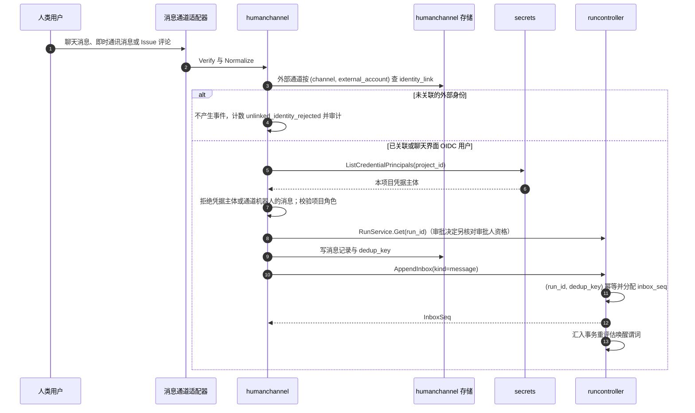
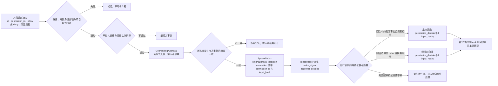
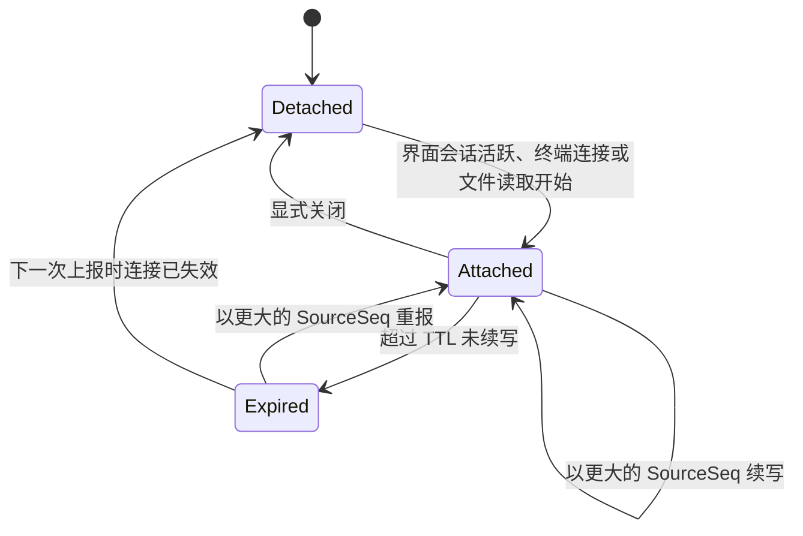
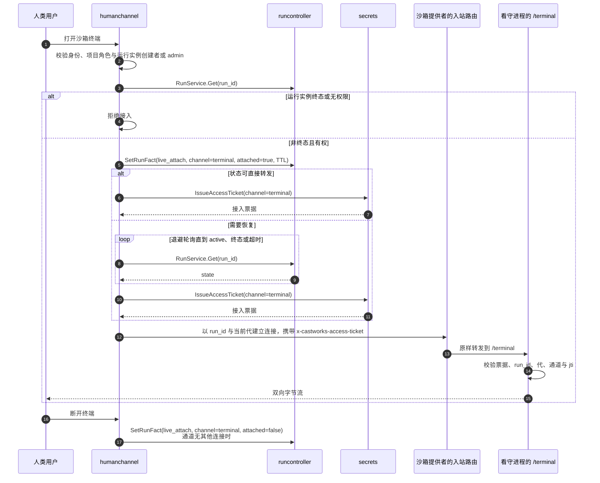

# humanchannel

`humanchannel` 是控制面中唯一面向用户的入口，也是事件源模块之一。平台界面只调用它；聊天界面、即时通讯与 Issue 评论的人类输入经它进入[运行实例](../../glossary.md)的[收件箱](../../glossary.md)。用户以部署对接的 IdP（OIDC）认证；即时通讯与 Issue 评论的外部账号经[外部身份关联](../../glossary.md)落到平台用户。本模块按[项目角色](../../glossary.md)执行用户授权，判定[审批人](../../glossary.md)资格，排除本项目[凭据主体](../../glossary.md)与通道机器人发出的消息与审批决定，读取并转义呈现待决审批内容，为终端与文件访问签发[接入票据](../../glossary.md)，并把终端连接与[工作区](../../glossary.md)文件读取登记为[实时接入](../../glossary.md)。它不拥有收件箱与状态机，不执行审批 hook（[REF-claude-code-hooks](../../references.md)），不落地[出口策略](../../glossary.md)。心智模型：人类侧的动作先经校验与规范化，再成为与外部系统事件相同的收件箱事件与运行实例事实，`runcontroller` 据这些持久化事实唤醒、投递与决策；Agent 进程从不直接接触 `humanchannel`。

文档较长，不宜顺序通读。第一次阅读按以下顺序：核心概念、职责、外部接口契约、UML 图、走查、消息摄入与去重、审批决定的读取、呈现与写入、实时接入的写入与到期、终端接入、界面文件访问的接入门控；核心数据结构、错误与失败语义、并发与事务边界作为参考，在核对具体字段或交错序列时查阅。

## 核心概念

实时接入把“人是否在场”表达为运行实例上的一条事实。平台界面会话活跃、终端已连接或界面正在经[沙箱](../../glossary.md)读取工作区文件时，本模块写入带有效期的接入事实，并以单调递增的来源序号续写；有效期让控制面知道人何时离开，来源序号让控制面区分续写、重报与迟到的上报。`runcontroller` 依据这条事实在人在场期间只[冻结](../../glossary.md)、不销毁沙箱，全部接入失效后回到异步回合制（[ADR-turn-boundary-destroy](../../adr/adr-turn-boundary-destroy.md)）；没有它，系统无法判断一个[挂起](../../glossary.md)的运行实例是否正等着人操作。

用户授权以单一入口为前提。平台界面只调用 `humanchannel`；本模块完成 OIDC 认证与外部身份关联，按 IdP 组声明映射出的项目角色判定每个操作是否允许，再以自身 SPIFFE 身份（[REF-spiffe](../../references.md)）调用 `runcontroller` 与 `workspace`，并在请求中传递已认证的用户。下游只记录传入的用户并写审计，不重复判定项目成员资格。审批决定只有审批人可以提交；待决审批内容由 `runcontroller` 保存并经 `GetPendingApproval` 提供，本模块转义呈现，并以[审批内容摘要](../../glossary.md)把决定绑定到审批人所见的内容（[ADR-user-facing-authorization](../../adr/adr-user-facing-authorization.md)、[ADR-approval-bound-to-tool-input](../../adr/adr-approval-bound-to-tool-input.md)）。

终端与文件访问以接入票据端到端认证。本模块在完成用户与角色校验后向 `secrets` 申请一张短期、一次性的接入票据，票据绑定平台用户、项目、运行实例、代与接入通道；看守进程在校验票据后才启动 shell 或读取文件，入站路由只原样转发。链路中任何一跳都不单独构成一次接入的授权（[ADR-user-facing-authorization](../../adr/adr-user-facing-authorization.md)）。

## 职责

职责穷举如下，每条先写本模块执行的动作，再写产生的结果或边界。

- **用户身份认证与外部身份关联**：平台界面用户以部署对接的 IdP 的 OIDC 身份认证；即时通讯与 Issue 评论的外部账号按 `(channel, external_account)` 查 `identity_link`，落到唯一平台用户。未关联的外部身份不产生任何事件，只计数 `unlinked_identity_rejected` 并写审计。
- **项目角色授权**：把 IdP 组声明按部署配置 `project_role_mapping` 映射为项目角色闭集 `member`、`approver`、`admin`，缓存不超过 `T_role_cache`；对每个用户操作按权限矩阵判定，越权请求不产生收件箱事件、不建立接入。
- **提供面向用户的 `UserService`**：方法闭集为 `CreateRun`、`GetRun`（含准入状态）、`EndRun`、`ResolveRun`、`ListFiles`、`ReadFile`、`StreamFile`、`ListApprovals`、`GetApproval`、`SubmitApproval`、`AttachTerminal`；以 `humanchannel` SPIFFE 身份调用 `runcontroller` 与 `workspace`，并在请求中传递已认证用户，下游不重复判定成员资格。
- **判定审批人资格与排除凭据主体**：审批人取[运行实例创建者](../../glossary.md)或持有 `approver` 角色的用户；经 `secrets.ListCredentialPrincipals` 取本项目凭据主体，拒绝外部账号等于任一凭据主体或本模块自身通道机器人的消息与审批决定，计数并写审计；部署为项目凭据使用独立的机器账号，项目凭据使用某审批人的个人令牌时，该审批人在对应通道的决定被拒绝。部署配置 `approval_second_factor` 为可选加固，取值闭集为 `none`、`ui_confirm`、`signed_callback`、`oob_code`，缺省 `none`，开启后审批决定另需附带 Agent 取不到的因子。
- **读取与呈现待决审批内容**：以 `GetPendingApproval` 与 `ListPendingApprovals` 读取 `runcontroller` 保存的工具名、工具输入、截断预览、摘要与大小；呈现时转义控制字符、双向文本控制符与终端转义序列，完整展示或明示截断并提供完整查看，标明内容由 Agent 产生；把审批人所见内容的[审批内容摘要](../../glossary.md)写入决定。
- **消息摄入与适配**：接收聊天界面、即时通讯与 Issue 评论的原始请求，完成身份、角色与归属校验，把每个输入规范化为收件箱事件（`kind=message`），填充 `Actor`、`occurred_at` 与由通道消息标识派生的 `event_id`、`dedup_key`，经[汇入契约](../../glossary.md)调用 `AppendInbox` 写入；重复投递命中同一 `dedup_key`，不产生重复事件。
- **审批决定写入**：接收人类对权限询问的决定，决定携带标识 `id`、`correlation.permission_id`、`allow | deny`、可选的 `updatedInput` 与审批人所见内容的摘要；校验决定标识、`permission_id`、决定取值、审批人资格与该摘要，以 `permission_id` 与决定标识共同派生唯一 `dedup_key`，以 `kind=approval_decision` 写入收件箱，`correlation` 携带 `permission_id` 与 `input_hash`。权限询问是否仍处于等待由 `runcontroller` 的定向投递匹配判定，本模块只读取审批内容，不判定等待状态。同一 `permission_id` 的另一决定且决定标识不同时，本模块在写入前拒绝并审计。
- **在线与“正在输入”信号**：维护平台界面会话的活跃状态，以 `ui_session` 接入通道写入接入事实；活跃状态由用户活动或心跳判定，空闲时长超过一个短于 `TTL` 的空闲超时后写接入值为假，会话打开而长时间无操作不视为实时接入。把界面产生的“正在输入”事件作为[预测性恢复](../../glossary.md)提示经 `SetRunFact{wake_hint}` 写入，载荷为 `WakeHint{Generation, Origin, RequestID}`，`Origin` 取 `ui`，是否据此提前恢复由 `suspendpolicy` 批准。活跃状态不改变运行实例状态，只约束挂起决策。
- **实时接入状态**：为 `ui_session`、`terminal`、`file` 接入通道写入 `SetRunFact{live_attach}` 事实，给出 `Channel`、`Attached`、`TTL` 与单调递增的 `SourceSeq`；接入期间按小于 `TTL` 的周期续写，该通道无其他有效连接时写接入值为假，进程重启后以更大的 `SourceSeq` 重报仍有效的接入。`runcontroller` 据此唤醒、取消挂起或约束挂起决策；本模块不判定挂起机制。
- **终端接入**：用户身份与项目角色校验通过（运行实例创建者或 `admin`）后写入 `terminal` 接入事实，按 `RunService.Get` 返回的状态决定直接转发或以退避轮询等待进入 `active`，再申请 `channel=terminal` 的接入票据，以 `run_id` 与运行实例的当前代（[代](../../glossary.md)）为目标经入站路由建立到看守进程 `/terminal` 的双向流，并在请求头 `x-castworks-access-ticket` 携带票据；流内字节不在本模块解析，该通道无其他有效连接时写接入值为假。
- **界面文件访问的接入门控**：`ListFiles`、`ReadFile` 与 `StreamFile` 完成身份与项目角色校验（任一项目角色）后写入 `file` 接入事实，按与终端相同的条件等待运行实例可接收；每次读取前申请 `channel=file` 的接入票据，放进 `workspace` 的 `FileAccess` 请求的 `Ticket`；`workspace` 把票据原样转发到 `/files`，经看守进程的读取由看守进程验签；直接读取以本模块的 SPIFFE 身份与调用前完成的项目角色判定授权。文件内容不经过本模块。
- **附件存放与取回**：超过 [`S_max`](design-runcontroller.md)（`runcontroller` 的单批载荷上限，3 MiB）的载荷由本模块存放，收件箱事件载荷只携带附件引用（可取回的 URI、内容哈希与字节数）；附件取回在[面向沙箱的端点](../../glossary.md) `human` 上提供，以 `humanchannel` 受众的运行实例令牌与代查询校验请求方。
- **通道侧状态维护**：保存外部身份关联、通道绑定、人类消息与决定的去重记录、接入会话与附件对象；以本地记录重驱动未完成的汇入写入，保证至少一次写入而不产生重复事件。

### 非职责

非职责举例如下，判定标准为：职责清单之外、由其他模块拥有的事实与机制。

- 收件箱、唤醒信号（[唤醒信号](../../glossary.md)）、等待、投递游标与运行实例状态机归 `runcontroller`；本模块只经汇入契约与 `RunService` 调用，不读写其表。
- 审批 hook 的注册与执行归看守进程的 [Agent 驱动器](../../glossary.md)与 Claude Code 托管策略设置；本模块只写入决定事件，不决定 hook 如何返回、何时续接回合，也不比对看守进程交付前的工具输入摘要。
- 出口策略的生成、落地与撤销归 `connectorhub` 与 `sandboxprovider`；本模块不生成出口主机集合，也不替换凭据占位符。
- 终端字节流与文件内容通道归入站路由、看守进程的 `/terminal` 与文件 API、`workspace`；本模块只建立接入事实、签发票据并按条件转发，不解析或缓存流内内容。
- 挂起决策、恢复准入（[恢复准入](../../glossary.md)）与实时接入的机制切换归 `suspendpolicy` 与 `runcontroller`；本模块只提供接入事实。
- 工作区的持久化实现与沙箱外读取能力判断归 `workspace`；本模块不判断某提供者能否外部读取，也不直接读取文件内容。
- 运行实例令牌的签发、轮换与签名校验归 `secrets`；接入票据的签名与公钥集合也归 `secrets`，本模块只申请票据。本模块不签发、不缓存运行实例令牌。
- 项目成员资格与运行实例创建者、发起用户的持久化归 `runcontroller`；本模块判定操作权限后把已认证用户传给下游，下游只记录与审计。

## 术语表

| 术语 | 英文对照 | 适用范围 | 定义 |
| --- | --- | --- | --- |
| 消息通道 | message channel | humanchannel | 人类输入的来源类别，闭集为 `chat_ui`、`im` 与 `issue_comment`；每种通道实现同一适配器接口。 |
| 接入通道 | attach channel | humanchannel | 实时接入的通道类别，闭集为 `ui_session`、`terminal` 与 `file`；与消息通道相互独立。 |
| 接入事实 | live attach fact | humanchannel | 写入 `run_fact` 的 `live_attach` 行，含接入通道、接入值、有效期与来源序号。 |
| 附件引用 | attachment reference | humanchannel | 收件箱事件载荷中指向超过 `S_max` 内容的可取回 URI、内容哈希与字节数；内容由 humanchannel 存放。 |

## 外部接口契约

稳定性承诺按接口类别给出：面向用户的 `UserService` 与消息通道适配器对人类用户稳定；汇入契约、控制面服务接口与代查询接口由 `runcontroller` 定义并对事件源稳定；令牌校验、接入票据申请、凭据主体查询与附件取回接口对 `secrets` 与平台 MCP 服务器稳定。本模块不读取 `runcontroller` 的表，也不向 `runcontroller` 反向提供接口。

### 接口面与调用方

本模块的面向用户接口与面向沙箱接口使用不同的主机名与端口。面向用户的 `UserService` 与消息通道适配器供人类用户访问，用户以 OIDC 身份或已关联的外部身份认证；面向沙箱的端点 `human` 只提供附件取回，供看守进程调用，要求 `humanchannel` 受众的运行实例令牌，不在内部监听器上提供。本模块不向其他控制面模块提供内部方法；它以 `humanchannel` SPIFFE 身份经内部监听器调用 `runcontroller`、`workspace` 与 `secrets`，各调用按对端身份与按方法授权表执行。

### 人类输入适配器

```go
type Adapter interface {
    Channel() MessageChannel
    Verify(ctx context.Context, req RawRequest) (Identity, error)
    Normalize(ctx context.Context, req RawRequest, id Identity) ([]HumanInput, error)
}

type Identity struct {
    UserID          string        // 平台用户标识
    Channel         MessageChannel // chat_ui、im、issue_comment
    ExternalAccount string        // 外部通道的账号；聊天界面为空
    LinkMethod      string        // oauth、signed_callback；聊天界面为空
    ProjectID       ProjectID
}

type HumanInput struct {
    Channel          MessageChannel   // chat_ui、im、issue_comment
    ConversationRef  string           // 会话或 Issue 线程标识，绑定查找的键
    MessageRef       string           // 通道内的消息标识
    ProjectID        ProjectID
    RunID            RunID
    Actor            string
    Kind             InputKind        // message、approval_decision
    OccurredAt       time.Time
    Text             string
    Decision         *ApprovalDecision
    Attachments      []AttachmentRef
}

type ApprovalDecision struct {
    ID              string          // 决定标识，通道内唯一
    PermissionID    string          // 写入 correlation.permission_id
    Decision        string          // allow、deny
    UpdatedInput    json.RawMessage // allow 时可选
    Message         string          // deny 时的说明
    InputHash       string          // 审批人所见内容的审批内容摘要；界面通道为完整值
    InputHashPrefix string          // 文本通道携带的前缀，不少于 12 个十六进制字符
}
```

- 每种消息通道实现 `Adapter`。聊天界面以 OIDC 认证，`ExternalAccount` 与 `LinkMethod` 为空；即时通讯与 Issue 评论的 `Verify` 按 `(channel, external_account)` 查 `identity_link`，返回已关联的平台用户，未关联的身份返回不可重试的拒绝，不产生事件。
- `Normalize` 只做规范化，不写收件箱；新增消息通道不修改摄入核心。`ApprovalDecision.Decision` 的取值闭集为 `allow`、`deny`；`allow` 可携带 `updatedInput`，`deny` 可携带 `message`。
- `Channel` 与 `MessageRef` 共同派生消息的 `event_id` 与 `dedup_key`；审批决定的 `dedup_key` 由 `PermissionID` 与 `ID` 共同派生。重试必须复用同一组标识。
- 界面通道的决定以 `InputHash` 携带完整摘要；文本通道的决定以 `InputHashPrefix` 携带所见摘要的前缀，本模块以 `GetPendingApproval` 返回的摘要按前缀匹配展开为完整 `InputHash`。

### 对 runcontroller 的汇入调用

```go
type Ingest interface {
    AppendInbox(ctx context.Context, ev InboxEvent) (InboxSeq, error)
    SetRunFact(ctx context.Context, fact RunFact) error
}

type InboxEvent struct {
    RunID             RunID
    EventID, DedupKey string
    Kind              EventKind           // message、approval_decision
    Source, Actor     string              // Source 由 runcontroller 按对端身份写入；Actor 为用户身份
    Correlation       map[string]string   // approval_decision 携带 permission_id 与 input_hash
    OccurredAt        time.Time
    Payload           json.RawMessage     // 合法 JSON，不超过 S_max
}

type RunFact struct {
    RunID      RunID
    Kind       FactKind                   // live_attach、wake_hint
    Source     string
    SourceSeq  int64
    ObservedAt time.Time
    LiveAttach *LiveAttach                // {Channel, Attached, TTL}
    WakeHint   *WakeHint                  // {Generation, Origin, RequestID}
}

type WakeHint struct {
    Generation int
    Origin     string                     // 固定为 ui
    RequestID  string
}
```

- 本模块以 `humanchannel` SPIFFE 身份经 mTLS 调用上述方法；`InboxEvent.Source` 与 `RunFact.Source` 由 `runcontroller` 按对端身份写入，请求中的同名值被忽略；`Actor` 只在对端为 `humanchannel` 时接受且必填。
- `AppendInbox` 以 `(run_id, dedup_key)` 幂等；命中且关联键（`permission_id`）与 `input_hash` 都相同时返回已分配的序号，本模块按成功处理并停止重试；命中而关联键不同时按不可重试冲突拒绝并审计，不写第二行。不可重试错误丢弃并审计；暂时性错误以同一 `dedup_key` 退避重试。
- `SetRunFact{live_attach}` 只接受更大的 `SourceSeq`；接入值为真的实时接入事实以写入时刻加 `LiveAttach.TTL` 为有效期，接入值为假的事实没有有效期。`SetRunFact{wake_hint}` 以 `Origin=ui` 写入，按 `(run_id, generation, origin, request_id)` 幂等；`request_id` 由界面为每次“正在输入”事件给出，同一次事件的重复上报复用同一值，不同输入事件使用新值。
- 汇入契约是写入收件箱事件与运行实例事实的唯一入口，`runcontroller` 不反向调用本模块（[ADR-wait-on-durable-inbox](../../adr/adr-wait-on-durable-inbox.md)）。

### 控制面服务与代查询

```go
type RunService interface {
    Create(ctx context.Context, req CreateRequest) (RunView, error)
    End(ctx context.Context, id RunID, requestedBy string) (RunView, error)
    Get(ctx context.Context, id RunID) (RunView, error)
    AdmissionState(ctx context.Context, id RunID) (AdmissionState, error)
    Resolve(ctx context.Context, id RunID, resolution Resolution) (RunView, error)
    GetPendingApproval(ctx context.Context, id RunID, permissionID string) (PendingApproval, error)
    ListPendingApprovals(ctx context.Context, id RunID) ([]PendingApproval, error)
}

type Generations interface {
    Current(ctx context.Context, id RunID) (CurrentGeneration, error)
}

type CurrentGeneration struct {
    Generation int
    Terminal   bool
    Fenced     bool
}
```

- `Create` 的 `ProjectID` 与 `IdempotencyKey` 由调用方传入，`CreatedBy` 由本模块填已认证用户；`End` 与 `Resolve` 的发起用户同样由本模块填已认证用户，运维调用填 `ops:<操作者>`。`RunView` 提供 `state`、`substate`、`suspend_mode`、`generation`、`project_id` 与 `created_by`；`AdmissionState` 返回队列位置与预计恢复时刻。
- `Get` 用于终端与文件接入的转发判定、等待与审批人资格核对；`Current` 用于附件取回时判定令牌中的代、运行实例是否终态与本代沙箱是否作废。
- `GetPendingApproval` 与 `ListPendingApprovals` 只返回未关闭的待决审批行，返回 `PendingApproval{RunID, PermissionID, CallID, ToolName, ToolInput, ToolInputPreview, InputHash, InputSize, Blocking, Deferred, RequestedAt}`；本模块以 `ToolInput` 或 `ToolInputPreview` 呈现内容，以 `InputHash` 核对审批人所见内容。
- 上述方法只在 `runcontroller` 的内部监听器上提供，各方法的允许调用方取[认证与授权边界](../architecture.md#认证与授权边界)的按方法授权表；本模块以 `humanchannel` SPIFFE 身份调用 `Create`、`End`、`Get`、`AdmissionState`、`Resolve`、`GetPendingApproval` 与 `ListPendingApprovals`，以同一身份调用 `Generations.Current`。

### 面向用户的 UserService

```go
type UserService interface {
    CreateRun(ctx context.Context, req CreateRunRequest) (RunView, error)
    GetRun(ctx context.Context, runID RunID) (RunView, AdmissionState, error)
    EndRun(ctx context.Context, runID RunID) (RunView, error)
    ResolveRun(ctx context.Context, runID RunID, action ResolutionAction) (RunView, error)
    ListFiles(ctx context.Context, runID RunID, path string) ([]FileEntry, error)
    ReadFile(ctx context.Context, runID RunID, path string) (Content, error)
    StreamFile(ctx context.Context, runID RunID, path string) (ContentStream, error)
    ListApprovals(ctx context.Context, runID RunID) ([]PendingApproval, error)
    GetApproval(ctx context.Context, runID RunID, permissionID string) (PendingApproval, error)
    SubmitApproval(ctx context.Context, runID RunID, decision ApprovalDecision) error
    AttachTerminal(ctx context.Context, runID RunID) (TerminalSession, error)
}

type CreateRunRequest struct {
    ProjectID      ProjectID
    IdempotencyKey string
}
```

- 平台界面只调用 `UserService`；用户以 OIDC 身份访问，本模块从已验证的会话取得用户标识，请求体不携带用户标识。即时通讯与 Issue 评论的消息与审批决定经消息通道适配器进入，不经过 `UserService`。
- 权限矩阵穷举如下：创建运行实例、查看运行实例状态与准入、读取工作区文件、发送消息、查看待决审批内容对任一项目角色开放；提交审批决定只对审批人开放；终端接入、结束、兜底与放弃只对运行实例创建者或持有 `admin` 角色的用户开放。
- `CreateRun` 写入 `run.created_by`，`GetRun` 返回 `created_by`；`EndRun` 与 `ResolveRun` 把已认证用户作为 `RequestedBy` 传给 `runcontroller`，运维调用填 `ops:<操作者>`。
- `ListFiles`、`ReadFile` 与 `StreamFile` 调用 `workspace` 的 `FileAccess`，请求携带运行实例、代、已认证用户与 `channel=file` 的接入票据；直接读取以本模块的 SPIFFE 身份与调用前完成的项目角色判定授权，经看守进程的读取由看守进程验签。`AttachTerminal` 申请 `channel=terminal` 的接入票据并建立到 `/terminal` 的双向流。
- `ListApprovals` 与 `GetApproval` 以 `ListPendingApprovals` 与 `GetPendingApproval` 读取内容；`SubmitApproval` 按审批决定写入一节处置。`approval_second_factor` 开启时，`SubmitApproval` 另要求 Agent 取不到的因子，缺失即拒绝。

### 令牌校验与附件取回

```go
type RunTokenVerifier interface {
    VerifyRunToken(ctx context.Context, token string, aud RunTokenAudience) (VerifyResult, error)
}

type AttachmentStore interface {
    Retrieve(ctx context.Context, ref AttachmentRef, token string) (Content, error)
}
```

- `VerifyRunToken` 由 `secrets` 提供；本模块只以 `humanchannel` 受众调用，校验令牌的签名、过期时间、`run_id` 与受众；过期单独返回，不视为签名无效。本模块另以 `Generations.Current` 校验令牌中的代、运行实例是否终态与本代沙箱是否作废（[ADR-run-token-audience-and-holder-binding](../../adr/adr-run-token-audience-and-holder-binding.md)）。
- `AttachmentStore.Retrieve` 部署在面向沙箱的端点 `human` 上，面向平台 MCP 服务器：请求携带看守进程持有的 `humanchannel` 受众运行实例令牌与附件引用；受众不是 `humanchannel` 按令牌无效拒绝；校验通过且内容哈希匹配时返回内容，否则拒绝。该接口对平台 MCP 服务器稳定。
- 新增附件存放后端不改变上述接口；令牌的签发与轮换不经过本模块，接入票据的签名也不经过本模块。

### 终端与文件访问的入站转发

终端与文件访问不通过代码依赖到达 `warden` 或 `sandboxprovider`。本模块以 `run_id` 与当前代为目标，经沙箱提供者的入站路由到达该代看守进程的 `/terminal` 与 `/files`；k8s 提供者的入站路由与 Substrate 路由器在接口之后，本模块不区分提供者。入站路由原样转发请求头 `x-castworks-access-ticket`；终端由本模块直接携带，文件读取由本模块放进 `FileAccess` 请求的 `Ticket`，`workspace` 转发到 `/files`。转发是运行时调用，不出现在模块依赖图中。

## 依赖

依赖穷举如下，方向与[模块依赖图](../architecture.md#模块依赖图)一致。

- `runcontroller`：汇入契约（`AppendInbox`、`SetRunFact`）、`RunService`（`Create`、`End`、`Get`、`AdmissionState`、`Resolve`、`GetPendingApproval`、`ListPendingApprovals`）与 `Generations.Current`。本模块是事件源，只经这些接口写入与读取，`runcontroller` 不反向调用本模块。
- `secrets`：`VerifyRunToken`（`humanchannel` 受众）、`IssueAccessTicket`（终端与文件读取）、`ListCredentialPrincipals`（凭据主体排除）与拒绝路径的 `ReportDenial`。附件取回的拒绝不涉及凭据目标，`ReportDenial` 的 `kind` 为空。
- `workspace`：`FileAccess` 的 `List`、`Read` 与 `Stream`，本模块以 `humanchannel` SPIFFE 身份调用并传递已认证用户与 `channel=file` 的接入票据；直接读取与经看守进程的读取都经本模块，`workspace` 不判定项目成员资格。
- OIDC 身份提供方：部署对接的 IdP，提供用户认证与组声明；`project_role_mapping` 把组声明映射为项目角色。
- PostgreSQL：本模块自己的 `identity_link`、通道绑定、消息与决定记录、接入会话与附件对象；这些写入在本模块自身事务内完成，与汇入调用不在同一事务。
- 不依赖 `sandboxprovider`、`warden`、`connectorhub` 与 `llmgateway`：终端流经入站路由，附件取回由本模块提供，二者都是运行时调用而非代码依赖。人类通道是托管侧持有的外部唤醒源之一（[ADR-host-owns-external-wake-sources](../../adr/adr-host-owns-external-wake-sources.md)）。
- 审批决定在异步渠道以 `defer` 推迟到回合边界（[回合边界](../../glossary.md)），决定到达后以恢复句柄续接；实时接入中审批阻塞等待，策略切换见 [ADR-turn-boundary-destroy](../../adr/adr-turn-boundary-destroy.md)。

## UML 图

下列图分别固定消息摄入的写入顺序、审批决定的流转路径、接入通道的状态与终端接入的时序。图中不能表达的顺序约束与通道差异由每张图后的正文给出。

### 消息摄入时序图

顺序图固定消息从通道到收件箱的写入顺序：身份校验、外部身份关联、项目角色与凭据主体排除先于任何持久化，通道侧记录先于汇入调用，汇入调用成功后才把本地记录标记为已写入。`occurred_at` 只随事件交给 Agent，不参与收件箱排序；同一 `dedup_key` 的重试由 `runcontroller` 吸收，通道侧不因返回已有序号而写第二行。



### 审批决定流转图

流转图固定一个审批决定从读取权威内容到送达的路径。决定先经身份、角色与审批人资格校验，再读取 `runcontroller` 保存的待决审批内容，转义呈现并核对审批人所见内容的摘要，然后成为收件箱事件；`runcontroller` 在同一事务派生 `approval_decided` 唤醒信号并按摘要核对定向投递。送达目标是回合中的阻塞审批还是回合边界的 defer 续接，由运行实例的回合位置决定，`humanchannel` 不参与该判定，也不执行 hook。



### 实时接入状态图

状态图固定本模块 `attach_session` 在单个接入通道上的本地状态。状态按通道独立维护；运行实例的实时接入有效值为任一通道的接入值为真且未过期，该有效值与到期由 `runcontroller` 的 `run_fact` 维护，到期守卫只改写 `run_fact`，不写本模块的表。`ui_session` 只约束挂起决策；`terminal` 与 `file` 另触发唤醒与挂起中止。`attach_session` 的 `expired` 由本模块的到期扫描判定；下一次上报按连接是否仍有效转 `attached` 或 `detached`。



### 终端接入时序图

顺序图固定终端接入的顺序：身份与项目角色校验、状态判定、接入事实、接入票据、入站路由与断开。权限先于接入事实；接入事实先于建立连接，运行实例在连接建立前已知道有人要接入；接入票据在建立连接之前申请，绑定用户、项目、运行实例、代与通道 `terminal`。快照态与销毁态由该事实触发唤醒，`humanchannel` 需要恢复时以退避轮询 `Get` 等到 `active` 后再建立连接。入站路由按提供者不同，本模块不区分提供者，也不解析终端字节。



## 核心数据结构

人类通道自己的持久化状态如下。运行实例的实时接入事实由 `runcontroller` 的 `run_fact` 保存，本模块只保存外部身份关联、通道侧的接入会话与续写序号。

### 外部身份关联（`identity_link`）

| 列 | 说明 |
| --- | --- |
| `channel` | 外部通道，取值 `im`、`issue_comment`；聊天界面用户以 OIDC 认证，不在本表建立行 |
| `external_account` | 外部系统中的账号标识 |
| `user_id` | 平台用户标识 |
| `link_method` | 闭集 `oauth`、`signed_callback` |
| `linked_at` | 关联建立时刻 |

唯一约束 `(channel, external_account)`。即时通讯与 Issue 评论的外部账号必须在此显式关联到平台用户；未关联的外部身份不产生任何事件。聊天界面用户直接以 OIDC 认证，不在此表建立行。

### 通道绑定（`channel_binding`）

| 列 | 说明 |
| --- | --- |
| `binding_id` | 主键 |
| `channel` | 消息通道，闭集 `chat_ui`、`im`、`issue_comment` |
| `conversation_ref` | 通道内的会话或 Issue 线程标识 |
| `project_id` | 绑定所属项目 |
| `run_id` | 绑定的运行实例 |
| `user_id` | 发起绑定的用户身份 |
| `created_at` | 绑定建立时刻 |

唯一约束 `(channel, conversation_ref)`。绑定把通道内的会话或 Issue 线程映射到项目与运行实例，只确定会话对应哪个运行实例；它不证明发送者有权操作该运行实例，权限由用户身份、外部身份关联与项目角色判定。

### 人类消息与决定（`human_message`）

| 列 | 说明 |
| --- | --- |
| `message_id` | 主键 |
| `channel`、`message_ref` | 消息通道与通道内消息标识 |
| `run_id`、`project_id` | 所属运行实例与项目 |
| `actor` | 用户身份，写入收件箱事件的 `Actor` |
| `kind` | 闭集 `message`、`approval_decision` |
| `event_id`、`dedup_key` | 收件箱事件标识与去重键 |
| `decision_id` | 审批决定的 `id`，消息行为空 |
| `permission_id` | 审批决定关联的权限询问，消息行为空 |
| `input_hash` | 审批人所见内容的审批内容摘要，消息行为空 |
| `occurred_at` | 通道事件发生时刻 |
| `received_at` | 本模块接收时刻 |
| `ingest_state` | 闭集 `recorded`、`written`、`abandoned` |
| `attachment_refs` | 附件引用数组，可为空 |

唯一约束 `(run_id, dedup_key)`；审批决定行另以 `(run_id, permission_id) WHERE ingest_state <> 'abandoned'` 唯一，保证每个权限询问至多一个未放弃的决定，已放弃行不阻止新决定。`ingest_state=recorded` 表示本地已记录、汇入未确认；`written` 表示 `AppendInbox` 成功；`abandoned` 表示汇入返回不可重试错误，行保留供审计。

### 接入会话（`attach_session`）

| 列 | 说明 |
| --- | --- |
| `attach_id` | 主键 |
| `run_id`、`channel` | 所属运行实例与接入通道，闭集 `ui_session`、`terminal`、`file` |
| `connection_ref` | 通道内的连接标识，同一通道的并发接入各占一行 |
| `actor` | 建立接入的用户身份 |
| `state` | 闭集 `attached`、`detached`、`expired` |
| `opened_at`、`closed_at` | 接入建立与关闭时刻 |
| `last_reported_at` | 最近一次写入接入事实的时刻 |
| `source_seq` | 最近一次写入的 `SourceSeq` |

唯一约束 `(run_id, channel, connection_ref)`。本表按连接建行，同一通道的并发接入各占一行；本模块维护该通道的有效连接计数，计数归零时才写 `Attached=false`。运行实例的接入有效值以 `runcontroller` 的 `run_fact` 为准。`SourceSeq` 由 `(run_id, channel)` 的持久计数分配，进程重启后从已持久化的最大值继续递增。

### 附件对象（`attachment_object`）

| 列 | 说明 |
| --- | --- |
| `content_id` | 内容标识，主键的一部分 |
| `run_id` | 所属运行实例 |
| `sha256` | 内容哈希 |
| `size` | 内容字节数 |
| `media_type` | 内容类型 |
| `uri` | 可取回的 URI，指向本模块的取回接口 |
| `stored_at` | 存放时刻 |

唯一约束 `(run_id, content_id)`。收件箱事件载荷中的附件引用由 `uri`、`sha256` 与 `size` 组成；取回时以 `sha256` 校验内容。

### 状态一览

| 状态 | 一句话含义 | 当前动作 | 直觉画面 |
| --- | --- | --- | --- |
| `detached` | 该接入通道没有有效接入 | `humanchannel` 停止续写，`runcontroller` 按无接入处理 | 人合上界面或挂断终端 |
| `attached` | 接入事实在 `TTL` 内有效 | `humanchannel` 按小于 `TTL` 的周期续写，`runcontroller` 据此约束挂起并按通道唤醒 | 人仍看着会话或握着终端 |
| `expired` | 接入事实超过 `TTL` 且未续写 | `runcontroller` 的到期守卫把 `run_fact` 改写为未接入，本模块的到期扫描把 `attach_session` 转 `expired`，待下一次信号以更大的 `SourceSeq` 重报 | 人离开太久，系统判定其不在场 |

## 核心算法与流程

### 走查

走查把审批决定从 Issue 评论到 Agent 工具继续的路径落到具体值上；`run` 行只列与本条相关的字段。

初始状态：`run_id=r-1`、`generation=5`、`state=suspended`、`substate=destroyed`、`session_id=ses-1`、`deferred_permission_id=p-1`、`created_by=u-7`、`cursor_accepted=10`、`cursor_consumed=10`、`head_seq=10`；`approval_request` 中 `(r-1, p-1)` 未关闭，工具输入摘要为 `9f2c…h-1`；`identity_link(issue_comment, gh:alice, u-7, signed_callback)` 已存在，`secrets.ListCredentialPrincipals` 返回的本项目凭据主体不含 `gh:alice`；`u-7` 持有 `approver` 角色。

| 步骤 | 事件或调用 | 持久化结果 |
| --- | --- | --- |
| 1 | 用户 `gh:alice` 在 Issue 评论中批准 `p-1`，并附所见摘要前缀 `9f2c1a3b4c5d`；适配器 `Verify` 查到 `identity_link(issue_comment, gh:alice) = u-7` | 无；`unlinked_identity_rejected` 不增 |
| 2 | `humanchannel` 核对 `u-7` 的项目角色为 `approver`、`run.created_by=u-7`，且 `gh:alice` 不是本项目凭据主体或通道机器人；`GetPendingApproval(r-1, p-1)` 返回 `InputHash=9f2c…h-1`，前缀匹配成立 | 无 |
| 3 | 转义呈现工具输入并标明内容由 Agent 产生；决定 `d-1` 的 `InputHash` 写完整摘要 `9f2c…h-1` | `human_message` 插入 `{kind=approval_decision, decision_id=d-1, permission_id=p-1, input_hash=9f2c…h-1, dedup_key=…, ingest_state=recorded}` |
| 4 | `humanchannel` 调用 `AppendInbox`，`correlation` 为 `{permission_id=p-1, input_hash=9f2c…h-1}` | `inbox` 插入 `inbox_seq=11`，`head_seq=11`；同一事务派生 `wake_signal(approval_decided, ref=p-1, derived_from=11)`，条件 UPDATE 把 `state` 改为 `wake_queued`、`wake_reason=approval`；`human_message.ingest_state=written` |
| 5 | 恢复准入放行，`fence_and_bump` 后重建 | `generation=6`、`resume_id=rs-2`、`resume_mode=cold_start`；新代 `Hello` 后进入回合边界 |
| 6 | `runcontroller` 以续接决定（决定 `d-1`，权限询问 `p-1`，摘要 `9f2c…h-1`）生成定向批 `permission_decision{id=p-1, input_hash=9f2c…h-1}`，`resume_session_id=ses-1` | 看守进程续接 Claude Code，hook 取回 `allow` 并重算摘要；`Accepted` 后 `deferred_permission_id` 清空，`inbox.delivered_at` 写入，`cursor_accepted` 仍为 10 |
| 7 | 回合开始并结束 | `turn_phase` 回到边界，`cursor_consumed` 仍为 10，`session_id=ses-1` |

走查结束时 `generation=6`、`session_id=ses-1`、`cursor_accepted=10`、`cursor_consumed=10`、`deferred_permission_id` 为空：定向投递的决定不推进投递游标，审批决定只改变运行实例的等待位置与恢复路径。摘要把决定绑定到审批人所见的内容，前缀在写入前展开并核对；摘要不一致时该决定不写入。

### 消息摄入与去重

1. 适配器调用 `Verify`。聊天界面以 OIDC 得到平台用户；即时通讯与 Issue 评论按 `(channel, external_account)` 查 `identity_link`，未关联时返回不可重试拒绝，不写任何状态，计数 `unlinked_identity_rejected` 并写审计。
2. 以 `secrets.ListCredentialPrincipals` 取本项目凭据主体；外部账号等于任一凭据主体或本模块自身通道机器人时拒绝，计数并写审计。聊天界面用户以 OIDC 认证，不适用该项。
3. 按 `project_role_mapping` 与缓存不超过 `T_role_cache` 的角色判定操作权限：发送消息需要任一项目角色；审批决定另需审批人资格。权限不足时拒绝，不写任何状态。
4. 以通道绑定核对运行实例属于该项目；不符时拒绝，不产生收件箱事件。
5. 适配器调用 `Normalize`，每个输入生成一条 `HumanInput`；消息与审批决定分别映射为 `kind=message` 与 `kind=approval_decision`。
6. 消息的 `event_id` 与 `dedup_key` 由消息通道与通道内消息标识派生；审批决定的 `dedup_key` 由 `permission_id` 与决定标识共同派生。重试复用同一组值。
7. 本模块先在 `human_message` 写入 `recorded`，再调用 `AppendInbox`。成功则改为 `written`；不可重试错误改为 `abandoned` 并审计；暂时性错误按 `dedup_key` 退避重试。
8. 载荷超过 `S_max` 时，内容存入 `attachment_object`，`InboxEvent.Payload` 只放附件引用。`occurred_at` 原样传递，收件箱全序由 `inbox_seq` 决定。

### 审批决定的读取、呈现与写入

1. 校验决定标识、`permission_id`、决定取值与审批人资格；`allow` 可带 `updatedInput`，`deny` 可带 `message`。本模块拒绝缺少 `permission_id`、决定取值越出闭集、提交者不是审批人，或 `approval_second_factor` 开启时缺少相应因子的请求。
2. 调用 `GetPendingApproval(run_id, permission_id)` 读取权威内容；行不存在或已关闭时拒绝并提示该审批已结束。
3. 呈现 `ToolInput`；`InputSize` 超过 `S_tool_input`（1 MiB）时呈现 `ToolInputPreview` 并明示截断，摘要仍取对完整输入计算的 `InputHash`。呈现前转义控制字符、双向文本控制符与终端转义序列，并标明内容由 Agent 产生；界面通道以完整摘要回传，文本通道以不少于 12 个十六进制字符的摘要前缀回传。
4. 以 `GetPendingApproval` 返回的 `InputHash` 核对审批人所见内容：界面通道核对完整值，文本通道按前缀匹配展开为完整值；不一致时拒绝写入、提示刷新并写审计。
5. 以 `permission_id` 与决定标识共同派生 `dedup_key`，写入 `kind=approval_decision` 的收件箱事件，`correlation` 携带 `permission_id` 与 `input_hash`；`human_message` 同时写入 `input_hash`。同一 `permission_id` 的另一决定且决定标识不同时，由本地唯一约束拒绝并审计。
6. `runcontroller` 在写入事务内派生 `approval_decided` 唤醒信号；决定在回合中匹配阻塞审批，或在回合边界匹配 `deferred_permission_id`，另以 `correlation.input_hash` 等于待决审批的摘要为定向投递条件；摘要不等时按未定向事件处理。其余决定按 `runcontroller` 的投递规则处理。
7. 本模块不区分异步回合制与实时接入：异步回合制与实时接入下写入的决定事件相同，差异由 hook 在沙箱侧阻塞等待还是 `defer` 结束回合决定（[ADR-turn-boundary-destroy](../../adr/adr-turn-boundary-destroy.md)）。
8. 决定的送达确认由 `runcontroller` 记录；本模块不等待 `Accepted`，也不因未收到确认而重写事件。

### 实时接入的写入、续写与到期

1. 接入建立时按连接创建或复用 `attach_session` 行，状态置 `attached`；该通道首个有效连接建立时以 `SetRunFact{live_attach}` 写入 `{Channel, Attached=true, TTL}`，`SourceSeq` 取该 `(run_id, channel)` 的持久计数加一。
2. 接入期间按小于 `TTL` 的周期续写，每次使用更大的 `SourceSeq`；接入值为真的事实以写入时刻加 `TTL` 为有效期。
3. 连接关闭时该行转 `detached`；该通道的有效连接计数归零时才写 `Attached=false` 与更大的 `SourceSeq`。
4. 超过 `TTL` 未续写时，`runcontroller` 的到期守卫以 `SourceSeq` 未变且已过期为条件把 `run_fact` 改写为未接入；本模块的到期扫描把该通道的 `attach_session` 行转 `expired`。`humanchannel` 之后以更大的 `SourceSeq` 重报时，事实回到接入。
5. 进程重启后，`humanchannel` 读取 `attach_session` 中仍有效的接入，以更大的 `SourceSeq` 重报全部接入；超过 `TTL` 未续写的会话按过期处理，不再重报。
6. 通道差异：`ui_session` 只约束挂起决策，不唤醒快照态与销毁态，也不中止进行中的挂起尝试；`terminal` 与 `file` 的接入唤醒快照态与销毁态，并中止进行中的快照或销毁尝试。该差异由 `runcontroller` 落实，本模块只写入通道标识。

### 终端接入

1. 平台界面的请求完成 OIDC 认证与项目角色校验，只有运行实例创建者或持有 `admin` 角色的用户可以接入；不符时拒绝越权请求。
2. 调用 `RunService.Get` 判定转发条件：`active`、冻结类模式的 `suspending`、`suspended.frozen`、`wake_queued.frozen` 与 `resuming(thaw)` 可直接转发；运行实例已终态时拒绝接入，其余非终态需要等待进入 `active`。
3. 写入 `terminal` 接入事实，`Attached=true`、`TTL` 与递增的 `SourceSeq`；接入事实先于建立连接，快照态与销毁态由该事实触发唤醒。
4. 调用 `secrets.IssueAccessTicket` 申请 `channel=terminal` 的接入票据，`Subject` 取已认证用户，`ProjectID`、`RunID` 与 `Generation` 取运行实例当前值。
5. 可直接转发的状态以 `run_id` 与当前代为目标，经沙箱提供者的入站路由建立到看守进程 `/terminal` 的双向流，请求头 `x-castworks-access-ticket` 携带票据；需要等待的状态以退避轮询 `Get` 等到进入 `active`，等待设有超时并可被请求取消，再申请票据并建立双向流。路由按提供者实现，本模块不区分。
6. 流关闭、路由失败或用户断开时，该连接转 `detached`；该通道的有效连接计数归零时写 `Attached=false` 并停止续写；路由失败向用户呈现接入失败，不重试建立新的运行实例。
7. 本模块不在流内解析或缓存字节；终端内容不经收件箱，也不进入 Agent 的消息投递。

### 界面文件访问的接入门控

1. 平台界面的 `ListFiles`、`ReadFile` 与 `StreamFile` 请求完成 OIDC 认证与项目角色校验，任一项目角色可读；不符时拒绝越权请求。
2. 调用 `RunService.Get` 判定运行实例能否接收；运行实例已终态时拒绝，其余情形按与终端相同的条件确定是否需要等待。
3. 写入 `file` 接入事实，`Attached=true`、`TTL` 与递增的 `SourceSeq`；可直接接收时立即应答界面，需要恢复时以退避轮询 `Get` 等到运行实例可接收后应答界面。
4. 每次 `List`、`Read` 或 `Stream` 调用前申请 `channel=file` 的接入票据，把票据放进 `workspace` 的 `FileAccess` 请求的 `Ticket`，请求同时携带运行实例、代与已认证用户；`workspace` 把票据原样转发到 `/files`，经看守进程的读取由看守进程验签；直接读取以本模块的 SPIFFE 身份与调用前完成的项目角色判定授权。
5. 读取期间本模块按小于 `TTL` 的周期续写 `file` 接入事实；该读取会话结束时转 `detached`，该通道的有效连接计数归零时写 `Attached=false`。
6. 文件内容不经过本模块；本模块不以文件通道替代 `workspace` 的读取能力判断。

### 附件取回与令牌校验

1. 载荷超过 `S_max` 时，内容存入本模块的附件存储，收件箱事件载荷只携带 `{uri, sha256, size}`。
2. 平台 MCP 服务器在为 Agent 取回附件时，附上看守进程持有的 `humanchannel` 受众运行实例令牌，调用面向沙箱的端点 `human`。
3. 本模块调用 `secrets.VerifyRunToken(token, humanchannel)` 校验签名、过期时间、`run_id` 与受众；受众不是 `humanchannel` 时按令牌无效拒绝；过期单独返回，不视为签名无效。
4. 本模块调用 `runcontroller.Generations.Current` 取得当前代、是否终态与本代是否作废；令牌中的代必须等于当前代，运行实例不得为终态，本代不得作废。
5. 附件所属运行实例必须等于令牌中的 `run_id`；内容哈希必须等于引用中的 `sha256`。全部通过时返回内容，否则按错误类别拒绝。
6. 令牌过期时拒绝取回；看守进程收到控制面的 `TokenRotate` 后，平台 MCP 服务器以新令牌重试。

### 异步回合制与实时接入的策略切换

- 默认模式为异步回合制：没有接入事实，人类消息与审批决定经收件箱唤醒运行实例；审批可经 `defer` 推迟到回合边界。
- 任一接入通道写入接入值为真的接入事实时，运行实例进入实时接入：`runcontroller` 与 `suspendpolicy` 在实时接入有效期间只冻结、不销毁，也不发起新的快照或销毁尝试。`ui_session` 的差异仅在于不唤醒快照态与销毁态、不中止进行中的挂起尝试；`terminal` 与 `file` 另唤醒快照态与销毁态并中止进行中的尝试。
- 全部接入通道关闭或到期后，运行实例回到异步回合制；`humanchannel` 不保存模式标志，模式由 `runcontroller` 从接入事实推导。
- “正在输入”只作为预测性恢复提示，不替代接入事实；是否提前恢复由 `suspendpolicy` 批准。

## 错误与失败语义

失败的处置由请求拒绝、以同一 `dedup_key` 或 `SourceSeq` 的退避重试、接入值为假的写入、接入事实的到期与重报以及审计写入组合表达。下表列出已明确处置路径的失败，各行是举例。

| 失败 | 处置 |
| --- | --- |
| 身份校验失败 | 拒绝请求，不写消息记录、不写收件箱、不建立接入；计入审计。 |
| 外部身份未关联 | 不产生任何事件，计数 `unlinked_identity_rejected` 并写审计；界面提示先完成账号关联。 |
| 外部账号等于凭据主体或通道机器人 | 拒绝该消息或审批决定，不写收件箱，计数并写审计。 |
| 项目角色不足 | 拒绝请求，不写任何状态；不以错误信息暴露运行实例是否存在。 |
| 提交者不是审批人 | 拒绝审批决定，不写收件箱，写审计。 |
| 审批第二因子缺失 | 拒绝审批决定，提示补充因子，写审计。 |
| 审批内容摘要与待决审批不符 | 拒绝写入，提示刷新后重新提交，写审计；已存在的相同 `dedup_key` 不写第二行。 |
| 待决审批不存在或已关闭 | `GetPendingApproval` 返回不存在错误；本模块拒绝决定并提示该审批已结束。 |
| 通道绑定与项目不符 | 拒绝请求，不产生收件箱事件；不以错误信息暴露运行实例是否存在。 |
| 消息重复 | `AppendInbox` 以 `(run_id, dedup_key)` 幂等，命中且关联键与摘要相同返回已有序号，本模块视为成功并停止重试；关联键不同时按冲突拒绝并审计。 |
| `dedup_key` 命中而关联键不同 | 视为不可重试冲突，停止重试、计入审计、不写第二行。 |
| 审批决定重复 | 同一决定的重试命中同一 `dedup_key`；同一 `permission_id` 的另一决定且决定标识不同时，由本地唯一约束拒绝并审计。 |
| 接入票据签发失败 | 不建立终端连接、不发起文件读取，向用户呈现接入失败；已建立的双向流不受影响。 |
| 附件取回拒绝 | 令牌受众不是 `humanchannel`、签名无效、令牌过期、代不匹配、运行实例终态、本代作废、附件与令牌的 `run_id` 不符或内容哈希不符时拒绝，不返回内容并计数。 |
| 令牌过期 | `VerifyRunToken` 返回过期；本模块拒绝取回请求，看守进程收到控制面的 `TokenRotate` 后，平台 MCP 服务器以新令牌重试。本模块不签发或缓存令牌。 |
| 实时接入过期 | `runcontroller` 的到期守卫把 `run_fact` 改写为未接入，本模块的到期扫描把 `attach_session` 转 `expired`；`humanchannel` 在下次信号或进程重启时以更大的 `SourceSeq` 重报仍有效的接入。 |
| 汇入暂时性失败 | 以同一 `dedup_key` 退避重试；至少一次写入由 `runcontroller` 的幂等吸收。 |
| 汇入不可重试失败 | 丢弃该写入，`human_message.ingest_state=abandoned`，计入审计；界面呈现运行实例状态，不重试。 |
| 接入事实写入暂时性失败 | 以同一 `SourceSeq` 退避重试，重试期间不建立连接；重试耗尽按接入失败呈现。 |
| 接入事实写入不可重试失败 | 运行实例终态、代不符或参数非法时拒绝接入，不建立连接，向用户呈现运行实例状态并计入审计。 |
| `wake_hint` 写入失败 | 丢弃该提示并计入审计；不影响接入事实与运行实例状态。 |
| 终端路由失败 | 关闭连接，该通道无其他有效连接时写接入值为假并向用户呈现失败；不为该请求新建运行实例。 |
| 终端流断开 | 该通道无其他有效连接时写接入值为假并停止续写；运行实例状态不变，用户可重新发起接入。 |
| 文件读取失败 | 返回 `workspace` 的错误类别；该读取会话按连接结束处置，写接入值为假的条件与终端相同。 |
| 附件内容不可达 | 取回接口返回失败；不伪造内容，不以空内容替代。 |
| 通道原始请求格式非法 | 在适配器层拒绝，不写任何状态。 |

降级遵循失败关闭：身份未关联、角色不足、审批人资格不符、摘要不一致或票据签发失败时拒绝请求，不改用更宽的权限或跳过核对；`runcontroller` 或 `workspace` 不可用时拒绝操作并向用户呈现失败，不以本地缓存的事件或内容替代权威状态。

## 并发与事务边界

- **外部身份关联的唯一性**：`identity_link` 以 `(channel, external_account)` 唯一约束保证一个外部账号只对应一个平台用户；并发建立关联时只有一个事务成功，其余读取已有关联。角色缓存以 `T_role_cache` 为陈旧上界，权限判定以缓存值执行，缓存过期后重新映射。
- **并发消息的去重**：正确性由 `runcontroller` 的 `(run_id, dedup_key)` 唯一索引承担；`inbox_seq` 在 `run` 行锁之后分配，同一运行实例内按提交顺序递增。本模块的本地唯一约束只减少重复调用，不承担投递去重。多个事件源并发写入时，写入者之间不协调顺序，`occurred_at` 不参与排序。
- **本地记录与汇入调用**：本模块先写 `human_message`，再调用 `AppendInbox`；两步不在同一事务，也不存在跨模块事务。汇入暂时性失败时以同一 `dedup_key` 重驱动，重复由 `runcontroller` 吸收；本模块不以本地记录的 `recorded` 状态推断事件已写入。
- **审批内容与决定的交错**：`GetPendingApproval` 与摘要核对是只读调用；核对之后、写入之前待决审批被关闭时，`AppendInbox` 照常写入事件，`runcontroller` 在汇入事务内发现该 `permission_id` 没有待决审批行或摘要不等时，把该事件按未定向事件处理并计数 `approval_input_mismatch`。本模块不持有 `runcontroller` 的行锁，也不因并发关闭而重写已写入的事件。
- **实时接入续写的 `SourceSeq`**：`SourceSeq` 由 `(run_id, channel)` 的持久计数分配，单调递增；`runcontroller` 只接受更大的值，忽略较小或相等的续写。接入期间续写周期小于 `TTL`；进程重启后从已持久化的最大值继续递增并重报仍有效的接入，避免把重启误判为长时间断开。
- **接入事实与挂起尝试的交错**：终端与文件接入先写接入事实，再判定转发；`runcontroller` 在事实变化的事务中决定唤醒、取消挂起或中止进行中的快照或销毁尝试。本模块不持有 `runcontroller` 的锁，也不等待挂起尝试结束；接入与挂起并发时，以事实的 `SourceSeq` 与 `runcontroller` 的行锁串行化结果为准。
- **审批决定的唯一性**：决定的重试命中同一 `dedup_key`；同一 `permission_id` 的另一决定且决定标识不同时，由 `human_message` 的 `(run_id, permission_id) WHERE ingest_state <> 'abandoned'` 唯一约束拒绝。决定的写入与 `runcontroller` 的派生信号在汇入事务内完成；本模块不在本地事务中派生信号。
- **接入票据的一次性**：每次入站请求申请一张票据，绑定用户、项目、运行实例、代与通道；`jti` 的去重由看守进程执行，本模块不记录已签发的票据。票据在 `exp − iat ≤ T_access_ticket` 内有效，过期后用户重新发起操作并申请新票据。
- **附件取回**：令牌校验与代查询是只读调用，不持有本模块或 `runcontroller` 的行锁；取回不修改附件对象，也不改变运行实例状态。

## 扩展点

- **新增消息通道**：实现 `Adapter`，在 `identity_link` 与 `channel_binding` 增加对应的通道取值，并定义该通道的 `link_method` 取值；不修改摄入核心。条件为：稳定派生 `event_id` 与 `dedup_key`；提供已关联的平台用户、`Actor` 与 `occurred_at`；载荷不超过 `S_max`，超限内容以附件引用表达。
- **新增附件存放后端**：在 `AttachmentStore` 之后替换存储实现，不改变取回接口与附件引用的结构。
- **新增接入通道**：不是纯扩展。需要扩展 `runcontroller` 的 `LiveAttach.Channel` 闭集与接入票据的 `channel` 闭集，并定义该通道是否唤醒快照态与销毁态、是否中止进行中的挂起尝试；`humanchannel` 只增加通道对应的接入会话与上报逻辑。
- **新增决定类型**：不是纯扩展。需要扩展 `ApprovalDecision.Decision` 闭集，并同步扩展看守进程 hook 的翻译；收件箱事件的 `kind` 与定向投递目标不变。
- **新增项目角色**：不是纯扩展。项目角色是闭集，扩展取值需同步 `project_role_mapping`、权限矩阵与 `runcontroller` 的按方法授权，属于版本化变更。

## 实现状态

| 能力 | 状态 | 代码 |
| --- | --- | --- |
| 聊天界面适配 | 未实现 | — |
| 即时通讯适配 | 未实现 | — |
| Issue 评论适配 | 未实现 | — |
| 外部身份关联 | 未实现 | — |
| 用户身份与项目角色授权 | 未实现 | — |
| 面向用户的 UserService | 未实现 | — |
| 审批人资格与凭据主体排除 | 未实现 | — |
| 审批内容读取、转义呈现与摘要绑定 | 未实现 | — |
| 审批决定写入 | 未实现 | — |
| 在线与“正在输入”信号 | 未实现 | — |
| 实时接入状态 | 未实现 | — |
| 终端接入 | 未实现 | — |
| 接入票据申请 | 未实现 | — |
| 界面文件访问门控 | 未实现 | — |
| 附件存放与取回 | 未实现 | — |
| 运行实例令牌校验 | 未实现 | — |
