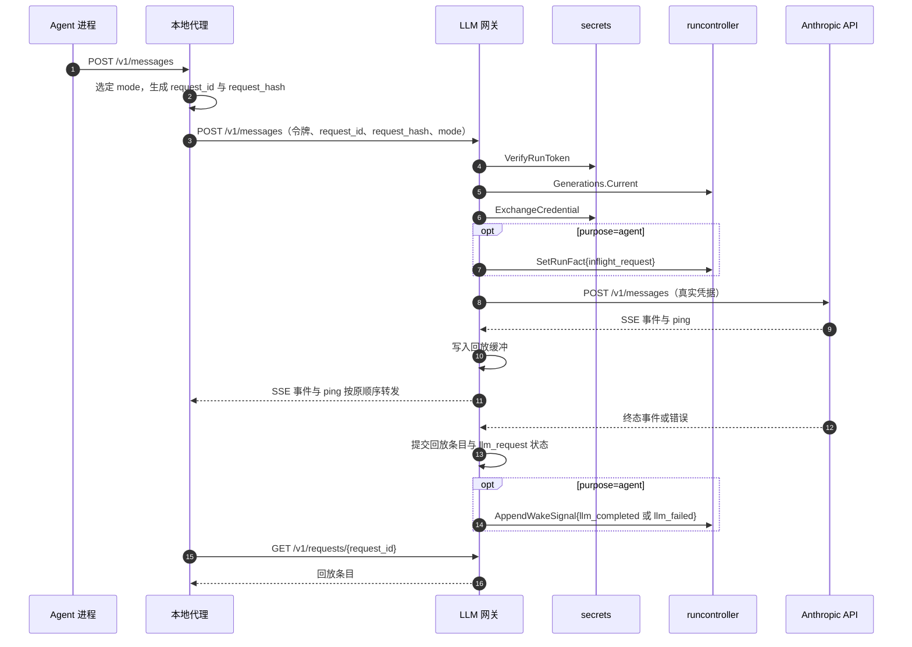
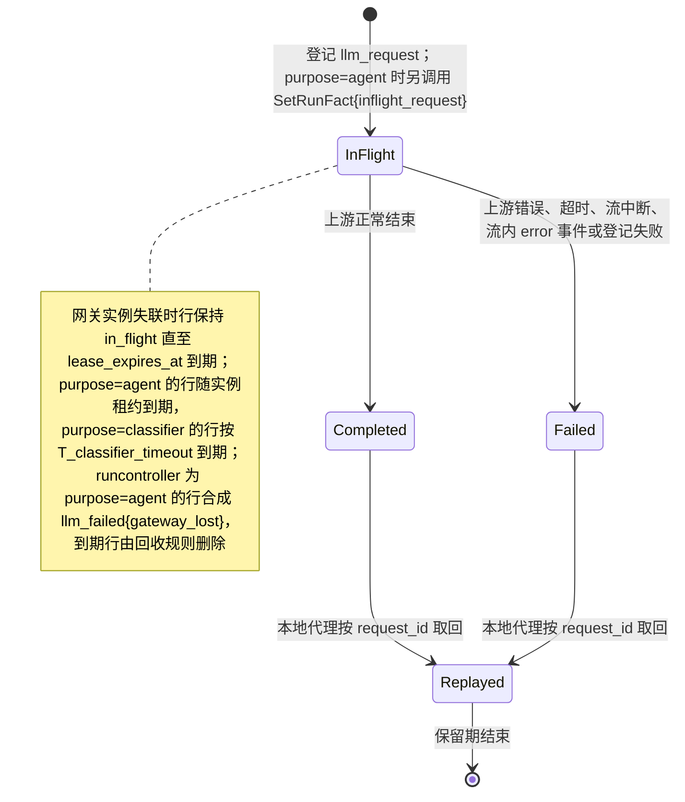
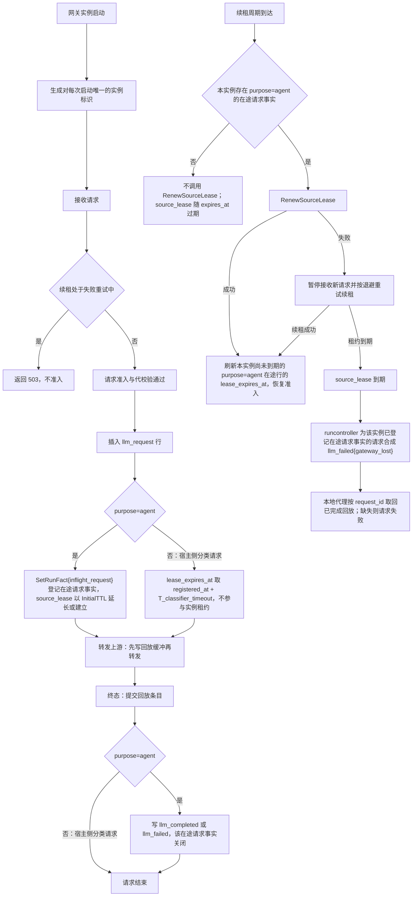

# llmgateway

`llmgateway` 是控制面中的 [LLM 网关](../../glossary.md)，位于[沙箱](../../glossary.md)内 [本地代理](../../glossary.md) 与 Anthropic API 之间。它拥有以 [运行实例令牌](../../glossary.md) 换取真实 LLM 凭据、按 [代](../../glossary.md) 校验请求、登记在途请求与实例租约、流式转发、单次回放、限流、计费、审计与时延直方图；它不拥有 Agent 进程、沙箱、本地代理的缓冲与模式选择、[挂起](../../glossary.md)决策与外部系统连接器。两级结构见 [ADR-two-tier-llm-proxy](../../adr/adr-two-tier-llm-proxy.md)。本模块围绕单次回放组织：网关把一次 LLM 请求变成一条控制面可持有、沙箱消失后仍可取回的回执。

文档较长，第一次阅读按以下顺序：核心概念、职责、外部接口契约、走查、请求准入与代校验、凭据换取与在途登记、上游转发与流式保活、终态持久化与信号、回放取回、宿主侧分类请求；术语表、依赖、UML 图、核心数据结构、时延直方图、限流、计费与审计、错误与失败语义、并发与事务边界作为参考，在核对字段、失败路径或事务顺序时查阅。并发与事务边界末尾的竞态用例留到最后自测：先按前文的顺序与幂等键判断每个交错序列的结果，再与表中处置核对。

## 核心概念

单次回放是网关把一次 LLM 请求变成可随时取回的回执的机制。本地代理为每个逻辑请求生成 `request_id` 与 `request_hash`，网关以 `(run_id, generation, request_hash)` 判定重发是否属于同一请求，并在终态把整条响应存成按 `(run_id, request_id)` 定位的回放条目；重发与恢复后的取回命中已存条目，不再次访问上游。系统需要它，是因为沙箱会在 LLM 请求在途时被冻结、快照或销毁重建，本地代理与网关之间的连接随之消失，而上游已经产出并计费的结果不能因载体消失而丢失，重发还会产生第二次生成与重复计费。判重带代、取回不带代：新代同一 `request_hash` 按新请求登记，销毁重建后的新代仍可按 `request_id` 取回旧代已完成的响应。

## 职责

`llmgateway` 是控制面中唯一以真实 LLM 凭据访问 Anthropic API 的模块。职责穷举如下，每条先写本模块执行的动作，再写产生的结果或边界；具体算法、表结构与顺序见后续章节。

- **请求准入与代校验**：校验运行实例令牌的签名、过期时间与 `run_id`，再经 `runcontroller` 的 `Generations.Current` 比较令牌中的代与当前代；令牌无效、[运行实例](../../glossary.md)已终态或本代已作废时拒绝请求。被拒绝的请求不换取凭据、不产生上游调用，并计入旧代拒绝计数。
- **凭据换取**：以运行实例令牌与调用方身份向 `secrets` 换取真实 LLM 凭据，目标为本模块部署配置中的 LLM 提供方与认证方式；凭据只在网关进程内存中持有至到期；凭据不写入数据库、回放条目，也不返回本地代理。
- **在途登记与实例续租**：转发上游前在 `llm_request` 表登记请求，并对 Agent 的 LLM 请求经 [汇入契约](../../glossary.md) `SetRunFact{inflight_request}` 写入在途请求事实与实例租约；只在本实例存在 `purpose=agent` 的在途请求事实时以 `RenewSourceLease` 周期续租，使实例失联可由 `runcontroller` 判定。
- **流式转发**：按原顺序转发 Anthropic Messages 的 SSE 事件与 ping 保活事件，不合并、不重排、不改写内容事件；同时把事件写入该请求的回放缓冲。
- **终态持久化与信号**：上游正常结束、返回错误、超时、流中断或流内 `error` 事件时，在同一事务提交回放条目与 `llm_request.status`；提交后对 Agent 的 LLM 请求经汇入契约写入 `llm_completed` 或 `llm_failed` [唤醒信号](../../glossary.md)。
- **宿主侧分类请求的区别处置**：识别本地代理为[看守进程](../../glossary.md)自身发起的分类请求附加的 `x-castworks-purpose: classifier`，按分类请求的形态校验该标记，照常执行令牌与代校验、限流、凭据换取、计费、审计与回放写入，但不写在途请求事实、不写唤醒信号、不参与实例租约，其在途行按网关自身的超时 `T_classifier_timeout` 跟踪；结果是分类请求不影响 `runcontroller` 的 I9 预检（[架构不变量](../architecture.md#架构不变量)）中的「本代无在途请求」，也不进入阻塞条件与[静止冻结](../../glossary.md)的静止证据，成本仍按运行实例计入。
- **单次回放**：以 `(run_id, generation, request_hash)` 保证客户端重发与恢复取回命中已登记请求或回放条目，不产生第二次上游请求；上游在未收到任何响应体内容前的有限次重试属于同一逻辑请求内的重试。按 `(run_id, request_id)` 保存终态响应，供本地代理在[快照](../../glossary.md)恢复或[销毁重建](../../glossary.md)后取回，取回不再次访问上游。
- **限流、计费与审计**：在凭据换取与转发之前按运行实例限流；按上游响应的 `usage` 记录输入与输出 token；审计凭据换取、代校验结果与请求终态，关联 `run_id`、`generation` 与 `request_id`。
- **时延直方图**：按 `model`、`thinking` 预算档、`max_tokens` 档与输入 token 档维护 Agent 的 LLM 请求的首 token 时延与总时长直方图，随 OpenTelemetry 指标导出，供校准 `suspendpolicy` 的 LLM 先验与诊断；直方图不逐请求传入 `runcontroller`，宿主侧分类请求不进入直方图，只按结果计数。

### 非职责

非职责举例如下，判定标准为职责清单之外、由其他模块拥有的事实与机制。

- **不做 MITM**：不拦截 Agent 的其他出站 TLS 流量；外部系统的凭据占位符替换归 `connectorhub` 的出口代理。
- **不决定何时冻结、快照或销毁**：[挂起](../../glossary.md)决策归 `suspendpolicy`，状态转移与执行归 `runcontroller` 与 `sandboxprovider`。
- **不持有沙箱**：不创建、销毁、[冻结](../../glossary.md)或恢复沙箱，不读取沙箱内进程状态。
- **不直接接 Agent**：只接受本地代理的请求；Agent 进程能到达的网络端点见[架构不变量](../architecture.md#架构不变量) I6，Agent 不持有网关凭据。
- **不选择[直通模式](../../glossary.md)或[缓存模式](../../glossary.md)**：模式由本地代理在请求开始时一次性选定；网关记录 `mode` 用于审计与指标分层，不据此改变转发行为。
- **不拥有[收件箱](../../glossary.md)、唤醒信号、在途请求事实与实例租约**：这些状态归 `runcontroller`；网关只经汇入契约写入，失联后的合成信号由 `runcontroller` 写入。
- **不发起宿主侧分类请求、不解释分类结果**：分类的时机、请求体与结果解释归 Claude Code 驱动器，`x-castworks-purpose` 的附加与对 Agent 进程请求的剥离归本地代理；网关只按标记区别处置。
- **不签发、轮换或校验运行实例令牌的签名**：归 `secrets`。
- **不接入外部系统**：webhook 接收、状态式轮询与订阅匹配归 `connectorhub`。

## 术语表

| 术语 | 英文对照 | 适用范围 | 定义 |
| --- | --- | --- | --- |
| 回放条目 | replay entry | llmgateway | 按 `(run_id, request_id)` 保存的上游终态响应流与失败结果；本地代理在快照恢复或重建后取回，取回不再次访问上游 |
| 单次回放 | single replay | llmgateway 与本地代理 | 同一 `(run_id, generation, request_hash)` 的客户端重发与恢复取回命中已登记请求或回放条目，不产生第二次上游请求；上游在未收到响应体内容前的有限次重试属于同一逻辑请求内的重试 |

## 外部接口契约

稳定性承诺按接口类别给出：对本地代理的 HTTP 接口在请求元数据字段、错误状态与回放取回语义上稳定，新增模型或上游事件类型不构成接口变更；对 `runcontroller` 的汇入调用遵循其汇入契约；对 `secrets` 的调用遵循其 `ExchangeCredential` 换取契约；上游 Anthropic API 的版本由请求头 `anthropic-version` 决定，不由本模块承诺。

### 对本地代理的 HTTP 接口

本地代理向网关发起的请求沿用 Anthropic Messages API 的请求体格式，平台元数据放在下列请求头中；`anthropic-version`、`content-type` 等 Anthropic 请求头由本地代理透传，网关以换取的凭据替换认证头。

| 请求头 | 含义 |
| --- | --- |
| `x-castworks-run-token` | [看守进程](../../glossary.md)持有的运行实例令牌 |
| `x-castworks-request-id` | 本地代理为逻辑请求生成的标识，在运行实例内跨代唯一（因而在 `(run_id, generation)` 内唯一），不从 `request_hash` 派生；网关在响应头 `x-castworks-request-id` 返回归一后的规范标识 |
| `x-castworks-request-hash` | 本地代理对影响上游结果的请求体计算的稳定摘要；同一逻辑请求重发时保持一致 |
| `x-castworks-mode` | `passthrough` 或 `hold`，由本地代理在请求开始时一次性选定 |
| `x-castworks-purpose` | 可选，取值闭集为 `classifier`；只由本地代理为看守进程自身发起的宿主侧分类请求附加，本地代理剥离 Agent 进程请求中的同名请求头；缺省表示 Agent 的 LLM 请求 |

```text
POST /v1/messages
GET  /v1/requests/{request_id}
```

- `POST /v1/messages` 的响应体为 Anthropic Messages API 的响应；请求 `stream=true` 时为 SSE 流。网关在响应头 `x-castworks-request-id` 返回归一后的 `request_id`（首次登记行的标识），本地代理以它取回回放，并把它作为 `llm.request.started`、`llm.request.completed`、`llm.request.failed` 与 `blocked_on.ref` 的 `request_id`；网关的唤醒信号 `Ref` 也取该规范标识。同一逻辑请求的重发若携带不同标识而 `request_hash` 相同，网关仍返回首次登记行的标识。
- 同一 `(run_id, generation, request_hash)` 已有终态行时，`POST` 直接返回该回放条目，不再请求上游；已有 `in_flight` 行且由同一网关实例持有时返回 `202`，由另一存活网关实例持有时返回 `409`，租约已到期的行先按回收规则删除再登记，都不新建上游调用。
- `GET /v1/requests/{request_id}` 携带同一运行实例令牌。网关按 `(run_id, request_id)` 定位行，校验令牌有效且运行实例未终态，并要求令牌的 `run_id` 等于行的 `run_id`；行的 `generation` 只作记录，取回不要求与令牌的代相同，因而销毁重建后的新代本地代理仍可取回旧代已完成的响应。行处于终态时返回 `200` 与原始响应内容；仍在途且由同一网关实例持有时返回 `202`，由另一存活网关实例持有时返回 `409`；持有实例的租约已到期时按回收规则删除该行并返回 `404`；条目缺失或已过保留期时返回 `404`；行属于其他运行实例时返回 `403`。
- 带 `x-castworks-purpose: classifier` 的请求是宿主侧分类请求，要求 `x-castworks-mode=passthrough` 且请求体 `stream` 不为真，否则返回 `400`；它与 Agent 的 LLM 请求共用上述两个端点、状态码与取回语义，网关不为它调用 `SetRunFact{inflight_request}`，不写 `llm_completed` 或 `llm_failed`。处置规则见[宿主侧分类请求](#宿主侧分类请求)。
- 认证失败、代不匹配、终态与作废、参数非法与限流以 HTTP 客户端错误返回；上游 `401` 与 `403` 以 `502` 返回；`secrets`、`runcontroller`、回放存储不可用以 `503` 返回。错误体字段不是稳定契约，调用方按状态码处置。
- 稳定承诺覆盖请求头名称、响应头 `x-castworks-request-id`、`mode` 与 `purpose` 闭集、宿主侧分类请求不登记在途请求事实与不写唤醒信号的语义、`GET` 的取回语义与 `200`、`202`、`403`、`404`、`409`、`422`、`502`、`503` 的区分；上游模型清单与事件类型的变化不改变本地代理的调用方式。

### 对 runcontroller 的汇入调用

```go
SetRunFact(ctx, RunFact{
    RunID: runID, Kind: inflight_request, Source: "llmgateway", ObservedAt: now,
    InFlight: &InFlightRequest{
        Generation: g, RequestID: requestID, Kind: llm,
        Instance: instance, InitialTTL: ttl,
    },
})
RenewSourceLease(ctx, SourceLease{Module: "llmgateway", Instance: instance, TTL: ttl})
AppendWakeSignal(ctx, WakeSignal{
    RunID: runID, Generation: g, Kind: llm_completed, Ref: requestID, OccurredAt: now,
})
current, err := Generations.Current(ctx, runID) // {Generation, Terminal, Fenced}
```

- `SetRunFact{inflight_request}` 在转发上游之前调用，只用于 `llm_request.purpose=agent` 的行，宿主侧分类请求不调用；`InFlightRequest.Instance` 取网关实例标识，`InitialTTL` 取本次登记的租约有效期。调用失败时按错误类别处置：不可重试错误使请求失败，已插入的行按登记失败规则处置，暂时性错误返回 `503`；都不转发上游。
- `RenewSourceLease` 只延长租约，不改变在途请求事实，只在本实例存在 `purpose=agent` 的在途请求事实时调用。本实例的一个在途请求事实在该请求的 `SetRunFact{inflight_request}` 成功时成立，在其唤醒信号写入成功、因不可重试错误被丢弃或终态提交的 CAS 失败时关闭；在途请求事实全部关闭后本实例停止续租，`source_lease` 随其 `expires_at` 过期，下一次 `SetRunFact{inflight_request}` 在同一事务以 `InitialTTL` 重新延长或建立租约。宿主侧分类请求不登记在途请求事实，也不参与实例租约：它不触发续租，其行不随续租刷新，在网关内按 `T_classifier_timeout` 跟踪（见[宿主侧分类请求](#宿主侧分类请求)）。`runcontroller` 对不存在的 `source_lease` 行按成功返回且不写入、不创建行（幂等的空操作），租约只由 `SetRunFact{inflight_request}` 建立；续租成功因而不证明租约行存在，网关按续租结果只刷新本实例尚未到期的 `purpose=agent` 在途行。续租周期小于 `InitialTTL` 减去时钟余量；续租返回暂时性错误或 `runcontroller` 不可达时网关按退避重试续租，期间暂停接收新请求（返回 `503`），续租成功后恢复准入；续租的不可重试错误属于部署或实现缺陷，告警并同样按续租失败处置。连续失败至本实例 `purpose=agent` 在途行的 `lease_expires_at` 到期时，本实例停止准入，这些行的终态提交随之失败并按回收规则处置；已有上游请求在租约有效期内继续完成并提交回放。
- `AppendWakeSignal` 只为 `purpose=agent` 的行调用；`Kind` 闭集为 `llm_completed` 与 `llm_failed`；`Ref` 取规范 `request_id`（首次登记行上的标识）；`Reason` 只在 `llm_failed` 时写入，取值闭集为 `upstream_error`、`upstream_timeout` 与 `stream_interrupted`。`gateway_lost` 只由 `runcontroller` 的「事件源实例失联」守卫合成。
- `Generations.Current` 返回当前代、是否终态与本代是否作废。LLM 请求的代查询结果可缓存不超过 `T_gen_cache`（`1 s`），缓存窗口内代递增、进入终态或作废的运行实例可能多接受一次请求；`Terminal` 或 `Fenced` 为真时拒绝请求。
- `SetRunFact{inflight_request}` 的不可重试错误使请求失败，已插入的行按登记失败规则处置；暂时性错误按幂等键退避重试。`AppendWakeSignal` 在终态提交之后调用，其不可重试错误只丢弃信号并计入审计或旧代拒绝计数，不改变已提交的终态条目与本地代理收到的响应；暂时性错误按幂等键退避重试。本模块不直接读写 `run`、`inbox`、`wake_signal`、`source_request` 与 `source_lease` 表。

### 对 secrets 的调用

```go
info, err := VerifyRunToken(token) // {RunID, Generation, ExpiresAt, Expired} | invalid
cred, err := ExchangeCredential(ctx, ExchangeRequest{
    Token:     token,
    ProjectID: projectID,
    Target: CredentialTarget{
        Kind:       llm,
        System:     llmProvider,
        AuthMethod: llmAuthMethod,
    },
    Usage: Usage{
        RunID:      runID,
        Generation: generation,
        Operation:  "llm.request",
        UsageID:    requestID,
    },
}) // MintedCredential{Value, Scopes, ExpiresAt, SourceVersion}
```

- `VerifyRunToken` 校验签名与 `run_id`，过期单独返回而不作为签名无效。令牌无效时拒绝请求；`secrets` 不可达或超时按暂时性错误处置，不据此判定令牌失效。
- `ExchangeCredential` 以运行实例令牌与调用方身份换取真实 LLM 凭据。本模块以 SPIFFE 工作负载身份（[REF-spiffe](../../references.md)）作为 mTLS 客户端证书调用，`secrets` 按部署白名单校验该身份并映射到允许的 `(Kind, System, AuthMethod)` 集合，本模块被允许的 `Kind` 为 `llm`，`System` 与 `AuthMethod` 取部署配置中登记的 LLM 提供方与认证方式；身份缺失时 mTLS 握手失败，身份不在白名单时 `secrets` 返回未认证错误。
- `Target.Kind` 固定为 `llm`；`Target.System` 与 `Target.AuthMethod` 取部署配置中该模型对应的 LLM 提供方（`llmProvider`）与认证方式（`llmAuthMethod`）。请求模型不在部署映射中时，网关在换取前返回 `400` 并告警，不调用 `ExchangeCredential`，不设隐式默认提供方。新增兼容 Anthropic Messages API 的提供方只改变部署配置，不改变调用方式；其他协议需要新的转发适配。
- `Target.Scopes` 留空表示不额外收窄范围，`secrets` 以凭据对象的授权范围为准；返回的 `Scopes` 与 `SourceVersion` 只用于审计，不改变网关的转发行为。
- `ProjectID` 取运行实例所属项目（`RunView.project_id`），`Usage` 的 `RunID` 与 `Generation` 取已验证令牌中的值，`Usage.Operation` 固定为 `llm.request`（宿主侧分类请求相同），`UsageID` 取本次请求的 `request_id`。
- 凭据为不透明值，只在网关进程内存中持有至 `ExpiresAt`，不写入数据库或回放条目。
- 换取失败的处置按 `secrets` 的错误分类：`ErrInvalidToken` 与 `ErrTokenExpired` 返回 `401`；`ErrTargetNotAuthorized` 是部署或身份配置错误，返回 `503` 并告警，`secrets` 不读取凭据对象、不暴露其存在性并写 `denied` 审计；mTLS 握手失败或 `secrets` 返回未认证错误（身份不在白名单）同为部署或身份配置错误，网关返回 `503` 并告警，身份不在白名单时 `secrets` 写 `denied` 审计；密钥库不可达、审计存储不可用与铸造的暂时性失败返回 `503` 并按退避重试；`ErrCredentialNotConfigured` 与 `ErrInvalidArgument` 是部署配置错误，返回 `503` 并告警，不随客户端重试恢复。
- `secrets` 在换取与使用审计中关联 `run_id`、`generation` 与操作；本模块的审计记录同一组标识与 `request_id`。
- 稳定承诺覆盖调用的输入标识、`Target` 的 `Kind`、`System` 与 `AuthMethod` 字段以及返回凭据的有效期；凭据格式由 `secrets` 定义，本模块不解析。

## 依赖

依赖穷举如下，方向与[模块依赖图](../architecture.md#模块依赖图)一致：本模块依赖 `runcontroller` 与 `secrets`，存储为 PostgreSQL，上游为 Anthropic API；`runcontroller` 不反向调用本模块。

- `runcontroller`：[汇入契约](../../glossary.md)与代查询接口。在途请求事实、实例租约、完成与失败信号按[运行实例](../../glossary.md)写入，宿主侧分类请求不写在途请求事实与信号，也不参与实例租约；代查询用于请求准入，对宿主侧分类请求同样执行。这些调用都由本模块发起，`runcontroller` 不感知本模块。
- `secrets`：运行实例令牌校验与 LLM 凭据换取；调用 `ExchangeCredential` 时以调用方身份认证，`Target.Kind=llm`。真实凭据只在本模块与上游之间使用，不跨越沙箱边界（[ADR-host-owns-external-wake-sources](../../adr/adr-host-owns-external-wake-sources.md)）。代不匹配、运行实例终态与本代作废等拒绝路径调用 `secrets.ReportDenial` 写 `denied` 记录。
- PostgreSQL：`llm_request` 表与回放条目的持久化，提供唯一索引、行锁与状态 CAS。
- Anthropic API：上游 LLM 服务。流式响应的 SSE 事件与 ping 保活事件按 Anthropic Messages API 的格式处理（[REF-anthropic-streaming](../../references.md)）；网关不定义上游协议。
- OpenTelemetry：追踪与指标遵循 `gen_ai` 语义约定（[REF-otel-genai-semconv](../../references.md)），使一次请求在本地代理、网关与上游之间按同一条追踪关联。

**边界**：本模块不依赖 `warden`、`connectorhub` 或 `sandboxprovider`。本地代理与网关之间是运行时 HTTP 调用，不是代码依赖；网关不读看守进程的工作区或投递意图日志。本模块不写 `runcontroller` 的表，所有控制面事实经汇入契约写入。

## UML 图

请求时序图固定准入、登记、转发与终态的顺序；状态图固定在途请求与回放条目的生命周期；活动图固定实例租约的续期与失联处置。图中不表达的约束由每张图后的正文与后续章节给出。

### 请求时序图



时序图固定下列顺序约束：`SetRunFact{inflight_request}` 在转发上游之前完成；同一上游事件先写入回放缓冲、再转发给本地代理，缓冲写入成功前不转发该事件；回放条目与 `llm_request.status` 在同一事务提交；唤醒信号在提交之后写入；取回只读取已提交的终态条目。图中省略本地代理向 `runcontroller` 发送 `llm.request.completed` 的出站流消息；它与网关的 `AppendWakeSignal` 命中同一阻塞条件，后到者在条件 UPDATE 中无效果。`ExchangeCredential` 与 `VerifyRunToken` 都经 `secrets`；`ExchangeCredential` 依赖 `VerifyRunToken` 已确认的 `run_id` 与代。图中以 Agent 进程发起的请求为例；看守进程经本地代理发起的宿主侧分类请求（`purpose=classifier`）走同一序列，省略两个 `opt` 片段中的汇入调用，本地代理也不为它发送 `llm.request.*`。

### 在途请求与回放状态图



状态闭集为 `in_flight`、`completed`、`failed` 与 `replayed`。`in_flight` 的条目不可取回；终态条目提交后才可被本地代理取回，取回把行置为 `replayed`，重复取回返回同一内容而不访问上游。网关实例失联不引入新状态：行保持 `in_flight` 直至租约到期，控制面合成 `llm_failed{gateway_lost}`；租约到期后行由回收规则删除，取回返回 `404`。已完成或失败的条目仍可被本地代理取回。`purpose=classifier` 的行走同一生命周期，区别在控制面侧与到期时刻：登记不写在途请求事实，终态不写唤醒信号，`lease_expires_at` 取登记时刻加 `T_classifier_timeout` 且不随续租刷新，网关实例失联时没有对应的合成信号，到期行同样由回收规则删除。状态与表的对应关系见状态一览与在途请求表。

### 实例租约与失联处置活动图



活动图固定实例租约的续期与失联处置：请求路径与续租周期相互独立，续租只在本实例存在 `purpose=agent` 的在途请求事实时发生，在途请求事实全部关闭后不再调用 `RenewSourceLease`，租约由下一次 `SetRunFact{inflight_request}` 重新延长或建立；`runcontroller` 对不存在的 `source_lease` 行按成功返回且不创建行，续租不能重建租约。续租失败时本实例暂停接收新请求并按退避重试续租，续租成功后恢复准入；已有上游请求在租约有效期内继续完成并提交回放，租约到期后其行由回收规则删除。`source_lease` 到期后由 `runcontroller` 的「事件源实例失联」守卫为已登记在途请求事实的请求合成 `llm_failed{gateway_lost}`；宿主侧分类请求没有在途请求事实，不参与实例租约，其行按 `T_classifier_timeout` 到期，不产生合成信号，本地代理取回得到 `404` 后按失败返回驱动器。合成信号不撤销已完成回放；本地代理仍可按 `request_id` 取回。本模块不自行判定实例失联，也不写合成信号；它只保证实例标识对每次进程启动唯一，并在本实例存在在途请求事实期间使续租按期到达。

## 核心数据结构

本模块持久化的数据为 `llm_request` 表与回放条目。`llm_request` 保存请求元数据、状态与回放引用；回放条目保存终态响应内容。网关不持久化请求正文与真实凭据。

### 状态一览

下表的状态由 LLM 网关在 `llm_request.status` 上维护，闭集与转移见在途请求与回放状态图。

| 状态 | 一句话含义 | 当前动作（LLM 网关） | 直觉画面 |
| --- | --- | --- | --- |
| `in_flight` | 上游请求已登记、尚未产生终态 | 持有上游连接并写入回放缓冲；`purpose=agent` 的行随周期续租刷新 `lease_expires_at`，`purpose=classifier` 的行在 `T_classifier_timeout` 到达前结束 | 请求在途，回执未到 |
| `completed` | 上游流正常结束，回放条目已提交 | 记录用量；`purpose=agent` 时写 `llm_completed` | 回执归档，等待取件 |
| `failed` | 上游错误、超时、流中断或登记失败，失败条目已提交 | 记录失败原因；`purpose=agent` 的上游失败写 `llm_failed`，登记失败与宿主侧分类请求不写信号 | 回执盖失败章 |
| `replayed` | 回放条目已被本地代理按 `request_id` 取回 | 返回已存条目，不再访问上游 | 回执被取走，存根留在柜里 |

### 在途请求表 `llm_request`

| 列 | 类型 | 含义 |
| --- | --- | --- |
| `run_id` | uuid | 运行实例 |
| `generation` | integer | 请求登记时的代 |
| `request_id` | text | 本地代理生成的请求标识，网关归一后返回 |
| `request_hash` | text | 本地代理计算的稳定摘要 |
| `gateway_instance` | text | 登记该请求的网关实例标识 |
| `lease_expires_at` | timestamptz | 行的到期时刻，回收规则与终态提交的 CAS 都以它为条件；`purpose=agent` 的行跟随所属网关实例的实例租约，登记时取 `registered_at + InitialTTL`，每次 `RenewSourceLease` 成功后刷新本实例尚未到期的 `purpose=agent` 在途行；`purpose=classifier` 的行按网关自身的超时，登记时取 `registered_at + T_classifier_timeout`，此后不刷新 |
| `status` | text | `in_flight`、`completed`、`failed`、`replayed` |
| `mode` | text | `passthrough` 或 `hold` |
| `purpose` | text | `agent` 或 `classifier`；登记时取自请求头 `x-castworks-purpose`，缺省为 `agent`，此后不变；决定是否写在途请求事实与唤醒信号、是否参与实例租约以及 `lease_expires_at` 的取值 |
| `model` | text | 上游模型标识 |
| `replay_ref` | text | 单个回放条目的引用；`in_flight` 为空 |
| `reason` | text | 失败原因；`failed` 与失败后的 `replayed` 非空，取值闭集见错误与失败语义 |
| `registered_at` | timestamptz | 登记时刻 |
| `finished_at` | timestamptz | 终态提交时刻 |
| `replayed_at` | timestamptz | 首次取回时刻 |

键与约束：

- 主键为 `(run_id, request_id)`，使同一运行实例的 `request_id` 跨代唯一；唯一索引 `(run_id, generation, request_hash)` 是单次回放与重发去重的依据。
- 索引 `(gateway_instance, status)` 用于实例续租时刷新 `purpose=agent` 在途行与实例失联后的请求定位；索引 `(lease_expires_at) WHERE status='in_flight'` 用于回收扫描；索引 `(finished_at)` 用于保留期清理。
- `replay_ref` 单值：每个 `(run_id, request_id)` 至多对应一个回放条目。`status=in_flight` 时 `replay_ref`、`reason`、`finished_at` 与 `replayed_at` 为空；`completed` 与 `failed` 时 `replay_ref` 与 `finished_at` 非空；`replayed` 保留原终态条目的 `replay_ref` 与 `finished_at`，另要求 `replayed_at` 非空。`purpose=classifier` 的行不调用 `SetRunFact{inflight_request}`，因而 `reason` 不取 `registration_failed`。
- 行只保存元数据与回放引用，不保存请求正文。`gateway_instance` 记录登记该请求的实例；终态行可由任一副本取回，取回不要求实例仍存活。
- 回收规则：`status=in_flight` 且 `lease_expires_at < now()` 的行视为失去所有者的行。任一网关实例在 `POST` 命中或 `GET` 读取这样的行时，以 CAS 删除该行（条件为 `status=in_flight` 且 `lease_expires_at < now()`），再按行不存在处置：`POST` 重新登记，`GET` 返回 `404`；后台扫描按同一条件清理。规则对两种 `purpose` 相同，区别只在 `lease_expires_at` 的来源。删除不产生回放条目，旧实例在 `lease_expires_at` 到期后不再提交终态。

### 回放条目

| 字段 | 含义 |
| --- | --- |
| `run_id` | 归属的运行实例 |
| `request_id` | 归属的请求 |
| `outcome` | `completed` 或 `failed` |
| `events` | 上游响应内容：流式请求为 SSE 事件序列，按原顺序保存；非流式请求为完整响应体 |
| `usage` | 上游响应的输入与输出 token 用量 |
| `reason` | 失败原因；`completed` 为空 |
| `created_at` | 终态提交时刻 |

回放条目按 `(run_id, request_id)` 唯一，`llm_request.replay_ref` 指向它。保留期由部署配置给出，覆盖快照与销毁恢复前的最长等待以及本地代理可能重发的最长窗口；期满在同一事务删除 `llm_request` 行与回放条目，取回返回 `404`。失败条目保存已收到的事件与失败原因；`completed` 条目保存完整事件序列与 `usage`。宿主侧分类请求的响应按同一规则写入回放条目，保留期相同。回放条目不含真实凭据，也不含本地代理或 Agent 的其他状态。

## 核心算法与流程

### 走查

初始状态：运行实例处于代 `g`，`llm_request` 中没有 `request_id` 为 `r1` 的行，`source_request` 中没有 `r1` 的行；本地代理已为本次逻辑请求选定缓存模式，并生成 `request_hash=h1`。

| 步骤 | 事件 | `llm_request` 持久化 | `runcontroller` 侧持久化 | 回放存储 |
| --- | --- | --- | --- | --- |
| 1 | 本地代理发送 `POST /v1/messages`，携带令牌、`request_id=r1`、`request_hash=h1`、`mode=hold` | 无 | 无 | 无 |
| 2 | `VerifyRunToken` 通过；`Generations.Current` 返回 `{Generation: g, Terminal: false, Fenced: false}` | 无 | 无 | 无 |
| 3 | 限流通过；`ExchangeCredential` 返回凭据 `C`，凭据只在内存 | 无 | 无 | 无 |
| 4 | 插入 `llm_request(run_id, g, r1, h1, gateway_instance=I1, status=in_flight)`；`SetRunFact{inflight_request}` 成功 | 行 `r1` 为 `in_flight` | `source_request` 行 `r1` 为 `in_flight`；`source_lease(I1)` 以 `InitialTTL` 有效 | 无；尚未请求上游 |
| 5 | 网关向上游发送请求，收到 SSE 事件与 ping，先写入回放缓冲，再按原顺序转发；`r1` 是 `I1` 的在途请求事实，`I1` 按续租周期调用 `RenewSourceLease` | 行仍为 `in_flight`，`lease_expires_at` 随每次续租成功刷新 | `source_lease(I1)` 周期延长 | 缓冲增长，条目不可读 |
| 6 | 沙箱被冻结，挂起决策发生在网关之外；本地代理持有到网关的连接，网关继续读取上游并转发 | 行仍为 `in_flight` | 租约继续续租 | 缓冲继续增长 |
| 7 | 上游 `message_stop`：网关在同一事务提交回放条目 `E1` 与 `status=completed`、`replay_ref=E1`、`finished_at`；提交后写 `llm_completed`，`r1` 的在途请求事实关闭；`I1` 没有其他在途请求事实，停止续租 | 行 `r1` 为 `completed` | `wake_signal(llm_completed, ref=r1)` 写入，`source_request` 行 `r1` 置 `done`；`source_lease(I1)` 不再延长，随 `expires_at` 过期 | `E1` 可读 |
| 8 | 快照或销毁断开本地代理与网关的连接；恢复后本地代理 `GET /v1/requests/r1`；网关以 CAS 置 `status=replayed`、`replayed_at` 并返回 `E1` | 行 `r1` 为 `replayed` | 无新增写入 | `E1` 保留至保留期结束 |
| 9 | 对照失败路径：上游返回错误或流中断时，网关提交失败条目 `E1'` 与 `status=failed`、`reason`，提交后写 `llm_failed`；取回返回 `E1'` | 行 `r1` 为 `failed`，取回后为 `replayed` | `wake_signal(llm_failed, ref=r1, reason)` 写入 | `E1'` 可读 |
| 10 | 对照宿主侧分类请求：本地代理以 `request_id=r2`、`request_hash=h2`、`mode=passthrough` 与 `x-castworks-purpose: classifier` 发送 `stream=false` 请求；准入、限流与凭据换取同步骤 2、3；插入行后不调用 `SetRunFact`，转发上游，终态提交 `E2` 后不写唤醒信号；`r2` 不计入 `I1` 的在途请求事实，`I1` 不因它调用 `RenewSourceLease`；本地代理取回 `E2` | 行 `r2` 为 `in_flight`、`purpose=classifier`、`lease_expires_at = registered_at + T_classifier_timeout` 且不刷新，终态后为 `completed`，取回后为 `replayed` | 无写入；`source_request` 中没有 `r2`，`wake_signal` 中没有 `ref=r2` 的信号，`source_lease(I1)` 不因 `r2` 延长 | `E2` 可读 |

走查说明持久化点的先后：`SetRunFact{inflight_request}` 必须先于上游转发，使控制面在沙箱消失前知道请求存在；回放条目与状态必须先于唤醒信号提交，使被唤醒的本地代理总能取到终态条目。续租只覆盖在途请求事实存续的区间：步骤 4 的 `SetRunFact{inflight_request}` 建立租约，步骤 7 的唤醒信号关闭最后一个在途请求事实后停止续租。步骤 10 的宿主侧分类请求始终不出现在 `runcontroller` 侧，`r2` 是否在途不影响 I9 预检中的「本代无在途请求」，也不使 `I1` 续租。`llm_request` 的插入与 `SetRunFact{inflight_request}` 不在同一事务内，其间崩溃时行停在 `in_flight`，由实例租约到期后的合成失败信号承接，行在租约到期后由回收规则删除，不产生重复的上游调用。

### 请求准入与代校验

请求准入按固定顺序执行，任一步失败即返回且不进入后续步骤：

1. `secrets.VerifyRunToken` 校验签名、`run_id` 与过期时间。令牌无效返回 `401`；`secrets` 不可达或超时返回 `503`，按暂时性错误处置。过期属于令牌有效期判定，按无效处理；按代拒绝的[失效判定](../../glossary.md)只约束代不匹配与本代作废（[ADR-generation-fencing](../../adr/adr-generation-fencing.md)）。
2. 调用 `runcontroller.Generations.Current(run_id)`，取得当前代、`Terminal` 与 `Fenced`。代查询结果可缓存不超过 `T_gen_cache`（`1 s`），缓存窗口的风险见对 `runcontroller` 的汇入调用。
3. 令牌中的代不等于 `Current.Generation`、`Terminal` 为真或 `Fenced` 为真时拒绝：返回 `403`，计入旧代拒绝计数，不换取凭据、不写 `llm_request`、不写唤醒信号。
4. 校验请求元数据：`request_id`、`request_hash` 与 `mode` 必填，`mode` 属于 `passthrough`、`hold` 闭集。缺失或越界返回 `400`。`x-castworks-purpose` 出现时取值必须为 `classifier`，`mode` 必须为 `passthrough`，请求体 `stream` 不得为真；不满足返回 `400` 并计入分类标记拒绝计数，规则见[宿主侧分类请求](#宿主侧分类请求)。

令牌有效的条件与 `runcontroller` 的定义一致：`secrets` 的签名、过期时间与 `run_id` 校验通过；令牌中的代等于当前代；运行实例未进入终态；本代未被判定作废。令牌在请求准入之后过期不中断已准入的请求，已换取的凭据按其自身的 `ExpiresAt` 使用；新请求重新执行准入。代在请求期间递增时，已完成的上游调用不回滚，完成信号按请求登记时的代写入，由 `runcontroller` 按旧代拒绝并计数；旧代回放可由同一运行实例按 `request_id` 取回，新代同一 `request_hash` 按新请求登记。

### 凭据换取与在途登记

准入通过后，网关按以下顺序建立控制面可见的在途请求：

1. 按运行实例限流。超限返回 `429`，不换取凭据、不登记、不产生上游调用。
2. 以运行实例令牌与调用方身份调用 `ExchangeCredential`。换取失败按 `secrets` 的错误分类返回 `401` 或 `503`，不登记。凭据在 `ExpiresAt` 之前可复用于同一运行实例的后续请求；换取与复用都记审计。
3. 插入 `llm_request` 行，`status=in_flight`，`gateway_instance` 取当前实例标识，`purpose` 取请求头 `x-castworks-purpose`，缺省为 `agent`；`lease_expires_at` 在 `purpose=agent` 时取登记时刻加 `InitialTTL`，在 `purpose=classifier` 时取登记时刻加 `T_classifier_timeout`。唯一索引 `(run_id, generation, request_hash)` 冲突时按已有行处置：已有行为 `completed`、`replayed` 或 `failed` 且 `reason≠registration_failed` 时直接返回回放条目；已有行为 `failed` 且 `reason=registration_failed` 时以 CAS 置回 `in_flight`（`gateway_instance` 与 `lease_expires_at` 按本次登记重写）并重新执行登记；已有行为 `in_flight` 且 `gateway_instance` 为当前实例时返回 `202` 与规范 `request_id`；属于另一存活网关实例时返回 `409`；`lease_expires_at < now()` 时先按回收规则删除该行再登记。唯一索引 `(run_id, request_id)` 冲突时返回 `422`，由本地代理重新生成标识后重发；该状态与 `409`（同一逻辑请求由另一存活网关实例持有）语义不同，本地代理不得对 `422` 执行取回或退避。上述情形都不新建上游调用。冲突处置与本次请求是否带分类标记无关；置回 `in_flight` 后是否写在途请求事实、是否参与实例租约、终态后是否写唤醒信号，都按已有行的 `purpose` 判定。
4. `purpose=agent` 的行调用 `SetRunFact{inflight_request}`；`purpose=classifier` 的行跳过本步，直接进入步骤 5。`InFlightRequest` 的 `Kind` 为 `llm`，`Instance` 取当前网关实例标识，`InitialTTL` 取本次租约有效期。`runcontroller` 在同一事务写入 `source_request` 与 `source_lease`。调用失败时以 CAS 把刚插入的 `in_flight` 行置为 `failed`、写入 `reason=registration_failed` 与失败回放条目，返回 `503`，不转发上游，不写唤醒信号；已并发拿到 `202` 的调用方取回该失败条目，不会看到行被删除。回放存储不可用时行保持 `in_flight`，由回收规则删除。
5. 开始向上游转发。`purpose=agent` 的请求自步骤 4 成功起计入本实例的在途请求事实，本实例存在在途请求事实期间周期调用 `RenewSourceLease`，最后一个在途请求事实关闭后停止调用（关闭条件见对 `runcontroller` 的汇入调用）。续租周期小于 `InitialTTL` 减去时钟余量；每次续租成功后以 `gateway_instance` 等于本实例、`status=in_flight`、`purpose=agent` 且 `lease_expires_at > now()` 为条件刷新 `lease_expires_at`，`lease_expires_at` 与 `source_lease.expires_at` 按同一 `InitialTTL` 与续租周期推进；已到期的行不因续租成功复活。`purpose=classifier` 的行不计入在途请求事实，不触发续租，也不随续租刷新，`lease_expires_at` 保持登记时的取值。`Instance` 对每次进程启动唯一，进程重启后不使用旧标识续租。

实例标识取进程启动时生成的唯一值，例如 Pod 名加启动时生成的随机串。网关进程重启后，属于旧实例的 `in_flight` 行不再续租；这些行保持 `in_flight`，其中 `purpose=agent` 的行由 `runcontroller` 的失联守卫合成失败信号，全部行在各自的 `lease_expires_at` 到期后由回收规则删除，同一 `request_hash` 的后续 `POST` 重新登记；已完成或失败的条目仍可由新实例取回。

### 上游转发与流式保活

网关把请求体原样转发给 Anthropic API，只替换认证头为换取的真实凭据。响应按 Anthropic Messages API 的 SSE 格式处理：每个事件的 `event` 与 `data` 字段按原顺序转发，不合并事件、不重排事件、不改写内容事件。`ping` 事件按原顺序转发，用于维持本地代理与网关之间的连接；`ping` 不参与首 token 计时与用量统计。

直通模式与缓存模式的差异只在本地代理；网关对两种模式执行相同的转发与回放写入，`mode` 只记录在 `llm_request` 与指标标签中。

上游响应期间本地代理断开连接不取消上游请求：网关继续读取到终态并提交回放条目，供本地代理重发或恢复后取回。客户端在未收到任何内容时中止并重发（[REF-claude-code-network-config](../../references.md)）时，本地代理以同一 `request_hash` 重发；网关按唯一索引命中原行，不产生重复的上游调用。已收到部分内容时客户端保留截断结果，网关不重试上游。

### 终态持久化与信号

终态按以下规则判定并持久化：

- **完成**：上游发送 `message_stop` 终止事件、连接正常结束，且流中没有 `error` 事件后，网关把完整事件序列、`usage` 与 `outcome=completed` 写入回放条目，并在同一事务把 `llm_request.status` 置为 `completed`、写入 `replay_ref` 与 `finished_at`。
- **失败**：上游返回错误状态、上游超时、连接中断、流在终态之前中断，或 HTTP `200` 的 SSE 流中出现 `event: error` 时，网关把已收到的事件、失败原因与 `outcome=failed` 写入回放条目，并在同一事务把 `llm_request.status` 置为 `failed`、写入 `replay_ref`、`reason` 与 `finished_at`。流内 `error` 事件的 `reason` 取 `upstream_error`，网关按原顺序转发该事件后关闭流。
- **上游可重试错误**：只在请求尚未完整发往上游时重试，即建立连接、TLS 握手或发送请求体的过程中失败，且未收到任何响应字节；上游明确返回 `429` 或 `408` 时按 `retry-after` 退避重试。重试使用同一 `request_id` 与同一行，不新建 `llm_request`。请求完整发出后的连接重置、读超时与上游 `5xx` 不重试，按失败持久化；网关不依赖上游的幂等键，已发送的请求可能已被上游接收并计费，重试会产生第二次生成与重复计费。
- **上游不可重试错误**：上游 `401` 与 `403` 是网关凭据或权限错误，返回 `502` 并告警；其余 `4xx` 响应作为终态失败透传给本地代理。两者都不重试，并按失败持久化。

回放条目与状态的提交先于唤醒信号。`purpose=classifier` 的行提交后不写唤醒信号，本段其余规则只适用于 `purpose=agent` 的行。提交事务成功后，网关调用 `AppendWakeSignal`：成功写 `llm_completed`，失败写 `llm_failed`，`Ref` 取规范 `request_id`，`Generation` 取请求登记时的代。信号写入失败时按退避重试；重复信号由 `(run_id, generation, kind, ref)` 幂等吸收。本地代理的出站流消息 `llm.request.completed` 与 `llm.request.failed` 也写入同一阻塞条件，先到者满足条件，后到者无效果。

提交前崩溃时，行停在 `in_flight`，回放条目不存在；实例租约到期后由 `runcontroller` 合成 `llm_failed{gateway_lost}`，租约到期后行由回收规则删除，本地代理取回得到 `404` 并使该请求失败。提交后、信号前崩溃时，回放条目已可读，实例租约到期后同样合成失败信号；本地代理按 `request_id` 取回已完成条目并按条目内容交付，交付内容以回放条目为准。宿主侧分类请求在这两种崩溃下都没有合成信号：提交前崩溃时，行在登记时取定的 `lease_expires_at`（`registered_at + T_classifier_timeout`）之前取回得到 `409`，之后按回收规则删除并返回 `404`，本地代理在截止时间内拿不到终态条目即按失败返回驱动器；提交后崩溃时取回照常返回终态条目。

### 回放取回

回放取回按以下规则执行：

1. 本地代理以运行实例令牌调用 `GET /v1/requests/{request_id}`。网关按 `(run_id, request_id)` 定位行，校验令牌有效且运行实例未终态，要求令牌的 `run_id` 等于行的 `run_id`；不匹配返回 `403`。行的 `generation` 只作记录，不是取回条件。
2. 行处于 `completed` 或 `failed` 时，网关在同一事务把 `status` CAS 为 `replayed`、写入 `replayed_at`，并返回回放条目的原始内容。并发取回中只有一个 CAS 成功，其余读到 `replayed` 后返回同一内容；重复取回不再次访问上游。
3. 行处于 `in_flight` 且 `gateway_instance` 为当前实例时返回 `202`；属于另一存活网关实例时返回 `409`；所属实例的租约已到期时按回收规则删除并返回 `404`，本地代理不重发上游。
4. 行不存在或已过保留期时返回 `404`。本地代理据此向 `runcontroller` 写 `llm.request.failed` 出站流消息（宿主侧分类请求不写，按失败返回驱动器）；Agent 以新的逻辑请求重试，网关不针对已删除的 `request_hash` 自行重发上游。

回放条目按 `(run_id, request_id)` 取回，不按代隔离；新代的新请求不复用旧代条目，唯一索引 `(run_id, generation, request_hash)` 把同一 `request_hash` 在新代登记为新请求。保留期必须覆盖快照与销毁恢复前的最长等待以及本地代理可能重发的最长窗口；期满在同一事务删除 `llm_request` 行与回放条目，同一 `request_hash` 视为新的逻辑请求。

### 宿主侧分类请求

宿主侧分类请求是看守进程的 Claude Code 驱动器在 `intent.classifier` 开启时经本地代理发出的等待意图分类请求，不经 Agent 进程（转发侧见[本地代理](warden/design-warden-llmproxy.md#宿主侧分类请求)）。本地代理为它附 `x-castworks-purpose: classifier`，`x-castworks-mode` 取 `passthrough`，请求体为 `stream=false` 的 Messages API 请求。网关按以下规则处置：

1. **标记的来源**：本地代理剥离 Agent 进程请求中的 `x-castworks-purpose`，Agent 进程只能经本地代理到达网关且取不到运行实例令牌（[架构不变量](../architecture.md#架构不变量) I6），因此到达网关的标记只来自看守进程自身发起的分类请求；本地代理剥离 Agent 进程附带的标记后，该请求按 `purpose=agent` 登记在途请求事实并写唤醒信号。网关拒绝不符合分类请求形态的标记：取值不是 `classifier`，或 `mode` 不是 `passthrough`，或请求体 `stream` 为真时返回 `400`，计入分类标记拒绝计数，不换取凭据、不登记、不产生上游调用。
2. **照常执行的步骤**：请求准入与代校验、按运行实例限流（与 Agent 的 LLM 请求共用同一限额）、凭据换取、`llm_request` 登记与唯一索引判重、上游转发、终态持久化、回放取回、计费与审计，规则与 Agent 的 LLM 请求相同；行的 `purpose` 为 `classifier`。
3. **不写入控制面的事实**：不调用 `SetRunFact{inflight_request}`，终态提交后不调用 `AppendWakeSignal`；本地代理也不为它发送 `llm.request.*`。`runcontroller` 因而没有它的 `source_request` 行与唤醒信号：它不影响 I9 预检中的「本代无在途请求」，不进入阻塞条件与静止证据，完成或失败不产生唤醒。它不计入本实例的在途请求事实，不触发 `RenewSourceLease`。网关实例失联时控制面不为它合成 `llm_failed{gateway_lost}`，其 `in_flight` 行按网关自身的超时到期后由回收规则删除。
4. **网关自身的超时**：分类请求不参与实例租约，网关以部署配置给出的 `T_classifier_timeout` 跟踪它。登记时 `lease_expires_at` 取 `registered_at + T_classifier_timeout`，此后不刷新，本实例有无在途请求事实、续租成功与否都不改变它；网关在 `lease_expires_at` 减去时钟余量时中止仍未结束的上游请求，按 `reason=upstream_timeout` 提交失败条目并返回 `504`。实例崩溃时，该行在 `lease_expires_at` 之前对其他实例的 `POST` 与 `GET` 返回 `409`，到期后由回收规则删除。
5. **回放与沙箱消失**：响应写入回放条目，同一代内请求体相同的分类请求命中已有行或条目，不产生第二次上游调用。沙箱在分类请求在途时被快照或销毁，网关照常读取上游到终态并提交回放条目；本地代理不再取回它，条目在保留期满后删除。
6. **计费、审计与可观测性**：用量按运行实例记录并标注 `purpose=classifier`，审计记录同样带 `purpose`。分类请求不进入时延直方图；网关导出分类请求计数与分类标记拒绝计数，见[时延直方图](#时延直方图)。

### 时延直方图

网关按 `model`、`thinking` 预算档、`max_tokens` 档与输入 token 档维护首 token 时延与总时长直方图，样本只取 `purpose=agent` 的请求。首 token 时延从向上游发出请求起算，到首个内容事件为止，`ping` 不计入；总时长从发出请求起算，到终态事件或失败为止。分档边界是网关的部署配置，网关按该配置分桶。

直方图按维度在网关进程内聚合，随 OpenTelemetry 指标周期导出；多副本各自聚合，观测后端按维度合并。指标导出 `count`、`sum` 与桶计数，`p25`、`p50`、`p90` 由观测后端按桶近似计算。观测后端的历史样本用于校准 `suspendpolicy` 的 LLM 先验（比例系数与先验置信度）与诊断，不逐请求传入 `runcontroller`；`suspendpolicy` 不读取观测后端，也不反向调用本模块，事件源到 `runcontroller` 的单向依赖不变。进程重启只清空进程内聚合，观测后端保留的历史样本不随之清零；校准规则与样本不足时的先验置信度由 `suspendpolicy` 定义。

在途请求数按 `gateway_instance`、`model`、`mode` 与 `purpose` 统计 `status=in_flight` 的 `llm_request` 行数，随同一 OpenTelemetry 指标周期导出；数据来源为 `llm_request` 表，多副本与进程重启后的取值一致。

分类请求计数按 `model` 与 `outcome`（`completed`、`failed`）统计 `purpose=classifier` 的终态提交次数，按运行实例的分类成本由计费记录给出；分类标记拒绝计数统计请求准入中因 `x-castworks-purpose` 不符合分类请求形态而返回 `400` 的请求。两者都是进程内计数器，随同一 OpenTelemetry 指标周期导出，多副本由观测后端合并。

### 限流、计费与审计

- **限流**：在凭据换取与上游转发之前，按运行实例施加并发与速率限制，宿主侧分类请求与 Agent 的 LLM 请求计入同一限额。阈值由部署配置给出，本模块不定义默认值。超限返回 `429`，不换取凭据、不登记在途请求、不写唤醒信号。
- **计费**：按上游响应的 `usage` 记录输入与输出 token，关联 `run_id`、`generation`、`request_id`、`model`、`mode` 与 `purpose`；宿主侧分类请求同样计入所属运行实例。用量随指标与审计记录导出；单价与结算规则不在本模块定义。
- **审计**：记录凭据换取、代校验结果、分类标记拒绝、请求终态与失败原因，关联调用方身份、`run_id`、`generation`、`request_id`、`purpose` 与网关实例标识。审计记录不复制请求与响应正文；正文只在回放条目中按保留期保存。`secrets` 侧的凭据使用审计与网关的请求审计以 `run_id`、`generation`、操作与调用方身份关联；LLM 请求的操作固定为 `llm.request`，由本模块在 `Usage.Operation` 中传入。

## 错误与失败语义

客户端指本地代理，上游指 Anthropic API。错误分类决定是否产生上游调用、是否写回放条目与唤醒信号，以及是否允许重试。重试只用于同一 `(run_id, generation, request_hash)` 的请求，适用情形只有请求尚未完整发往上游时的失败，以及上游明确返回的 `408` 与 `429`；请求完整发出后的超时、连接重置与 `5xx` 不重试。下表列出已明确处置路径的失败，各行是举例。

| 情形 | 分类 | 返回 | 副作用与信号 | 重试 |
| --- | --- | --- | --- | --- |
| 令牌缺失、签名无效、`run_id` 不符或已过期 | 客户端错误 | `401` | 无上游调用；不写回放条目与信号 | 不重试 |
| 代不匹配、运行实例已终态或本代已作废 | 客户端错误 | `403` | 无上游调用；计入旧代拒绝计数 | 不重试 |
| `request_id`、`request_hash` 或 `mode` 缺失或越界 | 客户端错误 | `400` | 无上游调用 | 不重试 |
| `x-castworks-purpose` 取值不是 `classifier`，或带该标记的请求的 `mode` 不是 `passthrough`，或其请求体 `stream` 为真 | 客户端错误 | `400` | 无凭据换取、无上游调用；计入分类标记拒绝计数并审计 | 不重试 |
| 请求模型不在部署映射中 | 客户端或部署配置错误 | `400` | 无凭据换取、无上游调用；告警 | 不重试 |
| 同一 `request_hash` 在另一存活网关实例上处于 `in_flight` | 客户端错误 | `409` | 不新建上游调用；持有实例的租约已到期时先按回收规则删除再登记 | 不重试 |
| `request_id` 已在运行实例内登记（跨代复用） | 客户端错误 | `422` | 无上游调用；由本地代理重新生成 `request_id` 后重发，不得按 `409` 取回 | 不重试 |
| 限流 | 客户端错误 | `429` | 无凭据换取、无上游调用 | 不重试 |
| `secrets` 或 `runcontroller` 不可达 | 网关依赖错误 | `503` | 无上游调用；不写回放条目 | 可重试 |
| `ExchangeCredential` 返回 `ErrTargetNotAuthorized`、`ErrCredentialNotConfigured` 或 `ErrInvalidArgument` | 部署或身份配置错误 | `503` | 无上游调用；不读取凭据对象；`ErrTargetNotAuthorized` 由 `secrets` 写 `denied` 审计；告警 | 不重试 |
| mTLS 握手失败或 `ExchangeCredential` 返回未认证错误（身份不在白名单） | 部署或身份配置错误 | `503` | 无上游调用；告警；身份不在白名单时 `secrets` 写 `denied` 审计 | 不重试 |
| `SetRunFact{inflight_request}` 失败 | 网关依赖错误或部署错误 | `503` | 行置 `failed`、`reason=registration_failed` 并写失败条目；不写唤醒信号 | 暂时性错误可重试 |
| `RenewSourceLease` 返回暂时性错误、`runcontroller` 不可达或返回不可重试错误 | 网关依赖错误；不可重试错误为部署或实现缺陷 | 续租失败重试期间的新请求返回 `503` | 已准入请求继续；连续失败至 `purpose=agent` 在途行的 `lease_expires_at` 到期时本实例停止准入，这些行的终态提交失败并由回收规则删除，控制面合成 `llm_failed{gateway_lost}`；不可重试错误另告警 | 按退避重试续租 |
| 续租时 `runcontroller` 没有本实例的 `source_lease` 行 | 不构成失败 | 续租按成功返回 | `runcontroller` 不写入、不创建行；网关只刷新尚未到期的 `purpose=agent` 在途行，租约由下一次 `SetRunFact{inflight_request}` 建立；清理任务只删除不被 `in_flight` 的 `source_request` 引用的租约行，空操作不影响失联判定 | 不重试 |
| 回放存储不可用 | 网关依赖错误 | `503` | 不转发上游，避免产生无法回放的调用 | 可重试 |
| 转发中回放写入失败 | 网关存储错误 | 流式保留截断响应；非流式返回 `503` | 中止上游读取，置 `failed`、`reason=stream_interrupted`，写已写入的事件与 `llm_failed{stream_interrupted}`；写入仍失败时行保持 `in_flight`，由回收规则删除 | 不重试 |
| 上游 `401` 或 `403` 响应 | 网关依赖或凭据错误 | `502` | 写失败条目与 `llm_failed{upstream_error}`；告警 | 不重试 |
| 上游 `408` 或 `429` 响应 | 上游限流或超时 | 透传上游状态与 `retry-after` | 重试耗尽后写失败条目与 `llm_failed{upstream_error}` | 按 `retry-after` 退避重试 |
| 上游其余 `4xx` 响应 | 上游错误（请求可纠正） | 透传上游状态与响应 | 写失败条目与 `llm_failed{upstream_error}` | 不重试 |
| 请求未完整发往上游的失败（连接、TLS 或发送请求体） | 上游错误 | 重试耗尽后透传失败 | 成功则写完成条目与 `llm_completed`；失败则写失败条目与 `llm_failed{upstream_error}` | 仅在未收到任何响应字节时重试 |
| 请求完整发出后的连接重置、读超时或上游 `5xx` | 上游错误 | 流式截断响应；非流式 `504` 或透传 `5xx` | 写失败条目与 `llm_failed{upstream_error}` 或 `llm_failed{upstream_timeout}`；不重试 | 不重试 |
| HTTP `200` 的 SSE 流中出现 `event: error` | 上游错误 | 转发 `error` 事件后关闭 | 写失败条目与 `llm_failed{upstream_error}` | 不重试 |
| 流在终态之前中断 | 上游错误 | 截断响应或失败 | 写失败条目与 `llm_failed{stream_interrupted}` | 不重试 |
| 宿主侧分类请求到 `lease_expires_at` 减去时钟余量仍未结束 | 网关超时 | `504` | 中止上游请求，写失败条目，`reason=upstream_timeout`；不写唤醒信号 | 不重试 |
| 网关实例失联 | 控制面合成 | 不经过本模块 | `runcontroller` 合成 `llm_failed{gateway_lost}`；已完成回放仍可取回 | 不重试 |
| 令牌在请求期间过期 | 不影响已准入请求 | 继续 | 已换取凭据按自身有效期使用；新请求重新准入 | 不重试 |
| 代在请求期间递增 | 不影响已完成的上游调用 | 继续 | 完成信号按登记的代写入，旧代被拒绝；旧代回放可由同一运行实例按 `request_id` 取回，新代同一 `request_hash` 按新请求登记 | 不重试 |
| 回放缺失或已过保留期 | 取回错误 | `404` | 本地代理写 `llm.request.failed`；网关不重发上游 | Agent 以新请求重试 |

`llm_request.reason` 的闭集为 `upstream_error`、`upstream_timeout`、`stream_interrupted` 与 `registration_failed`；`llm_failed` 信号的 `reason` 闭集为 `upstream_error`、`upstream_timeout` 与 `stream_interrupted`，`registration_failed` 不写信号；`gateway_lost` 只由 `runcontroller` 合成。宿主侧分类请求按同一张表处置，副作用一列中的唤醒信号与在途请求事实对它不适用：网关不写 `llm_completed` 与 `llm_failed`，`SetRunFact{inflight_request}` 失败一行不会出现，`RenewSourceLease` 失败一行对它只影响准入、其行按 `T_classifier_timeout` 到期，网关实例失联时控制面没有对应的合成信号，`404` 由本地代理按失败返回驱动器而不写 `llm.request.failed`。重试的适用情形只有请求尚未完整发往上游时的失败，以及上游明确返回的 `408` 与 `429`；其余 `4xx` 与 `5xx` 不重试。网关不把客户端错误转换为 `llm_failed`，因为客户端错误没有产生上游调用。

## 并发与事务边界

### 在途请求表的事务

数据库事务不覆盖上游调用（[ADR-effect-record-after-commit](../../adr/adr-effect-record-after-commit.md)）。`llm_request` 的插入是单事务，唯一索引 `(run_id, generation, request_hash)` 决定同一逻辑请求的单一登记：并发插入中只有一个事务成功，其余事务读到已有行并按状态返回回放、`202` 或 `409`。插入与 `SetRunFact{inflight_request}` 不在同一数据库事务内：先提交插入，再调用汇入契约；汇入失败时以 CAS 把行置 `failed` 并写失败条目，返回 `503`，不转发上游。插入与汇入之间崩溃时行停在 `in_flight`，由实例租约到期后的合成失败信号承接，租约到期后行由回收规则删除。`purpose=classifier` 的行没有汇入步骤，插入提交后直接转发上游；其后崩溃时行停在 `in_flight`，没有合成信号，在登记时取定的 `lease_expires_at`（登记时刻加 `T_classifier_timeout`）到期后由回收规则删除。

`status` 的每次变更以 CAS 完成：终态提交以 `status=in_flight`、`gateway_instance` 等于本实例且 `lease_expires_at > now()` 为条件；取回以 `status IN (completed, failed)` 为条件置 `replayed`。续租成功后的刷新只改 `lease_expires_at`，以 `gateway_instance` 等于本实例、`status=in_flight`、`purpose=agent` 且 `lease_expires_at > now()` 为条件，与回收规则的删除条件互斥，已到期并可能正被其他副本回收的行不被刷新。CAS 失败时读取当前状态并按当前状态返回；终态提交的 CAS 失败时丢弃回放条目写入，不覆盖其他副本或并发请求写入的结果。

### 回放存储与完成信号的先后

回放条目与 `llm_request.status` 在同一事务提交，`purpose=agent` 的行的唤醒信号在该事务提交之后写入，`purpose=classifier` 的行不写唤醒信号。顺序固定为：写回放条目与状态，提交，写 `llm_completed` 或 `llm_failed`。这样本地代理被唤醒后按 `request_id` 取回时，终态条目已经可读。信号写入失败时按退避重试；重复信号由 `runcontroller` 的幂等键吸收。

提交前崩溃不产生可读条目，行停在 `in_flight`，`purpose=agent` 的行由租约到期后的合成失败信号承接，租约到期后行由回收规则删除；提交后、信号前崩溃产生可读条目，合成失败信号到达后本地代理仍取回完成条目并按条目内容交付。`purpose=classifier` 的行在两种崩溃下都没有合成信号，本地代理只按取回结果处置。回放条目不在唤醒信号之后写入，避免取回时条目缺失。

### 实例续租与失联

网关实例标识对每次进程启动唯一；`SetRunFact{inflight_request}` 以 `InitialTTL` 建立或延长 `source_lease`，`RenewSourceLease` 只延长已有的租约行，对不存在的行按成功返回且不写入、不创建行。本实例只在存在 `purpose=agent` 的在途请求事实时续租，续租周期小于 `InitialTTL` 减去时钟余量；在途请求事实全部关闭后停止续租，`source_lease` 随 `expires_at` 过期，下一个 `purpose=agent` 请求的 `SetRunFact{inflight_request}` 在同一事务重新延长或建立租约；续租成功的前提下，租约覆盖本实例每个在途请求事实的存续区间。续租成功不证明租约行存在，网关不据此推断控制面状态，只按刷新条件延长本实例尚未到期的 `purpose=agent` 在途行。续租失败时网关按退避重试续租，期间暂停接收新请求，续租成功后恢复准入；已有上游请求在租约有效期内继续完成并提交回放，租约到期后由 `runcontroller` 为 `purpose=agent` 的行合成 `llm_failed{gateway_lost}`，这些行由回收规则删除。租约到期后本实例不再以旧标识续租，恢复服务需以新实例标识重新登记或重新调用 `SetRunFact{inflight_request}`。`purpose=classifier` 的行不参与实例租约，按登记时取定的 `lease_expires_at` 提交终态或由回收规则删除，不受续租成败影响。

实例失联不影响已完成或失败的条目：行保留原 `gateway_instance`，任一副本可按 `request_id` 取回。属于失联网关实例的 `in_flight` 行不再刷新，也不由新实例重发上游；`lease_expires_at` 到期后由回收规则删除，本地代理取回得到 `404` 后使该请求失败，`purpose=agent` 的请求由 Agent 以新请求重试，`purpose=classifier` 的请求按失败返回驱动器。多副本各自维护实例标识与租约，同一 `request_hash` 的行只属于一个实例。

### 竞态用例

| 竞态 | 交错序列 | 处置 |
| --- | --- | --- |
| 同一 `request_hash` 并发到达不同网关实例 | 不同实例同时插入同一 `(run_id, generation, request_hash)` | 唯一索引使一个事务成功；另一个读到 `in_flight` 且 `gateway_instance` 不同，返回 `409`，不产生重复的上游调用 |
| `SetRunFact` 失败与并发 `POST` | 首个请求插入行后调用 `SetRunFact` 失败；并发 `POST` 在处置前读到该行并收到 `202` | 首个请求以 CAS 把行置 `failed` 并写失败条目；并发调用方的后续 `GET` 取回该失败条目，不得到 `404`；同一 `request_hash` 的下一次 `POST` 以 CAS 置回 `in_flight` 重新登记 |
| 回收与旧实例终态提交并发 | 旧实例租约到期，新实例按回收规则删除行；旧实例恰好提交终态 | 删除与提交都以 `status=in_flight` 与 `lease_expires_at` 为条件；只有一个成功，失败的一方丢弃写入，不产生孤立回放条目 |
| 终态提交与取回并发 | 取回先读到 `in_flight`；提交事务随后把状态置为 `completed` | 取回返回 `202`；本地代理在终态后再次取回，CAS 置 `replayed` 并返回条目 |
| 完成信号与本地代理的 `llm.request.completed` 并发 | 网关 `AppendWakeSignal` 与看守进程出站流消息同时到达 `runcontroller` | 两条消息命中同一阻塞条件；`runcontroller` 的信号幂等键与条件 UPDATE 使后到者无效果 |
| 回放提交后、信号前崩溃 | 回放条目与 `status=completed` 已提交；进程崩溃；实例租约到期 | `runcontroller` 合成 `llm_failed{gateway_lost}`；本地代理按 `request_id` 取回完成条目并按条目内容交付 |
| 代递增与在途请求 | 请求以代 `g` 准入；完成前运行实例进入代 `g+1` | 上游调用与回放条目按 `g` 完成；完成信号按 `g` 写入并被 `runcontroller` 按旧代拒绝；新代本地代理可按 `request_id` 取回 `g` 的条目，同一 `request_hash` 在新代按新请求登记 |
| 实例租约到期与请求完成并发 | 租约已到期；上游恰好发送终态 | 终态提交以 `lease_expires_at > now()` 为条件，提交失败时网关丢弃写入并关闭上游连接；行由回收规则删除，本地代理取回 `404` 并以新请求重试；控制面可能已合成失败信号 |
| 在途请求事实全部关闭与新的 Agent 请求登记并发 | 本实例最后一个在途请求事实的唤醒信号写入成功，网关停止续租；新的 `purpose=agent` 请求随即调用 `SetRunFact{inflight_request}` | `SetRunFact{inflight_request}` 在同一事务以 `InitialTTL` 延长或建立 `source_lease`，成功后该请求计入在途请求事实，网关恢复周期续租，首次续租在 `InitialTTL` 减去时钟余量之内到达；停止续租的区间内没有本实例登记的在途请求事实，租约过期不使失联守卫命中 |
| 续租到达时租约行已不存在 | 网关发出 `RenewSourceLease`；`runcontroller` 侧该实例的 `source_lease` 行已被清理任务删除 | `runcontroller` 按成功返回且不创建行；清理任务只删除不被 `in_flight` 的 `source_request` 引用的租约行，空操作不影响失联判定；网关按刷新条件只延长尚未到期的 `purpose=agent` 在途行，已到期的行不复活，仍由回收规则删除 |
| 续租连续失败与宿主侧分类请求在途 | 本实例续租连续失败，`purpose=agent` 在途行的 `lease_expires_at` 到期；同一实例上的分类请求仍在途 | 本实例停止准入；`purpose=agent` 行的终态提交失败并由回收规则删除，控制面合成 `llm_failed{gateway_lost}`；分类请求的行按登记时取定的 `lease_expires_at` 判定，到期前照常提交终态，到期后由回收规则删除 |
| 只有宿主侧分类请求在途时实例崩溃 | 本实例只有 `purpose=classifier` 的 `in_flight` 行，没有在途请求事实，不续租；进程崩溃 | `runcontroller` 侧没有本实例登记的在途请求事实，不合成信号；行在 `lease_expires_at`（`registered_at + T_classifier_timeout`）之前对其他实例的取回返回 `409`，到期后由回收规则删除并返回 `404`；本地代理在截止时间内拿不到终态条目即按失败返回驱动器 |
| 宿主侧分类请求在途与 I9 预检 | 分类请求行为 `in_flight`；`runcontroller` 在回合边界执行 I9 预检并决定销毁 | 控制面没有该请求的 `source_request` 行，预检的「本代无在途请求」不受它影响；网关照常读取上游到终态并提交回放条目，不写唤醒信号；沙箱销毁后本地代理不再取回，条目在保留期满后删除 |
| 宿主侧分类请求完成与冻结中的运行实例 | 运行实例已冻结；同一代的分类请求在冻结期间到达终态 | 网关提交回放条目，不写 `llm_completed`；该请求既不满足阻塞条件，也不构成静止冻结的本代 LLM 完成唤醒；本地代理在看守进程内取回结果交给驱动器 |

## 实现状态

| 能力 | 状态 | 代码 |
| --- | --- | --- |
| 令牌校验与代查询 | 未实现 | — |
| 凭据换取 | 未实现 | — |
| 在途请求表与汇入登记 | 未实现 | — |
| 流式转发与 ping 保活 | 未实现 | — |
| 单次回放存储 | 未实现 | — |
| 实例租约与失联处置 | 未实现 | — |
| 限流、计费与审计 | 未实现 | — |
| 时延直方图 | 未实现 | — |
| 宿主侧分类请求的区别处置 | 未实现 | — |
