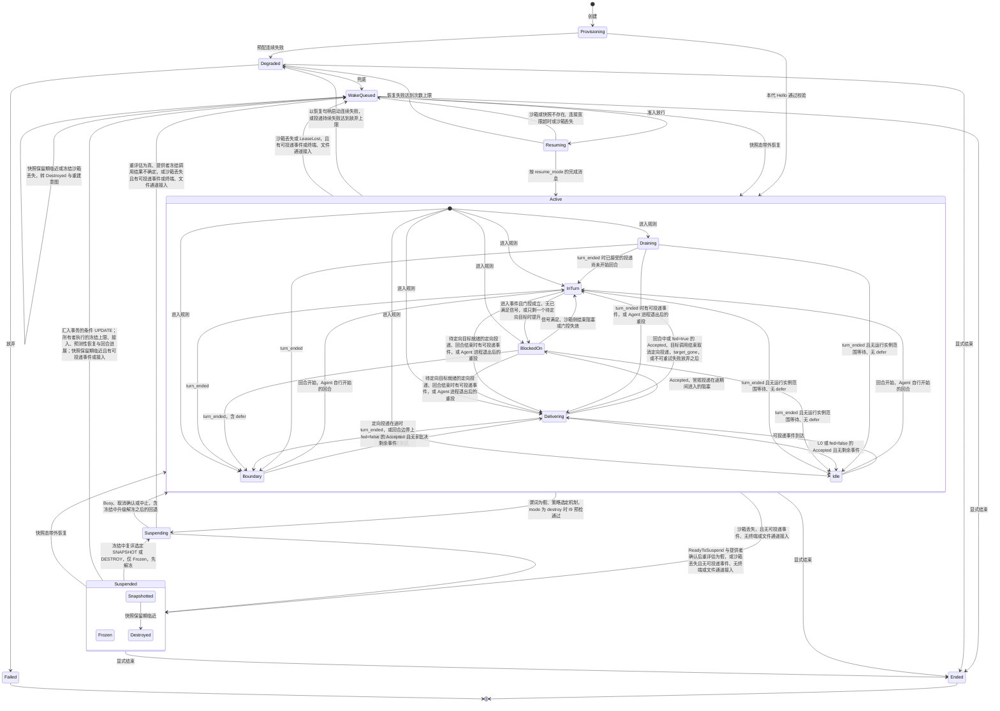
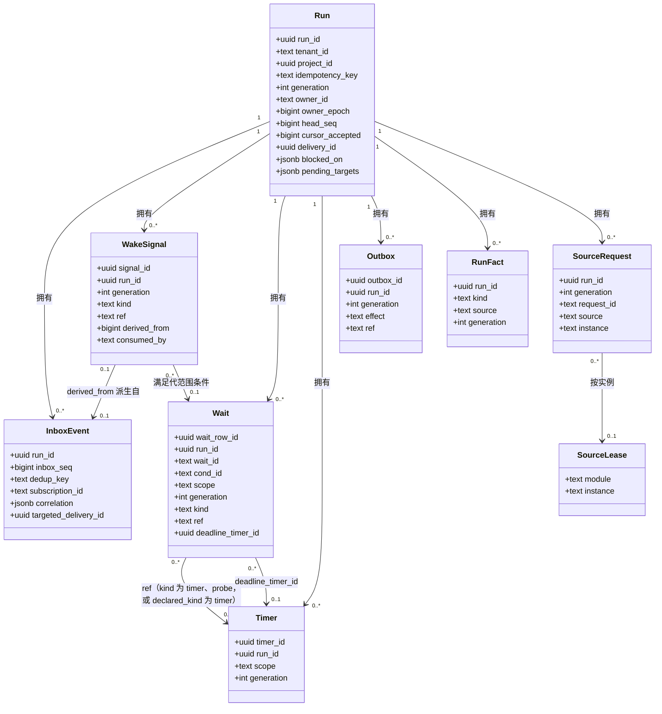
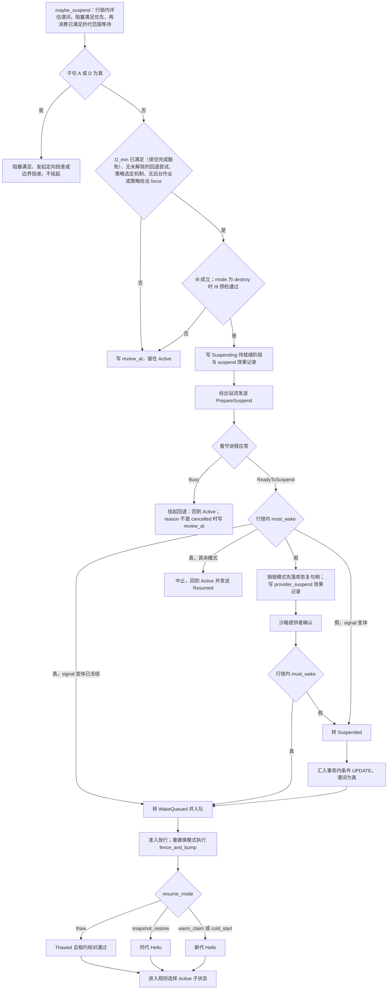
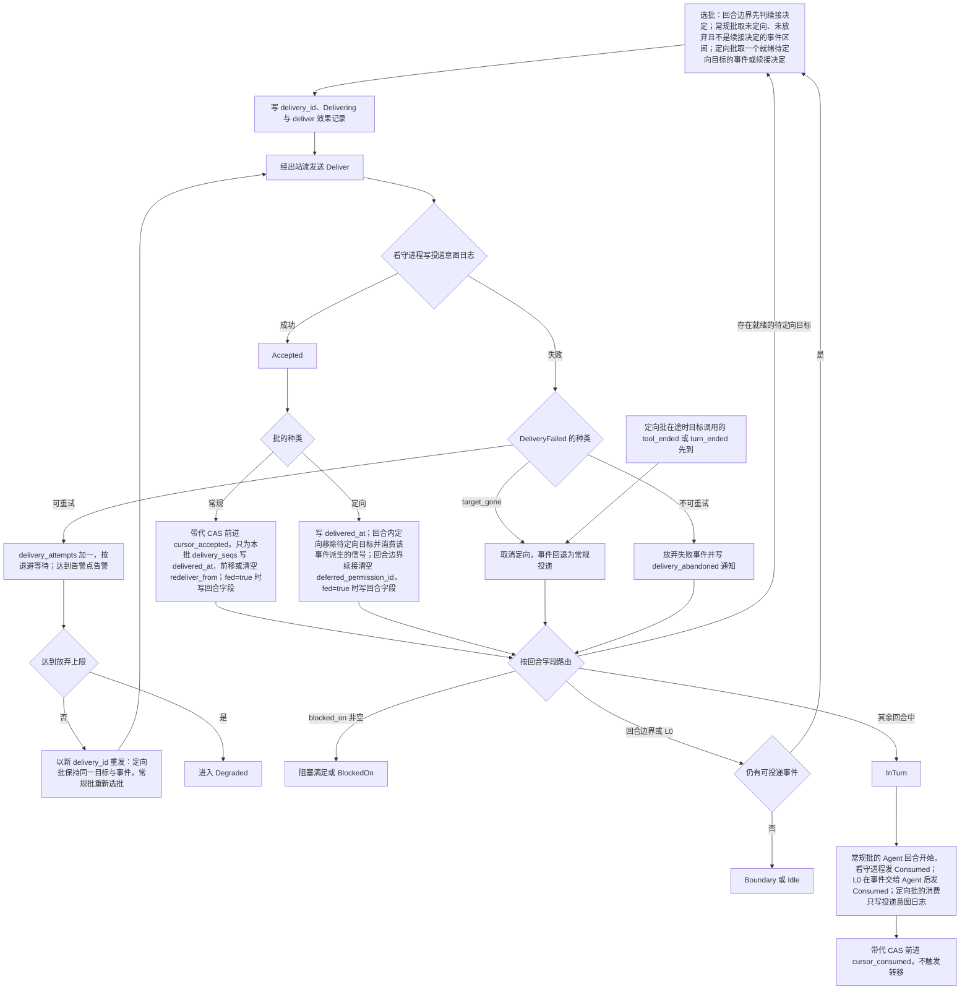

# runcontroller

`runcontroller` 坐在控制面，是运行实例状态机的唯一写者。它拥有 `run` 行及其状态转移、收件箱与唤醒信号的持久化、唤醒谓词、投递游标、代与失效判定的控制面一侧、定时器、效果记录与纠正性对账；它不拥有 Agent 进程、沙箱的创建与销毁、挂起决策的参数与沙箱侧的安全点检查，这些分别归看守进程、`sandboxprovider` 与 `suspendpolicy`。心智模型：沙箱一代代出现和消失，运行实例不会；本模块维护的正是这个跨代存续的状态机，每一代沙箱只是它当前借用的执行载体（[ADR-run-outlives-sandbox](../../adr/adr-run-outlives-sandbox.md)）。

文档较长，不宜顺序通读。第一次阅读按以下顺序：职责、状态与回合字段的闭集、[状态一览](#状态一览)、走查、转移表、唤醒谓词、投递与两级确认、挂起决策与冻结中复评、恢复准入与实时接入；术语表、外部接口契约、依赖、UML 图与字段表作为参考，在核对具体效果或字段时查阅。并发与事务边界末尾的竞态用例留到最后自测：先按前文的处置规则判断每个交错序列的结果，再与表中结论核对。

## 职责

`runcontroller` 是控制面中运行实例状态机的写者。除汇入事务的条件 UPDATE（`suspended` 转 `wake_queued`）外，运行实例的状态转移由持有该运行实例所有者租约的副本在 `run` 行锁内执行；汇入事务可由任一副本执行，其写入范围与所有权规则见并发与事务边界（[ADR-single-writer-per-run](../../adr/adr-single-writer-per-run.md)）。职责穷举如下，每条先写本模块执行的动作，再写产生的结果或边界；具体算法、表结构与转移细节见后续章节。

- **运行实例状态机**：接收创建、结束、查询、准入状态查询与降级裁决请求；在 `run` 行锁内执行状态转移，写入转移后的 `state`、`substate`、挂起阶段、回合字段与持久化点；拒绝与当前代、所有者或当前状态不符的转移。
- **事实持久化**：在每次转移或汇入写入中持久化收件箱事件、唤醒信号、等待、定时器、效果记录、运行实例事实（实时接入、恢复提示、结束请求、裁决请求、在途请求）、事件源实例租约与运行实例所有者租约；以 `(run_id, dedup_key)`、`(run_id, generation, kind, ref)` 等唯一键去重，并以 `inbox_seq` 维持同一运行实例的全序。
- **效果记录执行**：写效果记录；在提交后由所有者或认领者按 `(run_id, effect, ref)` 领取并执行外部调用；完成事务按效果类别校验并置 `done`；失败按退避重试，滞留由对账器重驱动；保留执行类效果在终态后继续执行。
- **所有者租约**：在 `Hello` 接管、过期租约认领与批量续租中维护 `owner_id`、`owner_epoch` 与 `owner_lease_expires_at`；每个所有者事务先在行锁内校验所有权，校验失败即回滚、丢弃该运行实例的内存状态并关闭出站流；与数据库分区的副本以本地单调时钟停止持流。
- **过期行清理**：按 `durable_cursor` 与各表保留期删除收件箱、唤醒信号、在途请求、已结束的等待与定时器、已完成的效果记录与过期租约；删除不持 `run` 行锁，删除条件在语句内对 `run` 行当前值求值；续接决定与在途定向事件不清理。
- **唤醒谓词**：在 `run` 行锁内评估子句 A、B、D、E，返回为真的子句集合；在汇入事务中执行唯一一条 `Suspended` 转 `WakeQueued` 的条件 UPDATE；在每次挂起决策、进入 `Suspended` 之前与对账时重新评估（I5）。
- **挂起决策与冻结中复评**：在可挂起子状态向 `suspendpolicy` 提供上下文（回合位置、阻塞条件、活动度、实时接入、能力集合、`policy_state` 等），持久化 `decide` 与 `review` 的结果，并写 `suspend`、`thaw`、`provider_suspend` 效果记录，驱动沙箱提供者冻结、解冻、快照与销毁；在谓词为真、唤醒集合为空或 I9 不成立时不发起挂起。
- **投递与两级确认**：在回合边界与回合内选取常规批或定向批，写 `delivery_id` 与 `deliver` 效果记录；处理 `Accepted` 推进 `cursor_accepted` 与 `delivered_at`，处理 `Consumed` 推进 `cursor_consumed`，处理 `DeliveryFailed` 执行退避重发、放弃或目标失效回退；新代 `Hello` 时按 `pending_intents` 与 `cursor_consumed` 对账并跨代重投（I4）。
- **代与失效判定**：在重建类准入放行与明确失败后的新预配中递增代；拒绝旧代的消息、令牌、游标推进、工作区写入与出口请求；作废旧代的等待、定时器与在途请求；写 `destroy` 与 `revoke_egress` 效果记录；向令牌校验方提供当前代、终态与本代作废状态（I7）。
- **汇入契约**：向事件源提供 `AppendInbox`、`AppendWakeSignal`、`SetRunFact` 与 `RenewSourceLease`；校验种类闭集、幂等键、关联键、载荷上限与事件源实例标识；以汇入事务写入收件箱、唤醒信号、事实行与租约，派生审批决定与订阅完成的唤醒信号，并返回不可重试与暂时性错误分类。
- **定时器与截止时间**：登记 `sleep_until`、`probe` 与 `declared_deadline` 定时器；按 `fire_at` 扫描到期行并在所有者事务中触发，代范围定时器写 `timer_fired` 信号，运行实例范围定时器写 `timer_due` 通知；以内存定时器与对账器调度 `transition_deadline`、`review_at`、`freeze_deadline`、`degraded_deadline`、`next_delivery_at`、`rebuild_after` 等所有者侧截止时间。
- **恢复准入与重建衔接**：在 `wake_queued` 入队时确定 `resume_mode` 并调用 `admit`；在放行事务中写 `resuming`、`resume_id` 与 `slot_lease`，经效果记录驱动预配、快照恢复、解冻或预热池认领；经效果记录建立、保持与释放工作区租约，签发与轮换运行实例令牌；在恢复失败、超时或对象不存在时重驱动、转重建意图或进入降级；处理 `wake_hint` 事实并按 `suspendpolicy` 的批准触发预测性恢复。
- **实时接入处置**：接收 `SetRunFact{live_attach}`，维护接入有效值与到期；在终端或文件通道接入时唤醒快照态与销毁态、中止进行中的快照或销毁尝试；向本代沙箱推送 `LiveState`，并在 `HelloAck` 中携带接入状态；平台界面会话只约束挂起决策。
- **事件源实例失联处置**：按 `source_request.instance` 关联 `source_lease`，在续租过期时为该实例的全部在途请求合成 `llm_failed` 或 `request_failed` 唤醒信号，并在同一事务关闭在途行。
- **纠正性对账**：按 `T_reconcile` 扫描守卫闭集——过渡态截止、投递滞后、悬挂唤醒、阻塞已满足未转出、排队悬挂、事件源实例失联、复评与截止到期、沙箱丢失、代范围等待过期、效果记录滞留、实时接入到期——以同一标识幂等重驱动或纠正，计数并在连续命中时告警（I10）。
- **控制面服务接口**：实现 `Create`、`End`、`Get`、`AdmissionState` 与 `Resolve`；`Create` 以 `(project_id, idempotency_key)` 幂等并成为首个所有者，`End` 与 `Resolve` 登记请求事实后由所有者执行，`Get` 返回状态与准入字段，`AdmissionState` 按 `run` 行计算队列位置与预计恢复时刻。
- **对看守进程的协议处理**：处理 `Hello`、`AgentEvent`、LLM 与请求完成/失败、`WaitDeclared`、`Activity`、`Accepted`/`Consumed`/`DeliveryFailed`、`ReadyToSuspend`/`Busy`/`Thawed`、`LeaseLost` 等入站消息，按消息类型执行状态机效果并写效果记录；在 `Hello` 中校验令牌、代与工作区租约，接管所有权或拒绝旧代。

### 非职责

非职责举例如下，判定标准为：职责清单之外、由其他模块拥有的事实与机制。

- 事件源自有的事实与表归事件源模块：在途 LLM 请求表与回放存储归 `llmgateway`；外部系统定义、连接器事件日志、订阅登记与订阅状态归 `connectorhub`；人类会话、身份与通道侧的实时接入状态归 `humanchannel`。本模块只保存自己的事实行，以及 `blocked_on.ref`、`wait.ref` 与 `wake_signal.ref` 中的标识。
- 挂起决策函数与参数归 `suspendpolicy`：等待时长预测、抖动预算、冻结中复评与升级梯、恢复机制选择、恢复准入的限速与优先级、看门狗空闲证据。本模块只提供调用点、上下文与结果落库。
- 挂起机制的执行与 I9 在沙箱侧的检查归 `sandboxprovider` 与看守进程。
- 协议序列化、信封、重放与按 `(generation, msg_seq)` 去重归 `agentprotocol`；本模块只实现每条消息的状态机效果。
- 外部系统接入归 `connectorhub`：webhook 接收与签名校验、状态式轮询、回溯匹配、订阅超时与出口策略生成。
- 投递意图日志、Agent 进程监督、活动度采集、本地代理与平台 MCP 服务器归看守进程。
- 运行实例令牌的签发、轮换签名与签名校验归 `secrets`；LLM 请求、连接器操作与 k8s 路径出口请求的令牌校验归 `llmgateway` 与 `connectorhub` 自身（k8s 路径的出口请求由 `connectorhub` 的平台出口代理校验），`llmgateway` 与 `connectorhub` 经代查询接口比较令牌中的代；Substrate 路径出口策略的落地与撤销执行归 `sandboxprovider`（[REF-substrate](../../references.md)）。
- 工作区绑定、工作区租约表、续约与接管规则归 `workspace`；周期续约由看守进程执行。

## 术语表

| 术语 | 英文对照 | 适用范围 | 定义 |
| --- | --- | --- | --- |
| 汇入事务 | ingestion transaction | runcontroller | 由任一控制面副本执行、不校验运行实例所有权的写事务，写入范围只限汇入写入集合（见并发与事务边界） |
| 所有者事务 | owner transaction | runcontroller | 汇入事务、所有权获取事务（「创建」的插入、通过 Hello 公共校验的接管、所有者租约过期后的认领）与清理任务的删除之外的写事务，含定时器触发，由持有运行实例所有者租约的副本执行，开头在行锁内校验 `owner_epoch` |
| 常规投递 | regular delivery | runcontroller | 按 `inbox_seq` 区间选取收件箱事件、作为下一条用户消息送达、以 `Accepted` 推进 `cursor_accepted` 的投递 |
| 定向投递 | targeted delivery | runcontroller | 只含一条事件、按 `Deliver.target` 送达一个等待点（回合中的阻塞型审批或 `wait_for`，或回合边界上以 hook 的 defer 推迟的审批，[REF-claude-code-hooks](../../references.md)）、不推进 `cursor_accepted` 的投递 |
| 待定向目标 | pending target | runcontroller | 回合中登记、等待以定向投递送达审批决定或订阅完成的阻塞型审批与阻塞型 `wait_for`，存于 `run.pending_targets` |
| 续接决定 | resume decision | runcontroller | 与 `run.deferred_permission_id` 匹配（`kind=approval_decision` 且 `correlation.permission_id` 相等）、未被定向投递占用、未送达且未放弃的收件箱事件；只以回合边界续接的定向投递送达，不进入常规批 |
| 冻结记录 | freeze record | runcontroller | Agent 进程树冻结期间保留在 `run` 行上的冻结标识 `freeze_id`、冻结变体 `freeze_variant`、冻结时刻 `frozen_since` 与冻结上限 `freeze_deadline`；冻结中升级不改写 |

## 外部接口契约

稳定性承诺按接口类别给出：汇入契约对事件源模块稳定，满足扩展点所列条件的新增事件源不修改本模块；控制面服务接口 `RunService` 与代查询接口 `Generations` 对平台界面、运维接口与依赖本模块的事件源模块稳定；协议接口受 `agentprotocol` 的协议版本约束，本模块声明每条消息的状态机效果。

### 汇入契约

汇入契约是事件源模块写入收件箱事件、唤醒信号、运行实例事实与事件源实例租约的唯一入口，全部方法幂等，由接收请求的副本以汇入事务执行（[ADR-wait-on-durable-inbox](../../adr/adr-wait-on-durable-inbox.md)、[ADR-single-writer-per-run](../../adr/adr-single-writer-per-run.md)）。

```go
type Ingest interface {
    AppendInbox(ctx context.Context, ev InboxEvent) (InboxSeq, error)
    AppendWakeSignal(ctx context.Context, sig WakeSignal) (SignalRef, error)
    SetRunFact(ctx context.Context, fact RunFact) error
    RenewSourceLease(ctx context.Context, l SourceLease) error
}

type InboxEvent struct {
    RunID              RunID
    EventID, DedupKey  string
    Kind               EventKind          // message、approval_decision、subscription_completed
    Source, Actor      string             // Actor：用户身份，Source 为 humanchannel 时必填
    SubscriptionID     *string
    SubscriptionStatus *string            // active、completed、expired、cancelled
    Correlation        map[string]string  // approval_decision 携带 permission_id
    OccurredAt         time.Time
    Payload            json.RawMessage    // 合法 JSON，不超过 S_max；大内容以附件引用表达
}

type WakeSignal struct {
    RunID      RunID
    Generation int                        // 必须等于运行实例当前代
    Kind       SignalKind                 // llm_completed、llm_failed、request_completed、request_failed
    Ref        string                     // request_id
    Reason     *string                    // 失败原因，只用于 llm_failed、request_failed，写入 wake_signal.reason
    OccurredAt time.Time                  // 信号来源由本模块按调用方身份填写
}

type RunFact struct {
    RunID      RunID
    Kind       FactKind                   // live_attach、inflight_request、wake_hint
    Source     string
    SourceSeq  int64
    ObservedAt time.Time
    LiveAttach *LiveAttach                // {Channel, Attached, TTL}，运行实例范围
    InFlight   *InFlightRequest           // {Generation, RequestID, Kind: llm|request, Instance, InitialTTL}
    WakeHint   *WakeHint                  // {Generation, RequestID}
}

type SourceLease struct {
    Module, Instance string
    TTL              time.Duration
}
```

- **种类约束**：`InboxEvent.Kind` 与 `WakeSignal.Kind` 的取值为所列闭集；`internal_notice` 类收件箱事件、`timer_fired`、`approval_decided` 与 `subscription_done` 类唤醒信号只由本模块写入。`LiveAttach.Channel` 的取值为闭集 `ui_session`、`terminal` 与 `file`；需要沙箱存活才能服务的通道（终端与经沙箱的文件访问）唤醒快照态与销毁态并中止进行中的快照或销毁尝试；`ui_session` 只反映人在平台界面是否活跃，只约束挂起决策。
- **幂等**：`AppendInbox` 以 `(run_id, dedup_key)` 幂等，命中时返回已分配的序号，已有行的关联键（`permission_id` 或 `subscription_id`）与本次不同时以冲突错误拒绝并计数；`AppendWakeSignal` 写入非派生信号，以 `(run_id, generation, kind, ref)` 幂等，`AppendInbox` 同一事务派生的信号以 `(run_id, derived_from)` 幂等；`SetRunFact` 的实时接入按 `(run_id, kind, channel)`、恢复提示按 `(run_id, generation, request_id)` 幂等，只接受更大的 `SourceSeq`，接入值为真的实时接入以写入时刻加 `LiveAttach.TTL` 为有效期；在途请求按 `(run_id, generation, request_id, source)` 以插入登记，不比较 `SourceSeq`：主键冲突且已有行为 `done` 时不改，已 `done` 的行不会被重复登记改回 `in_flight`；已有行仍为 `in_flight` 且本次实例不同时，把 `instance` 改写为本次实例（同一请求被改发到另一实例，失联判定随之转到该实例），并在同一事务为本次实例续租；`SetRunFact{inflight_request}` 在同一事务以 `InitialTTL` 登记该事件源实例的租约；`RenewSourceLease` 只延长租约。
- **载荷上限**：`InboxEvent.Payload` 不超过 `S_max`（与投递批的字节上限相同，单个事件因而总能装入一批）。超过上限的内容由事件源自行存放，`Payload` 内只放附件引用（可取回的 URI 与内容哈希）；Agent 经平台 MCP 服务器取回附件：平台 MCP 服务器附运行实例令牌向存放方请求引用中的 URI，存放方按令牌有效的条件校验后返回内容，Agent 进程因而不需要直连存放方（I6）。存放附件的事件源承担提供这一取回接口的义务；本模块不解析、不取回附件。
- **事件源实例标识**：`InFlightRequest.Instance` 与 `SourceLease.Instance` 对事件源进程的每次启动唯一（例如 Pod 名加启动时生成的随机串），进程重启后不沿用旧标识登记在途请求或续租；「事件源实例失联」守卫依赖这一唯一性判定重启前登记的在途请求失联。
- **错误语义**：错误按类别穷举。不可重试错误：运行实例已终态；代不匹配；冲突（`dedup_key` 命中而关联键不同）；运行实例不存在；参数非法（`Kind` 越出闭集、写入只由本模块写入的种类、必填字段缺失、`Payload` 不是合法 JSON 或超过 `S_max`）。暂时性错误：数据库不可用、超时、锁等待超时、所有者通知失败。调用方收到不可重试错误时丢弃该写入并计入旧代拒绝计数或审计（终态拒绝时 `connectorhub` 的订阅处置见调用方义务），收到暂时性错误时按幂等键退避重试。
- **调用方义务**：对汇入契约的调用为至少一次。已在事件源自身事务中提交、尚未写入汇入契约的事实（例如已认领的连接器事件、已完成的在途请求），事件源必须能从自身持久化状态重驱动对应写入，直到成功或收到不可重试错误；`AppendInbox` 因运行实例已终态被拒时，`connectorhub` 把对应订阅置为 `cancelled`。
- **读取边界**：作为汇入契约调用方的事件源模块不读取 `run`、`inbox`、`wake_signal`、`wait`、`timer`、`outbox`、`run_fact`、`source_request` 与 `source_lease` 表；事件源模块自有的表（例如 `subscription`、`llm_request` 与连接器事件日志）由所属模块在自身事务内写入。
- **写入路径**：本模块写入自有表的路径穷举为：汇入契约；协议接口，看守进程的消息由所有者事务处理；所有者自身的调度，即定时器触发、截止时间与对账器；所有权的获取与续租，即 `Hello` 接管、效果执行器、定时器扫描与对账器以条件 UPDATE 对过期所有者租约的认领，以及所有者以 `owner_id=self AND owner_epoch=held` 为条件对 `owner_lease_expires_at` 与 `stream_seen_at` 的批量刷新（单条 UPDATE，逐行取得 `run` 行锁，只写这两列）；内部汇入路径，即事件源实例失联的合成信号、实时接入到期的事实失效、「悬挂唤醒」守卫的条件 UPDATE、节点内存压力的复评请求与 `End`、`Resolve` 的请求登记；`RunService.Create` 的插入，受理副本成为首个所有者；效果记录的领取与完成事务，由所有者或认领者执行；清理任务对过期行的删除。全部写入在 `run` 行锁事务内执行，例外穷举为：不改变状态与谓词的 `RenewSourceLease` 与 `SetRunFact{inflight_request}` 都不加行锁；清理任务的执行者、锁与删除条件见过期行的清理。

### 控制面服务接口

```go
type RunService interface {
    Create(ctx context.Context, req CreateRun) (RunID, error)
    End(ctx context.Context, req EndRun) error
    Get(ctx context.Context, id RunID) (RunView, error)
    AdmissionState(ctx context.Context, id RunID) (AdmissionState, error)
    Resolve(ctx context.Context, id RunID, r Resolution) error   // fallback 或 fail
}

// EndRun 含 RunID 与 Reason；CreateRun、RunView、AdmissionState、Resolution、CurrentGeneration 同上，
// AppendWakeSignal 返回 SignalRef（即 signal_id），幂等命中时返回已有行的 signal_id。

type Generations interface {
    Current(ctx context.Context, id RunID) (CurrentGeneration, error)
}

type CurrentGeneration struct {
    Generation int
    Terminal   bool                       // 运行实例已结束或已失败
    Fenced     bool                       // 本代沙箱已作废
}
```

- `CreateRun` 含 `TenantID`、`ProjectID`、`IdempotencyKey` 与 `AgentKind`。`Create` 以 `(project_id, idempotency_key)` 幂等：同键同参返回原 `run_id`，同键不同参返回冲突错误。租户维度按 [ADR-tenant-dimension-without-enforcement](../../adr/adr-tenant-dimension-without-enforcement.md) 保留，以 `run_id` 归属的记录经 `run` 行继承租户维度。
- `End` 与 `Resolve` 的执行属于所有者事务，而所有者可能是另一副本。接收副本在 `run` 行锁内登记请求事实（`end_request{reason}` 或 `resolve_request{resolution}`），同一事务写 `wake_check` 效果记录并通知所有者；所有者在 `wake_check` 的分派中执行「显式结束」「兜底」或「放弃」。返回成功表示请求已持久化，调用方以 `Get` 观察 `state`。`End` 作用于已终态的运行实例时返回成功、不登记；`Resolve` 在登记事务内要求 `state=degraded`，否则返回状态错误。
- `RunView` 含 `state`、`substate`、`suspend_mode`、`turn_phase`、`generation`、`wake_reason`、`last_resumed_at`、`reason` 与准入字段；`humanchannel` 据 `state`、`substate`、`suspend_mode` 判定终端请求能否直接转发（见恢复准入与实时接入）。
- `AdmissionState` 在运行实例处于 `wake_queued` 或 `resuming` 时返回 `{State, WakeReason, QueuedAt, Priority, Mechanism, QueuePosition, EstimatedResume}`：`Priority` 取 `wake_reason` 的级别；`Mechanism` 取 `run.resume_mode`，闭集为 `thaw`、`snapshot_restore`、`warm_claim`、`cold_start`，「入队」执行之前为空；`QueuePosition` 与 `EstimatedResume` 由受理副本按 `run` 行计算，计算函数由 `suspendpolicy` 的准入排队估计提供，不读所有者副本的准入队列：`QueuePosition` 为 `state='wake_queued'` 且 `resume_mode` 相同的行中，按有效优先级（含老化提升）排在前面或同级而 `queued_at` 更早的行数，`EstimatedResume` 为该位置除以该机制的放行速率，再加上 `sandboxprovider` 按机制给出的恢复时延估计。`Mechanism` 为空时 `QueuePosition` 与 `EstimatedResume` 为空，`resuming` 中 `QueuePosition` 为 0；其他状态返回 `State` 与空的准入字段，不报错。
- `Generations.Current` 返回当前代、是否终态与本代是否作废。本代作废当且仅当 `state=degraded`，或 `state∈{suspended, wake_queued}` 且 `substate=destroyed`：本代沙箱已被确认删除、判定丢失或放弃，代递增发生在准入放行时，其间该代令牌不得再被接受。
- 令牌有效的条件穷举为：`secrets` 校验签名、过期时间与 `run_id` 通过；令牌中的代等于当前代；运行实例非终态；本代未作废。`llmgateway` 对 LLM 请求可缓存代查询结果不超过 `T_gen_cache`；`connectorhub` 对有外部副作用的操作与订阅登记不使用缓存；`connectorhub` 的平台出口代理对 k8s 路径的每个出口请求，按附带的运行实例令牌经 `Generations.Current` 校验代、终态与作废状态，不使用缓存。代递增、进入作废状态与进入终态的事务提交即令对应令牌失效，不另设吊销记录（[ADR-generation-fencing](../../adr/adr-generation-fencing.md)）。Substrate 路径的出口网关不经代查询，按以运行实例与代为键的出口策略放行：新代的出口策略由 `sandboxprovider` 在预配与认领时按代落地；「本代沙箱作废」「提供者确认」（销毁落地）「进入降级」「放弃」「显式结束」与 `fence_and_bump` 在各自的事务内写 `revoke_egress` 效果撤销对应代的出口策略，已撤销的代拒绝此后的落地与更新，作废到撤销生效之间的残余窗口以该效果的执行截止为上界。
- 错误按类别穷举。不可重试错误：冲突（`Create` 同键不同参）；状态不符（`Resolve` 在 `state≠degraded` 时，含运行实例已终态）；运行实例不存在；参数非法（`Resolution` 越出 `fallback`、`fail`，必填字段缺失）。暂时性错误：数据库不可用、超时、锁等待超时、所有者通知失败。调用方收到不可重试错误时不重试，收到暂时性错误时退避重试：`Create` 以 `idempotency_key` 幂等，`End`、`Resolve` 的登记对同一运行实例幂等。

### 对看守进程的协议接口

本模块要求 `agentprotocol` 在信封与基本消息类型之外定义下列消息、字段与规则（穷举；本模块处理的全部消息见下表）：`AgentEvent` 的 `turn_started{session_id, delivery_id}`、`tool_started{call_id}`、`tool_ended{call_id}`、`permission_requested{id, call_id, blocking}`、`timer_requested{timer_id, fire_at, scope}`（本模块只登记 `scope=run`）、`wait_started{call_id, kind, ref, fire_at, predicted_ms}` 与 `bg_jobs_changed{job_ids}`；`request.completed` 与 `request.failed`；`Accepted.delivery_id` 与 `Accepted.fed`；`Consumed` 只针对常规投递（`target=next_user_message`）发出；`DeliveryFailed.delivery_id` 与 `reason=target_gone`；`Busy.reason=cancelled`；`LeaseLost{lease_id, expires_at}`；`Hello.sandbox_id`；`Hello.cursor_accepted` 只计常规投递的已接受前缀，`Hello.cursor_consumed` 只计常规投递的已消费前缀；`Hello.agent_state` 与 `Activity` 携带的 Agent 进程树冻结状态 `frozen`（`cgroup` 变体为 Agent 子 cgroup 已冻结，`signal` 变体为看守进程执行的 SIGSTOP 冻结尚未解除）与冻结标识 `freeze_id`；`PrepareSuspend.variant` 与 `force`；`Resumed.drain`；`LiveState{attached, as_of}`；`HelloAck.live_attached` 与 `live_as_of`；出站 `msg_seq` 跨所有者副本单调；区别于 `Fenced` 的可重试关闭状态；区别于 `Fenced` 与可重试关闭的不可重试认证失败关闭状态；出站流的最大消息尺寸不小于 `S_max` 加信封与编码余量。

`turn_ended` 由 Agent 驱动器在 `result` 与 `idle` 齐备且 `result.queued_turn_count` 为 0 之后发出（[REF-claude-agent-sdk-typescript](../../references.md)）；`turn_started.delivery_id` 为本回合消费的投递，Agent 自行开始的回合（例如 task-notification 回合）为空。除 `Hello`（见 Hello 的处理）外，入站消息一律由所有者事务处理。下表穷举本模块处理的消息：

| 方向 | 消息 | 处理 |
| --- | --- | --- |
| 入站 | `Hello` | 见 Hello 的处理 |
| 入站 | `AgentEvent` | `active` 中：`turn_started`（「回合开始」）、`turn_ended`（「回合结束」「Agent 进程退出」，`draining` 中为「排空完成」）、`state_changed`（只更新 `agent_state`）、`tool_started`、`tool_ended`、`bg_jobs_changed`（「工具进展」）、`permission_requested`（「进入阻塞」或只记录，`draining` 中为「排空中回合进展」）、`subscription_created`（「订阅创建」）、`timer_requested`（「定时请求」）、`wait_started`（「进入阻塞」或「进入即满足」，`draining` 中为「排空中回合进展」）；「非 Active 回合进展」所列起点中回合进展事件按该转移；本代作废的状态按本代作废的拒绝规则处理；其余非终态（例如快照态）计数丢弃 |
| 入站 | `llm.request.started`、`llm.first_token` | `active` 中按「进入阻塞」或「进入即满足」，门控不成立或 L0 时只登记在途请求，`draining` 中按「排空中回合进展」只登记在途请求；「非 Active 回合进展」所列起点中按该转移；本代作废的状态按本代作废的拒绝规则处理；其余非终态计数丢弃；`llm.first_token` 只用于预测性恢复提示与预测重估 |
| 入站 | `llm.request.completed`、`llm.request.failed`、`request.completed`、`request.failed` | 本代未作废的非终态中：所有者事务写唤醒信号（来源为本地代理或看守进程），同一事务把该 `request_id` 的全部来源 `source_request` 行置 `done`；`active.blocked_on` 时同一事务执行「阻塞满足」；`suspended` 时同一事务按汇入写入集合的条件判定转 `wake_queued` 并入队；`suspending(await_ready)` 且 `must_wake` 为真时执行「取消挂起」 |
| 入站 | `WaitDeclared` | 「等待声明」 |
| 入站 | `Activity` | 所有者内存保留最近摘要与累计时长（接管后从零累计）；看守进程按固定周期发送；L0 空闲证据成立时执行「看门狗空闲」；`active` 中报告 `frozen=true` 时：冻结标识等于 `aborted_suspend_id` 则不处置（由「迟到的挂起应答」与重连解除），否则计数、告警并执行「本代沙箱作废」 |
| 入站 | `Accepted`、`Consumed`、`DeliveryFailed` | 见 Accepted 与 Consumed、DeliveryFailed |
| 入站 | `ReadyToSuspend`、`Busy`、`Thawed` | 「就绪应答」「挂起回退」「升级解冻完成」或「解冻完成」；`Thawed` 的标识为冻结记录的 `freeze_id`，「解冻完成」的 `GetLease` 调用失败时按可重试拒绝处理；`suspend_id` 等于 `run.aborted_suspend_id` 的 `ReadyToSuspend`、`Busy` 与 `Thawed` 按「迟到的挂起应答」处理 |
| 入站 | `LeaseLost{lease_id, expires_at}` | 「本代沙箱作废」 |
| 出站 | `HelloAck` | 见 Hello 的处理 |
| 出站 | `Deliver` | `deliver` 效果；字段来源见投递与两级确认 |
| 出站 | `PrepareSuspend` | `suspend` 效果（「发起挂起」「升级解冻完成」）；字段来源见挂起决策与冻结中复评 |
| 出站 | `CancelSuspend{suspend_id}` | `send` 效果（「取消挂起」、「挂起截止」的 `await_ready` 回退）；确认载体为 `Busy{suspend_id, reason=cancelled}`，看守进程已越过不可撤销点时照常回 `ReadyToSuspend` |
| 出站 | `Thaw{suspend_id}` | 取值为冻结记录的 `freeze_id`；由 `thaw` 效果（「冻结中升级」）与 `resume` 效果（「准入放行」的解冻）发出：`signal` 变体由效果直接发送，`cgroup` 变体由效果的完成事务在提供者解冻调用返回之后写 `send(Thaw)`；「解冻中重连」与 `suspending(thawing)` 中的重连时重发；`aborted_suspend_id` 所指的冻结由「迟到的挂起应答」与 `active.*` 中的同代 `Hello` 以 `send(Thaw{aborted_suspend_id})` 解除，看守进程随后的 `Thawed` 只清空 `aborted_suspend_id` |
| 出站 | `Resumed{suspend_id, suspended_for_ms, wall_clock_now, drain}` | `send` 效果：「解冻完成」（`suspend_id=freeze_id`）、「快照恢复完成」「快照带外恢复」「排队中带外恢复」、「升级解冻完成」与「就绪应答」的中止分支、「提供者挂起失败」的快照与销毁中止、「迟到的挂起应答」的快照与 `Freeze{cgroup}` 分支；载荷在写入效果记录时确定 |
| 出站 | `LiveState{attached, as_of}` | `send` 效果（「实时接入推送」）；`ref=live:<as_of>`，看守进程只接受更新的 `as_of`；被接受的 `Hello` 由 `HelloAck` 携带同样的值 |
| 出站 | `Shutdown{graceful, reason, deadline}` | `destroy` 效果执行器在目标沙箱的出站流上先行发出（「显式结束」「放弃」「进入降级」「本代沙箱作废」与 `fence_and_bump`）；「销毁态连接」与终态下的 `Hello` 在应答中同步发出，本代作废的拒绝判定在关闭流之前同步发出，不经效果记录；`deadline` 取发出时刻加 `T_shutdown_grace` |
| 出站 | `Fenced{current_generation}` | 已建立的出站流上收到非 `Hello` 的旧代消息时应答，每条流每个旧代一次，随后关闭该流 |
| 出站 | `TokenRotate{token}` | `rotate_token` 效果 |

- **失效判定**：信封 `generation` 不等于当前代的入站消息不产生转移、不推进游标、不更新事实，计入旧代拒绝计数（I7）。入站消息只在本代已接受的出站流（`stream_epoch` 为当前值）上处理；同一副本上 `stream_epoch` 较小的流在新流建立后关闭，其上的消息不再处理。
- **本代作废的拒绝判定**：本代作废（`state=degraded`，或 `state∈{suspended, wake_queued}` 且 `substate=destroyed`，与 `Generations.Current` 的 `Fenced` 判定相同）时，同代出站流上的非 `Hello` 消息不产生转移、不推进游标与 `in_msg_seq`、不写信号与事实，计入旧代拒绝计数，回 `Shutdown{graceful=false}` 后关闭该流；`Hello` 按「销毁态连接」处理。
- **可重试拒绝**：消息处理依赖的事务外调用（令牌校验函数、`workspace.GetLease`）失败时，该消息不处理、不推进 `ack_msg_seq`，控制面以可重试状态关闭出站流；看守进程不终止 Agent 进程树，退避重连后重放未确认消息。
- **幂等标识**：`Deliver` 以 `delivery_id`；`PrepareSuspend`、`CancelSuspend` 与 `Resumed` 以 `suspend_id`；`Thaw` 与 `Thawed` 以冻结记录的 `freeze_id`；`Accepted` 依靠 `delivery_id` 与带代的单调 CAS，`Consumed` 依靠带代的单调 CAS；`resume_id` 只用于 `sandboxprovider`、`workspace` 的调用与效果记录。
- **消息序号**：协议消息的处理事务提交后才推进 `ack_msg_seq`；本代最后已处理的入站序号持久化在 `run.in_msg_seq`，`HelloAck.last_received_msg_seq` 取自它。

### Hello 的处理

**公共校验**：事务外先以 `secrets` 的校验函数验证 `resume_token` 的签名与 `run_id`（过期单独标记，不在此拒绝），并调用 `workspace.GetLease(run_id)`；任一调用失败（不可达、超时）不是校验失败，按可重试拒绝应答，不开事务、不接管、不作失效判定、关闭流。调用成功后，事务内持 `run` 行锁、在改变所有权之前依次校验：

1. 签名与 `run_id` 有效，且令牌中的代等于信封 `generation`；否则以 `agentprotocol` 定义的不可重试认证失败状态关闭流，不回 `HelloAck`、不携带当前代，计入旧代拒绝计数，看守进程收到后停止重连并上报。
2. `generation` 不等于 `run.generation` 时回 `HelloAck.fenced{current_generation}`，计数，关闭流。
3. 运行实例已终态时回 `Shutdown{graceful=false}` 并关闭流。
4. 租约与沙箱：`lease.generation=run.generation`、`lease.lease_id=Hello.workspace_lease_id`、`lease.holder=Hello.sandbox_id`、`lease.expires_at > now()`；`run.lease_generation=run.generation` 时另要求 `lease.lease_id=run.lease_id`；`run.sandbox_id` 非空且状态属于同一沙箱实例延续的集合（`active`、`suspending`、`suspended.frozen`、`wake_queued.frozen`、`resuming(thaw)`）时另要求 `run.sandbox_id=Hello.sandbox_id`。任一不满足时回 `HelloAck.fenced{current_generation}`，同代不同沙箱同样拒绝；`lease.holder` 为空（迟到的 `HoldLease` 在快照之后清空了持有者）时回可重试拒绝而不作失效判定，看守进程的下一次 `RenewLease` 重新绑定持有者后重连。快照态、`resuming(snapshot_restore)` 与新代状态下 `sandbox_id` 取自 `Hello`：快照恢复的实例可能换标识，租约持有者已由其首次续约绑定；`HoldLease` 在快照恢复调用之前完成（见效果间的先后依赖），并以持有者为空或等于快照时的沙箱为 CAS 条件；带外恢复的实例沿用原标识时，该绑定可能被迟到的 `HoldLease` 清空，其下一次续约重新绑定持有者，期间的 `Hello` 以可重试拒绝应答，清空本身不构成失效判定。
5. 令牌已过期或临近到期：签名与租约校验都通过时仍接受，同一事务写 `rotate_token`（`ref=t<generation>:<token_expires_at>`，同 `ref` 已 `done` 的行重置为 `pending`；「销毁态连接」不写）。看守进程收到 `TokenRotate` 之前不向 `llmgateway` 与 `connectorhub` 发请求；`llmgateway`、`connectorhub` 照常拒绝过期令牌。
6. 校验通过后接管所有权（`owner_epoch+1`、`owner_id=self`、续租），写 `stream_epoch+1` 与 `stream_seen_at`。「销毁态连接」只写这些字段；其余状态另写 `agent_state`、`token_expires_at`（取该令牌的到期时刻）、`ws_durability`（取 `lease.durability`），`lease_id`、`lease_generation` 为空或属旧代时取自租约。`session_id` 只由使运行实例保持或进入沙箱存活状态的同代 `Hello`（「同代重连」「挂起中重连」「冻结态重连」「解冻中重连」「快照恢复完成」「快照带外恢复」「排队中带外恢复」）在 `agent_state.session_id` 非空时更新，新代 `Hello`（「预配完成」「重建完成」）与「销毁态连接」不写。回 `HelloAck{accepted, desired_state, last_received_msg_seq=in_msg_seq, cursor_accepted, owner_epoch, live_attached, live_as_of}`。

任一校验的拒绝路径回滚事务，不写 `run` 行、不改变所有权，接收副本只应答。各类拒绝计入旧代拒绝计数，`Hello` 的认证属于代校验入口。

**按状态的效果**：

| 状态 | 效果 | `desired_state` |
| --- | --- | --- |
| `provisioning` | 「预配完成」 | `running` |
| `resuming(warm_claim)`、`resuming(cold_start)`（新代） | 「重建完成」 | `running` |
| `resuming(snapshot_restore)` | 「快照恢复完成」 | `running` |
| `resuming(thaw)` | 「解冻中重连」（完成以 `Thawed` 为准） | `running` |
| `active.*` | 「同代重连」 | `running` |
| `suspending` | 「挂起中重连」 | `running`；解冻尚未完成（`suspend_origin=frozen`）时为 `frozen` |
| `suspended.frozen`、`wake_queued.frozen` | 「冻结态重连」 | `frozen` |
| `suspended.snapshotted`、`wake_queued.snapshotted` | 「快照带外恢复」「排队中带外恢复」 | `running` |
| `suspended.destroyed`、`wake_queued.destroyed`、`degraded` | 「销毁态连接」 | — |

新代 `Hello` 的 `agent_state.phase` 只用于核对：新代沙箱的 Agent 进程在首个 `Deliver` 之前不启动，`phase` 应为 `starting`，为其他值时计入异常计数，不改变进入规则的选择。新代 `Hello` 的 `agent_state.session_id` 同样只用于核对，不改写 `run.session_id`；恢复句柄经 `Deliver.resume_session_id` 交给看守进程。

## 依赖

依赖穷举如下，方向与[模块依赖图](../architecture.md#模块依赖图)一致：本模块依赖基础层（`agentprotocol`、`suspendpolicy`、`secrets`、`workspace`）与 `sandboxprovider`，存储为 PostgreSQL；`llmgateway`、`connectorhub` 经汇入契约与代查询接口依赖本模块，`humanchannel` 经汇入契约与 `RunService` 依赖本模块；本模块不反向调用事件源模块。

- `agentprotocol`：信封、消息类型、出站流服务端、按 `(generation, msg_seq)` 去重，以及出站 `msg_seq` 跨所有者副本单调的规则。
- `suspendpolicy`：以库的形式在进程内调用。`decide`、`review`、`mechanism`、`reacquire_slot`、`on_resumed` 与各估计函数在 `run` 行锁内同步调用；`pick_for_pressure` 由副本在节点压力复评时于行锁外批量调用；`admit`、`release` 与「显式结束」的「从准入队列移除」只修改进程内队列，在事务提交后调用（副本在提交后、调用前崩溃时由 `slot_expires_at` 到期回收）。接口提供 `decide`、`review`、`mechanism`、`admit`、`reacquire_slot`（槽位到期后的重驱动同步重新取得并发槽位，不入队）、`release`、`on_resumed`、`pick_for_pressure`（由节点压力值与该节点的冻结运行实例列表选出升级对象，不读 `run` 表）、看门狗空闲证据、唤醒原因优先级、预测性恢复的批准、定时类等待与退避的随机抖动、依 `policy_state` 给出的退避时刻、准入排队估计，以及节点内存压力的阈值 ρ_soft；策略参数与各机制的超时见参数表。
- `sandboxprovider`：在效果记录内、事务提交后调用，放大状态查询、沙箱存在查询与节点压力查询在事务外调用。所需能力穷举为：预配与预热池认领（创建沙箱时按代落地出口策略，见出口策略一项）；`Freeze{cgroup}`（cgroup v2 冻结接口，[REF-linux-cgroup-v2](../../references.md)）与解冻，冻结、解冻与 FREEZE_SHRINK 的缩小 CPU request 都以 `freeze_id` 标识，对已执行过解冻的 `freeze_id`，之后到达的冻结与缩小请求不生效；快照与快照恢复（快照确认报告快照保留期限，快照恢复返回沙箱标识，快照不存在时明确报告）；按 `suspend_id` 撤销尚未确认的快照尝试，撤销即墓碑：撤销确认之后到达的、属于同一 `suspend_id` 的快照请求不生效（提供者不具备该能力时，`suspendpolicy` 不在回合中选择快照，回合中只有不挂起与冻结）；按 `(run_id, generation)` 的整代销毁（删除确认携带被删除沙箱所属的代）与按 `(generation, sandbox_id)` 的单个销毁，整代销毁与单个销毁都携带代，只作用于该代的沙箱实例，不作用于更新的代（例如 k8s 提供者在 Pod 上标注代，并按 Pod UID 带前置条件删除），都不改变运行实例级资源（例如 k8s 提供者以 Sandbox CR 的 `operatingMode` 实现销毁与重建，[REF-agent-sandbox](../../references.md)）；创建墓碑：整代销毁 `(run_id, g)` 之后，代不大于 g 的预配、预热池认领与快照恢复一律以明确的拒绝结果返回，整代销毁的删除确认因而证明该代此后不再出现沙箱实例；按 `run_id` 释放运行实例级资源（例如 k8s 提供者的 Sandbox CR、Service 与 PVC），幂等，释放之后对该 `run_id` 的一切创建（沙箱、运行实例级资源与出口策略）一律拒绝；出口策略：保存 `connectorhub` 推送的每运行实例出口策略，预配与认领时以 `(run_id, generation)` 落地它的本代副本（例如 Substrate 提供者的 EgressPolicy），快照恢复沿用同代副本，推送的更新只同步到该运行实例尚未撤销的代副本；按 `(run_id, generation)` 撤销该代副本，撤销即墓碑，已撤销的 `(run_id, generation)` 拒绝此后的落地与更新，幂等；k8s 提供者的平台出口代理逐请求校验代，出口策略按运行实例落地，按代撤销为空操作；原地缩小 CPU request 与恢复时放大，未缩小时为空操作（[REF-k8s-in-place-pod-resize](../../references.md)）；放大状态查询；沙箱存在与状态查询（批量列举，结果含每个沙箱所属的 `run_id`、代与放置位置；按 `sandbox_id` 逐个查询）；按节点查询冻结态内存与可分配内存（或订阅节点压力事件）；按机制的恢复时延估计，事务外读取；能力集合。调用按 `suspend_id`、`resume_id` 幂等，对同一运行实例按到达顺序串行；重建的 `provision` 排在租约所属代的 `destroy` 完成或旧租约到期之后（见重建衔接）。`Thaw` 经出站流发送，不经沙箱提供者。
- `workspace`：在效果记录内调用租约接口；`GetLease` 在 `Hello`、`Thawed` 处理与对账器中于事务外调用，调用失败与结果不符分别处理。所需接口穷举为：
  - `CreateLease(run_id, generation, attempt_id) → {lease_id, durability}`（第 1 代）与 `TakeoverLease(run_id, generation, attempt_id, proof) → {lease_id, durability} | not_before`（重建）：以 `(run_id, generation, attempt_id)` 幂等，`attempt_id` 取 `resume_id`；`TakeoverLease` 在旧租约已到期时成功，不需要 `proof`；旧租约未到期时，只在 `proof` 为沙箱提供者的删除确认且其携带的被删除沙箱所属的代等于 `lease.generation` 时据此接管；运行实例尚无租约时直接建立；其余情形返回旧租约的到期时刻作为 `not_before`；持有者为空与租约已释放都不构成接管条件。`durability` 为工作区持久化语义 `sync` 或 `on_suspend`。
  - `RenewLease(lease_id, generation, sandbox_id)`：由看守进程周期调用；CAS 条件为 `lease_id` 与 `generation` 匹配、`expires_at > now()`，且持有者为空或等于 `sandbox_id`；持有者为空时由本次续约绑定为该沙箱。调用以 `lease_id` 与 `generation` 认证（两者只由看守进程持有），不经 `secrets` 校验，也不以运行实例令牌未过期为前提。
  - `HoldLease(run_id, lease_id, generation, until, holder)`：以 `lease_id` 与 `generation` 匹配且持有者为空或等于 `holder`（快照时的 `run.sandbox_id`）为 CAS 条件，快照期间把到期时刻设为 `until` 并清空持有者，快照恢复的沙箱实例以首次续约重新绑定；持有者已是其他沙箱（例如带外恢复的实例已以首次续约绑定）时为空操作。
  - `ReleaseLease(run_id, generation)`：以 `lease.generation=generation` 为 CAS 条件，租约已被更大的代接管时为空操作；只在同代沙箱的删除确认之后调用。释放把租约标记为已释放并清空持有者，此后对该租约的 `RenewLease` 以 CAS 失败返回；`expires_at` 不变，释放不构成接管条件，`TakeoverLease` 仍按到期或 `proof` 判定。
  - `ReleaseRunLease(run_id)`：「显式结束」「放弃」使用；不论 `lease.generation` 为何值都释放该运行实例的租约并留下墓碑，此后对该 `run_id` 的 `CreateLease` 与 `TakeoverLease` 一律返回明确的拒绝，执行器已领取、在途的 `TakeoverLease` 因而不会在释放之后重建租约。
  - `GetLease(run_id) → {lease_id, generation, holder, expires_at, durability, released}`。
- `secrets`：`IssueRunToken(run_id, generation) → {token, expires_at}` 在效果记录内调用；`VerifyRunToken(token) → {run_id, generation, expires_at, expired} | invalid` 在 `Hello` 处理前于事务外调用，过期时不返回错误、只置 `expired`，调用不可达或超时与 `invalid` 分开返回。`secrets` 不读本模块的表。
- PostgreSQL：控制面存储，提供行锁、序列、唯一索引与 `LISTEN/NOTIFY`。

**边界**：本模块不读写 `connectorhub`、`llmgateway`、`workspace`、`secrets` 的表；订阅与在途 LLM 请求只以本模块的 `wait`、`source_request` 行与 `blocked_on.ref`、`wait.ref`、`wake_signal.ref` 中的标识出现。运行实例范围的订阅等待只由 `subscription_created` 派生，订阅完成与超时经 `AppendInbox` 到达，回合边界不遍历订阅，显式结束不写订阅。

**被依赖方与调用方承担的约束**：除依赖清单所列接口的语义外，本模块的正确性依赖下列由其他模块承担的约束，按模块穷举如下。

- 看守进程：首次 `RenewLease` 成功之后才发 `Hello`，在 `expires_at` 减时钟余量之前停止写入；`Hello.agent_state` 如实反映回合位置；`Hello.cursor_accepted` 只计常规投递的已接受前缀；每个 `tool_started` 都有配对的 `tool_ended`，被 hook 拒绝或超时的调用同样发出；`permission_requested`、`wait_started` 携带 `call_id`；本地代理为每次上游请求（含客户端重发）生成在同一运行实例、同一代内唯一的 `request_id`，不从 `request_hash` 派生；以单次回放缓存应答重发时不发 `llm.request.started`，仍发时必须用新的 `request_id` 并随后发出同一 `request_id` 的完成或失败。本地代理随转发给 `llmgateway` 的请求携带与 `llm.request.started` 相同的 `request_id`，平台 MCP 服务器随同步连接器操作携带与 `wait_started.ref` 相同的 `request_id`；`wait_started` 的 `ref` 只取 `lifetime: once` 的订阅；`timer_requested` 只以 `scope=run` 发出；已接受的常规投递与回合边界续接只在 Agent 回合之间喂入（L1、L2），回合进行中 `Accepted` 的输入等该回合 `turn_ended` 之后才喂入；`Accepted.fed` 如实报告本批按投递意图日志去重之后是否仍有事件喂给 Agent；常规批与回合边界续接批在 `fed=true` 时随后发出带该 `delivery_id` 的 `turn_started`（L0 为 `Consumed`）或报告 Agent 进程退出，`fed=false` 时不为本批启动 Agent、不发 `turn_started`；以恢复句柄启动 Agent 失败时先发该投递的 `Accepted`，再报 `turn_ended{agent_exited=true}`；L0 在事件交给 Agent 后写消费记录并发 `Consumed`；接受记录同步写入工作区之后才回 `Accepted`，消费记录同步写入工作区之后才发 `Consumed`，写入失败时都不发；`Consumed` 只针对 `target=next_user_message` 的常规投递发出，`through_seq` 取已开始处理的常规批的 `through_seq`，定向投递（含回合边界续接）的消费只写入投递意图日志、不发 `Consumed`；`Hello.cursor_consumed` 只计常规投递的已消费前缀；`Activity` 按固定周期发送，携带 Agent 进程树的冻结状态（`cgroup` 与 `signal` 两种变体都计入）与冻结标识；`PrepareSuspend.force` 只终止 Agent 主进程之外的进程；`ReadyToSuspend` 销毁模式的 `session_id` 取本代 Agent 进程使用的恢复句柄，本代未启动 Agent 进程时取最近一次收到的 `resume_session_id`，没有收到过时为空；`Resumed.drain` 按 `suspend_id` 幂等处理，收到 `Resumed{drain=true}` 时，已在等待的与之后发起的阻塞型审批、`wait_for` 与阻塞型 `sleep_until` 都按 DRAIN 规则立即返回，之后发起的阻塞型 `sleep_until` 照常发出 `wait_started`；收到 `Thaw{freeze_id}` 后上报 `Thawed`，按 `freeze_id` 幂等：`signal` 变体在自行解冻进程树之后，`cgroup` 变体在读取 Agent 子 cgroup 观察到未冻结之后（进程树从未冻结时立即）；取消定向后以常规投递重送的事件按投递意图日志去重；`LiveState` 与 `HelloAck` 的实时接入状态按 `as_of` 取最新；令牌已过期而重连时，收到 `TokenRotate` 之前不访问 `llmgateway` 与 `connectorhub`；收到可重试拒绝时不终止 Agent 进程树，收到不可重试认证失败关闭时停止重连并上报；目标等待点已在沙箱内失效时以 `DeliveryFailed{reason=target_gone}` 应答；`CancelSuspend` 以 `Busy{cancelled}` 或 `ReadyToSuspend` 确认，对从未收到过 `PrepareSuspend` 的 `suspend_id` 同样回 `Busy{cancelled}`；租约续约失败时上报 `LeaseLost{lease_id, expires_at}`。
- `connectorhub`：`subscription_completed` 的 `dedup_key` 以订阅标识与外部事件标识共同派生；订阅超时以 CAS 置 `expired` 并经 `AppendInbox` 写入 `subscription_completed(subscription_status=expired)`；汇入因终态被拒或代查询返回终态时取消订阅；同步请求经 `SetRunFact{inflight_request}` 登记并按实例续租，实例标识对每次进程启动唯一；平台出口代理对 k8s 路径的每个出口请求按附带的运行实例令牌经 `Generations.Current` 校验，不使用缓存，不通过时拒绝并计入旧代拒绝计数；`InFlight.RequestID` 与 `WakeSignal.Ref` 取平台 MCP 服务器随请求携带的 `request_id`；超过 `S_max` 的原始负载自行存放，并为平台 MCP 服务器提供附运行实例令牌的附件取回接口。
- `llmgateway`：转发上游前经 `SetRunFact{inflight_request}` 登记在途请求并按实例续租，实例标识对每次进程启动唯一；`InFlight.RequestID` 与 `WakeSignal.Ref` 取本地代理随请求携带的 `request_id`；完成与失败经 `AppendWakeSignal`；拒绝过期令牌与代查询报告作废的令牌。
- `humanchannel`：实时接入按通道经 `SetRunFact` 写入，接入期间按小于 `LiveAttach.TTL` 的周期以更大的 `SourceSeq` 续写，进程重启后以更大的 `SourceSeq` 重报全部有效接入；人类事件填 `Actor`；审批决定的 `dedup_key` 每个决定唯一；终端请求与经沙箱的文件访问按恢复准入与实时接入所列条件转发或等待；超过 `S_max` 的内容自行存放，并提供与 `connectorhub` 相同的附件取回接口。
- `suspendpolicy`：`review` 在实时接入有效值为真时只返回 KEEP，或在冻结上限到达时返回 DRAIN；冻结上限到达时只返回 SNAPSHOT 或 DRAIN；`decide` 对已过冻结上限的阻塞不返回冻结，FREEZE_SHRINK 只与 `cgroup` 变体组合；`admit` 在冻结态携带的截止之前放行；`admit` 对同一 `run_id` 幂等、不重置老化，携带的机制或截止与已有条目不同时把条目改到新的机制与截止；放行回调携带该条目的机制；`Activity` 累计不足 Q_quiet 时空闲证据不成立。

## UML 图

状态图固定运行实例的生命周期，类图固定本模块持久化实体的关系，活动图分别固定挂起决策与恢复、投递与确认的处理顺序；图中不表达的约束由每张图后的正文给出，状态图的完整约束是核心算法与流程中的转移表。

### 状态图



状态闭集为 `Provisioning`、`Active`、`Suspending`、`Suspended`、`WakeQueued`、`Resuming`、`Degraded`、`Ended`、`Failed`，其中 `Ended` 与 `Failed` 为终态。`Active` 的子状态闭集为 `InTurn`、`BlockedOn`、`Boundary`、`Idle`、`Delivering`、`Draining`；`Suspended`、`WakeQueued` 与 `Resuming` 的子状态是沙箱的物理形态 `Frozen`、`Snapshotted`、`Destroyed`，`Resuming` 中表示从哪种形态恢复。进入 `Active` 的子状态由进入规则依据恢复前持久化的回合字段选择分支，游标只在回合边界分支中用于判定是否存在可投递事件。

图中省略的边与约束如下，均由转移表补全：

- 显式结束可从任一非终态到达，图中只画出代表性边。
- 沙箱丢失经「本代沙箱作废」转为 `Destroyed`，起点穷举为：「沙箱丢失」守卫的候选集，即 `Active`、`Suspending` 的解冻阶段与待就绪阶段、冻结类的提供者待确认阶段、`Suspended{Frozen}`、`WakeQueued{Frozen}`、解冻中的 `Resuming`；以及快照模式的提供者待确认阶段，由 `provider_suspend` 报告沙箱不存在时到达。起点为 `WakeQueued` 或 `Resuming` 时一律到达 `WakeQueued`（重建意图，保留原唤醒原因与排队时刻）；其余起点在有可投递事件、其他满足的条件或终端、文件通道接入时到达 `WakeQueued`，否则到达 `Suspended{Destroyed}`。快照保留期临近与快照恢复对象不存在按同一规则处置。
- `WakeQueued{Frozen}` 保留冻结上限，由恢复准入在冻结上限之前截止放行。
- 回合进展事件在非 `Active` 状态下只改写回合字段，不产生子状态边；其结果由之后的转移按更新后的回合字段路由。
- 进入 `Suspended` 的每条边都在 `run` 行锁内重评估唤醒谓词，为真时改走 `WakeQueued`（I5）；`Suspended` 转 `WakeQueued` 除汇入事务的条件 UPDATE 外，冻结上限、终端或文件通道接入、预测性恢复与回合进展导致的唤醒由所有者执行。
- `Degraded` 只经 `WakeQueued` 与恢复准入以新代重建回到 `Active`，不直接进入 `Active`。
- 过渡态 `Provisioning`、`Suspending`、`Resuming` 与子状态 `Delivering`、`Draining` 都带截止时间，由对账器幂等重驱动（I10）；`Draining` 的截止只重发 `Resumed{drain=true}`，不约束回合时长，只经 `turn_ended` 离开。

### 类图



类图只列键字段与关系字段，全部列见核心数据结构。`Run` 是聚合根，其余实体以 `run_id` 归属，`SourceLease` 按事件源实例归属而不属于任何运行实例；运行实例所有者租约由 `Run` 行上的 `owner_id`、`owner_epoch` 与 `owner_lease_expires_at` 承载。`WakeSignal` 以 `generation` 与 `ref` 满足代范围的 `Wait`，满足判定不存储，在行锁内计算，消费时写 `WakeSignal.consumed_by` 与 `Wait.satisfied_by`。审批决定与订阅完成事件各派生一条 `WakeSignal`，`derived_from` 指向该事件的 `inbox_seq`；非派生信号的 `derived_from` 为空。`Timer` 经 `Wait.ref` 或 `Wait.deadline_timer_id` 被等待引用。`SourceRequest` 中来源为 `llmgateway` 与 `connectorhub` 的行按 `instance` 关联事件源实例租约，来源为本地代理的行没有实例租约。`InboxEvent.targeted_delivery_id` 记录最近一次定向投递该事件的批，`delivered_at` 为空时即 `Run.delivery_id` 所指的在途定向批。收件箱事件不携带代；唤醒信号、代范围的等待与定时器携带代，代递增后作废（[ADR-generation-scoped-waits](../../adr/adr-generation-scoped-waits.md)）。

### 挂起决策与恢复活动图



挂起决策只在 `Active` 的可挂起子状态（`BlockedOn`、`Boundary`、`Idle`，以及 L2 声明等待下的 `InTurn`）调用；同一信号同时满足 `blocked_on` 或待定向目标与代范围等待时，信号由「阻塞满足」或定向投递的「投递接受」消费，`settle_gen_waits` 只了结等待一侧（见信号与等待的消费）。「无未解除的回退尝试」指 `aborted_suspend_id` 为空：待就绪阶段回退的尝试经「迟到的挂起应答」、重连或作废解除之前，不发起新的挂起尝试。L0 只经看门狗路径挂起，看门狗路径在挂起决策之前登记探测定时器。图中「真，signal 变体已冻结」指 `Freeze{signal}` 路径：看守进程回 `ReadyToSuspend` 时 Agent 进程树已冻结，`ReadyToSuspend` 即冻结确认，不写 `provider_suspend`。冻结中复评选定 SNAPSHOT 或 DESTROY 时先经 `Suspending` 的解冻阶段，`Thawed` 之后再发 `PrepareSuspend`，其余步骤与图中相同。每个出口都在行锁内重评估唤醒谓词，谓词为真时不进入 `Suspended`（I3、I5）。代递增只在准入放行事务（重建类模式）与提供者报告明确失败后的新预配尝试中发生，代递增使旧代令牌失效。

### 投递与确认活动图



`Accepted` 表示事件已同步写入工作区内的投递意图日志、尚未喂给 Agent，投喂责任由看守进程承担；`Consumed` 表示 Agent 已开始处理对应输入，只推进 `cursor_consumed`，不触发状态转移（[ADR-delivery-intent-log](../../adr/adr-delivery-intent-log.md)）。常规批只在回合边界或 L0 的 `Idle` 发出，回合中积压的未定向事件留到回合边界；定向批不推进 `cursor_accepted`，其消费只写入投递意图日志，不发 `Consumed`。游标的前进都是带 `generation` 的单调 CAS，迟到或重复的 `Accepted` 与 `DeliveryFailed` 因 `delivery_id` 不匹配被计数丢弃（I4、I7）；游标唯一的回退是新代 `Hello` 在 `on_suspend` 持久化语义下把 `cursor_consumed`（L0 连同 `idle_cursor`）对齐到随工作区回退的会话位置（见跨代重投与同代重连）。`Accepted.fed` 报告本批按投递意图日志去重之后是否仍有事件喂给 Agent：常规批与回合边界续接批在 `fed=true` 时写入回合字段、等待回合开始，`fed=false` 时不会有对应的回合开始，不写回合字段，回合边界上随即续投或回到 `Boundary`、`Idle`；回合内定向批的处理不看 `fed`。投递在途期间 Agent 自行开始的回合只改写回合字段，`Accepted` 之后按改写后的回合字段路由。

## 核心数据结构

本模块拥有的表穷举为 `run`、`inbox`、`wake_signal`、`wait`、`timer`、`outbox`、`run_fact`、`source_request` 与 `source_lease`。字段表中的「写入」「清除」两列以名称引用核心算法与流程中转移表的转移与过程；「清除」为置空或复位。

### 状态与回合字段的闭集

回合字段记录运行实例的回合位置，跨挂起保留（[ADR-turn-position-persisted](../../adr/adr-turn-position-persisted.md)）；`suspend_mode` 与 `resume_mode` 的取值是提供者能力允许的闭集（[ADR-capability-tiered-suspension](../../adr/adr-capability-tiered-suspension.md)）。

| 字段 | 取值（闭集） | 说明 |
| --- | --- | --- |
| `state` | `provisioning`、`active`、`suspending`、`suspended`、`wake_queued`、`resuming`、`degraded`、`ended`、`failed` | `ended`、`failed` 为终态 |
| `substate`（`active`） | `in_turn`、`blocked_on`、`boundary`、`idle`、`delivering`、`draining` | |
| `substate`（`suspended`、`wake_queued`、`resuming`） | `frozen`、`snapshotted`、`destroyed` | 沙箱的物理形态；`resuming` 中表示从哪种形态恢复 |
| `substate`（`suspending`） | `suspend_origin=active` 时为与回合字段一致的 active 子状态；`suspend_origin=frozen` 时为 `frozen` | `suspend_origin=frozen` 只出现在解冻阶段，「升级解冻完成」把 `substate` 改写为与回合字段一致的 active 子状态，同时 `suspend_origin` 改为 `active`；回退时经进入规则按回合字段路由 |
| `substate`（`provisioning`、`degraded`、终态） | 空 | |
| `turn_phase` | `in_turn`、`boundary`、`idle` | 挂起期间记录挂起位置；L0 恒为 `idle` |
| `suspend_mode` | `freeze`、`freeze_shrink`、`snapshot`、`destroy` | 挂起尝试的模式，只在 `suspending` 中非空 |
| `freeze_variant` | `cgroup`、`signal` | 冻结类挂起尝试与冻结记录中非空 |
| `suspend_phase` | `thawing`、`await_ready`、`provider_pending` | 只在 `suspending` 中非空 |
| `suspend_origin` | `active`、`frozen` | 只在 `suspending` 中非空；`frozen` 只出现在 `thawing` 阶段 |
| `resume_mode` | `thaw`、`snapshot_restore`、`warm_claim`、`cold_start` | `warm_claim`、`cold_start` 为销毁重建（新代），称重建类模式；`provisioning` 记为 `cold_start` |
| `resume_intent` | `normal`、`drain`、`rebuild`、`fallback` | `wake_queued`、`resuming` 中非空 |
| `wake_reason` | `live_attach`、`human_reply`、`approval`、`llm_completed`、`external_event`、`timer`、`predictive` | 与[并发模型](../architecture.md#并发模型)中恢复准入的唤醒原因优先级一一对应，次序相同 |
| `delivery_kind` | `regular`、`targeted` | 只在 `delivering` 中非空 |
| `blocked_on.kind` | `llm`、`request`、`timer`、`approval`、`wait_for` | 见阻塞门控与待定向目标 |
| `pending_targets[].kind` | `approval`、`wait_for` | 见阻塞门控与待定向目标 |
| `cooperation_level` | `L0`、`L1`、`L2` | 「创建」时按 Agent 驱动器登记的 `agent_kind` 映射写入 |

转移表与字段表中以 `freeze_cgroup`、`freeze_signal` 指 `suspend_mode∈{freeze, freeze_shrink}` 且 `freeze_variant` 为对应变体的挂起尝试；`freeze_shrink` 只与 `cgroup` 变体组合。

组合约束按状态分述：

- 全部状态：`blocked_on` 或 `pending_targets` 非空 ⇒ `turn_phase=in_turn`；`blocked_on.kind∈{approval, wait_for}` ⇒ `pending_targets` 含同 `ref` 的项；`blocked_on` 非空 ⇒ 门控成立（`blocked_on.kind∈{llm, request, timer}` 时 `pending_targets` 为空，否则 `pending_targets` 只含该项）；`cooperation_level=L0` ⇒ `turn_phase=idle`；`state=suspending` ⇔ `suspend_phase` 非空；`suspend_origin=frozen` ⇒ `suspend_phase=thawing`；`substate=frozen` ⇔ `freeze_id` 非空；`state∈{wake_queued, resuming}` ⇒ `resume_intent` 非空；`state=resuming` ⇒ `resume_mode` 非空；`inbox.targeted_delivery_id` 非空且 `delivered_at` 为空的事件只属于 `run.delivery_id` 指向的在途定向批。
- `state=active`：`substate` 属于 active 子状态集；`substate≠delivering` 时 `substate=blocked_on` ⇔ `blocked_on` 非空；`substate∈{in_turn, blocked_on, draining}` ⇒ `turn_phase=in_turn`；`substate=draining` ⇒ `blocked_on` 与 `pending_targets` 为空；`substate∈{boundary, idle}` ⇒ `turn_phase` 同名；`substate=idle` ⇒ `deferred_permission_id` 为空。
- `state=active` 且 `substate=delivering`：`delivery_kind=targeted` ⇒ 目标为 `pending_targets` 中的一项（回合内定向投递），或为 `deferred_permission_id` 的决定（回合边界续接，发出时 `turn_phase=boundary`，在途期间可因 Agent 自行开始的回合变为 `in_turn`）；`delivery_kind=regular` 的批在 `turn_phase∈{boundary, idle}` 时发出，在途期间 `turn_phase` 可因 Agent 自行开始的回合或该回合进入的阻塞变为 `in_turn`，`Accepted` 后按「投递接受」路由。
- 非 active 状态：回合字段（`turn_phase`、`blocked_on`、`pending_targets`、`running_tools`、`current_turn_id`）记录挂起位置，由「非 Active 回合进展」「Agent 进程退出」与「本代沙箱作废」改写。

### 状态一览

状态与回合字段的闭集回答存在哪些取值；下表回答每个 `state` 取值在运行中意味着什么，`substate` 的差异并入对应行。

| 状态 | 一句话含义 | 组件在做什么 | 直觉画面 |
| --- | --- | --- | --- |
| `provisioning` | 运行实例已创建，第一代沙箱尚未接入 | 写 `run` 行，等待看守进程的首个 `Hello` | 办公室正在搭起来，人还没到 |
| `active` | 运行实例可以推进：`in_turn` 与 `draining` 中 Agent 在工作，`blocked_on` 在等依赖，`boundary` 与 `idle` 在等下一条输入，`delivering` 正在投递一批事件 | 评估唤醒谓词，选取并投递事件 | 灯亮着：有人在打字、在等电话，或刚把一叠文件递进去 |
| `suspending` | 已选定挂起机制，正在执行；从冻结态升级为销毁时先解冻 | 写挂起、解冻与提供者操作的效果记录，等看守进程与沙箱提供者的确认 | 正在把房间封存或退租，收尾动作尚未完成 |
| `suspended` | 沙箱已按 `frozen`、`snapshotted` 或 `destroyed` 落位 | 不驱动沙箱，等唤醒信号与冻结截止时间 | 房间被暂停、拍成照片，或已退租，家具还在仓库 |
| `wake_queued` | 唤醒条件已成立，等待恢复准入放行 | 按机制入队，等准入放行 | 叫醒服务已登记，正在恢复队列里排队 |
| `resuming` | 准入已放行，正在恢复沙箱并等待重新接入 | 驱动解冻、快照恢复、预热池认领或冷启动，等新代 `Hello` | 房间正在重新通电或重建，Agent 还没接上话 |
| `degraded` | 恢复或投递连续失败达到上限，本代沙箱已作废，等待兜底或放弃 | 等兜底或放弃裁决，写销毁与释放的效果记录 | 事故后先清场，等待用恢复句柄或新会话重开 |
| `ended` | 显式结束，终态 | 销毁沙箱，释放运行实例级资源 | 任务关闭归档 |
| `failed` | 放弃，终态 | 销毁沙箱，释放运行实例级资源 | 任务判定无法继续，归档并标注失败 |

### 运行实例行（`run`）

#### 身份、租户与创建

| 字段 | 类型 | 含义 | 写入 | 清除 |
| --- | --- | --- | --- | --- |
| `run_id` | uuid | 主键 | 「创建」 | — |
| `tenant_id` | text | 租户维度 | 「创建」 | — |
| `project_id`、`idempotency_key` | uuid、text | 唯一键，创建幂等 | 「创建」 | — |
| `create_hash` | text | 创建参数哈希，判定同键不同参 | 「创建」 | — |
| `agent_kind` | text | Agent 类型 | 「创建」 | — |
| `cooperation_level` | text | 协作层级，作为挂起决策的上下文传给 `suspendpolicy` | 「创建」 | — |
| `created_at`、`ended_at` | timestamptz | 创建与结束时刻 | 「创建」；「显式结束」 | — |
| `end_reason` | text | 显式结束原因 | 「显式结束」（取 `end_request` 事实） | — |

#### 生命周期与回合

| 字段 | 类型 | 含义 | 写入 | 清除 |
| --- | --- | --- | --- | --- |
| `state`、`substate` | text | 见状态与回合字段的闭集 | 每条转移；「非 Active 回合进展」改写 `suspending`（`suspend_origin=active`）的 `substate` | 终态时 `substate=∅` |
| `turn_phase` | text | `in_turn`、`boundary`、`idle` | 「创建」写 `idle`；「回合开始」、「投递接受」（`fed=true`）写 `in_turn`（L0 恒为 `idle`）；「回合结束」「排空完成」、`interrupt_turn`、「兜底」写 `boundary`（L0 为 `idle`）；进入 `Idle` 时写 `idle`；「非 Active 回合进展」按回合进展事件同步写入；挂起、恢复与 `Boundary`、`Idle` 转 `Delivering` 不改 | 不清除 |
| `reason` | text | 最近一次进入回合边界、降级或失败的原因 | 「回合结束」「排空完成」（取 `turn_ended.reason`）；「进入降级」；「放弃」 | 不清除 |
| `current_turn_id` | text | 进行中回合的标识；`Accepted` 之后、`turn_started` 之前为占位值 `accepted:<delivery_id>` | 「回合开始」；「投递接受」（`fed=true` 且为空时写占位值，常规与回合边界续接相同，L0 不写）；「回合结束」「排空完成」（已接受的投递尚未开始回合时写占位值）；「非 Active 回合进展」 | 「回合结束」「排空完成」、`interrupt_turn`、「兜底」、`fence_and_bump` |
| `pending_turn_delivery_id` | uuid | 已 `Accepted`、尚未开始回合的常规批或回合边界续接批；非空时 `turn_ended` 不进入回合边界 | 「投递接受」（`fed=true`，L0 不写） | 「回合开始」（`turn_started.delivery_id` 与之相等时）、`interrupt_turn`、「进入降级」「显式结束」、`fence_and_bump` |
| `last_turn_id` | text | 最近结束的回合 | 「回合结束」「排空完成」、`interrupt_turn`、「非 Active 回合进展」（取 `current_turn_id`） | — |
| `running_tools` | jsonb | 未配对 `tool_started` 的 `call_id` 集合 | 「工具进展」「非 Active 回合进展」 | 「回合结束」「排空完成」、`interrupt_turn`、「进入降级」「显式结束」、`fence_and_bump` |
| `bg_jobs` | jsonb | Agent 驱动器登记的后台作业与子代理标识集合；非空时运行实例视为活动 | 「回合结束」「排空完成」（取 `turn_ended.bg_procs`）；「工具进展」「非 Active 回合进展」（取 `bg_jobs_changed`） | 「Agent 进程退出」「进入降级」「本代沙箱作废」「显式结束」、`fence_and_bump` |
| `blocked_on` | jsonb | `{kind, ref, call_id, since, predicted_ms, mode}`，回合只在等待这一个条件；`mode` 在 `kind=llm` 时取 `llm.request.started.mode`（`passthrough` 或 `hold`），其余为空 | 「进入阻塞」、`promote_blocked`、「非 Active 回合进展」 | 「阻塞满足」「阻塞结束或门控失效」「回合结束」、「投递接受」（定向）、「投递不可重试失败」「定向目标失效」、`enter_active` 的消费与 Draining 分支、「显式结束」、`interrupt_turn`、「进入降级」「非 Active 回合进展」、`fence_and_bump` |
| `pending_targets` | jsonb | 待定向目标 `[{kind, ref, call_id, since}]` | 「进入阻塞」「进入即满足」「非 Active 回合进展」 | 「投递接受」（定向）、「阻塞结束或门控失效」与「工具进展」（所属调用的 `tool_ended`）、「回合结束」「投递不可重试失败」「定向目标失效」、`enter_active` 的 Draining 分支、`interrupt_turn`、「进入降级」「显式结束」、`fence_and_bump` |
| `permission_id` | text | 回合中最近一次权限询问 | `permission_requested`（「进入阻塞」「进入即满足」「非阻塞询问」「排空中回合进展」「非 Active 回合进展」） | 「回合结束」「排空完成」（转存之后）、`interrupt_turn`、「进入降级」「兜底」、`fence_and_bump` |
| `deferred_permission_id` | text | 以 defer 推迟、等待决定的权限询问；跨代保留；其决定为续接决定 | 「回合结束」「排空完成」（`reason=tool_deferred`，含 `pending_turn_delivery_id` 非空的分支，在清空 `permission_id` 之前转存）；「非 Active 回合进展」按同一规则 | 「投递接受」（回合边界续接）、「投递不可重试失败」「定向目标失效」「兜底」 |
| `session_id` | text | 恢复句柄；Claude Code 驱动器下为会话标识，看守进程以 `--resume` 续接该会话（[REF-claude-code-headless](../../references.md)） | 「回合开始」「非 Active 回合进展」（取 `turn_started.session_id`）；「就绪应答」的销毁分支（取 `ReadyToSuspend.session_id`，非空时才写，空值不覆盖已落库的恢复句柄；销毁执行前落库，I9）；使运行实例保持或进入沙箱存活状态的同代 `Hello`（「同代重连」「挂起中重连」「冻结态重连」「解冻中重连」「快照恢复完成」「快照带外恢复」「排队中带外恢复」，取 `agent_state.session_id`，非空时才更新）；新代 `Hello` 与「销毁态连接」不写 | 「兜底」（`reason=agent_start_failed` 时以新会话恢复） |
| `agent_state` | jsonb | 看守进程最近一次报告的 Agent 状态摘要；重连对账时核对 `phase`（`exited` 触发「Agent 进程退出」，`boundary` 而 `turn_phase=in_turn` 时按「回合结束」或「非 Active 回合进展」对账）、`blocked_on` 与 `frozen` 的一致性（`active` 中 `frozen=true` 时，冻结标识等于 `aborted_suspend_id` 则发 `Thaw`，否则执行「本代沙箱作废」；其余不一致计数） | 被接受的 `Hello`（「销毁态连接」除外）；`state_changed`；「Agent 进程退出」（`phase=exited`）；「就绪应答」与「迟到的挂起应答」的销毁分支（`phase=exited`） | — |
| `policy_state` | jsonb | `suspendpolicy` 的每运行实例状态（抖动预算账、探测退避、Busy、无应答与提供者失败次数、已做预测性恢复的 `request_id`），内容由 `suspendpolicy` 定义 | 每次 `decide`、`review` 的同一事务；「挂起回退」「提供者挂起失败」「挂起截止」「预测性恢复」 | — |
| `flap_counter` | integer | 预测失准的连续计数，作为 `decide` 的上下文 | `enter_active` 的恢复路径（取 `suspendpolicy.on_resumed` 的返回值） | 同左，由 `suspendpolicy` 复位 |
| `start_failures` | integer | Agent 进程启动后在开始处理输入之前退出的连续次数 | 「Agent 进程退出」加一 | 「回合开始」「兜底」、L0 的 `Consumed` 置 0 |

#### 挂起字段

| 字段 | 类型 | 含义 | 写入 | 清除 |
| --- | --- | --- | --- | --- |
| `suspend_id` | uuid | 当前或最近一次挂起尝试；挂起落地后保留，作为恢复后 `Resumed{suspend_id}` 的取值 | 「发起挂起」「冻结中升级」；「就绪应答」的 `freeze_signal` 落地与转 `wake_queued`、「提供者挂起失败」的冻结类分支时与 `freeze_id` 相同 | `enter_active`、「本代沙箱作废」、`fence_and_bump`、「显式结束」 |
| `aborted_suspend_id` | uuid | 待就绪阶段因无应答回退的挂起尝试；看守进程之后对它的 `ReadyToSuspend` 或冻结报告由「迟到的挂起应答」与同代 `Hello` 解除；非空期间「发起挂起」不发起新尝试 | 「挂起截止」的 `await_ready` 回退（取当时的 `suspend_id`） | 「迟到的挂起应答」（`Busy`、未冻结的 `ReadyToSuspend` 与 `Thawed`）、「进入降级」「本代沙箱作废」、`fence_and_bump`、「显式结束」 |
| `suspend_mode` | text | 挂起尝试的模式 | 「发起挂起」「冻结中升级」 | 离开 `suspending` 的同一事务 |
| `suspend_phase`、`suspend_origin` | text | 见状态与回合字段的闭集 | 「发起挂起」「冻结中升级」；「升级解冻完成」（改写为 `await_ready` 与 `active`）、「就绪应答」（`provider_pending`） | 离开 `suspending` 的同一事务 |
| `freeze_variant` | text | `cgroup` 或 `signal`；冻结类挂起尝试与冻结记录的组成部分 | 「发起挂起」（冻结类）、「提供者挂起失败」（冻结类结果不确定，`cgroup`） | 冻结未落地而离开 `suspending` 时；冻结记录清除时 |
| `freeze_id` | uuid | 冻结记录的标识：Agent 进程树冻结时所属挂起尝试的 `suspend_id`；`Thaw`、`Thawed` 以它为标识；「冻结中升级」不改写 | 「就绪应答」（`signal` 落地或转 `wake_queued`）、「提供者确认」（`cgroup` 落地或转 `wake_queued`）、「提供者挂起失败」（冻结类结果不确定） | 「升级解冻完成」的继续挂起分支、`enter_active`、「进入降级」「本代沙箱作废」、`fence_and_bump`、「显式结束」 |
| `transition_deadline` | timestamptz | 过渡态（`provisioning`、`suspending`、`resuming`、`active.delivering`、`active.draining`）的截止时间；`active.draining` 中为下一次重发 `Resumed{drain=true}` 的时刻，不约束回合时长 | 「创建」、「发起挂起」「冻结中升级」「升级解冻完成」「就绪应答」「挂起截止」、「准入放行」、「恢复失败或超时」与「预配失败或超时」、生成投递批的转移（「发起定向投递」「边界投递」「回合结束」「退避重发」「Agent 进程退出」「排空完成」「投递不可重试失败」「定向目标失效」、「投递接受」的下一批与定向投递路由）、「投递可重试失败」、`enter_active` 进入 `delivering` 或 `draining`、「过渡态截止」守卫对 `delivering` 的重发与对 `draining` 的 `Resumed` 重发 | 离开过渡态的同一事务；`cancel_delivery`；「进入降级」；「显式结束」 |
| `frozen_since` | timestamptz | 冻结时刻 | 「就绪应答」（`signal` 取 `frozen_at`）、「提供者确认」（`cgroup` 取提供者确认时刻）、「提供者挂起失败」（取 `now()`） | 与 `freeze_id` 相同 |
| `freeze_cap` | interval | 挂起尝试的冻结上限时长，取自 `suspendpolicy.decide` 的 `f_cap`：`blocked_on.kind=llm` 且 `blocked_on.mode=passthrough` 时为 F_stream，`blocked_on` 非空的其余情形为 F_cap(`blocked_on.kind`)，`blocked_on` 为空时为空；冻结落地时据此写 `freeze_deadline` | 「发起挂起」（取 `d.f_cap`）；「非 Active 回合进展」（`suspending` 中改写 `blocked_on` 时按同一规则重算） | 离开 `suspending` 的同一事务 |
| `freeze_deadline` | timestamptz | 回合中且 `blocked_on` 非空的冻结上限 `blocked_on.since+freeze_cap`，冻结中进入新阻塞时按 `freeze_cap` 的取值规则直接计算；回合边界冻结与 L2 声明等待下的冻结为空；在 `suspended.frozen` 中供谓词子句 E 判定，在 `wake_queued.frozen` 中作为恢复准入的截止放行时刻，冻结中升级的解冻期间保留 | 「就绪应答」「提供者确认」（冻结落地或转 `wake_queued`）、「提供者挂起失败」、「非 Active 回合进展」（冻结中进入新阻塞） | 「非 Active 回合进展」（冻结中回合结束）；其余与 `freeze_id` 相同 |
| `grace_deadline` | timestamptz | 回合边界宽限期截止；作为 `maybe_suspend` 与 `frozen_review` 的上下文传给 `suspendpolicy`，由其判定宽限期是否已过并给出复评时刻；不进入谓词 | 「发起挂起」（边界冻结，取 `now()+d.grace`，`d.grace` 为 `suspendpolicy.decide` 给出的宽限期）、「排空完成」（取 `now()`） | 「投递接受」（`fed=true`）、「回合开始」、`enter_active`、「进入降级」「本代沙箱作废」「显式结束」 |
| `review_at` | timestamptz | 所有者侧下一次复评时刻（策略复评、D_min、Busy 的 `retry_after`（`reason=cancelled` 除外）、提供者失败与无应答的退避、冻结中复评、原地放大迁移）；只在 `active` 与 `suspended.frozen` 中有效 | `resume`（`cgroup` 解冻）与 `thaw` 的完成事务（`state=active` 且写入非空 `resize_deferred_since` 时）、`maybe_suspend` 返回 NONE（L0 除外）、「就绪应答」（`signal` 落地）、「提供者确认」（冻结落地）、「挂起回退」（`reason≠cancelled`）、「提供者挂起失败」「挂起截止」「冻结保持」、「非 Active 回合进展」（冻结中回合结束时取 `now()`） | 「回合开始」、「投递接受」（`fed=true`）、「发起挂起」「冻结中升级」「汇入唤醒」「冻结上限处置」「接入唤醒」「预测性恢复」、`enter_active`（「挂起回退」「提供者挂起失败」「挂起截止」在其后另写）、「进入降级」「本代沙箱作废」、到期处理事务、「显式结束」 |
| `resize_deferred_since` | timestamptz | 原地放大进入 `Deferred` 的时刻，取自沙箱提供者对放大请求的返回 | `resume`（`cgroup` 解冻）与 `thaw` 效果的完成事务（`resume` 与 `thaw` 的完成事务只校验运行实例非终态与效果的代，状态已为 `active` 或升级尝试已中止时照常写入） | 复评时 `sandboxprovider` 报告放大完成；`fence_and_bump`；「显式结束」 |
| `snapshot_expires_at` | timestamptz | 快照保留期限；`HoldLease` 的期限取它加 `T_hold_margin`；临近时转销毁态 | 「提供者确认」（快照落地） | `enter_active`、「进入降级」「本代沙箱作废」、`fence_and_bump`、「显式结束」 |

#### 唤醒、准入与恢复

| 字段 | 类型 | 含义 | 写入 | 清除 |
| --- | --- | --- | --- | --- |
| `wake_reason` | text | 见唤醒原因的派生 | 「就绪应答」「提供者确认」「提供者挂起失败」「非 Active 回合进展」「汇入唤醒」「冻结上限处置」「接入唤醒」「预测性恢复」「兜底」「本代沙箱作废」；「入队」升级 | `enter_active`；「本代沙箱作废」（转 `suspended` 时）；「显式结束」 |
| `queued_at` | timestamptz | 进入 `wake_queued` 的时刻，老化依据；重建意图与重新入队保留原值 | 同 `wake_reason` 的转移（「入队」除外） | `enter_active`；「本代沙箱作废」（转 `suspended` 时）；「显式结束」 |
| `resume_intent` | text | `normal`、`drain`、`rebuild`、`fallback` | 「就绪应答」「提供者确认」「提供者挂起失败」「非 Active 回合进展」「汇入唤醒」「冻结上限处置」「接入唤醒」「预测性恢复」「兜底」「本代沙箱作废」 | `enter_active`；「进入降级」；「本代沙箱作废」（转 `suspended` 时）；「显式结束」 |
| `resume_id` | uuid | 当前或最近一次恢复、预配尝试；离开 `provisioning`、`resuming` 后保留，供 `provision` 与 `resume` 的完成事务核对，只被下一次尝试覆盖 | 「创建」「准入放行」、「恢复失败或超时」与「预配失败或超时」的新尝试 | 「进入降级」「本代沙箱作废」「显式结束」 |
| `resume_mode` | text | 放行之前由 `suspendpolicy` 依子状态、能力与意图确定；`AdmissionState.Mechanism` 取该列 | 「创建」（`cold_start`）、「入队」、「兜底」 | `enter_active`；「进入降级」；「本代沙箱作废」（转 `wake_queued` 与转 `suspended` 均清空，入队时重算）；「显式结束」 |
| `resume_attempts` | integer | 同一次唤醒中预配或恢复失败的次数（租约前置的等待、连接宽限、`signal` 变体解冻的无流等待与槽位重新取得的等待不计） | 「恢复失败或超时」与「预配失败或超时」加一 | `enter_active`、「兜底」置 0 |
| `fallback_attempts` | integer | 连续的兜底次数 | 「兜底」加一 | 「回合开始」、L0 的 `Consumed` 置 0 |
| `slot_lease`、`slot_expires_at` | uuid、timestamptz | 准入槽位与到期时刻（`transition_deadline+T_slot_grace`） | 「准入放行」（含截止放行）；「恢复失败或超时」的重驱动、连接宽限与租约前置的等待在写新的 `transition_deadline` 时同写 `slot_expires_at`；槽位已到期时的重驱动先经 `suspendpolicy.reacquire_slot` 重新取得 `slot_lease` | `enter_active`、「进入降级」「本代沙箱作废」「显式结束」，同一事务清空，提交后通知 `suspendpolicy.release` |
| `last_resumed_at` | timestamptz | D_min 的计时起点；为空视为已满足 | `enter_active` 的 `provision`、`thaw`、`snapshot_restore`、`rebuild`、`out_of_band` 路径 | — |
| `rebuild_after` | timestamptz | 重建之前须等待的旧租约到期时刻；只在 `wake_queued` 中参与判定 | 「本代沙箱作废」（取 `LeaseLost.expires_at`，或「沙箱丢失」守卫、「解冻完成」读取的租约到期时刻） | `fence_and_bump`；「显式结束」 |
| `sandbox_gone_at` | timestamptz | 沙箱提供者确认本代沙箱不存在的时刻；「沙箱丢失」守卫据此直接判定丢失 | 「沙箱丢失」守卫（按 `sandbox_id` 逐个查询确认之后）、「提供者确认」（销毁确认）、「恢复对象不存在」、`destroy` 效果完成（被销毁对象含 `run.sandbox_id` 且代相同时，终态行同样写入） | `fence_and_bump` |
| `degraded_deadline` | timestamptz | 自动兜底时刻 | 「进入降级」 | 「兜底」「放弃」「显式结束」 |

#### 投递与游标

| 字段 | 类型 | 含义 | 写入 | 清除 |
| --- | --- | --- | --- | --- |
| `head_seq` | bigint | 收件箱最大序号 | 插入 `inbox` 行的事务：汇入事务，以及所有者写内部通知时（`interrupt_turn`、`enter_active` 的新代路径与「投递接受」的回合边界续接 `fed=false` 分支写入的回合被中断通知、「投递不可重试失败」「兜底」、运行实例范围定时器触发）；一律取新插入行的 `inbox_seq`，`(run_id, dedup_key)` 幂等命中、未插入新行时不写 | — |
| `cursor_accepted` | bigint | 常规投递累计接受的前缀 | 「投递接受」常规分支的 CAS；同代 `Hello` 在常规批在途时按同代重连规则前进；新代 `Hello` 按跨代重投规则前进（只取常规投递的已接受序号） | — |
| `cursor_consumed` | bigint | 常规投递累计消费的前缀，不超过 `cursor_accepted` | `Consumed` 的 CAS（只针对常规投递；L0 在事件交给 Agent 后发出）；同代 `Hello` 按同代重连规则前进；新代 `Hello`（「预配完成」「重建完成」）按跨代重投对账：`sync` 语义下前进，`on_suspend` 语义下置为 `Hello.cursor_consumed`（允许回退，不低于 `durable_cursor`） | — |
| `idle_cursor` | bigint | L0 最近一次看门狗空闲证据成立时的 `cursor_consumed`；只用于判定 L0 是否处理中，不作为重投起点 | 「创建」（0）、「看门狗空闲」；新代 `Hello`（L0，取 `min(idle_cursor, cursor_consumed)`） | — |
| `durable_cursor` | bigint | 收件箱清理下界：`sync` 持久化语义下等于 `cursor_consumed`；`on_suspend` 语义下为最近一次同步挂起确认时的 `cursor_consumed` | `Consumed`（`sync` 语义）；「提供者确认」（`on_suspend` 语义，只在销毁落地且同步挂起上传完成时） | — |
| `redeliver_from` | bigint | Agent 进程状态丢失后重投的起点；重投区间超过一批时随每批 `Accepted` 前移 | `interrupt_turn`、`enter_active` 的新代与 `abort_destroy` 路径；「投递接受」（常规，`Accepted.through_seq` 小于 `cursor_accepted` 时前移到 `Accepted.through_seq`） | 「投递接受」（常规，`Accepted.through_seq` 不小于 `cursor_accepted` 时） |
| `delivery_id` | uuid | 当前在途投递批 | 「发起定向投递」「边界投递」「回合结束」「投递不可重试失败」「定向目标失效」「退避重发」「Agent 进程退出」「排空完成」、「投递接受」（下一批与定向投递路由）、`enter_active` 进入 `delivering` | 「投递接受」、`cancel_delivery`、「显式结束」 |
| `delivery_kind`、`delivery_target` | text、jsonb | 常规或定向；投递目标 | 同 `delivery_id` | 同 `delivery_id` |
| `delivery_from`、`through_seq` | bigint | 常规批区间 `(delivery_from, through_seq]`；定向批的 `through_seq` 为该事件序号 | 同 `delivery_id` | 同 `delivery_id` |
| `delivery_seqs` | bigint[] | 本批实际包含的事件序号（常规批跳过已放弃、已送达与被跨过的续接决定；定向批只有该事件） | 同 `delivery_id` | 同 `delivery_id` |
| `delivery_attempts` | integer | 同一批连续可重试失败的次数 | 「投递可重试失败」 | 「投递接受」、`cancel_delivery`、「显式结束」 |
| `next_delivery_at` | timestamptz | 退避重投时刻；只在 `active.delivering` 中有效 | 「投递可重试失败」 | 「退避重发」「投递接受」、`cancel_delivery`、「显式结束」 |

#### 沙箱、出站流、令牌与租约

| 字段 | 类型 | 含义 | 写入 | 清除 |
| --- | --- | --- | --- | --- |
| `generation` | integer | 代，单调递增，只在 `fence_and_bump` 中加一 | 「创建」（1）、`fence_and_bump` | — |
| `sandbox_id` | text | 本代沙箱标识；`provision`、`resume` 完成事务与首个被接受的本代 `Hello` 中先到者写入，后到者核对相等；不等时以租约持有者为准：后到者为 `Hello`（已通过租约持有者校验）时以 `Hello.sandbox_id` 覆盖，并在同一事务清空完成事务写入的 `placement`；后到者为完成事务时保留原值且不写 `placement`；不一致时 `placement` 一律由「沙箱丢失」守卫的批量列举补写；无论哪一方后到，都为效果返回的沙箱写 `destroy(ref=g<generation>:<该沙箱>)` 并告警 | `provision`、`resume` 完成事务；「预配完成」「快照带外恢复」「排队中带外恢复」「快照恢复完成」「重建完成」 | `fence_and_bump`；「准入放行」（`snapshot_restore`） |
| `placement` | jsonb | 节点与可用区，供内存压力复评选取候选；为空的运行实例不在候选之列 | `provision`、`resume` 完成事务（结果写回类，状态已为 `active` 时照常写入；效果返回的沙箱与 `run.sandbox_id` 不等时不写）；「沙箱丢失」守卫的批量列举（`placement` 为空且列举到的沙箱等于 `run.sandbox_id` 时补写） | `fence_and_bump`；`Hello` 按 `sandbox_id` 的不一致规则覆盖 `sandbox_id` 的同一事务 |
| `ws_durability` | text | 工作区持久化语义 `sync` 或 `on_suspend`，由 `workspace` 报告 | `provision` 完成事务（取 `CreateLease`、`TakeoverLease` 的返回）；被接受的 `Hello`（取 `GetLease` 的返回） | — |
| `lease_id`、`lease_generation` | uuid、integer | `workspace` 报告的本代工作区租约 | `provision` 完成事务与首个被接受的本代 `Hello` 中先到者写入，后到者核对 | `fence_and_bump` |
| `token_expires_at` | timestamptz | 看守进程持有的令牌的到期时刻；本应有存活沙箱且有出站流时，`now() ≥ token_expires_at−T_token_refresh` 写 `rotate_token` | 被接受的 `Hello`（取其令牌的到期时刻，不取较大值）、`rotate_token` 完成事务 | 「提供者确认」（销毁确认）、「显式结束」、`fence_and_bump` |
| `stream_epoch` | bigint | 出站流连接代，每次被接受的 `Hello` 加一 | 被接受的 `Hello` | `fence_and_bump` 置 0 |
| `stream_seen_at` | timestamptz | 持流所有者按 `T_stream_beat` 周期以 `owner_id=self AND owner_epoch=held` 为条件批量刷新；「沙箱丢失」守卫以 `T_stream_loss` 判定流丢失 | `Hello`；持流所有者批量刷新 | — |
| `in_msg_seq` | bigint | 本代最后已处理的入站 `msg_seq` | 每个协议消息的处理事务 | `fence_and_bump` 置 0 |

**运行实例所有者租约**：`owner_id`、`owner_epoch`、`owner_lease_expires_at`，获取、续租与校验规则见并发与事务边界。

**约束**：`generation ≥ 1` 且只增；`idle_cursor ≤ cursor_consumed ≤ cursor_accepted ≤ head_seq`；`durable_cursor ≤ cursor_consumed`；状态与子状态组合按状态与回合字段的闭集；终态行只允许写 `owner_*`、效果完成事务写入的 `sandbox_gone_at` 与 `outbox`；`(project_id, idempotency_key)` 唯一。

**部分索引**：`run` 表上供对账器与截止调度使用的部分索引穷举为：`transition_deadline`、`review_at`、`degraded_deadline`、`next_delivery_at`、`token_expires_at`、`rebuild_after`、`snapshot_expires_at` 各自 `WHERE … IS NOT NULL`；`freeze_deadline WHERE substate='frozen'`（覆盖 `suspended.frozen` 与 `wake_queued.frozen`）；`(state, queued_at) WHERE state='wake_queued'`；`WHERE state='suspended' AND (cursor_accepted < head_seq OR redeliver_from IS NOT NULL)`；`WHERE state='active' AND (cursor_accepted < head_seq OR redeliver_from IS NOT NULL)`；`(placement->>'node', frozen_since) WHERE substate='frozen'`；`owner_lease_expires_at WHERE state NOT IN ('ended','failed')`；`run_fact` 的 `expires_at WHERE expires_at IS NOT NULL`（「实时接入到期」守卫）。「复评与截止到期」守卫在这些索引的结果上再按状态过滤。

### 收件箱（`inbox`）

| 列 | 说明 |
| --- | --- |
| `run_id`、`inbox_seq` | 复合主键；`inbox_seq` 在持有 `run` 行锁之后由数据库序列分配，同一运行实例内按提交顺序递增；全局序列不连续，与序号相关的阈值一律用时间量 |
| `event_id`、`dedup_key` | `(run_id, dedup_key)` 唯一；`subscription_completed` 的 `dedup_key` 由 `connectorhub` 以订阅标识与外部事件标识共同派生，同一订阅的 webhook 与状态式轮询的重复被吸收，不同订阅匹配同一外部事件时各成一行 |
| `kind` | 闭集 `message`、`approval_decision`、`subscription_completed`、`internal_notice` |
| `subkind` | `internal_notice` 的闭集：`turn_interrupted`、`timer_due`、`degraded_summary`、`delivery_abandoned` |
| `source` | 写入方标识，例如 `humanchannel`、`connectorhub` 与本模块的内部通知路径 |
| `actor` | 用户身份，`source` 为 `humanchannel` 时必填 |
| `subscription_id`、`subscription_status` | 订阅标识；完成事件写入后订阅的状态，闭集 `active`、`completed`、`expired`、`cancelled` |
| `correlation` | 关联键；`approval_decision` 携带 `permission_id` |
| `occurred_at` | 事件发生时刻，随 `Deliver` 交给 Agent，不参与投递排序 |
| `received_at` | 写入时刻，「投递滞后」守卫的阈值依据 |
| `targeted_delivery_id` | 最近一次定向投递该事件的批；`delivered_at` 为空时即占用该事件的在途定向批 |
| `delivered_at` | 投递确认时刻：`Accepted` 首次覆盖该行的时刻 |
| `consumed_at` | 消费时刻 |
| `abandoned_at`、`abandon_reason` | 不可重试的投递失败后放弃投递的时刻与原因；被放弃的事件不进入常规批与谓词子句 D |
| `payload` | 合法 JSON，不超过 `S_max`（汇入契约拒绝超限者）；大内容由事件源以附件引用（可取回的 URI 与内容哈希）表达，原样投递 |

约束：追加写，只有 `targeted_delivery_id`、`delivered_at`、`consumed_at`、`abandoned_at` 与 `abandon_reason` 可更新；可投递事件索引 `(run_id, inbox_seq) WHERE targeted_delivery_id IS NULL AND abandoned_at IS NULL` 供子句 D、常规选批与「投递滞后」守卫使用；关联键索引 `(run_id, (correlation->>'permission_id'), inbox_seq) WHERE kind='approval_decision'` 与 `(run_id, subscription_id, inbox_seq) WHERE kind='subscription_completed'` 供续接决定判定、`target_ready` 与「订阅创建」的已完成检查使用；`(run_id, dedup_key)` 幂等命中而关联键（`permission_id` 或 `subscription_id`）不同时拒绝写入；`inbox_seq ≤ durable_cursor` 且超过保留期的行才可清理，续接决定除外（见过期行的清理）。取消定向与重投只作用于 `redeliver_from` 之后的事件，而 `redeliver_from ≥ durable_cursor`，定向事件因而不另设清理下界。

### 唤醒信号（`wake_signal`）

| 列 | 说明 |
| --- | --- |
| `signal_id` | 主键 |
| `run_id`、`generation` | 所属运行实例与代 |
| `kind` | 闭集 `llm_completed`、`llm_failed`、`request_completed`、`request_failed`、`timer_fired`、`approval_decided`、`subscription_done` |
| `ref` | 条件标识：`request_id`、`timer_id`、`permission_id` 或 `subscription_id` |
| `source` | 信号来源标识，例如 `llmgateway`、本地代理、`connectorhub`、定时器调度、派生与本模块合成 |
| `derived_from` | 派生信号的来源 `inbox_seq` |
| `reason` | 失败原因，只用于 `llm_failed`、`request_failed`：汇入契约写入时取 `WakeSignal.Reason`，出站流上的失败消息不携带原因，写入的信号 `reason` 为空；本模块的合成信号为 `gateway_lost` 或 `connector_lost` |
| `occurred_at` | 发生时刻，由调用方提供 |
| `created_at` | 写入时刻，插入事务内取 `now()`；「阻塞已满足未转出」与「悬挂唤醒」中由信号满足的子句以它计时，子句 D 以 `inbox.received_at` 计时 |
| `consumed_at`、`consumed_by` | 消费时刻与离开等待位置的转移标识，例如 `blocked:<ref>`、`delivery:<delivery_id>` 与 `wait:<wait_row_id>` |

约束：唯一性由按是否派生划分的部分唯一索引承担：非派生信号 `(run_id, generation, kind, ref) WHERE derived_from IS NULL`，派生信号 `(run_id, derived_from) WHERE derived_from IS NOT NULL`；插入以 `ON CONFLICT` 指定对应的索引列与索引谓词并 `DO NOTHING`。未消费信号索引 `(run_id, generation, ref) WHERE consumed_at IS NULL` 供谓词评估与对账器的候选查询使用。每个审批决定与订阅完成事件因而各自派生一条信号，同一订阅的多次完成互不吸收。写入时不消费，消费只发生在信号与等待的消费所列的转移内；旧代行、已消费超过保留期的行与不再被任何条件引用的未消费行由清理任务删除。派生信号只在来源事件未被定向投递占用、未被放弃时参与谓词（`live`，见唤醒谓词）。本代未消费、却不对应当前 `blocked_on`、待定向目标或任何 pending 等待的信号（例如双路径中后到的同条件信号、派生后未被使用的信号）不影响谓词，对账器的候选查询以 `ref` 与 `live` 过滤掉它们。

### 等待（`wait`）

| 列 | 说明 |
| --- | --- |
| `wait_row_id` | 代理主键 |
| `run_id` | 所属运行实例 |
| `wait_id` | 派生等待取来源对象标识（`sub_id`、`timer_id`）；声明等待取 `WaitDeclared.wait_id` |
| `cond_id` | 派生等待取 `kind`；声明等待取条件标识 |
| `scope`、`generation` | 范围 `run` 或 `generation`；CHECK：`scope=run ⇔ generation IS NULL` |
| `kind` | 闭集 `subscription`、`timer`、`probe`、`declared` |
| `declared_kind` | 闭集与 `blocked_on.kind` 相同：`llm`、`request`、`timer`、`approval`、`wait_for`；`scope=run` 时只能取 `approval`、`wait_for`、`timer`；取 `timer` 时 `ref` 必须引用同范围已登记的 `timer` 行（条件见「等待声明」的守卫） |
| `ref` | 条件标识 |
| `deadline_timer_id` | 声明带截止时间时登记的同范围定时器，同一声明的全部条件行取同一值 |
| `status` | 闭集 `pending`、`closed`、`consumed`、`expired`、`cancelled` |
| `satisfied_by` | 消费时写入满足它的信号或事件 |
| `deadline` | `WaitDeclared.deadline`，「等待声明」写入，是截止定时器 `fire_at` 加抖动之前的取值；截止的判定以 `deadline_timer_id` 所指的定时器为准 |
| `safe_to` | `WaitDeclared.safe_to`，供 `suspendpolicy.decide` 读取 |
| `created_at` | 登记时刻 |

约束：

- 派生等待的部分唯一索引 `(run_id, scope, coalesce(generation,0), kind, ref) WHERE kind<>'declared'`，插入用 `ON CONFLICT DO NOTHING`；状态索引 `(run_id, status)` 供谓词评估使用。
- `status` 的每次变更以 CAS 完成：`scope=generation` 时 CAS 条件含 `generation=run.generation` 与当前状态，`scope=run` 时只含当前状态。满足判定不存储，在行锁内由信号与收件箱计算；声明等待的任一条件行被满足即视为该声明被满足，消费时同一 `wait_id` 的其余 pending 行 CAS 为 `closed`。
- `fence_and_bump` 把旧代 pending 行置 `expired`；「显式结束」置 `cancelled`。
- 代范围的声明等待不跨回合。关闭本代声明等待，即把本代 `scope=generation`、`kind=declared` 的 pending 行 CAS 为 `closed`，并把这些行的 `deadline_timer_id` 所指的 pending 定时器置 `cancelled`；执行点穷举为：「回合结束」（含 `pending_turn_delivery_id` 非空的分支，以及「非 Active 回合进展」对它的应用）、「排空完成」与 `interrupt_turn`。
- 写入者只有所有者事务，汇入事务不写 `wait`。
- 运行实例范围的 pending 行在对应收件箱事件写入后由所有者关闭，关闭点穷举为：运行实例范围定时器的触发事务（`kind=timer` 的行，以及 `declared_kind=timer` 且 `ref` 或 `deadline_timer_id` 等于该 `timer_id` 的声明行）；`wake_check` 的分派在订阅完成事件的 `subscription_status≠active` 时按 `subscription_id` 关闭 `kind=subscription` 的行，并在任一匹配的订阅完成（按 `subscription_id`）或审批决定（按 `permission_id`）到达时关闭 `declared_kind` 为 `wait_for`、`approval` 且 `ref` 相同的声明行；「订阅创建」登记时已有完成事件的订阅。声明行关闭时同一 `wait_id` 的其余 pending 行一并 CAS 为 `closed`。

### 定时器（`timer`）

| 列 | 说明 |
| --- | --- |
| `timer_id` | 由平台 MCP 服务器每次调用新生成的随机 UUID，全局唯一；不接受 Agent 指定的值。主键 `(run_id, timer_id)`，插入以 `ON CONFLICT DO NOTHING`：同一运行实例的同一 `timer_id` 视为幂等，属于其他运行实例时计数并拒绝该登记 |
| `run_id`、`scope`、`generation` | CHECK 同 `wait` |
| `kind` | 闭集 `sleep_until`、`probe`、`declared_deadline`；声明的截止定时器取 `declared_deadline` |
| `fire_at` | 预定触发时刻：请求时刻加登记时取自 `[0, J]` 的随机抖动，不早于请求时刻 |
| `status` | 闭集 `pending`、`fired`、`cancelled`、`expired` |
| `fired_at` | 实际触发时刻，取触发事务的提交时刻 |
| `created_at` | 登记时刻 |

索引 `fire_at WHERE status='pending'`（全局扫描）与 `(run_id) WHERE status='pending'`（按运行实例更新与关闭）。触发由所有者事务执行；「冻结上限处置」的 `timer` 分支把代范围行改为运行实例范围（`scope=run`、`generation` 置空，`fire_at` 不变）。

### 效果记录（`outbox`）

| 列 | 说明 |
| --- | --- |
| `outbox_id` | 主键 |
| `run_id`、`generation` | 所属运行实例与写入时的代 |
| `effect` | 闭集见效果记录的执行 |
| `ref` | 效果内的幂等标识，与 `run_id`、`effect` 共同构成记录唯一键 |
| `params` | 写入时确定的执行参数，例如 `send` 的目标代、目标沙箱与消息载荷，`destroy` 的 `graceful`，`thaw` 的冻结记录 |
| `status` | 闭集 `pending`、`done`、`abandoned` |
| `attempts` | 执行次数 |
| `not_before` | 最早执行时刻，用于退避与依赖等待 |
| `deadline` | 执行截止，取值见效果闭集；只用于「效果记录滞留」守卫 |
| `result` | 执行结果，例如 `destroy` 的删除确认 |
| `created_at`、`done_at` | 写入与完成时刻 |

约束：`(run_id, effect, ref)` 唯一；索引 `(status, not_before) WHERE status='pending'`。

### 运行实例事实（`run_fact`）

| 列 | 说明 |
| --- | --- |
| `run_id` | 所属运行实例 |
| `generation` | 非空；`wake_hint` 取所属代，其余种类为运行实例范围，取 0 |
| `kind` | 闭集 `live_attach`、`wake_hint`、`end_request`、`resolve_request` |
| `source` | `live_attach` 为通道（例如 `ui_session`、`terminal`、`file`）；`wake_hint` 为 `request_id`；`end_request`、`resolve_request` 取 `run` |
| `value` | `live_attach` 为接入值；`end_request` 为 `{reason}`；`resolve_request` 为 `{resolution}` |
| `source_seq`、`observed_at` | 来源序号与观察时刻 |
| `expires_at` | `live_attach` 接入值为真时取写入时刻加 `LiveAttach.TTL`，接入值为假与其他种类为空 |

主键 `(run_id, kind, source, generation)`。只接受 `source_seq`（或 `observed_at`）更大的值；`end_request` 以首次请求为准（ON CONFLICT DO NOTHING）；`resolve_request` 的 `source_seq` 取登记时刻，由「兜底」「放弃」处理后删除，状态已不是 `degraded` 时由 `wake_check` 的分派删除并计数。实时接入的有效值为接入值为真且 `expires_at > now()` 的通道是否存在；终端与文件通道另单独判定，用于「接入唤醒」与进行中的快照或销毁挂起尝试的中止（「取消挂起」「就绪应答」「升级解冻完成」），`ui_session` 通道不参与这些判定。到期的接入事实由「实时接入到期」守卫经内部汇入路径在 `run` 行锁内改写为未接入（`observed_at` 取原 `expires_at`，`expires_at=∅`，`source_seq` 不变），改写以 `source_seq` 等于候选读出时的值且 `expires_at < now()` 为条件，未命中（候选读出之后 `humanchannel` 已续写）时放弃；命中时同一事务写 `wake_check`（`ref=fact:live_attach:<channel>:<source_seq>:expired`）并通知所有者；`humanchannel` 之后以更大的 `source_seq` 续写时照常覆盖。

### 在途请求（`source_request`）与事件源实例租约（`source_lease`）

`source_request` 的列为 `run_id`、`generation`、`request_id`、`source`（闭集 `llmgateway`、`connectorhub`、`local_proxy`）、`instance`、`kind`（闭集 `llm`、`request`）、`status`（闭集 `in_flight`、`done`）与 `registered_at`，主键 `(run_id, generation, request_id, source)`，索引 `(instance) WHERE status='in_flight'` 供「事件源实例失联」守卫使用。

- 登记：`llmgateway` 在向上游转发前经 `SetRunFact{inflight_request}` 登记来源为 `llmgateway` 的行，`connectorhub` 的同步请求以同样方式登记（`kind=request`），主键冲突时按汇入契约的幂等规则处理（`done` 行不改，`in_flight` 行的 `instance` 改写为最近一次登记的实例）；本地代理的请求由所有者处理 `llm.request.started` 时登记为来源 `local_proxy` 的行，门控不成立、L0 与 `draining` 中同样登记。
- 关闭：任一非终态中，所有者处理出站流上的完成或失败消息，或汇入事务处理 `AppendWakeSignal`（含信号幂等命中），都在同一事务把该 `request_id` 的全部来源行置 `done`，与是否命中 `blocked_on` 无关。来源为 `local_proxy` 的行另在「Agent 进程退出」「进入降级」「本代沙箱作废」与 `fence_and_bump` 中按代整体置 `done`；「显式结束」「放弃」把本运行实例全部 `in_flight` 行置 `done`。
- I9 预检以本代 `in_flight` 行数为 0 判定无在途请求。
- 旧代行、终态运行实例的行与已 `done` 超过保留期的行由清理任务删除；不加行锁的登记在竞态下可能遗留旧代或终态的 `in_flight` 行，它们不参与任何判定。

`source_lease` 的列为 `module`、`instance` 与 `expires_at`，主键 `(module, instance)`。`SetRunFact{inflight_request}` 在同一事务以 `InitialTTL` 写入本次调用所带实例的行（只延长），在途行已存在时同样为本次实例续租，此后事件源按实例周期调用 `RenewSourceLease`；`SetRunFact{inflight_request}` 与 `RenewSourceLease` 都不加行锁、不写 `wake_check`。失联判定按 `source_request.instance`（最近一次登记该在途请求的实例）关联租约，依赖实例标识对每次进程启动唯一：进程重启后以新标识登记与续租，旧标识的租约不再延长，重启前登记的在途请求随之由「事件源实例失联」守卫判为失联。

## 核心算法与流程

### 走查

两条走查把主要路径落到具体值上；`run` 行只列与本条相关的字段。

**回合中等待 LLM。** 初始 `generation=5`、`sandbox_id=sb-5`、`state=active`、`substate=in_turn`、`turn_phase=in_turn`、`current_turn_id=turn-7`、`blocked_on=∅`、`cursor_accepted=10`、`cursor_consumed=10`、`head_seq=10`。

| 步骤 | 事件或调用 | `run` 行关键字段 |
| --- | --- | --- |
| 1 | 本地代理收到 `llm.request.started{request_id=r-1, mode=hold}`，登记在途请求 | `blocked_on={kind=llm, ref=r-1, call_id=c-3, since=t1, mode=hold}`、`substate=blocked_on` |
| 2 | `maybe_suspend` 选定 `FREEZE{cgroup}`，发出 `PrepareSuspend` | `state=suspending`、`suspend_id=s-1`、`suspend_mode=freeze`、`suspend_phase=await_ready`、`transition_deadline=t1+T_suspend(freeze)` |
| 3 | 看守进程回 `ReadyToSuspend{suspend_id=s-1}` | `suspend_phase=provider_pending` |
| 4 | 节点冻结代理确认冻结 | `state=suspended`、`substate=frozen`、`freeze_id=s-1`、`frozen_since=t2`、`freeze_deadline=t1+F_cap(llm)` |
| 5 | LLM 网关写入 `llm_completed` 信号，同一事务条件 UPDATE | `state=wake_queued`、`wake_reason=llm_completed`、`queued_at=t3`、`substate` 仍为 `frozen` |
| 6 | 恢复准入放行 | `state=resuming`、`resume_id=rs-1`、`resume_mode=thaw`、`slot_lease=sl-1` |
| 7 | 提供者解冻完成，看守进程上报 `Thawed`，`enter_active` 消费信号并清空 `blocked_on` | `state=active`、`substate=in_turn`、`turn_phase=in_turn`、`last_resumed_at=t4`、冻结记录清空 |

走查结束时 `generation` 仍为 5，`cursor_accepted` 与 `cursor_consumed` 仍为 10：冻结与解冻不改变代，也不推进投递游标。

**回合边界等待外部事件。** 初始 `generation=5`、`sandbox_id=sb-5`、`state=active`、`substate=in_turn`、`turn_phase=in_turn`、`current_turn_id=turn-8`、`session_id=ses-1`、`cursor_accepted=10`、`cursor_consumed=10`、`head_seq=10`。

| 步骤 | 事件或调用 | `run` 行关键字段 |
| --- | --- | --- |
| 1 | MCP 工具 `subscribe_event` 在 `connectorhub` 登记订阅 `sub-9`；`subscription_created` 到达 | 插入 `wait(scope=run, kind=subscription, ref=sub-9)`；`run` 行不变 |
| 2 | `turn_ended{turn_id=turn-8}` 与 `state_changed{idle}`；无可投递事件，`maybe_suspend(trigger=boundary)` | `turn_phase=boundary`、`current_turn_id=∅`、`last_turn_id=turn-8`、`blocked_on=∅` |
| 3 | 预测等待超过 `G_turn_grace`，选定 `DESTROY`，I9 预检通过；发出 `PrepareSuspend{destroy}` | `state=suspending`、`suspend_id=s-2`、`suspend_mode=destroy`、`suspend_phase=await_ready` |
| 4 | `ReadyToSuspend{suspend_id=s-2, session_id=ses-1}`；提供者确认销毁 | `session_id=ses-1` 在销毁前已落库；`state=suspended`、`substate=destroyed`；`generation` 仍为 5 |
| 5 | webhook 到达，`connectorhub` 匹配订阅并写入完成事件 `inbox_seq=11` | `head_seq=11`；同一事务条件 UPDATE 写 `state=wake_queued`、`wake_reason=external_event`、`queued_at=t3`、`substate=destroyed` |
| 6 | 恢复准入放行，`fence_and_bump` | `generation=6`、`sandbox_id=∅`、`state=resuming`、`resume_id=rs-2`、`resume_mode=cold_start` |
| 7 | 新代 `Hello{generation=6, sandbox_id=sb-6, cursor_accepted=10, cursor_consumed=10, pending_intents=[]}`；`enter_active(path=rebuild)` 按回合字段路由到 `Delivering` | `sandbox_id=sb-6`、`stream_epoch` 加一、`session_id` 保持 `ses-1`、`turn_phase=boundary`、`delivery_id=d-4`、`through_seq=11` |
| 8 | `Accepted{delivery_id=d-4, through_seq=11, fed=true}`；随后 `Consumed{through_seq=11}` | `cursor_accepted=11`、`cursor_consumed=11`、`state=active`、`substate=in_turn`、`turn_phase=in_turn` |

走查结束时 `generation=6`、`sandbox_id=sb-6`、`cursor_accepted=11`、`cursor_consumed=11`、`session_id=ses-1`：代在重建时递增，投递游标在一次新投递中前进，恢复句柄跨代保留。

### 转移表

转移表穷举运行实例的状态转移，是状态图的完整约束。「起点」中 `a.b` 表示状态 `a` 的子状态 `b`，`a.*` 表示任一子状态，`a(m)` 表示 `resume_mode` 或 `delivery_kind` 为 `m`；「写」列中 `x=v` 为写入，`x=∅` 为清空。「执行者」的取值：所有者；所有者（接管），指通过 Hello 公共校验的接收副本在同一事务接管所有权后执行；任一，指汇入事务。全部所有者事务在行锁内先校验所有权，表中不重复。表中调用的过程 `enter_active`、`maybe_suspend`、`frozen_review`、`must_wake`、`promote_blocked`、`target_ready`、`cancel_delivery`、`interrupt_turn` 与 `fence_and_bump` 定义在本章对应小节，均在调用它的事务内执行；「同事务入队」指转入 `wake_queued` 的所有者事务在同一事务内执行「入队」。「挂起尝试字段」指 `suspend_mode`、`suspend_phase`、`suspend_origin`、`freeze_cap` 与 `transition_deadline`；`suspend_id` 在挂起落地后保留，由 `enter_active`、「本代沙箱作废」、`fence_and_bump` 与「显式结束」清除。

#### 创建与预配

| 转移 | 起点 | 触发 | 守卫 | 写 | 效果记录 | 目标 | 执行者 |
| --- | --- | --- | --- | --- | --- | --- | --- |
| 创建 | — | `RunService.Create` | `(project_id, idempotency_key)` 未用；已用且参数哈希相同时返回原 `run_id`，不同时返回冲突错误 | 插入 `run`：`generation=1`、`cursor_accepted=cursor_consumed=durable_cursor=idle_cursor=head_seq=0`、`turn_phase=idle`、`tenant_id`、`project_id`、`agent_kind`、`cooperation_level`、`create_hash`、`resume_id=新`、`resume_mode=cold_start`、`transition_deadline=now()+T_provision`、所有者字段 | `provision(ref=resume_id)` | `provisioning` | 受理 `Create` 的副本，成为首个所有者 |
| 预配完成 | `provisioning` | 本代 `Hello` | Hello 公共校验通过（令牌、代、租约持有者） | `sandbox_id` 取自 `Hello`（`provision` 完成事务已写入而不等时按 `sandbox_id` 的不一致规则覆盖，并销毁效果返回的沙箱）；`lease_id`、`lease_generation`（为空时取自 `Hello`，`provision` 完成事务核对）、`ws_durability`（取自 `GetLease`）、`token_expires_at`（取自 `Hello` 的令牌）、`stream_epoch+1`、`stream_seen_at=now()`、`agent_state`、`in_msg_seq`；不写 `session_id`；`enter_active(path=provision)` | 按进入规则可能 `deliver`；令牌已过期或临近到期时 `rotate_token` | `active.*` | 所有者（接管） |
| 预配失败或超时 | `provisioning` | `transition_deadline` 到期（「过渡态截止」守卫）；`provision` 效果报告失败或租约前置未满足 | — | 按「恢复失败或超时」的规则处理，`provisioning` 视同重建类尝试：租约前置的等待与连接宽限不计数；明确失败与截止时效果仍未完成计入 `resume_attempts`，明确失败的新尝试先 `fence_and_bump` 并换 `resume_id`（状态保持 `provisioning`）；`resume_attempts` 达到 `N_resume` 时执行「进入降级」 | 同「恢复失败或超时」 | `provisioning`，或经「进入降级」到 `degraded` | 所有者 |

#### Active 内部

| 转移 | 起点 | 触发 | 守卫 | 写 | 效果记录 | 目标 | 执行者 |
| --- | --- | --- | --- | --- | --- | --- | --- |
| 回合开始 | `active.{in_turn, boundary, idle, delivering}` | `turn_started{turn_id, session_id, delivery_id}` | 代匹配 | `current_turn_id=turn_id`；`turn_started.delivery_id` 等于 `pending_turn_delivery_id` 时 `pending_turn_delivery_id=∅`（Agent 自行开始的回合不带投递标识，不清除）；`session_id` 非空时更新；`turn_phase=in_turn`；`start_failures=0`、`fallback_attempts=0`；从回合边界进入时（Agent 自行开始的回合）`grace_deadline=∅`、`review_at=∅`；起点为 `delivering` 时子状态保持，`Accepted` 后按「投递接受」路由 | — | `in_turn` 或不变 | 所有者 |
| 进入阻塞 | `active.{in_turn, blocked_on, delivering}` | 阻塞进入事件（见阻塞门控与待定向目标） | 代匹配；该条件尚未满足 | 先按阻塞门控处理该事件对既有 `blocked_on` 的影响（门控不再成立时清空，同「阻塞结束或门控失效」）。登记：`llm` 插入 `source_request(source=local_proxy)`；`approval` 写 `permission_id` 并追加待定向目标；`wait_for` 追加待定向目标。门控成立且 `blocked_on` 为空时写 `blocked_on={kind, ref, call_id, since=now(), predicted_ms, mode}`（`mode` 只在 `llm` 时取 `llm.request.started.mode`；`timer` 另插入代范围 `timer` 行）：起点为 `in_turn`、`blocked_on` 时 `substate=blocked_on` 并 `maybe_suspend(trigger=blocked)`，起点为 `delivering` 时子状态保持；门控不成立时只登记 | `maybe_suspend` 选定机制时 `suspend` | `blocked_on`、`in_turn`、不变，或经「发起挂起」到 `suspending` | 所有者 |
| 进入即满足 | `active.{in_turn, blocked_on, delivering}` | 阻塞进入事件 | 代匹配；该条件已满足：`llm`、`request`、`timer` 存在未消费的本代信号（完成先于进入事件到达）；`approval`、`wait_for` 就绪（收件箱已有对应的决定或订阅完成，含前代到达的事件） | 先按阻塞门控处理该事件对既有 `blocked_on` 的影响。`llm`、`request`、`timer`：消费信号（`consumed_at`、`consumed_by`），不写 `blocked_on`，不调用 `maybe_suspend`。`approval`、`wait_for`：同「进入阻塞」登记待定向目标，不写 `blocked_on`；不在 `delivering` 时按「发起定向投递」投递，在 `delivering` 时由「投递接受」路由 | `approval`、`wait_for` 且不在 `delivering` 时 `deliver` | `in_turn`、`delivering(targeted)` 或不变 | 所有者 |
| 阻塞满足 | `active.blocked_on`（`kind∈{llm, request, timer}`） | `wake_check`（汇入的信号）、定时器触发事务，或出站流上的完成消息（所有者直接写信号） | 信号 `ref=blocked_on.ref`、kind 可接受、代匹配、未消费 | 消费信号；`blocked_on=∅`；该 `request_id` 的全部来源 `source_request` 行置 `done`（已关闭时为空操作） | — | `in_turn` | 所有者 |
| 发起定向投递 | `active.{in_turn, blocked_on}` | `wake_check`（派生信号）；「进入即满足」「投递接受」「投递不可重试失败」「定向目标失效」与进入规则的路由；`maybe_suspend` 的子句 A 分支 | 存在就绪的待定向目标；不在 `delivering` | 取按登记先后第一个就绪项 t：`delivery_id=新`、`delivery_kind=targeted`、`through_seq` 为该事件的 `inbox_seq`、`delivery_target`（`approval` 为 `permission_decision{id=t.ref}`，`wait_for` 为 `tool_result{call_id=t.call_id}`）、该事件的 `targeted_delivery_id`、`substate=delivering`、`transition_deadline=now()+T_deliver`；`blocked_on` 保留 | `deliver` | `delivering(targeted)` | 所有者 |
| 阻塞结束或门控失效 | `active.{blocked_on, in_turn, delivering}` | 同回合的进展事件（见阻塞门控与待定向目标；`turn_ended` 见「回合结束」） | 代与回合匹配 | 按阻塞门控结束阻塞或使门控失效：`blocked_on=∅`（不消费信号），起点为 `blocked_on` 时 `substate=in_turn`；所属调用的 `tool_ended` 同时移除其待定向目标，在途定向批的目标属于该调用时 `cancel_delivery`（事件回退为常规投递）并 `substate=in_turn`；常规投递在途时子状态保持；再处理该事件；随后 `promote_blocked` | 视该事件 | 视该事件 | 所有者 |
| 回合结束 | `active.{in_turn, blocked_on, delivering}` | `turn_ended{turn_id, reason, agent_exited, bg_procs}` | 代与 `current_turn_id` 匹配（`current_turn_id` 为空或为 `accepted:` 占位值时接受）；Agent 驱动器已判定 `result` 与 `idle` 齐备且 `queued_turn_count` 为 0 | `agent_exited=true` 时改按「Agent 进程退出」处理。回合内定向批在途（目标为待定向目标）时 `cancel_delivery`；回合边界续接的定向批在途时不取消。`pending_turn_delivery_id` 非空与为空的分支都先关闭本代声明等待（见等待的约束），`reason=tool_deferred` 时在清空 `permission_id` 之前写 `deferred_permission_id=permission_id`。`pending_turn_delivery_id` 非空时（已接受的投递尚未开始回合，该 `turn_ended` 属于投递在途期间 Agent 自行开始的回合）：`last_turn_id=current_turn_id`、`current_turn_id="accepted:"+pending_turn_delivery_id`、`blocked_on=∅`、`pending_targets=∅`、`running_tools=∅`、`permission_id=∅`、`bg_jobs=bg_procs`，`turn_phase` 保持 `in_turn`，`substate=in_turn`（投递在途时保持 `delivering`），不调用 `maybe_suspend`。否则做边界写入：`turn_phase=boundary`、`last_turn_id=current_turn_id`、`current_turn_id=∅`、`reason=turn_ended.reason`、`blocked_on=∅`、`pending_targets=∅`、`running_tools=∅`、`bg_jobs=bg_procs`、`permission_id=∅`；投递在途时只做边界写入、子状态保持（`Accepted` 后按「投递接受」路由）；其余按进入规则的边界分支选 `delivering`、`boundary` 或 `idle`，无可投递事件时 `maybe_suspend(trigger=boundary)` | `deliver` 或 `suspend` | `delivering`、`in_turn`、`boundary`、`idle`、`suspending` 或不变 | 所有者 |
| 边界投递 | `active.{boundary, idle}` | `wake_check`（新的可投递事件或续接决定）；「投递滞后」守卫兜底 | 不在 `delivering` | 按进入规则的边界分支选批：存在续接决定时先生成回合边界续接的定向批，否则按常规批生成常规批 | `deliver` | `delivering` | 所有者 |
| 投递接受 | `active.delivering` | `Accepted{delivery_id, through_seq, fed}` | 代匹配；`delivery_id=run.delivery_id`；常规批要求 `through_seq ≤ run.through_seq` | 常规：游标 CAS、`inbox.delivered_at`（只覆盖本批 `delivery_seqs`，被跨过的续接决定不写）；`redeliver_from` 非空时，`Accepted.through_seq` 小于 CAS 之后的 `cursor_accepted` 则前移到 `Accepted.through_seq`（重投区间逐批续投），否则清空；`fed=true` 时另写 `turn_phase=in_turn`（L0 为 `idle`）、`grace_deadline=∅`、`review_at=∅`、`pending_turn_delivery_id=delivery_id`（L0 不写）。回合内定向（不论 `fed`）：该事件的 `delivered_at`；消费 `derived_from` 等于该事件序号的未消费派生信号（存在时）；从 `pending_targets` 移除该项，`blocked_on` 为该项时 `blocked_on=∅`。回合边界续接的定向：该事件的 `delivered_at`、`deferred_permission_id` 等于该批目标（`delivery_target.permission_id`）时置空（批在途期间「回合结束」写入了另一个 defer 的标识时保留）；`fed=true` 时另写 `turn_phase=in_turn`、`grace_deadline=∅`、`review_at=∅`、`pending_turn_delivery_id=delivery_id`；`fed=false` 时（该决定已在之前的代喂入，控制面没有收到那一批的 `Accepted`，也没有见到它开始的回合）插入 `internal_notice{turn_interrupted}`（`event_id=dedup_key="turn_interrupted:"+generation+":deferred:"+delivery_id`），插入成功时 `head_seq` 取新行的 `inbox_seq`，幂等命中时不改。`fed=true` 的常规批（L0 除外）与回合边界续接：`current_turn_id` 为空时写占位值 `"accepted:"+delivery_id`。全部批：清空 `delivery_*`、`transition_deadline`、`next_delivery_at` 与 `delivery_attempts`。随后按回合字段路由：L0，以及 `fed=false` 而 `turn_phase∈{boundary, idle}` 时，按进入规则的边界分支（仍有可投递事件则生成下一批，否则 `boundary` 或 `idle`，L1、L2 另 `maybe_suspend(trigger=boundary)`）；存在就绪的待定向目标时执行「发起定向投递」；`blocked_on` 非空（常规投递在途期间进入的阻塞）时已满足则执行「阻塞满足」，否则 `substate=blocked_on` 并 `maybe_suspend(trigger=blocked)`；否则 `substate=in_turn` 并 `promote_blocked`。路由的转移之后调用 `settle_gen_waits`（路由调用 `maybe_suspend` 时由其内部调用） | 可能 `deliver`、`suspend` | `in_turn`、`blocked_on`、`boundary`、`idle`、`delivering` 或 `suspending` | 所有者 |
| 投递可重试失败 | `active.delivering` | `DeliveryFailed{delivery_id, retryable=true}` | `delivery_id` 匹配 | `delivery_attempts+1`；`next_delivery_at=now()+退避`、`transition_deadline=next_delivery_at+T_deliver`；达到 `N_deliver_retry` 时告警，此后按退避上限继续；达到 `N_deliver_giveup` 时改为执行「进入降级」（`reason=delivery_failed`） | — | 不变，或经「进入降级」到 `degraded` | 所有者 |
| 投递不可重试失败 | `active.delivering` | `DeliveryFailed{retryable=false}` | `delivery_id` 匹配；`reason≠target_gone` | 放弃投递：`DeliveryFailed.seqs` 与本批的交集（`seqs` 为空或与本批无交集时取整批）写 `abandoned_at=now()`、`abandon_reason=reason`；被放弃的事件中含 `delivery_abandoned` 通知以外的事件时插入 `internal_notice{delivery_abandoned}`（`event_id=dedup_key="delivery_abandoned:"+delivery_id`，载荷为被放弃的序号与原因），插入成功时 `head_seq` 取新行的 `inbox_seq`，`(run_id, dedup_key)` 幂等命中、未插入新行时不改 `head_seq`；结构化日志记 `delivery_id`、`generation`、`seqs` 与 `reason`，计入投递失败计数。定向批另从 `pending_targets` 移除该项（`blocked_on` 为该项时清空），回合边界续接时 `deferred_permission_id` 等于该批目标时置空。随后 `cancel_delivery`；回合中按「投递接受」的回合中路由：存在就绪的待定向目标时「发起定向投递」，`blocked_on` 非空时已满足则「阻塞满足」、否则 `substate=blocked_on` 并 `maybe_suspend(trigger=blocked)`，都不成立时 `substate=in_turn` 并 `promote_blocked`；回合边界按进入规则的边界分支选批，跳过已放弃的事件；无可投递事件且无续接决定时进入 `boundary` 或 `idle`，L1、L2 另 `maybe_suspend(trigger=boundary)` | 可能 `deliver`、`suspend` | `in_turn`、`delivering`、`boundary`、`idle` 或 `suspending` | 所有者 |
| 定向目标失效 | `active.delivering(targeted)` | `DeliveryFailed{reason=target_gone}` | `delivery_id` 匹配 | `cancel_delivery`（事件回退为常规投递）。回合内：从 `pending_targets` 移除该项（`blocked_on` 为该项时清空），转 `in_turn` 并 `promote_blocked`。回合边界续接：`deferred_permission_id` 等于该批目标时置空；`turn_phase=boundary` 时按「边界投递」选批，无可投递事件且无续接决定时进入 `boundary` 或 `idle`，L1、L2 另 `maybe_suspend(trigger=boundary)`，`turn_phase=in_turn`（Agent 自行开始的回合进行中）时按「投递接受」的回合中路由 | 可能 `deliver`、`suspend` | `in_turn`、`delivering(regular)`、`boundary`、`idle` 或 `suspending` | 所有者 |
| 退避重发 | `active.delivering` | `next_delivery_at` 到期 | 仍为同一失败批 | 按原 `delivery_kind` 重发：定向批以新 `delivery_id` 重发同一目标与同一事件，并把该事件的 `targeted_delivery_id` 改写为新 `delivery_id`；原批为常规批时以新 `delivery_id` 重新选批：`turn_phase∈{boundary, idle}` 且存在续接决定时改为生成回合边界续接的定向批，否则按常规批重新选批（`turn_phase=in_turn` 时这是「常规批只在回合边界或 L0 的 Idle 发出」的例外：投递在途期间 Agent 自行开始的回合不阻止该批重发，其 `Accepted` 之后按「投递接受」路由），重投批全部 `redelivery=true`；`next_delivery_at=∅`、`transition_deadline=now()+T_deliver` | `deliver` | `delivering` | 所有者 |
| Agent 进程退出 | `active.*` | `turn_ended{agent_exited=true}`，`Hello.agent_state.phase=exited`，或「迟到的挂起应答」报告 Agent 已退出 | 代匹配 | 本代来源为 `local_proxy` 的 `source_request` 行置 `done`；`bg_jobs=∅`。`turn_phase=in_turn` 或 L0 处理中：`interrupt_turn` 后按进入规则的边界分支选批（存在续接决定时先生成回合边界续接的定向批，否则生成常规批）；Agent 在开始处理输入之前退出（L1、L2：退出时 `current_turn_id` 为空或为 `accepted:` 占位值；L0：`cursor_consumed < cursor_accepted`）时 `start_failures+1`，达到 `N_resume` 时改为执行「进入降级」、不选批。其余情形（回合边界上，或 L0 空闲）只更新 `agent_state` | `deliver` | `delivering`、不变，或经「进入降级」到 `degraded` | 所有者 |
| 排空完成 | `active.draining` | `turn_ended{turn_id, reason, agent_exited, bg_procs}` | 代匹配 | `agent_exited=true` 时改按「Agent 进程退出」处理。其余情形先关闭本代声明等待，`reason=tool_deferred` 时在清空 `permission_id` 之前写 `deferred_permission_id=permission_id`。`pending_turn_delivery_id` 非空时按「回合结束」的同名分支写入，`substate=in_turn`、`transition_deadline=∅`，不调用 `maybe_suspend`。否则做「回合结束」的边界写入并写 `grace_deadline=now()`：有可投递事件或续接决定时按进入规则的边界分支投递，否则按进入规则的边界分支进入 `Boundary` 或 `Idle`，再 `maybe_suspend(trigger=drain_done)`，不受 D_min 约束 | `suspend` 或 `deliver` | `suspending(destroy)`、`delivering`、`in_turn`、`boundary` 或 `idle` | 所有者 |
| 排空中回合进展 | `active.draining` | `llm.request.started`、`permission_requested`、`wait_started` | 代匹配 | 只登记，不写 `blocked_on`、不追加 `pending_targets`、不调用 `maybe_suspend`：`llm.request.started` 插入 `source_request(source=local_proxy)`；`permission_requested` 写 `permission_id`；`wait_started` 插入运行实例范围 `timer(kind=sleep_until, timer_id=ref)`（`fire_at` 取 `wait_started.fire_at` 加 `suspendpolicy` 给出的随机抖动）与 `wait(scope=run, kind=timer, ref=timer_id)`，到期以 `internal_notice{timer_due}` 通知；`wait_started` 与 `wait_started` 不登记 | — | 不变 | 所有者 |
| 看门狗空闲 | `active.idle`（L0） | `Activity` | `suspendpolicy` 判定空闲证据成立，且所有者已累计不少于 Q_quiet 的 `Activity` | `idle_cursor=cursor_consumed`；`cursor_accepted=cursor_consumed`（无已接受而未交给 Agent 的输入）时 `maybe_suspend(trigger=watchdog)`，在挂起决策之前登记代范围 `probe` 定时器与 `wait(kind=probe)` | `suspend` | `suspending` 或不变 | 所有者 |
| 工具进展 | `active.*` | `tool_started{call_id}`、`tool_ended{call_id}`、`bg_jobs_changed{job_ids}` | 代匹配 | `running_tools` 增删 `call_id`；`bg_jobs=job_ids`；`tool_ended` 移除该调用的待定向目标；对 `blocked_on` 与在途定向批的影响按「阻塞结束或门控失效」；随后 `promote_blocked` | 同「阻塞结束或门控失效」 | 不变、`in_turn` 或 `blocked_on` | 所有者 |
| 订阅创建 | `active.*` | `subscription_created{sub_id, since_cursor}` | 代匹配 | 插入 `wait(scope=run, kind=subscription, ref=sub_id)`（ON CONFLICT DO NOTHING）；收件箱已有该订阅 `subscription_status≠active` 的完成事件时直接置 `closed` | — | 不变 | 所有者 |
| 定时请求 | `active.*` | `timer_requested{timer_id, fire_at, scope}` | 代匹配；`scope=run`，`scope=generation` 的请求不登记并计数 | 插入运行实例范围 `timer`（`fire_at` 加 `suspendpolicy` 给出的随机抖动）与 `wait(scope=run, kind=timer)` | — | 不变 | 所有者 |
| 等待声明 | `active.*` | `WaitDeclared{wait_id, scope, conditions[{cond_id, kind, ref}], deadline, safe_to}` | `cooperation_level=L2`；每个条件的 `kind` 属于 `declared_kind` 闭集；`scope=run` 的条件只能取以收件箱事件承接的 `approval`、`wait_for`、`timer`；`kind=timer` 的条件要求存在 `timer_id=ref` 且范围相同的 `timer` 行，代范围要求该行 `generation=run.generation`，且 `status=pending`，或 `status=fired` 且存在未消费的本代 `timer_fired` 信号，运行实例范围要求 `status=pending`；任一条件不满足时拒绝整条声明并计数 | 每个条件插入 `wait(kind=declared, wait_id, cond_id, declared_kind, ref, scope, safe_to, deadline)`；带 `deadline` 时登记同范围定时器（`kind=declared_deadline`），其 `timer_id` 写入该声明全部条件行的 `deadline_timer_id`；`maybe_suspend` 的前置成立时（`substate∈{blocked_on, boundary, idle}`，或 `in_turn` 且 `pending_targets` 为空）调用 `maybe_suspend(trigger=declared)`，`substate∈{delivering, draining}` 或 `pending_targets` 非空时只登记等待行、不调用挂起决策 | 可能 `suspend` | 不变或 `suspending` | 所有者 |
| 实时接入推送 | `active.*`、`suspending`、`suspended.frozen`、`wake_queued.frozen`、`resuming(thaw)` | `wake_check`（实时接入有效值变化） | 本代沙箱有已接受的出站流 | — | `send(LiveState{attached, as_of})`，`ref=live:<as_of>`，目标为本代沙箱；`as_of` 取实时接入各通道事实中最大的 `observed_at` | 不变 | 所有者 |
| 同代重连 | `active.*` | 同代 `Hello`（看守进程重连） | Hello 公共校验 | `stream_epoch+1`、`stream_seen_at`、`agent_state`、`ws_durability`、`token_expires_at`；`agent_state.session_id` 非空时更新 `session_id`；子状态不变；`cursor_accepted`、`cursor_consumed` 按同代重连规则前进；`agent_state.phase=exited` 时执行「Agent 进程退出」；`agent_state.phase=boundary` 而 `turn_phase=in_turn` 时按「回合结束」对账；`agent_state.frozen=true`（Agent 进程树被冻结而状态为 `active`）且 `agent_state.freeze_id` 等于 `aborted_suspend_id` 时不作废，`frozen=true` 的其余情形计数、告警并执行「本代沙箱作废」 | `delivering` 且尚未收到该批结果时把该批的 `deliver` 效果重置为 `pending`（同一 `delivery_id`）；`draining` 时把本代最近一次 `send(Resumed)` 效果重置为 `pending`（看守进程按 `suspend_id` 幂等）；冻结标识等于 `aborted_suspend_id` 时写 `send(Thaw{aborted_suspend_id})`（同 `ref` 已 `done` 的行重置为 `pending`）；`aborted_suspend_id` 非空且 `agent_state` 未报告以它为标识的冻结时，把 `send(CancelSuspend{aborted_suspend_id})` 重置为 `pending`（看守进程从未收到该尝试的 `PrepareSuspend` 时这是唯一的清空途径）；令牌已过期或临近到期时 `rotate_token` | 不变，或经「Agent 进程退出」「回合结束」「本代沙箱作废」离开 | 所有者（接管） |
| 非 Active 回合进展 | `suspending.*`、`suspended.frozen`、`wake_queued.frozen`、`resuming(thaw)` | 本代已接受出站流上的回合进展事件：`turn_started`、`turn_ended`、`tool_started`、`tool_ended`、`bg_jobs_changed`、`permission_requested`、`wait_started`、`subscription_created`、`timer_requested`、`llm.request.started` | 代匹配 | 按「回合开始」「进入阻塞」「进入即满足」的字段部分（含待定向目标的登记）、「阻塞结束或门控失效」、「回合结束」（`agent_exited=true` 时按「Agent 进程退出」的写入，不计 `start_failures`）、「工具进展」「订阅创建」与「定时请求」更新回合字段并登记行；不做 Active 子状态转移、不投递、不调用 `maybe_suspend`；`suspend_origin=active` 时 `substate` 同步为对应的 active 子状态；冻结态中回合结束或 `blocked_on` 被清空时 `freeze_deadline=∅`（`suspended.frozen` 另写 `review_at=now()`），进入新阻塞时 `freeze_deadline` 取 `blocked_on.since` 加按 `freeze_cap` 的取值规则得到的时长（`llm` 直通取 F_stream，其余取 F_cap(kind)）；`suspending` 中改写 `blocked_on` 时按同一规则重算 `freeze_cap`。随后：`suspended.frozen` 且 `must_wake` 为真时写 `state=wake_queued`、`wake_reason`、`queued_at`、`resume_intent=normal`、`review_at=∅`，同事务入队；`suspending(await_ready)` 且 `must_wake` 为真时执行「取消挂起」；其余状态由之后的「升级解冻完成」「就绪应答」「提供者确认」「挂起回退」「提供者挂起失败」与 `enter_active` 按更新后的回合字段路由 | `send(CancelSuspend)` 或无 | 不变或 `wake_queued` | 所有者 |

#### 挂起转移

| 转移 | 起点 | 触发 | 守卫 | 写 | 效果记录 | 目标 | 执行者 |
| --- | --- | --- | --- | --- | --- | --- | --- |
| 发起挂起 | `active.{blocked_on, boundary, idle}`；L2 声明等待下的 `active.in_turn` | `maybe_suspend` 选定 FREEZE、FREEZE_SHRINK、SNAPSHOT 或 DESTROY | 谓词为假（I3）；D_min 已满足（`trigger=drain_done` 时豁免）；`aborted_suspend_id` 为空（回退的尝试解除之前不发起新尝试）；策略选定；I8；`bg_jobs` 为空或策略给出超时终止（`force`）；DESTROY 时 I9 预检通过 | `state=suspending`、`suspend_id=新`、`suspend_mode`、`freeze_variant`（冻结类；FREEZE_SHRINK 只取 `cgroup`）、`suspend_phase=await_ready`、`suspend_origin=active`、`transition_deadline=now()+T_suspend(mode)`、`freeze_cap=d.f_cap`；边界冻结写 `grace_deadline=now()+d.grace`；`review_at=∅`；`policy_state`；`substate`、`turn_phase` 保留 | `suspend`（发 `PrepareSuspend`） | `suspending` | 所有者 |
| 冻结中升级 | `suspended.frozen` | `frozen_review` 选定 SNAPSHOT 或 DESTROY（由 `review_at`、冻结上限或节点内存压力的复评请求触发） | `must_wake` 为假；实时接入有效值为假；DESTROY 要求 `turn_phase∈{boundary, idle}` 且 I9 预检通过 | `state=suspending`、`suspend_id=新`（升级尝试的标识）、`suspend_mode`、`suspend_origin=frozen`、`suspend_phase=thawing`、`transition_deadline=now()+T_suspend(mode)`、`review_at=∅`；`substate=frozen` 与冻结记录保留。SNAPSHOT 与 DESTROY 都先解冻，快照中不含被冻结的进程树 | `thaw(ref=suspend_id)`，参数为冻结记录的 `freeze_id`、`freeze_variant`（`cgroup` 变体并行恢复 CPU request） | `suspending` | 所有者 |
| 升级解冻完成 | `suspending`（`thawing`） | `Thawed{suspend_id}` | `Thawed.suspend_id=run.freeze_id` | `must_wake` 为真，或 `suspend_mode=destroy` 且 `turn_phase=in_turn`，或终端或文件通道的接入有效值为真（终端或文件通道接入期间不快照、不销毁；`ui_session` 通道不中止进行中的升级）：`enter_active(path=abort_thawed)`。否则继续挂起：`suspend_phase=await_ready`、`suspend_origin=active`、`substate` 为与回合字段一致的 active 子状态、清空冻结记录、`transition_deadline=now()+T_suspend(mode)` | 中止：`send(Resumed{suspend_id=freeze_id})`；继续挂起：`suspend`（发 `PrepareSuspend{mode}`） | `suspending` 或 `active` | 所有者 |
| 就绪应答 | `suspending`（`await_ready`） | `ReadyToSuspend{suspend_id, mode, frozen_at｜exited_at, session_id}` | `suspend_id`、代匹配；`provider_pending` 时幂等返回 | `destroy`（Agent 已退出）先写 `agent_state.phase=exited`，`ReadyToSuspend.session_id` 非空时写 `session_id`（恢复句柄）；空值不覆盖已落库的恢复句柄（本代未启动 Agent 进程且没有收到过 `Deliver` 时看守进程回报为空）。模式为 `snapshot` 或 `destroy` 且终端或文件通道的接入有效值为真（`CancelSuspend` 发出后看守进程已越过不可撤销点）：`snapshot` 执行 `enter_active(path=abort)`，`destroy` 执行 `enter_active(path=abort_destroy)`，不写 `provider_suspend`。`must_wake` 为真：`destroy` 执行 `enter_active(path=abort_destroy)`；`freeze_cgroup`、`snapshot` 执行 `enter_active(path=abort)`；`freeze_signal`（已冻结）写 `state=wake_queued`、`substate=frozen`、`freeze_id=suspend_id`、`frozen_since=frozen_at`、`blocked_on` 非空时 `freeze_deadline=blocked_on.since+freeze_cap`、`wake_reason`、`queued_at`、`resume_intent=normal`，清空挂起尝试字段，同事务入队。接入未中止且 `must_wake` 为假：`destroy`、`snapshot`、`freeze_cgroup` 写 `suspend_phase=provider_pending`、`transition_deadline=now()+T_suspend(mode)`；`freeze_signal` 直接落地，写 `state=suspended`、`substate=frozen`、`freeze_id=suspend_id`、`frozen_since=frozen_at`、`blocked_on` 非空时 `freeze_deadline=blocked_on.since+freeze_cap`、`review_at`，清空挂起尝试字段，落地时已过 `freeze_deadline−safety_margin` 则同事务执行「冻结上限处置」 | 写 `provider_pending` 时：`provider_suspend(ref=suspend_id)`；接入中止与 `must_wake` 为真的非 `freeze_signal` 中止：`send(Resumed{suspend_id})` | `active`、`wake_queued`、`suspended`，或经「冻结上限处置」的「冻结中升级」到 `suspending` 或不变 | 所有者 |
| 提供者确认 | `suspending`（`provider_pending`） | `provider_suspend` 完成（销毁模式下提供者报告沙箱不存在视为完成） | `suspend_id` 匹配 | 冻结类写冻结记录：`freeze_id=suspend_id`、`frozen_since` 取提供者确认时刻、`blocked_on` 非空时 `freeze_deadline=blocked_on.since+freeze_cap`；快照写 `snapshot_expires_at=now()+T_snapshot_keep`（提供者报告保留期限时取其值）；销毁确认写 `sandbox_gone_at=now()`、`token_expires_at=∅`。重评估 `must_wake`。为真：`state=wake_queued`、`substate` 为 `frozen`、`snapshotted` 或 `destroyed`、`wake_reason`、`queued_at`、`resume_intent=normal`，同事务入队。为假：`state=suspended`、`substate`；冻结落地时已过 `freeze_deadline−safety_margin` 则同事务执行「冻结上限处置」；冻结落地时 `review_at` 取 `suspendpolicy` 给出的复评时刻，快照与销毁落地不写；`on_suspend` 持久化语义下，只有销毁落地且提供者确认的同步挂起已返回（上传完成）时写 `durable_cursor=cursor_consumed`，销毁模式下提供者报告沙箱不存在而视为完成时不写，冻结与快照落地不写；快照或销毁落地且终端或文件通道接入有效时同事务按「接入唤醒」转 `wake_queued`。`must_wake` 为真与为假时都清空挂起尝试字段 | 快照：`workspace_hold`（`until=snapshot_expires_at+T_hold_margin`，`holder=sandbox_id`）；销毁：`workspace_release` 与 `revoke_egress(ref=g<generation>)`（与 `fence_and_bump` 的同键写入合并）；`must_wake` 为真与为假时都写 | `wake_queued`、`suspended`，或经「冻结上限处置」的「冻结中升级」到 `suspending` | 所有者 |
| 挂起回退 | `suspending`（`await_ready`） | `Busy{suspend_id, reason, retry_after}`（含 `reason=cancelled`） | `suspend_id` 匹配 | `reason=cancelled`（「取消挂起」的确认）：`enter_active(path=abort)`，不计入 Busy 次数，不按 `retry_after` 写 `review_at`，路由落在可挂起子状态时照常 `maybe_suspend(trigger=entry)`。其余 `reason`：`enter_active(path=fallback)`，之后路由落在可挂起子状态时 `review_at=now()+retry_after`；`policy_state` 记 Busy 次数 | 视路由 | `active` | 所有者 |
| 取消挂起 | `suspending`（`await_ready`） | `wake_check` 或「非 Active 回合进展」发现 `must_wake` 为真；模式为快照或销毁时终端或文件通道接入变为有效 | — | 不转移 | `send(CancelSuspend{suspend_id})` | 不变；看守进程以 `Busy{cancelled}` 或 `ReadyToSuspend` 应答 | 所有者 |
| 提供者挂起失败 | `suspending`（`provider_pending`） | `provider_suspend` 失败（含截止到期仍无结果）达 `N_provider` 次，计数为该效果记录的 `attempts`（明确失败后的重试与「挂起截止」的重驱动都累加） | — | 告警；`policy_state` 记提供者失败次数；同一事务把该 `provider_suspend` 效果置 `abandoned`，执行器或其重驱动此后不再发出该冻结、快照或销毁调用。冻结类（`freeze_cgroup`，含 FREEZE_SHRINK）：调用结果不确定，进程树可能已冻结，CPU request 可能已缩小，按已冻结处理并立即唤醒：`state=wake_queued`、`substate=frozen`、`freeze_id=suspend_id`、`freeze_variant=cgroup`、`frozen_since=now()`、`blocked_on` 非空时 `freeze_deadline=blocked_on.since+freeze_cap`、`wake_reason`（无为真来源时取 `external_event`）、`queued_at`、`resume_intent=normal`，清空挂起尝试字段，同事务入队；「准入放行」的解冻与恢复 CPU request 撤销已生效的部分，对未生效的部分为空操作；已在途、在解冻之后才到达提供者的冻结请求与 FREEZE_SHRINK 的缩小 CPU request 请求都携带同一 `freeze_id`，因该 `freeze_id` 已解冻而不生效，CPU request 不会停在缩小值；进程树仍被冻结时，看守进程在 `Activity` 中报告 `frozen=true`，所有者在 `active` 中据此执行「本代沙箱作废」。快照：同一事务已把 `provider_suspend` 置 `abandoned`，再写 `revoke_suspend(ref=suspend_id)`；撤销确认之后才 `enter_active(path=abort, no_suspend)` 并按 `review_at` 取 `suspendpolicy` 给出的退避时刻，撤销之前运行实例停在 `suspending(provider_pending)`，迟到的快照因墓碑不生效。销毁：不回到 `active`，同一事务执行「本代沙箱作废」（起点为销毁的 `provider_pending`）：Agent 已退出，恢复句柄已落库，按 `must_wake` 与接入有效值转 `wake_queued.destroyed` 或 `suspended.destroyed`，迟到的整代 `destroy` 只作用于旧代 | 冻结类：见左；快照：`revoke_suspend`，撤销确认后 `send(Resumed{suspend_id})`；销毁：按「本代沙箱作废」 | `wake_queued.frozen`、`wake_queued.destroyed`、`suspended.destroyed` 或 `active` | 所有者 |
| 挂起截止 | `suspending` | `transition_deadline` 到期（「过渡态截止」守卫） | — | 每次重驱动写新的 `transition_deadline`。`thawing`：以同一 `suspend_id` 重执行 `thaw`，累计 `N_suspend_redrive` 次仍无 `Thawed` 时按沙箱丢失执行「本代沙箱作废」。`await_ready`：重发 `PrepareSuspend`，累计 `N_suspend_redrive` 次后回退：`aborted_suspend_id=suspend_id`，同一事务写 `send(CancelSuspend{suspend_id})`，再 `enter_active(path=fallback)`，`review_at` 取 `suspendpolicy` 依 `policy_state` 中无应答次数给出的退避时刻，告警；看守进程之后对该标识的应答按「迟到的挂起应答」处理。`provider_pending`：以同一 `suspend_id` 重执行提供者调用，截止到期而效果未完成计入该效果记录的 `attempts`，与明确失败合计达到 `N_provider` 时执行「提供者挂起失败」 | 同一 `suspend_id` 的 `thaw`、`suspend` 或 `provider_suspend`；`await_ready` 回退时 `send(CancelSuspend)` | 不变、`active`，经「本代沙箱作废」离开，或经「提供者挂起失败」到 `wake_queued.frozen` 或 `active` | 所有者 |
| 迟到的挂起应答 | `active.*`、`suspending` | `ReadyToSuspend{suspend_id, …}`、`Busy{suspend_id}` 或 `Thawed{suspend_id}`，`suspend_id=run.aborted_suspend_id` | 代匹配 | `Busy`：`aborted_suspend_id=∅`，计数。`ReadyToSuspend` 携带 `frozen_at`（`Freeze{signal}` 已冻结 Agent 进程树）：写 `send(Thaw{suspend_id})`，`aborted_suspend_id` 保留到看守进程上报同一标识的 `Thawed`，期间断流重连的 `Hello` 仍按它解冻而不作废。携带 `exited_at`（销毁模式，Agent 已退出）：`aborted_suspend_id=∅`，写 `agent_state.phase=exited`，`active` 中按「Agent 进程退出」处理，`suspending` 中按「非 Active 回合进展」对「Agent 进程退出」的写入处理。其余（快照或 `Freeze{cgroup}` 的准备已完成）：`aborted_suspend_id=∅`，写 `send(Resumed{suspend_id})`。`active` 或 `suspending` 中收到标识等于 `aborted_suspend_id` 的 `Thawed` 时 `aborted_suspend_id=∅`，不做其他处理 | `send(Thaw)` 或 `send(Resumed)`；经「Agent 进程退出」可能 `deliver` | 不变，或经「Agent 进程退出」离开 | 所有者 |
| 挂起中重连 | `suspending` | 同代 `Hello`（看守进程重连） | Hello 公共校验 | `stream_epoch+1`、`stream_seen_at`、`agent_state`、`ws_durability`、`token_expires_at`；`agent_state.session_id` 非空时更新 `session_id`；`HelloAck.desired_state` 在解冻尚未完成（`suspend_origin=frozen`）时为 `frozen`，否则为 `running`；回合字段与 `agent_state` 不一致时按「非 Active 回合进展」对账 | `await_ready`：以同一 `suspend_id` 重发 `suspend`；`thawing`：`signal` 变体重执行 `thaw`，`cgroup` 变体把已有的 `send(Thaw)` 效果重置为 `pending`；`provider_pending` 无动作；令牌已过期或临近到期时 `rotate_token` | 不变 | 所有者（接管） |

#### Suspended

| 转移 | 起点 | 触发 | 守卫 | 写 | 效果记录 | 目标 | 执行者 |
| --- | --- | --- | --- | --- | --- | --- | --- |
| 汇入唤醒 | `suspended.*` | 汇入事务（事件、信号、合成信号）；定时器触发事务 | 子句 A、B 或 D 为真；只有子句 E 为真时不转移，见「冻结上限处置」 | 汇入写入集合中的条件 UPDATE：`state=wake_queued`、`wake_reason`、`queued_at`、`resume_intent=normal`、`review_at=∅`，`freeze_deadline` 保留；定时器触发事务为所有者事务，同事务入队 | 汇入事务写 `wake_check` | `wake_queued` | 任一；定时器触发为所有者 |
| 冻结上限处置 | `suspended.frozen` | `now ≥ freeze_deadline−safety_margin`：所有者截止调度、`wake_check`、「悬挂唤醒」守卫，以及冻结落地时的检查 | 只有子句 E 为真 | `frozen_review(trigger=f_cap)`：SNAPSHOT 时执行「冻结中升级」；DRAIN 时按 `blocked_on.kind` 处置：`llm`、`approval`、`wait_for` 写 `resume_intent=drain`；`timer` 把该代范围 `timer` 行改为 `scope=run`、`generation=∅`（`fire_at` 不变），插入 `wait(scope=run, kind=timer, ref=timer_id)`，写 `resume_intent=drain`；`request` 写 `resume_intent=normal`，不 DRAIN。DRAIN 的各分支均写 `state=wake_queued`、`wake_reason`（按唤醒原因的派生中冻结上限一行取值）、`queued_at`、`review_at=∅`，`freeze_deadline` 保留，准入以它为截止，同事务入队 | — | `suspending` 或 `wake_queued` | 所有者 |
| 接入唤醒 | `suspended.{snapshotted, destroyed}` | `wake_check`（终端或文件通道接入）；「提供者确认」落地时接入已有效 | 终端或文件通道的接入有效值为真 | `state=wake_queued`、`wake_reason=live_attach`、`queued_at`、`resume_intent=normal`、`review_at=∅`，同事务入队 | — | `wake_queued` | 所有者 |
| 预测性恢复 | `suspended.*` | `wake_check`（`wake_hint` 事实） | `suspendpolicy` 批准预测性恢复，且该 `request_id` 未做过预测性恢复 | 同「接入唤醒」，`wake_reason=predictive`；`policy_state` 记该 `request_id` | — | `wake_queued` | 所有者 |
| 冻结保持 | `suspended.frozen` | `review_at` 到期、节点内存压力的复评请求（`wake_check`） | `frozen_review` 返回 KEEP，或返回 DESTROY 而回合位置或 I9 预检不满足 | `review_at` 取新的复评时刻 | — | 不变 | 所有者 |
| 快照带外恢复 | `suspended.snapshotted` | 同代 `Hello`：Substrate 路由器因入站请求恢复 actor（[REF-substrate](../../references.md)） | Hello 公共校验 | `sandbox_id` 取自 `Hello`、`placement=∅`（由「沙箱丢失」守卫的批量列举补写）；`agent_state.session_id` 非空时更新 `session_id`；`ws_durability`、`token_expires_at`、`stream_epoch+1`、`stream_seen_at`、`agent_state`；`enter_active(path=out_of_band)`；计入带外恢复计数 | `send(Resumed{suspend_id})`；令牌已过期或临近到期时 `rotate_token` | `active.*` | 所有者（接管） |
| 销毁态连接 | `suspended.destroyed`、`wake_queued.destroyed`、`degraded` | 通过公共校验的 `Hello` | — | 不转移；只写所有权字段、`stream_epoch+1` 与 `stream_seen_at`，不写 `session_id`、`agent_state`、`token_expires_at`、租约字段与回合字段 | `destroy(ref=g<generation>:<Hello.sandbox_id>)`；不回 `HelloAck`，在该流上同步发送 `Shutdown{graceful=false, reason}` 并关闭流，不经效果记录（与终态下 `Hello` 的处理一致） | 不变 | 所有者（接管） |
| 冻结态重连 | `suspended.frozen`、`wake_queued.frozen` | 同代 `Hello`（看守进程重连） | Hello 公共校验 | `stream_epoch+1`、`stream_seen_at`、`agent_state`、`ws_durability`、`token_expires_at`；`HelloAck.desired_state=frozen`；`agent_state` 与回合字段不一致时按「非 Active 回合进展」对账 | 令牌已过期或临近到期时 `rotate_token` | 不变 | 所有者（接管） |

#### WakeQueued 与 Resuming

| 转移 | 起点 | 触发 | 守卫 | 写 | 效果记录 | 目标 | 执行者 |
| --- | --- | --- | --- | --- | --- | --- | --- |
| 入队 | `wake_queued` | `wake_check`、所有权接管、「排队悬挂」守卫；转入 `wake_queued` 的所有者事务在同一事务执行 | — | `resume_mode` 为空时取 `suspendpolicy.mechanism(substate, caps, resume_intent)`；新原因按唤醒原因的派生对当前为真的来源取最高优先级（终端或文件通道接入有效值为真时计为 `live_attach` 来源），优先级高于当前 `wake_reason` 时升级，保留 `queued_at`；提交后 `suspendpolicy.admit` 入队，携带 `resume_mode` 与截止（`substate=frozen` 时为 `freeze_deadline−safety_margin`，其余为空）；`admit` 对同一 `run_id` 幂等、不重置老化，机制或截止与已有条目不同时把条目改到新值（例如「本代沙箱作废」把冻结态或快照态转为销毁态之后） | — | 不变 | 所有者 |
| 准入放行 | `wake_queued` | 准入放行回调；`wake_queued.frozen` 的冻结截止到期仍未放行（所有者截止放行） | `state=wake_queued`；`resume_mode` 非空，且等于放行回调携带的机制（所有者截止放行不经回调，以当前的 `resume_mode` 为准）；为空或不等时按「入队」计算并重新入队，本次不放行；重建类模式要求 `rebuild_after` 为空或已过；`snapshot_restore` 要求 `now() < snapshot_expires_at−T_snapshot_margin`，否则按「本代沙箱作废」转销毁态 | 重建类模式先 `fence_and_bump`；`state=resuming`、`resume_id=新`、`slot_lease`（截止放行时同样登记）、`transition_deadline=now()+T_resume(mode)`、`slot_expires_at=transition_deadline+T_slot_grace`；`snapshot_restore` 清空 `sandbox_id`，由同代 `Hello` 或 `resume` 完成事务写入 | `resume_mode` 为 `thaw` 或 `snapshot_restore` 时 `resume(ref=resume_id)`，`thaw` 的参数为冻结记录的 `freeze_id`、`freeze_variant`；重建类模式 `provision(ref=resume_id)`，参数为旧代号，租约前置见重建衔接 | `resuming` | 所有者 |
| 排队中带外恢复 | `wake_queued.snapshotted` | 同代 `Hello`（带外恢复） | Hello 公共校验 | 从准入队列移除；其余同「快照带外恢复」 | `send(Resumed{suspend_id})`；令牌已过期或临近到期时 `rotate_token` | `active.*` | 所有者（接管） |
| 解冻完成 | `resuming(thaw)` | `Thawed{suspend_id}` | `Thawed.suspend_id=run.freeze_id`；事务外 `GetLease` 成功且结果满足 `lease.generation=run.generation`、`lease.holder=run.sandbox_id` 且未到期；结果不满足时执行「本代沙箱作废」并写 `rebuild_after=lease.expires_at`；调用失败时不处理该消息 | `enter_active(path=thaw)` | `send(Resumed{suspend_id=freeze_id, suspended_for_ms, wall_clock_now, drain})`；可能 `deliver` | `active.*` | 所有者 |
| 快照恢复完成 | `resuming(snapshot_restore)` | 同代 `Hello` | Hello 公共校验 | `sandbox_id` 取自 `Hello`（`resume` 完成事务已写入而不等时按 `sandbox_id` 的不一致规则覆盖，并销毁效果返回的沙箱）、`ws_durability`、`token_expires_at`、`stream_epoch+1`、`stream_seen_at`、`agent_state`；`agent_state.session_id` 非空时更新 `session_id`；`enter_active(path=snapshot_restore)` | `send(Resumed{suspend_id})`；令牌已过期或临近到期时 `rotate_token` | `active.*` | 所有者（接管） |
| 重建完成 | `resuming(warm_claim)`、`resuming(cold_start)` | 新代 `Hello` | Hello 公共校验 | 同「快照恢复完成」（`sandbox_id` 的完成事务为 `provision`），另写 `lease_id`、`lease_generation`（为空时取自 `Hello`，`provision` 完成事务核对）；不写 `session_id`；`cursor_accepted`、`cursor_consumed` 与 L0 的 `idle_cursor` 按跨代重投对账（`on_suspend` 语义下 `cursor_consumed` 可回退）；`enter_active(path=rebuild)` | 可能 `deliver`、`rotate_token` | `active.*` | 所有者（接管） |
| 恢复失败或超时 | `resuming`；经「预配失败或超时」的 `provisioning` | `resume`、`provision` 失败或报告租约前置未满足，或 `transition_deadline` 到期 | — | 下文「延长截止」指写新的 `transition_deadline` 并同写 `slot_expires_at=transition_deadline+T_slot_grace`；状态为 `resuming` 且 `slot_expires_at ≤ now()`（槽位已按到期视为释放）时，重驱动与新尝试先经 `suspendpolicy.reacquire_slot` 重新取得 `slot_lease`，取不到则不写或不重置效果，截止顺延 `T_reconcile` 后再试，不计数。处置穷举：`provision` 报告租约前置未满足（`TakeoverLease` 返回旧租约到期时刻）时不计数，截止延长到该时刻加 `T_provision`，效果按 `not_before` 等于该时刻重排；截止到期时 `provision` 仍处于租约前置的依赖等待（租约所属代的 `destroy` 未完成且旧租约未到期，见重建衔接）时不计数，同事务延长截止；`resume_mode=thaw`、`freeze_variant=signal` 且 `resume` 效果因目标沙箱无本代出站流而按 `not_before` 等待（`Thaw` 尚未发出）时，截止到期不计数，事务外按 `sandbox_id` 向提供者查询，沙箱存在且自该效果写入起未超过 `T_resume(thaw)+T_connect_grace` 则延长截止，不存在或已超过则执行「恢复对象不存在」；截止到期、效果已 `done` 而完成消息（`Thawed` 或 `Hello`）未到时，事务外向提供者查询本代沙箱，存在且自效果完成起未超过 `T_connect_grace` 则延长截止、不计数，不存在或已超过则 `thaw`、`snapshot_restore` 按「恢复对象不存在」转重建意图（不计数），重建类模式与 `provisioning` 按明确失败处理；其余截止到期且效果未完成（调用无结果）时 `resume_attempts+1`，以同一 `resume_id` 重驱动（不递增代），同事务延长截止；提供者报告明确失败时 `resume_attempts+1` 并发起新尝试，重建类模式与 `provisioning` 先 `fence_and_bump` 并换 `resume_id`，`thaw`、`snapshot_restore` 换 `resume_id`。`resume_attempts` 达到 `N_resume` 时执行「进入降级」 | 重驱动或新尝试的效果 | `resuming`、`provisioning`，经「恢复对象不存在」到 `wake_queued`，或经「进入降级」到 `degraded` | 所有者 |
| 恢复对象不存在 | `resuming(thaw)`、`resuming(snapshot_restore)` | 解冻调用返回沙箱不存在；快照恢复返回快照不存在；「恢复失败或超时」的连接宽限超时，或 `signal` 变体解冻因无出站流未发出而超过宽限，或提供者报告沙箱不存在 | — | 提供者确认不存在时写 `sandbox_gone_at=now()`；按「本代沙箱作废」转重建意图，不计 `resume_attempts`，保留原 `wake_reason` 与 `queued_at` | — | `wake_queued` | 所有者 |
| 解冻中重连 | `resuming(thaw)` | 同代 `Hello`（重连） | Hello 公共校验 | `stream_epoch+1`、`stream_seen_at`、`agent_state`、`ws_durability`、`token_expires_at`；重发 `Thaw{suspend_id=freeze_id}`：`signal` 变体经 `resume` 重驱动发出，`cgroup` 变体另把已有的 `send(Thaw)` 效果重置为 `pending` | `resume` 重驱动；令牌已过期或临近到期时 `rotate_token` | 不变 | 所有者（接管） |
| 进入降级 | `active.*`；`resuming`；`provisioning` | 「Agent 进程退出」的 `start_failures` 达到 `N_resume`；「投递可重试失败」的 `delivery_attempts` 达到 `N_deliver_giveup`；「恢复失败或超时」的 `resume_attempts` 达到 `N_resume` | — | `state=degraded`、`substate=∅`、`reason`（`agent_start_failed`、`delivery_failed` 或恢复失败原因）、`degraded_deadline=now()+T_degraded_auto`；释放 `slot_lease`；清空 `resume_id`、`resume_mode`、`resume_intent`、`aborted_suspend_id`、挂起尝试字段、冻结记录、`transition_deadline`、`review_at`、`grace_deadline`、`snapshot_expires_at`；`cancel_delivery`；回合字段 `blocked_on=∅`、`pending_targets=∅`、`running_tools=∅`、`bg_jobs=∅`、`permission_id=∅`、`pending_turn_delivery_id=∅`；本代来源为 `local_proxy` 的 `source_request` 行置 `done`；`turn_phase`、`current_turn_id`、`session_id` 与收件箱游标保留，由「兜底」改写 | `destroy(ref=g<generation>, graceful=false)`（沙箱可能存活或已部分创建）；`workspace_release(ref=g<generation>)`，排在 `destroy` 完成之后；`revoke_egress(ref=g<generation>)` | `degraded` | 所有者 |

#### Degraded、Failed、重建意图与结束

| 转移 | 起点 | 触发 | 守卫 | 写 | 效果记录 | 目标 | 执行者 |
| --- | --- | --- | --- | --- | --- | --- | --- |
| 兜底 | `degraded` | `degraded_deadline` 到期（「复评与截止到期」守卫），或 `resolve_request` 事实（`RunService.Resolve(fallback)`，经 `wake_check`） | `fallback_attempts < N_fallback` | `reason=agent_start_failed` 时 `session_id=∅`（新会话），其余原因保留 `session_id`，以恢复句柄重建；`start_failures=0`、`resume_attempts=0`；`current_turn_id=∅`、`permission_id=∅`、`deferred_permission_id=∅`；插入 `internal_notice{degraded_summary}`（`event_id=dedup_key="degraded:"+generation`，载荷含中断原因、`last_turn_id` 与 `cursor_consumed`，摘要文本由 Agent 驱动器生成），插入成功时 `head_seq` 取新行的 `inbox_seq`，幂等命中时不改；`turn_phase=boundary`（L0 为 `idle`）；`state=wake_queued`、`substate=destroyed`、`resume_intent=fallback`、`resume_mode=cold_start`、`wake_reason=external_event`、`queued_at`、`degraded_deadline=∅`；`fallback_attempts+1`；删除已处理的 `resolve_request` 事实；同事务入队 | — | `wake_queued`，经「准入放行」递增代 | 所有者 |
| 放弃 | `degraded` | 同「兜底」且 `fallback_attempts ≥ N_fallback`；或 `resolve_request(fail)` 事实 | — | `state=failed`、`reason`；同「显式结束」的清理；删除已处理的 `resolve_request` 事实 | `destroy(ref=g<generation>)`、`workspace_release`（排在 `destroy` 完成之后）与 `revoke_egress(ref=g<generation>)`，与「进入降级」写入的同键记录合并；`release_run(ref=run)` 与 `release_run_lease(ref=run)`，排在同一运行实例全部 `destroy` 与 `workspace_release` 完成之后 | `failed` | 所有者 |
| 本代沙箱作废 | `active.*`；`suspending` 的 `thawing`、`await_ready`，或冻结类、快照的 `provider_pending`，或销毁的 `provider_pending`（只经「提供者挂起失败」）；`suspended.frozen`；`wake_queued.frozen`；`resuming(thaw)`；`suspended.snapshotted`、`wake_queued.snapshotted`（只在快照保留期临近时）；`resuming(snapshot_restore)`（只经「恢复对象不存在」） | 「沙箱丢失」守卫判定沙箱丢失；`LeaseLost{lease_id, expires_at}`；「挂起截止」的解冻重驱动达到上限；「解冻完成」的租约核对不符；`provider_suspend` 报告沙箱不存在（冻结类与快照）；「恢复对象不存在」；快照保留期临近（`snapshot_expires_at−T_snapshot_margin`）；同代 `Hello` 或 `Activity` 报告 Agent 进程树冻结而状态为 `active`（冻结标识等于 `aborted_suspend_id` 时除外） | 代匹配 | 作废在途的 `suspend`、`thaw`、`provider_suspend`、`resume`、`provision`、`deliver` 与 `send` 效果（置 `abandoned`），释放 `slot_lease`；已知旧租约到期时刻时写 `rebuild_after`（取 `LeaseLost.expires_at`，或「沙箱丢失」守卫、「解冻完成」读取的到期时刻）；`turn_phase=in_turn` 或 L0 处理中时 `interrupt_turn`，否则 `cancel_delivery`；清空 `suspend_id`、`aborted_suspend_id`、挂起尝试字段、冻结记录、`review_at`、`grace_deadline`、`snapshot_expires_at`、`resume_id`、`resume_mode` 与 `bg_jobs`；本代来源为 `local_proxy` 的 `source_request` 行置 `done`。随后按起点选择出口：起点为 `wake_queued.*` 或 `resuming(*)` 时一律写 `state=wake_queued`、`substate=destroyed`、`resume_intent=rebuild`，保留原 `wake_reason` 与 `queued_at`，同事务入队；其余起点在 `must_wake` 为真（存在可投递事件或其他满足的条件）或终端、文件通道的接入有效值为真时写 `state=wake_queued`、`substate=destroyed`、`resume_intent=rebuild`、`wake_reason`（取为真来源中优先级最高者，接入有效时为 `live_attach`）、`queued_at=now()`，同事务入队，否则写 `state=suspended`、`substate=destroyed`，并清空 `resume_intent`、`wake_reason` 与 `queued_at` | `destroy(ref=g<generation>, graceful=false)`，一律写入（`LeaseLost`、流丢失而提供者未确认与快照保留期临近时沙箱可能仍存活）；`revoke_egress(ref=g<generation>)`；本转移写入的 `destroy`、`revoke_egress` 记录与 `fence_and_bump` 的同键写入以 ON CONFLICT 合并 | `wake_queued` 或 `suspended.destroyed` | 所有者 |
| 显式结束 | 任一非终态 | `end_request` 事实（`RunService.End`，经 `wake_check`） | 已终态时无动作 | `state=ended`、`end_reason`、`ended_at`；`destroy`、`workspace_release`、`release_run`、`release_run_lease`、`revoke_egress` 以外的 pending 效果置 `abandoned`；`blocked_on=∅`、`pending_targets=∅`；释放 `slot_lease` 并从准入队列移除；`timer` 置 `cancelled`；`release_run_lease(ref=run)` 排在同代 `destroy` 完成之后；`wait` 置 `cancelled`；本运行实例全部 `in_flight` 的 `source_request` 行置 `done`；`cancel_delivery`；清空 `suspend_id`、`aborted_suspend_id`、挂起尝试字段、冻结记录、`transition_deadline`、`review_at`、`grace_deadline`、`degraded_deadline`、`rebuild_after`、`token_expires_at`、`snapshot_expires_at`、`resize_deferred_since`、`resume_id`、`resume_mode`、`resume_intent`、`wake_reason`、`queued_at`、`running_tools`、`pending_targets`、`pending_turn_delivery_id` 与 `bg_jobs`；令牌经代查询的终态判定失效 | `destroy(ref=g<generation>)`，参数 `graceful=true`，执行器在目标代沙箱的出站流仍在时先发 `Shutdown{graceful=true}`；在途的 `provision`、`resume` 在调用提供者之前的复核中置 `abandoned`，已调用而在结束之后才返回的，由完成事务的校验失败分支或「沙箱丢失」守卫的反向求差销毁其沙箱，晚于 `destroy(g)` 或 `release_run` 到达提供者的创建被创建墓碑拒绝，运行实例级资源不会在释放之后被重建；`workspace_release`，排在 `destroy` 完成之后；`revoke_egress(ref=g<generation>)`；`release_run(ref=run)`，排在同一运行实例全部 `destroy` 与 `workspace_release` 完成之后 | `ended` | 所有者 |

终态下入站消息不产生转移：`Hello` 不接管所有权，只回 `Shutdown` 并关闭流，其他消息计数丢弃；汇入写入以不可重试错误拒绝，`End` 的登记返回成功；终态行只接受 `owner_*` 的写入（认领与续租）、效果完成事务对 `sandbox_gone_at` 的写入与 `outbox` 写入。

### 阻塞门控与待定向目标

`blocked_on.kind` 的闭集与各种类的进入、门控与满足如下：

| kind | 进入事件（所有者处理） | 门控 `gate` | `ref` | 满足来源（本代信号） | 满足后 | 冻结上限类别 |
| --- | --- | --- | --- | --- | --- | --- |
| `llm` | `llm.request.started{request_id, request_hash, mode, predicted_ms}` | `running_tools` 为空且 `pending_targets` 为空 | `request_id` | `llm_completed`、`llm_failed`：`llmgateway` 经汇入契约、本地代理经出站流、本模块合成 | 转 `InTurn` | `llm`；`mode=passthrough` 时取 F_stream |
| `request` | `wait_started{call_id, kind=request, ref=request_id, predicted_ms}`（平台 MCP 服务器代理的同步连接器操作） | `running_tools ⊆ {call_id}` 且 `pending_targets` 为空 | `request_id` | `request_completed`、`request_failed`：`connectorhub` 经汇入契约、看守进程经出站流、本模块合成 | 转 `InTurn` | `sync` |
| `timer` | `wait_started{call_id, kind=timer, ref=timer_id, fire_at}`（阻塞型 `sleep_until`） | 同 `request` | `timer_id` | `timer_fired`：代范围定时器触发 | 转 `InTurn` | `wait_for` |
| `approval` | `permission_requested{id, call_id, blocking=true}` | `running_tools ⊆ {call_id}` 且 `pending_targets` 只含本项 | `permission_id` | `approval_decided`：`AppendInbox` 派生 | 定向投递 `permission_decision{id}`，`Accepted` 后移除该待定向目标并转 `InTurn` | `approval` |
| `wait_for` | `wait_started{call_id, kind=wait_for, ref=sub_id}` | 同 `approval` | `sub_id` | `subscription_done`：`AppendInbox` 派生 | 定向投递 `tool_result{call_id}`，`Accepted` 后移除该待定向目标并转 `InTurn` | `wait_for` |

- **`blocked_on`**：结构为 `{kind, ref, call_id, since, predicted_ms, mode}`，表示回合只在等待这一个条件、可以挂起；`mode` 只在 `kind=llm` 时取 `llm.request.started.mode`，决定冻结上限取 F_stream（`passthrough`）还是 F_cap(llm)（`hold`）。门控不成立时只登记（`llm` 登记在途请求，`approval`、`wait_for` 登记待定向目标），不写 `blocked_on`，不调用挂起决策；`request`、`timer` 在门控不成立时不登记，此后也不提升，只失去挂起机会，完成由平台 MCP 服务器直接返回。L0 处于 `idle`，其 `llm.request.started` 只登记在途请求。常规投递在途时进入事件只写 `blocked_on`，子状态保持 `delivering`，`Accepted` 后按「投递接受」路由。
- **待定向目标**：`pending_targets` 的结构为 `[{kind, ref, call_id, since}]`。回合中的阻塞型审批与阻塞型 `wait_for` 不论门控一律追加，供定向投递使用。移除点穷举为：该项的定向投递 `Accepted`；该项所属调用的 `tool_ended`（hook 超时或工具自行返回后，Agent 驱动器对被拒或已返回的调用同样发 `tool_ended`）；该项的 `DeliveryFailed{target_gone}` 或不可重试失败；`turn_ended`；进入 `Draining`；`interrupt_turn`；「进入降级」；「显式结束」；`fence_and_bump`。并行工具调用中多个调用各自阻塞等待审批时（defer 被忽略、退回 hook 阻塞），各项各自定向送达，门控不成立期间不挂起。
- **沙箱侧结束阻塞与门控失效**：`blocked_on` 非空期间（`active.blocked_on`、`active.delivering` 与非 active 状态），下列回合进展事件表示阻塞已在沙箱内结束：`turn_ended`；`blocked_on.call_id` 的 `tool_ended`（例如 hook 超时、MCP 工具自行返回「已转为订阅」）；`kind=llm` 时任一 `tool_started` 或另一条 `llm.request.started`（模型已返回或另起请求）。下列事件使门控不再成立：其他调用的 `tool_started`、新的阻塞登记（`permission_requested{blocking}`、`wait_started`）。结束阻塞的事件与使门控失效的事件都同一事务清空 `blocked_on`、不消费信号，再按该事件处理；只有所属调用的 `tool_ended` 与 `turn_ended` 移除对应的待定向目标，定向投递只在其目标所属调用结束或回合结束时取消，其他调用的进展事件不清空待定向目标、不取消定向投递。非 active 状态下的处理见「非 Active 回合进展」。
- **提升 `promote_blocked(run)`**：`turn_phase=in_turn`、`blocked_on` 为空、`pending_targets` 恰有一项 t 且 `running_tools ⊆ {t.call_id}` 时，以 t 写 `blocked_on`（`since=t.since`）；`active.delivering` 中只写 `blocked_on`、子状态保持，不调用 `maybe_suspend`，`Accepted` 之后由「投递接受」路由；`active` 的其余子状态写 `substate=blocked_on` 并 `maybe_suspend(trigger=blocked)`；`enter_active` 的 `fallback` 与 `no_suspend` 路径只提升、不调用。调用点穷举为：「阻塞结束或门控失效」「投递接受」「投递不可重试失败」「定向目标失效」「工具进展」之后，以及 `enter_active` 的 `InTurn` 出口。
- **非阻塞审批**：`permission_requested{blocking=false}`（异步渠道的 defer）在任何非终态中（`draining` 由「排空中回合进展」覆盖）由同名转移「非阻塞询问」处理，只记录 `permission_id`，不影响门控与子状态，也不写 `blocked_on`；随后的 `turn_ended{reason=tool_deferred}` 把它转存为 `deferred_permission_id`，决定到达后以回合边界续接的定向投递 `permission_decision{id}` 送达，看守进程以 `resume_session_id` 不带 prompt 续接；`Accepted.fed=true` 时转 `InTurn`，`fed=false`（该决定已按投递意图日志处理过）时同样清空 `deferred_permission_id`，不写回合字段，插入回合被中断通知后按当时的回合字段路由（见「投递接受」）。派生信号照常写入但不被使用，回合边界上由收件箱子句唤醒。
- **运行实例范围的等待**：订阅、运行实例范围定时器与运行实例范围的声明条件不是 `blocked_on`，由回合边界的收件箱子句承接。
- **冻结上限处置的 DRAIN 分支**：`llm`、`approval`、`wait_for` 进入 `Draining`（本地代理回放跑完本次请求；hook 以「需人工批准，批准后以消息通知」拒绝；`wait_for` 返回「已转为订阅」）；`timer` 先把该代范围定时器改为运行实例范围定时器并登记运行实例范围等待，再进入 `Draining`，阻塞型 `sleep_until` 返回「已转为定时，请结束本回合」，到期以 `internal_notice{timer_due}` 通知；`request` 不进入 `Draining`，其完成只经平台 MCP 服务器直接返回，控制面无法代为保存结果，按普通唤醒解冻、回到 `BlockedOn`，`suspendpolicy` 对已过冻结上限的阻塞不再冻结。`Draining` 中的回合进展按「排空中回合进展」只登记：阻塞型 `sleep_until` 登记运行实例范围定时器与等待，审批与 `wait_for` 不追加待定向目标，均不写 `blocked_on`。DRAIN 不约束回合时长：`Draining` 的截止只重发 `Resumed{drain=true}`，不中断回合、不销毁沙箱；`turn_ended` 之后经「排空完成」写 `grace_deadline=now()`，`suspendpolicy` 按宽限期为零得出销毁决策（I9 预检通过时）。

### 进入规则

进入 `Active` 的全部事务调用 `enter_active`，调用点穷举为：「预配完成」；「解冻完成」「快照恢复完成」「重建完成」；「快照带外恢复」「排队中带外恢复」；「升级解冻完成」与「就绪应答」的中止分支（`path=abort_thawed`、`abort`、`abort_destroy`）；「挂起回退」对 `Busy{cancelled}` 的处理（`path=abort`）；「挂起回退」（`reason≠cancelled`）与「挂起截止」的回退（`path=fallback`）；「提供者挂起失败」的快照与销毁中止（`path=abort`、`abort_destroy`，`no_suspend`）。回合位置随运行实例持久化，进入规则按回合字段路由（[ADR-turn-position-persisted](../../adr/adr-turn-position-persisted.md)）。

```text
enter_active(run, path, hello, no_suspend=false):   # 行锁内，所有者
  # 路由依据在公共写入之前读入局部变量
  intent = run.resume_intent
  sat_block  = run.blocked_on.kind ∈ {llm, request, timer} 且存在满足它的未消费本代信号
  if sat_block: 消费该信号（consumed_by=blocked:<ref>）   # 先于 settle_gen_waits，阻塞满足优先取得信号
  settle_gen_waits(run)        # 被满足的本代 probe、declared 等待 CAS 为 consumed；匹配不要求信号未消费与 live
  cancel_pending_probes(run)   # 本代 pending 的 probe 定时器与 probe 等待置 cancelled
  sat_target = run.pending_targets 中按登记先后第一个 target_ready 的项
  公共写入：state=active；清空 suspend_id 与挂起尝试字段（suspend_mode、suspend_phase、suspend_origin、freeze_cap）、冻结记录、
           grace_deadline、review_at、wake_reason、queued_at、resume_intent、transition_deadline、
           snapshot_expires_at
  若 path ∈ {provision, thaw, snapshot_restore, rebuild, out_of_band}：
           last_resumed_at=now()；resume_attempts=0；flap_counter=suspendpolicy.on_resumed(...)；
           释放并清空 slot_lease、slot_expires_at；清空 resume_mode（resume_id 保留，供完成事务核对）
  若 path ∈ {provision, rebuild}（新代）：
           (pa, pc) = (cursor_accepted, cursor_consumed)   # 对账前的值
           cursor_accepted、cursor_consumed 与 L0 的 idle_cursor 按跨代重投由 hello 对账
           （on_suspend 语义下 cursor_consumed 置为 hello.cursor_consumed，允许回退）；
           若 cursor_accepted > pa 且 cursor_consumed > pc：   # 旧代已开始处理的常规批，控制面未收到其 Accepted
               插入 internal_notice{turn_interrupted}（event_id = dedup_key = "turn_interrupted:" + generation
               + ":consumed:" + cursor_consumed），插入成功时 head_seq 取新行的 inbox_seq
           redeliver_from = cursor_consumed；turn_phase 必为 boundary 或 idle；
           inbox_seq > redeliver_from 的定向事件取消定向
  若 path = abort_destroy（Agent 已退出）：redeliver_from = run.cursor_consumed

  if turn_phase ∈ {boundary, idle}:
      if 存在续接决定: → Delivering(targeted)，回合边界续接
      elif 存在 inbox_seq > coalesce(redeliver_from, cursor_accepted) 的未定向、未放弃且不是续接决定的事件: → Delivering(regular)
      else: → Boundary 或 Idle（运行实例范围的 pending 等待为空且 deferred_permission_id 为空时 Idle）；
            maybe_suspend(trigger=entry)
  else:   # turn_phase = in_turn
      if sat_block: 清空 blocked_on（信号已在开头消费）→ InTurn；promote_blocked
      elif sat_target: → Delivering(targeted)，目标为 sat_target，blocked_on 保留
      elif intent = drain: 清空 blocked_on 与 pending_targets → Draining
            （transition_deadline=now()+T_drain；Resumed.drain=true）
      elif blocked_on 非空: → BlockedOn；maybe_suspend(trigger=entry)
      elif 存在本代 pending 的 declared 等待（L2）且 pending_targets 为空: → InTurn；maybe_suspend(trigger=entry)
      else: → InTurn；promote_blocked
      回合中积压的未定向事件留在收件箱，到回合边界再投递
  进入 Delivering 时按投递与两级确认写投递批与 deliver 效果
  path = fallback 或 no_suspend 时不调用 maybe_suspend，由调用方写入的 review_at 承接
```

- 中止与回退路径不写 `last_resumed_at`。回退路径（「挂起回退」「挂起截止」）与「提供者挂起失败」的中止由调用方在 `enter_active` 之后写 `review_at`：「挂起回退」（`reason≠cancelled`）取 `now()+retry_after`，其余取 `suspendpolicy` 依 `policy_state` 中 Busy、无应答与提供者失败次数给出的退避时刻；只在路由落在可挂起子状态时写入，沙箱提供者或看守进程持续故障时不形成挂起与中止的循环。
- 有 `deferred_permission_id` 时不路由到 `Idle`：等待中的 defer 审批视为运行实例范围的等待，决定到达后的定向批在 `Boundary` 发出。
- 新代路径补写的回合被中断通知：旧代沙箱在常规批的 `Accepted` 送达之前丢失，而看守进程已把该批交给 Agent 并开始处理时，控制面仍在回合边界，「本代沙箱作废」只执行 `cancel_delivery`，不写通知；新代 `Hello` 的 `pending_intents` 与 `cursor_consumed` 使 `cursor_accepted` 与 `cursor_consumed` 都前进，进入规则据此插入回合被中断通知，作为常规批送达，新代 Agent 进程以恢复句柄续接被截断的处理（L0 同样适用）。`Accepted` 已处理而 `Consumed` 丢失时，`cursor_accepted` 不因 `Hello` 前进，回合被中断通知已由作废时的 `interrupt_turn` 写入，不重复插入。旧代的该回合在沙箱丢失之前已经结束，而回合消息全部未送达时，这条通知多余，Agent 续接时由会话记录得知回合已完成。
- `cancel_pending_probes` 使挂起被中止、回退或经其他原因唤醒后残留的探测定时器不再触发；探测定时器自身触发而唤醒时，其等待已先由 `settle_gen_waits` 消费。L0 的下一次挂起由「看门狗空闲」重新登记探测定时器。
- 回合边界冻结被运行实例范围定时器唤醒时，定时器触发已写入 `internal_notice{timer_due}`，进入规则因而落在 `Delivering`，不会出现没有回合的 `InTurn`。
- `Hello` 先于首条消息到达时，「创建」已写 `turn_phase=idle`，首个 `Hello` 无可投递事件，进入 `Idle` 并调用 `maybe_suspend`（D_min 未满足时登记复评）；首条消息由 `AppendInbox` 的 `wake_check` 经「边界投递」送达。

### 唤醒谓词

唤醒谓词的定义：阻塞条件或代范围的等待条件已被唤醒信号满足，或处于回合边界且存在可投递事件（含跨代重投区间内待重投的事件）或以 defer 推迟的审批的决定，或回合中冻结的截止时间已到（[ADR-wait-on-durable-inbox](../../adr/adr-wait-on-durable-inbox.md)）。唤醒集合指运行实例尚未满足的等待条件与截止时间的集合，即 I8 中的「条件或截止时间」，其构成见唤醒集合与 I8。行锁内的评估如下：

```text
evaluate(run, now):                      # 行锁内；读 run 行、wake_signal、wait、inbox
  live(s) = s.derived_from 为空，或 inbox_seq = s.derived_from 的收件箱事件
            targeted_delivery_id 与 abandoned_at 都为空
  A. run.turn_phase = in_turn 且存在 wake_signal s：s.generation = run.generation、s.consumed_at 为空、
     live(s)，且
       (run.blocked_on 非空 且 s.ref = blocked_on.ref 且 s.kind ∈ accepts(blocked_on.kind))
       或 (存在待定向目标 t ∈ run.pending_targets：s.ref = t.ref 且 s.kind ∈ accepts(t.kind))
  B. 存在 wait w：w.status = pending、w.scope = generation、w.generation = run.generation、
     w.kind ∈ {probe, declared}，且存在未消费的本代信号 s，live(s)，且
       (s.ref = w.ref 且 s.kind ∈ accepts(w)) 或 (s.kind = timer_fired 且 s.ref = w.deadline_timer_id)
  D. run.turn_phase ∈ {boundary, idle} 且
     (存在 inbox e：e.inbox_seq > coalesce(run.redeliver_from, run.cursor_accepted)、
      e.targeted_delivery_id 为空、e.abandoned_at 为空、e 不是续接决定
      或 存在续接决定)
  E. run.state = suspended 且 run.substate = frozen 且 run.blocked_on 非空
     且 run.freeze_deadline 非空
     且 now ≥ run.freeze_deadline − safety_margin
  返回 A or B or D or E，并返回为真的子句集合，供 wake_reason 派生与 frozen_review 区分

i8_lost(run)  = run.turn_phase = in_turn 且 run.blocked_on 为空
                且不存在本代 pending 的 probe 或 declared 等待    # 回合中唤醒集合为空
ready_target(run) = run.turn_phase = in_turn                       # 非 Active 中登记、登记时已就绪的目标
                且存在 t ∈ run.pending_targets 满足 target_ready(t)
must_wake(run) = A or B or D or i8_lost(run) or ready_target(run)   # 子句 E 由「冻结上限处置」单独处理
```

- `accepts` 映射：`llm` 取 `{llm_completed, llm_failed}`；`request` 取 `{request_completed, request_failed}`；`timer`、`probe` 取 `{timer_fired}`；`approval` 取 `{approval_decided}`；`wait_for` 取 `{subscription_done}`；`declared` 按 `declared_kind` 取同名映射，声明的截止定时器另以 `deadline_timer_id` 匹配 `timer_fired`。收件箱类条件（人类消息）不能声明为代范围等待：L2 Agent 等待人类输入时结束回合，由子句 D 承接。
- 子句 B 只覆盖代范围条件。运行实例范围的条件（订阅、运行实例范围定时器、运行实例范围声明）一律在回合边界由子句 D 承接：订阅完成事件经 `AppendInbox` 进入收件箱，运行实例范围定时器触发写入 `internal_notice{timer_due}`；运行实例范围的声明条件因而不按代匹配，跨代保留。带截止时间的声明条件登记同范围定时器，代范围的截止以 `timer_fired` 经 `deadline_timer_id` 满足子句 B，运行实例范围的截止以 `internal_notice{timer_due}` 满足子句 D，谓词不另设截止子句。
- 子句 A 的待定向目标分支：每个审批决定与订阅完成事件派生一条信号，子句 A 只认 `live` 信号；`live` 信号的来源事件未被定向投递占用、未被放弃，满足它的待定向目标因而 `target_ready`。登记时已就绪的待定向目标直接定向投递（「进入即满足」）；未就绪的目标只可能被登记之后写入收件箱的事件满足（该事件在当前代派生 `live` 信号），或在匹配事件的在途定向批 `Accepted` 之后就绪（该事件已送达、不再在途；这种就绪只发生在 `Active` 中，由「投递接受」的路由随即再次定向投递）；因此信号判定与收件箱判定（`target_ready`）在挂起态下一致；在非 Active 中登记、登记时已就绪的待定向目标（包括随后被 `promote_blocked` 写回 `blocked_on` 的）由 `must_wake` 的 `ready_target` 承接。同一审批的多条决定、同一订阅的多次完成各自派生信号，新事件派生的信号不被已消费的旧信号吸收，被放弃事件的信号不再使子句 A 为真。门控保证挂起时 `pending_targets` 至多只含 `blocked_on` 本身；挂起期间回合进展事件登记的新目标经「非 Active 回合进展」使 `blocked_on` 清空，`i8_lost` 为真而唤醒。
- 子句 E 只在 `suspended.frozen` 参与：`freeze_deadline` 只承载回合中、`blocked_on` 非空的冻结的冻结上限，回合边界冻结与 L2 声明等待下的冻结为空；宽限期到期只触发复评，不进入谓词。`wake_queued.frozen` 保留 `freeze_deadline`，由恢复准入的截止放行保证在冻结上限之前解冻。冻结中升级（`suspending`，`suspend_origin=frozen`）期间不以子句 E 中止升级：该升级是冻结上限处置的结果之一，SNAPSHOT 与 DESTROY 都先解冻，解冻之后冻结上限不再适用。
- `must_wake` 用于挂起过程与挂起态的中止或唤醒判定：「非 Active 回合进展」「升级解冻完成」「就绪应答」「提供者确认」「取消挂起」「本代沙箱作废」、`frozen_review` 与 `wake_check` 的分派。汇入事务只评估子句 A、B、D：汇入不改写回合字段，`i8_lost` 与 `ready_target` 不会因汇入变真。
- 实时接入不进入谓词：终端或文件通道接入唤醒快照态或销毁态的运行实例由所有者经 `wake_check` 执行「接入唤醒」；进行中的快照或销毁挂起尝试由「取消挂起」「就绪应答」与「升级解冻完成」各自核对终端与文件通道的接入有效值后中止；`ui_session` 通道只经实时接入有效值约束 `suspendpolicy` 的决策，不唤醒、不中止进行中的挂起尝试。
- 复杂度：单次评估为本代未消费信号与 pending 等待的索引查找（`wake_signal` 的未消费信号索引、`wait` 的状态索引）加一次收件箱区间存在性查询（`inbox` 的可投递事件索引），派生信号的 `live` 判定另需一次收件箱主键查找；`deferred_permission_id` 非空时另有一次续接决定的关联键索引查找。各项均为 O(log N)，N 为对应表的行数；各索引定义在对应表的约束中。

#### 唤醒集合与 I8

- 唤醒集合（I8 中的「条件或截止时间」）在回合中为 `blocked_on`（含其待定向目标）、本代 pending 的 `probe` 与 `declared` 等待（含声明的截止定时器；代范围的声明等待在「回合结束」「排空完成」与 `interrupt_turn` 时关闭，不跨回合）与 `blocked_on` 的冻结上限；在回合边界为收件箱（人类消息恒为唤醒源）、运行实例范围的等待与等待中的 defer 审批。只登记了待定向目标而门控不成立的回合不构成挂起依据。
- I8 检查在 `suspendpolicy.decide` 之后执行：回合中、`blocked_on` 为空、无本代 pending 的 `probe` 或 `declared` 等待时不挂起。L0 的 `turn_phase` 恒为 `idle`，收件箱子句不足以构成其挂起依据：L0 只经看门狗路径挂起，I8 要求本代 pending 的 `probe` 等待非空。
- 看门狗路径的挂起在同一事务先登记指数退避的 `probe` 定时器与 `wait(kind=probe)`，再执行检查。
- 挂起之后，回合进展事件可能清空 `blocked_on` 而使回合中的唤醒集合变空（沙箱内的等待在冻结落地前已经结束）；此时 `i8_lost` 为真，按必须唤醒处理，`wake_reason=external_event`。

#### 信号与等待的消费

- 写入不消费：汇入事务只插入信号，不在评估谓词之前、也不在写入事务内消费等待条件（[ADR-wait-on-durable-inbox](../../adr/adr-wait-on-durable-inbox.md)）。
- 消费只发生在运行实例实际离开等待位置的转移内，同一事务写 `wake_signal.consumed_at`、`consumed_by`，并清空 `blocked_on` 或把 `wait` CAS 为 `consumed`（同时写 `satisfied_by`）。消费点穷举为：「进入即满足」、「阻塞满足」、「投递接受」的回合内定向分支（消费由该事件派生的信号，存在时）、`enter_active` 的回合中满足分支。
- `settle_gen_waits(run)` 把本代 pending、已被信号满足的 `probe` 与 `declared` 等待 CAS 为 `consumed` 并写 `satisfied_by`，同一 `wait_id` 的其余 pending 行 CAS 为 `closed`。匹配规则同子句 B，但既不要求信号未消费，也不要求 `live`：派生信号的来源事件已被定向投递占用、已定向送达或已被放弃时，声明的条件同样已经满足。只写等待一侧，一律不写信号的 `consumed_at`：信号留给离开阻塞或待定向位置的转移（「进入即满足」「阻塞满足」、定向投递的「投递接受」、`enter_active` 的回合中满足分支）消费；已无任何引用、写入超过 `R_signal` 的信号由清理任务删除。调用点穷举为：`enter_active`（在阻塞满足的信号消费之后）、`maybe_suspend`（在「阻塞满足」与「发起定向投递」的判定之后）、`active` 状态下 `wake_check` 的分派（同上，`delivering` 中同样调用）、「投递接受」（路由的转移之后）。同一信号既满足 `blocked_on` 或待定向目标，又满足 L2 声明的代范围等待时（例如声明 `{llm, r}` 而 `blocked_on={llm, r}`，声明 `{approval, p}` 而 p 是待定向目标），不论 `settle_gen_waits` 在离开阻塞位置的转移之前还是之后执行，信号都由该转移消费：`llm`、`request`、`timer` 由「阻塞满足」（常规投递在途期间由「投递接受」路由到它），`approval`、`wait_for` 由定向投递的「投递接受」；声明等待按同一信号了结。运行实例因而不会因信号被等待先行消费而停在 `BlockedOn`，声明等待也不会因信号已被定向投递消费或来源事件已被定向占用而一直保持 pending；`Active` 中被满足的代范围等待在下一次分派、投递确认或挂起决策时被消费，子句 B 不会在 `Active` 中长期为真。
- 挂起被中止、回退或经其他原因唤醒而回到 `Active` 时（`enter_active` 的全部路径），本代 pending 的 `probe` 定时器与 `probe` 等待置 `cancelled`；「提供者挂起失败」的冻结类分支转 `wake_queued.frozen` 时保留它们。
- 进入阻塞的事务先查条件是否已满足：`llm`、`request`、`timer` 查本代未消费信号，`approval`、`wait_for` 查收件箱（`target_ready`，跨代有效，受收件箱保留期约束，见定向投递）；命中时执行「进入即满足」，不写 `blocked_on`，不调用挂起决策。
- 运行实例处于 `Suspending` 时到达的信号保持未消费，由「升级解冻完成」「就绪应答」「提供者确认」的重评估或「取消挂起」接住；处于 `Suspended` 时由同一汇入事务的条件 UPDATE 接住，只有子句 E 为真时由所有者执行「冻结上限处置」；`wake_check` 的分派在行锁内按当前状态评估所需的子句。
- 后到的同条件信号（LLM 网关与本地代理双路径）被非派生信号的唯一约束吸收，或作为另一种类插入后因 `blocked_on` 已清空而无效果。

#### 唤醒原因的派生

| 为真的来源 | `wake_reason` |
| --- | --- |
| 终端或文件通道实时接入（「接入唤醒」；`wake_queued` 中由「入队」升级；「提供者确认」「本代沙箱作废」落地时接入有效） | `live_attach` |
| 子句 D 中 `kind=message` 的事件，实时接入有效值为真时 | `live_attach` |
| 子句 D 中 `kind=message` 的事件，实时接入有效值为假时 | `human_reply` |
| 子句 D 中 `kind=approval_decision` 的事件；子句 A、B 中的 `approval_decided` | `approval` |
| 子句 A、B 中的 `llm_completed`、`llm_failed` | `llm_completed` |
| 子句 D 中的 `subscription_completed` 与 `internal_notice{turn_interrupted, degraded_summary, delivery_abandoned}`；子句 A、B 中的 `request_completed`、`request_failed`、`subscription_done`；`i8_lost`；无为真来源的必须唤醒（「提供者挂起失败」的冻结结果不确定） | `external_event` |
| 子句 D 中的 `internal_notice{timer_due}`；子句 A、B 中的 `timer_fired`（含声明的截止定时器） | `timer` |
| `ready_target` 中 `kind=approval` 的目标 | `approval` |
| `ready_target` 中 `kind=wait_for` 的目标 | `external_event` |
| 子句 E（冻结上限） | 按 `blocked_on.kind`：`llm` 取 `llm_completed`，`approval` 取 `approval`，`request`、`wait_for` 取 `external_event`，`timer` 取 `timer` |
| 预测性恢复（「预测性恢复」） | `predictive` |

多个来源同时为真时取优先级最高者。汇入事务完成「汇入唤醒」时写派生值；进入 `wake_queued` 后更高优先级的来源到达时，由所有者在「入队」中升级 `wake_reason` 并通知准入队列重排，`queued_at` 不变；`wake_queued` 期间实时接入变为有效且已有未投递的 `message` 时，同样按本表升级为 `live_attach`。`AdmissionState.Priority` 取 `wake_reason` 的级别。

#### 条件 UPDATE

```sql
BEGIN;
SELECT state, generation, substate, turn_phase, blocked_on, pending_targets,
       cursor_accepted, redeliver_from, head_seq, freeze_deadline, deferred_permission_id,
       owner_id, owner_lease_expires_at
  FROM run WHERE run_id = $1 FOR UPDATE;
-- 插入 inbox（插入新行时同时把 run.head_seq 写为新行的 inbox_seq，幂等命中时不改）或 wake_signal（inbox_seq 在此之后分配）；读取本代未消费信号与 pending 等待；
-- 应用内评估子句 A、B、D，子句 A、B、D 均为假（含只有子句 E 为真）时跳过下面的 UPDATE
WITH u AS (
  UPDATE run SET state='wake_queued', wake_reason=$r, queued_at=now(), resume_intent='normal',
                 review_at=NULL                       -- freeze_deadline 保留，准入以它为截止
   WHERE run_id=$1 AND generation=$g AND state='suspended'
  RETURNING run_id)
SELECT 1 FROM u;
INSERT INTO outbox (run_id, generation, effect, ref, deadline)
  VALUES ($1, $g, 'wake_check', $ref, now()+$d)
  ON CONFLICT (run_id, effect, ref) DO NOTHING;
SELECT pg_notify($channel, $1::text);
COMMIT;
```

`wake_check` 在插入了收件箱行或唤醒信号、改变了实时接入有效值或恢复提示、登记了结束或裁决请求的汇入事务中写入，与条件 UPDATE 是否命中无关：`Active` 内的投递与阻塞转出、只有子句 E 为真时的「冻结上限处置」、`Suspending` 中的取消、结束与裁决都由所有者经 `wake_check` 执行。「悬挂唤醒」守卫的条件 UPDATE 同属汇入事务，只在命中时写 `wake_check`，由所有者执行「入队」；节点内存压力的复评请求只写 `wake_check`。`ref` 取触发它的 `inbox:<inbox_seq>`、`signal:<signal_id>`、`fact:<kind>:<source>:<source_seq>`（实时接入到期另加 `:expired`）、`dangling:<queued_at>`（「悬挂唤醒」）或 `pressure:<node>:<window>`（节点内存压力，`window` 为压力查询的周期序号）；`$d` 为 `T_dangling_wake`；`$channel` 为 `rc_owner_<owner_id>`，所有者租约已过期时为 `rc_unowned`。条件 UPDATE 不清空 `substate`，物理形态保留到恢复。定时器触发是所有者事务，按同样的子句判定，命中时同事务入队，不写 `wake_check`。

### 投递与两级确认

投递语义为至少一次加跨代幂等，去重状态在工作区内的投递意图日志中（[ADR-delivery-intent-log](../../adr/adr-delivery-intent-log.md)）。

#### 常规批

- 触发：「回合结束」「排空完成」结束回合时、`enter_active` 的边界分支、「边界投递」、「投递不可重试失败」之后、「定向目标失效」回退之后、「退避重发」、「Agent 进程退出」之后的重投、「投递接受」的 L0 分支（下一批）、「投递滞后」守卫兜底。在线投递由这些所有者事务完成，守卫只兜底。`turn_phase∈{boundary, idle}` 时的触发点一律按进入规则的边界分支选批：存在续接决定时先生成回合边界续接的定向批，不生成常规批。
- 选批：`from = coalesce(redeliver_from, cursor_accepted)`；按 `inbox_seq` 升序取 `(from, head_seq]` 中 `targeted_delivery_id` 为空、`abandoned_at` 为空且不是续接决定的事件，条数不超过 `B_max`、`payload` 累计字节不超过 `S_max`，至少一条；`through_seq` 取批内最后一条的序号，区间内被定向投递占用、已放弃或属于续接决定的事件被跨过、不进批。批内与跨批都不重排，`occurred_at` 不参与排序。复杂度 O(b log N)，b 为批内条数。选批区间 `(from, head_seq]` 内未定向、未放弃且不是续接决定的事件即可投递事件；进入规则的边界分支、子句 D、`wake_check` 的分派与「投递滞后」守卫都以同一下界 `coalesce(redeliver_from, cursor_accepted)` 与同一排除规则判定是否有可投递事件，并另行判定是否存在续接决定。
- 写：`delivery_id`、`delivery_kind=regular`、`delivery_from=from`、`through_seq`、`delivery_target={next_user_message}`、`substate=delivering`、`transition_deadline=now()+T_deliver`；效果记录 `deliver`。
- `Deliver` 载荷：`batch[{inbox_seq, event_id, dedup_key, kind, subkind, payload, occurred_at, redelivery}]`。`subkind` 在 `kind=internal_notice` 时取收件箱 `subkind` 闭集的取值，四类内部通知的载荷结构穷举为：`turn_interrupted` 取 `{generation, interrupted_turn}`（`interrupted_turn` 取去重键中的回合标识）；`timer_due` 取 `{timer_id, fire_at}`；`degraded_summary` 取 `{reason, last_turn_id, cursor_consumed}`；`delivery_abandoned` 取 `{seqs, reason}`。`redelivery=true` 当且仅当 `inbox_seq ≤ cursor_accepted`（重投区间）、该行 `delivered_at` 非空（含取消定向后以常规投递重送的事件），或本批是 `DeliveryFailed` 之后的重投；看守进程对投递意图日志中已记接受的事件同样置 `redelivery=true`。`resume_session_id=run.session_id`，为空表示新会话，看守进程只在需要启动 Agent 进程时使用它。
- 批的上限 `B_max=100` 条、`S_max=3 MiB`：`S_max` 是本模块自有的单批载荷上限，`agentprotocol` 把出站流的最大消息尺寸配置为不小于 `S_max` 加信封与编码余量；汇入契约要求单个事件的 `payload` 不超过 `S_max`，一批因而至少容纳一条。附件引用随 `payload` 原样投递，Agent 经平台 MCP 服务器附运行实例令牌向存放方取回（见汇入契约的载荷上限），不经本模块与工作区文件接口。
- `Accepted` 之后仍有可投递事件时（游标仍落后，或重投区间未投完），下一回合边界继续投递下一批；`Accepted.fed=false` 时不会开始回合，「投递接受」随即按进入规则的边界分支生成下一批；L0 没有回合边界事件，「投递接受」在同一事务生成下一批。

#### 定向投递

- `target_ready(t)`：收件箱中存在与待定向目标 t 匹配的事件（`approval` 匹配 `correlation.permission_id=t.ref` 的 `approval_decision`，`wait_for` 匹配 `subscription_id=t.ref` 的 `subscription_completed`），且该事件未被放弃、不属于在途投递（`targeted_delivery_id` 为空，或 `delivered_at` 非空且 `targeted_delivery_id` 不等于 `run.delivery_id`）。已定向送达、不再在途的事件因而可以再次定向送达给等待同一审批或订阅的其他待定向目标（例如同一回合并行等待同一订阅的多个 `wait_for`、Agent 续接被中断回合后重新等待）。满足这些条件的匹配事件有多条时取 `inbox_seq` 最小的一条，「发起定向投递」「进入即满足」与进入规则的定向分支投递的事件即指这一条。`target_ready` 按关联键查询，不受序号下界约束，跨代有效；`durable_cursor` 及其以下、超过 `R_inbox` 的事件由清理任务删除之后，对同一审批或订阅的重新等待不再由收件箱满足，按未就绪的待定向目标处理，冻结时由冻结上限经 DRAIN 返回。
- 派生信号：`AppendInbox` 写入 `kind=approval_decision` 且 `correlation.permission_id` 非空，或 `kind=subscription_completed` 且 `subscription_id` 非空的事件时，不论 `turn_phase`，同一事务派生 `wake_signal(kind=approval_decided|subscription_done, ref=permission_id|subscription_id, generation=run.generation, source=derived, derived_from=inbox_seq)`，以 `(run_id, derived_from)` 幂等，每个事件一条。事件可能先于对应的阻塞登记到达，也可能在投递的 `Accepted` 提交之前、`turn_phase` 仍为边界时到达；进入阻塞的事务以收件箱判定是否已满足（`target_ready`），登记之后到达的事件在当前代派生信号，承担挂起期间的唤醒。未被消费的派生信号随代失效；来源事件被定向投递占用或被放弃后，其派生信号不再参与谓词（`live`）。
- 回合中：存在就绪的待定向目标且不在 `delivering` 时，按登记先后取第一项生成定向批（「发起定向投递」）：`approval` 的目标为 `permission_decision{id}`，`wait_for` 的目标为 `tool_result{call_id=t.call_id}`。一批在途期间就绪的其他目标，在 `Accepted` 之后由「投递接受」依次生成下一批。
- 回合边界：存在续接决定（见术语表）时，以它生成回合边界续接的定向批，目标为 `permission_decision{id}`，看守进程以 `resume_session_id` 不带 prompt 续接。续接决定不进入常规批，`turn_phase∈{boundary, idle}` 时全部选批点先判续接决定，决定因而不会以普通用户消息送达。
- 批次只含该事件；写该事件的 `targeted_delivery_id`；不推进 `cursor_accepted`；`Accepted` 写该事件的 `delivered_at`，回合内定向移除对应待定向目标，回合边界续接清空 `deferred_permission_id`。已送达过、不再在途的事件再次被同一审批或订阅的等待命中时（见 `target_ready`）照常再次定向送达：改写其 `targeted_delivery_id`，`delivered_at` 保留首次送达的时刻，`redelivery=true`；这样的再次送达在途时被取消（例如目标失效、目标调用结束），该事件因 `delivered_at` 非空不回退为常规投递。
- 可重试失败后的重发保持定向：以新 `delivery_id` 重发同一目标与同一事件，并把该事件的 `targeted_delivery_id` 改写为新 `delivery_id`，不重新选批。
- 目标失效：看守进程回 `DeliveryFailed{reason=target_gone, retryable=false}`（例如 hook 已超时，工具已返回）时按「定向目标失效」回退为常规投递。回合内定向批在途时，目标所属调用的 `tool_ended` 或 `turn_ended` 先到同样表示目标已在沙箱内失效，「阻塞结束或门控失效」与「回合结束」取消该定向投递，事件回退为常规投递；其他调用的进展事件不取消定向投递；迟到的 `Accepted` 或 `DeliveryFailed` 因 `delivery_id` 不匹配被计数丢弃。
- `cancel_delivery(run)` 是未收到匹配的 `Accepted` 时放弃在途投递批的唯一入口（「投递接受」在确认后自行清空批字段，不经它；定向批的 `targeted_delivery_id` 因已写 `delivered_at` 而保留），「阻塞结束或门控失效」「回合结束」「投递不可重试失败」「定向目标失效」、`interrupt_turn`、「进入降级」「本代沙箱作废」「显式结束」与 `fence_and_bump` 都经它：

```text
cancel_delivery(run):
  if run.delivery_kind = targeted:
      UPDATE inbox SET targeted_delivery_id = NULL
       WHERE run_id=$1 AND targeted_delivery_id = run.delivery_id AND delivered_at IS NULL
  清空 delivery_id、delivery_kind、delivery_target、delivery_from、through_seq、next_delivery_at、delivery_attempts；
  substate=delivering 时清空 transition_deadline
```

由此，`targeted_delivery_id` 非空且 `delivered_at` 为空的事件只属于 `run.delivery_id` 指向的在途定向批；回合边界上 defer 续接的定向批在途时丢失沙箱，事件同样取消定向，`deferred_permission_id` 跨代保留，它仍是续接决定，由新代以续接批送达。常规批、子句 D 与「投递滞后」守卫只计未定向且未放弃的事件。`interrupt_turn` 与新代进入（`enter_active` 的 `provision`、`rebuild` 路径）时，`inbox_seq > redeliver_from` 的定向事件不论是否已 `Accepted` 一律取消定向，随重投批以常规投递送达，已送达过的带 `redelivery=true`；看守进程按投递意图日志去重，Agent 已处理的不再重喂，未确认处理或日志随工作区回退到上次快照而丢失的以重新投递标记重喂；Agent 续接被中断回合并重新等待同一审批或订阅时，由「进入即满足」依收件箱再次定向送达。

#### 跨代重投与同代重连

- 新代 `Hello`（「预配完成」「重建完成」）：事务内先处理 `cursor_accepted`：`Hello.pending_intents` 中常规投递（`target=next_user_message`）最大的已接受序号大于 `run.cursor_accepted` 时，CAS 前进 `cursor_accepted`，上界为 `head_seq`，表示旧代的 `Accepted` 已在日志中落盘而消息丢失；定向投递的条目不参与游标推进，`cursor_accepted` 不回退。再对账 `cursor_consumed`，上界为前进后的 `cursor_accepted`：`ws_durability=sync` 时以 `Hello.cursor_consumed` 带代 CAS 前进；`on_suspend` 时置为 `Hello.cursor_consumed`，允许回退，因为投递意图日志与会话记录一同回退到最近一次同步挂起，回退不低于 `durable_cursor`。L0 另写 `idle_cursor=min(idle_cursor, cursor_consumed)`，保持 `idle_cursor ≤ cursor_consumed`。`interrupt_turn`、`abort_destroy`、「提供者确认」的 `durable_cursor` 与「看门狗空闲」此后读到的都是新代会话的实际位置。`cursor_accepted` 与 `cursor_consumed` 都因 `Hello` 前进时（旧代已开始处理，控制面未收到其 `Accepted` 的常规批），进入规则插入回合被中断通知（见进入规则）。
- `redeliver_from`：取对账之后的 `cursor_consumed`，`sync` 时即 `max(run.cursor_consumed, Hello.cursor_consumed)`，`on_suspend` 时即 `Hello.cursor_consumed`；L0 同样取 `cursor_consumed`，`idle_cursor` 不参与。`redeliver_from` 之后的定向事件取消定向。
- 批次为 `(redeliver_from, head_seq]` 中未定向、未放弃的事件，受 `B_max`、`S_max` 限制；不超过 `cursor_accepted` 的条目与 `delivered_at` 非空的条目置 `redelivery=true`；`Accepted` 在 `delivery_id` 匹配时即使游标不前进也按「投递接受」路由。重投区间超过一批时逐批续投：`redeliver_from` 随每批 `Accepted` 前移到该批的 `through_seq`，越过 `cursor_accepted` 时清空；L0 在「投递接受」的同一事务生成下一批，L1、L2 在回合边界由进入规则生成下一批。看守进程按投递意图日志去重：日志已记消费的跳过，已接受未消费的以 `redelivery=true` 重喂；本批全部被跳过时以 `Accepted{fed=false}` 应答、不为本批启动 Agent，「投递接受」不写回合字段，随即按进入规则的边界分支续投。
- 同代重连（看守进程以同代 `Hello` 重建出站流，`active.*`）：`Hello.cursor_accepted` 只计常规投递的已接受前缀；`delivery_kind=regular` 的批在途时以它 CAS 前进 `cursor_accepted`，上界为 `run.through_seq`；定向批在途或无在途批时不前进。`cursor_consumed` 以 `Hello.cursor_consumed` 带代 CAS 前进，上界为 `cursor_accepted`。
- 同代 Agent 进程重启（「Agent 进程退出」的 `interrupt_turn`、`abort_destroy` 路径）同样以 `redeliver_from` 选批，已接受未消费的事件随回合被中断通知重投，重投区间超过一批时同样逐批续投。
- 收件箱清理以 `durable_cursor` 为下界。

#### Accepted 与 Consumed

```text
on_accepted(a):                          # 所有者，行锁内
  if a.generation != run.generation or run.state in (ended, failed): 计数并返回
  if 本代作废（state=degraded，或 state ∈ {suspended, wake_queued} 且 substate=destroyed）:
      按本代作废的拒绝规则计数、回 Shutdown 并关流，返回
  if run.substate != delivering or a.delivery_id != run.delivery_id: 计数并返回（迟到或重复）
  if run.delivery_kind = regular:
      require a.through_seq <= run.through_seq                  # 上界
      UPDATE run SET cursor_accepted = a.through_seq
       WHERE run_id=$1 AND generation=$g AND cursor_accepted < a.through_seq   # 游标 CAS，可不命中
      UPDATE inbox SET delivered_at=now()                     # 只覆盖本批实际包含的事件
       WHERE run_id=$1 AND inbox_seq = ANY(run.delivery_seqs)
         AND targeted_delivery_id IS NULL AND abandoned_at IS NULL AND delivered_at IS NULL
      if run.redeliver_from 非空:                                 # 重投批：逐批续投
          redeliver_from = (a.through_seq < run.cursor_accepted) ? a.through_seq : ∅
  else:
      UPDATE inbox SET delivered_at=coalesce(delivered_at, now()) WHERE inbox_seq = run.through_seq
      回合内定向时消费 derived_from = run.through_seq 的未消费派生信号（存在时）
  执行「投递接受」（WHERE state='active' AND substate='delivering' AND delivery_id=$d），
  a.fed 决定是否写入回合字段（回合内定向批不看 a.fed）

on_consumed(c):                          # 所有者，行锁内
  if c.generation != run.generation or run.state in (ended, failed): 计数并返回
  if 本代作废: 按本代作废的拒绝规则计数、回 Shutdown 并关流，返回
  t = min(c.through_seq, run.cursor_accepted)；c.through_seq 超过 cursor_accepted 时计数
  if run.cooperation_level = L0: start_failures=0；fallback_attempts=0   # 事件已交给 Agent，进程已启动
  if t <= run.cursor_consumed: return                                   # 幂等
  UPDATE run SET cursor_consumed=t（ws_durability=sync 时另写 durable_cursor=t）
   WHERE run_id=$1 AND generation=$g AND cursor_consumed < t
  UPDATE inbox SET consumed_at=now() WHERE run_id=$1 AND inbox_seq ∈ (old, t] AND consumed_at IS NULL
```

`Accepted` 表示事件已同步写入工作区投递意图日志、尚未喂给 Agent，投喂责任由看守进程承担；`Consumed` 表示 Agent 已开始处理对应的常规投递，以回合开始为准，只针对 `target=next_user_message` 的常规批发出，`through_seq` 取已开始处理的常规批的 `through_seq`，消费记录同步写入工作区之后才发出，`sync` 语义下 `durable_cursor` 随它前进因而不会越过未落盘的消费。L1、L2 的常规投递与回合边界续接只在 Agent 回合之间喂入，回合进行中 `Accepted` 的输入等该回合 `turn_ended` 之后才喂入，「回合结束」据 `pending_turn_delivery_id` 保持 `in_turn`。`Accepted.fed` 报告本批按投递意图日志去重之后是否仍有事件喂给 Agent。常规批与回合边界续接批在 `fed=true` 时，看守进程随后发出带该 `delivery_id` 的 `turn_started`（L0 为 `Consumed`）或报告 Agent 进程退出，「投递接受」据此写 `turn_phase=in_turn` 与 `pending_turn_delivery_id`；`fed=false` 时没有对应的回合开始，「投递接受」只做常规批的游标 CAS 与 `redeliver_from` 处理、写 `delivered_at`（回合边界续接另清空 `deferred_permission_id`，并插入回合被中断通知：该决定已在之前的代喂入，那一回合的进展控制面没有见到），不写回合字段，按当时的 `turn_phase` 路由，运行实例不会停在等不到回合开始的 `InTurn`。回合内定向批的处理与路由不看 `fed`。L0 没有回合开始信号，看守进程把事件交给 Agent 之后即写消费记录并发 `Consumed`，`cursor_consumed` 照常前进，`sync` 语义下 `durable_cursor` 随之前进。定向投递（回合内定向与回合边界续接）的消费只写入投递意图日志，看守进程不为其发 `Consumed`，`Hello.cursor_consumed` 只计常规投递的已消费前缀；定向投递的消费因而不会把 `cursor_consumed` 推过已接受、尚未喂入的常规批。`Accepted` 依靠 `delivery_id` 与带代的单调 CAS 幂等，`Consumed` 依靠带代的单调 CAS 幂等；`Consumed` 不触发转移。

#### DeliveryFailed

- 可重试：指数退避重投，基数 `T_deliver_backoff=1 s`、上限 60 s、加随机抖动；同一批连续失败累计于 `delivery_attempts`，`Accepted` 清零；累计达到 `N_deliver_retry=8` 时告警，此后按上限间隔继续以新 `delivery_id` 重发（「投递可重试失败」「退避重发」）；达到 `N_deliver_giveup=40`（约 35 min）时经「进入降级」转 `degraded`（`reason=delivery_failed`），释放沙箱，由「兜底」以恢复句柄重建或由运维裁决。
- 不可重试：不再投递该批中失败的事件。`DeliveryFailed.seqs` 中的事件（`seqs` 为空或与本批无交集时取整批，重新选批因而不会再选回同一批）写 `abandoned_at` 放弃投递，插入 `internal_notice{delivery_abandoned}` 告知 Agent 被放弃的序号与原因（被放弃的事件都是该类通知时不再写通知），清空在途投递后按回合字段路由；被放弃的事件不再进入常规批与子句 D，游标随之后的批次越过它们（「投递不可重试失败」）。
- `target_gone`：「定向目标失效」。
- `delivering` 的过渡态截止（既未收到 `Accepted` 也未收到 `DeliveryFailed`）由「过渡态截止」守卫以同一 `delivery_id` 重发，看守进程按 I10 返回首次结果；已收到失败结果的批不再以同一 `delivery_id` 重驱动。

#### Agent 进程退出与回合被中断

- 看守进程存活而 Agent 进程退出（例如 OOM、按策略终止）时，看守进程发 `turn_ended{agent_exited=true}`，或在重连的 `Hello.agent_state.phase=exited` 中体现；本模块执行「Agent 进程退出」，下一次 `Deliver` 携带 `resume_session_id`，由看守进程以 `--resume` 启动 Agent。`InTurn` 不另设「无回合进展」截止。
- 启动失败：以恢复句柄启动的 Agent 进程失败时，看守进程先发该投递的 `Accepted`，再报 `turn_ended{agent_exited=true}`。「Agent 进程退出」把开始处理输入之前的退出计入 `start_failures`（L1、L2 以首个 `turn_started` 为准，L0 以已接受的输入尚未交给 Agent 为准），`turn_started`（L0 为 `Consumed`）清零；连续达到 `N_resume` 次时经「进入降级」转 `degraded`，由「兜底」以新会话加合成摘要恢复，与 `Resuming` 连续失败共用同一降级路径。
- L0 处理中：`cooperation_level=L0` 且 `cursor_accepted > idle_cursor`，即自最近一次看门狗空闲证据以来有已接受的输入。L0 的 `turn_phase` 恒为 `idle`，处理中丢失沙箱（「本代沙箱作废」）或 Agent 退出（「Agent 进程退出」）按回合中处理：写回合被中断通知，从 `cursor_consumed` 之后重投。看守进程对已交给 Agent 的事件写消费记录并按日志跳过，已交给 Agent 而未处理完的输入因而不重喂，由回合被中断通知告知 Agent；`idle_cursor` 只用于判定 L0 是否处理中。
- `interrupt_turn(run)` 是回合中断清理，调用点穷举为：「Agent 进程退出」与「本代沙箱作废」在 `turn_phase=in_turn` 或 L0 处理中时；「非 Active 回合进展」按「Agent 进程退出」的写入调用。

```text
interrupt_turn(run):
  key = (run.turn_phase = in_turn) ? run.current_turn_id : "l0:" + run.cursor_consumed
  插入 internal_notice{turn_interrupted}（event_id = dedup_key = "turn_interrupted:" + generation + ":" + key）；
      插入成功时 head_seq = 新行的 inbox_seq，(run_id, dedup_key) 幂等命中时不改 head_seq
  redeliver_from = cursor_consumed
  cancel_delivery(run)
  UPDATE inbox SET targeted_delivery_id = NULL
   WHERE run_id=$1 AND targeted_delivery_id IS NOT NULL AND inbox_seq > redeliver_from
  关闭本代声明等待（见等待的约束）
  turn_phase = boundary（L0 为 idle）；last_turn_id = current_turn_id；current_turn_id = ∅；
  pending_turn_delivery_id = ∅；blocked_on = ∅；pending_targets = ∅；running_tools = ∅；permission_id = ∅
```

`internal_notice{turn_interrupted}` 的写入点穷举为：`interrupt_turn`，只在回合中（含 `BlockedOn`、`Draining` 与已收到 `Accepted` 而尚未 `turn_started` 的回合）或 L0 处理中调用；`enter_active` 的新代路径，在 `Hello` 使 `cursor_accepted` 与 `cursor_consumed` 都前进时（去重键的回合标识取 `"consumed:"+cursor_consumed`）；「投递接受」的回合边界续接分支，在 `fed=false` 时（回合标识取 `"deferred:"+delivery_id`）。各写入点都依靠 `(run_id, dedup_key)` 唯一去重。「投递接受」在 `fed=true` 且 `current_turn_id` 为空时（常规批，以及回合边界上 defer 续接的定向批）写占位值 `accepted:<delivery_id>`，「回合结束」在已接受的投递尚未开始回合时同样写占位值，「回合开始」以真实 `turn_id` 覆盖，已接受未开始的回合因而也有确定且同代内不重复的去重键。回合边界上丢失沙箱或 Agent 退出（L0 空闲）时 `interrupt_turn` 不写该事件；看守进程已开始处理，控制面却没有收到其 `Accepted` 的批，由新代路径与续接批 `fed=false` 的写入点补写。

### 定时器与截止时间

#### 定时器的登记

登记路径穷举如下，消息由 `agentprotocol` 定义：

- `timer_requested{timer_id, fire_at, scope=run}`：平台 MCP 服务器的非阻塞 `sleep_until`（返回「已转为定时，请结束本回合」）发出；「定时请求」插入运行实例范围 `timer`（`fire_at` 加 `suspendpolicy` 给出的随机抖动）与 `wait(scope=run, kind=timer)`。看守进程只以 `scope=run` 发出 `timer_requested`，`scope=generation` 的请求不登记并计数；代范围的定时等待由 L2 以等待声明的截止时间表达。
- `wait_started{call_id, kind=timer, ref=timer_id, fire_at}`：阻塞型 `sleep_until` 发出；「进入阻塞」插入代范围 `timer(kind=sleep_until)` 并进入 `BlockedOn{timer}`。`Draining` 中由「排空中回合进展」改为插入运行实例范围 `timer(kind=sleep_until)`（`fire_at` 加抖动）与 `wait(scope=run, kind=timer)`，看守进程按 DRAIN 规则返回「已转为定时」，到期以 `internal_notice{timer_due}` 通知。
- 探测定时器：`maybe_suspend(trigger=watchdog)` 在同一事务插入代范围 `timer(kind=probe)` 与 `wait(kind=probe)`，间隔取 `policy_state` 中的退避值并加抖动。
- 声明条件的截止：「等待声明」登记同范围定时器（`kind=declared_deadline`），`timer_id` 写入该声明全部条件行的 `deadline_timer_id`；代范围声明等待随回合结束关闭时，该定时器同时置 `cancelled`；代范围的截止定时器触发写 `timer_fired`，经 `deadline_timer_id` 满足子句 B；运行实例范围的截止定时器触发写 `internal_notice{timer_due}` 并关闭该声明的全部行。
- 冻结上限的转换：阻塞型 `sleep_until` 冻结达到冻结上限而选定 DRAIN 时，「冻结上限处置」把它的代范围定时器改为运行实例范围定时器（同一 `timer_id`、`fire_at` 不变）并登记运行实例范围等待，到期由收件箱通知承接。

定时类等待、探测退避与投递退避的随机抖动由 `suspendpolicy` 的参数决定；`fire_at` 存放加入抖动后的值。定时类等待（运行实例范围 `sleep_until`、阻塞型 `sleep_until` 与声明截止）的抖动取值为 `[0, J]`，`J` 由 `suspendpolicy` 给出，`fire_at` 不早于请求时刻，Agent 不会在请求时刻之前被唤醒。订阅超时归 `connectorhub`：它以 CAS 把订阅置为 `expired`，并经 `AppendInbox` 写入 `subscription_completed(subscription_status=expired)`，`event_id` 由 `(sub_id, expired)` 派生；本模块不为订阅超时登记定时器，对应的运行实例范围等待行由 `wake_check` 的分派按 `subscription_status` 关闭。

#### 调度扫描与触发事务

- 扫描：每个副本每 `T_timer_scan` 执行一次 `SELECT … FROM timer t JOIN run r USING (run_id) WHERE t.status='pending' AND t.fire_at <= now() AND (r.owner_id = self OR r.owner_lease_expires_at < now()) ORDER BY t.fire_at LIMIT n` 选出到期定时器，不加锁；所有者租约已过期的运行实例先以条件 UPDATE 认领，再对每行执行触发事务。定时器的状态变化因而只由所有者写入，不属于汇入事务。
- 触发事务（所有者事务）：`run` 行锁，然后 `UPDATE timer SET status='fired', fired_at=now() WHERE timer_id=$t AND status='pending'`，不命中则返回；随后按范围处理：
  - 代范围（阻塞型 `sleep_until`、`probe`、声明截止）：`timer.generation ≠ run.generation` 时改置 `expired` 并返回；否则插入 `wake_signal(kind=timer_fired, ref=timer_id, generation)`。
  - 运行实例范围：插入 `inbox(kind=internal_notice, subkind=timer_due, event_id=dedup_key="timer:"+timer_id, payload={timer_id, fire_at})`，插入成功时 `head_seq` 取新行的 `inbox_seq`，幂等命中时不改；同一事务把引用该定时器的运行实例范围等待行 CAS 为 `closed`：`kind=timer` 且 `ref=timer_id` 的行，以及 `declared_kind=timer` 且 `ref` 或 `deadline_timer_id` 等于 `timer_id` 的声明行（同一 `wait_id` 的其余 pending 行一并 `closed`）。
  - 然后按当前状态处理：`suspended` 且子句 A、B 或 D 为真时按「汇入唤醒」的写入转 `wake_queued`，同事务入队；`suspended.frozen` 且只有子句 E 为真时执行「冻结上限处置」；`active.*` 按 `wake_check` 分派中 `active` 的规则执行「阻塞满足」或「边界投递」；`suspending(await_ready)` 且 `must_wake` 为真时执行「取消挂起」；其余状态只写行。
- 终态运行实例的定时器已在「显式结束」中置 `cancelled`，扫描不再命中。
- 锁顺序：先 `run` 行、后 `timer` 行，与全部写事务一致。

#### 所有者侧截止时间

下列时刻存于 `run` 行，不使用 `timer` 表；所有者以内存定时器在到期时执行对应事务，副本崩溃或易主时由对账器按部分索引扫描兜底（「过渡态截止」「悬挂唤醒」「复评与截止到期」守卫），新所有者认领后重建内存定时器。各列只在「有效状态」中调度，残留在其他状态的值不触发动作，「复评与截止到期」守卫按同一状态过滤。

| 列 | 有效状态 | 到期动作 |
| --- | --- | --- |
| `transition_deadline` | `provisioning`、`suspending`、`resuming`、`active.{delivering, draining}` | 「过渡态截止」守卫的重驱动：「预配失败或超时」「挂起截止」「恢复失败或超时」、`delivering` 重发、`draining` 重发 `Resumed{drain=true}`（子状态保持，不中断回合、不销毁沙箱） |
| `freeze_deadline − safety_margin` | `suspended.frozen`、`wake_queued.frozen` | `suspended.frozen`：「冻结上限处置」；`wake_queued.frozen`：仍未放行时执行「准入放行」的截止放行 |
| `snapshot_expires_at − T_snapshot_margin` | `suspended.snapshotted`、`wake_queued.snapshotted` | 「本代沙箱作废」，转销毁态 |
| `review_at` | `active`、`suspended.frozen` | `active`：`maybe_suspend(trigger=review)`；`suspended.frozen`：`frozen_review(trigger=review)`，结果为「冻结保持」或「冻结中升级」 |
| `grace_deadline` | — | 不单独调度：边界冻结时 `suspendpolicy` 把宽限期到期纳入 `review_at` |
| `next_delivery_at` | `active.delivering` | 「退避重发」 |
| `degraded_deadline` | `degraded` | 「兜底」或「放弃」 |
| `token_expires_at − T_token_refresh` | 本应有存活沙箱的状态（「沙箱丢失」守卫的候选集）且 `stream_seen_at ≥ now()−T_stream_loss` | 写 `rotate_token` |
| `rebuild_after` | `wake_queued` | 重建意图重新提交准入（「入队」） |

`review_at` 的写入来源穷举为：`maybe_suspend` 返回 NONE 时，D_min 分支取 `last_resumed_at + D_min`，策略分支取 `suspendpolicy` 给出的复评时刻；收到 `reason≠cancelled` 的 `Busy` 取 `now()+retry_after`（`Busy{cancelled}` 是取消挂起的确认，不写 `review_at`）；「提供者挂起失败」「挂起截止」取 `suspendpolicy` 依提供者失败与无应答次数给出的退避时刻；冻结落地与每次 `frozen_review` 取 `suspendpolicy` 给出的下一次复评时刻（含 T_snapshot 点与宽限期到期点）；「非 Active 回合进展」在 `suspended.frozen` 中回合结束时取 `now()`；`resume`（`cgroup` 解冻）与 `thaw` 的完成事务写入非空 `resize_deferred_since` 且 `state=active` 时取 `least(review_at, resize_deferred_since + T_resize_migrate)`（`review_at` 为空时取后者），`state` 尚不是 `active` 时不写，由随后 `enter_active` 调用的 `maybe_suspend` 依 `ctx.resize_deferred_since` 给出不晚于 `resize_deferred_since + T_resize_migrate` 的复评时刻。节点内存压力不经 `review_at`，由节点内存压力的复评请求触发 `frozen_review`（见挂起决策与冻结中复评）。

原地放大迁移：`resize_deferred_since` 非空时，所有者在 `review_at` 到期的复评事务之前（事务外）向 `sandboxprovider` 查询该沙箱的放大状态；已完成则在复评事务内清空 `resize_deferred_since`；仍为 `Deferred` 则作为 `ctx.resize_deferred_since` 交给 `suspendpolicy.decide`，由策略在回合边界且超过 `T_resize_migrate` 时选定 DESTROY 以迁移，回合中维持低权重运行。

### 挂起决策与冻结中复评

```text
maybe_suspend(run, trigger):            # 所有者，行锁内
  前置：state=active 且 substate ∈ {blocked_on, boundary, idle}，或 L2 声明等待下的 in_turn（pending_targets 为空）
  c = evaluate(run)
  if c 含 A 且「阻塞满足」或「发起定向投递」适用: 执行之; settle_gen_waits(run); return   # I3：阻塞满足优先取得信号
  settle_gen_waits(run)                  # 在阻塞满足判定之后；匹配不要求信号未消费与 live
  a_stuck = c 含 A                       # 谓词为真而「阻塞满足」与「发起定向投递」都不适用：计数并告警，只走 NONE 出口
  if c 含 D: 执行「边界投递」; return                                   # I3：回合边界上已有可投递事件
  if run.cooperation_level = L0 and trigger ≠ watchdog: return NONE   # L0 只经看门狗挂起
  if run.last_resumed_at 非空 and now − last_resumed_at < D_min and trigger ≠ drain_done:
      review_at = last_resumed_at + D_min; return NONE
  ctx = {cooperation_level, turn_phase, blocked_on（含 mode）, bg_jobs, 预测输入, 实时接入有效值, 能力集合, policy_state,
         flap_counter, safe_to, resize_deferred_since, grace_deadline, 最近 Activity 摘要（所有者内存）, Activity 累计时长,
         本代 source_request in_flight 数, 节点压力, trigger}
  d = suspendpolicy.decide(ctx)        # {mode, variant, force, f_cap, grace, next_review_at, probe_interval}
  if d.mode = NONE or a_stuck: review_at = d.next_review_at; return NONE   # a_stuck：I3，谓词为真不挂起
  if run.aborted_suspend_id 非空: review_at = d.next_review_at; return NONE   # 回退的尝试解除之前不发起新尝试
  if run.bg_jobs 非空 and not d.force: review_at = d.next_review_at; return NONE   # 后台作业运行中视为活动
  if trigger = watchdog: 登记 probe 定时器与 wait(kind=probe)
  if I8 不满足: 撤销本次登记的 probe; review_at = d.next_review_at; return NONE
  if d.mode = DESTROY and not i9_precheck(ctx):
      d = d 的降级选择（FREEZE 或 NONE）
      if d.mode = NONE: 撤销本次登记的 probe; review_at = d.next_review_at; return NONE
  执行「发起挂起」；效果记录 suspend
```

- `decide` 返回的 `f_cap` 为本次阻塞的冻结上限时长（`blocked_on.kind=llm` 且 `blocked_on.mode=passthrough` 时为 F_stream，`blocked_on` 非空的其余情形为 F_cap(`blocked_on.kind`)，`blocked_on` 为空时为空），`grace` 为回合边界宽限期（默认 G_turn_grace）。「发起挂起」把 `f_cap` 与 `grace` 落库为 `freeze_cap` 与 `grace_deadline=now()+grace`，冻结落地时 `freeze_deadline=blocked_on.since+freeze_cap`；直通请求的冻结因而不超过 F_stream。`grace_deadline` 随 `maybe_suspend` 的 `ctx` 与 `frozen_review` 的输入交给 `suspendpolicy`，由其判定宽限期是否已过并据此给出复评时刻与升级决策；「排空完成」写 `grace_deadline=now()`，宽限期因而为零。策略以库的形式在 `run` 行锁内同步调用，不读写数据库（[ADR-suspendpolicy-as-library](../../adr/adr-suspendpolicy-as-library.md)）。
- I9 预检只约束 DESTROY，条件穷举为：`cooperation_level≠L0`；`turn_phase∈{boundary, idle}`；`bg_jobs` 为空；本代 `source_request` 无 `in_flight` 行；最近 `Activity` 静默不短于 Q_quiet；进程树中除 Agent 主进程外无其他进程。看守进程在 `PrepareSuspend{destroy}` 中复核，不满足时回 `Busy`。L2 同样只在回合边界销毁，回合中的声明等待点只允许冻结与快照。以挂起为目的的销毁只在 I9 安全点执行（[ADR-turn-boundary-destroy](../../adr/adr-turn-boundary-destroy.md)）。
- `Activity` 只保存在所有者内存：所有权经 `Hello` 或认领转移后，新所有者累计的 `Activity` 不足 Q_quiet 时，静默检查与看门狗空闲证据一律判为不成立（I9 预检失败，「看门狗空闲」不触发），所有权转移不会把缺少历史当作静默。
- 调用点穷举为：「进入阻塞」与「投递接受」的阻塞分支及 `promote_blocked`（`trigger=blocked`）；「回合结束」的无事件分支、「投递接受」在 `fed=false` 时的无事件边界分支、「投递不可重试失败」与「定向目标失效」的无事件边界分支（`boundary`）；`enter_active` 的 `Boundary`、`Idle`、`BlockedOn` 与 L2 声明等待下的 `InTurn` 分支（`entry`）；「排空完成」（`drain_done`，豁免 D_min，`grace_deadline=now()` 使 `suspendpolicy` 得出销毁决策）；「看门狗空闲」（`watchdog`）；「等待声明」（`declared`）；`review_at` 到期（`review`，含 Busy 与提供者失败后的退避、D_min 到期与原地放大迁移）。
- 返回 NONE 的出口都写 `review_at`，L0 除外：L0 只经看门狗挂起，复评由看守进程按固定周期发送的 `Activity` 驱动；`entry`、`review` 等其他触发不挂起 L0，因而不会绕过探测定时器的登记。子句 A 为真而「阻塞满足」与「发起定向投递」都不适用时计数并告警，同样经 NONE 出口写 `review_at`、不挂起（I3）；子句 A 只认 `live` 信号，正常路径下「阻塞满足」与「发起定向投递」至少一个适用。
- 实时接入期间 `suspendpolicy` 只返回 NONE、FREEZE 或 FREEZE_SHRINK。FREEZE_SHRINK 只与 `cgroup` 变体组合，`signal` 变体只做不缩容的短冻结；已过冻结上限的阻塞（`now ≥ blocked_on.since` 加按 `blocked_on.kind` 与 `blocked_on.mode` 取的 F_stream 或 F_cap(kind)，「冻结上限处置」对 `request` 不 DRAIN 后回到 `BlockedOn` 的情形）不再冻结。可选的挂起机制由提供者能力集合决定（[ADR-capability-tiered-suspension](../../adr/adr-capability-tiered-suspension.md)）。
- 后台作业：`bg_jobs` 非空时运行实例视为活动，`maybe_suspend` 不挂起；`suspendpolicy` 对运行超过策略上限的后台作业给出超时终止（`d.force=true`）时照常执行「发起挂起」。
- `PrepareSuspend` 的字段来源：`deadline=transition_deadline`；`mode=suspend_mode`；`variant=freeze_variant`（「升级解冻完成」继续挂起时冻结记录已在同一事务清空，`variant` 为空、`force=false`）；`require.no_bg_procs` 对全部模式为真，`process_exit`、`no_ws_write_fds`、`sync` 在 `destroy` 时为真；`force=d.force`。`force` 为真时看守进程只终止 Agent 主进程之外的进程（后台作业与残留子进程），Agent 主进程仍经关闭 stdin 正常退出并完成 I9 检查后回 `ReadyToSuspend`；主进程不能正常退出时回 `Busy`，不以终止主进程的方式进入销毁。

```text
frozen_review(run, trigger):            # 所有者，行锁内；state=suspended，substate=frozen
  if must_wake(run): 按「汇入唤醒」的写入转 wake_queued，同事务入队; return
  c = evaluate(run)
  r = suspendpolicy.review({..., trigger, 冻结时长, 节点压力, caps, turn_phase, blocked_on.kind, blocked_on.mode, safe_to, grace_deadline,
                            实时接入有效值, policy_state（含 Busy、无应答与提供者失败次数）,
                            f_cap_reached = c 含 E})
  KEEP     → 「冻结保持」：review_at = r.next_review_at                  # f_cap_reached 时不返回 KEEP
  SNAPSHOT → 「冻结中升级」：先解冻，再发 PrepareSuspend{snapshot}
  DESTROY  → turn_phase ∈ {boundary, idle} 且 i9_precheck 通过时「冻结中升级」（先解冻）
             否则按 KEEP 处理：「冻结保持」，review_at = r.next_review_at
  DRAIN    → 只在 f_cap_reached 时：「冻结上限处置」的 DRAIN 分支，按 blocked_on.kind 处置
```

`frozen_review` 的触发穷举为：`review_at`（T_nofreeze、T_snapshot 与宽限期到期点）、冻结上限、节点内存压力的复评请求（`trigger=pressure`）。`review` 的返回约束：实时接入有效值为真时只返回 KEEP，或在冻结上限到达时返回 DRAIN，节点内存压力不构成例外（实时接入期间挂起策略只冻结不销毁，见[概览](../architecture.md#概览)）；冻结上限到达时只返回 SNAPSHOT 或 DRAIN。冻结中升级一律先解冻（「冻结中升级」「升级解冻完成」），快照中不含被冻结的进程树，快照恢复后不需要再解冻；升级尝试在解冻之后回退时回到 `Active`，由 `maybe_suspend` 依 `policy_state` 中的失败次数退避；解冻期间终端或文件通道变为接入时，「升级解冻完成」中止升级。

节点内存压力：每个副本以 `T_pressure` 为周期在事务外经 `sandboxprovider` 查询各沙箱节点的冻结态内存与可分配内存（或订阅其节点压力事件），结果缓存在副本内存中，`maybe_suspend` 与 `frozen_review` 上下文中的节点压力取该缓存中 `placement` 节点的值。某节点压力超过 ρ_soft 时，查询到它的副本按 `(placement->>'node', frozen_since) WHERE substate='frozen'` 只读列出该节点的全部冻结运行实例，连同压力值交给 `suspendpolicy.pick_for_pressure` 选出升级对象（例如冻结最久且剩余预测等待最长者）；再以内部汇入路径为每个对象在行锁内写 `wake_check(ref=pressure:<node>:<window>)`（参数为压力值）并通知所有者（所有者租约已过期时通知 `rc_unowned`），同一周期内多个副本的请求以该 `ref` 合并。所有者在分派中对仍处于 `suspended.frozen` 的对象执行 `frozen_review(trigger=pressure)`，结果为「冻结保持」或「冻结中升级」。`suspendpolicy` 不读 `run` 表、不调用 `sandboxprovider`，依赖方向不变。

### 恢复准入与实时接入

- 事实源：`run` 行（`state='wake_queued'`、`wake_reason`、`queued_at`、`resume_mode`、`resume_intent`、`rebuild_after` 与冻结态的 `freeze_deadline`）是准入的唯一事实源；`suspendpolicy` 的内存队列只是缓存，`suspendpolicy.admit(run_id, …)` 对同一 `run_id` 幂等且不重置老化，携带的机制或截止变化时把条目改到新值（[ADR-single-recovery-admission](../../adr/adr-single-recovery-admission.md)）。
- 入队：所有者执行「入队」，触发为 `wake_check`、所有权接管、「排队悬挂」守卫，以及转入 `wake_queued` 的所有者事务（「非 Active 回合进展」「就绪应答」「提供者确认」「提供者挂起失败」「冻结上限处置」「接入唤醒」「预测性恢复」「兜底」「本代沙箱作废」与定时器触发事务，均在同一事务内执行）。所有者变更后，新所有者在接管事务之后按 `queued_at` 重建队列条目。
- 放行：`suspendpolicy` 回调后执行「准入放行」（行锁、`owner_epoch` 校验、`state='wake_queued'`、`resume_mode` 非空且等于回调携带的机制）。`resume_mode` 为空（例如汇入事务的条件 UPDATE 转入 `wake_queued` 之后、所有者执行「入队」之前），或与回调的机制不等（例如「本代沙箱作废」把冻结态或快照态转为销毁态并重算 `resume_mode` 之后，旧机制队列的回调先到）时不放行，按「入队」重新 `admit`；`admit` 把条目改到新的机制与截止并保留老化，旧机制的限速、截止与并发额度因而不会放行重建。未放行时保持 `wake_queued`，`queued_at` 参与老化。
- 冻结态的截止放行：`wake_queued.frozen` 保留 `freeze_deadline`，入队时 `admit` 携带截止 `freeze_deadline−safety_margin`，`suspendpolicy` 须在截止之前放行，越过机制限速与优先级；截止到达仍未放行时，所有者直接执行「准入放行」（`thaw`）并登记槽位，计入超限计数。直通模式下已向 Agent 转发部分内容的 LLM 流因此不会在准入队列中冻结超过 F_stream。
- 机制：`frozen` 取 `thaw`（`resume_intent=rebuild` 时改为重建类）；`snapshotted` 取 `snapshot_restore`（`snapshot_expires_at` 临近时先经「本代沙箱作废」转 `destroyed`）；`destroyed` 取 `warm_claim`（预热池可用）或 `cold_start`。`resume_mode` 由 `suspendpolicy.mechanism` 在入队时确定并落库，`resume` 效果与对账器只读该列。
- 限速与优先级按[并发模型](../architecture.md#并发模型)中的恢复准入队列；跨副本的全局限速与并发上限（例如冷启动并发不超过 20）由 `suspendpolicy` 定义。并发型限额的计数经 `suspendpolicy` 定义的槽位计数接口（`SlotCounter.Count(mechanism)`）取得：本模块实现并注入该接口，按机制统计「`state='resuming'` 且 `resume_mode` 为该机制、`slot_lease` 非空且 `slot_expires_at>now()`」的行数；`suspendpolicy` 因而仍不读 `run` 表，依赖方向不变。该计数是近似上限：不同副本的「准入放行」只锁各自的 `run` 行，同时放行时彼此的计数不可见，超出量不超过同时执行放行的所有者副本数；`suspendpolicy` 定义上限时计入这一余量。
- 槽位释放：离开 `resuming` 的每条转移（`enter_active`、「恢复对象不存在」「进入降级」「本代沙箱作废」「显式结束」）同一事务清空 `slot_lease`，提交后通知 `suspendpolicy.release`；`slot_expires_at` 取 `transition_deadline+T_slot_grace`，`T_slot_grace ≥ T_reconcile+T_owner_lease`，使截止到期之后、对账器或新所有者完成重驱动之前槽位仍计入并发；「恢复失败或超时」的重驱动、连接宽限与租约前置的等待在写新的 `transition_deadline` 时同写 `slot_expires_at`；`slot_expires_at` 到期的槽位视为已释放，供副本崩溃后回收，此后的重驱动先经 `suspendpolicy.reacquire_slot` 重新取得槽位，取不到时不发效果、按 `not_before` 等待，不经准入就延长的旧槽位因而不会突破并发限额；新尝试覆盖旧值。
- 实时接入：`SetRunFact(live_attach, channel, attached)` 的 `wake_check` 在有出站流时执行「实时接入推送」；被接受的 `Hello` 的 `HelloAck` 携带实时接入有效值与 `as_of`，重建、快照恢复或带外恢复产生的新沙箱实例由此得到当前接入状态。终端或文件通道变为有效时：`suspended.{snapshotted, destroyed}` 执行「接入唤醒」；快照或销毁模式的 `suspending(await_ready)` 执行「取消挂起」，取消即将释放沙箱的挂起，看守进程已越过不可撤销点而回 `ReadyToSuspend` 时「就绪应答」中止；冻结中升级的 `suspending(thawing)` 由「升级解冻完成」中止，不再发 `PrepareSuspend{snapshot|destroy}`；`provider_pending` 的快照或销毁落地时由「提供者确认」按「接入唤醒」转 `wake_queued`；「本代沙箱作废」落地时终端或文件通道接入有效，则转 `wake_queued`（`wake_reason=live_attach`，起点已在 `wake_queued` 或 `resuming` 时保留原唤醒原因），不落到 `suspended.destroyed`；冻结态不唤醒，冻结中复评在接入期间不升级。`ui_session` 通道只更新事实：它计入实时接入有效值，约束 `suspendpolicy` 的决策（不发起新的快照或销毁尝试），不唤醒快照态与销毁态，也不中止进行中的挂起尝试。
- `humanchannel` 转发终端请求的条件：运行实例处于 `active`、冻结类模式的 `suspending`，或沙箱存活的冻结态（`suspended.frozen`、`wake_queued.frozen`、`resuming(thaw)`）时直接转发；处于其余非终态（例如快照态、销毁态、快照或销毁模式的 `suspending`、重建与快照恢复中的 `resuming`、`provisioning`、`degraded`）时，先写接入事实，再调用 `RunService.Get` 等待进入 `active`。
- 经沙箱的文件访问：界面对工作区文件的读取由 `workspace` 的控制面部分经入站路由发起（见[逻辑部署架构](../architecture.md#逻辑部署架构)）。`workspace` 报告该工作区不提供沙箱外读取时（例如 `durableDir` 配置），平台界面先经 `humanchannel` 以 `file` 通道写接入事实，`humanchannel` 按终端相同的条件等到运行实例可接收后应答界面，界面随后调用 `workspace` 的文件访问接口；`workspace` 不调用本模块，模块依赖不变。文件访问因此不会带外恢复快照态或销毁态的 actor。Substrate 路由器因其他入站请求恢复快照态 actor 时，以同代 `Hello` 回到状态机（「快照带外恢复」「排队中带外恢复」）；销毁态出现通过校验的 `Hello` 时回 `Shutdown` 并销毁（「销毁态连接」）。

### 重建衔接

```text
fence_and_bump(run):                    # 不自带事务；由已持锁的所有者在「准入放行」（重建类）
                                        # 与「恢复失败或超时」「预配失败或超时」的新尝试中调用
  old = run.generation
  run.generation = old + 1                          # 旧代令牌随之失效
  写 outbox(destroy, ref='g'||old, params={graceful=false})   # 一律写入，整代销毁，按 (run_id, generation) 幂等，
                                                              # 与「进入降级」「本代沙箱作废」的同键写入以 ON CONFLICT 合并
  写 outbox(revoke_egress, ref='g'||old)                      # 撤销旧代出口策略，同样按同键合并
  sandbox_id=∅；placement=∅；lease_id=∅；lease_generation=∅；token_expires_at=∅；snapshot_expires_at=∅；
  resize_deferred_since=∅；stream_epoch=0；in_msg_seq=0；rebuild_after=∅；sandbox_gone_at=∅
  cancel_delivery(run)；blocked_on=∅；pending_targets=∅；running_tools=∅；bg_jobs=∅；
  current_turn_id=∅；pending_turn_delivery_id=∅；permission_id=∅
  suspend_id、aborted_suspend_id、挂起尝试字段与冻结记录=∅
  UPDATE source_request SET status='done' WHERE run_id=$1 AND generation<=old AND status='in_flight'
  UPDATE wait  SET status='expired' WHERE run_id=$1 AND scope='generation' AND generation<=old AND status='pending'
  UPDATE timer SET status='expired' WHERE run_id=$1 AND scope='generation' AND generation<=old AND status='pending'
```

- `fence_and_bump` 不写 `resume_id`、不写 `provision` 效果，由调用方写入，每次尝试只有一个 `resume_id`。它不要求旧租约已到期：接管前置由 `provision` 效果调用 `workspace.TakeoverLease` 强制（见下方执行顺序；[ADR-generation-fencing](../../adr/adr-generation-fencing.md)），「准入放行」只以 `rebuild_after` 避免空占槽位。`deferred_permission_id` 跨代保留，决定到达后以定向投递续接。
- 全部重建都经 `wake_queued` 与恢复准入：销毁态唤醒、沙箱丢失、`LeaseLost`、快照保留期临近与降级兜底。重建因此受准入限速，每次重建，以及明确失败后的新预配尝试，各递增一次代（同一 `resume_id` 的重驱动不递增）；`fence_and_bump` 只在「准入放行」（重建类）与「恢复失败或超时」「预配失败或超时」的新尝试（提供者报告明确失败）中调用；对账器重驱动 `resuming`、`provisioning` 时以同一 `resume_id` 重执行，不递增代。
- `provision` 效果的执行顺序（与旧代 `destroy` 之间按代校验，见[并发模型](../architecture.md#并发模型)）：
  1. 租约前置（第 1 代无此步）：先调用 `workspace.GetLease(run_id)`。运行实例尚无租约，或 `lease.generation` 等于本代（同一尝试的重驱动）时直接进入第 2 步；否则取租约所属代的整代 `destroy(ref=g<lease.generation>)`，等待它完成或 `GetLease` 报告旧租约到期，先到者即进入第 2 步：`destroy` 先完成时以其 `result` 中携带该代的删除确认为 `proof`（整代销毁的创建墓碑使该代在删除确认之后不再出现沙箱实例，迟到的同代预配、认领与快照恢复被提供者拒绝），旧租约先到期时不带 `proof`。等待期间按 `not_before` 退避，不计 `attempts`，「恢复失败或超时」对这段等待不计 `resume_attempts`，只延长截止（`transition_deadline` 与随之重写的 `slot_expires_at`）。中间代从未取得租约时（例如某代预配一直等待更早代销毁，最终降级兜底），`lease.generation` 仍指向最后持有租约的代，`proof` 证明的是该代沙箱已删除。旧代的销毁可能晚于新代预配执行，例如旧租约先到期而不等待销毁完成、退避中的单个销毁 `g<k>:<sandbox_id>`、更早代尚未完成的整代销毁，以及所有权转移后原执行者仍在途的同一 `destroy` 调用。新代沙箱不被删除，依据的是按代的销毁语义：整代销毁与单个销毁都携带代，提供者只作用于该代的沙箱实例，不作用于更新的代（k8s 提供者以每运行实例一个 Sandbox CR 的 `operatingMode` 实现销毁与重建时，新旧代沙箱共用同一 CR，提供者在 Pod 上标注代并按 Pod UID 带前置条件删除），不依据效果之间的先后。
  2. 租约：第 1 代调用 `workspace.CreateLease(run_id, generation, resume_id)`；重建调用 `workspace.TakeoverLease(run_id, generation, resume_id, proof)`。返回 `not_before` 时按「恢复失败或超时」的租约等待处理：不计 `resume_attempts`，延长截止，按 `not_before` 重排。
  3. `secrets.IssueRunToken(run_id, generation)`。
  4. 在行锁内按结果写回类复核（运行实例非终态、代与 `resume_id` 未变），不满足则置 `abandoned` 而不调用；随后 `sandboxprovider.Provision` 或 `Claim(run_id, generation, resume_id, token, lease_id)`，提供者在其中以 `(run_id, generation)` 落地本代的出口策略副本（Substrate 提供者；k8s 提供者落地运行实例级出口配置）。提供者以创建墓碑拒绝时按明确失败返回，失败处理只在状态与 `resume_id` 未变时执行（见结果写回类）；完成事务校验失败而结果含 `sandbox_id` 时同一事务写单个沙箱的 `destroy`（见效果记录的执行）。
- `provision` 的完成事务（结果写回类）写 `sandbox_id`、`lease_id`、`lease_generation`（已由 `Hello` 写入时核对相等）、`placement` 与 `ws_durability`；状态已离开 `provisioning`、`resuming`（`Hello` 先到）时照常写入。令牌不落库，重试时重新签发同代令牌（有效性只依赖代），`token_expires_at` 由被接受的 `Hello` 取自其令牌。看守进程以首次 `RenewLease` 绑定租约持有者之后才发 `Hello`，新沙箱的 `Hello` 因而可以先于完成事务通过租约校验。

### 恢复失败、降级与失败

- `resume_attempts` 在「恢复失败或超时」与「预配失败或超时」中累加（租约前置的等待、连接宽限、`signal` 变体解冻的无流等待与槽位重新取得的等待不计），`enter_active` 清零；因沙箱或快照不存在导致的恢复失败与连接宽限超时按「恢复对象不存在」转重建，不计数；重建意图在队列中的等待不计数。Agent 进程以恢复句柄启动后在开始处理输入之前退出计入 `start_failures`，「回合开始」「兜底」与 L0 的 `Consumed` 清零。投递持续可重试失败累计于 `delivery_attempts`。
- `resume_attempts` 或 `start_failures` 达到 `N_resume`、`delivery_attempts` 达到 `N_deliver_giveup` 时经「进入降级」转 `degraded`：写 `reason` 与 `degraded_deadline=now()+T_degraded_auto`，写当前代的 `destroy` 与排在其后的 `workspace_release`，兜底的重建因而不必等待旧租约或快照保留期；进入 `degraded` 即令本代令牌经作废判定失效。
- 兜底的触发者穷举为：对账器在 `degraded_deadline` 自动兜底（「兜底」），或运维经 `RunService.Resolve(runID, fallback|fail)` 登记裁决请求、由所有者执行。兜底经 `wake_queued` 与恢复准入以 `cold_start` 重建：`reason=agent_start_failed`（恢复句柄本身无法启动）时以新会话加合成摘要恢复，其余原因保留 `session_id`，以恢复句柄续接；新代 `Hello` 之后因 `degraded_summary` 通知进入 `Delivering`。
- `fallback_attempts ≥ N_fallback` 时执行「放弃」转 `failed`。兜底之后首个 `turn_started`（L0 为首个 `Consumed`）把 `fallback_attempts` 清零，`N_fallback` 只约束连续的兜底失败。

### 效果记录的执行

效果记录与产生它的转移在同一事务写入，`params` 记录写入时确定的执行参数与目标；执行者为所有者副本，无有效所有者时由效果执行器认领（[ADR-effect-record-after-commit](../../adr/adr-effect-record-after-commit.md)）。执行步骤：领取时在行锁内校验所有权，再按效果类别校验，不满足则置 `abandoned`；提交后执行外部调用，以调用参数中的幂等标识为幂等键；调用 `sandboxprovider` 创建或恢复沙箱（`Provision`、`Claim`、快照恢复）与调用 `HoldLease` 之前，执行器在行锁内再按类别复核一次，不满足则置 `abandoned` 而不调用，领取之后的依赖等待与前置步骤期间提交的显式结束、降级或代递增因而不会被越过；完成事务在行锁内再次按类别校验，应用完成转移或写回结果，置 `done`。失败按 `not_before` 指数退避重试并累加 `attempts`；`deadline` 在写入时按效果闭集中的取值确定，超时由「效果记录滞留」守卫重驱动。记录唯一键 `(run_id, effect, ref)`，写入一律 `ON CONFLICT DO NOTHING`；对同一标识的重驱动（「过渡态截止」「效果记录滞留」守卫、「挂起截止」、「恢复失败或超时」以同一 `resume_id` 的重驱动、`delivering` 重发、`draining` 截止与重连时的 `Resumed` 重发、`Hello` 对已 `done` 的 `rotate_token` 的重置、「挂起中重连」对 `suspend`、`thaw` 的重发、「解冻中重连」的 `resume` 重驱动，以及「解冻中重连」「挂起中重连」与「同代重连」对已 `done` 的 `send(Thaw)`、`send(CancelSuspend)` 的重置）把已有行重置为 `pending` 并累加 `attempts`，不插入新行。

效果间的先后依赖穷举为：重建的 `provision` 依赖租约所属代（`GetLease` 报告的 `lease.generation`）的整代 `destroy` 完成或旧租约到期，先到者满足依赖，`destroy` 先完成时以其携带该代的删除确认为 `TakeoverLease` 的 `proof`；`workspace_release(ref=g<generation>)` 依赖同代沙箱的删除确认（「提供者确认」的销毁确认本身即是；「进入降级」「放弃」「显式结束」的释放依赖同代 `destroy` 完成）；`release_run(ref=run)` 依赖同一运行实例全部 `destroy`、`workspace_release` 与 `release_run_lease` 完成；`resume(snapshot_restore)` 依赖所恢复快照的 `workspace_hold(ref=run.suspend_id)` 离开 `pending`（`done`，或因快照态已被带外恢复、作废而 `abandoned`），`HoldLease` 因而先于快照恢复的沙箱首次续约，不会清空它的持有者；路由器带外恢复的实例先于 `HoldLease` 绑定持有者时，`HoldLease` 因持有者条件为空操作。依赖未完成时执行器按 `not_before` 退避，不计 `attempts`；被依赖的 `destroy`、`workspace_release` 属保留执行类，不会被作废。

领取与完成的校验按类别穷举：

- 当前标识类（`deliver`、`suspend`、`thaw` 的领取、`provider_suspend`、`workspace_hold`）：运行实例非终态，效果的代等于 `run.generation`，且 `ref` 等于 `run` 上对应的当前标识（`delivery_id`、`suspend_id`）。`workspace_hold` 在领取与调用前的复核中另要求状态属于 `suspended.snapshotted`、`wake_queued.snapshotted`，或 `resuming(snapshot_restore)` 且 `run.sandbox_id` 为空（快照恢复尚未执行）；快照态已被带外恢复或作废时置 `abandoned`。
- 结果写回类（`provision`、`resume`）：运行实例非终态，效果的代等于 `run.generation`，且 `ref` 等于 `run.resume_id`。`resume(snapshot_restore)` 在调用快照恢复之前的复核另要求 `state=resuming(snapshot_restore)` 且 `run.sandbox_id` 为空：路由器带外恢复的实例以同代 `Hello` 经「快照恢复完成」先进入 `active` 时置 `abandoned`，不再发出快照恢复，同代不会出现第二个恢复出的实例，也不会重置正在运行的实例。`resume_id` 在离开 `provisioning`、`resuming` 后保留，只被下一次尝试覆盖或由「进入降级」「本代沙箱作废」「显式结束」清除，`Hello` 或 `Thawed` 先于完成事务提交时校验照常通过。完成事务只写数据列（`sandbox_id` 核对、`lease_id`、`lease_generation`、`placement`、`ws_durability`、`resize_deferred_since`，以及 `state=active` 时按 `resize_deferred_since` 规则写入的 `review_at`）与 `cgroup` 解冻的 `send(Thaw)`，不做状态转移，状态已离开 `provisioning`、`resuming` 时照常写入；失败处理（「预配失败或超时」「恢复失败或超时」「恢复对象不存在」）只在状态仍为 `provisioning`、`resuming` 且 `ref` 未变时执行。完成事务的校验失败按原因分开处理。运行实例已终态、效果的代小于 `run.generation`，或本代已作废（`state=degraded`，或 `state∈{suspended, wake_queued}` 且 `substate=destroyed`）时，提供者结果含 `sandbox_id` 即同一事务写 `destroy(ref=g<效果的代>:<sandbox_id>, graceful=false)` 后置 `abandoned`。同代且未作废、只因 `ref≠run.resume_id` 校验失败时（同代后续的 `thaw` 或 `snapshot_restore` 已覆盖 `resume_id`，说明本代已有沙箱被 `Hello` 接受），不写数据列、置 `done`；只有结果的 `sandbox_id` 与 `run.sandbox_id` 都非空且不相等时才按 `sandbox_id` 不一致规则写单个沙箱的 `destroy` 并告警，`run.sandbox_id` 为空时（快照恢复尚未完成）不销毁，由「沙箱丢失」守卫的反向求差回收。执行器在提供者返回之后、完成事务之前崩溃的窗口同样由反向求差回收。
- `thaw` 的完成事务：写回与状态推进分开。领取按当前标识类校验；完成事务只要求运行实例非终态且效果的代等于 `run.generation`，照常写 `resize_deferred_since` 与 `state=active` 时按 `resize_deferred_since` 规则写入的 `review_at`，`Thawed` 已先到，「升级解冻完成」已中止或继续挂起时同样写入；`cgroup` 变体的 `send(Thaw)` 与失败处理（重试、「本代沙箱作废」）只在 `suspend_id` 仍等于 `ref` 且状态仍为 `suspending(thawing)` 时执行。
- 状态类：`wake_check` 只要求运行实例非终态，分派按当前状态执行、不比较代，代递增之后的分派照常关闭运行实例范围等待行；`rotate_token` 另要求效果的代等于 `run.generation`。
- 目标绑定类（`send`）：`params.target={generation, sandbox_id}` 与消息载荷在写入时确定；领取时要求运行实例非终态、`run.generation` 与 `run.sandbox_id` 等于目标，不与 `run` 上可能已被同一事务清空的 `suspend_id` 等标识比较；执行时只在目标沙箱已接受的本代出站流上发送，目标沙箱暂无出站流时按 `not_before` 等待其重连。
- 保留执行类（`destroy`、`workspace_release`、`release_run`、`release_run_lease`、`revoke_egress`）：`destroy`、`workspace_release`、`revoke_egress` 按 `ref` 中的代（与 `sandbox_id`）执行，`release_run` 与 `release_run_lease` 按 `run_id` 执行；豁免代校验与终态校验，只要求所有权（终态行的效果同样由所有者或认领者执行）；完成事务可写终态行的 `sandbox_gone_at`。

效果闭集：

| effect | ref | 写入者 | 执行动作 | 完成 | 失败处理 | `deadline` | 显式结束时 |
| --- | --- | --- | --- | --- | --- | --- | --- |
| `wake_check` | `inbox:<seq>`、`signal:<id>`、`fact:<kind>:<source>:<seq>`（实时接入到期另加 `:expired`）、`dangling:<queued_at>`、`pressure:<node>:<window>`（参数为压力值） | 汇入事务、内部汇入路径（含「悬挂唤醒」的条件 UPDATE 与节点内存压力的复评请求）、`End` 与 `Resolve` 的请求登记 | 行锁内按状态分派（见下） | 分派事务内置 `done` | 重试；无所有者时认领 | `now()+T_dangling_wake` | `abandoned`；`end_request` 自身的 `wake_check` 由分派执行「显式结束」后置 `done` |
| `deliver` | `delivery_id` | 「发起定向投递」「边界投递」「回合结束」「投递接受」（下一批与路由）「投递不可重试失败」「定向目标失效」「退避重发」「Agent 进程退出」「排空完成」、`enter_active` | 持流所有者在本代沙箱的出站流上发送 `Deliver` | 交给该流的发送队列即 `done`；`Accepted`、`DeliveryFailed` 推进状态 | 无流时按 `not_before` 等待；「过渡态截止」守卫在尚未收到结果时以同一 `ref` 重执行 | 写入时的 `run.transition_deadline` | `abandoned` |
| `suspend` | `suspend_id` | 「发起挂起」「升级解冻完成」 | 发送 `PrepareSuspend` | 发送即 `done`；`ReadyToSuspend`、`Busy` 推进状态 | 同 `deliver`；「挂起截止」 | 写入时的 `run.transition_deadline` | `abandoned` |
| `thaw` | `suspend_id`（升级尝试）；参数为冻结记录的 `freeze_id`、`freeze_variant` | 「冻结中升级」 | `cgroup`：`sandboxprovider` 解冻并并行请求恢复 CPU request（未缩小时为空操作）；`signal`：发送 `Thaw{freeze_id}`，无本代出站流时按 `not_before` 等待重连，不计 `attempts` | 调用返回或发送即 `done`；完成事务只校验运行实例非终态与代（见 `thaw` 的完成事务）：`cgroup` 记 `resize_deferred_since`，`suspend_id` 仍等于 `ref` 且仍在 `thawing` 时在同一完成事务写 `send(Thaw{freeze_id})`（目标为本代沙箱）；`Thawed` 推进状态 | 只在 `suspend_id` 仍等于 `ref` 时执行：重试至截止；「挂起截止」累计 `N_suspend_redrive` 次仍无 `Thawed` 时执行「本代沙箱作废」；沙箱不存在时执行「本代沙箱作废」 | 写入时的 `run.transition_deadline` | `abandoned` |
| `provider_suspend` | `suspend_id` | 「就绪应答」（`freeze_cgroup`、`snapshot`、`destroy`） | `sandboxprovider` 的 `Freeze{cgroup}`（返回后即完成并执行「提供者确认」；`freeze_shrink` 在冻结返回之后以同一 `freeze_id` 请求缩小 CPU request，不等待其结果、不阻塞「提供者确认」，只在 `InPlaceResize` 在能力集内时由策略选定）、`Snapshot` 或 `Destroy`；`freeze_signal` 不写该效果 | 完成事务执行「提供者确认」 | 重试；`attempts`（明确失败后的重试与「挂起截止」的重驱动都累加）达到 `N_provider` 而仍未完成时执行「提供者挂起失败」，该效果同一事务置 `abandoned`；沙箱不存在时销毁模式按完成处理，冻结类与快照执行「本代沙箱作废」 | 写入时的 `run.transition_deadline` | `abandoned`；`destroy` 排在在途调用之后 |
| `resume` | `resume_id`；`thaw` 的参数为冻结记录的 `freeze_id`、`freeze_variant` | 「准入放行」（`thaw`、`snapshot_restore`）、「恢复失败或超时」的新尝试（`thaw`、`snapshot_restore` 换 `resume_id`） | `thaw`：`cgroup` 解冻并并行请求恢复 CPU request（不等待放大），`signal` 发送 `Thaw{freeze_id}`，无本代出站流时按 `not_before` 等待重连，不计 `attempts`；`snapshot_restore`：依赖所恢复快照的 `workspace_hold` 离开 `pending`，调用前在行锁内复核（另要求仍在 `resuming(snapshot_restore)` 且 `run.sandbox_id` 为空），然后 `sandboxprovider` 快照恢复 | 调用返回即 `done`（结果写回类）：`cgroup` 记 `resize_deferred_since`，并在同一完成事务写 `send(Thaw{freeze_id})`（目标为本代沙箱）；`snapshot_restore` 记 `sandbox_id`（`Hello` 已写入时按 `sandbox_id` 的不一致规则处理）与 `placement`；`Thawed` 或同代 `Hello` 推进状态 | 重试至截止；「恢复失败或超时」（`signal` 变体因无流未发送时按其中的无流宽限处理，不计数）；`thaw` 遇沙箱不存在，`snapshot_restore` 遇快照不存在时执行「恢复对象不存在」 | 写入时的 `run.transition_deadline` | `abandoned`；调用期间恢复出的沙箱由完成事务的校验失败分支写单个沙箱的 `destroy`，执行器崩溃的窗口由「沙箱丢失」守卫的反向求差回收；晚于 `destroy(g)` 或 `release_run` 到达的快照恢复被创建墓碑拒绝 |
| `provision` | `resume_id` | 「创建」「准入放行」（重建类）、「恢复失败或超时」与「预配失败或超时」的新尝试 | 见重建衔接：`GetLease` 后等待租约所属代的 `destroy` 完成或旧租约到期，然后租约、令牌，在行锁内复核后预配或认领（Substrate 提供者同时落地本代出口策略副本） | 完成事务（结果写回类）记 `sandbox_id`（`Hello` 已写入时按 `sandbox_id` 的不一致规则处理）、`lease_id`、`lease_generation`（`Hello` 已写入时核对相等）、`placement`、`ws_durability`；`Hello` 推进状态 | 租约前置的依赖等待与 `TakeoverLease` 返回 `not_before` 时按「恢复失败或超时」的租约等待重排，不计数；其余重试；「预配失败或超时」「恢复失败或超时」 | 写入时的 `run.transition_deadline` | `abandoned`；调用期间创建的沙箱由完成事务的校验失败分支写单个沙箱的 `destroy`，执行器崩溃的窗口由「沙箱丢失」守卫的反向求差回收；`destroy(g)` 按代只作用于该代沙箱；晚于 `destroy(g)` 或 `release_run` 到达的预配与认领被创建墓碑拒绝 |
| `destroy` | `g<generation>`（整代）或 `g<generation>:<sandbox_id>`（单个沙箱）；参数 `graceful`，「显式结束」为 `true`，其余为 `false` | `fence_and_bump`、「销毁态连接」「进入降级」「放弃」「本代沙箱作废」「显式结束」、`sandbox_id` 核对不符、`provision` 与 `resume` 完成事务的校验失败分支、「沙箱丢失」守卫的反向求差 | 所有者持有目标沙箱（整代时为该代任一沙箱）已接受的出站流时，先在该流上发 `Shutdown{graceful}`（`deadline=now()+T_shutdown_grace`）并等待至该时刻，否则直接调用提供者；整代调用 `sandboxprovider.Destroy(run_id, generation)`，单个调用 `sandboxprovider.DestroySandbox(generation, sandbox_id)`，整代与单个销毁都只作用于 `ref` 中那一代的沙箱实例，迟到执行时不删除更新的代；整代销毁只用于整代作废已确定的场合（`fence_and_bump`、「进入降级」「放弃」「本代沙箱作废」「显式结束」） | 提供者确认即 `done`，`result` 记携带该代的删除确认，作为重建 `provision` 的 `proof`（整代销毁同时建立该代的创建墓碑，见依赖）；被销毁对象含 `run.sandbox_id` 且代等于 `run.generation` 时写 `sandbox_gone_at`，终态行同样写入 | 重试；「效果记录滞留」守卫 | `now()+T_destroy` | 保留执行 |
| `rotate_token` | `t<generation>:<token_expires_at>` | 截止调度（本应有存活沙箱且有出站流时）；通过校验的 `Hello`（令牌已过期或临近到期，同 `ref` 已 `done` 的行重置为 `pending`） | `secrets.IssueRunToken`，然后在本代沙箱的出站流发送 `TokenRotate` | 完成事务写 `token_expires_at` | 无流时按 `not_before` 等待；重试 | `now()+T_effect` | `abandoned` |
| `revoke_suspend` | `suspend_id` | 「提供者挂起失败」（快照） | `sandboxprovider` 按 `suspend_id` 撤销尚未确认的快照尝试，撤销即墓碑 | 完成事务执行「提供者挂起失败」的快照分支：`enter_active(path=abort, no_suspend)`、`review_at` 取 `suspendpolicy` 给出的退避时刻，置 `done` | 重试；「效果记录滞留」守卫 | `now()+T_effect` | `abandoned` |
| `workspace_hold` | `suspend_id`；参数 `lease_id`、`until=snapshot_expires_at+T_hold_margin`、`holder`（写入时的 `run.sandbox_id`） | 「提供者确认」（快照落地，`must_wake` 为真与为假） | 领取与调用前按当前标识类复核，然后 `workspace.HoldLease(run_id, lease_id, generation, until, holder)`：持有者为空或等于 `holder` 时延长期限并清空持有者，持有者已是其他沙箱时为空操作 | `done` | 重试；快照态已被带外恢复、作废或快照恢复已执行时置 `abandoned` | `now()+T_effect` | `abandoned` |
| `workspace_release` | `g<generation>`；参数为 `ref` 中的代 | 「提供者确认」（销毁落地，`must_wake` 为真与为假）、「进入降级」「放弃」「显式结束」 | 同代沙箱的删除确认之后调用 `workspace.ReleaseLease(run_id, generation)`，不读 `run.lease_id` | `done` | 依赖未完成时等待；重试 | `now()+T_destroy` | 保留执行 |
| `release_run_lease` | `run` | 「显式结束」「放弃」 | 调用 `workspace.ReleaseRunLease(run_id)`：不论 `lease.generation` 为何值都释放该运行实例的租约并留下墓碑，此后对该 `run_id` 的 `CreateLease` 与 `TakeoverLease` 一律返回明确的拒绝，执行器已领取、在途的 `TakeoverLease` 因而不会在释放之后重建租约 | 提供者确认即 `done` | 重试；「效果记录滞留」守卫 | `now()+T_destroy` | 保留执行 |
| `release_run` | `run` | 「显式结束」「放弃」 | 同一运行实例全部 `destroy` 与 `workspace_release` 完成之后，调用 `sandboxprovider` 按 `run_id` 释放运行实例级资源，提供者此后拒绝该运行实例的一切创建 | 提供者确认即 `done` | 依赖未完成时等待；重试 | `now()+T_destroy` | 保留执行 |
| `revoke_egress` | `g<generation>`；参数为 `ref` 中的代 | 「本代沙箱作废」「提供者确认」（销毁落地）「进入降级」「放弃」「显式结束」、`fence_and_bump`（递增前的代） | 调用 `sandboxprovider` 按 `(run_id, generation)` 撤销该代的出口策略，不依赖其他效果；撤销即墓碑，之后到达的该代落地与更新被拒绝 | 提供者确认即 `done` | 重试；「效果记录滞留」守卫 | `now()+T_effect` | 保留执行 |
| `send` | `<message>:<id>`（`LiveState` 的 `id` 为 `as_of`，`Thaw` 的 `id` 为 `freeze_id` 或 `aborted_suspend_id`）；参数为目标 `{generation, sandbox_id}` 与消息载荷 | 「升级解冻完成」「就绪应答」「取消挂起」「挂起截止」（`await_ready` 回退的 `CancelSuspend`）「迟到的挂起应答」「提供者挂起失败」「快照带外恢复」「排队中带外恢复」「解冻完成」「快照恢复完成」「实时接入推送」「同代重连」（`aborted_suspend_id` 的 `Thaw`）；`thaw`、`resume` 的完成事务（`cgroup` 解冻） | 只在目标沙箱已接受的本代出站流上发送 `Resumed`、`CancelSuspend`、`LiveState` 或 `Thaw` | 发送即 `done` | 目标沙箱暂无出站流时按 `not_before` 等待其重连；代或 `run.sandbox_id` 已变化时置 `abandoned`；`Resumed` 丢失由重连的 `HelloAck.desired_state`、`draining` 重连时的重发与 Draining 截止时的重发兜底；`LiveState` 丢失由重连 `HelloAck` 携带的接入状态兜底；`Thaw` 丢失由「解冻中重连」与「挂起中重连」时的重置兜底，`CancelSuspend` 丢失由「同代重连」时的重置兜底（看守进程对未知或已结束的 `suspend_id` 的 `CancelSuspend` 回 `Busy{cancelled}`） | `now()+T_effect` | `abandoned` |

`wake_check` 的分派由所有者在行锁内按当前状态执行，规则穷举为：

- 终态：无动作，领取时已置 `abandoned`。
- 全部非终态：`end_request` 时执行「显式结束」；`resolve_request` 在 `state=degraded` 时执行「兜底」或「放弃」，否则删除该请求并计数；关闭运行实例范围等待行：`kind=subscription` 的行只在订阅完成事件的 `subscription_status≠active` 时按 `subscription_id` 关闭（与「订阅创建」同一规则）；`declared_kind` 为 `wait_for`、`approval` 的声明行在任一匹配的订阅完成（按 `subscription_id`）或审批决定（按 `permission_id`）到达时关闭，同一 `wait_id` 的其余 pending 行一并 `closed`。
- `active.*`：不在 `delivering` 时，子句 A 为真则先执行「阻塞满足」（`substate=blocked_on`，`blocked_on` 为 `llm`、`request`、`timer`）或「发起定向投递」（待定向目标就绪）；在 `delivering` 时，`blocked_on` 的满足与就绪的待定向目标都由「投递接受」路由，分派不执行「阻塞满足」与「发起定向投递」；随后 `settle_gen_waits`（仍满足 `blocked_on` 或待定向目标的信号只了结等待一侧，留给「投递接受」路由到的转移消费）；`boundary`、`idle` 有可投递事件或续接决定时执行「边界投递」；实时接入有效值变化时执行「实时接入推送」。
- `suspending`：`await_ready` 且 `must_wake` 为真，或模式为快照、销毁且终端或文件通道接入变为有效时执行「取消挂起」；`thawing` 无动作，`must_wake` 与终端或文件通道接入都由「升级解冻完成」在 `Thawed` 到达时重评估，为真时中止升级；`provider_pending` 无动作，由「提供者确认」的重评估接住；实时接入有效值变化时执行「实时接入推送」。
- `suspended.frozen`：子句 A、B 或 D 为真时按「汇入唤醒」的写入转 `wake_queued`，同事务入队（汇入事务未命中时的兜底）；只有子句 E 为真时执行「冻结上限处置」；`wake_hint` 时执行「预测性恢复」；节点内存压力的复评请求（`ref` 以 `pressure:` 开头）时以效果参数中的压力值执行 `frozen_review(trigger=pressure)`；实时接入有效值变化时执行「实时接入推送」。
- `suspended.{snapshotted, destroyed}`：子句 A、B 或 D 为真时同上；终端或文件通道接入有效时执行「接入唤醒」；`wake_hint` 时执行「预测性恢复」。
- `wake_queued`：执行「入队」；`wake_queued.frozen` 在实时接入有效值变化时另执行「实时接入推送」。`resuming(thaw)`：实时接入有效值变化时执行「实时接入推送」。`resuming` 的其余模式与 `provisioning`、`degraded`：除全部非终态的规则外无动作。节点内存压力的复评请求在 `suspended.frozen` 以外的状态无动作。

`wake_check` 在分派事务提交时置 `done`。分派按状态评估所需的子句；`suspended` 与 `wake_queued` 中的唤醒已由汇入事务的条件 UPDATE 完成，分派对它们只做兜底与入队。

### 纠正性对账器

对账器以持久化状态为准（I10），周期 `T_reconcile`（[ADR-state-based-reconciliation](../../adr/adr-state-based-reconciliation.md)）。执行范围：每个副本只对本副本拥有的运行实例与所有者租约已过期的运行实例执行所有者类动作，所有者租约已过期的运行实例先以条件 UPDATE 认领再动作；汇入类动作（「悬挂唤醒」的条件 UPDATE、「事件源实例失联」的合成信号、「实时接入到期」的事实失效）由任一副本执行，不认领。守卫依赖的事务外查询（提供者列举与逐个查询、`GetLease`）失败时该周期不判定。每次纠正计数；同一运行实例同一守卫连续 `N_reconcile_alert` 次纠正后仍命中时，按[可观测性](../architecture.md#可观测性)的告警条件上报，不伪造转移。守卫闭集如下：

| 守卫 | 触发条件 | 动作 | 阈值来源 | 单轮代价与索引 |
| --- | --- | --- | --- | --- |
| 过渡态截止 | `transition_deadline < now()`，且 `state∈{provisioning, suspending, resuming}` 或 `substate∈{delivering, draining}` | `provisioning`：「预配失败或超时」；`suspending`：按 `suspend_phase` 重执行解冻、重发 `PrepareSuspend` 或重执行提供者调用（「挂起截止」）；`resuming`：「恢复失败或超时」（含槽位到期后的 `reacquire_slot`）；`delivering`：尚未收到该批的 `Accepted` 或 `DeliveryFailed` 时以同一 `delivery_id` 重发（收到可重试失败后由「退避重发」以新 `delivery_id` 重发，收到不可重试失败后已离开该批）；`draining`：把本代最近一次 `send(Resumed{drain=true})` 效果重置为 `pending`，子状态保持，不调用 `interrupt_turn`、不写 `destroy`。每次重驱动在同一事务写新的 `transition_deadline`，`resuming` 同时写 `slot_expires_at=transition_deadline+T_slot_grace` | `T_provision`、`T_suspend(mode)`、`T_resume(mode)` 由 `suspendpolicy` 按机制给出；`T_deliver`、`T_drain` 见参数表 | 到期行数；`transition_deadline` 部分索引 |
| 投递滞后 | `active.{boundary, idle}`，存在可投递事件（未定向、未放弃、不是续接决定且 `inbox_seq > coalesce(redeliver_from, cursor_accepted)`）或续接决定，且其中最早一条的 `received_at < now()−T_deliver_lag` | 「边界投递」 | `T_deliver_lag` | 候选取 `state='active' AND (cursor_accepted<head_seq OR redeliver_from IS NOT NULL)` 的部分索引，再以收件箱的可投递事件索引查询；定向投递不推进 `cursor_accepted`，候选因而包含收件箱尾部只剩已定向送达或已放弃事件的运行实例，它们在下一个常规批或新代之前每轮都被评估一次，代价为候选数乘 O(log N) |
| 悬挂唤醒 | `state='suspended'` 且谓词为真持续超过 `T_dangling_wake` | 子句 A、B 或 D 为真：任一副本以内部汇入路径在行锁内执行条件 UPDATE，命中时同一事务写 `wake_check(ref=dangling:<queued_at>)` 并通知所有者（所有者租约已过期时通知 `rc_unowned`），所有者经分派执行「入队」；`suspended.frozen` 且只有子句 E 为真：「冻结上限处置」（所有者） | `T_dangling_wake`；`safety_margin` 归 `suspendpolicy` | 候选取并集：`freeze_deadline`（`frozen`）部分索引；`suspended AND (cursor_accepted<head_seq OR redeliver_from IS NOT NULL)` 部分索引（同「投递滞后」，含收件箱尾部只剩已定向或已放弃事件的运行实例）；`ref` 等于 `run.blocked_on.ref`、某个待定向目标的 `ref` 或某个本代 pending 等待的 `ref`、`deadline_timer_id` 的本代未消费 `live` 信号；只对候选评估完整谓词 |
| 阻塞已满足未转出 | `active` 且不在 `delivering`，满足 `blocked_on` 或某个待定向目标的未消费 `live` 信号存在超过 `T_blocked_stuck` | 「阻塞满足」或「发起定向投递」 | `T_blocked_stuck` | 未消费信号索引 `(run_id, generation, ref) WHERE consumed_at IS NULL`，只取 `ref` 等于 `run.blocked_on.ref` 或待定向目标 `ref`，且 `live` 的行 |
| 排队悬挂 | `state='wake_queued'` 且所有者租约已过期（任一副本认领后执行），或所有者核对本副本准入队列无该条目（所有者执行） | 「入队」，保留原 `queued_at` | — | `(state, queued_at)` 部分索引 |
| 事件源实例失联 | 运行实例非终态；`source_request.source ∈ {llmgateway, connectorhub}`、`status='in_flight'`、`generation=run.generation`，所属实例没有 `source_lease` 行或 `expires_at < now()−T_source_grace` | 内部汇入路径写入 `wake_signal(kind=llm_failed\|request_failed, ref=request_id, source=runcontroller, reason=gateway_lost\|connector_lost)`，同一事务把该 `request_id` 的全部来源行置 `done`，按汇入写入集合执行条件 UPDATE；幂等依据 `(run_id, generation, kind, ref)` 唯一 | `T_source_grace`；实例 TTL 归事件源模块 | 过期实例数乘其在途请求数；`source_request (instance) WHERE status='in_flight'`，反连接 `source_lease` |
| 复评与截止到期 | 下列列已过而所有者未处理，且运行实例处于该列的有效状态：`review_at`（`active`、`suspended.frozen`）、`degraded_deadline`（`degraded`）、`next_delivery_at`（`active.delivering`）、`token_expires_at−T_token_refresh`（本应有存活沙箱且 `stream_seen_at ≥ now()−T_stream_loss`）、`rebuild_after`（`wake_queued`）、`freeze_deadline−safety_margin`（`wake_queued.frozen`，截止放行）、`snapshot_expires_at−T_snapshot_margin`（`suspended.snapshotted`、`wake_queued.snapshotted`） | 所有者侧截止时间表中对应的到期动作 | 各列 | 各列部分索引，再按状态过滤 |
| 沙箱丢失 | 候选为本应有存活沙箱的运行实例：`active`；`suspending` 的 `thawing`、`await_ready`，或冻结类的 `provider_pending`；`suspended.frozen`；`wake_queued.frozen`；`resuming(thaw)`。判定成立的条件穷举为：`stream_seen_at < now()−T_stream_loss` 且（沙箱提供者按 `sandbox_id` 逐个查询确认不存在，或 `workspace` 报告租约已过期）；冻结态只要提供者逐个确认不存在；`sandbox_gone_at` 已记录；已记 `rebuild_after` 且已过。反向求差：列举到的沙箱所属运行实例已终态，或其代小于 `run.generation`（例如在途预配在显式结束、进入降级或代递增之后才落地，执行器在提供者返回之后、完成事务之前崩溃） | 以事务外查询的结果写 `sandbox_gone_at`（只在逐个确认之后）或 `rebuild_after`，再执行「本代沙箱作废」；反向求差命中的沙箱由所有者（终态行同样认领）写 `destroy(ref=g<该沙箱的代>:<sandbox_id>, graceful=false)`；列举到的沙箱等于 `run.sandbox_id` 而 `run.placement` 为空时，以列举结果中的放置位置补写 `placement` | `T_stream_loss`、`T_stream_beat` | 提供者按批列举本控制面的沙箱（结果含所属 `run_id`、代与放置位置，或订阅其删除事件），与候选集求差得到疑似丢失者，反向求差得到待回收者；疑似者再按 `sandbox_id` 逐个查询确认，列举的最终一致或缓存滞后不直接写 `sandbox_gone_at` |
| 代范围等待过期 | `wait`、`timer` 的 `scope='generation'`、`generation < run.generation`、`status='pending'` | 置 `expired` | — | 正常由 `fence_and_bump` 批量完成，本守卫只兜底 |
| 效果记录滞留 | `outbox.status='pending'` 且 `deadline < now()` | 同一事务把 `deadline` 顺延一个截止时长（取自 `transition_deadline` 的效果为对应过渡态的 `T_deliver`、`T_suspend(mode)`、`T_resume(mode)` 或 `T_provision`，其余为效果闭集中的参数）：依赖未完成或按 `not_before` 等待重连的行只顺延，不累加 `attempts`；`deadline` 取自 `transition_deadline` 的效果（`deliver`、`suspend`、`thaw`、`provider_suspend`、`resume`、`provision`）在运行实例仍处于对应过渡态时同样只顺延，重驱动只由「过渡态截止」守卫执行，`provider_suspend` 的 `attempts` 因而每个截止周期只累加一次；其余行按 `(effect, ref)` 幂等重执行，`attempts+1` | 各效果的 `deadline` | `(status, not_before)` 部分索引 |
| 实时接入到期 | `run_fact.kind='live_attach'`、接入值为真且 `expires_at < now()` | 内部汇入路径在 `run` 行锁内以 `source_seq` 等于候选读出时的值且 `expires_at < now()` 为条件，把该行改写为未接入（`observed_at` 取原 `expires_at`，`expires_at=∅`，`source_seq` 不变），未命中（候选读出之后 `humanchannel` 已续写）时放弃；命中时同一事务写 `wake_check` 并通知所有者；所有者的分派按接入有效值的变化执行「实时接入推送」，此后的复评不再受实时接入约束 | `LiveAttach.TTL` 由 `humanchannel` 给出 | 到期行数；`run_fact (expires_at) WHERE expires_at IS NOT NULL` |

快照态、销毁态、快照与销毁模式的 `provider_pending`、`resuming(snapshot_restore)` 与 `provisioning` 不纳入「沙箱丢失」守卫：快照与销毁模式的 `provider_pending` 由 `provider_suspend` 的失败处理处置；快照态由快照保留期（「复评与截止到期」守卫、「本代沙箱作废」）与恢复路径（「恢复失败或超时」「恢复对象不存在」）处置，`provisioning` 与 `resuming(snapshot_restore)` 由「预配失败或超时」「恢复失败或超时」处置。终态运行实例上的活动订阅不由本模块对账：`connectorhub` 依代查询的终态结果或 `AppendInbox` 的终态拒绝取消订阅。

参数如下，表中默认值为设计取值：

| 参数 | 默认值 | 归属与依据 |
| --- | --- | --- |
| `T_reconcile` | 10 s | 本模块；对账周期 |
| `T_owner_lease` | 15 s，续租周期 5 s | 本模块 |
| `T_stream_beat`、`T_stream_loss` | 5 s、30 s | 本模块；`T_stream_loss` 覆盖看守进程的重连退避 |
| `T_provision`、`T_suspend(mode)`、`T_resume(mode)` | 按机制 | `suspendpolicy`，与恢复时延目标对齐 |
| `T_deliver` | 10 s | 本模块；覆盖一次工作区同步写入与往返 |
| `T_drain` | 60 s | 本模块；`Draining` 中 `Resumed{drain=true}` 的重发周期，看守进程按 `suspend_id` 幂等，不约束回合时长 |
| `T_deliver_lag` | 30 s | 本模块 |
| `T_dangling_wake` | 10 s | 本模块；同时为 `wake_check` 的执行截止 |
| `T_slot_grace` | 30 s | 本模块；`slot_expires_at` 超出 `transition_deadline` 的余量，不小于 `T_reconcile+T_owner_lease` |
| `T_pressure` | 30 s | 本模块；节点内存压力的查询周期，`pressure:<node>:<window>` 的 `window` 为 `now()` 按它取整的序号 |
| `T_effect` | 30 s | 本模块；`send`、`rotate_token`、`workspace_hold`、`revoke_egress` 的执行截止，覆盖一次出站流发送或外部调用及其退避；`revoke_egress` 的截止是 Substrate 路径出口残余窗口的上界 |
| `T_destroy`、`T_shutdown_grace` | 5 min、30 s | 本模块；`T_shutdown_grace` 为 `Shutdown.deadline` 距发出时刻的宽限；`T_destroy` 为 `destroy`、`workspace_release` 与 `release_run` 的执行截止，覆盖 `T_shutdown_grace` 与一次提供者删除 |
| `T_blocked_stuck` | 10 s | 本模块 |
| `T_timer_scan` | 1 s | 本模块；定时器触发时延的上界约为 `T_timer_scan` 加一次触发事务 |
| `T_cleanup`、`R_inbox`、`R_signal`、`R_source_request`、`R_outbox`、`R_wait`、`R_source_lease` | 10 min、7 d、24 h、24 h、7 d、7 d、24 h | 本模块；清理周期与各表过期行的保留期，保留期大于事件源对同一写入重驱动的最长时长（见过期行的清理） |
| `T_source_grace` | 15 s | 本模块；事件源实例续租周期由其模块定义 |
| `N_reconcile_alert` | 5 | 本模块；告警条件 |
| `N_resume`、`N_fallback`、`T_degraded_auto` | 3、2、60 s | 本模块 |
| `N_provider`、`N_suspend_redrive` | 5、3 | 本模块 |
| `N_deliver_retry`、`N_deliver_giveup`、`T_deliver_backoff` 与退避上限 | 8、40、1 s、60 s | 本模块；`N_deliver_retry` 为告警点，`N_deliver_giveup`（约 35 min）为转 `degraded` 的放弃点 |
| `T_connect_grace` | 60 s | 本模块；效果已完成而完成消息未到时的连接宽限，覆盖 `T_stream_loss` 与看守进程的重连退避 |
| `T_snapshot_keep`、`T_snapshot_margin`、`T_hold_margin` | 按提供者、`T_resume(snapshot_restore)+T_stream_loss`、10 min | `T_snapshot_keep` 为快照保留期限，取 `sandboxprovider` 随快照确认报告的值，未报告时由 `suspendpolicy` 给出；`T_snapshot_margin` 保证快照恢复在保留期内完成；`T_hold_margin` 为 `HoldLease` 超出快照保留期的余量，归本模块 |
| `B_max`、`S_max` | 100 条、3 MiB | 本模块；`agentprotocol` 把出站流的最大消息尺寸配置为不小于 `S_max` 加信封与编码余量；`S_max` 同时是汇入契约的单事件 `Payload` 上限 |
| `T_token_refresh` | 令牌有效期的 1/3 | 有效期由 `secrets` 给出 |
| `T_gen_cache` | 1 s | 本模块规定的上限；只适用于 `llmgateway` 的 LLM 请求 |
| `safety_margin`、D_min、G_turn_grace、F_cap、F_stream、T_nofreeze、T_snapshot、Q_quiet、ρ_soft、`T_resize_migrate` | 由 `suspendpolicy` 定义 | `suspendpolicy` |

## 错误与失败语义

失败的处置由状态对账、幂等重驱动、至少一次投递与失效判定组合表达；重试计数与退避时刻（`delivery_attempts`、`next_delivery_at`、`resume_attempts`、`start_failures`、`fallback_attempts`、`degraded_deadline`）属于 `run` 行，不另设失败记录表。下表列出已明确处置路径的失败，各行是举例；判定任一失败处置是否完备的标准是它能否由状态对账、幂等重驱动、至少一次投递与失效判定组合表达。

| 失败 | 处置 |
| --- | --- |
| 过渡态超时 | 「过渡态截止」守卫以同一标识重驱动，沙箱提供者与看守进程对同一标识返回首次结果 |
| 重复投递 | 收件箱与唤醒信号的唯一约束、投递意图日志去重、`redelivery` 标记 |
| 代过期 | 旧代拒绝计数，`Fenced` 与 `HelloAck.fenced`；令牌经代查询失效 |
| 对账器纠正失败 | 同一守卫连续 `N_reconcile_alert` 次纠正后告警，运行实例停留原状态 |
| `runcontroller` 副本崩溃 | 所有者租约过期后由其他副本认领，`owner_epoch` 加一；按「过渡态截止」「排队悬挂」「复评与截止到期」守卫重建内存状态；看守进程重连以 `Hello` 对账 |
| 看守进程回 `Busy` | 「挂起回退」，按 `retry_after` 复评；反复 `Busy` 后由 `suspendpolicy` 给出超时终止 |
| Agent 进程在看守进程存活时退出 | 「Agent 进程退出」：回合中断清理，以恢复句柄重投 |
| Agent 进程以恢复句柄启动连续失败 | 「Agent 进程退出」累计 `start_failures`，经「进入降级」与「兜底」或「放弃」处置 |
| 沙箱在回合中丢失 | 「本代沙箱作废」写回合被中断通知，经恢复准入以新代重建 |
| 投递可重试失败 | 「投递可重试失败」「退避重发」；达到 `N_deliver_retry` 告警，达到 `N_deliver_giveup` 经「进入降级」转 `degraded` |
| 投递不可重试失败 | 「投递不可重试失败」放弃失败的事件并通知 Agent，继续投递其后的事件 |
| 恢复失败 | 「恢复失败或超时」，达到 `N_resume` 经「进入降级」，再由「兜底」或「放弃」处置 |
| 效果已完成而完成消息未到 | 「恢复失败或超时」的连接宽限，超时后按「恢复对象不存在」转重建 |
| 事件源实例失联 | 「事件源实例失联」守卫合成 `llm_failed{gateway_lost}` 或 `request_failed{connector_lost}`；已完成并持久化到回放存储的 LLM 响应由本地代理按 `request_id` 取回 |
| 沙箱提供者挂起调用持续失败或无结果 | 「挂起截止」的重驱动与明确失败合计计入 `attempts`，达到 `N_provider` 时「提供者挂起失败」：冻结类按已冻结处理并经解冻恢复，迟到的冻结请求对已解冻的 `freeze_id` 不生效；快照与销毁回到 `Active` 并退避 |
| 冻结中升级失败 | 解冻之后经「挂起回退」或「挂起截止」回到 `Active` |
| 控制面不可用期间令牌过期 | `Hello` 接受签名、代与租约校验都通过而只是过期的令牌，并在同一事务写 `rotate_token` |
| 依赖调用失败时的 `Hello` 与 `Thawed` | 可重试拒绝，看守进程退避重连后重放 |
| 快照保留期临近 | 「本代沙箱作废」转销毁态，之后以恢复句柄重建 |

接口层的错误语义见外部接口契约：不可重试错误与暂时性错误各为闭集，调用方对不可重试错误丢弃并计数或审计，对暂时性错误按幂等键退避重试；协议消息依赖的事务外调用失败时以可重试状态关闭出站流。

## 并发与事务边界

### 单写者与汇入

写事务分为汇入事务与所有者事务；所有权获取事务与清理任务的删除不属于汇入事务与所有者事务，分别见所有权的获取与续租、过期行的清理（[ADR-single-writer-per-run](../../adr/adr-single-writer-per-run.md)）。

**汇入事务**由接收请求的任一副本执行，不校验 `owner_epoch`。成员穷举为：`AppendInbox`、`AppendWakeSignal`、`SetRunFact`、`RenewSourceLease`、`RunService.End` 与 `RunService.Resolve` 的请求登记，以及本模块的内部汇入路径（「事件源实例失联」守卫的合成信号、「实时接入到期」守卫的事实失效、「悬挂唤醒」守卫的条件 UPDATE、节点内存压力的复评请求）。`RenewSourceLease` 只更新 `source_lease`，`SetRunFact{inflight_request}` 只写 `source_request` 与 `source_lease`，`RenewSourceLease` 与 `SetRunFact{inflight_request}` 都不加行锁、不写 `wake_check`：它们不改变状态与谓词，代与终态的核对读取 `run` 行而不加锁，竞态遗留的旧代或终态行不参与任何判定（I9 预检与「事件源实例失联」守卫只看本代、非终态），由清理任务删除。其余成员在 `run` 行锁内执行。汇入写入集合穷举为：

1. 插入 `inbox` 行，`inbox_seq` 在行锁之后由序列分配，`run.head_seq` 取新行的 `inbox_seq`；`(run_id, dedup_key)` 幂等命中、未插入新行时不改 `head_seq`。
2. 插入 `wake_signal` 行，含审批决定与订阅完成的派生信号。
3. 写运行实例事实行（`run_fact` 的实时接入、恢复提示、结束请求、裁决请求，以及 `source_request`），以及 `source_lease`；信号幂等命中时同样把对应 `source_request` 行置 `done`。
4. 唯一的状态转移：`UPDATE run SET state='wake_queued', wake_reason=$r, queued_at=now(), resume_intent='normal', review_at=NULL WHERE run_id=$1 AND generation=$g AND state='suspended'`，只在谓词子句 A、B 或 D 为真时执行；`freeze_deadline` 不清空，冻结态在准入队列中仍受冻结上限约束。只有子句 E 为真时不转移，由所有者经 `wake_check` 执行「冻结上限处置」。
5. 写 `outbox(effect='wake_check')`：插入了收件箱行或唤醒信号、改变了实时接入有效值或恢复提示、登记了结束或裁决请求的汇入事务各写一条；「悬挂唤醒」守卫的条件 UPDATE 命中时写一条（`ref=dangling:<queued_at>`）；节点内存压力的复评请求为每个选中的运行实例写一条（`ref=pressure:<node>:<window>`）；幂等命中、终态拒绝、只登记或关闭在途请求的写入不写。

汇入事务不写 `wait`、`timer` 行，也不写 `run` 行的其他列（例如 `wake_reason` 的升级、`substate`、`blocked_on`）。

**所有者事务**是汇入事务、所有权获取事务（「创建」的插入、通过 Hello 公共校验的接管、所有者租约过期后的认领，见所有权的获取与续租）与清理任务的删除之外的写事务，含定时器触发。开头在行锁内要求 `run.owner_id=self AND run.owner_epoch=held AND run.owner_lease_expires_at>now()`，不满足则回滚、丢弃本副本该运行实例的内存状态并关闭其出站流。

**所有者得知待处理的运行实例**：汇入事务写 `wake_check` 效果记录，同一事务执行 `pg_notify('rc_owner_'||owner_id, run_id)`（所有者租约已过期时通知公共频道 `rc_unowned`），通知在提交时送达；通知丢失由效果执行器轮询 `outbox` 与对账器兜底。`wake_check` 只由汇入事务写入；所有者自己转入 `wake_queued` 的事务在同一事务执行「入队」，不写 `wake_check`。

**所有权的获取与续租**：

- 通过 Hello 公共校验的 `Hello` 由接收副本接管：`owner_epoch+1`、`owner_id=self`。校验在接管之前、同一行锁内完成；未通过校验的 `Hello`（旧代、终态、租约或沙箱不符、令牌无效）只应答，不写 `run` 行，所有权不变。出站流因此在所有者副本上终止；旧所有者此后的事务因 `owner_epoch` 不符而失败，随即关闭它持有的流。
- 效果执行器、定时器扫描或对账器遇到所有者租约已过期的运行实例时认领：条件 UPDATE `WHERE owner_lease_expires_at < now()`，`owner_epoch+1`。
- 受理 `Create` 的副本成为首个所有者。
- 所有者对有出站流、处于过渡态或 `wake_queued`，或有 pending 效果记录的运行实例批量续租（`owner_lease_expires_at = now()+T_owner_lease`）；其余运行实例（多为挂起态）的租约允许过期，需要处理时被认领。批量续租与 `stream_seen_at` 的批量刷新都以 `owner_id=self AND owner_epoch=held` 为条件（`stream_seen_at` 的刷新另要求状态非终态），未命中的运行实例按所有者事务校验失败的规则丢弃内存状态并关闭出站流。
- 副本以发起续租事务之前读取的本地单调时钟记录每个运行实例最近一次续租成功的时刻；超过 `T_owner_lease` 减一个续租周期仍未续租成功（含数据库不可达，事务直接报错而走不到所有者校验）时，关闭该运行实例的出站流并丢弃内存状态，与数据库分区的副本因而不会在新所有者接管之后继续持流。
- 协议消息的处理事务提交后才推进 `ack_msg_seq`；入站最后已处理序号持久化在 `run.in_msg_seq`（按代，代递增时清零）；出站 `msg_seq` 跨所有者副本单调。

### 隔离与锁顺序

- 隔离级别为 READ COMMITTED。全部加行锁的写事务以 `SELECT … FROM run … FOR UPDATE` 开头，等锁结束后其余语句以新快照读取 `inbox`、`wake_signal`、`wait`、`timer`；不使用 REPEATABLE READ；使用 SERIALIZABLE 时须配合中止后重试。
- 锁顺序：先 `run` 行，后该运行实例的子表行；`inbox` 的 INSERT 在行锁之后，`inbox_seq` 因而在同一运行实例内按提交顺序递增，区间投递依赖这一顺序。同一运行实例的序号分配、`head_seq` 推进与谓词评估都由 `run` 行锁串行化，事件源之间不协调写入顺序。
- 事务内不做跨进程调用：`sandboxprovider`、`secrets`（签发）与 `workspace` 的调用由效果记录在提交后执行；只读查询（`Hello` 与 `Thawed` 处理前的 `GetLease` 与令牌校验、复评前的放大状态查询、「恢复失败或超时」的沙箱存在查询、节点内存压力的周期查询、对账器的批量列举与逐个确认）在行锁事务开始之前执行，其结果在事务内与 `run` 行核对，查询失败时不据以判定；`suspendpolicy` 以库的形式在进程内调用，调用时机见依赖一节。

### 过期行的清理

清理任务由每个副本每 `T_cleanup` 执行一次，不要求运行实例所有权，不持 `run` 行锁，以按主键分批的 `DELETE` 执行，删除条件在语句内对 `run` 行的当前值求值。可删除的行穷举为：

- `inbox`：`inbox_seq ≤ run.durable_cursor` 且 `received_at < now()−R_inbox` 的行，`correlation.permission_id` 等于 `run.deferred_permission_id` 的审批决定与 `targeted_delivery_id = run.delivery_id` 的在途定向事件除外；终态运行实例中 `received_at < now()−R_inbox` 的行。`deliver` 效果执行时定向批的事件已不存在，则按「定向目标失效」的取消路径执行 `cancel_delivery`，待定向目标保留为未就绪。
- `wake_signal`：`generation < run.generation` 的行；终态运行实例的行；`consumed_at < now()−R_signal`，且 `ref` 不等于本代任一 pending 等待的 `ref` 或 `deadline_timer_id` 的行；本代未消费（`consumed_at IS NULL`）、`ref` 不等于本代 `blocked_on`、任一待定向目标、任一 pending 等待的 `ref` 或 `deadline_timer_id`，且 `created_at < now()−R_signal` 的行。
- `source_request`：`generation < run.generation` 的行；终态运行实例的行；`status='done'` 且 `registered_at < now()−R_source_request` 的行。
- `outbox`：`effect='wake_check'`、`status<>'pending'` 且 `done_at < now()−R_outbox` 的行，不限代（这类行的 `ref` 按事件或信号唯一，不会被重置为 `pending`）；其余效果中 `status<>'pending'`、`done_at < now()−R_outbox`、`ref` 不等于 `run` 行上任何当前标识（`delivery_id`、`suspend_id`、`resume_id`、`freeze_id`、`aborted_suspend_id`）的行，租约所属代的 `destroy` 行保留到当前代 `provision` 离开 `pending`；终态运行实例在 `release_run` 为 `done` 之后删除全部超过 `R_outbox` 的非 `pending` 行。
- `wait`、`timer`：`status<>'pending'` 且超过 `R_wait` 的行。
- `run_fact`：旧代的唤醒提示行；终态运行实例的全部行。
- `source_lease`：`expires_at < now()−R_source_lease` 且不被任何 `in_flight` 的 `source_request` 引用的行。

不持行锁的依据：`durable_cursor` 与 `generation` 只增，终态不可逆；按序号区间读取收件箱的转移（选批、子句 D、取消定向与重投）只读 `coalesce(redeliver_from, cursor_accepted)` 或 `redeliver_from` 之后的事件，而 `redeliver_from ≥ durable_cursor`；转移不读取旧代或终态运行实例的信号与在途行，被删除的已消费信号不再被任何 pending 等待引用。按关联键读取收件箱的 `target_ready` 与续接决定不受序号下界约束：续接决定不在可删除之列，其余已消费的审批决定与订阅完成超过 `R_inbox` 被删除之后，只是不再满足对同一审批或订阅的重新等待（见定向投递）。删除因而不改变按序号区间读取的转移的结果，按关联键读取的转移只受 `R_inbox` 约束。删除之后，同一 `dedup_key` 的迟到 `AppendInbox`、同一键的迟到信号与同一请求的迟到登记会作为新行写入，`R_inbox`、`R_signal` 与 `R_source_request` 因而取大于事件源对同一写入重驱动的最长时长。

### 同事务写入

必须在同一数据库事务内完成的写事务穷举如下：

| 写事务 | 同一事务内的写入 | 幂等依据 | 不变量 |
| --- | --- | --- | --- |
| 汇入写入 | `inbox` 或 `wake_signal` 行（含派生信号）、运行实例事实行、`head_seq`（取新行的 `inbox_seq`）、条件 UPDATE、`wake_check` 效果记录与通知 | `(run_id, dedup_key)`；非派生信号 `(run_id, generation, kind, ref)`，派生信号 `(run_id, derived_from)`；事实主键与 `source_seq`；在途请求主键（`done` 行不改，`in_flight` 行改写为最近登记的实例） | I5 |
| 内部汇入 | 合成失败信号与在途行关闭、条件 UPDATE；到期接入事实的改写与 `wake_check`；「悬挂唤醒」的条件 UPDATE 与命中时的 `wake_check` 及通知；节点内存压力复评请求的 `wake_check` 及通知；`end_request`、`resolve_request` 事实与 `wake_check` | `(run_id, generation, kind, ref)`；条件 UPDATE 的 `state='suspended'` 条件；`wake_check` 的 `(run_id, effect, ref)`；`end_request` 以首次请求为准 | I5、I10 |
| 定时器触发 | `timer` 状态 CAS；`timer_fired` 信号，或 `timer_due` 通知、`head_seq` 与运行实例范围等待行的关闭；转 `wake_queued` 与入队 | `timer.status='pending'` 的 CAS；`dedup_key="timer:"+timer_id` | I5 |
| 协议消息处理 | 转移、字段、`in_msg_seq` 与效果记录，含非 Active 状态下的回合进展 | `(generation, msg_seq)` 与 `in_msg_seq`；`delivery_id`、`suspend_id`、`freeze_id` | I7、I10 |
| `Hello` 的校验与接管 | 校验、所有权接管、`stream_epoch`、令牌到期时刻、租约字段、进入规则与 `rotate_token`；拒绝路径不写 `run` 行 | `owner_epoch` 条件；令牌中的代 | I7 |
| 挂起决策 | 谓词评估、「发起挂起」或「冻结中升级」的字段、`suspend` 或 `thaw` 效果、探测定时器登记 | `suspend_id` | I3、I8、I9 |
| 就绪应答 | 恢复句柄落库、重评估、`provider_suspend` 效果或中止 | `suspend_id` | I5、I9 |
| 提供者确认 | 冻结记录、快照期限或销毁确认、重评估、`Suspended` 或 `WakeQueued`、`workspace_hold` 或 `workspace_release` | `suspend_id` | I5 |
| 游标 CAS 与收件箱时间戳 | `cursor_accepted`、`cursor_consumed`、`durable_cursor` 的带代 CAS，重投批的 `redeliver_from` 前移或清空；新代 `Hello` 的游标对账；`delivered_at`、`consumed_at` | 带代的单调 CAS（新代 `Hello` 在 `on_suspend` 语义下对齐 `cursor_consumed` 除外）；`delivery_id` | I4、I7 |
| 等待状态 CAS 与离开等待位置的转移 | 信号的 `consumed_at`、`consumed_by`；`wait` 状态 CAS 与 `satisfied_by`；清空 `blocked_on` | `wait` 的 CAS 条件（代与当前状态） | I5 |
| 准入放行与 `fence_and_bump` | `resuming`、`resume_id`、`slot_lease`；重建类的代递增、旧代 `destroy` 与 `revoke_egress`、旧代等待与定时器过期、`provision` 或 `resume` 效果 | `resume_id`；`destroy`、`revoke_egress` 的 `g<generation>` | I7 |
| 本代沙箱作废 | 在途效果作废、回合中断清理、`destroy` 与 `revoke_egress` 效果、转 `wake_queued` 或 `suspended.destroyed` | `(run_id, effect, ref)`；`turn_interrupted` 的 `dedup_key` | I4、I7、I10 |
| 进入降级 | `degraded` 字段、回合字段清空、`destroy`、`workspace_release` 与 `revoke_egress` | `g<generation>` | I7、I10 |
| 显式结束与放弃 | `ended` 或 `failed`、效果作废、定时器与等待取消、在途行关闭、`destroy`、`workspace_release`、`revoke_egress`、`release_run` 与 `release_run_lease` | `end_request` 以首次请求为准 | I7、I10 |
| 效果完成事务 | 按类别校验后的完成转移或结果写回，效果置 `done` | `(run_id, effect, ref)` | I10 |

### 竞态用例

任一竞态的处置由 `run` 行锁串行化、带代的 CAS、幂等标识与「写入不消费、离开等待位置才消费」组合给出，这是判定新竞态处置是否完备的标准。下表是举例：

| 竞态 | 交错序列 | 事务边界 | 处置 | 不变量 |
| --- | --- | --- | --- | --- |
| 事件先于订阅登记 | webhook 先落连接器事件日志 → Agent 调用 `subscribe_event` → `connectorhub` 登记事务回溯匹配命中 → `AppendInbox` 写入完成事件 → 看守进程的 `subscription_created` 晚于完成事件到达 | 回溯匹配在 `connectorhub` 自身事务；`AppendInbox` 与「订阅创建」各自持 `run` 行锁 | 完成事件进入收件箱，回合边界由子句 D 投递；「订阅创建」发现已有 `subscription_status≠active` 的完成事件，等待行直接 `closed`；回合中的 `wait_for` 由派生信号承接，`wait_started` 经「进入即满足」直接定向投递 | I2、I5 |
| 事件在 Suspending 期间到达 | 「发起挂起」提交（`await_ready`）→ `AppendInbox` 提交（条件 UPDATE 不命中，写 `wake_check`）→ 所有者执行「取消挂起」→ 看守进程回 `Busy{cancelled}`（「挂起回退」回到 `Active` 并投递），或已越过不可撤销点回 `ReadyToSuspend`（「就绪应答」重评估为真：`cgroup` 冻结、快照与销毁中止回 `Active`，`signal` 冻结转 `wake_queued`）；`provider_pending` 期间到达时由「提供者确认」重评估为真转 `wake_queued` | 每步一个行锁事务；事件与信号不被消费 | 不丢唤醒；挂起至多完成后立即排队恢复 | I3、I5 |
| 事件在 Resuming 期间到达 | 「准入放行」提交 → `AppendInbox`（状态 `resuming`，只写行与 `wake_check`）→ `Thawed` 或 `Hello` | 各自行锁 | `wake_check` 的分派无动作；`enter_active` 按进入规则读取全部已到事件：回合边界进入 `Delivering`，回合中的审批与 `wait_for` 定向投递，其余回合中事件留到回合边界 | I4、I5 |
| webhook 与状态式轮询重复 | 两条路径各自 `AppendInbox` 同一完成事件 | 两个汇入事务串行于行锁 | `(run_id, dedup_key)` 冲突，返回已分配序号，不插入新行、不写 `wake_check` | I4 |
| 旧代重连 | 重建的「准入放行」提交（代 g+1）→ 旧沙箱的看守进程以代 g 重连 | `Hello` 处理事务 | 回 `HelloAck.fenced{g+1}`，看守进程停止副作用并终止 Agent；校验在接管之前完成，被拒绝的 `Hello` 回滚、不改变 `owner_epoch`，新代在原所有者上的出站流不受影响；已建立流上的旧代非 `Hello` 消息回 `Fenced`（每流每代一次）并关流；旧代令牌经代查询失效 | I7、I10 |
| 已投递未确认时崩溃 | 看守进程日志记 `accepted` → 发 `Accepted` 之前沙箱丢失 → 「本代沙箱作废」→「准入放行」→ 新代 `Hello{cursor_consumed, pending_intents}` | 「重建完成」在一个事务内完成游标对账与选批 | `cursor_accepted` 按 `pending_intents` 前进；`redeliver_from` 按跨代重投求得；重投批带 `redelivery`，看守进程按日志去重；同代出站流断开时看守进程重放未确认的 `Accepted` | I4、I7 |
| `Accepted` 与 `Consumed` 都丢失 | `sync` 语义下回合边界的常规批 d（`(c, t]`）→ 看守进程日志记接受与消费，Agent 开始处理 d → `Accepted`、`turn_started`、`Consumed` 送达之前沙箱丢失 →「本代沙箱作废」（`turn_phase=boundary`，只执行 `cancel_delivery`）→ 重建 → 新代 `Hello{pending_intents 含 d 的接受, cursor_consumed=t}` | 「重建完成」一个事务 | 先按 `pending_intents` 中常规投递的最大已接受序号把 `cursor_accepted` 前进到 t，再以 `Hello.cursor_consumed` 前进 `cursor_consumed`，上界取前进后的 `cursor_accepted`，`cursor_consumed` 不被截在 c；`redeliver_from=t`，d 不重投；`cursor_accepted` 与 `cursor_consumed` 都因 `Hello` 前进，进入规则插入 `internal_notice{turn_interrupted}`（回合标识 `consumed:t`），作为常规批送达，新代 Agent 进程以恢复句柄续接被截断的回合，运行实例不会停在等待下一条外部输入的 `Boundary`；L0 同样补写该通知，「看门狗空闲」随之可以成立，此后的 Agent 退出不被误计为启动失败 | I4、I7 |
| 控制面重启于 `provisioning` | 「创建」提交后副本崩溃，`provision` 未执行或执行中 | — | 所有者租约过期后认领；「效果记录滞留」或「过渡态截止」守卫以同一 `resume_id` 重执行，沙箱提供者、`workspace` 与 `secrets` 按键幂等 | I10 |
| 控制面重启于 `suspending`（`ReadyToSuspend` 之前） | 「发起挂起」提交，`PrepareSuspend` 未发出或已发出 | — | 「过渡态截止」守卫以同一 `suspend_id` 重发 `PrepareSuspend`，看守进程对同一 `suspend_id` 返回首次结果 | I10 |
| 控制面重启于 `suspending`（`ReadyToSuspend` 之后） | 「就绪应答」提交（恢复句柄已落库、`provider_suspend` 为 pending）→ 崩溃 | — | 新所有者以同一 `suspend_id` 重执行提供者调用，已完成则返回同一结果，「提供者确认」落地 | I9、I10 |
| 控制面重启于 `wake_queued` | 「汇入唤醒」提交 → 持有准入队列的副本崩溃 | — | 「排队悬挂」守卫认领后按原 `queued_at` 重新入队；`admit` 对同一 `run_id` 幂等 | I5、I10 |
| 控制面重启于 `resuming` | 「准入放行」提交 → 崩溃 | — | 「过渡态截止」或「效果记录滞留」守卫以同一 `resume_id` 重执行，不递增代；`slot_expires_at` 比截止晚 `T_slot_grace`，认领与重驱动在此之前完成时槽位一直计入并发，之后才完成时先经 `suspendpolicy.reacquire_slot` 重新取得槽位，取不到不发效果、按 `not_before` 等待，不绕过准入延长旧槽位 | I7、I10 |
| 控制面重启于 `delivering` | 「边界投递」提交 → 崩溃 | — | 「过渡态截止」守卫以同一 `delivery_id` 重发，看守进程按日志与 `delivery_id` 返回首次结果 | I4、I10 |
| 控制面重启于 `draining` | 「解冻完成」（`resume_intent=drain`）提交，`Resumed{drain=true}` 已入发送队列 → 所有者副本崩溃 | — | 看守进程重连，新所有者在 `Hello` 中把最近一次 `send(Resumed)` 重置为 `pending` 重发，看守进程按 `suspend_id` 幂等；仍未转为回合边界时每到 `T_drain` 截止由「过渡态截止」守卫再次重发 `Resumed{drain=true}`，`Draining` 保持到 `turn_ended`，不中断回合、不销毁沙箱 | I9、I10 |
| 控制面重启于 `suspending(thawing)` | 「冻结中升级」（DESTROY）提交，`thaw` 效果执行中 → 崩溃 | — | 新所有者经「效果记录滞留」或「过渡态截止」守卫以同一 `suspend_id` 重执行 `thaw`（解冻对象为冻结记录的 `freeze_id`），累计 `N_suspend_redrive` 次仍无 `Thawed` 时按沙箱丢失执行「本代沙箱作废」 | I10 |
| 看门狗误判 | L0 空闲证据成立 →「看门狗空闲」登记 `probe` 并冻结 → Agent 实际在等待内部计时 | 冻结与 `probe` 登记在同一事务 | `probe` 触发 → 子句 B → `wake_queued` → 解冻，`enter_active` 消费该探测等待 → `Activity` 显示忙则保持 `Active`，仍空闲则以加倍间隔再次冻结；`flap_counter` 与 `policy_state` 记录失准。L0 只经看门狗挂起，挂起总附带探测定时器；挂起中止或经其他原因唤醒时未触发的探测定时器被取消 | I8 |
| 恢复风暴 | 节点故障使大量沙箱同时丢失，或大量定时同时到期 | 每个运行实例的「本代沙箱作废」或「汇入唤醒」各自一个事务 | 全部进入 `wake_queued`，按机制限速、按唤醒原因优先级与老化放行；重建也经恢复准入；排队不计恢复失败；预热池按比例保留 | I10 |
| `Hello` 先于首条消息 | 「创建」→ 第 1 代 `Hello` → 首条 `AppendInbox` | 各自行锁 | 「预配完成」的进入规则落在 `Idle`（`turn_phase=idle`），不进入没有回合的 `InTurn`；首条消息经 `wake_check` 由「边界投递」送达 | I4 |
| 回合边界冻结被定时器唤醒 | 回合边界冻结 → 运行实例范围的 `sleep_until` 到期 | 定时器触发事务 | 写 `internal_notice{timer_due}`，子句 D 为真，转 `wake_queued`；恢复后进入 `Delivering` 投递该通知 | I5、I8 |
| 完成信号先于 `llm.request.started` | LLM 网关的 `AppendWakeSignal(llm_completed)` 先提交（`in_turn`，信号未消费）→ 所有者处理 `llm.request.started` | 两个行锁事务 | 「进入即满足」：消费信号、留在 `InTurn`、不写 `blocked_on`、不调用挂起决策；本地代理的同一完成被唯一约束吸收；「阻塞已满足未转出」守卫兜底 | I3、I5 |
| `AppendInbox` 与冻结中升级并发 | 回合边界冻结 → `frozen_review` 选定 DESTROY | 行锁串行 | 汇入先提交：条件 UPDATE 转 `wake_queued`，`frozen_review` 发现状态已变，不升级；升级先提交（`thawing`）：汇入只写行与 `wake_check`，`Thawed` 到达时「升级解冻完成」重评估为真，中止升级回到 `Active` 并投递 | I5、I9 |
| 审批决定与挂起并发 | `BlockedOn{approval}` →「发起挂起」（冻结）→ 决定到达 | 各自行锁 | 决定派生 `approval_decided`；`await_ready` 时经「取消挂起」或「就绪应答」中止后由 `enter_active` 定向投递；`provider_pending` 时「提供者确认」转 `wake_queued`，解冻后由 `enter_active` 定向投递 | I5 |
| 审批决定在 Suspending 或 Resuming 期间到达 | 同「事件在 Suspending 期间到达」「事件在 Resuming 期间到达」 | — | 信号未消费，`enter_active` 的回合中满足分支定向投递 | I5 |
| 审批决定与 DRAIN 并发 | 冻结上限 →「冻结上限处置」（`drain`）→ 决定在解冻之前或 `Draining` 中到达 | 各自行锁 | 解冻之前到达：`enter_active` 先判满足分支，定向投递而不进入 `Draining`；`Draining` 中到达：`blocked_on` 与待定向目标已清空，事件保持未定向，在回合边界作为常规投递送达（hook 已以「批准后以消息通知」拒绝） | I4、I5 |
| 审批决定或订阅完成与 hook 超时或 `wait_for` 转订阅并发 | 沙箱内放弃等待与决定到达交错 | 各自行锁 | 目标调用的 `tool_ended` 先于决定：「阻塞结束或门控失效」清空 `blocked_on` 并移除该待定向目标，决定作为未定向事件留到回合边界；定向投递已发出而目标调用的 `tool_ended` 或 `turn_ended` 先于看守进程的应答到达：「阻塞结束或门控失效」或「回合结束」取消定向投递，事件回退为常规投递，迟到的 `Accepted` 或 `DeliveryFailed` 因 `delivery_id` 不匹配被丢弃；其他调用的进展事件只使门控失效，不移除目标、不取消定向投递；看守进程先回 `target_gone`：「定向目标失效」回退 | I4 |
| 定时器触发与挂起决策并发 | 代范围的 `timer_fired` 与 `maybe_suspend` | 行锁串行 | 触发先提交：信号满足 `blocked_on` 时 `maybe_suspend` 执行「阻塞满足」，满足代范围等待时经 `settle_gen_waits` 消费，均不挂起；决策先提交：状态为 `suspending`，信号未消费，由「就绪应答」「提供者确认」的重评估接住 | I3、I5 |
| 阻塞与声明等待同一条件 | L2 声明 `{llm, r}` 并进入 `BlockedOn{llm, r}` → 冻结 → `llm_completed(r)` 写入 → 准入放行与解冻；或常规批在途期间进入阻塞（子状态保持 `delivering`）并声明同一条件 → `llm_completed(r)` 写入 → `Accepted` | 各自行锁 | 冻结的序列：`enter_active` 先以该信号满足 `blocked_on`（回到 `InTurn`），再由 `settle_gen_waits` 按同一信号了结声明等待（不要求信号未消费，只写等待一侧）。`delivering` 的序列：`wake_check` 的分派不执行「阻塞满足」，其中的 `settle_gen_waits` 因该信号仍满足 `blocked_on` 只写等待一侧、不消费信号；「投递接受」随后以同一未消费信号执行「阻塞满足」回到 `InTurn`，不会转为 `BlockedOn` 并在条件已满足时冻结；定时器触发事务按同一分派规则执行，`blocked_on{timer}` 同理 | I3、I5 |
| 唤醒信号写入与挂起决策并发 | 信号与「发起挂起」竞争行锁 | 行锁串行 | 信号先提交：决策读到谓词为真，不挂起；决策先提交：状态为 `Suspending`，信号事务的条件 UPDATE 不命中，信号保持未消费，「就绪应答」与「提供者确认」重评估为真后中止或转 `wake_queued`；信号晚于进入 `Suspended` 到达时由条件 UPDATE 转 `wake_queued` | I3、I5 |
| `ReadyToSuspend` 与唤醒信号并发 | 到达顺序不定 | 行锁串行 | 信号先提交：「就绪应答」走为真分支；`ReadyToSuspend` 先提交：进入 `provider_pending`，「提供者确认」重评估为真转 `wake_queued` | I5 |
| 销毁已返回而确认事务提交之前崩溃 | 「就绪应答」提交 → 提供者完成销毁 → 完成事务提交之前崩溃 | 「就绪应答」与「提供者确认」分属两个事务 | 恢复句柄已在「就绪应答」中落库；`provider_suspend` 仍为 pending，新所有者以同一 `suspend_id` 重执行，提供者返回已销毁，「提供者确认」落地 | I9、I10 |
| 提供者挂起调用持续无结果 | 「就绪应答」写 `provider_suspend(s)` → 提供者调用一直挂起，既不返回也不报错 | 各自行锁 | 「挂起截止」每次以同一 `suspend_id` 重执行，截止到期计入该效果记录的 `attempts`；与明确失败合计达到 `N_provider` 时执行「提供者挂起失败」：冻结类按已冻结转 `wake_queued.frozen`，快照与销毁回到 `Active`，期间到达的人类消息随后投递 | I10 |
| 提供者冻结结果不确定后迟到生效 | 「就绪应答」（`freeze_cgroup`）→ `provider_suspend(s)` 的执行者领取后停顿 → 重驱动累计达到 `N_provider` →「提供者挂起失败」按已冻结转 `wake_queued.frozen` →「准入放行」解冻（`freeze_id=s`）→ 停顿的执行者的冻结请求到达提供者 | 各自行锁；提供者调用在事务外 | 「提供者挂起失败」同一事务把该 `provider_suspend` 置 `abandoned`，重驱动不再发出；提供者对已解冻的 `freeze_id=s` 不再执行冻结，FREEZE_SHRINK 随后的缩小请求同样携带 `freeze_id=s` 而不生效，CPU request 不会停在缩小值；进程树仍被冻结时，看守进程的 `Activity` 报告 `frozen=true`，所有者按 `active` 中的冻结规则执行「本代沙箱作废」并经准入重建，运行实例不会永久停在 `InTurn` | I7、I10 |
| 待就绪回退后看守进程完成冻结 | 「发起挂起」（`freeze_signal`，`suspend_id=s`）→ `PrepareSuspend` 重发 `N_suspend_redrive` 次仍无应答 →「挂起截止」回退到 `active`，写 `aborted_suspend_id=s` 与 `send(CancelSuspend{s})` → 看守进程完成 `Freeze{signal}` 并回 `ReadyToSuspend{s}` | 各自行锁 | `CancelSuspend` 先被处理时看守进程回 `Busy{s, cancelled}`，「迟到的挂起应答」只清空 `aborted_suspend_id`；已越过不可撤销点时「迟到的挂起应答」写 `send(Thaw{s})`，看守进程解冻 Agent 进程树并上报 `Thawed{s}`，`aborted_suspend_id` 随之清空；`Thaw` 送达之前断流时，重连的 `Hello` 报告 `frozen=true` 且冻结标识为 s，所有者把 `send(Thaw{s})` 重置为 `pending` 重发，不执行「本代沙箱作废」，健康沙箱不被重建；`aborted_suspend_id` 解除之前「发起挂起」不发起新尝试，第二次回退不会覆盖 s，迟到的 `ReadyToSuspend{s}` 总能按「迟到的挂起应答」处理 | I10 |
| 冻结上限唤醒、排空与回合边界 | 「冻结上限处置」（`drain`）→「解冻完成」→ `Draining` → `turn_ended` | 各自行锁 | `Draining` 不约束回合时长，截止到期只重发 `Resumed{drain=true}`；「排空完成」写 `grace_deadline=now()`，`maybe_suspend(drain_done)` 豁免 D_min，`suspendpolicy` 在 I9 成立时返回 DESTROY | I8、I9 |
| 冻结沙箱被驱逐后先被信号唤醒 | 驱逐 → 信号「汇入唤醒」→「准入放行」（`thaw`）→ 解冻返回沙箱不存在 | 各自行锁 | 「恢复对象不存在」：转重建意图、不计失败、保留 `queued_at`，再经「准入放行」执行 `fence_and_bump` | I7、I10 |
| `signal` 变体解冻时无出站流 | `suspended.frozen`（`signal`）→ 看守进程重连中或沙箱被驱逐 → 信号「汇入唤醒」→「准入放行」（`thaw`）→ `resume` 效果因无本代出站流按 `not_before` 等待 → 截止到期 | 各自行锁；提供者查询在事务外 | 「恢复失败或超时」不计 `resume_attempts`，按 `sandbox_id` 查询提供者：沙箱存在且自效果写入起未超过 `T_resume(thaw)+T_connect_grace` 时延长截止与槽位，看守进程重连后由「解冻中重连」重驱动发出 `Thaw`；沙箱不存在或超过宽限时执行「恢复对象不存在」转重建意图；不因看守进程重连消耗恢复失败次数，也不无上限等待 | I10 |
| Suspending 期间沙箱消失 | 「发起挂起」→ Pod 消失 | 「沙箱丢失」守卫的事务 | 「本代沙箱作废」作废挂起效果，按 `turn_phase` 写回合被中断通知；有可投递事件、其他满足的条件或终端、文件通道接入时转重建意图，否则 `suspended.destroyed` | I10 |
| 对账器重驱动 Resuming 与重建 | 「过渡态截止」守卫的重驱动与「恢复失败或超时」的新尝试 | 行锁串行 | 重驱动以同一 `resume_id`、不递增代；只有提供者报告明确失败的新尝试调用 `fence_and_bump` | I7、I10 |
| `Accepted` 与代递增并发 | 旧代 `Accepted` 与「准入放行」 | 行锁串行 | 代递增先提交时按代不等拒绝；`Accepted` 先提交时状态已是 `wake_queued`（进入它的各条路径都已 `cancel_delivery`），`wake_queued.destroyed` 按本代作废的拒绝规则丢弃，其余子状态因 `substate≠delivering` 计数丢弃，都不推进游标。旧代已落盘的接受记录由新代 `Hello.pending_intents` 推进 `cursor_accepted`，再按跨代重投规则重投 | I4、I7 |
| `LeaseLost` 与投递确认并发 | `LeaseLost` 与 `Accepted`、`Consumed` | 行锁串行 | `Accepted` 带代与 `delivery_id`，`Consumed` 只带代；「本代沙箱作废」之后同代迟到的 `Accepted` 与 `Consumed` 按本代作废的拒绝规则丢弃（不推进游标，回 `Shutdown` 后关流），代递增后按代不等拒绝；重投按跨代重投 | I4、I7、I10 |
| 对账器重驱动与在线转移并发 | 「过渡态截止」守卫与在线完成 | 行锁串行 | 在线转移先提交：重驱动在领取时发现标识不再是当前值，置 `abandoned` | I10 |
| Agent 进程退出与 `Accepted`、`Consumed` 交错 | `Accepted` → Agent 退出（`turn_started` 之前或之后） | 各自行锁 | 退出在 `turn_started` 之前：去重键取 `accepted:<delivery_id>`，已接受未消费的事件随回合被中断通知以 `redelivery` 重投；退出在 `Consumed` 之后：去重键取 `turn_id`，只重投通知与之后的事件 | I4 |
| 所有者易主与出站流 | 看守进程重连到另一副本；或所有者副本与数据库分区，租约过期后被认领 | `Hello` 处理事务：校验通过后接管 | 旧所有者的事务因 `owner_epoch` 失败、关闭旧流；与数据库分区的旧所有者以本地单调时钟判定续租超时后关闭出站流，看守进程重连到其他副本；`ack_msg_seq` 只在处理事务提交后推进；新所有者以 `in_msg_seq` 去重；未通过校验的 `Hello` 不接管 | I10 |
| `Hello` 先于 `provision` 完成事务 | 预热池认领后看守进程以首次续约绑定租约持有者，随即发 `Hello`；效果执行器尚未提交完成事务 | 各自行锁 | `run.lease_generation` 不等于当前代，`Hello` 以 `GetLease` 的结果（代、`lease_id`、持有者、未到期）通过校验，同一事务写入 `sandbox_id`、`lease_id`、`lease_generation`、`ws_durability` 与 `token_expires_at`；`provision` 属结果写回类，`resume_id` 在 `enter_active` 之后保留，完成事务核对 `sandbox_id`、`lease_id`，相等时照常写入 `placement`；`sandbox_id` 不等时以 `Hello` 写入的租约持有者为准，保留 `run.sandbox_id`、不写 `placement`，只为效果返回的沙箱写单个沙箱的 `destroy` 并告警；完成事务先到、`Hello` 后到而不等时，`Hello` 以租约持有者覆盖 `sandbox_id` 并在同一事务清空完成事务写入的 `placement`；不论哪一方先到，`placement` 都由「沙箱丢失」守卫的批量列举按 `run.sandbox_id` 补写，节点内存压力不会按被销毁沙箱所在的节点选取候选 | I7 |
| `Thawed` 先于 `resume` 完成事务 | 「准入放行」（`thaw`，`signal` 变体）→ 执行器发送 `Thaw` → 看守进程解冻并发 `Thawed` →「解冻完成」提交 → 执行器提交 `resume` 完成事务 | 各自行锁 | `resume` 属结果写回类：`resume_id` 在 `enter_active` 之后保留，完成事务照常提交；`cgroup` 变体的 `Thaw` 由完成事务写入的 `send(Thaw)` 发出，`Thawed` 只可能晚于完成事务，`resize_deferred_since` 因而先于「解冻完成」写入；`snapshot_restore` 的同代 `Hello` 先于完成事务时，完成事务按 `sandbox_id` 的不一致规则核对，相等时照常写 `placement` | I10 |
| 显式结束与订阅登记并发 | `connectorhub` 校验代之后、插入订阅之前「显式结束」提交 | 分属两个模块 | 之后的 `AppendInbox` 以终态拒绝，`connectorhub` 取消订阅；登记时的代查询对终态返回 `Terminal=true` | I7 |
| 显式结束与在途提供者操作 | `resuming` 中「显式结束」提交，`provision` 正在执行 | — | 领取之后、调用提供者之前提交：执行器在行锁内复核发现终态，置 `abandoned`，不调用 `Provision`；调用之后提交：完成事务校验失败，结果含 `sandbox_id` 时同一事务写 `destroy(ref=g<效果的代>:<sandbox_id>)`；执行器在提供者返回之后、完成事务之前崩溃：「沙箱丢失」守卫的反向求差发现该沙箱属于已终态运行实例，写单个沙箱的 `destroy`；`Provision` 晚于 `destroy(g)` 或 `release_run` 到达提供者时被创建墓碑拒绝，不会在运行实例级资源释放之后重建 Sandbox CR、Service 与 PVC。「进入降级」与在途预配交错按同一机制处置：`destroy(g)` 的删除确认因同一墓碑证明该代此后不再出现沙箱，兜底重建以它为 `proof` 接管租约时不会遗漏迟到创建的沙箱 | I10 |
| 非所有者副本收到 `End` | 副本 X 是所有者并持有出站流 → 平台的 `End` 调用落到副本 Y | Y 的登记事务（行锁） | Y 写 `end_request` 事实与 `wake_check` 并通知 X；X 在分派中执行「显式结束」；X 的所有者租约已过期时由任一副本认领后执行；`End` 返回已受理 | I10 |
| 定向事件早于 `Accepted` 提交 | 回合边界发出 `Deliver(d)` → 看守进程记接受、发 `Accepted` 后流断开 → Agent 开始回合并调用 `wait_for`，订阅登记回溯命中 → `AppendInbox(subscription_completed)` 提交（`turn_phase` 仍为边界）→ 重连后 `Accepted` 重放 → `wait_started` | 各自行锁 | `AppendInbox` 不论 `turn_phase` 派生信号；「投递接受」之后 `wait_started` 经「进入即满足」直接定向投递，不进入 `BlockedOn` | I2、I5 |
| `wait_for` 转订阅与订阅完成并发 | `BlockedOn{wait_for}` → 订阅完成，「发起定向投递」发出 `Deliver{tool_result}` → 平台 MCP 服务器已返回「已转为订阅，请结束本回合」→ `tool_ended`、`turn_ended` 先于 `DeliveryFailed` 到达 | 各自行锁 | `tool_ended` 经「阻塞结束或门控失效」取消定向投递并回到 `InTurn`，`turn_ended` 经「回合结束」做边界写入并按进入规则把完成事件作为常规投递送达；迟到的 `DeliveryFailed{target_gone}` 因 `delivery_id` 不匹配被丢弃 | I4、I5 |
| 回合结束与回合中挂起交错 | `BlockedOn{llm}`（直通模式）→「发起挂起」（`await_ready`）→ 上游完成，Agent 输出结果并结束回合 → `llm.request.completed`、`turn_ended` 先于 `ReadyToSuspend` 或 `Busy` 到达 | 各自行锁 | 完成消息写信号并关闭在途行；`turn_ended` 经「非 Active 回合进展」写边界字段、`substate` 同步为 `boundary`；`must_wake` 为真时执行「取消挂起」；`Busy` 或 `ReadyToSuspend` 到达后按更新后的回合字段路由，不会停在没有回合的 `InTurn` | I3、I5 |
| 冻结落地之前沙箱内等待已结束 | 「发起挂起」选定冻结 → 看守进程回 `ReadyToSuspend` → Agent 收到响应、开始下一工具 → 提供者完成冻结 → `tool_started` 晚于冻结确认到达 | 各自行锁 | 「非 Active 回合进展」清空 `blocked_on`，回合中唤醒集合为空（`i8_lost`），按必须唤醒转 `wake_queued` 并解冻 | I5、I8 |
| 冻结中升级与解冻标识 | 冻结（`freeze_id=s1`）→「冻结中升级」选定 SNAPSHOT 或 DESTROY（`suspend_id=s2`）→ 看守进程回 `Thawed{s1}` → 之后回 `Busy` | 各自行锁 | 「升级解冻完成」以 `freeze_id` 校验 `Thawed`，解冻后以 `s2` 发 `PrepareSuspend` 并清空冻结记录；`Busy` 经「挂起回退」回到 `Active`，快照中不含被冻结的进程树，恢复后不需要再解冻 | I10 |
| `Thawed` 先于 `thaw` 完成事务 | 「冻结中升级」（`thaw(s2)`，参数 `freeze_id=s1`）→ 执行器发出解冻 → `Thawed{s1}` 先于 `thaw` 完成事务到达（例如 `signal` 变体由执行器先发送后提交，重驱动的调用在中止之后才提交）→「升级解冻完成」因 `must_wake` 为真中止，`enter_active` 清空 `suspend_id` → 执行器提交 `thaw` 完成事务 | 各自行锁 | 完成事务只校验运行实例非终态与代，照常写 `resize_deferred_since` 并置 `done`；`send(Thaw)` 与失败处理因 `suspend_id` 已不等于 `ref` 不执行；原地放大迁移照常由 `review_at` 的复评触发 | I10 |
| 冻结中升级解冻期间接入终端 | `suspended.frozen` →「冻结中升级」（SNAPSHOT，`thawing`）→ 用户打开终端（`SetRunFact` 写接入事实与 `wake_check`）→ `Thawed` | 各自行锁 | `wake_check` 在 `thawing` 无动作；「升级解冻完成」发现终端接入有效，执行 `enter_active(path=abort_thawed)` 并 `send(Resumed{freeze_id})`，不发 `PrepareSuspend{snapshot}`；接入发生在 `await_ready` 时由「取消挂起」取消，看守进程已越过不可撤销点而回 `ReadyToSuspend` 时「就绪应答」按接入中止（快照为 `abort`，销毁为 `abort_destroy`），不写 `provider_suspend` | I5、I9 |
| 旧代销毁与新代预配 | `LeaseLost` →「本代沙箱作废」→「准入放行」（`fence_and_bump` 写 `destroy(g)` 与 `provision(g+1)`） | 各自行锁 | `provision` 先 `GetLease`（租约属于第 g 代），等待 `destroy(g)` 完成或旧租约到期：销毁先完成时以携带代 g 的删除确认为 `TakeoverLease` 的 `proof` 接管；旧租约先到期（例如节点不可达，删除确认拿不到）时不带 `proof` 接管，等待期间不计 `resume_attempts`；`destroy` 在旧代沙箱的出站流仍在时先发 `Shutdown{graceful=false}`；不等销毁完成而接管时，迟到执行的旧代整代销毁、退避中的单个销毁 `g<k>:<sandbox_id>` 与原执行者仍在途的同一调用都携带其代，提供者只作用于该代沙箱实例，不删除新代沙箱。中间代从未取得租约（第 g+1 代预配一直等待 `destroy(g)` 而降级，兜底以第 g+2 代重建）时，`lease.generation` 仍为 g，`proof` 只能取 `destroy(g)` 的删除确认；第 g+1 代的删除确认因代不等于 `lease.generation` 不能使仍在续约的第 g 代租约被接管 | I7 |
| Agent 以恢复句柄启动反复失败 | 重建后 `Deliver` → 看守进程以 `--resume` 启动失败 → `Accepted` → `turn_ended{agent_exited=true}`，循环 | 各自行锁 | 「Agent 进程退出」累加 `start_failures`，达到 `N_resume` 经「进入降级」转 `degraded`，由「兜底」以新会话恢复 | I10 |
| 快照期间令牌过期 | 「提供者确认」落地为快照 → 等待超过令牌有效期 →「准入放行」快照恢复 → 同代 `Hello` 携带过期令牌 | `Hello` 处理事务 | 签名、代与租约校验通过，接受连接并在同一事务写 `rotate_token`；看守进程收到 `TokenRotate` 之前不访问 `llmgateway`、`connectorhub` | I7 |
| 快照落地后立即唤醒 | 「提供者确认」（快照，写 `workspace_hold(s)`）→ 事件随即到达，转 `wake_queued` →「准入放行」（`snapshot_restore`）时 `HoldLease` 尚未执行 | 各自行锁 | `resume(snapshot_restore)` 依赖 `workspace_hold(s)` 离开 `pending`，按 `not_before` 退避、不计 `attempts`；`HoldLease` 以 `lease_id` 与代为 CAS 条件先执行，恢复出的沙箱随后以首次续约绑定持有者；快照态已被带外恢复或作废时 `workspace_hold` 在领取或调用前的复核中置 `abandoned`；复核之后才被带外恢复时，`HoldLease` 以持有者为空或等于快照时的沙箱为 CAS 条件，已绑定持有者的其他沙箱不受影响，迟到的 `HoldLease` 不会清空活跃沙箱的租约持有者；`resume(snapshot_restore)` 在调用前复核运行实例仍在 `resuming(snapshot_restore)` 且 `sandbox_id` 为空，「快照恢复完成」已先提交时不再发出快照恢复 | I7、I10 |
| 冻结态接入终端 | `suspended.frozen` → 用户打开终端 | 汇入事务与所有者事务 | 冻结态不唤醒，`humanchannel` 对沙箱存活的冻结态直接转发终端请求；快照态与销毁态由「接入唤醒」唤醒后转发；快照或销毁模式的挂起尝试由「取消挂起」取消，看守进程已越过不可撤销点而回 `ReadyToSuspend` 时由「就绪应答」中止；冻结中升级正在解冻时由「升级解冻完成」中止，不再发 `PrepareSuspend{snapshot\|destroy}`；已进入 `provider_pending` 的在「提供者确认」落地时转 `wake_queued` | I5 |
| 冻结上限临近与无关事件并发 | 回合中冻结，`freeze_deadline−safety_margin` 已到而「冻结上限处置」尚未执行 → 无关的人类消息经 `AppendInbox` 写入 | 汇入事务 | 回合中子句 D 为假，只有子句 E 为真，汇入事务不转移，只写 `wake_check`；所有者执行「冻结上限处置」（快照或 DRAIN），不以普通恢复绕过冻结上限的处置 | I5 |
| 同一回合并行的阻塞型审批 | `tool_started{c1}`、`tool_started{c2}` → `permission_requested{p1, c1}`、`permission_requested{p2, c2}` → 决定 p2 先到 → 决定 p1 | 各自行锁 | 两项都记入待定向目标，门控不成立，不写 `blocked_on`、不挂起；p2 的派生信号经 `wake_check` 触发「发起定向投递」，`Accepted` 后移除该项；p1 同理；只剩一项且其调用是唯一运行中的工具时提升为 `blocked_on`，可以冻结；`tool_started` 晚于 hook 发出时，后到的登记只使门控失效，不清除先登记的目标 | I4、I5 |
| 投递在途期间 Agent 自行开始的回合 | 回合边界的常规批或 defer 续接定向批在途 → `turn_started{T_a}` → `Accepted` → `turn_ended{T_a}` | 各自行锁 | 「回合开始」改写回合字段、子状态保持 `delivering`；「投递接受」记 `pending_turn_delivery_id`；`T_a` 的 `turn_ended` 经「回合结束」保持 `in_turn` 并写占位 `current_turn_id`，不进入回合边界、不挂起；看守进程在 `T_a` 结束后才喂入已接受的输入，其 `turn_started{delivery_id}` 经「回合开始」清除标记；`T_a` 在 `Accepted` 之后才开始时其 `turn_started` 不带该标识、不清除；`T_a` 的进展事件不取消 defer 续接的定向批；`T_a` 以 `turn_ended{reason=tool_deferred}` 结束时，「回合结束」在清空 `permission_id` 之前把它转存为 `deferred_permission_id`，已接受批的回合结束后，其决定作为续接决定在回合边界以续接定向批送达，不进入常规批 | I4、I8 |
| 投递不可重试失败 | 常规批 d（序号 11 至 15）→ `DeliveryFailed{seqs=[13], retryable=false}` | 行锁 | 「投递不可重试失败」放弃 13，插入 `delivery_abandoned` 通知，重新选批时跳过 13；游标随之后的批越过 13；运行实例不停留在 `Delivering` | I4、I10 |
| 投递持续可重试失败 | 工作区存储长时间不可用 → `DeliveryFailed{retryable=true}` 反复到达 | 各自行锁 | 「投递可重试失败」「退避重发」按退避以新 `delivery_id` 重新选批，达到 `N_deliver_retry` 时告警；存储恢复后下一次重发成功；达到 `N_deliver_giveup` 时经「进入降级」转 `degraded`，释放沙箱，「兜底」以恢复句柄重建 | I10 |
| 快照保留期到期 | 「提供者确认」快照落地 → 等待超过 `snapshot_expires_at−T_snapshot_margin` | 所有者截止调度，「复评与截止到期」守卫兜底 | 「本代沙箱作废」：回合中写回合被中断通知，写 `destroy(g)`；起点为 `wake_queued.snapshotted` 时留在 `wake_queued` 并转重建意图，起点为 `suspended.snapshotted` 时有可投递事件或终端、文件通道接入则转重建意图，否则 `suspended.destroyed`；之后的唤醒以恢复句柄重建，不经快照恢复，`HoldLease` 的期限晚于该时刻 | I7、I10 |
| 依赖调用失败时的 `Hello` 与 `Thawed` | `workspace` 短暂不可用 → 看守进程重连或上报 `Thawed` → `GetLease` 调用失败 | 处理事务之外 | 可重试拒绝：不接管、不作失效判定、关闭流，不推进 `ack_msg_seq`；看守进程不终止 Agent 进程树，退避重连后重放 | I7、I10 |
| L0 处理中丢失沙箱 | L0 `idle` → `Deliver` → `Accepted` → `Consumed` → Agent 处理中 → 节点故障 →「沙箱丢失」守卫 | 行锁 | `cursor_accepted > idle_cursor` 判定处理中：`interrupt_turn` 写回合被中断通知、`redeliver_from=cursor_consumed`，子句 D 为真，转重建意图；新代从对账之后的 `cursor_consumed` 起重投，已交给 Agent 的事件按投递意图日志跳过，回合被中断通知告知 Agent 处理被中断 | I4、I5 |
| 回合中断与已 `Accepted` 的定向事件 | `BlockedOn{wait_for, s1}` → 订阅完成定向送达并 `Accepted` → 沙箱丢失（例如 `durableDir` 下工作区回退到上次快照）→ 新代 Agent 续接被中断回合并重新调用 `wait_for(s1)` | 各自行锁 | `interrupt_turn` 与新代进入把 `redeliver_from` 之后的定向事件改回未定向，随重投批以 `redelivery=true` 送达，看守进程按日志去重；重新等待经「进入即满足」依收件箱再次定向送达，不进入 `BlockedOn` | I4、I5 |
| 重投区间超过一批 | `on_suspend` 下上次同步挂起之后又接受并消费了超过 `B_max` 条 → 沙箱丢失并重建 → 新代 `Hello{cursor_consumed=c}`（回退到同步挂起时的位置）→ 首批 `(c, t1]` 的 `Accepted{fed=true}` → 窗口内 Agent 进程退出，或回合中冻结、快照后恢复 | 各自行锁 | 「重建完成」把 `cursor_consumed` 对齐到 c、`redeliver_from=c`；「投递接受」把 `redeliver_from` 前移到 t1，`(t1, cursor_accepted]` 内的事件仍可投递；Agent 进程退出时 `interrupt_turn` 取 `redeliver_from=cursor_consumed`（首批尚未 `Consumed` 时为 c），从该位置重投；回合中挂起与恢复不改 `redeliver_from`，回合边界上进入规则、子句 D 与「投递滞后」守卫以 `coalesce(redeliver_from, cursor_accepted)` 为下界续投下一批，越过 `cursor_accepted` 时清空 | I4、I5 |
| 接入唤醒排队中沙箱作废 | 终端接入 →「接入唤醒」把回合边界、无未投递事件的 `suspended.snapshotted` 转为 `wake_queued`（`wake_reason=live_attach`）→ 放行之前快照保留期临近，或「准入放行」之后快照恢复返回快照不存在 | 各自行锁 | 「本代沙箱作废」的起点为 `wake_queued` 或 `resuming`，一律转为 `wake_queued.destroyed` 与重建意图，保留原 `wake_reason` 与 `queued_at`，`humanchannel` 等到重建后的 `active`；起点为 `active.*` 且终端已直连时，接入有效同样转 `wake_queued`（`wake_reason=live_attach`），不落到 `suspended.destroyed` | I5 |
| 续接批 `Accepted` 丢失后全部跳过 | 回合边界续接批 d1 → 看守进程记接受并喂入，Agent 处理该决定 → `Accepted{d1}` 送达之前沙箱丢失 →「本代沙箱作废」（`turn_phase=boundary`，`cancel_delivery`，`deferred_permission_id` 跨代保留）→ 重建，进入规则生成续接批 d2 → 看守进程按日志跳过该决定 | 各自行锁 | 看守进程回 `Accepted{d2, fed=false}`，不为本批启动 Agent；「投递接受」写该事件的 `delivered_at`、`deferred_permission_id=∅`，插入回合被中断通知（回合标识 `deferred:d2`），不写 `turn_phase` 与 `pending_turn_delivery_id`，按进入规则的边界分支以常规批投递该通知与其余事件，不会停在等不到 `turn_started` 的 `InTurn`；新代 Agent 进程以恢复句柄续接被截断的续接回合 | I4 |
| 回合内定向事件已消费后重建 | `BlockedOn{wait_for, s1}` → 完成事件 e 定向送达、`Accepted`，Agent 处理 → 回合结束，回合边界销毁 → 终端接入，「接入唤醒」→ 重建，新代进入把 `inbox_seq > redeliver_from` 的 e 取消定向，重投批只含 e → 看守进程按日志跳过 e | 各自行锁 | `Accepted{fed=false}`：游标 CAS，`redeliver_from` 前移或清空，`turn_phase` 保持 `boundary`，按进入规则的边界分支路由，无其余事件时进入 `Boundary` 或 `Idle` | I4 |
| 定向投递的消费与已接受未喂入的常规批 | 回合边界常规批 d1（`(c, t]`）在途时 Agent 自行开始回合 →「投递接受」记 d1 为已接受、尚未喂入 → 该回合的阻塞型审批以回合内定向批 d2 送达（序号 u > t），Agent 处理该决定 → 沙箱丢失 | 各自行锁 | 看守进程只为常规批发 `Consumed`，d2 的消费只写投递意图日志，`cursor_consumed` 与 `durable_cursor` 仍不超过 c；重建以 `redeliver_from=c` 重投 d1，d1 的事件不会因定向投递的消费被越过或先被清理 | I4 |
| 首批全部是已消费事件 | 新代进入的重投区间以日志已记消费的事件开头（例如取消定向的回合内事件），首批受 `B_max`、`S_max` 截断后只含这些事件 | 各自行锁 | `Accepted{fed=false}`：`redeliver_from` 前移到该批的 `through_seq`，同一事务按进入规则的边界分支生成下一批，直到出现需要喂入的事件（`fed=true`）或重投区间投完 | I4 |
| 同代内对同一订阅再次 `wait_for` | `BlockedOn{wait_for, s1}`（`lifetime: once`）→ 完成事件 e1 派生信号 g1 → 定向投递 e1，`Accepted` 消费 g1 → 同一回合内 Agent 再次 `wait_for(s1)` | 各自行锁 | e1 已送达、不再在途，`target_ready` 为真，「进入即满足」以 `redelivery=true` 再次定向送达 e1，不进入 `BlockedOn`；同一回合中并行等待 s1 的其他调用（门控不成立，不写 `blocked_on`）在 e1 的 `Accepted` 之后由「投递接受」的路由同样送达；once 订阅不会再有完成事件，运行实例不会冻结在等不到信号的 `BlockedOn` | I4、I5 |
| 同一审批的多条决定 | `BlockedOn{approval, p}` → 冻结 → 审批人的决定 e1 写入并派生 g1 →「准入放行」之前另一审批人的决定 e2 写入并派生 g2 | 汇入事务；各自行锁 | g2 以 `(run_id, derived_from)` 唯一，不被 g1 吸收；子句 A 由 g1 为真，条件 UPDATE 转 `wake_queued`；恢复后 `enter_active` 按 `target_ready` 取 `inbox_seq` 最小的 e1 定向投递，「投递接受」只消费 `derived_from` 为 e1 的 g1；p 移除后 g2 不对应任何待定向目标或等待，不影响谓词，e2 作为未定向事件在回合边界以常规批送达 | I4、I5 |
| `Active` 中经定向投递满足声明的审批或 `wait_for` | L2 `active.in_turn` → `permission_requested{p, blocking=true}`（`BlockedOn{approval, p}`）→ `WaitDeclared{scope=generation, [{approval, p}]}` → 决定 e1 写入并派生 g1 → `wake_check` 的分派执行「发起定向投递」，随后 `settle_gen_waits` → `Accepted` | 各自行锁 | `settle_gen_waits` 不要求 `live`：e1 已被定向占用，g1 照常匹配声明行；g1 仍满足待定向目标 p，只写等待一侧，声明行置 `consumed`；「投递接受」消费 g1、移除 p 并回到 `InTurn`，路由之后的 `settle_gen_waits` 无事可做；此后的 `maybe_suspend` 中 I8 不再因该声明成立，运行实例不会在执行被批准的工具时冻结而没有唤醒来源。阻塞型 `wait_for(s1)` 与声明 `{wait_for, s1}` 同理 | I5、I8 |
| 新代未启动 Agent 即在回合边界销毁 | L1 回合边界销毁落地（`run.session_id=S1`）→ 界面经沙箱读取工作区文件，「接入唤醒」→ 重建第 g+1 代，新代 `Hello` 不写 `session_id`，无可投递事件而进入 `Boundary`，Agent 进程未启动 → 读取结束，接入失效 →「发起挂起」（DESTROY，I9 预检通过）→ `ReadyToSuspend{exited_at, session_id=∅}` | 各自行锁 | 看守进程本代未启动 Agent 进程、也没有收到过 `Deliver`，回报空的 `session_id`；「就绪应答」只在 `session_id` 非空时写入，`run.session_id` 保持 S1；下一条消息触发的重建以 `resume_session_id=S1` 续接原会话，会话历史不丢失 | I9 |

## 扩展点

### 新增事件源接入汇入契约

新增事件源满足下列条件时不修改本模块：写入前派生稳定的 `event_id` 与内容派生的 `dedup_key`；`Payload` 不超过 `S_max`，大内容自行存放并以附件引用表达，并为平台 MCP 服务器提供附运行实例令牌的附件取回接口；收件箱事件的 `kind` 落在 `InboxEvent.Kind` 闭集内；唤醒信号的 `kind` 落在 `WakeSignal.Kind` 闭集内，且携带运行实例当前代；运行实例事实按汇入契约的幂等键写入；承担汇入契约的调用方义务；不读取本模块的表、不假定写入顺序。`kind` 超出接口闭集时属于修改本模块：增加取值须同时扩展接口闭集与表闭集（`InboxEvent.Kind` 与 `inbox.kind`，`WakeSignal.Kind` 与 `wake_signal.kind`）；收件箱事件增加种类另须扩展 `agentprotocol` 的投递目标与看守进程的 Agent 驱动器；新的唤醒信号种类按「新增等待条件类型」处理。

### 新增等待条件类型

新增等待条件类型须扩展 `blocked_on.kind` 或 `wait.kind` 闭集，并给出 `accepts` 映射、满足来源、门控、冻结上限类别、截止时间与对账器可观察的满足来源。条件由外部系统产生时，由对应事件源模块经汇入契约写入完成事件或唤醒信号；条件由 Agent 声明时经 `WaitDeclared` 追加。须同步修改的位置穷举为：新的唤醒信号种类同时扩展 `wake_signal.kind` 闭集与 `WakeSignal.Kind`；唤醒原因的派生表给出新信号种类的 `wake_reason` 映射，新增 `blocked_on.kind` 时同时给出子句 E 的映射；新增 `wake_reason` 取值时同步修改[并发模型](../architecture.md#并发模型)中的恢复准入优先级与 `wake_reason` 闭集；新增代范围的 `wait.kind` 时同步扩展子句 B 与 `i8_lost` 中的 kind 集合。投递路径、游标与确认语义不变。

## 实现状态

| 能力 | 状态 | 代码 |
| --- | --- | --- |
| 状态机 | 未实现 | — |
| 收件箱与投递 | 未实现 | — |
| 唤醒谓词与挂起决策调用点 | 未实现 | — |
| 代与失效判定 | 未实现 | — |
| 定时器调度 | 未实现 | — |
| 纠正性对账器 | 未实现 | — |
| 恢复准入调用点 | 未实现 | — |
| 预测性恢复 | 未实现 | — |
