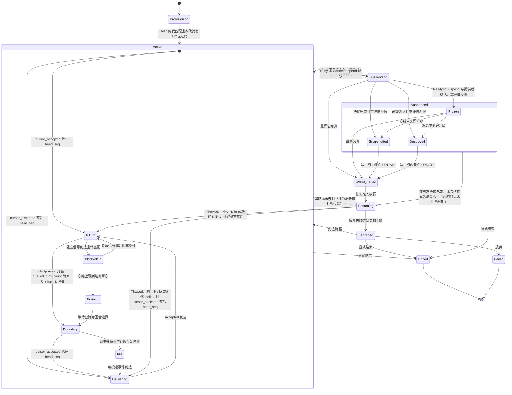
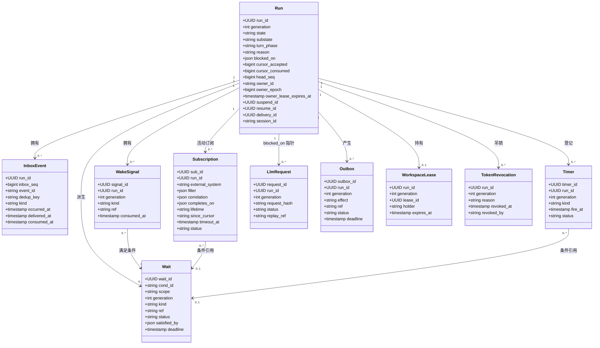
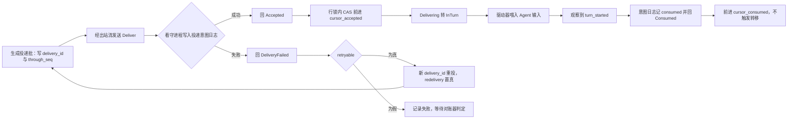
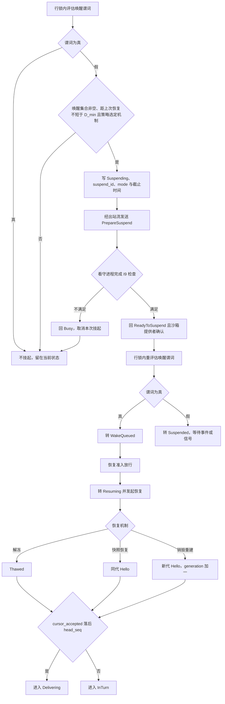

# runcontroller

## 职责

`runcontroller` 是控制面中运行实例状态机的写者。任一时刻由一个副本持有运行实例所有者租约并承担某个运行实例的全部状态转移，全部转移在运行实例行锁内执行。职责穷举如下：

- 运行实例状态机的状态、子状态与转移，以及每次转移的持久化点。
- 收件箱、唤醒信号、等待、定时器、效果记录、工作区租约与运行实例所有者租约的持久化；订阅与在途 LLM 请求的读取与指针保存。
- 唤醒谓词在运行实例行锁内的评估，以及每次事件或唤醒信号写入事务内的条件 UPDATE（I5）。
- 挂起决策的调用点：向 `suspendpolicy` 提供上下文，持久化决策结果，并经 `sandboxprovider` 驱动挂起。
- 投递与两级确认：`Deliver` 批次的生成、`Accepted` 推进 `cursor_accepted`、`Consumed` 推进 `cursor_consumed`（I4）。
- 代递增与围栏：拒绝旧代的协议消息、令牌、工作区写入与游标推进（I7）。
- 事件源模块的摄入契约，作为收件箱事件、唤醒信号与运行实例事实的唯一写入口。
- 纠正性对账器：按持久化状态重驱动超时的过渡态与遗漏的唤醒（I10）。
- 恢复准入的调用点：在 `WakeQueued` 上向 `suspendpolicy` 请求放行，并持久化 `resume_id` 与 `slot_lease`。

### 非职责

非职责穷举如下。

- 事件源产生的在途事实归事件源模块：LLM 在途请求表与回放存储归 `llmgateway`，外部系统定义、连接器事件日志与订阅登记归 `connectorhub`，人类会话、身份与实时接入的通道侧状态归 `humanchannel`。`runcontroller` 只保存指向这些事实的指针与由其派生的等待条件。
- 挂起决策函数与其参数归 `suspendpolicy`：等待时长预测、置信度、抖动预算、冻结中复评与升级梯、恢复准入的限速与优先级。`runcontroller` 只提供调用点、上下文与结果落库。
- 挂起机制的执行归 `sandboxprovider` 与看守进程：冻结、解冻、快照、销毁、预热池认领，以及 I9 安全点在沙箱侧的检查。
- 协议序列化、信封、重放与按 `(generation, msg_seq)` 去重归 `agentprotocol`；`runcontroller` 只实现每条消息的状态机效果。
- 外部系统接入归 `connectorhub`：webhook 接收与签名校验、状态式轮询、回溯匹配、去重与出口策略生成。
- 投递意图日志归看守进程，写在工作区内，不进入数据库事务。
- Agent 进程的监督、活动度采集、本地代理与平台 MCP 服务器归看守进程。

## 外部接口契约

本模块的稳定性承诺按接口类别分别给出：摄入契约对事件源模块稳定，新增事件源不修改本模块；控制面服务接口对平台界面与运维接口稳定；协议面由 `agentprotocol` 的协议版本约束，本模块声明每条消息的状态机效果。

### 摄入契约

事件源模块写入控制面只经摄入契约，写入方法均幂等。

```go
type Ingest interface {
    AppendInbox(ctx context.Context, ev InboxEvent) (InboxSeq, error)
    AppendWakeSignal(ctx context.Context, sig WakeSignal) (SignalRef, error)
    SetRunFact(ctx context.Context, fact RunFact) error
}

type InboxEvent struct {
    RunID       RunID
    EventID     string            // 由来源事实派生，同一事实重写时相同
    DedupKey    string            // (run_id, dedup_key) 唯一
    Kind        EventKind         // message、approval_decision、subscription_completed、internal_notice
    Source      string
    Priority    int
    Correlation map[string]string
    OccurredAt  time.Time
    Payload     []byte
}

type WakeSignal struct {
    RunID      RunID
    Generation int                // 等于运行实例当前代
    Kind       SignalKind         // llm_completed、llm_failed、request_completed、timer_fired、probe
    Ref        string             // request_id、timer_id 或等待条件标识
    OccurredAt time.Time
}

type RunFact struct {
    RunID      RunID
    Generation int
    LiveAttach *LiveAttach        // 实时接入状态
    InFlight   *InFlight          // 事件源报告的在途请求计数
}
```

- `AppendInbox` 在单个事务内分配 `inbox_seq`、推进 `head_seq`、评估唤醒谓词并按评估结果做条件 UPDATE。`(run_id, dedup_key)` 冲突时返回已分配的序号，不产生第二次写入；`event_id` 由来源事实派生，同一事实重写不改变结果。终态运行实例拒绝写入。
- `AppendWakeSignal` 要求 `Generation` 等于运行实例当前代，不匹配的信号被拒绝并计入围栏拒绝计数。`(run_id, generation, kind, ref)` 冲突时返回已有标识，LLM 网关与本地代理对同一请求的完成信号只有一条生效。信号不进入收件箱，在同一事务内参与条件 UPDATE。
- `SetRunFact` 只更新运行实例事实，不直接改变状态机状态；实时接入状态进入挂起决策的上下文，运行实例在实时接入期间处于只冻结不销毁的策略区间。事实写入以 `(run_id, generation, fact kind)` 幂等。
- 摄入契约的调用方为 `llmgateway`、`connectorhub`、`humanchannel` 与本模块的内部通知路径；事件源模块的调用方不读取 `run`、`inbox`、`wake_signal`、`wait`、`timer` 与 `outbox` 表，本模块自身的状态机读写这些表。`subscription` 行由 `connectorhub` 在其登记事务内写入，与对连接器事件日志的回溯匹配同事务（I2），不属于摄入契约。

### 控制面服务接口

```go
type RunService interface {
    Create(ctx context.Context, in CreateRun) (RunID, error)
    End(ctx context.Context, in EndRun) error
    SetLiveAttachment(ctx context.Context, in LiveAttachment) error
    AdmissionState(ctx context.Context, runID RunID) (AdmissionState, error)
}

type CreateRun struct {
    TenantID       string
    ProjectID      ProjectID
    IdempotencyKey string
    AgentKind      string
}

type EndRun struct {
    RunID  RunID
    Reason string
}

type LiveAttachment struct {
    RunID    RunID
    Attached bool
    Channel  string              // ui_session 或 terminal，为举例
}

type AdmissionState struct {
    State      RunState          // wake_queued 或 resuming
    WakeReason string
    QueuedAt   time.Time
    Priority   int
    Mechanism  string            // thaw、snapshot_restore、warm_claim 或 cold_start
}
```

- `Create` 以 `(project_id, idempotency_key)` 幂等；同一事务写 `run` 行（`generation=1`、`cursor_accepted=0`、`cursor_consumed=0`、`head_seq=0`、`state=provisioning`）与 `workspace_lease` 行；提交后经效果记录由 `secrets` 签发含当前代的运行实例令牌并绑定工作区，随后驱动首次预配。
- `End` 只由显式结束触发；同一事务把状态置为 `ended`，把该运行实例的活动订阅置为 `cancelled`、取消定时器、写入令牌吊销记录，并经效果记录异步驱动沙箱销毁。
- `SetLiveAttachment` 更新运行实例事实；进入与退出都幂等，重复设置同一值不改变状态。
- `AdmissionState` 返回运行实例在恢复准入中的状态；排队位置与限速由 `suspendpolicy` 的准入队列维护，本接口转调其结果。

### 对看守进程的协议面

协议消息的定义、信封、重放与协议版本归 `agentprotocol` 模块；本模块实现每条消息的状态机效果，处理的入站与出站消息穷举如下。

| 方向 | 消息 | 本模块的处理 |
|---|---|---|
| 入站 | `Hello` | 校验 `generation`，写 `sandbox_id`、`stream_epoch` 与 `agent_state`；以 `HelloAck` 答复 `owner_epoch`、`cursor_accepted` 与 `desired_state`；`cursor_accepted` 落后 `head_seq` 时进入 `Delivering` |
| 入站 | `AgentEvent` | `turn_started`、`turn_ended`、`state_changed`、`tool_started`、`tool_ended`、`permission_requested`、`subscription_created` 驱动 `InTurn`、`BlockedOn` 与 `Boundary` 之间的转移；`InTurn` 转 `Boundary` 还要求 `idle` 与 `result` 齐备、`result.queued_turn_count` 为 0、`generation` 与 `turn_id` 匹配；`subscription_created` 派生运行实例范围的等待条件 |
| 入站 | `WaitDeclared` | 仅 L2：向派生等待追加显式条件，不改变阻塞条件 |
| 入站 | `Activity` | 写入运行实例事实，供挂起决策与 I9 前置检查使用 |
| 入站 | `Accepted` | 以带 `generation` 的 CAS 前进 `cursor_accepted`，`Delivering` 转 `InTurn` |
| 入站 | `Consumed` | 前进 `cursor_consumed`，不触发状态转移 |
| 入站 | `DeliveryFailed` | `retryable` 为真时以新 `delivery_id` 重投并置 `redelivery`；为假时记录失败 |
| 入站 | `ReadyToSuspend` | 与沙箱提供者的确认一并到达后在行锁内重评估谓词，落地 `Suspended` 或 `WakeQueued`；`session_id` 与恢复句柄在此落库 |
| 入站 | `Busy` | 取消本次挂起；`suspendpolicy` 按 `retry_after` 重新评估或按策略终止 |
| 入站 | `Thawed` | `Resuming` 转 `InTurn` 或 `Delivering`，写 `last_resumed_at` 作为 D_min 的计时起点 |
| 入站 | `LeaseLost` | 进入重建路径：写入内部可投递事件"回合被中断"，并按 `(generation, turn_id)` 去重 |
| 入站 | `llm.request.started`、`llm.first_token`、`llm.request.completed`、`llm.request.failed` | 建立或满足代范围的阻塞条件；完成与失败信号以 `request_id` 为 `ref` |
| 出站 | `HelloAck`、`Deliver`、`PrepareSuspend`、`CancelSuspend`、`Thaw`、`Resumed`、`Shutdown`、`Fenced`、`TokenRotate` | 由状态转移与效果记录触发，经出站流发送 |

旧代消息的处理规则统一：信封 `generation` 低于当前代的入站消息不产生状态转移、不推进游标、不更新事实，并计入围栏拒绝计数；`Hello` 携带旧代时以 `HelloAck.fenced{current_generation}` 应答（I7、[ADR-generation-fencing](../../adr/adr-generation-fencing.md)）。出站消息在重连后由 `agentprotocol` 重放，本模块按 `delivery_id`、`suspend_id` 与 `resume_id` 保证重放幂等。

## 依赖

本模块依赖 `agentprotocol`、`suspendpolicy`、`sandboxprovider`、`workspace` 与 `secrets`，方向与架构的模块依赖图一致，依赖图为有向无环图。

- `agentprotocol`：信封与消息类型、出站流上的服务端实现与按 `(generation, msg_seq)` 的去重规则。
- `suspendpolicy`：以库的形式链接进本模块进程，提供挂起决策、冻结中复评、抖动预算与恢复准入。
- `sandboxprovider`：沙箱预配、挂起、恢复、销毁与能力集合；本模块按 `suspend_id` 与 `resume_id` 调用，对同一运行实例串行。
- `workspace`：工作区绑定与工作区租约的续约、到期与接管。
- `secrets`：运行实例令牌的签发与轮换；令牌换取时读取本模块写入的 `token_revocation` 记录，拒绝已吊销代的令牌。

本模块不依赖事件源模块。`llmgateway`、`connectorhub` 与 `humanchannel` 经摄入契约写入本模块，本模块不反向调用它们，新增事件源不改动本模块的代码。事件源模块的在途事实以指针形式被引用：`llm_request` 行的写入方是 `llmgateway`，本模块只读取；`subscription` 行的插入由 `connectorhub` 在登记事务内完成，本模块读取活动订阅并在结束运行实例时变更其状态。租户维度保留在 `run` 行，不实现跨租户配额与抢占（[ADR-tenant-dimension-without-enforcement](../../adr/adr-tenant-dimension-without-enforcement.md)）。

## UML 图

状态图固定运行实例的生命周期，类图固定持久化实体的关系，活动图分别固定挂起决策与恢复流程、投递确认与游标推进的顺序；图中不表达的约束由每张图后的正文给出。

### 状态图



状态集合为闭合集合：`Provisioning`、`Active`、`Suspending`、`Suspended`、`WakeQueued`、`Resuming`、`Degraded`、`Ended`、`Failed`；`Active` 的子状态为 `InTurn`、`BlockedOn`、`Boundary`、`Delivering`、`Idle`、`Draining`，`Suspended` 的子状态为 `Frozen`、`Snapshotted`、`Destroyed`。`Draining` 是解冻后由 Agent 驱动器把当前等待转为回合边界的中间子状态。`Ended` 只由显式结束触发，与 `Idle` 分离；`Ended` 与 `Failed` 为终态，不再转移。显式结束可从任何非终态到达，图中只画出代表性边。每条进入 `Suspended` 的边都在运行实例行锁内重评估唤醒谓词，谓词为真时改走 `WakeQueued`（I5）。过渡态 `Provisioning`、`Suspending`、`Resuming` 与子状态 `Delivering` 都带截止时间，由对账器幂等重驱动（I10）。进入 `Active` 时按 `cursor_accepted` 与 `head_seq` 的关系选择初始子状态 `InTurn` 或 `Delivering`。`Resuming` 的恢复按机制区分解冻、快照恢复与销毁重建：解冻以 `Thawed` 结束，快照恢复以同代 `Hello` 结束且 `generation` 不递增，销毁重建以新代 `Hello` 结束且 `generation` 递增；解冻、快照恢复与销毁重建的恢复都在 `Thawed` 或 `Hello` 之后按 `cursor_accepted` 是否落后 `head_seq` 进入 `InTurn` 或 `Delivering`。`Active` 在出站流丢失且（沙箱消失或工作区租约过期）时、`Suspended` 的冻结态在沙箱已死时直接进入 `Resuming` 重建；重建写入内部可投递事件"回合被中断"并按 `(generation, turn_id)` 去重，随后递增代。

### 类图



`Run` 是聚合根，`InboxEvent`、`WakeSignal`、`Wait`、`Timer`、`Outbox`、`WorkspaceLease` 与 `TokenRevocation` 以 `run_id` 归属；运行实例所有者租约由 `Run` 行上的 `owner_id`、`owner_epoch` 与 `owner_lease_expires_at` 承载。`Subscription` 行的插入由 `connectorhub` 在登记事务内完成，`LlmRequest` 行的插入由 `llmgateway` 完成；`runcontroller` 以 `sub_id` 与 `request_id` 作为指针读取二者，不复制其状态。`WakeSignal` 以 `generation` 与 `ref` 命中 `Wait` 的条件，`Wait.satisfied_by` 保存满足它的信号标识。收件箱事件不携带代，唤醒信号与代范围的等待条件携带代：代范围的等待在代递增后作废，运行实例范围的等待保留。

### 投递确认与游标推进活动图



`Deliver` 批次的 `through_seq` 在生成批次的事务内取 `head_seq` 的快照，批次之后写入的事件留待下一批。`Accepted` 只前进 `cursor_accepted` 并使运行实例离开 `Delivering`；`Consumed` 只前进 `cursor_consumed`，不触发状态转移。游标的前进都是带 `generation` 的 CAS，且只接受更大的值，因此重复的 `Accepted` 与重放的 `Deliver` 不改变结果（I4、I7）。投递为至少一次：`DeliveryFailed` 可重试时以新的 `delivery_id` 重投并置 `redelivery`，看守进程按工作区内的投递意图日志去重（[ADR-delivery-intent-log](../../adr/adr-delivery-intent-log.md)）；日志记录 `consumed` 之前崩溃的批次会以 `redelivery` 重新投喂。

### 挂起决策与恢复活动图



挂起决策只在行锁内谓词为假、唤醒集合非空、距上次恢复不短于 D_min 且策略选定机制时写入 `Suspending`；`PrepareSuspend` 的 I9 检查由看守进程执行，检查不满足时回 `Busy`，本次挂起取消。`ReadyToSuspend` 与沙箱提供者确认到达后再次在行锁内重评估谓词，为真则直接进入 `WakeQueued`，避免事件已在收件箱而运行实例仍被挂起。恢复准入放行后按沙箱提供者的能力与上次挂起机制选择解冻、快照恢复或销毁重建，解冻、快照恢复与销毁重建都在 `Thawed` 或 `Hello` 之后按 `cursor_accepted` 与 `head_seq` 的关系选择进入 `Delivering` 或 `InTurn`。对账器对超时的 `suspend_id` 与 `resume_id` 重驱动同一条路径（I10）。

## 核心数据结构

控制面存储为 PostgreSQL，全部表以 `run_id` 关联 `run` 行。`llm_request` 由 `llmgateway` 写入，本模块只读取；`subscription` 的插入由 `connectorhub` 完成，本模块读取并在结束运行实例时变更其状态；其余表由本模块写入。所有时间列类型为 `timestamptz`。

### 运行实例行（`run`）

| 字段 | 类型 | 约束与含义 |
|---|---|---|
| `run_id` | uuid | 主键 |
| `tenant_id` | text | 租户维度，保留字段 |
| `project_id` | uuid | 归属项目 |
| `idempotency_key` | text | 与 `project_id` 组成唯一键，创建幂等 |
| `generation` | integer | 单调递增，每次预配沙箱前加一，围栏依据 |
| `state` | text | 闭合集合：`provisioning`、`active`、`suspending`、`suspended`、`wake_queued`、`resuming`、`degraded`、`ended`、`failed` |
| `substate` | text | `active` 与 `suspended` 的子状态，取值见状态图 |
| `turn_phase` | text | `in_turn`、`boundary` 或 `idle` |
| `reason` | text | 最近一次进入回合边界或降级的原因，`InTurn` 转 `Boundary` 与 `Resuming` 转 `Degraded` 时写入 |
| `last_turn_id` | text | 最近一个回合的标识，用于去重 |
| `blocked_on` | jsonb | `{kind, ref, since}`；为空表示未阻塞 |
| `suspend_id` | uuid | 当前挂起尝试的标识 |
| `suspend_mode` | text | `freeze`、`freeze_shrink`、`snapshot` 或 `destroy` |
| `suspend_deadline` | timestamptz | 当前过渡态的截止时间 |
| `freeze_deadline` | timestamptz | 冻结上限，取 F_cap 或宽限期 |
| `grace_deadline` | timestamptz | 回合边界的宽限期截止时间 |
| `resume_id` | uuid | 当前恢复尝试的标识 |
| `slot_lease` | uuid | 恢复准入放行的槽位租约 |
| `delivery_id` | uuid | 最近一次投递批的标识 |
| `through_seq` | bigint | 最近一次投递批的上界 |
| `cursor_accepted` | bigint | `Accepted` 累计前进，CAS 条件含 `generation` |
| `cursor_consumed` | bigint | `Consumed` 累计前进 |
| `head_seq` | bigint | 收件箱最大序号 |
| `wake_reason` | text | 唤醒原因，与恢复准入的优先级对应 |
| `queued_at` | timestamptz | 进入 `WakeQueued` 的时刻，老化依据 |
| `frozen_since` | timestamptz | 冻结时刻，取冻结确认时刻 |
| `session_id` | text | 恢复句柄，销毁执行前落库（I9） |
| `sandbox_id` | text | 当前代沙箱标识 |
| `stream_epoch` | bigint | 出站流连接代，用于识别重连 |
| `agent_state` | jsonb | 最近一次 `Hello` 上报的状态摘要 |
| `flap_counter` | integer | 预测失准的连续计数，供 `suspendpolicy` 使用 |
| `last_resumed_at` | timestamptz | D_min 的计时起点 |

约束：`generation` 不小于 1 且只增不减；`cursor_consumed ≤ cursor_accepted ≤ head_seq`；`state` 与 `substate` 取值落在闭合集合内；`ended` 与 `failed` 为终态，不再接受转移；`(state, substate)` 组合决定允许的转移集合。

### 运行实例所有者租约

运行实例所有者租约由 `run` 行上的字段承载，用于保证每运行实例单写者。

| 字段 | 类型 | 约束与含义 |
|---|---|---|
| `owner_id` | text | 当前写者副本的标识 |
| `owner_epoch` | bigint | 每次接管加一，单调递增 |
| `owner_lease_expires_at` | timestamptz | 租约到期时刻，到期后其他副本可接管 |
| `owner_heartbeat_at` | timestamptz | 当前写者的续约时刻 |

约束：每次状态转移在运行实例行锁内校验 `owner_epoch` 等于本副本持有的值且 `owner_lease_expires_at` 未过期；接管者在第一次写事务中先递增 `owner_epoch` 再执行转移；携带旧 `owner_epoch` 的转移被拒绝。`HelloAck` 把当前 `owner_epoch` 告知看守进程。

### 收件箱（`inbox`）

| 字段 | 类型 | 约束与含义 |
|---|---|---|
| `run_id` | uuid | 复合主键之一，外键指向 `run` |
| `inbox_seq` | bigint | 复合主键之一，由数据库序列在写事务内分配，构成全序 |
| `event_id` | text | 来源事实派生的事件标识 |
| `dedup_key` | text | 与 `run_id` 组成唯一键 |
| `kind` | text | 闭合集合：`message`、`approval_decision`、`subscription_completed`、`internal_notice` |
| `priority` | smallint | 投递排序与恢复准入优先级的输入 |
| `source` | text | 写入方标识：`humanchannel`、`connectorhub` 或本模块的内部通知路径 |
| `subscription_id` | uuid | 可空，订阅完成事件指向 `subscription` |
| `correlation` | jsonb | 关联键值 |
| `occurred_at` | timestamptz | 事件发生时刻，跨来源排序依据 |
| `received_at` | timestamptz | 写入时刻 |
| `delivered_at` | timestamptz | 首次投递时刻 |
| `consumed_at` | timestamptz | `Consumed` 到达时刻 |
| `payload` | jsonb | 投递给 Agent 的内容 |

约束：表为追加写，只有 `delivered_at` 与 `consumed_at` 在投递确认时更新；`(run_id, dedup_key)` 唯一；`inbox_seq` 的分配与 `head_seq` 的推进在同一事务内完成；`internal_notice` 的 `event_id` 由 `(generation, turn_id)` 派生，用于"回合被中断"的去重。

### 唤醒信号（`wake_signal`）

| 字段 | 类型 | 约束与含义 |
|---|---|---|
| `signal_id` | uuid | 主键 |
| `run_id` | uuid | 外键指向 `run` |
| `generation` | integer | 信号所属代，代范围的条件只接受同代信号 |
| `kind` | text | 闭合集合：`llm_completed`、`llm_failed`、`request_completed`、`timer_fired`、`probe` |
| `ref` | text | `request_id`、`timer_id` 或等待条件标识 |
| `source` | text | `llmgateway`、本地代理、`connectorhub` 或定时器调度 |
| `occurred_at` | timestamptz | 信号发生时刻 |
| `consumed_at` | timestamptz | 被谓词评估消费的时刻 |
| `consumed_by` | uuid | 消费它的等待条件 |

约束：`(run_id, generation, kind, ref)` 唯一，同一阻塞条件的重复完成信号只有一条生效；信号不进入收件箱；信号写入与唤醒谓词的条件 UPDATE 在同一事务内完成，已消费的信号不再参与评估。

### 等待（`wait`）

| 字段 | 类型 | 约束与含义 |
|---|---|---|
| `wait_id` | uuid | 与 `cond_id` 组成主键 |
| `cond_id` | text | 条件标识 |
| `run_id` | uuid | 外键指向 `run` |
| `scope` | text | `generation` 或 `run` |
| `generation` | integer | `scope` 为 `generation` 时非空，代递增后作废 |
| `kind` | text | 闭合集合：`blocked_condition`、`subscription`、`timer`、`human_message`、`declared` |
| `ref` | text | `request_id`、`sub_id`、`timer_id` 或 `WaitDeclared` 的条件标识 |
| `status` | text | 闭合集合：`pending`、`satisfied`、`expired`、`cancelled` |
| `satisfied_by` | jsonb | 满足条件的信号标识数组，同事务追加 |
| `deadline` | timestamptz | 条件自身的截止时间，可空 |
| `created_at` | timestamptz | 派生或追加的时刻 |

约束：等待行由控制面从持久化事实派生并写入，沙箱消息不直接写等待行；L2 的 `WaitDeclared` 只追加 `declared` 条件。`status` 的每次变更以 CAS 完成，CAS 条件含 `generation` 与当前 `status`；`satisfied_by` 只追加不覆盖。代范围的等待在 `generation` 小于运行实例当前代时置为 `expired`。

### 订阅（`subscription`）

| 字段 | 类型 | 约束与含义 |
|---|---|---|
| `sub_id` | uuid | 主键 |
| `run_id` | uuid | 外键指向 `run` |
| `external_system` | text | 外部系统定义的名称 |
| `filter` | jsonb | 事件过滤条件 |
| `correlation` | jsonb | 关联键值 |
| `completes_on` | jsonb | 完成条件，可空 |
| `lifetime` | text | `once` 或 `until_cancelled` |
| `since_cursor` | text | 登记时刻的连接器事件日志游标，用于回溯匹配 |
| `timeout_at` | timestamptz | 订阅超时时刻 |
| `dedup_spec` | jsonb | 去重键的派生规格 |
| `status` | text | `active`、`completed`、`cancelled` 或 `expired` |
| `created_generation` | integer | 登记时的运行实例代 |

约束：行的插入由 `connectorhub` 在登记事务内完成，与对连接器事件日志的回溯匹配同事务（I2）；本模块读取活动订阅派生运行实例范围的等待条件；`status` 由 `connectorhub` 在完成与超时时以 CAS 变更，本模块在结束运行实例的同一事务内把它置为 `cancelled`，不调用 `connectorhub`。

### 定时器（`timer`）

| 字段 | 类型 | 约束与含义 |
|---|---|---|
| `timer_id` | uuid | 主键 |
| `run_id` | uuid | 外键指向 `run` |
| `generation` | integer | 代范围定时器在代递增后作废；运行实例范围为空 |
| `kind` | text | `sleep_until` 或 `probe` |
| `fire_at` | timestamptz | 触发时刻，登记时加随机抖动 |
| `status` | text | `pending`、`fired` 或 `cancelled` |
| `fired_at` | timestamptz | 触发时刻 |

约束：定时器触发事务插入 `wake_signal`（`kind` 为 `timer_fired`，`ref` 为 `timer_id`）并执行条件 UPDATE；同一时刻可有多个定时器。冻结且无其他唤醒来源的运行实例必须登记至少一个 `probe` 定时器，否则不得挂起（I8）。

### 在途 LLM 请求指针（`llm_request`）

| 字段 | 类型 | 约束与含义 |
|---|---|---|
| `request_id` | uuid | 主键，由本地代理生成 |
| `run_id` | uuid | 外键指向 `run` |
| `generation` | integer | 请求所属代 |
| `request_hash` | text | 请求内容的哈希，回放缓存键的组成部分 |
| `status` | text | `in_flight`、`completed` 或 `failed` |
| `replay_ref` | text | 单次回放存储的引用 |
| `gateway_instance` | text | 处理该请求的网关实例 |

约束：行由 `llmgateway` 在自身事务内写入与更新；本模块只把 `request_id` 保存在 `blocked_on.ref` 与 `wake_signal.ref` 中作为指针，并读取状态用于对账，不写该表。

### 效果记录（`outbox`）

| 字段 | 类型 | 约束与含义 |
|---|---|---|
| `outbox_id` | uuid | 主键 |
| `run_id` | uuid | 外键指向 `run` |
| `generation` | integer | 产生该效果时的运行实例代 |
| `effect` | text | 闭合集合：`wake_check`、`deliver`、`suspend`、`resume`、`destroy` |
| `ref` | text | 效果标识：`delivery_id`、`suspend_id` 或 `resume_id` |
| `status` | text | `pending`、`done` 或 `abandoned` |
| `attempts` | integer | 执行尝试次数 |
| `deadline` | timestamptz | 执行截止时间 |
| `created_at` | timestamptz | 写入时刻 |

约束：效果记录与产生它的状态转移在同一事务内写入；执行发生在事务提交之后，按 `ref` 幂等；`wake_check` 在提交后重评估唤醒谓词并为真时触发恢复准入；滞留超过 `deadline` 的行由对账器重驱动。

### 工作区租约（`workspace_lease`）

| 字段 | 类型 | 约束与含义 |
|---|---|---|
| `run_id` | uuid | 主键，外键指向 `run` |
| `generation` | integer | 租约所属代 |
| `lease_id` | uuid | 租约标识，`Hello` 携带 |
| `holder` | text | 持有者，为看守进程所在沙箱的标识 |
| `expires_at` | timestamptz | 租约到期时刻 |
| `renewed_at` | timestamptz | 最近一次续约时刻 |

约束：看守进程周期续约，续约失败即冻结或杀死 Agent 进程树并上报 `LeaseLost{}`；新代只在旧租约到期或沙箱确认删除后接管工作区（[ADR-generation-fencing](../../adr/adr-generation-fencing.md)）。租约的续约与接管经 `workspace` 模块的接口完成，行由本模块持有。

### 令牌吊销记录（`token_revocation`）

| 字段 | 类型 | 约束与含义 |
|---|---|---|
| `run_id` | uuid | 复合主键之一，外键指向 `run` |
| `generation` | integer | 复合主键之一，被吊销的令牌所属代 |
| `reason` | text | `rebuild` 或 `end`，吊销来源 |
| `revoked_at` | timestamptz | 吊销事务的提交时刻 |
| `revoked_by` | text | 执行吊销的 `runcontroller` 副本标识 |

约束：`(run_id, generation)` 唯一，已存在的记录按幂等忽略；行由本模块在代递增或显式结束的同一事务内写入，与 `run` 行的 `generation` 变更同事务提交（I7）。`secrets`、LLM 网关与连接器只读该表，令牌换取时按 `(run_id, generation)` 命中即拒绝。

## 核心算法与流程

### 唤醒谓词的评估

唤醒谓词在运行实例行锁内评估，并在每次事件或信号写入的事务内、每次进入 `Suspended` 时重评估（I3、I5、[ADR-wait-on-durable-inbox](../../adr/adr-wait-on-durable-inbox.md)）。评估输入为该行的状态与截止时间、该运行实例未满足的等待条件，以及未消费的唤醒信号。

```text
evaluate(run, waits, signals, now):
    for cond in waits where cond.status == pending:
        if cond.scope == generation:
            if cond.generation != run.generation: continue
            if 存在 sig in signals 满足 sig.generation == run.generation
               且 sig.ref == cond.ref
               且 sig.kind in accepted_kinds(cond, run):
                return true
        if cond.scope == run and cond.kind == timer:
            if 存在 sig in signals 满足 sig.generation == run.generation
               且 sig.kind == timer_fired 且 sig.ref == cond.ref:
                return true
        if cond.scope == run and cond.kind == declared:
            if 存在 sig in signals 满足 sig.generation == run.generation
               且 sig.ref == cond.ref:
                return true
    if run.turn_phase in {boundary, idle} and run.cursor_accepted < run.head_seq:
        return true
    if run.freeze_deadline is set and now >= run.freeze_deadline - safety_margin:
        return true
    return false
```

信号匹配以 `cond.ref` 为准。`accepted_kinds(cond, run)` 给出条件可接受的信号类型：`blocked_condition` 按 `run.blocked_on.kind` 限定，`llm` 接受 `llm_completed` 与 `llm_failed`，`request` 接受 `request_completed`，`timer` 接受 `timer_fired`；`timer` 条件接受 `timer_fired`；`declared` 条件接受任一信号；未列入的阻塞来源没有对应的唤醒信号。`subscription` 与 `human_message` 条件由收件箱事件满足，不参与信号匹配。

条件 UPDATE 与业务判断在同一事务内完成，其间不插入并发写：

```sql
BEGIN;
SELECT state, generation, cursor_accepted, head_seq, freeze_deadline
  FROM run WHERE run_id = $1 FOR UPDATE;
-- 应用内 evaluate(...)
UPDATE run
   SET state = 'wake_queued', wake_reason = $2, queued_at = now()
 WHERE run_id = $1 AND generation = $3 AND state = 'suspended';
INSERT INTO outbox (outbox_id, run_id, generation, effect, ref, deadline)
VALUES ($4, $1, $3, 'wake_check', $4, now() + $5);
COMMIT;
```

谓词的各子句也可以 `EXISTS` 子查询并入条件 UPDATE 的 `WHERE`，与行锁内的应用内评估语义相同。复杂度：单次评估的代价由该运行实例待满足的条件数量决定，`wait` 上的 `(run_id, status)` 索引与 `wake_signal` 上的 `(run_id, generation, kind, ref)` 索引把查找降为索引查找；回合边界上派生运行实例范围的等待需要对活动订阅做一次遍历，复杂度为 O(A log N)，A 为活动订阅数、N 为订阅总数。收件箱的写入与 `head_seq` 推进为 O(1)，索引维护为 O(log N)。

### 挂起决策的调用点

挂起决策在进入等待类子状态的同一事务内调用，或在该子状态上的截止时间到期时由效果记录与对账器触发。调用点为 `InTurn` 转 `BlockedOn`、`InTurn` 转 `Boundary`、`Boundary` 转 `Idle`，以及宽限期、冻结上限与策略复评截止时间到期。

```text
maybe_suspend(run, ctx):
    行锁内:
      if evaluate(...) == true: return NONE                    # I3
      if 等待条件集合为空 and run.freeze_deadline is null: return NONE   # I8
      if now - run.last_resumed_at < D_min: return NONE
      mode = suspendpolicy.decide(run, ctx)
      if mode == NONE: return NONE
      if mode == DESTROY and ctx.i9_satisfied == false: return NONE
      写 state = suspending, suspend_id, mode, suspend_deadline
      写 outbox(effect = suspend, ref = suspend_id)
```

决策函数、预测与升级梯属于 `suspendpolicy`；本模块只保证调用发生在行锁内、谓词为假、唤醒集合非空，并把决策结果与截止时间落库。`DESTROY` 的 I9 前置检查由看守进程在 `PrepareSuspend` 中执行，控制面在决策时使用最近一次上报的事实作为预检；看守进程回 `Busy` 时本次挂起取消。

### 进入 Suspended 的重评估

`ReadyToSuspend` 与沙箱提供者的确认都到达后，本模块在行锁内重评估谓词；谓词为假才进入 `Suspended`，为真则直接进入 `WakeQueued`（I5）。

```text
on_suspended(run, ready, provider_ack):
    BEGIN;
    SELECT ... FROM run WHERE run_id = $1 FOR UPDATE;
    require run.state == suspending and run.suspend_id == ready.suspend_id
    require provider_ack 确认同一 suspend_id
    写 run.session_id 与恢复句柄
    if evaluate(...) == true:
        写 state = wake_queued, wake_reason = $2, queued_at = now()
        写 outbox(effect = wake_check)
    else:
        写 state = suspended, substate = ready.mode 对应的子状态
        子状态为 Frozen 时写 frozen_since：
            Freeze{cgroup} 取节点冻结代理的确认时刻，Freeze{signal} 取 ready.frozen_at
    COMMIT;
```

`frozen_since` 在 `Freeze{cgroup}` 路径取节点冻结代理的确认时刻，在 `Freeze{signal}` 路径取 `ReadyToSuspend` 携带的 `frozen_at`；`freeze_deadline` 由 `suspendpolicy` 按机制上限给出。`session_id` 与恢复句柄在调用沙箱提供者销毁之前落库（I9）。

### 投递与两级确认

投递在 `Boundary` 或 `Idle` 上触发，条件是 `cursor_accepted` 小于 `head_seq`。生成批次的事务把状态置为 `Delivering`，写入 `delivery_id` 与 `through_seq`，并写入 `deliver` 效果记录；批次内容为 `(cursor_accepted, through_seq]` 区间内的收件箱事件。

```text
on_accepted(run, accepted):
    行锁内:
      require accepted.generation == run.generation
      if accepted.through_seq <= run.cursor_accepted: return      # 重放幂等
      UPDATE inbox SET delivered_at = now()
       WHERE run_id = $1 AND inbox_seq > run.cursor_accepted AND inbox_seq <= accepted.through_seq
      UPDATE run SET cursor_accepted = accepted.through_seq,
                     state = 'active', substate = 'in_turn'
       WHERE run_id = $1 AND generation = accepted.generation
         AND cursor_accepted < accepted.through_seq
      return

on_consumed(run, consumed):
    行锁内:
      require consumed.generation == run.generation
      old = run.cursor_consumed
      require consumed.through_seq > old
      UPDATE run SET cursor_consumed = consumed.through_seq
       WHERE run_id = $1 AND generation = consumed.generation
         AND cursor_consumed < consumed.through_seq
      UPDATE inbox SET consumed_at = now()
       WHERE run_id = $1 AND inbox_seq > old AND inbox_seq <= consumed.through_seq
```

`Accepted` 与 `Consumed` 的前进都只接受更大的 `through_seq`，由 `generation` 参与 CAS 条件，因此旧代确认与重复确认不推进游标（I4、I7）。批次选择与确认的复杂度为 O(b log N)，b 为批次大小、N 为收件箱行数；`(run_id, inbox_seq)` 主键使区间扫描按索引顺序进行。`DeliveryFailed` 可重试时生成新的 `delivery_id` 并置 `redelivery`，不可重试时只记录失败，由对账器在过渡态截止时间后判定。

### 代递增与围栏

重建路径在单个事务内递增代、写入旧令牌吊销记录并建立新的恢复尝试，之后才预配新沙箱（I7）。

```text
begin_rebuild(run, reason):
    BEGIN;
    SELECT ... FROM run WHERE run_id = $1 FOR UPDATE;
    require 旧工作区租约已到期 or 沙箱确认删除
    old = run.generation
    UPDATE run SET generation = old + 1, state = 'resuming',
                   resume_id = $2, sandbox_id = null, substate = null
    写 token_revocation(run_id, generation = old)
    写 outbox(effect = resume, ref = resume_id)
    COMMIT;
```

围栏规则在入站协议消息、令牌、工作区写入与游标 CAS 上生效，该入口集合为穷举：入站协议消息的 `generation` 与 `run.generation` 不等时不产生转移；游标 CAS 的 `WHERE` 含 `generation`；工作区写入由工作区租约的 `generation` 约束，新代只在旧租约到期或沙箱确认删除后接管；令牌由 `secrets`、LLM 网关与连接器校验其中的 `generation`，并与 `token_revocation` 记录比对。旧代看守进程重连时收到 `HelloAck.fenced{current_generation}`，随后停止投递与副作用并对 Agent 进程树执行强制终止。令牌吊销记录与代递增同事务提交，之后才允许预配新沙箱。

### 纠正性对账器

对账器以持久化状态为准，不以事件历史为准（I10）。它周期运行，按下表的守卫规则幂等重驱动；守卫规则穷举如下。每次纠正计数，纠正不了的状态才进入告警。

| 守卫 | 触发条件 | 动作 |
|---|---|---|
| 过渡态截止 | `state` 为 `provisioning`、`suspending`、`resuming`，或 `state` 为 `active` 且 `substate` 为 `delivering`，且超过对应截止时间 | 以同一 `suspend_id`、`resume_id` 或 `delivery_id` 重驱动相应转移 |
| 投递滞后 | `state` 为 `active` 且 `turn_phase` 为 `boundary` 或 `idle`，`cursor_accepted` 落后 `head_seq` 超过阈值 | 生成新的投递批 |
| 悬挂唤醒 | `state` 为 `suspended` 且谓词为真超过阈值 | 条件 UPDATE 转 `WakeQueued` |
| 代范围等待过期 | `wait.scope` 为 `generation` 且 `wait.generation` 小于运行实例当前代 | 置为 `expired`；运行实例范围的等待保留 |
| 沙箱丢失 | `state` 为 `active`，出站流丢失且（沙箱提供者报告沙箱不存在或工作区租约过期）；或 `state` 为 `suspended`、子状态为 `Frozen`，且沙箱提供者报告沙箱不存在 | 写入内部可投递事件"回合被中断"并按 `(generation, turn_id)` 去重，进入重建路径并递增代 |
| 效果记录滞留 | `outbox` 行为 `pending` 且超过 `deadline` | 按 `ref` 幂等重执行 |

对账器的单轮代价由扫描的运行实例数与效果记录数决定；对 `state` 与 `outbox.status` 建部分索引把扫描限制在过渡态与滞留行上。

### 恢复准入的调用点

`WakeQueued` 上的运行实例由恢复准入放行后才进入 `Resuming`。准入判定经 `suspendpolicy` 的队列完成，本模块在放行回调的事务内写 `resume_id` 与 `slot_lease`。

```text
admit(run):
    行锁内:
      if run.state != wake_queued: return
      grant = suspendpolicy.admit(run.wake_reason, mechanism(run))
      if grant == denied: return            # 留在 WakeQueued，队列按老化提升优先级
      写 state = resuming, resume_id, slot_lease = grant.slot
      写 outbox(effect = resume, ref = resume_id)
```

机制由 `suspendpolicy` 在沙箱提供者的能力集合内选择，准入按机制独立限速并按唤醒原因排定优先级；同级 FIFO，排队时长超过老化阈值的请求提升优先级。队列数据的复杂度由 `suspendpolicy` 定义，本模块只消费放行结果。未获放行的运行实例保持 `WakeQueued`，其 `queued_at` 参与老化计算。

## 错误与失败语义

失败的处理不引入新的持久化状态，全部由状态对账、幂等重驱动、至少一次投递与代围栏组合表达。下表为举例。

| 失败 | 语义与处置 |
|---|---|
| 过渡态超时 | 过渡态都带截止时间；对账器以同一标识重驱动，看守进程与沙箱提供者对同一 `suspend_id`、`resume_id` 或 `delivery_id` 返回与首次相同的结果（I10） |
| 重复投递 | 投递为至少一次；`(run_id, dedup_key)` 唯一约束吸收重复事件，看守进程按投递意图日志去重，不确定时以 `redelivery` 重喂；`Accepted` 与 `Consumed` 只接受更大的游标值（I4） |
| 代过期 | 旧代消息、令牌、工作区写入与游标推进被拒绝并计入围栏拒绝计数；旧代看守进程收到 `Fenced` 或 `HelloAck.fenced` 后停止副作用（I7） |
| 对账器纠正失败 | 每次纠正计数并重试；守卫规则长期不收敛时按可观测性的告警条件上报，运行实例停留在当前状态，不伪造转移 |
| 副本崩溃接管 | 运行实例所有者租约到期后另一副本接管并递增 `owner_epoch`；接管者先按对账器规则重驱动过渡态，看守进程重连后以 `Hello` 与 `HelloAck` 对账 |
| 看守进程回 `Busy` | 本次挂起取消；`suspendpolicy` 按 `retry_after` 重新评估，或按策略超时终止 Agent 进程树 |
| 沙箱在回合中丢失 | 进入重建路径，写入内部可投递事件"回合被中断"并按 `(generation, turn_id)` 去重，随后递增代（I10） |
| 不可重试的投递失败 | 不重投，记录失败与原因；运行实例停留在 `Delivering`，过渡态截止时间到期后对账器重驱动同一批次，持续失败进入运维告警，不伪造转移 |
| 恢复失败 | `Resuming` 失败达到次数上限后进入 `Degraded`；兜底路径以新会话加合成摘要回到 `Active`，或放弃进入 `Failed` |

## 并发与事务边界

每运行实例单写者由运行实例所有者租约与 `owner_epoch` 保证：全部状态转移在 `run` 行锁内执行，携带旧 `owner_epoch` 的转移被拒绝。事件源模块并发写入同一运行实例的收件箱时，`inbox_seq` 由数据库在写事务内分配，写入者之间不协调顺序；多个事件源同时触发的唤醒谓词重评估由运行实例行锁串行化。

必须在同一数据库事务内完成的写事务穷举如下。

| 写事务 | 行锁内完成的内容 | 条件与幂等键 | 不变量 |
|---|---|---|---|
| 收件箱写入 | 插入 `inbox` 行、推进 `head_seq`、评估谓词并条件 UPDATE | `(run_id, dedup_key)` 唯一；序号由序列分配 | I5 |
| 唤醒信号写入 | 插入 `wake_signal`、消费命中的等待条件、评估谓词并条件 UPDATE | `(run_id, generation, kind, ref)` 唯一 | I5 |
| 挂起决策 | 评估谓词与唤醒集合、调用 `suspendpolicy`、写 `suspending` 与效果记录 | 同一 `suspend_id` | I3、I8 |
| 进入 `Suspended` | 校验 `suspend_id` 与提供者确认、重评估谓词、写子状态与恢复句柄 | 同一 `suspend_id` | I5、I9 |
| 游标前进 | `Accepted` 与 `Consumed` 的 CAS、收件箱时间戳更新 | CAS 条件含 `generation`，只接受更大的序号 | I4、I7 |
| 等待状态变更 | `wait.status` 的 CAS 与 `satisfied_by` 追加 | CAS 条件含 `generation` 与当前状态 | I5 |
| 代递增与吊销 | `generation` 加一、写令牌吊销记录、写 `resume_id` 与效果记录 | 旧租约到期或沙箱确认删除 | I7 |
| 状态转移与持久化点 | 每次转移与其持久化字段同事务写入 | 转移的 `suspend_id`、`resume_id` 或 `delivery_id` | I10 |
| 效果记录 | `outbox` 行与产生它的转移同事务写入 | 按 `ref` 幂等执行 | I10 |

锁顺序固定为先 `run` 行、后该运行实例的子表行，避免同一运行实例上的死锁；子表的插入依赖唯一索引，不额外加锁。事务内不进行跨模块调用：`sandboxprovider`、`secrets` 与 `workspace` 的调用由效果记录在提交后执行，`suspendpolicy` 以库的形式在进程内调用。工作区不在任何数据库事务内，投递意图日志由看守进程写在工作区并 fsync，其去重语义与数据库游标相互独立。

### 竞态用例

竞态用例为举例，逐条的处置由运行实例行锁、带 `generation` 的 CAS 与幂等标识给出。

| 竞态 | 交错与处置 | 依赖的不变量 |
|---|---|---|
| 唤醒信号写入与挂起决策并发 | 唤醒信号写入与挂起决策都在 `run` 行锁内评估唤醒谓词。信号事务先行时，挂起决策读到谓词为真，不写入 `Suspending`；挂起决策先行时，信号事务的条件 UPDATE 把 `Suspended` 转 `WakeQueued`。 | I3、I5 |
| `ReadyToSuspend` 与唤醒信号并发 | 到达顺序不定，`ReadyToSuspend` 的处理在行锁内重评估谓词。信号先提交则直接进入 `WakeQueued`；`ReadyToSuspend` 先提交则进入 `Suspended`，随后由信号事务的条件 UPDATE 转 `WakeQueued`。 | I5 |
| `Accepted` 与代递增并发 | `Accepted` 的 CAS 条件含 `generation`。代递增先行时旧代 `Accepted` 被拒绝且 `cursor_accepted` 不前进；`Accepted` 先行时只推进旧代游标，新代看守进程按投递意图日志重投。 | I4、I7 |
| `LeaseLost` 与投递确认并发 | `LeaseLost` 与投递确认按 `delivery_id` 与 `generation` 幂等。重建事务递增代后，旧代的 `Accepted`、`Consumed` 与 `LeaseLost` 一律被围栏拒绝，新代按工作区中的投递意图日志判定重投。 | I4、I7、I10 |
| 对账器重驱动与在线转移并发 | 重驱动以同一 `suspend_id`、`resume_id` 或 `delivery_id` 幂等执行。在线转移先提交时，重驱动观察到状态已越过截止点，不再产生第二次转移。 | I10 |

## 扩展点

### 新增事件源接入摄入契约

新增事件源须在写入前派生稳定的 `event_id` 与内容派生的 `dedup_key`；`kind` 落在收件箱事件闭集内，或同时扩展 `agentprotocol` 的投递目标与看守进程的 Agent 驱动器；唤醒信号携带运行实例当前代；运行实例事实以 `(run_id, generation, fact kind)` 幂等。满足这些条件时本模块代码不变。事件源不得读取 `run`、`inbox`、`wake_signal`、`wait`、`timer` 与 `outbox` 表，也不得假定写入顺序；订阅登记的写入限于 `subscription` 行，并与连接器事件日志的回溯匹配同事务。

### 新增等待条件类型

新增等待条件类型须在 `wait.kind` 闭集增加取值，在唤醒谓词中给出满足判定，为对账器给出可观察的满足来源与截止时间。条件由外部系统产生时，由对应事件源模块经摄入契约写入完成事件或唤醒信号；条件由 Agent 声明时经 `WaitDeclared` 追加。投递路径、游标与确认语义不变。

## 实现状态

| 能力 | 状态 | 代码 |
|---|---|---|
| 状态机 | 未实现 | — |
| 收件箱与投递 | 未实现 | — |
| 唤醒谓词与挂起决策调用点 | 未实现 | — |
| 代与围栏 | 未实现 | — |
| 纠正性对账器 | 未实现 | — |
| 恢复准入调用点 | 未实现 | — |
