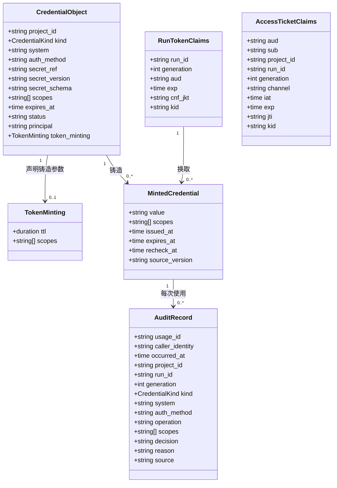
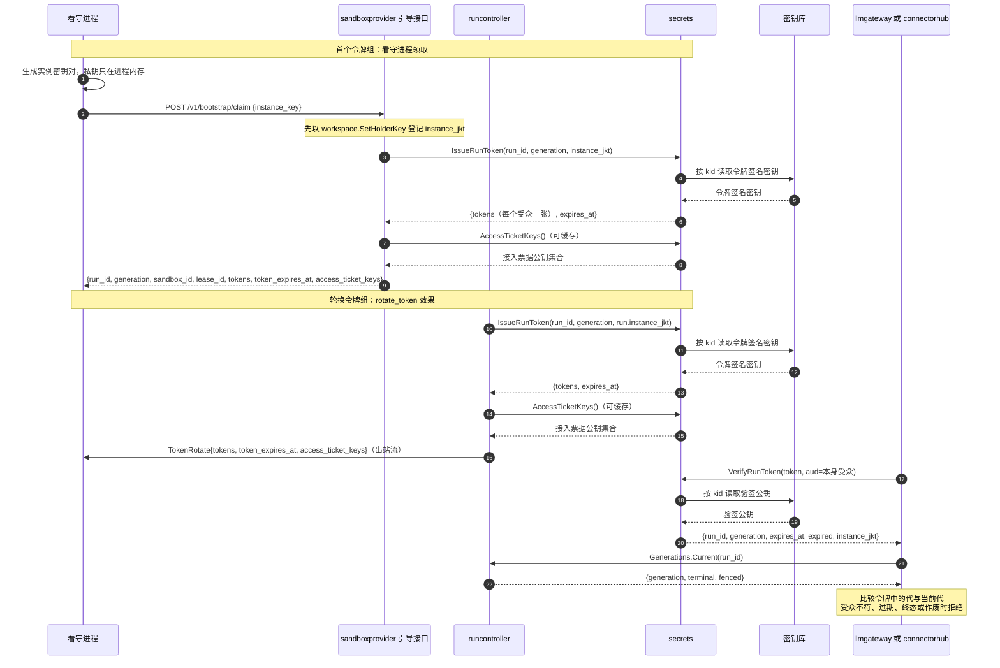
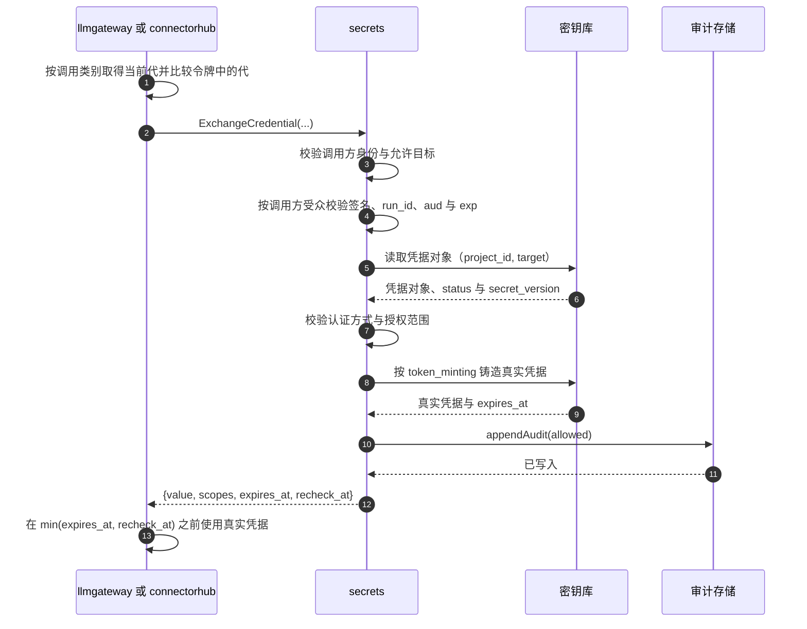
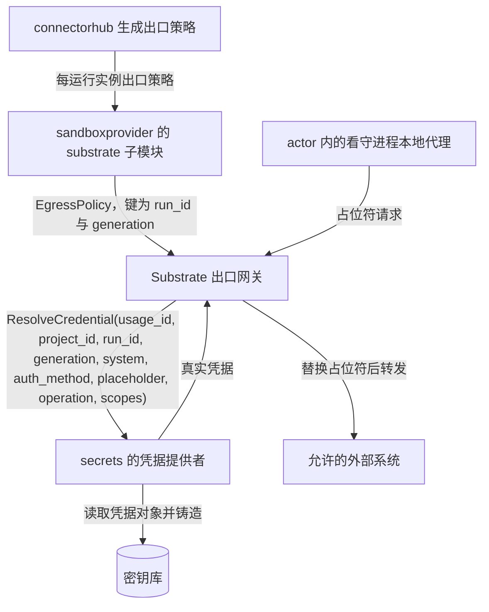

# secrets

`secrets` 坐在控制面基础层，是密钥库的唯一对接者。长期凭据只存在于密钥库，[沙箱](../../glossary.md)内的 Agent 进程只接触占位符，[运行实例令牌](../../glossary.md)只由[看守进程](../../glossary.md)持有：`secrets` 向[运行实例](../../glossary.md)签发按受众划分的令牌组，[LLM 网关](../../glossary.md)与 k8s 路径的平台出口代理凭本身受众的令牌与调用方身份换取真实凭据，[连接器](../../glossary.md)的状态核对只凭调用方身份换取，Substrate 路径的出口网关经凭据提供者按 `(run_id, generation)` 策略键与网关身份取得真实凭据。本模块拥有凭据对象与签名密钥的读取、运行实例令牌的签发与校验、[接入票据](../../glossary.md)的签发、凭据换取、调用方授权与使用审计；不拥有 LLM 请求转发、[出口策略](../../glossary.md)、运行实例状态、[代](../../glossary.md)与用户授权。心智模型：沙箱里看不到真实凭据，只看到占位符；托管侧换取真实凭据，每次换取都记一笔账，真实凭据不落进沙箱（[ADR-host-owns-external-wake-sources](../../adr/adr-host-owns-external-wake-sources.md)）。

文档较长，不宜顺序通读。第一次阅读按以下顺序：核心概念、职责、走查、运行实例令牌的签发、校验与轮换、接入票据的签发与公钥轮换、凭据换取、出口代理的凭据来源、缓存与失效、凭据提供者对接；术语表、外部接口契约、核心数据结构、错误与失败语义与并发与事务边界作为核对接口、字段与失败处置时的参考。走查给出一次请求从令牌校验到审计落库的逐步状态变化；并发与事务边界末尾的轮换、缓存与审计交错留作最后自测。

## 核心概念

运行实例令牌代表看守进程向控制面证明这次调用来自哪个运行实例的哪一代。沙箱内不存放真实凭据，Agent 的 LLM 与外部系统流量都由看守进程代理，令牌就是这个代理关系的依据：`runcontroller` 以它认证出站流，LLM 网关以它换取 LLM 凭据，平台出口代理以它逐请求校验代并换取外部系统凭据，`connectorhub` 与 `humanchannel` 以它认证看守进程的请求。签名确认令牌由本模块签发而非沙箱伪造，`generation` 供调用方与运行实例当前代比较。运行实例令牌按受众签发为令牌组，受众把一张令牌的可用范围限制在一个接收方：接收方只接受本身受众的令牌，一个接收方经手的令牌不能拿到另一个接收方使用。`exp` 限制单张令牌的有效期。令牌的 `cnf.jkt` 绑定看守进程的[实例密钥](../../glossary.md)，`runcontroller` 的 `Hello` 只接受到期时刻不低于接受下界的令牌，并要求[持有证明](../../glossary.md)；泄露的令牌因而不能用来接管出站流或换取新令牌（[ADR-run-token-audience-and-holder-binding](../../adr/adr-run-token-audience-and-holder-binding.md)）。换取还校验调用方身份，调用方只能取得其身份允许的凭据类别、系统与认证方式。

## 职责

`secrets` 是控制面中密钥材料与凭据换取的唯一入口。职责穷举如下，每条先写本模块执行的动作，再写产生的结果或边界；具体接口、字段与失败处置见后续章节。

- **对接密钥库**：读取凭据对象与令牌签名密钥，按项目、外部系统与认证方式解析；凭据材料只出现在密钥库与控制面调用方的进程内存中，不复制到[工作区](../../glossary.md)、沙箱或本模块的持久化存储。
- **维护项目作用域**：每次换取按调用方提供的 `project_id` 定位凭据对象；凭据对象只在其所属项目下可见，换取只解析 `project_id` 所指项目下的凭据对象，跨项目读取一律拒绝。
- **签发运行实例令牌**：以 `run_id`、`generation`、`exp` 与实例公钥指纹 `cnf.jkt` 为受众闭集中的每个受众各构造一张 JWT，按令牌签名密钥签名，返回同 `exp`、同 `cnf.jkt` 的令牌组与到期时刻；首个令牌组由 `sandboxprovider` 的[引导接口](../../glossary.md)在看守进程领取时调用签发，`cnf.jkt` 取领取请求中实例公钥的指纹，令牌组随领取响应交给看守进程。令牌不持久化，由签名自证。
- **校验运行实例令牌**：验证签名、`run_id`、受众与 `exp`，令牌受众不等于期望受众时判为无效；按调用方身份限定其可校验的受众；返回令牌载荷、实例公钥指纹与过期标记；不查询运行实例当前代，代比较与持有证明核对归调用方。
- **轮换运行实例令牌**：在到期前以运行实例记录的实例公钥指纹签发后继令牌组，交 `runcontroller` 经 `TokenRotate` 发往看守进程；`cnf.jkt` 不变，旧令牌在 `exp` 之前继续有效，后继令牌组投递成功时新旧令牌存在有效期重叠。
- **签发接入票据**：应 `humanchannel` 的申请，以与令牌签名密钥分开的接入票据签名密钥签发绑定平台用户、项目、运行实例、代与接入通道的短期一次性 JWT；向 `sandboxprovider` 与 `runcontroller` 提供接入票据公钥集合，由它们下发给看守进程；票据不持久化。
- **提供[凭据主体](../../glossary.md)**：按项目向 `humanchannel` 返回凭据对象在外部系统中的凭据主体，不返回凭据值、凭据路径与版本，供其拒绝凭据主体发出的消息与审批决定。
- **换取真实凭据**：校验运行实例令牌与调用方身份（不携带令牌的状态核对只校验调用方身份），按调用方给出的目标读取凭据对象，按凭据对象的 `token_minting` 铸造真实凭据，返回控制面调用方；不返回沙箱，不写入工作区。
- **校验调用方授权**：按调用方的 SPIFFE 身份逐方法限定可调用的方法，按身份与部署白名单限制可换取的 `(Kind, System, AuthMethod)` 集合，三者均必填；方法或目标不在允许集合时拒绝并写拒绝审计，不读取凭据对象，不暴露其存在性。
- **提供出口代理的凭据来源**：k8s 路径由平台出口代理调用换取接口；Substrate 路径由出口网关经凭据提供者协议取得占位符对应的真实凭据（[REF-substrate](../../references.md)）。
- **记录审计**：每次换取、占位符解析与拒绝写只追加审计记录，关联调用方身份、`run_id`、`generation`、外部系统与操作；审计写入先于凭据返回。
- **缓存真实凭据**：在凭据到期时刻与安全余量之内、且距上次核对凭据对象不超过 `T_cred_recheck` 时复用，按凭据对象状态、版本与到期时刻失效，使撤销在 `T_cred_recheck` 内生效；运行实例令牌与代不进入该缓存。

### 非职责

非职责举例如下，判定标准为职责清单之外、由其他模块拥有的事实与机制。

- 不做 LLM 代理：LLM 请求转发、流式缓冲、回放与在途跟踪归 `llmgateway`；本模块只返回 LLM 凭据。
- 不落地出口策略：允许主机、占位符规则、EgressPolicy 与 NetworkPolicy 归 `connectorhub` 与 `sandboxprovider`；本模块只按占位符返回对应凭据。
- 不持有运行实例状态：状态机、当前代、终态与本代作废判定归 `runcontroller`；本模块不读写 `run` 表，不判断令牌中的代是否为当前代。
- 不管理凭据对象的授权：凭据对象的创建、授权与撤销由密钥库的管理流程执行；本模块只读取。
- 不校验用户身份与项目归属：`humanchannel` 完成用户身份认证与[项目角色](../../glossary.md)授权，接入票据的载荷由它在授权之后提供，本模块不判定用户能否接入；`project_id` 由受信控制面调用方提供。
- 不校验接入票据：票据由看守进程在 `/terminal` 与 `/files` 上校验，本模块只签发票据并提供公钥集合。
- 不交付首个令牌：引导接口、看守进程的认证与领取的一次性归 `sandboxprovider`；本模块只在引导接口调用时签发令牌组，不与看守进程直接通信。
- 不持有沙箱与工作区：沙箱生命周期归 `sandboxprovider`，工作区归 `workspace`。

## 术语表

| 术语 | 英文对照 | 适用范围 | 定义 |
| --- | --- | --- | --- |
| 凭据对象 | credential object | secrets | 密钥库中按项目、凭据类别、外部系统与认证方式存放的长期凭据及其元数据，含 `secret_schema` 与 `token_minting` |
| 项目作用域 | project scope | secrets | 凭据对象按 `project_id` 隔离的可见范围；换取只解析调用方所指项目下的凭据对象 |
| 凭据换取 | credential exchange | secrets | 以调用方身份换取真实凭据的处理，请求携带运行实例令牌时一并校验令牌；含身份与授权校验、令牌校验、授权范围校验、铸造与审计 |
| 调用方身份 | caller identity | secrets | 控制面调用方在 mTLS 客户端证书中携带的 SPIFFE 工作负载身份；secrets 按它逐方法校验部署白名单，并限制可校验的令牌受众与可换取的凭据类别、系统与认证方式 |
| 授权范围 | authorization scope | secrets | 凭据对象允许请求使用的 `scopes` 集合；`token_minting.scopes` 非空时取它，否则取凭据对象的 `scopes` |
| 本次实际范围 | effective scope | secrets | 本次换取实际使用的 `scopes` 集合；`Target.Scopes` 非空时取它，否则取授权范围 |
| 凭据提供者 | credential provider | secrets 与 Substrate 出口路径 | Substrate 出口网关按请求调用、返回真实凭据的协议接口，由 `secrets` 实现 |
| 令牌签名密钥 | token signing key | secrets | 签发运行实例令牌所用的密钥，按 JWT 头部的 `kid` 选择 |
| 接入票据签名密钥 | access ticket signing key | secrets | 签发接入票据所用的密钥，与令牌签名密钥分开，`kid` 与之不重叠；公钥集合下发给看守进程用于校验票据 |
| 审计记录 | audit record | secrets | 每次凭据使用或拒绝的只追加记录，关联调用方身份、运行实例、代、外部系统与操作 |

## 外部接口契约

稳定性承诺按接口类别给出：令牌接口、接入票据接口、凭据主体查询接口、凭据换取接口与拒绝上报接口对控制面调用方稳定；凭据提供者接口对 Substrate 出口网关稳定；密钥库后端、凭据路径与缓存布局是实现细节，不是契约。

### 调用方授权

本模块的全部方法以 mTLS 暴露，只在内部监听器上提供，不对沙箱网段开放；调用方身份即客户端证书中的 SPIFFE 工作负载身份（[REF-spiffe](../../references.md)），形如 `spiffe://<spiffe_trust_domain>/castworks/<名称>`，下文以名称指代。每个方法允许的调用方取[认证与授权边界](../architecture.md#认证与授权边界)按方法授权表中的 `secrets` 行，穷举如下：

| 方法 | 允许的调用方 |
| --- | --- |
| `IssueRunToken` | `sandboxprovider`、`runcontroller` |
| `VerifyRunToken` | `runcontroller`、`llmgateway`、`connectorhub`、`egress-proxy`、`humanchannel`（各自只校验本身受众） |
| `ExchangeCredential` | `llmgateway`（`Kind=llm`）、`connectorhub`、`egress-proxy`（`Kind=external_system`） |
| `IssueAccessTicket` | `humanchannel` |
| `AccessTicketKeys` | `sandboxprovider`、`runcontroller` |
| `ListCredentialPrincipals` | `humanchannel` |
| `ReportDenial` | `llmgateway`、`connectorhub`、`egress-proxy`、`humanchannel` |
| 凭据提供者 `ResolveCredential` | Substrate 出口网关（Substrate 信任域中的身份，按部署白名单登记） |

- 身份缺失由 mTLS 在握手阶段拒绝，不进应用层。对端身份不在该方法的允许集合时，以不可重试的未授权错误拒绝，写 `denied` 审计（`operation` 取被拒绝的方法名，`usage_id` 取本模块为该次调用生成的请求标识，`run_id` 与 `generation` 取请求中可解析的值），不执行方法、不暴露凭据对象是否存在。
- `VerifyRunToken` 只允许调用方校验与其身份对应的受众：`runcontroller` 取 `runcontroller`，`llmgateway` 取 `llmgateway`，`connectorhub` 取 `connectorhub`，`egress-proxy` 取 `egress`，`humanchannel` 取 `humanchannel`；以其他受众调用按未授权拒绝，不解析令牌。
- 来源类字段一律由本模块按对端身份写入：审计记录的 `caller_identity` 取对端证书，请求中不携带该字段。

### 运行实例令牌接口

```go
// 受众闭集：runcontroller、llmgateway、connectorhub、humanchannel、egress
type RunTokenAudience string

type RunTokens interface {
    IssueRunToken(ctx context.Context, runID RunID, generation int, instanceJKT string) (IssuedTokenSet, error)
    VerifyRunToken(ctx context.Context, token string, aud RunTokenAudience) (VerifyResult, error)
}

type IssuedTokenSet struct {
    Tokens    map[RunTokenAudience]string // 每个受众一张，同 run_id、generation、exp 与 cnf.jkt
    ExpiresAt time.Time                   // 全组共享的到期时刻
}

type VerifyResult struct {
    RunID       RunID
    Generation  int
    ExpiresAt   time.Time
    Expired     bool
    InstanceJKT string // 令牌的 cnf.jkt
}
```

- `IssueRunToken` 的调用方穷举如下：`sandboxprovider` 的引导接口在看守进程领取时调用，`instanceJKT` 取领取请求体中实例公钥的指纹，签发首个令牌组；`runcontroller` 的 `rotate_token` 效果在事务提交后以 `run.instance_jkt` 调用，签发轮换令牌组。`instanceJKT` 必填，为空返回 `ErrInvalidArgument`；`generation` 由调用方传入，本模块不生成代，也不持久化令牌。
- 一次调用签发一组令牌：受众闭集中的每个受众各一张，全组的 `run_id`、`generation`、`exp` 与 `cnf.jkt` 相同。令牌载荷为 `{run_id, generation, aud, exp, cnf{jkt}}`，JOSE 头部为 `{kid, alg}`；签名算法与有效期由签发配置决定，本模块在 `ExpiresAt` 中返回到期时刻。
- 看守进程按接收方选用令牌：`Hello.resume_token` 取 `runcontroller` 令牌；本地代理发往 `llmgateway` 的 `x-castworks-run-token` 取 `llmgateway` 令牌；本地代理与透明拦截器的 `Proxy-Authorization: Bearer` 取 `egress` 令牌；平台 MCP 服务器对 `connectorhub` 取 `connectorhub` 令牌，对 `humanchannel` 的附件取回取 `humanchannel` 令牌。
- `VerifyRunToken` 的 `aud` 为调用方的期望受众，调用方与受众的对应见[调用方授权](#调用方授权)；令牌的 `aud` 不等于期望受众时返回 `ErrInvalidToken`，与签名无效同类。
- `VerifyRunToken` 的结果分为有效、过期、无效与不可达：签名、`run_id`、`aud` 与 `cnf.jkt` 有效而 `exp` 已过时，`Expired` 为真且不返回错误；签名无效、`run_id` 无效、受众不符、缺少 `cnf.jkt` 或签名算法不被接受时返回 `ErrInvalidToken`；密钥库不可达或超时返回传输错误，与无效分开。调用方依赖这一区分：`runcontroller` 在 `Hello` 中只在同一沙箱实例延续或快照恢复的状态下、且令牌到期时刻不低于 `run.token_accept_floor` 时接受过期令牌并写 `rotate_token`，换取路径则拒绝过期令牌。
- 校验只覆盖签名、`run_id`、`aud` 与 `exp`，不比较运行实例当前代，也不核对持有证明。`InstanceJKT` 返回令牌的 `cnf.jkt`，`runcontroller` 在 `Hello` 中把它与 `instance_key` 的公钥指纹、`run.instance_jkt` 及租约的 `holder_jkt` 比对。需要代校验的调用方经 `runcontroller` 的 `Generations.Current` 取得当前代、终态与本代作废状态后自行比较。
- 签名算法只接受配置声明的集合；`none` 与未知算法返回无效。验证按 `kid` 读取令牌签名密钥的公钥，接入票据签名密钥的 `kid` 不被接受；轮换窗口内同时接受旧密钥签发的未过期令牌。

### 接入票据接口

```go
type AccessTickets interface {
    IssueAccessTicket(ctx context.Context, claims AccessTicketClaims) (string, error)
    AccessTicketKeys(ctx context.Context) (JWKS, error)
}

type AccessTicketClaims struct {
    Subject    string // 平台用户标识，写入 sub
    ProjectID  string
    RunID      RunID
    Generation int
    Channel    string // terminal | file
}
```

- `IssueAccessTicket` 的调用方只有 `humanchannel`。`humanchannel` 在完成用户身份认证与项目角色授权之后调用，本模块不判定用户权限，只校验字段：`Subject`、`ProjectID` 与 `RunID` 非空，`Generation` 为正整数，`Channel` 属于闭集 `terminal`、`file`；不满足返回 `ErrInvalidArgument`。
- 票据为 JWT，头部为 `{alg: EdDSA, kid, typ: castworks-access-ticket}`，载荷为 `{aud: warden, sub, project_id, run_id, generation, channel, iat, exp, jti}`：`aud` 固定为 `warden`，`sub` 取 `Subject`，`exp − iat ≤ T_access_ticket`（60 s），`jti` 每次签发唯一。每个入站请求使用一张票据，一次性由看守进程记录已出现的 `jti` 直到其 `exp`，重复出现即拒绝。
- 接入票据签名密钥与令牌签名密钥分开，`kid` 不重叠：运行实例令牌的校验不接受接入票据签名密钥签发的 JWT，看守进程只以接入票据公钥集合校验票据。
- `AccessTicketKeys` 的调用方为 `sandboxprovider` 与 `runcontroller`，返回当前接入票据公钥集合（JWKS），调用方可缓存。`sandboxprovider` 把它放进领取响应的 `access_ticket_keys`，`runcontroller` 把它放进 `TokenRotate` 的 `access_ticket_keys`，看守进程据此校验 `/terminal` 与 `/files` 上的票据。
- 公钥集合的发布与保留：新签名密钥加入公钥集合不少于两个运行实例令牌有效期之后才用于签发；停止签发的旧密钥在集合中保留不少于 `T_access_ticket`。看守进程至少每个令牌有效期经 `TokenRotate` 收到一次公钥集合，两个有效期的提前量使在线的看守进程在新密钥启用之前都已持有它。
- 票据不持久化，本模块不记录已签发的 `jti`。接入票据签名密钥不可用时 `IssueAccessTicket` 返回可重试错误。

### 凭据换取接口

```go
type CredentialBroker interface {
    ExchangeCredential(ctx context.Context, req ExchangeRequest) (MintedCredential, error)
}

type ExchangeRequest struct {
    Token     string
    ProjectID string
    Target    CredentialTarget
    Usage     Usage
}

type CredentialTarget struct {
    Kind       CredentialKind // llm | external_system
    System     string
    AuthMethod string
    Scopes     []string // 为空表示不额外收窄
}

type Usage struct {
    RunID      RunID
    Generation int
    Operation  string
    UsageID    string // 审计幂等键的 usage 维度
}

type MintedCredential struct {
    Value         string
    Scopes        []string
    IssuedAt      time.Time
    ExpiresAt     time.Time
    RecheckAt     time.Time // min(ExpiresAt, 本次核对时刻 + T_cred_recheck)
    SourceVersion string
}
```

- `Token` 非空时，本模块按调用方身份对应的受众校验令牌：`llmgateway` 取 `llmgateway`，`egress-proxy` 取 `egress`，`connectorhub` 取 `connectorhub`；受众不符返回 `ErrInvalidToken`。令牌的 `run_id` 与 `generation` 必须与 `Usage` 一致；不一致返回 `ErrInvalidArgument`。这项一致性检查不是当前代校验。
- 状态核对可以不携带运行实例令牌。[状态式轮询](../../glossary.md)由 `connectorhub` 在后台按周期执行，运行实例挂起期间同样执行，不持有运行实例令牌。`Token` 为空时，调用方身份必须是 `connectorhub`（`egress-proxy` 不适用），`Usage.Operation` 必须以 `verify:` 开头，否则返回 `ErrInvalidArgument`；`Usage.Operation` 取 `verify:<event>`，或取 `verify:batch`，后者表示 `connectorhub` 在一个轮询周期内按运行实例、外部系统与认证方式换取一次，供该周期内多个核对共用，`Usage.UsageID` 取 `run_id`、`system` 与周期开始时刻拼接；`Usage.RunID` 取[订阅](../../glossary.md)所属运行实例，`Usage.Generation` 取调用方经 `Generations.Current` 取得的当前代。本模块对这类请求不调用 `VerifyRunToken`，不比对令牌载荷，审计的 `run_id` 与 `generation` 取 `Usage`。携带令牌的状态核对按常规换取校验。
- `Usage.UsageID` 必须非空；为空返回 `ErrInvalidArgument`。
- `ProjectID` 由调用方提供。调用方必须传入 `Usage.RunID` 所属运行实例的项目；本模块以 mTLS 客户端证书中的调用方身份为信任边界，不解析运行实例归属；归属与当前代归 `runcontroller`。错误归属由调用方的身份与审计追溯约束。
- `Target.Kind` 的取值为闭集 `llm` 与 `external_system`。`Kind=llm` 时 `System` 为 LLM 提供方，`AuthMethod` 为该提供方的认证方式，`System` 与 `AuthMethod` 均由调用方传入，取值来自调用方的部署配置；`Kind=external_system` 时 `System` 为 `ExternalSystem` 名，`AuthMethod` 取自该外部系统定义的 `auth.methods`。
- 凭据对象按 `(ProjectID, Kind, System, AuthMethod)` 读取；这组字段在项目内是唯一键，同一项目可存在多个同 `kind` 对象，按这组字段读取即可消歧；重复定义视为部署配置错误，返回 `ErrCredentialNotConfigured` 并告警。对象不存在或 `status=disabled` 返回 `ErrCredentialNotConfigured`。
- `Target.Scopes` 非空时必须是授权范围的子集，超出返回 `ErrScopeDenied`，不铸造、不返回凭据，并写拒绝审计；为空时使用授权范围。授权范围在 `token_minting.scopes` 非空时取它，否则取凭据对象的 `scopes`。本次实际范围在 `Target.Scopes` 非空时取它，否则取授权范围；对 `token_minting` 为空的凭据，不允许收窄：`Target.Scopes` 必须为空或等于授权范围，否则返回 `ErrScopeDenied`，此时本次实际范围等于授权范围。`MintedCredential.Scopes` 返回本次实际范围。
- `Usage.Operation` 由调用方传入且必须非空，为空返回 `ErrInvalidArgument`：LLM 为 `llm.request`，状态核对为 `verify:<event>` 或 `verify:batch`，占位符替换为占位符、请求方法与目标主机。本模块不校验 `Operation` 与 `Kind` 的匹配，审计记录关联调用方身份。
- 调用方身份与授权：`ExchangeCredential` 的调用方身份按[调用方授权](#调用方授权)校验，本模块再把身份映射到允许的 `(Kind, System, AuthMethod)` 集合，三者均必填。`Token` 非空时，身份与目标授权在令牌校验之后校验；`Token` 为空时不校验令牌，直接校验。身份不在白名单返回未授权错误，写 `denied` 审计，`run_id` 与 `generation` 取令牌载荷，`Token` 为空时取 `Usage`。目标不在允许集合返回 `ErrTargetNotAuthorized`，不读取凭据对象，不暴露其存在性，写 `denied` 审计。典型映射：`llmgateway` 允许 `Kind=llm`；`connectorhub` 与 `egress-proxy`（平台出口代理）允许 `Kind=external_system`；`sandboxprovider` 的允许集合为空，其身份只用于 `IssueRunToken` 与 `AccessTicketKeys`；`humanchannel` 的允许集合为空，其身份只用于 `VerifyRunToken`（`humanchannel` 受众）、`IssueAccessTicket`、`ListCredentialPrincipals` 与 `ReportDenial`；每个调用方的 `System` 与 `AuthMethod` 允许集合由部署配置枚举，不因 `Kind` 相同而默认放行。
- 返回的 `MintedCredential` 只给控制面调用方。本模块不把它写入工作区、不交给看守进程、不放进沙箱环境变量或文件。
- `RecheckAt` 取 `min(ExpiresAt, 本次核对时刻 + T_cred_recheck)`，本次核对时刻是本模块最近一次读取该凭据对象 `status` 与 `secret_version` 的时刻，缓存命中时取缓存条目的核对时刻（见[缓存与失效](#缓存与失效)）。调用方进程内缓存不得在 `min(ExpiresAt, RecheckAt)` 之后复用，须重新调用 `ExchangeCredential`。
- 调用方在换取前按其入口规则校验代：订阅登记与 k8s 路径的出口请求不使用缓存的代，LLM 请求可按 `llmgateway` 的 `T_gen_cache` 缓存代查询结果。携带令牌的调用方在换取返回后仍以令牌载荷中的代核对。
- 错误分类：`ErrInvalidToken`、`ErrTokenExpired`、`ErrInvalidArgument`、`ErrCredentialNotConfigured`、`ErrScopeDenied` 与 `ErrTargetNotAuthorized` 为不可重试；调用方身份缺失在 mTLS 握手阶段拒绝；身份不在白名单返回未授权错误，同样不可重试；密钥库不可达、审计存储不可用与铸造上游的暂时性失败为可重试。

### 凭据主体查询接口

```go
type CredentialPrincipals interface {
    ListCredentialPrincipals(ctx context.Context, projectID string) ([]CredentialPrincipal, error)
}

type CredentialPrincipal struct {
    System     string
    AuthMethod string
    Principal  string // 该凭据在外部系统中的主体
}
```

- 调用方只有 `humanchannel`。返回 `projectID` 所指项目下全部 `kind=external_system` 凭据对象（含 `status=disabled`）的 `system`、`auth_method` 与 `principal`；不返回凭据值、`secret_ref`、`secret_version` 与 `secret_schema`。`humanchannel` 可缓存结果，用于拒绝外部账号等于本项目任一凭据主体的消息与审批决定。
- `kind=external_system` 的凭据对象 `principal` 必填，由密钥库管理流程维护；为空视为部署配置错误，换取与凭据提供者解析都返回 `ErrCredentialNotConfigured` 并告警，使每个可被出口代理注入的外部系统凭据都有可排除的主体。
- 部署为项目凭据使用独立的机器账号。凭据主体与某[审批人](../../glossary.md)经[外部身份关联](../../glossary.md)对应的外部账号相同时（例如项目凭据使用该审批人的个人访问令牌），`humanchannel` 拒绝该外部账号在对应通道的消息与审批决定。

### 审计接口

```go
// DenialReporter 以 mTLS 暴露给控制面调用方，用于上报拒绝记录。
type DenialReporter interface {
    ReportDenial(ctx context.Context, report DenialReport) error
}

// AuditRecord 由 appendAudit（secrets 进程内方法，不对外暴露）写入。
type AuditRecord struct {
    UsageID        string
    CallerIdentity string
    OccurredAt     time.Time
    ProjectID      string
    RunID      RunID
    Generation int
    Kind       CredentialKind
    System     string
    AuthMethod string
    Operation  string
    Scopes     []string // 排序后的本次实际范围
    Decision   string   // allowed | denied
    Reason     string
    Source     string   // secrets | caller
}

type DenialReport struct {
    UsageID    string
    OccurredAt time.Time
    ProjectID  string
    RunID      RunID
    Generation int
    Kind       CredentialKind // 为空表示不涉及凭据目标的拒绝
    System     string
    AuthMethod string
    Operation  string
    Scopes     []string // 排序后的本次实际范围
    Reason     string
}
```

- `appendAudit` 是内部写入路径，由 `secrets` 在换取、占位符解析与自身拒绝路径调用，不以 RPC 暴露。它以 `(run_id, caller_identity, kind, usage_id, decision, system, auth_method, operation, 排序后的 scopes, source)` 幂等：这组字段相同的重复写入返回成功且不新增记录；同一 `usage_id` 下 `decision`、`system`、`auth_method`、`operation`、`scopes` 或 `source` 不同的判定各记一条。`usage_id` 为空时返回 `ErrInvalidArgument`。
- `ReportDenial` 以 mTLS 暴露，调用方白名单为 `llmgateway`、`connectorhub`、`egress-proxy` 与 `humanchannel`。请求不含 `CallerIdentity` 字段，服务端只从对端证书取得调用方身份；强制 `decision=denied`、`source=caller`；`kind` 非空时校验 `kind`、`system` 与 `auth_method` 属于该调用方身份允许的集合，越界返回 `ErrTargetNotAuthorized`，`kind` 为空表示不涉及凭据目标的拒绝（例如附件取回的令牌拒绝），只校验调用方身份；`usage_id` 为空返回 `ErrInvalidArgument`。
- `CallerIdentity` 由 `secrets` 按入口 mTLS 身份填充；`ReportDenial` 的请求不携带该字段，调用方无法指定身份。
- 审计记录只追加，不更新、不删除；保留期与存储介质由部署配置决定，接口语义不变。
- `secrets` 在返回真实凭据之前写入 `allowed` 记录；凭据对象未配置、请求的授权范围超出凭据对象的授权范围、铸造失败与拒绝提供时写入 `denied` 记录；调用方身份不在白名单与目标未授权也由 `secrets` 写 `denied` 记录，身份缺失在 mTLS 握手阶段拒绝，不进应用层。
- 调用方在代不匹配、终态与本代作废等拒绝路径上调用 `ReportDenial` 写 `denied` 记录；这类记录的 `source` 为 `caller`，`run_id` 与 `generation` 由调用方上报、未在写入时校验，`secrets` 不把它们与自身写入的审计合并。审计记录仍关联调用方身份、`run_id`、`generation`、外部系统与操作。

### 凭据提供者接口

```go
type CredentialProvider interface {
    ResolveCredential(ctx context.Context, req ProviderRequest) (ProviderResponse, error)
}

type ProviderRequest struct {
    UsageID     string // 审计幂等键的组成字段，取出口网关的请求标识
    ProjectID   string
    RunID       RunID
    Generation  int
    Kind        CredentialKind // 固定 external_system
    System      string
    AuthMethod  string
    Placeholder string
    Operation   string // 占位符、请求方法与目标主机，由出口网关构造
    Scopes      []string // 为空表示使用授权范围
}

type ProviderResponse struct {
    Value     string
    ExpiresAt time.Time // min(expires_at, recheck_at)
}
```

- 接口以 Substrate 的 credential provider 协议暴露；`secrets` 实现该协议，Substrate 出口网关在解析占位符时调用。
- 接口以 mTLS 暴露；出口网关以 SPIFFE 身份作为客户端证书调用，`secrets` 在入口按该身份与部署白名单校验允许的 `(Kind, System, AuthMethod)` 集合。身份不在白名单的调用方返回未授权错误，写 `denied` 审计，不暴露凭据对象是否存在；目标不在允许集合返回 `ErrTargetNotAuthorized`，同样写 `denied` 审计。
- 协议不带 `recheck_at`，`ExpiresAt` 因而取 `min(expires_at, recheck_at)`，出口网关的缓存同受撤销传播上界 `T_cred_recheck` 约束。
- 请求中的 `Generation` 只作为审计上下文；本模块不查询 `runcontroller` 的当前代，代校验由 EgressPolicy 的落地与撤销承担。
- 返回的真实凭据只由出口网关用于替换占位符，不返回沙箱。
- 请求缺少可解析的凭据对象或请求的授权范围超出凭据对象的授权范围时返回 `ErrCredentialNotConfigured` 或 `ErrScopeDenied`，并写拒绝审计。`Scopes` 为空表示使用授权范围；本次实际范围写入 `secrets` 的审计记录，不随响应返回。
- 其余错误分类与 `ExchangeCredential` 对齐：密钥库不可达、审计存储不可用与铸造上游的暂时性失败为可重试；铸造上游的永久性错误为不可重试；均不返回凭据，审计不可用时失败关闭。

### 稳定承诺

- 令牌接口、接入票据接口、凭据主体查询接口、凭据换取接口与拒绝上报接口的方法名、字段名与错误分类稳定；`ExchangeCredential` 是唯一的稳定换取方法；新增 `CredentialKind` 取值、`RunTokenAudience` 取值、接入通道或认证方式扩展闭集，属于版本化变更。
- `VerifyRunToken` 的有效、过期、无效与不可达结果稳定；调用方依赖其区分过期与[失效判定](../../glossary.md)。
- 运行实例令牌的载荷字段与接入票据的头部、载荷字段稳定；看守进程与各接收方依赖它们校验。
- 凭据提供者接口随 Substrate 的 credential provider 协议版本；`secrets` 的密钥库后端可替换，Substrate 出口网关不感知后端。
- 凭据路径、密钥库查询语句、缓存键与审计存储布局不是契约。

## 依赖

依赖穷举如下，方向与[模块依赖图](../architecture.md#模块依赖图)一致：本模块依赖密钥库与部署提供的控制面 mTLS；`runcontroller`、`sandboxprovider`、`llmgateway`、`connectorhub` 与 `humanchannel` 依赖本模块。本模块不依赖 `runcontroller`、`sandboxprovider`、看守进程与事件源模块，满足基础层不反向依赖的约束。

- 密钥库（Vault 类）：唯一的密钥材料依赖，凭据对象、令牌签名密钥与接入票据签名密钥的权威存储。本模块按项目路径读取凭据对象，按 `kid` 读取签名密钥；不拥有凭据表，不复制凭据材料。
- Substrate credential provider 协议：Substrate 出口网关在运行时调用本模块实现的凭据提供者；这是出口网关的运行时调用，不是代码依赖；`sandboxprovider` 对本模块的依赖只来自引导接口对 `IssueRunToken` 与 `AccessTicketKeys` 的调用。
- `runcontroller`：以 `runcontroller` 身份调用；在 `rotate_token` 效果中以 `run.instance_jkt` 调用 `IssueRunToken`，签发在效果记录所在事务提交后执行，并调用 `AccessTicketKeys` 把公钥集合随 `TokenRotate` 下发；以 `runcontroller` 受众调用 `VerifyRunToken`。`runcontroller` 的 `Hello` 处理以 `VerifyRunToken` 区分无效、过期与不可达，按其接受规则决定是否接受过期令牌并触发 `rotate_token`。本模块不读 `run` 表，代比较与持有证明核对归 `runcontroller` 与各调用方。
- `sandboxprovider`：以 `sandboxprovider` 身份调用；[引导接口](sandboxprovider/design-sandboxprovider.md)在看守进程领取时调用 `IssueRunToken(run_id, generation, instance_jkt)` 签发首个令牌组，并调用 `AccessTicketKeys` 取得公钥集合；令牌组与公钥集合随领取响应交给看守进程，令牌不持久化，不进入提供者的持久记录。本模块不感知领取的认证方式与一次性约束。
- `llmgateway`：以 `llmgateway` 身份调用；以 `llmgateway` 受众调用 `VerifyRunToken`，以该受众的令牌与调用方身份调用 `ExchangeCredential`，`Target.Kind=llm`，`System` 与 `AuthMethod` 取 `llmgateway` 部署配置中的 LLM 提供方与认证方式；校验令牌后按 `Generations.Current` 比较代。
- `connectorhub`：以 `connectorhub` 身份调用；以 `connectorhub` 受众调用 `VerifyRunToken` 认证事件目录、订阅登记与附件取回；状态式轮询的状态核对不携带令牌，只以调用方身份换取外部系统凭据（规则见[凭据换取接口](#凭据换取接口)）；[订阅](../../glossary.md)登记不使用缓存的代。平台出口代理以 `egress-proxy` 身份调用，以 `egress` 受众的令牌与调用方身份调用 `ExchangeCredential`，对 k8s 路径的每个出口请求换取凭据并逐请求校验代。
- 控制面 mTLS：调用方身份由部署的 SPIFFE mTLS 基础设施提供，本模块不签发调用方身份。
- `humanchannel`：以 `humanchannel` 身份调用；以 `humanchannel` 受众调用 `VerifyRunToken` 校验附件取回请求携带的令牌；调用 `IssueAccessTicket` 为终端与文件读取申请接入票据，调用 `ListCredentialPrincipals` 取得项目的凭据主体；拒绝路径调用 `ReportDenial`，附件取回不涉及凭据目标，`kind` 为空；不换取外部系统凭据。
- 审计存储：另一项外部依赖，由部署配置决定介质；本模块通过内部 `appendAudit` 写入，对控制面调用方以 `ReportDenial` 接收上报的拒绝记录，不参与运行实例状态的数据库事务。

## UML 图

类图固定凭据对象、令牌载荷、真实凭据与审计记录的关系；时序图固定令牌签发与校验、凭据换取与审计的消息顺序；对接图固定 Substrate 路径上出口策略、出口网关与凭据提供者的边界。图中不表达的约束由每张图后的正文给出。

### 类图



凭据对象按 `project_id`、凭据类别、`system` 与 `auth_method` 定位，是项目作用域的授权单位，`(project_id, kind, system, auth_method)` 为唯一键，重复定义视为部署配置错误；同一凭据对象可被同一项目的多个运行实例换取，真实凭据因而不按运行实例隔离；`principal` 记录该凭据在外部系统中的主体。运行实例令牌不持久化，`RunTokenClaims` 是从一张令牌中解析出的载荷，同一令牌组的各张只有 `aud` 不同，`cnf_jkt` 即载荷中的 `cnf.jkt`，`kid` 在 JOSE 头部。`AccessTicketClaims` 是接入票据的载荷，以接入票据签名密钥签名，与运行实例令牌没有关联，图中不画两者之间的边；票据同样不持久化。`MintedCredential` 的 `source_version` 取自凭据对象的 `secret_version`，用于缓存失效；`recheck_at` 是调用方缓存可复用的上界之一。`AuditRecord` 以 `(run_id, caller_identity, kind, usage_id, decision, system, auth_method, operation, 排序后的 scopes, source)` 幂等，每次换取或占位符解析的每个判定各写一条，拒绝同样写一条。

### 令牌签发与校验时序图



签发只由 `sandboxprovider` 的引导接口与 `runcontroller` 的 `rotate_token` 效果发起。首个令牌组由看守进程经 `sandboxprovider` 的引导接口领取：领取请求体携带看守进程启动后生成的实例公钥，引导接口以其指纹调用 `IssueRunToken`，再把令牌组与接入票据公钥集合随领取响应交给看守进程；令牌不进入提供者的持久记录，也不进入 Agent 的环境变量或文件系统。轮换令牌组由 `runcontroller` 的 `rotate_token` 效果以 `run.instance_jkt` 签发，`cnf.jkt` 与首个令牌组相同，经出站流上的 `TokenRotate` 交给看守进程。本模块与看守进程之间没有直接连接。图中 `G` 代表持有令牌的任一接收方，各自以本身受众校验；校验返回的 `expired` 是调用方分支的依据：`runcontroller` 的 `Hello` 只在其接受规则允许时接受过期令牌并触发轮换，`llmgateway` 与平台出口代理的换取路径拒绝过期令牌。代比较发生在校验之后、换取之前或换取响应之后，由调用方经 `Generations.Current` 完成；本模块不持有当前代。

### 凭据换取与审计时序图



图中画的是缓存未命中或已过核对时刻的路径；缓存命中且未过核对时刻时，读取凭据对象与铸造两步由缓存条目代替，审计照常写入。审计写入先于凭据返回：审计存储不可用时换取失败，不返回凭据。代比较在换取之前完成，换取返回后可再次核对，`secrets` 不复核当前代；换取请求携带令牌时，其中的 `run_id` 与 `generation` 只与令牌载荷比对，用于发现调用方传参错误。`connectorhub` 对订阅登记与 k8s 路径的每个出口请求取得当前代，不使用缓存；`llmgateway` 对 LLM 请求可按 `T_gen_cache` 缓存代查询结果。

### 凭据提供者对接图



`connectorhub` 生成出口策略，`sandboxprovider` 的 substrate 子模块以 `(run_id, generation)` 为键落地 EgressPolicy。出口网关只为命中已落地策略的请求调用凭据提供者；策略撤销即墓碑，网关不再为对应代解析占位符。凭据提供者不查询当前代，代的范围由策略的落地与撤销界定；撤销的残余窗口上界见认证与授权边界（[ADR-generation-fencing](../../adr/adr-generation-fencing.md)）。真实凭据只在出口网关替换请求头时出现，不物化为 k8s Secret，也不进入 actor。

## 核心数据结构

### 运行实例令牌

| 字段 | 位置 | 含义 |
| --- | --- | --- |
| `run_id` | 载荷 | 运行实例标识 |
| `generation` | 载荷 | 签发时运行实例的代 |
| `aud` | 载荷 | 受众，取值闭集 `runcontroller`、`llmgateway`、`connectorhub`、`humanchannel`、`egress`；接收方只接受本身受众 |
| `exp` | 载荷 | 到期时刻，同一令牌组相同 |
| `cnf.jkt` | 载荷 | 看守进程实例公钥的指纹，同一令牌组相同，轮换不变；`runcontroller` 在 `Hello` 中要求它与 `instance_key` 的指纹、`run.instance_jkt` 及租约的 `holder_jkt` 相等 |
| `kid` | JOSE 头部 | 令牌签名密钥标识，验证按它选择公钥 |
| `alg` | JOSE 头部 | 签名算法，取值由签发配置决定 |

令牌不持久化。`generation`、`aud`、`exp` 与 `cnf.jkt` 在签发时写入，令牌有效与否由签名、`run_id`、`aud` 与 `exp` 共同判定；当前代、终态、本代作废与持有证明由调用方另行判定，不在令牌载荷中。实例公钥指纹按 `instance_jkt` 的定义计算：对公钥 JWK 的成员 `crv`、`kty`、`x` 按键名排序、无空白序列化后求 SHA-256，再做 base64url 编码。

### 接入票据

| 字段 | 位置 | 含义 |
| --- | --- | --- |
| `alg` | JOSE 头部 | 固定 `EdDSA` |
| `kid` | JOSE 头部 | 接入票据签名密钥标识，与令牌签名密钥的 `kid` 不重叠 |
| `typ` | JOSE 头部 | 固定 `castworks-access-ticket` |
| `aud` | 载荷 | 固定 `warden` |
| `sub` | 载荷 | 平台用户标识，看守进程写入终端审计 |
| `project_id` | 载荷 | 运行实例所属项目 |
| `run_id` | 载荷 | 运行实例标识，看守进程要求等于本沙箱 |
| `generation` | 载荷 | 代，看守进程要求等于本沙箱 |
| `channel` | 载荷 | `terminal` 或 `file`，看守进程要求与端点相符（`/terminal` 对 `terminal`，`/files` 对 `file`） |
| `iat` | 载荷 | 签发时刻 |
| `exp` | 载荷 | 到期时刻，`exp − iat ≤ T_access_ticket` |
| `jti` | 载荷 | 票据标识，每次签发唯一；看守进程记录到 `exp`，重复出现即拒绝 |

票据不持久化，本模块不维护已签发票据的清单。

### 凭据对象

| 字段 | 含义 |
| --- | --- |
| `project_id` | 项目作用域 |
| `kind` | `llm` 或 `external_system` |
| `system` | LLM 提供方或 `ExternalSystem` 名 |
| `auth_method` | 认证方式；`Kind=external_system` 时取值来自 `ExternalSystem` 的 `auth.methods`，`Kind=llm` 时取值来自调用方部署配置中的 LLM 提供方定义 |
| `secret_ref` | 密钥库中的凭据路径 |
| `secret_version` | 凭据版本，缓存失效依据 |
| `secret_schema` | 该认证方式的 JSON Schema |
| `scopes` | 凭据对象的授权范围；`token_minting.scopes` 非空时授权范围取它，否则取本字段 |
| `expires_at` | 凭据有效期，由密钥库管理流程维护；`token_minting` 为空时作为返回凭据的到期时刻 |
| `token_minting` | `{ttl, scopes}`；非空时按它铸造，为空时返回凭据对象中的凭据本身 |
| `status` | `active` 或 `disabled`，由密钥库管理流程维护 |
| `principal` | 该凭据在外部系统中的主体（[凭据主体](../../glossary.md)），例如 GitHub App 机器人账号、个人访问令牌持有人或即时通讯机器人；由密钥库管理流程维护，`kind=external_system` 时必填 |

`(project_id, kind, system, auth_method)` 是凭据对象的唯一键；同一项目可存在多个同 `kind` 对象，重复定义这组字段视为部署配置错误，读取时返回 `ErrCredentialNotConfigured` 并告警。

`token_minting` 为空时，换取返回 `secret_ref` 指向的凭据值，有效期取凭据对象的 `expires_at`；授权范围取凭据对象的 `scopes`，本次实际范围等于授权范围。该路径不允许收窄：`Target.Scopes` 必须为空或等于授权范围，否则返回 `ErrScopeDenied`，避免以窄范围命名却返回全量权限的静态凭据。该路径通用于 `llm` 与 `external_system` 凭据对象，涵盖不能铸造的认证方式，例如个人访问令牌（`personal_access_token`）；`connectorhub` 为这类凭据生成注入规则时，`token_minting.scopes` 为空则回退到凭据对象的 `scopes`。

### 真实凭据

| 字段 | 含义 |
| --- | --- |
| `value` | 凭据值，只在调用方进程内存中使用 |
| `scopes` | 本次实际范围 |
| `issued_at` | 铸造时刻 |
| `expires_at` | 到期时刻，取自 `token_minting.ttl` 或凭据对象的 `expires_at` |
| `recheck_at` | `min(expires_at, 本次核对时刻 + T_cred_recheck)`；调用方缓存不得在 `min(expires_at, recheck_at)` 之后复用 |
| `source_version` | 铸造时凭据对象的 `secret_version` |

### 审计记录

| 字段 | 含义 |
| --- | --- |
| `usage_id` | 使用标识，由调用方生成，是审计幂等键的组成字段 |
| `caller_identity` | 调用方身份；由 `secrets` 按入口 mTLS 身份填充，调用方传入的值不作为信任依据 |
| `occurred_at` | 记录时刻 |
| `project_id` | 项目作用域 |
| `run_id` | 运行实例标识 |
| `generation` | 使用发生时令牌中的代；不携带运行实例令牌的状态核对取 `Usage.Generation`，即调用方经 `Generations.Current` 取得的当前代 |
| `kind` | `llm` 或 `external_system` |
| `system` | LLM 提供方或 `ExternalSystem` 名 |
| `auth_method` | 认证方式 |
| `operation` | 操作标识；LLM 为 `llm.request`（由调用方传入），状态核对为 `verify:<event>` 或 `verify:batch`，占位符替换为占位符、请求方法与目标主机，调用方授权拒绝为被拒绝的方法名 |
| `scopes` | 排序后的本次实际范围，审计幂等键的组成字段 |
| `decision` | `allowed` 或 `denied` |
| `reason` | 拒绝原因；允许时为空 |
| `source` | `secrets`（本模块写入）或 `caller`（调用方经 `ReportDenial` 上报） |

幂等键为 `(run_id, caller_identity, kind, usage_id, decision, system, auth_method, operation, 排序后的 scopes, source)`，同一换取或占位符解析的同一判定只记一条。

### 凭据提供者请求与响应

| 字段 | 方向 | 含义 |
| --- | --- | --- |
| `usage_id` | 请求 | 审计幂等键的组成字段，取出口网关的请求标识 |
| `project_id` | 请求 | 项目作用域，取自出口策略 |
| `run_id`、`generation` | 请求 | 运行实例与代，审计与策略键 |
| `kind` | 请求 | 固定 `external_system` |
| `system`、`auth_method` | 请求 | 外部系统与认证方式 |
| `placeholder` | 请求 | 待替换的占位符 |
| `operation` | 请求 | 占位符、请求方法与目标主机，由出口网关构造 |
| `scopes` | 请求 | 本次请求的范围；为空表示使用授权范围 |
| `value`、`expires_at` | 响应 | 真实凭据与到期时刻；本次实际范围只写入审计记录 |

## 核心算法与流程

### 走查

初始状态：运行实例 `R` 处于代 3，看守进程持有实例公钥指纹为 `K` 的实例密钥与令牌组 `T3`，`T3` 中每个受众各一张令牌，以 `T3[llmgateway]`、`T3[egress]` 这类写法指代，全组 `exp` 为 `T+20min`、`cnf.jkt=K`；`run.instance_jkt=K`；项目 `P` 在密钥库中有 LLM 凭据对象 `v2` 与 GitHub 凭据对象 `v7`，GitHub 凭据对象 `v7` 的 `token_minting` 为 `ttl=1h`、`scopes=[repo:read]`；审计存储为空。示例中的令牌有效期与 LLM 凭据有效期是取值示例，实际值由签发配置与 `token_minting` 决定。

| 步骤 | 事件或调用 | 持久化状态 |
| --- | --- | --- |
| 1 | `T+0`，看守进程的本地代理把携带 `T3[llmgateway]` 的 LLM 请求转发到 `llmgateway` | 无变化 |
| 2 | `llmgateway` 调用 `VerifyRunToken(T3[llmgateway], llmgateway)` 得到有效，调用 `Generations.Current(R)` 得到代 3，调用 `ExchangeCredential`，`Target` 为 `Kind=llm`、`System=anthropic`、`AuthMethod=api_key`，`Usage` 的 `Operation=llm.request`、`UsageID` 取本次请求标识 | 无变化 |
| 3 | `secrets` 按 `llmgateway` 受众校验令牌，读取 LLM 凭据对象 `v2`，按 `token_minting` 铸造真实凭据，`expires_at=T+10min`，`recheck_at=T+5min`（`T_cred_recheck` 取缺省 5 min），写 `allowed` 审计 | 审计记录 `A1{R, 3, llm, llm.request}` |
| 4 | `llmgateway` 以真实凭据访问上游并转发响应；`T+5min` 之后的请求重新调用 `ExchangeCredential` | 无变化 |
| 5 | `T+13:20`，`runcontroller` 的 `rotate_token` 截止调度触发（本应有存活沙箱且有出站流）；`secrets` 以 `K` 签发令牌组 `T3'`，`exp=T+33:20`、`cnf.jkt=K`；`runcontroller` 经出站流发送 `TokenRotate{tokens, token_expires_at, access_ticket_keys}`，看守进程保存 `T3'` | `run.token_accept_floor=T+20min`，`run.token_expires_at=T+33:20`；`outbox` 的 `rotate_token` 为 `done` |
| 6 | `T+22min`，一条仍在途的出口请求携带 `T3[egress]` 到达平台出口代理；`VerifyRunToken(T3[egress], egress)` 返回 `expired=true` | 出口代理拒绝请求并写 `denied` 审计 `A2{R, 3, github, Authorization 头占位符}`；`secrets` 未铸造凭据 |
| 7 | `T+23min`，本地代理以 `T3'[egress]` 重试；平台出口代理以 `egress` 受众校验有效、当前代仍为 3，换取 GitHub 凭据 | `secrets` 读取 `v7`，铸造 `exp=T+83min`、`scopes=[repo:read]` 的真实凭据，`recheck_at=T+28min`，写 `A3{R, 3, github, Authorization 头占位符}` |
| 8 | `T+24min`，经手过 `T3'[llmgateway]` 的一方以它向平台出口代理发起请求 | `VerifyRunToken(T3'[llmgateway], egress)` 因受众不符返回 `ErrInvalidToken`；出口代理拒绝并写 `denied` 审计；`secrets` 未铸造凭据 |
| 9 | `T+30min`，运行实例的代递增到 4；一条携带 `T3'[egress]` 的请求到达平台出口代理 | 出口代理经 `Generations.Current` 得到代 4，拒绝并不调用换取；写 `A4{R, 3, github, Authorization 头占位符}`，`reason` 记录当前代 4；`secrets` 未铸造凭据 |

走查的结论：令牌的受众、有效期与代的递增是独立维度。`T3[egress]` 在 `T+22min` 因过期被拒绝；`T3'[llmgateway]` 签名有效且未过期，但受众不是 `egress`，到不了平台出口代理；`T3'[egress]` 在代递增后仍签名有效且未过期，但调用方的代比较使它失效。轮换在旧令牌到期前完成，换取路径没有出现无可用令牌的窗口；轮换把 `run.token_accept_floor` 推到 `T3` 的到期时刻，`T3` 作为直接前任仍可用于 `Hello`（`TokenRotate` 未送达时看守进程只持有它），比 `T3` 更早到期的令牌在 `Hello` 中一律被拒绝。审计在凭据返回前落库，拒绝使用同样留下记录。

### 运行实例令牌的签发

1. 调用方传入 `run_id`、`generation` 与 `instance_jkt`；`instance_jkt` 为空返回 `ErrInvalidArgument`。本模块不生成代，也不读取运行实例状态。
2. `exp` 取当前时刻加签发配置的有效期；为受众闭集中的每个受众各构造一份载荷 `{run_id, generation, aud, exp, cnf{jkt}}`，各份共享 `exp` 与 `cnf.jkt`，只有 `aud` 不同。
3. 选择当前令牌签名密钥，按 `kid` 写入 JOSE 头部，逐张签名后返回 `IssuedTokenSet{Tokens, ExpiresAt}`。
4. 本模块不维护已签发令牌的清单；同一参数被重复调用时，返回的令牌只要在 `exp` 之前都有效。重复签发由调用方约束：`rotate_token` 效果以效果记录的 `ref` 幂等，引导接口对同一沙箱实例只完成一次领取。

签发不持久化，因而不存在令牌表的写入事务；令牌的失效由 `exp`、代递增与调用方的代比较共同完成。

### 运行实例令牌的校验

1. 核对期望受众属于调用方身份可校验的受众（见[调用方授权](#调用方授权)）；不属于时返回未授权错误，不解析令牌。
2. 解析 JOSE 头部，`alg` 必须在配置声明的集合内，`kid` 必须能解析到令牌签名密钥的公钥；任一项不满足返回 `ErrInvalidToken`。
3. 验证签名。
4. 校验 `run_id` 非空且与载荷一致，`aud` 等于期望受众，`cnf.jkt` 非空，`exp` 存在且可解析。
5. `exp` 早于当前时刻时返回载荷与 `Expired=true`，不返回错误；签名无效、`run_id` 无效、受众不符、缺少 `cnf.jkt` 或算法不被接受返回 `ErrInvalidToken`。`InstanceJKT` 返回 `cnf.jkt`。
6. 密钥库不可达或超时返回传输错误，调用方据此区分暂时不可用与令牌无效。

校验不读取 `run` 表，不比较当前代，不判断运行实例是否终态或本代是否作废，也不核对持有证明。公钥按 `kid` 缓存；令牌签发的密钥轮换后，旧公钥保留到用它签发的令牌全部过期，保留期限由签发配置决定。

### 运行实例令牌的轮换

1. `runcontroller` 在 `Hello` 中接受过期或临近到期的令牌时（接受规则见第 5 步），或 `rotate_token` 截止调度在 `token_expires_at − T_token_refresh` 触发时，写 `rotate_token` 效果；效果执行器以 `run.instance_jkt` 调用 `IssueRunToken(run_id, generation, instance_jkt)`。
2. 本模块签发后继令牌组，`generation` 与 `cnf.jkt` 不变，`exp` 后移；返回给效果执行器。
3. `runcontroller` 经出站流发送 `TokenRotate{tokens, token_expires_at, access_ticket_keys}`，`tokens` 为按受众为键的对象，`access_ticket_keys` 取 `AccessTicketKeys` 的结果；看守进程收到后替换本地持有的令牌组与接入票据公钥集合。
4. 旧令牌在 `exp` 之前继续有效；新旧令牌在重叠期内都能通过校验，换取路径不因轮换而拒绝。
5. 看守进程未收到 `TokenRotate` 时，旧令牌到期后换取返回 `ErrTokenExpired`；看守进程重连时 `Hello` 携带过期的 `runcontroller` 令牌、实例公钥与持有证明。`runcontroller` 只在同一沙箱实例延续或快照恢复的状态下接受过期令牌，且令牌到期时刻不低于接受下界 `run.token_accept_floor`，接受后再次触发轮换；新代状态下或低于接受下界时以不可重试认证失败关闭流（规则见 [runcontroller](design-runcontroller.md) 的 `Hello` 处理）。

轮换只由 `runcontroller` 发起，本模块不与看守进程直接通信。轮换不撤销旧令牌，也不使真实凭据缓存失效；旧令牌在换取路径上的失效由 `exp` 与代递增完成，在 `Hello` 上另受接受下界约束：`rotate_token` 完成时接受下界推进到上一张令牌的到期时刻，更早的令牌不再能接管出站流。`TokenRotate` 是看守进程获得轮换令牌组的唯一路径；首个令牌组由看守进程经引导接口领取，不经 `TokenRotate`，见令牌签发与校验时序图后的说明。

### 接入票据的签发与公钥轮换

签发：

1. `humanchannel` 完成用户身份认证与项目角色授权后调用 `IssueAccessTicket`，终端在建立连接之前申请，文件读取在每次 `List`、`Read` 或 `Stream` 调用之前申请。
2. 本模块按[调用方授权](#调用方授权)确认对端为 `humanchannel`，再校验 `AccessTicketClaims` 的字段；不满足返回 `ErrInvalidArgument`。
3. 取 `iat` 为当前时刻，`exp` 不晚于 `iat + T_access_ticket`，生成唯一的 `jti`，按 `{aud: warden, sub, project_id, run_id, generation, channel, iat, exp, jti}` 构造载荷。
4. 选择当前用于签发的接入票据签名密钥，头部写 `{alg: EdDSA, kid, typ: castworks-access-ticket}`，签名后返回票据字符串。

签发不持久化，不维护已签发票据的清单；一次性与通道、代的核对由看守进程执行。

公钥轮换：

1. 新接入票据签名密钥先加入 `AccessTicketKeys` 返回的公钥集合，此时不用于签发。
2. 加入不少于两个运行实例令牌有效期之后，签发切换到新密钥；此前在线的看守进程都已经由 `TokenRotate` 收到含新公钥的集合，新领取的看守进程从领取响应取得同一集合。
3. 旧密钥停止签发后，其公钥在集合中保留不少于 `T_access_ticket`，使用它签发、尚未过期的票据仍能通过校验；之后从集合中移除。

接入票据签名密钥与令牌签名密钥各自轮换，互不影响；`kid` 不重叠，一方的公钥不出现在另一方的校验集合中。

### 凭据换取

1. 调用方提交 `ExchangeRequest`，其中 `Token` 为看守进程持有的、调用方受众的运行实例令牌（状态核对可为空），`ProjectID` 为运行实例所属项目。
2. `Token` 非空时以调用方身份对应的受众（`llmgateway` 取 `llmgateway`，`egress-proxy` 取 `egress`，`connectorhub` 取 `connectorhub`）执行运行实例令牌的校验。无效或受众不符返回 `ErrInvalidToken`，过期返回 `ErrTokenExpired`，传输错误原样返回。`Token` 为空时跳过令牌校验。
3. 校验调用方身份与允许目标；身份缺失由 mTLS 在握手阶段拒绝，不进应用层；身份不在白名单返回未授权错误并写 `denied` 审计；`Token` 为空时按凭据换取接口中的状态核对规则校验调用方身份与 `Usage.Operation`，不满足返回 `ErrInvalidArgument`；目标不在允许集合返回 `ErrTargetNotAuthorized`，写 `denied` 审计且不读取凭据对象。两项审计的 `run_id` 与 `generation` 取令牌载荷，`Token` 为空时取 `Usage`。
4. `Token` 非空时比对 `Usage.RunID` 与 `Usage.Generation` 是否等于令牌载荷；不一致返回 `ErrInvalidArgument`。
5. 按 `(ProjectID, Target.Kind, Target.System, Target.AuthMethod)` 读取凭据对象。对象不存在、`status=disabled`，或 `kind=external_system` 而 `principal` 为空时返回 `ErrCredentialNotConfigured`。缓存条目可复用时（条件见[缓存与失效](#缓存与失效)）不读取凭据对象，跳过本步与第 7 步的铸造；缓存命中但已过核对时刻时同样执行本步，按读取结果丢弃、重新铸造或只刷新核对时刻。
6. 计算授权范围并校验 `Target.Scopes`：`Target.Scopes` 非空时必须是授权范围的子集，超出返回 `ErrScopeDenied`；为空时使用授权范围。授权范围在 `token_minting.scopes` 非空时取它，否则取凭据对象的 `scopes`。本次实际范围在 `Target.Scopes` 非空时取它，否则取授权范围；`token_minting` 为空时不允许收窄，`Target.Scopes` 必须为空或等于授权范围，否则返回 `ErrScopeDenied`。
7. `token_minting` 非空时按 `ttl` 与本次实际范围向密钥库请求铸造；为空时使用凭据对象中的凭据本身。铸造失败按上游错误分类返回。
8. 写入 `allowed` 审计记录；审计写入失败则不返回凭据。
9. 返回 `MintedCredential`，其中 `source_version` 为凭据对象的 `secret_version`，`Scopes` 为本次实际范围，`RecheckAt` 为 `min(ExpiresAt, 本次核对时刻 + T_cred_recheck)`。

本模块不判断令牌中的代是否为当前代。调用方在换取前或使用前经 `Generations.Current` 比较；订阅登记与 k8s 路径的每个出口请求取得当前代，不使用缓存。

### 出口代理的凭据来源

k8s 路径：

1. 本地代理或透明拦截器在转发给平台出口代理的请求上以 `Proxy-Authorization: Bearer` 附加 `egress` 受众的运行实例令牌。
2. 平台出口代理以 `egress` 受众调用 `VerifyRunToken`，再对每个请求调用 `Generations.Current`，校验令牌中的代、运行实例是否终态与本代是否作废，不使用缓存的代；任一不通过则拒绝，计入旧代拒绝计数。
3. 通过校验后，平台出口代理以 `egress-proxy` 调用方身份调用 `ExchangeCredential`，`Target` 为 `Kind=external_system`，`System`、`AuthMethod` 与 `Scopes` 取注入规则；`Usage.UsageID` 取出口代理的 `RequestID` 与规则标识（目标主机、头名与占位符）拼接，`Usage.Operation` 取占位符、请求方法与目标主机。
4. 平台出口代理把占位符替换为返回的真实凭据，转发到允许主机；同一凭据在进程内复用不超过 `min(ExpiresAt, RecheckAt)`。
5. 每次换取产生一条审计记录；规则标识进入 `UsageID`，同一请求命中多条注入规则时各次换取因 `UsageID` 不同而各记一条；平台出口代理不缓存代查询结果。

Substrate 路径：

1. `connectorhub` 生成每运行实例出口策略，`sandboxprovider` 的 substrate 子模块以 `(run_id, generation)` 为键落地 EgressPolicy。
2. 出口网关只为命中已落地策略的请求解析占位符；本代沙箱作废、提供者确认（销毁落地）、进入 `Degraded`、放弃、显式结束与代递增时撤销对应代的策略，撤销即墓碑。
3. 出口网关调用 `ResolveCredential`，请求携带 `usage_id`、`project_id`、`run_id`、`generation`、`kind`（固定 `external_system`）、`system`、`auth_method`、`placeholder`、`operation` 与 `scopes`；`usage_id` 取出口网关的请求标识。
4. 本模块读取项目作用域内的凭据对象，铸造真实凭据，写审计，返回给出口网关。
5. 出口网关替换占位符后转发；凭据只在出口网关内存中用于该请求。

git 流量经平台反向代理重写，Basic 与 Bearer 头同样由出口侧注入；需要本地签名的客户端不受支持。k8s 路径与 Substrate 路径都不把真实凭据交给沙箱，也不在沙箱内生成签名。

### 占位符环境变量与第三方工具

看守进程把 `GH_TOKEN={{github.token}}` 这类占位符写入 Agent 与 `ToolExec.exec` 的环境变量，第三方工具把它放进请求头；真实凭据仍只由出口代理在允许主机上换取。`secrets` 不新增面向沙箱的接口，沙箱进程不能直接调用本模块；所有换取都来自出口代理、LLM 网关或 `connectorhub` 的状态核对。审计粒度因而是凭据使用的主机、方法、占位符与 `verify:<event>` 或 `verify:batch`，不是第三方工具的操作名；平台不感知工具执行了什么操作。

### 审计

每次换取与占位符解析写一条审计记录，拒绝同样写一条。`operation` 的取值规则：

- LLM 流量：`llm.request`，由 `llmgateway` 在 `Usage.Operation` 中传入。
- 状态核对：`verify:<event>` 或 `verify:batch`，由 `connectorhub` 在只读查询时传入，两者都以 `verify:` 开头；`verify:batch` 表示 `connectorhub` 在一个轮询周期内按运行实例、外部系统与认证方式换取一次，供该周期内多个核对共用，审计条数随运行实例数而不是订阅数增长。
- 调用方授权拒绝：被拒绝的方法名，由本模块写入。
- 占位符替换：占位符、请求方法与目标主机，由出口代理传入。

`secrets` 在返回真实凭据之前写 `allowed` 记录；凭据对象未配置、认证方式不匹配、请求的授权范围超出凭据对象的授权范围、铸造失败与拒绝提供时写 `denied` 记录，并返回对应错误。调用方的代不匹配、终态与本代作废拒绝由调用方调用 `ReportDenial` 记录，`secrets` 不重复记录；这类记录的 `source` 为 `caller`。审计记录以 `(run_id, caller_identity, kind, usage_id, decision, system, auth_method, operation, 排序后的 scopes, source)` 幂等，同一判定重复写入不新增记录；暂时性失败写 `denied` 后重试成功时，`allowed` 另记一条，两者都保留。记录只追加，不更新、不删除。

### 缓存与失效

真实凭据缓存以 `(project_id, kind, system, auth_method, 排序后的本次实际范围)` 为键，值为真实凭据、`expires_at`、`source_version` 与上次核对时刻。上次核对时刻是本模块最近一次读取该凭据对象 `status` 与 `secret_version` 的时刻。

- 每次 `ExchangeCredential` 调用写一条审计，包括缓存命中；`UsageID` 由调用方为每次换取请求生成，出口代理的每次规则换取取 `RequestID` 与规则标识拼接。
- 部署配置 `T_cred_recheck` 是撤销传播上界，缺省 5 min。条目只在当前时刻早于 `min(expires_at − 安全余量, 上次核对时刻 + T_cred_recheck)` 时可复用；安全余量由部署配置决定。
- 当前时刻超过上次核对时刻加 `T_cred_recheck` 而条目未到期时，重新读取凭据对象的 `status` 与 `secret_version`：`status=disabled` 时丢弃条目并返回 `ErrCredentialNotConfigured`；版本与条目记录的 `source_version` 不一致时丢弃旧条目并重新铸造；版本未变时只刷新上次核对时刻，不重新铸造。
- 返回的 `RecheckAt` 取 `min(expires_at, 上次核对时刻 + T_cred_recheck)`；调用方进程内缓存与凭据提供者路径的出口网关缓存都不得在 `min(ExpiresAt, RecheckAt)` 之后复用，撤销对全部托管侧缓存的传播因而不超过 `T_cred_recheck`。
- 撤销（置 `disabled` 或提升版本）在 `T_cred_recheck` 内生效；本模块不设跨进程推送，撤销通知可作为扩展点预留，不作为正确性依赖。
- 运行实例令牌的过期与轮换不使真实凭据缓存失效；缓存键不含 `run_id` 与 `generation`，代校验在每次请求上完成。
- 令牌不缓存；代查询结果由调用方缓存，`llmgateway` 的缓存窗口不超过 `T_gen_cache`，`connectorhub` 对订阅登记与 k8s 路径的每个出口请求不缓存。
- 验签公钥按 `kid` 缓存；令牌签名密钥轮换期间同时保留旧公钥，直到旧令牌全部过期。

### 凭据提供者对接

Substrate 路径选择以 credential provider 插件对接密钥库。约束如下：

- `secrets` 实现 credential provider 协议，出口网关在每次占位符解析时调用；真实凭据在请求时按当前策略解析，不物化为 k8s Secret，因而不引入凭据副本与 Secret 读权限的分发路径。
- 请求携带 `usage_id`、`project_id`、`run_id`、`generation`、`kind`、`system`、`auth_method`、`placeholder`、`operation` 与 `scopes`；`project_id` 取自 `connectorhub` 生成的出口策略，`usage_id` 取出口网关的请求标识，`kind` 固定为 `external_system`，`scopes` 为空表示使用授权范围，本次实际范围写入 `secrets` 的审计记录。
- 出口网关以 mTLS 客户端证书携带 SPIFFE 身份调用，`secrets` 在入口按该身份与部署白名单校验；其他身份调用返回未授权错误。
- 提供者不查询 `runcontroller` 的当前代。代的范围由 EgressPolicy 的落地与撤销界定：策略只为当前代落地，撤销即墓碑；撤销的触发穷举见出口代理的凭据来源的 Substrate 路径，残余窗口上界见认证与授权边界（ADR-generation-fencing）。
- 出口网关只在 `(run_id, generation)` 命中已落地策略时调用提供者；策略撤销后不再解析占位符。
- 返回的真实凭据只由出口网关用于替换请求头，不进入 actor 的文件系统、环境变量或进程内存。
- 真实凭据的有效期取自 `token_minting`；provider 协议不带 `recheck_at`，本模块向出口网关返回 `min(expires_at, recheck_at)` 作为到期时刻，网关缓存同受此上界约束，且不得超过该时刻减安全余量。

## 错误与失败语义

失败处置由令牌校验结果、凭据对象状态、审计写入与调用方的代比较组合表达。下表列出已明确处置路径的失败，各行是举例。

| 失败 | 判定与处置 |
| --- | --- |
| 调用方身份缺失 | mTLS 握手失败，传输层拒绝，不可重试；不进应用层，不写审计 |
| 调用方身份不在该方法的允许集合 | 未授权错误，不可重试；写 `denied` 审计（换取路径在令牌校验后写，`run_id` 与 `generation` 取令牌载荷，`Token` 为空时取 `Usage`；其他方法的 `operation` 取方法名），不执行方法，不读取凭据对象，不暴露其存在性 |
| 调用方以非本身受众调用 `VerifyRunToken` | 未授权错误，不可重试；不解析令牌，写 `denied` 审计 |
| 目标不在调用方允许集合 | `ErrTargetNotAuthorized`，不可重试；写 `denied` 审计，不读取凭据对象 |
| 签名无效、`alg` 不被接受或 `kid` 未知（含接入票据签名密钥的 `kid`） | `ErrInvalidToken`，不可重试；调用方拒绝请求，计入旧代拒绝计数并写拒绝审计 |
| 令牌受众不等于期望受众，或缺少 `cnf.jkt` | `ErrInvalidToken`，不可重试；接收方拒绝请求并写拒绝审计，一个接收方经手的令牌不能在另一个接收方使用 |
| `run_id` 为空或与载荷不一致 | `ErrInvalidToken`，不可重试；不换取、不返回凭据 |
| 令牌过期 | `VerifyRunToken` 返回 `Expired=true`；换取返回 `ErrTokenExpired`，不铸造；`runcontroller` 的 `Hello` 只在同一沙箱实例延续或快照恢复的状态下、且令牌到期时刻不低于 `run.token_accept_floor` 时接受过期令牌并写 `rotate_token`，其余情形以不可重试认证失败关闭流；看守进程收到 `TokenRotate` 后以新令牌重试，LLM 网关与平台出口代理对过期令牌直接拒绝；过期与失效判定分开 |
| `IssueRunToken` 的 `instanceJKT` 为空 | `ErrInvalidArgument`，不可重试；不签发令牌 |
| 代不匹配 | 由调用方经 `Generations.Current` 判定，`secrets` 不参与；调用方拒绝请求，不调用换取或丢弃换取结果，计入旧代拒绝计数并写拒绝审计 |
| 项目下无凭据对象 | `ErrCredentialNotConfigured`，不可重试；写 `denied` 审计 |
| `kind=external_system` 的凭据对象缺少 `principal` | 部署配置错误；换取与凭据提供者解析返回 `ErrCredentialNotConfigured`，不可重试；写 `denied` 审计并告警 |
| 凭据对象被撤销（置 `disabled` 或提升版本） | 缓存条目在下一次核对时刻重读凭据对象：`disabled` 时丢弃条目并返回 `ErrCredentialNotConfigured`，版本变化时重新铸造；调用方缓存在 `min(ExpiresAt, RecheckAt)` 之后不再复用，撤销在 `T_cred_recheck` 内对全部托管侧缓存生效 |
| 认证方式与凭据对象不匹配 | `ErrCredentialNotConfigured`，不可重试；写 `denied` 审计 |
| 请求的授权范围超出凭据对象的授权范围，或 `token_minting` 为空而 `Target.Scopes` 不等于授权范围 | `ErrScopeDenied`，不可重试；写 `denied` 审计，不铸造；`Target.Scopes` 为空时使用授权范围，不触发该错误 |
| 密钥库不可达或超时 | 可重试；未到核对时刻且未到期的缓存条目可继续服务；条目已过核对时刻时无法核对状态与版本，换取失败，不返回未核对或过期的凭据 |
| 令牌签名密钥不可用 | `IssueRunToken` 失败；引导接口向看守进程返回 503，看守进程退避重试领取；`rotate_token` 效果按退避重试；已签发令牌在 `exp` 前继续有效 |
| 接入票据签名密钥不可用 | `IssueAccessTicket` 返回可重试错误；`humanchannel` 不建立终端连接、不发起文件读取，向用户呈现接入失败；已签发票据在 `exp` 前继续有效 |
| `IssueAccessTicket` 的字段非法（`Channel` 越出闭集、标识为空或 `Generation` 非正） | `ErrInvalidArgument`，不可重试；不签发票据 |
| `IssueRunToken` 的调用方身份不在白名单 | 未授权错误，不可重试；不签发令牌 |
| 铸造被上游拒绝 | 区分上游的暂时性与永久性错误；暂时性错误可重试，永久性错误不可重试；均不返回凭据，写 `denied` 审计 |
| 审计存储不可用 | 可重试；不返回真实凭据，调用方以同一 `usage_id` 重试 |
| 凭据提供者的调用方身份不在白名单 | 未授权错误，不可重试；写 `denied` 审计，不暴露凭据对象是否存在 |
| 凭据提供者请求的凭据对象不存在或请求的授权范围超出凭据对象的授权范围 | `ErrCredentialNotConfigured` 或 `ErrScopeDenied`，不可重试；写 `denied` 审计 |
| 真实凭据在使用前过期或到达核对时刻 | 调用方在 `min(expires_at, recheck_at)` 之前停止复用；重新换取，不延长旧凭据 |
| 轮换期间旧令牌仍被使用 | 旧令牌在 `exp` 前有效，换取正常完成；轮换不产生拒绝 |

降级遵循失败关闭：调用方身份不可用或目标未授权时失败关闭，请求的授权范围超出凭据对象的授权范围时不改用更大范围的凭据，密钥库不可用时不回退到沙箱侧的任何凭据，审计不可用时不返回凭据。密钥库只读或令牌签名密钥暂时不可用时，已签发令牌在到期前继续有效，新签发等待恢复；真实凭据缓存只在有效期、安全余量与核对时刻之内服务，超过后不提供；接入票据签名密钥不可用时不改用令牌签名密钥签发票据。Substrate 路径的凭据提供者不可用时，出口请求失败，不回退到 k8s Secret 或静态凭据。

## 并发与事务边界

### 令牌签发与轮换

`IssueRunToken` 只签名、不写存储，不参与调用方的数据库事务：`rotate_token` 效果的签发在状态转移与效果记录同事务提交之后由效果执行器调用；引导接口的签发在领取时调用，领取的一次性由 `sandboxprovider` 保证。因此签发与代递增之间没有共享数据库锁；轮换的原子性由有效期重叠与调用方的代比较保证，而不是由两阶段提交保证。

- 轮换先签发后继令牌，再经 `TokenRotate` 投递；新旧令牌在重叠期内都有效，看守进程在收到新令牌后替换，投递成功时不出现无可用令牌的窗口。
- 后继令牌组未送达时，旧令牌到期后换取返回 `ErrTokenExpired`；看守进程重连的 `Hello` 在其接受规则允许时触发再次轮换。轮换完成事务把接受下界推进到上一张令牌的到期时刻，与令牌签发之间同样不共享锁：签发失败或重复签发不改变接受下界，只有 `runcontroller` 的完成事务改变它。
- 同一效果被重复执行时，`runcontroller` 以效果记录的 `ref` 幂等；本模块不维护令牌清单，重复签发的令牌只要未过期都能通过校验。
- 代递增不撤销令牌，也不写吊销记录；旧代令牌的拒绝由调用方比较当前代完成，代递增的事务提交即令比较结果改变。

### 凭据缓存与失效

缓存条目不可变，刷新与核对时整条替换；同一缓存键的并发刷新或并发核对合并为一次密钥库调用，先完成的结果生效，其余调用复用该结果。读者看到旧条目或新条目，看不到部分写入的条目。

状态与版本检查在条目超过核对时刻时进行，不在每次读取时查询密钥库；缓存命中但已过核对时刻时同样读取凭据对象，按凭据换取第 5 步处置。凭据对象的撤销（置 `disabled` 或提升 `secret_version`）在 `T_cred_recheck` 内生效：本模块的条目最迟在上次核对时刻加 `T_cred_recheck` 时重读凭据对象，调用方缓存的复用上界 `RecheckAt` 不晚于同一时刻。本模块不维护跨进程的失效广播，因而不存在缓存与密钥库之间的事务；陈旧窗口的上界取 `T_cred_recheck` 与条目有效期减安全余量中的较小者。

### 审计写入

审计记录先于真实凭据返回写入，两者不在同一事务内：审计存储与密钥库是不同系统，无法以单一事务提交。崩溃发生在审计写入之后、凭据返回之前时，调用方以同一 `usage_id` 重试，审计以 `(run_id, caller_identity, kind, usage_id, decision, system, auth_method, operation, 排序后的 scopes, source)` 幂等，同一判定不产生重复记录；崩溃发生在审计写入之前时，没有凭据返回，调用方重试后重新写审计。

审计记录只追加，不更新、不删除；并发的重复写入由 `(run_id, caller_identity, kind, usage_id, decision, system, auth_method, operation, 排序后的 scopes, source)` 唯一约束收敛。审计存储不可用时换取失败，这是失败关闭的一部分。

### 并发换取

多个调用方可以并发换取同一项目、同一外部系统的凭据；缓存键相同则合并密钥库调用，缓存键不同则各自铸造。身份与目标授权在读取凭据对象之前完成；本模块不缓存授权结果。本模块不按运行实例加锁，也不在换取与外部调用之间持有锁。

代递增与换取并发时，代比较由调用方完成；代递增在比较之后、外部调用之前提交时，该次外部调用仍可能发生。失效判定不替代外部系统的幂等键；平台不提供按操作的幂等键，第三方工具对创建或改变外部对象的操作自行实现重试与幂等（[ADR-platform-does-not-execute-external-operations](../../adr/adr-platform-does-not-execute-external-operations.md)）。

## 扩展点

### 新增外部系统认证方式

认证方式以 `ExternalSystem` 的 `auth.methods`、`secret_schema` 与 `token_minting` 表达时，不修改本模块接口：`secrets` 按 schema 读取凭据对象，按 `token_minting` 铸造。认证方式需要不同的下游签发 API 时，增加一个铸造适配器，保持 `ExchangeCredential` 的请求与响应不变。

### 新增 LLM 提供方

在调用方部署配置中登记提供方与认证方式，在密钥库中为项目创建对应 `kind=llm` 的凭据对象；调用方在 `Target.System` 与 `Target.AuthMethod` 传入新值。`ExchangeCredential` 的接口不修改。

### 新增密钥库后端

替换密钥库后端时实现读取凭据对象、读取令牌签名密钥与铸造，保持项目路径语义、`secret_version` 与授权范围校验不变。密钥库后端的认证与连接配置由部署决定，不进入本模块的接口契约。

### 新增出口路径的凭据来源

新出口路径能逐请求携带运行实例令牌时，以调用方身份调用 `ExchangeCredential` 并自行完成代比较；它作为新的令牌接收方时，在 `RunTokenAudience` 闭集中增加受众并在授权表中登记调用方身份，属于版本化变更，不复用其他接收方的受众。出口路径只能按策略键放行时，实现凭据提供者协议，以 `(run_id, generation)` 为策略键。各出口路径都必须写审计、都必须把真实凭据留在托管侧，不把凭据交给沙箱，缓存复用都受 `min(ExpiresAt, RecheckAt)` 约束。

### 撤销通知

部署需要短于 `T_cred_recheck` 的撤销传播时，可接入密钥库的撤销通知：收到通知即丢弃对应凭据对象的缓存条目，下一次换取重读凭据对象。通知只缩短传播时间，不作为正确性依赖；通知丢失或延迟时，撤销仍在 `T_cred_recheck` 内生效。

## 实现状态

| 能力 | 状态 | 代码 |
| --- | --- | --- |
| 密钥库对接 | 未实现 | — |
| 凭据对象与项目作用域 | 未实现 | — |
| 运行实例令牌签发 | 未实现 | — |
| 运行实例令牌校验 | 未实现 | — |
| 令牌轮换 | 未实现 | — |
| 接入票据签发与公钥集合 | 未实现 | — |
| 凭据主体查询 | 未实现 | — |
| 调用方按方法授权 | 未实现 | — |
| 凭据换取 | 未实现 | — |
| 出口代理占位符凭据来源 | 未实现 | — |
| 审计 | 未实现 | — |
| 凭据缓存与失效 | 未实现 | — |
| Substrate 凭据提供者 | 未实现 | — |
