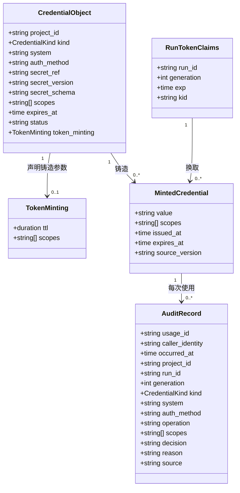
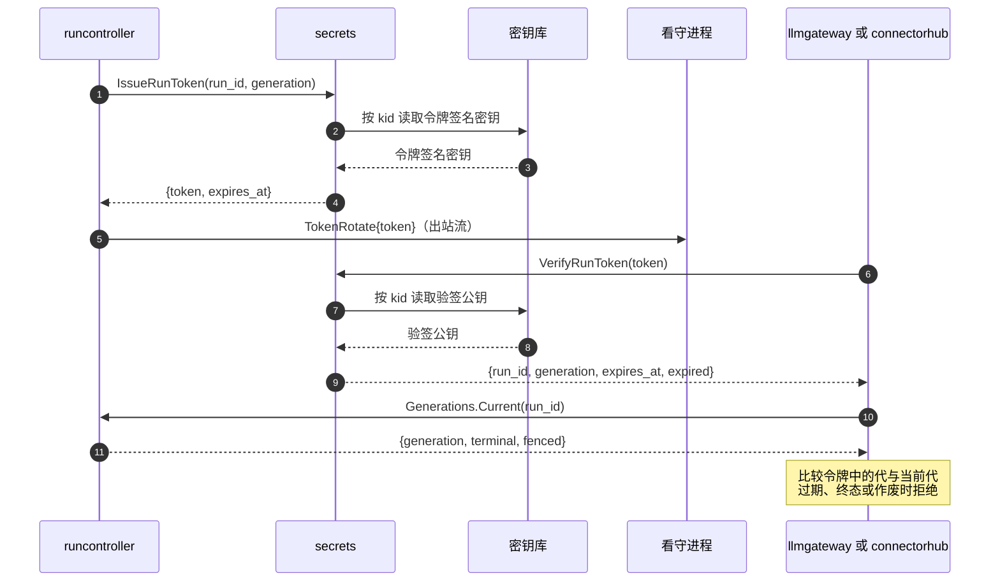
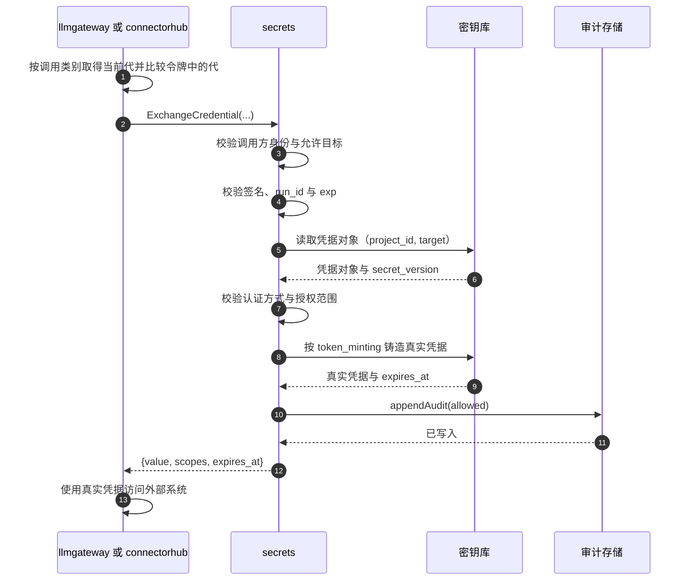
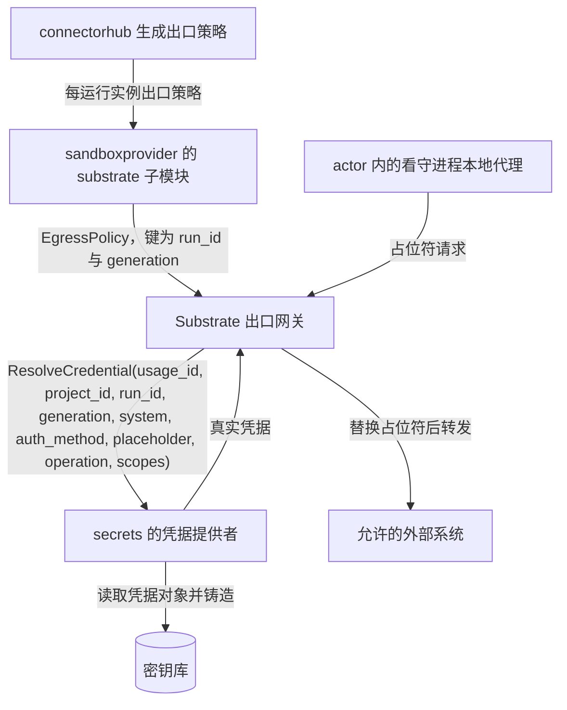

# secrets

`secrets` 坐在控制面基础层，是密钥库的唯一对接者。长期凭据只存在于密钥库，[沙箱](../../glossary.md)内的 Agent 进程只接触占位符，[运行实例令牌](../../glossary.md)只由[看守进程](../../glossary.md)持有：`secrets` 向[运行实例](../../glossary.md)签发令牌，[LLM 网关](../../glossary.md)、[连接器](../../glossary.md)与 k8s 路径的平台出口代理凭这张令牌与调用方身份换取真实凭据，Substrate 路径的出口网关经凭据提供者按 `(run_id, generation)` 策略键与网关身份取得真实凭据。本模块拥有凭据对象与令牌签名密钥的读取、令牌的签发与校验、凭据换取、调用方授权与使用审计；不拥有 LLM 请求转发、[出口策略](../../glossary.md)、运行实例状态与[代](../../glossary.md)。心智模型：沙箱里看不到真实凭据，只看到占位符；托管侧换取真实凭据，每次换取都记一笔账，真实凭据不落进沙箱（[ADR-host-owns-all-wake-sources](../../adr/adr-host-owns-all-wake-sources.md)）。

文档较长，不宜顺序通读。第一次阅读按以下顺序：核心概念、职责、走查、运行实例令牌的签发与校验、凭据换取、出口代理的凭据来源、凭据提供者对接；术语表、外部接口契约、核心数据结构、错误与失败语义与并发与事务边界作为核对接口、字段与失败处置时的参考。走查给出一次请求从令牌校验到审计落库的逐步状态变化；并发与事务边界末尾的轮换、缓存与审计交错留作最后自测。

## 核心概念

运行实例令牌代表看守进程向控制面证明这次调用来自哪个运行实例的哪一代。沙箱内不存放真实凭据，Agent 的 LLM 与外部系统流量都由看守进程代理，令牌就是这个代理关系的依据：`runcontroller` 以它认证出站流，LLM 网关与连接器以它换取真实凭据，平台出口代理以它逐请求校验代。签名确认令牌由本模块签发而非沙箱伪造，`generation` 供调用方与运行实例当前代比较，`exp` 把令牌泄露后的可用窗口限制在一个轮换周期内。换取还校验调用方身份，调用方只能取得其身份允许的凭据类别、系统与认证方式。

## 职责

`secrets` 是控制面中密钥材料与凭据换取的唯一入口。职责穷举如下，每条先写本模块执行的动作，再写产生的结果或边界；具体接口、字段与失败处置见后续章节。

- **对接密钥库**：读取凭据对象与令牌签名密钥，按项目、外部系统与认证方式解析；凭据材料只出现在密钥库与控制面调用方的进程内存中，不复制到[工作区](../../glossary.md)、沙箱或本模块的持久化存储。
- **维护项目作用域**：每次换取按调用方提供的 `project_id` 定位凭据对象；凭据对象只在其所属项目下可见，换取只解析 `project_id` 所指项目下的凭据对象，跨项目读取一律拒绝。
- **签发运行实例令牌**：以 `run_id`、`generation` 与 `exp` 构造 JWT，按令牌签名密钥签名，返回令牌与到期时刻；首个令牌由 `provision` 效果投递，令牌返回给效果执行器，由 `runcontroller` 经预配的引导参数交给 `sandboxprovider`，经看守进程的私有引导通道注入。令牌不持久化，由签名自证。
- **校验运行实例令牌**：验证签名、`run_id` 与 `exp`，返回令牌载荷与过期标记；不查询运行实例当前代，代比较归调用方。
- **轮换运行实例令牌**：在到期前签发后继令牌，交 `runcontroller` 经 `TokenRotate` 发往看守进程；旧令牌在 `exp` 之前继续有效，后继令牌投递成功时新旧令牌存在有效期重叠。
- **换取真实凭据**：校验运行实例令牌与调用方身份，按调用方给出的目标读取凭据对象，按凭据对象的 `token_minting` 铸造真实凭据，返回控制面调用方；不返回沙箱，不写入工作区。
- **校验调用方授权**：按调用方身份与部署白名单限制可换取的 `(Kind, System, AuthMethod)` 集合，三者均必填；目标不在允许集合时拒绝并写拒绝审计，不读取凭据对象，不暴露其存在性。
- **提供出口代理的凭据来源**：k8s 路径由平台出口代理调用换取接口；Substrate 路径由出口网关经凭据提供者协议取得占位符对应的真实凭据（[REF-substrate](../../references.md)）。
- **记录审计**：每次换取、占位符解析与拒绝写只追加审计记录，关联调用方身份、`run_id`、`generation`、外部系统与操作；审计写入先于凭据返回。
- **缓存真实凭据**：在凭据到期时刻与安全余量之内复用，按凭据对象版本与到期时刻失效；运行实例令牌与代不进入该缓存。

### 非职责

非职责举例如下，判定标准为职责清单之外、由其他模块拥有的事实与机制。

- 不做 LLM 代理：LLM 请求转发、流式缓冲、回放与在途跟踪归 `llmgateway`；本模块只返回 LLM 凭据。
- 不落地出口策略：允许主机、占位符规则、EgressPolicy 与 NetworkPolicy 归 `connectorhub` 与 `sandboxprovider`；本模块只按占位符返回对应凭据。
- 不持有运行实例状态：状态机、当前代、终态与本代作废判定归 `runcontroller`；本模块不读写 `run` 表，不判断令牌中的代是否为当前代。
- 不管理凭据对象的授权：凭据对象的创建、授权与撤销由密钥库的管理流程执行；本模块只读取。
- 不校验用户身份与项目归属：`humanchannel` 完成用户身份校验；`project_id` 由受信控制面调用方提供。
- 不持有沙箱与工作区：沙箱生命周期归 `sandboxprovider`，工作区归 `workspace`。

## 术语表

| 术语 | 英文对照 | 适用范围 | 定义 |
| --- | --- | --- | --- |
| 凭据对象 | credential object | secrets | 密钥库中按项目、凭据类别、外部系统与认证方式存放的长期凭据及其元数据，含 `secret_schema` 与 `token_minting` |
| 项目作用域 | project scope | secrets | 凭据对象按 `project_id` 隔离的授权范围；换取只解析调用方所指项目下的凭据对象 |
| 凭据换取 | credential exchange | secrets | 以运行实例令牌与调用方身份换取真实凭据的处理，含身份与授权校验、令牌校验、授权范围校验、铸造与审计 |
| 调用方身份 | caller identity | secrets | 控制面调用方在 mTLS 客户端证书中携带的工作负载身份；secrets 按它限制可换取的凭据类别、系统与认证方式 |
| 授权范围 | authorization scope | secrets | 凭据对象允许请求使用的 `scopes` 集合；`token_minting.scopes` 非空时取它，否则取凭据对象的 `scopes` |
| 本次实际范围 | effective scope | secrets | 本次换取实际使用的 `scopes` 集合；`Target.Scopes` 非空时取它，否则取授权范围 |
| 凭据提供者 | credential provider | secrets 与 Substrate 出口路径 | Substrate 出口网关按请求调用、返回真实凭据的协议接口，由 `secrets` 实现 |
| 令牌签名密钥 | token signing key | secrets | 签发运行实例令牌所用的密钥，按 JWT 头部的 `kid` 选择 |
| 审计记录 | audit record | secrets | 每次凭据使用或拒绝的只追加记录，关联调用方身份、运行实例、代、外部系统与操作 |

## 外部接口契约

稳定性承诺按接口类别给出：令牌接口与凭据换取接口对控制面调用方稳定；凭据提供者接口对 Substrate 出口网关稳定；密钥库后端、凭据路径与缓存布局是实现细节，不是契约。

### 运行实例令牌接口

```go
type RunTokens interface {
    IssueRunToken(ctx context.Context, runID RunID, generation int) (IssuedToken, error)
    VerifyRunToken(ctx context.Context, token string) (VerifyResult, error)
}

type IssuedToken struct {
    Token     string
    ExpiresAt time.Time
}

type VerifyResult struct {
    RunID      RunID
    Generation int
    ExpiresAt  time.Time
    Expired    bool
}
```

- `IssueRunToken` 只由 `runcontroller` 的预配与轮换效果在事务提交后调用；`generation` 由调用方传入，本模块不生成代，也不持久化令牌。
- `VerifyRunToken` 的结果分为有效、过期、无效与不可达：签名与 `run_id` 有效而 `exp` 已过时，`Expired` 为真且不返回错误；签名无效、`run_id` 无效或签名算法不被接受时返回 `ErrInvalidToken`；密钥库不可达或超时返回传输错误，与无效分开。调用方依赖这一区分：`runcontroller` 在 `Hello` 中接受仅过期的令牌并写 `rotate_token`，换取路径则拒绝过期令牌。
- 校验只覆盖签名、`run_id` 与 `exp`，不比较运行实例当前代。需要代校验的调用方经 `runcontroller` 的 `Generations.Current` 取得当前代、终态与本代作废状态后自行比较。
- 令牌载荷为 `run_id`、`generation` 与 `exp`；签名算法与有效期由签发配置决定，本模块在 `exp` 中返回到期时刻。
- 签名算法只接受配置声明的集合；`none` 与未知算法返回无效。验证按 `kid` 读取公钥，轮换窗口内同时接受旧密钥签发的未过期令牌。

### 凭据换取接口

```go
type CredentialBroker interface {
    ExchangeCredential(ctx context.Context, req ExchangeRequest) (MintedCredential, error)
}

type ExchangeRequest struct {
    Token     string
    ProjectID string
    Target    CredentialTarget
    Usage     Usage
}

type CredentialTarget struct {
    Kind       CredentialKind // llm | external_system
    System     string
    AuthMethod string
    Scopes     []string // 为空表示不额外收窄
}

type Usage struct {
    RunID      RunID
    Generation int
    Operation  string
    UsageID    string // 审计幂等键的 usage 维度
}

type MintedCredential struct {
    Value        string
    Scopes       []string
    IssuedAt     time.Time
    ExpiresAt    time.Time
    SourceVersion string
}
```

- `Token` 的 `run_id` 与 `generation` 必须与 `Usage` 一致；不一致返回 `ErrInvalidArgument`。这项一致性检查不是当前代校验。
- `Usage.UsageID` 必须非空；为空返回 `ErrInvalidArgument`。
- `ProjectID` 由调用方提供。调用方必须传入令牌所属运行实例的项目；本模块以 mTLS 客户端证书中的调用方身份为信任边界，不解析运行实例归属；归属与当前代归 `runcontroller`。错误归属由调用方的身份与审计追溯约束。
- `Target.Kind` 的取值为闭集 `llm` 与 `external_system`。`Kind=llm` 时 `System` 为 LLM 提供方，`AuthMethod` 为该提供方的认证方式，`System` 与 `AuthMethod` 均由调用方传入，取值来自调用方的部署配置；`Kind=external_system` 时 `System` 为 `ExternalSystem` 名，`AuthMethod` 取自该外部系统定义的 `auth.methods`。
- 凭据对象按 `(ProjectID, Kind, System, AuthMethod)` 读取；这组字段在项目内是唯一键，同一项目可存在多个同 `kind` 对象，按这组字段读取即可消歧；重复定义视为部署配置错误，返回 `ErrCredentialNotConfigured` 并告警。对象不存在或 `status=disabled` 返回 `ErrCredentialNotConfigured`。
- `Target.Scopes` 非空时必须是授权范围的子集，超出返回 `ErrScopeDenied`，不铸造、不返回凭据，并写拒绝审计；为空时使用授权范围。授权范围在 `token_minting.scopes` 非空时取它，否则取凭据对象的 `scopes`。本次实际范围在 `Target.Scopes` 非空时取它，否则取授权范围；对 `token_minting` 为空的凭据，不允许收窄：`Target.Scopes` 必须为空或等于授权范围，否则返回 `ErrScopeDenied`，此时本次实际范围等于授权范围。`MintedCredential.Scopes` 返回本次实际范围。
- `Usage.Operation` 由调用方传入且必须非空，为空返回 `ErrInvalidArgument`：LLM 为 `llm.request`，连接器操作为 `operations[].name`，占位符替换为占位符、请求方法与目标主机。本模块不校验 `Operation` 与 `Kind` 的匹配，审计记录关联调用方身份。
- 调用方身份与授权：`ExchangeCredential` 以 mTLS 暴露，调用方身份即客户端的 SPIFFE 工作负载身份（[REF-spiffe](../../references.md)）；本模块在入口按部署白名单校验该身份，并把身份映射到允许的 `(Kind, System, AuthMethod)` 集合，三者均必填。身份缺失由 mTLS 在握手阶段拒绝，不进应用层；身份与目标授权在 `VerifyRunToken` 之后校验。身份不在白名单返回未认证错误，写 `denied` 审计，`run_id` 与 `generation` 取令牌载荷。目标不在允许集合返回 `ErrTargetNotAuthorized`，不读取凭据对象，不暴露其存在性，写 `denied` 审计。典型映射：`llmgateway` 允许 `Kind=llm`；`connectorhub` 与其平台出口代理允许 `Kind=external_system`；每个调用方的 `System` 与 `AuthMethod` 允许集合由部署配置枚举，不因 `Kind` 相同而默认放行。
- 返回的 `MintedCredential` 只给控制面调用方。本模块不把它写入工作区、不交给看守进程、不放进沙箱环境变量或文件。
- 有外部副作用的操作在换取前经 `Generations.Current` 取得当前代并比较，不使用缓存的代；LLM 请求可按 `llmgateway` 的 `T_gen_cache` 缓存代查询结果。调用方在换取返回后仍以令牌载荷中的代核对。
- 错误分类：`ErrInvalidToken`、`ErrTokenExpired`、`ErrInvalidArgument`、`ErrCredentialNotConfigured`、`ErrScopeDenied` 与 `ErrTargetNotAuthorized` 为不可重试；调用方身份缺失在 mTLS 握手阶段拒绝；身份不在白名单返回未认证错误，同样不可重试；密钥库不可达、审计存储不可用与铸造上游的暂时性失败为可重试。

### 审计接口

```go
// DenialReporter 以 mTLS 暴露给控制面调用方，用于上报拒绝记录。
type DenialReporter interface {
    ReportDenial(ctx context.Context, report DenialReport) error
}

// AuditRecord 由 appendAudit（secrets 进程内方法，不对外暴露）写入。
type AuditRecord struct {
    UsageID        string
    CallerIdentity string
    OccurredAt     time.Time
    ProjectID      string
    RunID      RunID
    Generation int
    Kind       CredentialKind
    System     string
    AuthMethod string
    Operation  string
    Scopes     []string // 排序后的本次实际范围
    Decision   string   // allowed | denied
    Reason     string
    Source     string   // secrets | caller
}

type DenialReport struct {
    UsageID    string
    OccurredAt time.Time
    ProjectID  string
    RunID      RunID
    Generation int
    Kind       CredentialKind // 为空表示不涉及凭据目标的拒绝
    System     string
    AuthMethod string
    Operation  string
    Scopes     []string // 排序后的本次实际范围
    Reason     string
}
```

- `appendAudit` 是内部写入路径，由 `secrets` 在换取、占位符解析与自身拒绝路径调用，不以 RPC 暴露。它以 `(run_id, caller_identity, kind, usage_id, decision, system, auth_method, operation, 排序后的 scopes, source)` 幂等：这组字段相同的重复写入返回成功且不新增记录；同一 `usage_id` 下 `decision`、`system`、`auth_method`、`operation`、`scopes` 或 `source` 不同的判定各记一条。`usage_id` 为空时返回 `ErrInvalidArgument`。
- `ReportDenial` 以 mTLS 暴露，身份白名单与控制面其它接口相同。请求不含 `CallerIdentity` 字段，服务端只从对端证书取得调用方身份；强制 `decision=denied`、`source=caller`；`kind` 非空时校验 `kind`、`system` 与 `auth_method` 属于该调用方身份允许的集合，越界返回 `ErrTargetNotAuthorized`，`kind` 为空表示不涉及凭据目标的拒绝（例如附件取回的令牌拒绝），只校验调用方身份；`usage_id` 为空返回 `ErrInvalidArgument`。
- `CallerIdentity` 由 `secrets` 按入口 mTLS 身份填充；`ReportDenial` 的请求不携带该字段，调用方无法指定身份。
- 审计记录只追加，不更新、不删除；保留期与存储介质由部署配置决定，接口语义不变。
- `secrets` 在返回真实凭据之前写入 `allowed` 记录；凭据对象未配置、请求的授权范围超出凭据对象的授权范围、铸造失败与拒绝提供时写入 `denied` 记录；调用方身份不在白名单与目标未授权也由 `secrets` 写 `denied` 记录，身份缺失在 mTLS 握手阶段拒绝，不进应用层。
- 调用方在代不匹配、终态与本代作废等拒绝路径上调用 `ReportDenial` 写 `denied` 记录；这类记录的 `source` 为 `caller`，`run_id` 与 `generation` 由调用方上报、未在写入时校验，`secrets` 不把它们与自身写入的审计合并。审计记录仍关联调用方身份、`run_id`、`generation`、外部系统与操作。

### 凭据提供者接口

```go
type CredentialProvider interface {
    ResolveCredential(ctx context.Context, req ProviderRequest) (ProviderResponse, error)
}

type ProviderRequest struct {
    UsageID     string // 审计幂等键的组成字段，取出口网关的请求标识
    ProjectID   string
    RunID       RunID
    Generation  int
    Kind        CredentialKind // 固定 external_system
    System      string
    AuthMethod  string
    Placeholder string
    Operation   string // 占位符、请求方法与目标主机，由出口网关构造
    Scopes      []string // 为空表示使用授权范围
}

type ProviderResponse struct {
    Value     string
    Scopes    []string // 本次实际范围
    ExpiresAt time.Time
}
```

- 接口以 Substrate 的 credential provider 协议暴露；`secrets` 实现该协议，Substrate 出口网关在解析占位符时调用。
- 接口以 mTLS 暴露；出口网关以 SPIFFE 身份作为客户端证书调用，`secrets` 在入口按该身份与部署白名单校验允许的 `(Kind, System, AuthMethod)` 集合。身份不在白名单的调用方返回未认证错误，写 `denied` 审计，不暴露凭据对象是否存在；目标不在允许集合返回 `ErrTargetNotAuthorized`，同样写 `denied` 审计。
- 请求中的 `Generation` 只作为审计上下文；本模块不查询 `runcontroller` 的当前代，代校验由 EgressPolicy 的落地与撤销承担。
- 返回的真实凭据只由出口网关用于替换占位符，不返回沙箱。
- 请求缺少可解析的凭据对象或请求的授权范围超出凭据对象的授权范围时返回 `ErrCredentialNotConfigured` 或 `ErrScopeDenied`，并写拒绝审计。`Scopes` 为空表示使用授权范围；响应中的 `Scopes` 为本次实际范围。
- 其余错误分类与 `ExchangeCredential` 对齐：密钥库不可达、审计存储不可用与铸造上游的暂时性失败为可重试；铸造上游的永久性错误为不可重试；均不返回凭据，审计不可用时失败关闭。

### 稳定承诺

- 令牌接口与凭据换取接口的方法名、字段名与错误分类稳定；`ExchangeCredential` 是唯一的稳定换取方法；新增 `CredentialKind` 取值或认证方式扩展闭集，属于版本化变更。
- `VerifyRunToken` 的有效、过期、无效与不可达结果稳定；调用方依赖其区分过期与[失效判定](../../glossary.md)。
- 凭据提供者接口随 Substrate 的 credential provider 协议版本；`secrets` 的密钥库后端可替换，Substrate 出口网关不感知后端。
- 凭据路径、密钥库查询语句、缓存键与审计存储布局不是契约。

## 依赖

依赖穷举如下，方向与[模块依赖图](../architecture.md#模块依赖图)一致：本模块依赖密钥库与部署提供的控制面 mTLS；`runcontroller`、`llmgateway`、`connectorhub` 与 `humanchannel` 依赖本模块。本模块不依赖 `runcontroller`、`sandboxprovider`、看守进程与事件源模块，满足基础层不反向依赖的约束。

- 密钥库（Vault 类）：唯一的密钥材料依赖，凭据对象与令牌签名密钥的权威存储。本模块按项目路径读取凭据对象，按 `kid` 读取令牌签名密钥；不拥有凭据表，不复制凭据材料。
- Substrate credential provider 协议：Substrate 出口网关在运行时调用本模块实现的凭据提供者；这是运行时调用，不是代码依赖，`sandboxprovider` 不依赖本模块。
- `runcontroller`：调用 `IssueRunToken` 与 `VerifyRunToken`；签发在效果记录内、事务提交后执行。`runcontroller` 的 `Hello` 处理以 `VerifyRunToken` 区分无效、过期与不可达，并据过期结果触发 `rotate_token`。本模块不读 `run` 表，代比较归 `runcontroller` 与各调用方。
- `llmgateway`：以运行实例令牌与调用方身份调用 `ExchangeCredential`，`Target.Kind=llm`，`System` 与 `AuthMethod` 取 `llmgateway` 部署配置中的 LLM 提供方与认证方式；校验令牌后按 `Generations.Current` 比较代。
- `connectorhub`：以运行实例令牌与调用方身份换取外部系统凭据；[订阅](../../glossary.md)登记与有外部副作用的操作不使用缓存的代。平台出口代理以调用方身份调用 `ExchangeCredential`，对 k8s 路径的每个出口请求换取凭据并逐请求校验代。
- 控制面 mTLS：调用方身份由部署的 mTLS 基础设施提供，本模块不签发调用方身份。
- `humanchannel`：用 `VerifyRunToken` 校验附件取回请求携带的运行实例令牌；不换取外部系统凭据。
- 审计存储：另一项外部依赖，由部署配置决定介质；本模块通过内部 `appendAudit` 写入，对控制面调用方以 `ReportDenial` 接收上报的拒绝记录，不参与运行实例状态的数据库事务。

## UML 图

类图固定凭据对象、令牌载荷、真实凭据与审计记录的关系；时序图固定令牌签发与校验、凭据换取与审计的消息顺序；对接图固定 Substrate 路径上出口策略、出口网关与凭据提供者的边界。图中不表达的约束由每张图后的正文给出。

### 类图



凭据对象按 `project_id`、凭据类别、`system` 与 `auth_method` 定位，是项目作用域的授权单位，`(project_id, kind, system, auth_method)` 为唯一键，重复定义视为部署配置错误；同一凭据对象可被同一项目的多个运行实例换取，真实凭据因而不按运行实例隔离。运行实例令牌不持久化，`RunTokenClaims` 是从令牌中解析出的载荷，`kid` 在 JOSE 头部。`MintedCredential` 的 `source_version` 取自凭据对象的 `secret_version`，用于缓存失效。`AuditRecord` 以 `(run_id, caller_identity, kind, usage_id, decision, system, auth_method, operation, 排序后的 scopes, source)` 幂等，每次换取或占位符解析的每个判定各写一条，拒绝同样写一条。

### 令牌签发与校验时序图



签发只在 `runcontroller` 的效果执行器中发生。轮换的令牌经出站流上的 `TokenRotate` 交给看守进程，不经过本模块与看守进程之间的直接连接；首个令牌由 `provision` 效果在预配时投递，`IssueRunToken` 的结果由 `runcontroller` 经预配的引导参数交给 `sandboxprovider`，由其经看守进程的私有引导通道注入，不进入 Agent 的环境变量或文件系统。校验返回的 `expired` 是调用方分支的依据：`runcontroller` 的 `Hello` 接受仅过期的令牌并触发轮换，`llmgateway` 与 `connectorhub` 的换取路径拒绝过期令牌。代比较发生在校验之后、换取之前或换取响应之后，由调用方经 `Generations.Current` 完成；本模块不持有当前代。

### 凭据换取与审计时序图



审计写入先于凭据返回：审计存储不可用时换取失败，不返回凭据。代比较在换取之前完成，换取返回后可再次核对，`secrets` 不复核当前代；换取请求中的 `run_id` 与 `generation` 只与令牌载荷比对，用于发现调用方传参错误。`connectorhub` 对有外部副作用的操作在每次调用前取得当前代，不使用缓存；`llmgateway` 对 LLM 请求可按 `T_gen_cache` 缓存代查询结果。

### 凭据提供者对接图



`connectorhub` 生成出口策略，`sandboxprovider` 的 substrate 子模块以 `(run_id, generation)` 为键落地 EgressPolicy。出口网关只为命中已落地策略的请求调用凭据提供者；策略撤销即墓碑，网关不再为对应代解析占位符。凭据提供者不查询当前代，代的范围由策略的落地与撤销界定；撤销的残余窗口上界见认证与授权边界（[ADR-generation-fencing](../../adr/adr-generation-fencing.md)）。真实凭据只在出口网关替换请求头时出现，不物化为 k8s Secret，也不进入 actor。

## 核心数据结构

### 运行实例令牌

| 字段 | 位置 | 含义 |
| --- | --- | --- |
| `run_id` | 载荷 | 运行实例标识 |
| `generation` | 载荷 | 签发时运行实例的代 |
| `exp` | 载荷 | 到期时刻 |
| `kid` | JOSE 头部 | 令牌签名密钥标识，验证按它选择公钥 |
| `alg` | JOSE 头部 | 签名算法，取值由签发配置决定 |

令牌不持久化。`exp` 与 `generation` 在签发时写入，令牌有效与否由签名、`run_id` 与 `exp` 共同判定；当前代、终态与本代作废由调用方另行判定，不在令牌载荷中。

### 凭据对象

| 字段 | 含义 |
| --- | --- |
| `project_id` | 项目作用域 |
| `kind` | `llm` 或 `external_system` |
| `system` | LLM 提供方或 `ExternalSystem` 名 |
| `auth_method` | 认证方式；`Kind=external_system` 时取值来自 `ExternalSystem` 的 `auth.methods`，`Kind=llm` 时取值来自调用方部署配置中的 LLM 提供方定义 |
| `secret_ref` | 密钥库中的凭据路径 |
| `secret_version` | 凭据版本，缓存失效依据 |
| `secret_schema` | 该认证方式的 JSON Schema |
| `scopes` | 凭据对象的授权范围；`token_minting.scopes` 非空时授权范围取它，否则取本字段 |
| `expires_at` | 凭据有效期，由密钥库管理流程维护；`token_minting` 为空时作为返回凭据的到期时刻 |
| `token_minting` | `{ttl, scopes}`；非空时按它铸造，为空时返回凭据对象中的凭据本身 |
| `status` | `active` 或 `disabled`，由密钥库管理流程维护 |

`(project_id, kind, system, auth_method)` 是凭据对象的唯一键；同一项目可存在多个同 `kind` 对象，重复定义这组字段视为部署配置错误，读取时返回 `ErrCredentialNotConfigured` 并告警。

`token_minting` 为空时，换取返回 `secret_ref` 指向的凭据值，有效期取凭据对象的 `expires_at`；授权范围取凭据对象的 `scopes`，本次实际范围等于授权范围。该路径不允许收窄：`Target.Scopes` 必须为空或等于授权范围，否则返回 `ErrScopeDenied`，避免以窄范围命名却返回全量权限的静态凭据。该路径通用于 `llm` 与 `external_system` 凭据对象，涵盖不能铸造的认证方式，例如个人访问令牌（`personal_access_token`）；`connectorhub` 为这类凭据生成注入规则时，`token_minting.scopes` 为空则回退到凭据对象的 `scopes`。

### 真实凭据

| 字段 | 含义 |
| --- | --- |
| `value` | 凭据值，只在调用方进程内存中使用 |
| `scopes` | 本次实际范围 |
| `issued_at` | 铸造时刻 |
| `expires_at` | 到期时刻，取自 `token_minting.ttl` 或凭据对象的 `expires_at` |
| `source_version` | 铸造时凭据对象的 `secret_version` |

### 审计记录

| 字段 | 含义 |
| --- | --- |
| `usage_id` | 使用标识，由调用方生成，是审计幂等键的组成字段 |
| `caller_identity` | 调用方身份；由 `secrets` 按入口 mTLS 身份填充，调用方传入的值不作为信任依据 |
| `occurred_at` | 记录时刻 |
| `project_id` | 项目作用域 |
| `run_id` | 运行实例标识 |
| `generation` | 使用发生时令牌中的代 |
| `kind` | `llm` 或 `external_system` |
| `system` | LLM 提供方或 `ExternalSystem` 名 |
| `auth_method` | 认证方式 |
| `operation` | 操作标识；LLM 为 `llm.request`（由调用方传入），连接器为 `operations[].name`，占位符替换为占位符、请求方法与目标主机 |
| `scopes` | 排序后的本次实际范围，审计幂等键的组成字段 |
| `decision` | `allowed` 或 `denied` |
| `reason` | 拒绝原因；允许时为空 |
| `source` | `secrets`（本模块写入）或 `caller`（调用方经 `ReportDenial` 上报） |

幂等键为 `(run_id, caller_identity, kind, usage_id, decision, system, auth_method, operation, 排序后的 scopes, source)`，同一换取或占位符解析的同一判定只记一条。

### 凭据提供者请求与响应

| 字段 | 方向 | 含义 |
| --- | --- | --- |
| `usage_id` | 请求 | 审计幂等键的组成字段，取出口网关的请求标识 |
| `project_id` | 请求 | 项目作用域，取自出口策略 |
| `run_id`、`generation` | 请求 | 运行实例与代，审计与策略键 |
| `kind` | 请求 | 固定 `external_system` |
| `system`、`auth_method` | 请求 | 外部系统与认证方式 |
| `placeholder` | 请求 | 待替换的占位符 |
| `operation` | 请求 | 占位符、请求方法与目标主机，由出口网关构造 |
| `scopes` | 请求 | 本次请求的范围；为空表示使用授权范围 |
| `value`、`scopes`、`expires_at` | 响应 | 真实凭据、本次实际范围与到期时刻 |

## 核心算法与流程

### 走查

初始状态：运行实例 `R` 处于代 3，看守进程持有令牌 `T3`，`exp` 为 `T+20min`；项目 `P` 在密钥库中有 LLM 凭据对象 `v2` 与 GitHub 凭据对象 `v7`，GitHub 凭据对象 `v7` 的 `token_minting` 为 `ttl=1h`、`scopes=[repo:read]`；审计存储为空。示例中的令牌有效期与 LLM 凭据有效期是取值示例，实际值由签发配置与 `token_minting` 决定。

| 步骤 | 事件或调用 | 持久化状态 |
| --- | --- | --- |
| 1 | `T+0`，看守进程的本地代理把携带 `T3` 的 LLM 请求转发到 `llmgateway` | 无变化 |
| 2 | `llmgateway` 调用 `VerifyRunToken(T3)` 得到有效，调用 `Generations.Current(R)` 得到代 3，调用 `ExchangeCredential`，`Target` 为 `Kind=llm`、`System=anthropic`、`AuthMethod=api_key`，`Usage` 的 `Operation=llm.request`、`UsageID` 取本次请求标识 | 无变化 |
| 3 | `secrets` 校验 `T3`，读取 LLM 凭据对象 `v2`，按 `token_minting` 铸造真实凭据，`expires_at=T+10min`，写 `allowed` 审计 | 审计记录 `A1{R, 3, llm, llm.request}` |
| 4 | `llmgateway` 以真实凭据访问上游并转发响应 | 无变化 |
| 5 | `T+13:20`，`runcontroller` 的 `rotate_token` 截止调度触发（本应有存活沙箱且有出站流）；`secrets` 签发 `T3'`，`exp=T+33:20`；`runcontroller` 经出站流发送 `TokenRotate`，看守进程保存 `T3'` | `run.token_expires_at=T+33:20`；`outbox` 的 `rotate_token` 为 `done` |
| 6 | `T+22min`，一条仍在途的请求携带 `T3` 到达 `connectorhub`；`VerifyRunToken(T3)` 返回 `expired=true` | `connectorhub` 拒绝请求并写 `denied` 审计 `A2{R, 3, github, create_pull_request}`；`secrets` 未铸造凭据 |
| 7 | `T+23min`，本地代理以 `T3'` 重试；`connectorhub` 校验有效、当前代仍为 3，换取 GitHub 凭据 | `secrets` 读取 `v7`，铸造 `exp=T+83min`、`scopes=[repo:read]` 的真实凭据，写 `A3{R, 3, github, create_pull_request}` |
| 8 | `T+30min`，运行实例的代递增到 4；一条携带 `T3'` 的请求到达 `connectorhub` | `connectorhub` 经 `Generations.Current` 得到代 4，拒绝并不调用换取；写 `A4{R, 3, github, create_pull_request}`，`reason` 记录当前代 4；`secrets` 未铸造凭据 |

走查的结论：令牌的有效期与代的递增是独立维度。`T3` 在 `T+22min` 因过期被拒绝，`T3'` 在代递增后仍签名有效且未过期，但调用方的代比较使它失效。轮换在旧令牌到期前完成，换取路径没有出现无可用令牌的窗口。审计在凭据返回前落库，拒绝使用同样留下记录。

### 运行实例令牌的签发

1. 调用方传入 `run_id` 与 `generation`；本模块不生成代，也不读取运行实例状态。
2. 构造载荷 `{run_id, generation, exp}`，`exp` 取当前时刻加签发配置的有效期。
3. 选择当前令牌签名密钥，按 `kid` 写入 JOSE 头部，签名后返回 `token` 与 `expires_at`。
4. 调用方以效果记录的 `ref` 幂等；同一参数被重复调用时，返回的令牌只要在 `exp` 之前都有效，本模块不维护已签发令牌的清单。

签发不持久化，因而不存在令牌表的写入事务；令牌的失效由 `exp`、代递增与调用方的代比较共同完成。

### 运行实例令牌的校验

1. 解析 JOSE 头部，`alg` 必须在配置声明的集合内，`kid` 必须能解析到公钥；任一项不满足返回 `ErrInvalidToken`。
2. 验证签名。
3. 校验 `run_id` 非空且与载荷一致，`exp` 存在且可解析。
4. `exp` 早于当前时刻时返回载荷与 `Expired=true`，不返回错误；签名无效、`run_id` 无效或算法不被接受返回 `ErrInvalidToken`。
5. 密钥库不可达或超时返回传输错误，调用方据此区分暂时不可用与令牌无效。

校验不读取 `run` 表，不比较当前代，不判断运行实例是否终态或本代是否作废。公钥按 `kid` 缓存；令牌签发的密钥轮换后，旧公钥保留到用它签发的令牌全部过期，保留期限由签发配置决定。

### 运行实例令牌的轮换

1. `runcontroller` 在 `Hello` 中遇到签名与 `run_id` 有效、仅 `exp` 已过或临近到期的令牌时，或 `rotate_token` 截止调度在 `token_expires_at − T_token_refresh` 触发时，写 `rotate_token` 效果；效果执行器调用 `IssueRunToken(run_id, generation)`。
2. 本模块签发后继令牌，`generation` 不变，`exp` 后移；返回给效果执行器。
3. `runcontroller` 经出站流发送 `TokenRotate{token}`；看守进程收到后替换本地持有的令牌。
4. 旧令牌在 `exp` 之前继续有效；新旧令牌在重叠期内都能通过校验，换取路径不因轮换而拒绝。
5. 看守进程未收到 `TokenRotate` 时，旧令牌到期后换取返回 `ErrTokenExpired`；看守进程重连时 `Hello` 携带过期令牌，`runcontroller` 接受并再次触发轮换。

轮换只由 `runcontroller` 发起，本模块不与看守进程直接通信。轮换不撤销旧令牌，也不使真实凭据缓存失效；旧令牌的失效由 `exp` 与代递增完成。`TokenRotate` 是看守进程获得轮换令牌的唯一路径；首个令牌由预配投递，不经 `TokenRotate`，其通道见令牌签发与校验时序图后的说明。

### 凭据换取

1. 调用方提交 `ExchangeRequest`，其中 `Token` 为看守进程持有的运行实例令牌，`ProjectID` 为运行实例所属项目。
2. 调用 `VerifyRunToken`。无效返回 `ErrInvalidToken`，过期返回 `ErrTokenExpired`，传输错误原样返回。
3. 校验调用方身份与允许目标；身份缺失由 mTLS 在握手阶段拒绝，不进应用层；身份不在白名单返回未认证错误并写 `denied` 审计；目标不在允许集合返回 `ErrTargetNotAuthorized`，写 `denied` 审计且不读取凭据对象。两项审计的 `run_id` 与 `generation` 取令牌载荷。
4. 比对 `Usage.RunID` 与 `Usage.Generation` 是否等于令牌载荷；不一致返回 `ErrInvalidArgument`。
5. 按 `(ProjectID, Target.Kind, Target.System, Target.AuthMethod)` 读取凭据对象。对象不存在或 `status=disabled` 返回 `ErrCredentialNotConfigured`。
6. 计算授权范围并校验 `Target.Scopes`：`Target.Scopes` 非空时必须是授权范围的子集，超出返回 `ErrScopeDenied`；为空时使用授权范围。授权范围在 `token_minting.scopes` 非空时取它，否则取凭据对象的 `scopes`。本次实际范围在 `Target.Scopes` 非空时取它，否则取授权范围；`token_minting` 为空时不允许收窄，`Target.Scopes` 必须为空或等于授权范围，否则返回 `ErrScopeDenied`。
7. `token_minting` 非空时按 `ttl` 与本次实际范围向密钥库请求铸造；为空时使用凭据对象中的凭据本身。铸造失败按上游错误分类返回。
8. 写入 `allowed` 审计记录；审计写入失败则不返回凭据。
9. 返回 `MintedCredential`，其中 `source_version` 为凭据对象的 `secret_version`，`Scopes` 为本次实际范围。

本模块不判断令牌中的代是否为当前代。调用方在换取前或使用前经 `Generations.Current` 比较；有外部副作用的操作在每次调用前取得当前代，不使用缓存。

### 出口代理的凭据来源

k8s 路径：

1. 本地代理在转发给平台出口代理的请求上附加运行实例令牌。
2. 平台出口代理对每个请求调用 `Generations.Current`，校验令牌中的代、运行实例是否终态与本代是否作废，不使用缓存的代；任一不通过则拒绝，计入旧代拒绝计数。
3. 通过校验后，平台出口代理以调用方身份调用 `ExchangeCredential`，`Target` 为 `Kind=external_system`，`System`、`AuthMethod` 与 `Scopes` 取注入规则；`Usage.UsageID` 取出口代理的 `RequestID` 与规则标识（目标主机、头名与占位符）拼接，`Usage.Operation` 取占位符、请求方法与目标主机。
4. 平台出口代理把占位符替换为返回的真实凭据，转发到允许主机。
5. 每次换取产生一条审计记录；规则标识进入 `UsageID`，同一请求命中多条注入规则时各次换取因 `UsageID` 不同而各记一条；平台出口代理不缓存代查询结果。

Substrate 路径：

1. `connectorhub` 生成每运行实例出口策略，`sandboxprovider` 的 substrate 子模块以 `(run_id, generation)` 为键落地 EgressPolicy。
2. 出口网关只为命中已落地策略的请求解析占位符；本代沙箱作废、提供者确认（销毁落地）、进入 `Degraded`、放弃、显式结束与代递增时撤销对应代的策略，撤销即墓碑。
3. 出口网关调用 `ResolveCredential`，请求携带 `usage_id`、`project_id`、`run_id`、`generation`、`kind`（固定 `external_system`）、`system`、`auth_method`、`placeholder`、`operation` 与 `scopes`；`usage_id` 取出口网关的请求标识。
4. 本模块读取项目作用域内的凭据对象，铸造真实凭据，写审计，返回给出口网关。
5. 出口网关替换占位符后转发；凭据只在出口网关内存中用于该请求。

git 流量经平台反向代理重写，Basic 与 Bearer 头同样由出口侧注入；需要本地签名的客户端改用连接器操作。k8s 路径与 Substrate 路径都不把真实凭据交给沙箱，也不在沙箱内生成签名。

### 审计

每次换取与占位符解析写一条审计记录，拒绝同样写一条。`operation` 的取值规则：

- LLM 流量：`llm.request`，由 `llmgateway` 在 `Usage.Operation` 中传入。
- 连接器操作：外部系统定义中的 `operations[].name`，例如 `create_pull_request`。
- 占位符替换：占位符、请求方法与目标主机，由出口代理传入。

`secrets` 在返回真实凭据之前写 `allowed` 记录；凭据对象未配置、认证方式不匹配、请求的授权范围超出凭据对象的授权范围、铸造失败与拒绝提供时写 `denied` 记录，并返回对应错误。调用方的代不匹配、终态与本代作废拒绝由调用方调用 `ReportDenial` 记录，`secrets` 不重复记录；这类记录的 `source` 为 `caller`。审计记录以 `(run_id, caller_identity, kind, usage_id, decision, system, auth_method, operation, 排序后的 scopes, source)` 幂等，同一判定重复写入不新增记录；暂时性失败写 `denied` 后重试成功时，`allowed` 另记一条，两者都保留。记录只追加，不更新、不删除。

### 缓存与失效

真实凭据缓存以 `(project_id, kind, system, auth_method, 排序后的本次实际范围)` 为键，值为真实凭据、`expires_at` 与 `source_version`。

- 每次 `ExchangeCredential` 调用写一条审计，包括缓存命中；`UsageID` 由调用方为每次换取请求生成，出口代理的每次规则换取取 `RequestID` 与规则标识拼接。
- 条目只在当前时刻早于 `expires_at` 减安全余量时可复用；安全余量由部署配置决定。
- 每次刷新读取凭据对象的 `secret_version`；与条目记录的 `source_version` 不一致时丢弃旧条目并重新铸造。
- 凭据对象在密钥库中被撤销时提升版本；缓存条目的失效上界为其 `expires_at`，本模块不设跨进程推送。
- 运行实例令牌的过期与轮换不使真实凭据缓存失效；缓存键不含 `run_id` 与 `generation`，代校验在每次请求上完成。
- 令牌不缓存；代查询结果由调用方缓存，`llmgateway` 的缓存窗口不超过 `T_gen_cache`，`connectorhub` 对有外部副作用的操作与订阅登记不缓存。
- 验签公钥按 `kid` 缓存；令牌签名密钥轮换期间同时保留旧公钥，直到旧令牌全部过期。

### 凭据提供者对接

Substrate 路径选择以 credential provider 插件对接密钥库。约束如下：

- `secrets` 实现 credential provider 协议，出口网关在每次占位符解析时调用；真实凭据在请求时按当前策略解析，不物化为 k8s Secret，因而不引入凭据副本与 Secret 读权限的分发路径。
- 请求携带 `usage_id`、`project_id`、`run_id`、`generation`、`kind`、`system`、`auth_method`、`placeholder`、`operation` 与 `scopes`；`project_id` 取自 `connectorhub` 生成的出口策略，`usage_id` 取出口网关的请求标识，`kind` 固定为 `external_system`，`scopes` 为空表示使用授权范围，响应返回本次实际范围。
- 出口网关以 mTLS 客户端证书携带 SPIFFE 身份调用，`secrets` 在入口按该身份与部署白名单校验；其他身份调用返回未认证错误。
- 提供者不查询 `runcontroller` 的当前代。代的范围由 EgressPolicy 的落地与撤销界定：策略只为当前代落地，撤销即墓碑；撤销的触发穷举见出口代理的凭据来源的 Substrate 路径，残余窗口上界见认证与授权边界（ADR-generation-fencing）。
- 出口网关只在 `(run_id, generation)` 命中已落地策略时调用提供者；策略撤销后不再解析占位符。
- 返回的真实凭据只由出口网关用于替换请求头，不进入 actor 的文件系统、环境变量或进程内存。
- 真实凭据的有效期取自 `token_minting`；出口网关的缓存不得超过 `expires_at` 减安全余量。

## 错误与失败语义

失败处置由令牌校验结果、凭据对象状态、审计写入与调用方的代比较组合表达。下表列出已明确处置路径的失败，各行是举例。

| 失败 | 判定与处置 |
| --- | --- |
| 调用方身份缺失 | mTLS 握手失败，传输层拒绝，不可重试；不进应用层，不写审计 |
| 调用方身份不在白名单 | 未认证错误，不可重试；令牌校验后写 `denied` 审计（`run_id` 与 `generation` 取令牌载荷），不读取凭据对象，不暴露其存在性 |
| 目标不在调用方允许集合 | `ErrTargetNotAuthorized`，不可重试；写 `denied` 审计，不读取凭据对象 |
| 签名无效、`alg` 不被接受或 `kid` 未知 | `ErrInvalidToken`，不可重试；调用方拒绝请求，计入旧代拒绝计数并写拒绝审计 |
| `run_id` 为空或与载荷不一致 | `ErrInvalidToken`，不可重试；不换取、不返回凭据 |
| 令牌过期 | `VerifyRunToken` 返回 `Expired=true`；换取返回 `ErrTokenExpired`，不铸造；`runcontroller` 的 `Hello` 接受仅过期的令牌并写 `rotate_token`；看守进程收到 `TokenRotate` 后以新令牌重试，LLM 网关与连接器对过期令牌直接拒绝；过期与失效判定分开 |
| 代不匹配 | 由调用方经 `Generations.Current` 判定，`secrets` 不参与；调用方拒绝请求，不调用换取或丢弃换取结果，计入旧代拒绝计数并写拒绝审计 |
| 项目下无凭据对象 | `ErrCredentialNotConfigured`，不可重试；写 `denied` 审计 |
| 认证方式与凭据对象不匹配 | `ErrCredentialNotConfigured`，不可重试；写 `denied` 审计 |
| 请求的授权范围超出凭据对象的授权范围 | `ErrScopeDenied`，不可重试；写 `denied` 审计，不铸造；`Target.Scopes` 为空时使用授权范围，不触发该错误 |
| 密钥库不可达或超时 | 可重试；有效期内的缓存可继续服务，缓存不可用时换取失败，不返回过期凭据 |
| 令牌签名密钥不可用 | `IssueRunToken` 失败；`runcontroller` 的效果按退避重试；已签发令牌在 `exp` 前继续有效，预配等待令牌签发 |
| 铸造被上游拒绝 | 区分上游的暂时性与永久性错误；暂时性错误可重试，永久性错误不可重试；均不返回凭据，写 `denied` 审计 |
| 审计存储不可用 | 可重试；不返回真实凭据，调用方以同一 `usage_id` 重试 |
| 凭据提供者收到未认证调用 | 未认证错误，不可重试；写 `denied` 审计，不暴露凭据对象是否存在 |
| 凭据提供者请求的凭据对象不存在或请求的授权范围超出凭据对象的授权范围 | `ErrCredentialNotConfigured` 或 `ErrScopeDenied`，不可重试；写 `denied` 审计 |
| 真实凭据在使用前过期 | 调用方在 `expires_at` 之前停止使用；重新换取，不延长旧凭据 |
| 轮换期间旧令牌仍被使用 | 旧令牌在 `exp` 前有效，换取正常完成；轮换不产生拒绝 |

降级遵循失败关闭：调用方身份不可用或目标未授权时失败关闭，请求的授权范围超出凭据对象的授权范围时不改用更大范围的凭据，密钥库不可用时不回退到沙箱侧的任何凭据，审计不可用时不返回凭据。密钥库只读或令牌签名密钥暂时不可用时，已签发令牌在到期前继续有效，新签发等待恢复；真实凭据缓存只在有效期与安全余量内服务，超过后不提供。Substrate 路径的凭据提供者不可用时，出口请求失败，不回退到 k8s Secret 或静态凭据。

## 并发与事务边界

### 令牌签发与轮换

`IssueRunToken` 不在 `runcontroller` 的状态转移事务内执行：状态转移与效果记录同事务提交，签发在提交后由效果执行器调用。因此签发与代递增之间没有共享数据库锁；轮换的原子性由有效期重叠与调用方的代比较保证，而不是由两阶段提交保证。

- 轮换先签发后继令牌，再经 `TokenRotate` 投递；新旧令牌在重叠期内都有效，看守进程在收到新令牌后替换，投递成功时不出现无可用令牌的窗口。
- 后继令牌未送达时，旧令牌到期后换取返回 `ErrTokenExpired`；看守进程重连的 `Hello` 触发再次轮换。
- 同一效果被重复执行时，`runcontroller` 以效果记录的 `ref` 幂等；本模块不维护令牌清单，重复签发的令牌只要未过期都能通过校验。
- 代递增不撤销令牌，也不写吊销记录；旧代令牌的拒绝由调用方比较当前代完成，代递增的事务提交即令比较结果改变。

### 凭据缓存与失效

缓存条目不可变，刷新时整条替换；同一缓存键的并发刷新合并为一次密钥库调用，先完成的结果生效，其余调用复用该结果。读者看到旧条目或新条目，看不到部分写入的条目。

版本检查在刷新时进行，不在每次读取时查询密钥库；凭据对象在密钥库中的撤销通过提升 `secret_version` 生效，缓存条目的失效上界为其 `expires_at`。本模块不维护跨进程的失效广播，因而不存在缓存与密钥库之间的事务；陈旧窗口的上界由条目有效期与安全余量界定。

### 审计写入

审计记录先于真实凭据返回写入，两者不在同一事务内：审计存储与密钥库是不同系统，无法以单一事务提交。崩溃发生在审计写入之后、凭据返回之前时，调用方以同一 `usage_id` 重试，审计以 `(run_id, caller_identity, kind, usage_id, decision, system, auth_method, operation, 排序后的 scopes, source)` 幂等，同一判定不产生重复记录；崩溃发生在审计写入之前时，没有凭据返回，调用方重试后重新写审计。

审计记录只追加，不更新、不删除；并发的重复写入由 `(run_id, caller_identity, kind, usage_id, decision, system, auth_method, operation, 排序后的 scopes, source)` 唯一约束收敛。审计存储不可用时换取失败，这是失败关闭的一部分。

### 并发换取

多个调用方可以并发换取同一项目、同一外部系统的凭据；缓存键相同则合并密钥库调用，缓存键不同则各自铸造。身份与目标授权在读取凭据对象之前完成；本模块不缓存授权结果。本模块不按运行实例加锁，也不在换取与外部调用之间持有锁。

代递增与换取并发时，代比较由调用方完成；代递增在比较之后、外部调用之前提交时，该次外部调用仍可能发生。失效判定不替代外部系统的幂等键，连接器对创建或改变外部对象的操作以幂等键约束重做。

## 扩展点

### 新增外部系统认证方式

认证方式以 `ExternalSystem` 的 `auth.methods`、`secret_schema` 与 `token_minting` 表达时，不修改本模块接口：`secrets` 按 schema 读取凭据对象，按 `token_minting` 铸造。认证方式需要不同的下游签发 API 时，增加一个铸造适配器，保持 `ExchangeCredential` 的请求与响应不变。

### 新增 LLM 提供方

在调用方部署配置中登记提供方与认证方式，在密钥库中为项目创建对应 `kind=llm` 的凭据对象；调用方在 `Target.System` 与 `Target.AuthMethod` 传入新值。`ExchangeCredential` 的接口不修改。

### 新增密钥库后端

替换密钥库后端时实现读取凭据对象、读取令牌签名密钥与铸造，保持项目路径语义、`secret_version` 与授权范围校验不变。密钥库后端的认证与连接配置由部署决定，不进入本模块的接口契约。

### 新增出口路径的凭据来源

新出口路径能逐请求携带运行实例令牌时，以调用方身份调用 `ExchangeCredential` 并自行完成代比较；出口路径只能按策略键放行时，实现凭据提供者协议，以 `(run_id, generation)` 为策略键。各出口路径都必须写审计、都必须把真实凭据留在托管侧，不把凭据交给沙箱。

## 实现状态

| 能力 | 状态 | 代码 |
| --- | --- | --- |
| 密钥库对接 | 未实现 | — |
| 凭据对象与项目作用域 | 未实现 | — |
| 运行实例令牌签发 | 未实现 | — |
| 运行实例令牌校验 | 未实现 | — |
| 令牌轮换 | 未实现 | — |
| 凭据换取 | 未实现 | — |
| 出口代理占位符凭据来源 | 未实现 | — |
| 审计 | 未实现 | — |
| 凭据缓存与失效 | 未实现 | — |
| Substrate 凭据提供者 | 未实现 | — |
