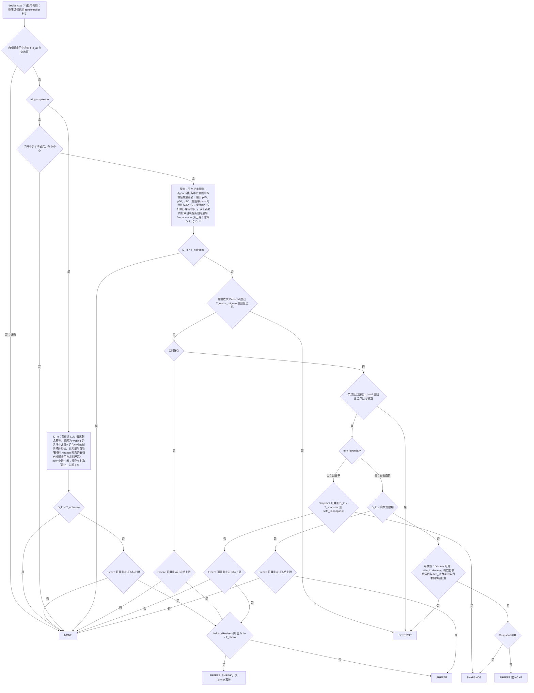
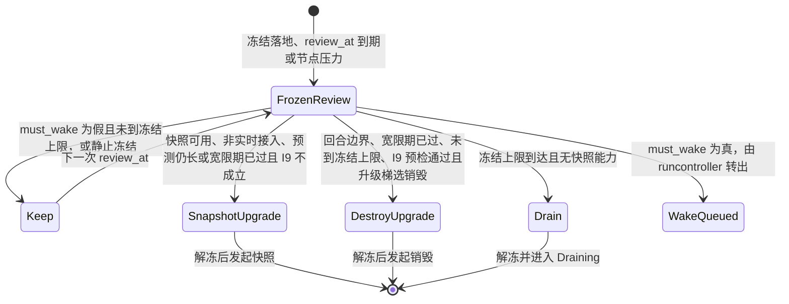
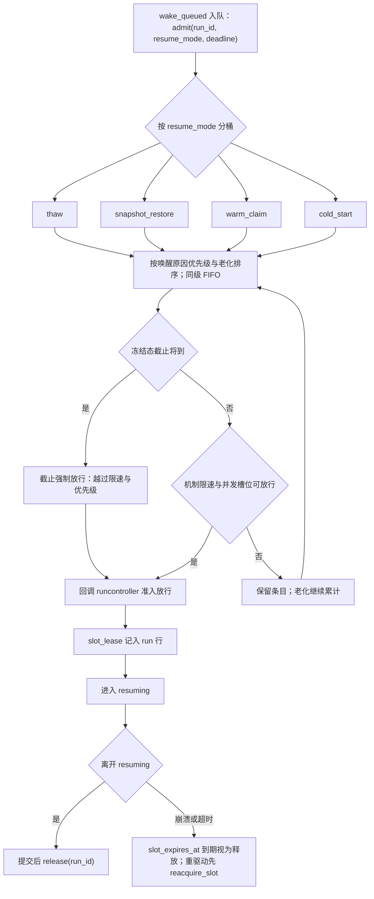

# suspendpolicy

`suspendpolicy` 是链接进 `runcontroller` 进程的库，在[运行实例](../../glossary.md)行锁内回答是否[挂起](../../glossary.md)、用哪种机制挂起、挂起之后何时复评或升级，并在事务提交后维护进程内的[恢复准入](../../glossary.md)队列。它拥有挂起决策函数、静止证据与空闲证据的判据（忙信号规则）、策略参数、等待时长预测与置信度、抖动预算、[冻结](../../glossary.md)中复评与升级梯、恢复机制选择、恢复准入的限速与优先级、准入槽位与节点内存压力下的升级对象选取；它不拥有运行实例状态机与[唤醒谓词](../../glossary.md)的持久事实、[沙箱](../../glossary.md)生命周期与[安全点](../../glossary.md)检查：运行实例状态机与唤醒谓词的持久事实归 `runcontroller`，沙箱生命周期归 `sandboxprovider`，安全点检查归 `runcontroller` 的 I9 预检与[看守进程](../../glossary.md)的复核。心智模型：行锁内的纯决策函数，加一份提交后维护的进程内队列（[ADR-suspendpolicy-as-library](../../adr/adr-suspendpolicy-as-library.md)）。

文档较长，不宜顺序通读。首轮阅读按以下顺序：核心概念、职责、外部接口契约、[走查](#走查)、[初判决策](#初判决策)、[静止证据与忙信号](#静止证据与忙信号)、[冻结中复评与升级梯](#冻结中复评与升级梯)、[恢复准入队列](#恢复准入队列)；参数表、等待时长预测、核心数据结构与 UML 图作为参考，在核对具体取值或字段时查阅。错误与失败语义、并发与事务边界留作最后核对：按前文的处置规则判断每个退化情形的结果，再与表中结论对照。

## 核心概念

本模块的机制是行锁内决策、提交后排队。初判决策、静止证据判定、冻结中复评与恢复机制选择都在[运行实例](../../glossary.md)行锁内执行：调用方传入上下文、提供者能力集合与 `policy_state`，策略返回挂起模式、复评时刻与更新后的策略状态；函数只依赖传入值，不读写数据库、不调用[沙箱提供者](../../glossary.md)，决策结果由 `runcontroller` 在同一事务写回，跨调用要记住的策略记忆随 `policy_state` 传入传出。恢复准入由同一策略在事务提交后维护：准入队列只存在于所有者副本的内存，`run` 行是准入的唯一事实源，队列与槽位只是缓存，副本崩溃后按 `run` 行补入。系统需要这个入口：解冻、[快照](../../glossary.md)恢复、预热池认领与冷启动的恢复时延与并发上限各不相同，排序、限速与槽位在同一处生效，不同机制的恢复共用一套规则（[ADR-single-recovery-admission](../../adr/adr-single-recovery-admission.md)）。

## 职责

职责穷举如下，每条先写本模块执行的动作，再写产生的结果或边界；具体算法、参数与数据结构见后续章节。

- **初判决策**：接收调用方在行锁内传入的决策上下文，判断是否挂起，返回挂起模式、冻结变体、冻结上限 `f_cap`、[静止冻结](../../glossary.md)的冻结截止 `FreezeDeadline`、宽限期 `grace`（首次边界决策按回合的[等待意图](../../glossary.md)选取）、下次复评时刻 `next_review_at` 与探测间隔 `probe_interval`；预测等待不足、能力缺失或上下文表明不满足挂起条件时返回 `NONE` 并给出下次复评时刻；自唤醒条目中存在 `fire_at` 为空（触发时刻未知）的项时返回 `NONE` 并计数。运行中的工具或后台作业存在时，只在 `trigger=quiesce` 下返回冻结类模式。
- **静止证据与空闲证据**：按调用方传入的活动度样本判定 Agent 是否静止（没有任何 Agent 循环能在不依赖托管侧唤醒的情况下推进），返回静止证据与静止窗起点；L0 的空闲证据在静止证据之上加 L0 的额外条件。忙信号的解释规则由本模块定义，看守进程的采集口径与 `runcontroller` 的触发都引用该规则。
- **冻结中复评**：在冻结时长达到复评点、冻结上限到达或节点内存压力变化时，返回 `KEEP`、`SNAPSHOT`、`DESTROY` 或 `DRAIN`，并按升级梯决定解冻之后的目标机制；实时接入期间只在 `KEEP` 与 `DRAIN` 之间返回；静止冻结只返回 `KEEP`，其冻结上限到达时由 `runcontroller` 直接唤醒，不进入复评。
- **恢复机制选择**：依恢复时的子状态、沙箱提供者能力集合与恢复意图返回 `resume_mode`，取值为 `thaw`、`snapshot_restore`、`warm_claim` 与 `cold_start` 的闭集。
- **自唤醒提前量与有效自唤醒条目的界限**：按挂起落地的子状态给出[自唤醒源](../../glossary.md)的提前量 `L_self_wake(substate)`，取该形态恢复时延的 p95 加 `safety_margin`（见[参数表](#参数表)），并给出[有效自唤醒条目](../../glossary.md)的界限 `now − (L_self_wake(substate) + P_quiesce)`（见[初判决策](#初判决策)）；`runcontroller` 以有效自唤醒条目中最早的 `fire_at` 减去提前量得到所有者侧截止 `self_wake_at`，保证到点时 Agent 进程可运行，并在销毁模式的挂起尝试中以 `destroyed` 形态的界限作为 `PrepareSuspend.self_wake_cutoff` 下发，看守进程的安全点检查因而与 I9 预检按同一界限排除[过期自唤醒条目](../../glossary.md)；给出 `L_thaw`，供探测定时器提前于已知最早自唤醒时刻触发。
- **等待时长预测与置信度**：在调用方传入的平台单点预测、Agent 自报的预计等待（`agent_expected_ms`）与等待意图给出的预计时长中取置信度最高者为 p50，按等待来源的先验展开 p25 与 p90 并给出置信度；等待意图携带[等待签名](../../glossary.md)的时长先验 `prior` 时直接使用其 p25、p50 与 p90，意图的预计时长与 `prior` 的分位都扣除自意图观察时刻 `observed_at` 起已等待的时长；没有单点值时取来源先验，人类等待按渠道与在线态先验取值，回合等待意图为 `completed` 的回合边界取「回合完成」先验；供初判决策计算保守值 `D_lo` 与上限值 `D_hi`；来源覆盖 LLM、CI 与异步事件、人、回合完成、定时与静止；有效自唤醒条目中最早的触发时刻作为全部来源预测的上界；按 `policy_state` 中的自报命中记录校准 Agent 自报的置信度。等待意图只作软输入，不进入静止证据、空闲证据与可销毁判定（[ADR-wait-intent-as-soft-input](../../adr/adr-wait-intent-as-soft-input.md)）。
- **抖动预算记账**：按挂起机制的成本从每运行实例的恢复时延预算中扣减，预算耗尽后把可选机制收窄为不挂起与冻结；预算窗口与余额随 `policy_state` 持久化。
- **冻结态内存装箱与压力升级**：依节点冻结态内存比例与冻结运行实例列表选出升级对象，给出快照、回合边界销毁或 `DRAIN` 的升级选择；在节点压力超过硬阈值时驱动该节点回合边界且非实时接入的新等待按零宽限期处置。
- **恢复准入**：在事务提交后把运行实例放入按机制划分的内存队列，按唤醒原因优先级与排队老化决定放行顺序，按机制限速与并发槽位放行；冻结态携带的截止到达时越过限速强制放行。
- **准入槽位**：在并发型限额下维护每个运行实例的槽位租约，放行时分配，离开恢复时释放；槽位到期视为已释放，重驱动前经 `reacquire_slot` 重新取得。
- **准入排队估计**：向 `runcontroller` 提供按 `run` 行计算队列位置与预计恢复时刻的函数，不读所有者副本的准入队列。
- **定时抖动**：为定时类等待与退避时刻给出随机抖动，分散同时到期的定时风暴。
- **[预测性恢复](../../glossary.md)批准**：对同一 `wake_hint` 来源标识至多批准一次预测性恢复，批准结果记入 `policy_state`，由 `runcontroller` 触发。
- **策略状态与复位**：定义 `policy_state` 的序列化内容，在每次决策与复评时输出更新后的状态，并在恢复完成时经 `on_resumed` 给出新的预测失准计数与更新后的 Agent 自报命中记录。

### 非职责

非职责举例如下，判定标准为：职责清单之外、由其他模块拥有的事实与机制。

- 运行实例的状态转移、字段持久化与唤醒谓词评估归 `runcontroller`；决策与估计函数只在行锁内被调用，`admit`、`release` 与 `remove` 在事务提交后调用；策略不启动或结束状态转移，不评估唤醒谓词的真值。
- 沙箱的冻结、解冻、快照、销毁与原地缩小 CPU request 的执行归 `sandboxprovider`；策略只返回机制选择，不调用沙箱提供者。
- 安全点的沙箱侧复核归看守进程；策略只读取调用方传入的 `safe_to` 与活动度摘要，不检查进程树、工作区写文件描述符或在途请求。
- 活动度的采集（PSI 累计值、CPU 用量累计值、进程态、定时睡眠进程与 LLM 请求时刻）归看守进程，采集口径由 `agentprotocol` 的 `Activity` 定义；策略只解释调用方传入的样本。
- 自唤醒条目的镜像与对账归 Agent 驱动器，`run.self_wake` 与 `self_wake_at` 的持久化与到期调度、`self_wake_cutoff` 的写入、挂起过程与挂起态中出现 `fire_at` 为空的条目时的必须唤醒归 `runcontroller`；策略只读取传入的条目，给出提前量与有效自唤醒条目的界限。
- 后台作业、残留进程与孤儿进程的去留归 Agent；策略不给出终止进程的决策，后台作业存活只把 `decide` 的可选结果收窄为静止冻结。以挂起为目的的销毁路径上，Agent 正常退出之后终止已声明的第三方 MCP 服务器（含其子进程）由看守进程执行，不由策略决定（见 [warden](warden/design-warden.md)）。
- 预测直方图的数据采集归 `llmgateway`、`connectorhub` 与 `humanchannel`；策略只消费随事件到达的单点预测与参数配置中的来源先验，不读这些模块的表。
- 等待意图的解析与上报、等待签名的匹配、情境提示的触发与频率控制归 Claude Code 驱动器与看守进程（见 [Claude Code 驱动器](warden/design-warden-driver-claude-code.md)），等待签名的定义与下发归 `connectorhub`，`run.intents` 与 Agent 自报值的持久化归 `runcontroller`；策略只读取调用方传入的等待意图与 Agent 自报值，用于等待时长预测与宽限期选择，不据此给出提示，不据此门控、判定静止或可销毁。
- 节点内存压力与沙箱存在性的查询归 `runcontroller` 经 `sandboxprovider` 在事务外执行；策略只接收查询结果。
- 准入槽位的持久事实 `slot_lease` 与 `slot_expires_at` 归 `run` 行；槽位计数的实现 `SlotCounter.Count(mechanism)` 由 `runcontroller` 提供并查询 `run` 表。
- 准入队列随所有权转移的重建由 `runcontroller` 按 `run` 行执行；策略只提供 `admit`、`release`、`remove` 与排队估计。
- 以挂起为目的的销毁只在回合边界这一约束由 `runcontroller` 的状态机与 I9 预检执行（[ADR-turn-boundary-destroy](../../adr/adr-turn-boundary-destroy.md)）；策略在能力与回合位置允许的范围内返回机制，不绕过该约束。

## 术语表

| 术语 | 英文对照 | 适用范围 | 定义 |
| --- | --- | --- | --- |
| 抖动预算 | jitter budget | suspendpolicy | 每运行实例每 10 min 的恢复时延预算；每次挂起按机制成本扣减，耗尽后只允许不挂起或冻结 |
| 升级梯 | escalation ladder | suspendpolicy | 冻结中的运行实例在内存压力或冻结上限到达时，按快照、回合边界销毁、回合中 `DRAIN` 的偏好顺序选择离开冻结的方式 |
| 准入槽位 | admission slot | suspendpolicy | 并发型恢复限额的计数单位，以 `slot_lease` 与 `slot_expires_at` 落在 `run` 行上，由本模块的队列在放行时占用 |
| 冻结态内存装箱 | frozen memory packing | suspendpolicy | 冻结运行实例的常驻内存仍计入节点可分配内存，策略按节点冻结态内存比例决定升级对象的选取 |
| 预测等待 | predicted wait | suspendpolicy | 以平台单点预测、Agent 自报与等待意图给出的时长中置信度最高者为 p50、按等待来源的先验展开的等待时长分布，等待意图携带等待签名的时长先验时直接取其分位；没有单点值时取来源先验，人类等待取渠道与在线态先验；以 p25、p50、p90 与置信度表达 |

## 外部接口契约

接口按调用时机区分。决策与纯估计函数只依赖传入的上下文与 `policy_state`；`reacquire_slot` 另依赖注入的 `SlotCounter`，不直接读写数据库；只修改进程内队列的函数在事务提交后调用。

```go
// 行锁内同步调用；不读写数据库、不调用外部服务
decide(ctx DecisionContext) Decision
review(ctx ReviewContext) ReviewResult
mechanism(substate Substate, caps CapabilitySet, intent ResumeIntent) ResumeMode
reacquire_slot(runID RunID, mode ResumeMode, retryAfter time.Duration) SlotAttempt
on_resumed(ctx ResumedContext) (int, PolicyState)
approve_predictive(ctx PredictiveContext) (bool, PolicyState)
quiescence_evidence(ctx QuiesceContext) QuiesceEvidence
idle_evidence(ctx IdleContext) bool
failure_backoff(policyState PolicyState, cause BackoffCause) time.Time
jitter(at time.Time, kind JitterKind) time.Time
estimate_admission(row AdmissionRow) AdmissionEstimate
pick_for_pressure(p NodePressure, frozen []FrozenRun) []RunID

// 事务提交后调用；只修改进程内队列
admit(runID RunID, mode ResumeMode, deadline time.Time)
release(runID RunID)
remove(runID RunID)

// 由 runcontroller 实现并注入
type SlotCounter interface {
    Count(mechanism ResumeMode) int
}

type SlotAttempt struct {
    Lease     SlotLease
    NotBefore time.Time // 取不到时为 now()+retryAfter，调用方据此等待
    OK        bool
}

type AdmissionRow struct { // 由调用方只读传入的 run 行快照
    RunID         RunID
    State         string
    WakeReason    WakeReason
    QueuedAt      time.Time
    ResumeMode    ResumeMode
    Now           time.Time
    MechanismRate float64       // 该机制每秒放行数；0 表示只按优先级估算
    ProviderP95   time.Duration // sandboxprovider 对该机制的恢复时延估计
}

type AdmissionEstimate struct {
    QueuePosition   int
    EstimatedResume time.Time
}

type QuiesceEvidence struct {
    OK         bool
    QuietSince time.Time // 当前静止窗的起点；静止窗被打断时为空，OK 为假时同样给出
}
```

```go
type Decision struct {
    Mode           Mode          // NONE、FREEZE、FREEZE_SHRINK、SNAPSHOT、DESTROY
    Variant        FreezeVariant // cgroup 或 signal；Mode 为 NONE 时为空
    FCap           *time.Duration
    FreezeDeadline *time.Time    // 静止冻结的冻结截止（绝对时刻）；只在 trigger=quiesce 时可能非空
    Grace          time.Duration
    NextReviewAt   time.Time     // 静止冻结的冻结出口为空
    ProbeInterval  time.Duration // trigger 为 watchdog 或 quiesce 时非空
    State          PolicyState   // 本次决策后的状态，runcontroller 在同一事务写回
}

type ReviewResult struct {
    Result       ReviewVerdict // KEEP、SNAPSHOT、DESTROY、DRAIN
    NextReviewAt time.Time
    State        PolicyState // 本次复评后的状态，runcontroller 在同一事务写回
}
```

- **`decide`**：由 `runcontroller` 在 `run` 行锁内于可挂起子状态调用，调用前已判定唤醒谓词与 `D_min`；`decide` 返回后由 `runcontroller` 再判定 `aborted_suspend_id`。`SelfWake` 中存在 `FireAt` 为空的条目时，任何触发都返回 `NONE` 并计数；等待上界只取[有效自唤醒条目](../../glossary.md)，是否有效按各机制落地后的形态判定，见[初判决策](#初判决策)。`RunningTools` 或 `BGJobs` 非空时只在 `trigger=quiesce` 下返回冻结类模式，其余触发返回 `NONE`；`trigger=quiesce` 只返回 `FREEZE`、`FREEZE_SHRINK` 或 `NONE`，`runcontroller` 只在静止证据成立时以该触发调用。`FCap` 的取值规则为：`blocked_on.kind=llm` 且 `blocked_on.mode=passthrough` 时取 `F_stream`；`blocked_on` 非空的其他情形取 `F_cap(blocked_on.kind)`；`blocked_on` 为空时为空。`FreezeDeadline` 只在 `trigger=quiesce` 选定冻结时非空，取本代各在途 LLM 请求的 `RegisteredAt` 加按 `Mode` 的上限（`passthrough` 取 `F_stream`，`hold` 取 `F_cap(llm)`）与 `blocked_on` 推出的上限 `blocked_on.since+FCap` 中最早者，`signal` 变体或内存比达到阈值时另含 `now+F_signal`，都没有时为空；`runcontroller` 把它落库为 `freeze_cap_at`，冻结落地时 `freeze_deadline` 取 `blocked_on` 推出的上限与 `freeze_cap_at` 中较早者。`Grace` 为回合边界宽限期：首次边界决策取 `graceFor(ctx)`，即最近一次回合等待意图为 `completed` 时取 `min(G_turn_grace_done, G_turn_grace(channel))`，否则取 `G_turn_grace(channel)`，`runcontroller` 据此写 `grace_deadline=now()+grace`；`grace_deadline` 已存在时，决策按它的剩余值判断宽限期，`Grace` 返回该剩余值；`trigger=quiesce` 时 `Grace` 为 0，`runcontroller` 不写 `grace_deadline`。`ProbeInterval` 在 `trigger` 为 `watchdog` 或 `quiesce` 时非空，`quiesce` 时不超过 `P_quiesce`。`FREEZE_SHRINK` 只与 `cgroup` 变体组合。`Intents` 与 `Prediction.AgentExpectedMs` 只进入等待时长预测与宽限期选择，不改变本条所列的触发与返回范围；返回挂起模式时 `State.SelfReportOpen` 记录本次的 Agent 自报值（没有自报或 `trigger=quiesce` 时为 0），供 `on_resumed` 判定命中。
- **`review`**：由 `runcontroller` 在 `suspended.frozen` 中对复评触发调用。输入含触发来源、冻结时长、节点压力、能力集合、`turn_phase`、`blocked_on.kind`、`blocked_on.mode`、`safe_to`、`grace_deadline`、实时接入有效值、`freeze_basis`、`policy_state` 与 `f_cap_reached`。`freeze_basis=quiesce` 时只返回 `KEEP`；静止冻结的冻结上限到达时 `runcontroller` 直接转 `wake_queued`，不调用 `review`。实时接入有效值为真时只返回 `KEEP`，或在冻结上限到达时返回 `DRAIN`；冻结上限到达时只返回 `SNAPSHOT` 或 `DRAIN`；`DESTROY` 只在宽限期已过、未到冻结上限且实时接入无效时返回。
- **`mechanism`**：在入队时确定 `resume_mode` 并落库；`resume` 效果与对账器只读该列，放行回调携带的机制与它不等时重新入队。
- **`admit`**：对同一 `run_id` 幂等，不重置老化；携带的机制或截止与已有条目不同时把条目改到新值。截止为冻结态入队时的 `freeze_deadline−safety_margin`，其余为空。
- **`reacquire_slot`**：槽位到期后的重驱动同步重新取得并发槽位，不入队。成功时返回租约；取不到时 `OK=false` 且 `NotBefore=now()+retryAfter`，`retryAfter` 由调用方传入（`runcontroller` 取 `T_reconcile`），调用方据此等待，不发效果。它依赖注入的 `SlotCounter`，不直接查询 `run` 表。
- **`release`**：离开 `resuming` 的转移在提交后调用；副本在提交后、调用前崩溃时由 `slot_expires_at` 到期回收。
- **`remove`**：`runcontroller` 执行「显式结束」时在事务提交后调用，把条目从进程内队列移除并从槽位计数中释放；对不存在的条目幂等。它不改变 `run` 行，持久事实已由该转移清空。
- **`on_resumed`**：恢复完成时调用，返回新的 `flap_counter` 与更新后的 `policy_state`；`runcontroller` 在同一事务把两者写入 `run` 行。`policy_state.SelfReportOpen` 非零时，按与 `flap_counter` 相同的实际等待时长判定 Agent 自报是否命中（实际等待落在 `[0.5 × SelfReportOpen, 1.5 × SelfReportOpen]` 内），累加 `SelfReportSamples`，命中时累加 `SelfReportHits`，并把 `SelfReportOpen` 清零。
- **`approve_predictive`**：`runcontroller` 在 `run` 行锁内调用，调用点为 `wake_check` 的 `wake_hint` 分支，以及 `suspended.{frozen, snapshotted}` 中 `llm.first_token` 的处理事务。输入为运行实例子状态、`wake_hint` 的来源标识、来源类型与置信度、`policy_state`；返回是否批准与更新后的 `policy_state`（批准的来源标识已加入 `PredictiveDone`）。
- **`quiescence_evidence`**：所有者处理每个 `Activity` 时在 `run` 行锁内调用。输入为最近两个活动度样本（含各自的 `cpu_usage_usec`）、上一次取证返回的 `QuietSince` 与本代在途 LLM 请求列表，判据见[静止证据与忙信号](#静止证据与忙信号)。返回的 `QuietSince` 不论 `OK` 真假都给出当前静止窗的起点，所有者保存在内存中并在下一次取证时原样传回，接管后从空值起算。`OK` 为真且所有者累计的 `Activity` 不少于 `Q_quiet` 时，L1、L2 经「静止冻结」以 `trigger=quiesce` 调用 `decide`，`QuietSince` 同时作为 `wait(kind=quiesce)` 的 `since`。
- **`idle_evidence`**：`runcontroller` 在 L0 的「看门狗空闲」判定中于行锁内调用。输入为同一 `Activity` 上 `quiescence_evidence` 的结果、最近一次活动度摘要、在途请求数、后台作业集合与 `cursor` 位置；判据为静止证据成立（忙信号全部适用，含 CPU 用量判据），且无在途请求、无后台作业、无已接受未消费的输入、进程树中只剩 Agent 主进程。
- **`failure_backoff`**：无应答或提供者失败时返回下一次复评的绝对时刻；取值随 `PolicyState.NoResponseCount` 或 `PolicyState.ProviderFailures` 指数增长，上限 10 min。
- **`jitter`**：为定时类等待、探测定时器与退避重试的到期时刻加随机偏移，返回落库的到期时刻；偏移范围见参数表，重驱动不重新抽样。
- **`estimate_admission`**：由受理副本在行锁内调用，输入为调用方只读取得的 `run` 行快照；不读所有者副本的准入队列。`QueuePosition` 为 `state='wake_queued'` 且 `resume_mode` 相同的行中，按有效优先级（含老化提升）排在前面或同级而 `queued_at` 更早的行数；`EstimatedResume` 为 `QueuePosition/MechanismRate` 加上 `ProviderP95`。未入队时两者为空。
- **`pick_for_pressure`**：由副本在节点压力复评时于行锁外批量调用，候选集由调用方只读列出，每项携带 `freeze_basis`；返回升级对象，不含 `freeze_basis=quiesce` 的候选，`runcontroller` 再为每个对象行锁内写复评请求。
- **稳定性承诺**：函数名、参数结构、返回闭集与 `resume_mode` 取值对 `runcontroller` 稳定；参数默认值可调整，调整不改变状态机。`policy_state` 的序列化格式只在本库内解释，`runcontroller` 原样透传。每个返回 `PolicyState` 的函数所带字段变化都在同一事务写回；未涉及的字段原样带回。

## 依赖

本模块在代码上不依赖任何项目模块：它不依赖 `runcontroller`、`sandboxprovider` 或事件源模块，不读写数据库，只依赖 Go 标准库与调用方传入的类型。依赖图中 `runcontroller → suspendpolicy` 是唯一的边，方向满足基础层不反向依赖的约束。

本模块解释沙箱提供者的能力集合，包括冻结、快照、销毁、预热池与原地缩小 CPU request（Kubernetes In-Place Pod Resize，[REF-k8s-in-place-pod-resize](../../references.md)）；能力集合由 `runcontroller` 从 `sandboxprovider` 取得后随上下文传入，本模块不调用沙箱提供者。

外部信息由调用方预取后传入：节点冻结态内存与可分配内存、冻结运行实例列表、本代在途 LLM 请求列表、自唤醒条目（[有效自唤醒条目](../../glossary.md)与 `fire_at` 为空的条目）、活动度样本、预测输入（含 Agent 自报值）、等待意图（`run.intents`，每项含 `prior` 与 `observed_at`）。本模块不发起这些查询，也不缓存跨运行实例的外部状态。

## UML 图

活动图固定初判决策的分支顺序，状态图固定冻结中复评的升级路径，队列图固定恢复准入的放行与槽位回收。图中不表达的约束由每张图后的正文与核心算法与流程给出。

### 决策活动图



分支顺序表达能力与边界的优先关系：触发时刻未知的自唤醒条目存在时任何触发都不挂起；静止冻结只冻结，不快照、不销毁；运行中的工具或后台作业存在时，其余触发都不挂起；回合中只有快照与冻结，回合边界才考虑销毁；实时接入只冻结。图中的「Freeze 可用」「Snapshot 可用」与「可销毁」另要求该机制落地形态下没有已到期的[有效自唤醒条目](../../glossary.md)（伪代码中的 `wakeOK`）。「可销毁」在 `PH` 与 `O` 两处含义相同，原地放大迁移的销毁同样要求它；`destroyed` 形态的有效自唤醒条目或 `fire_at` 为空的条目中存在 `survives_resume=false` 的项时不返回 `DESTROY`，与 `runcontroller` 的 I9 预检一致。唤醒谓词的判定在调用之前由 `runcontroller` 完成，图中不重复。等待意图只经两个预测节点与剩余宽限期（首次边界决策按回合等待意图选取）影响分支；能力、回合位置、运行中的工具与后台作业、实时接入与可销毁的判断都不读取意图。`FREEZE_SHRINK` 只在 `cgroup` 变体下返回，`Freeze{signal}` 只做不缩容的短冻结。静止冻结的冻结出口给出 `FreezeDeadline` 与 `ProbeInterval`，`NextReviewAt` 为空；其余出口都给出 `next_review_at`，`NONE` 不改变状态机。

### 冻结中复评状态图



`FrozenReview` 是策略的复评入口，不是持久状态；持久状态在 `run` 行。`WakeQueued` 由 `runcontroller` 在复评之前按 `must_wake` 处置（`run.self_wake` 中出现 `fire_at` 为空的条目时同样为真），策略不返回该结果。`SnapshotUpgrade`、`DestroyUpgrade` 与 `Drain` 都先解冻，区别在于解冻之后的目标机制。静止冻结（`freeze_basis=quiesce`）在复评中只走 `Keep`；它的冻结上限到达时由 `runcontroller` 直接转 `wake_queued`，不进入 `FrozenReview`。

### 恢复准入队列图



队列是所有者副本内存中的缓存，按机制分桶，桶内按有效优先级与 `queued_at` 排序。冻结态的截止放行越过机制限速与优先级，保证[直通模式](../../glossary.md)下已向 Agent 转发部分内容的 LLM 流不在队列中冻结超过 `F_stream`。槽位以 `run` 行上的租约表达，副本崩溃后的回收不依赖队列仍在。

## 核心数据结构

```go
type DecisionContext struct {
    RunID               RunID
    Cooperation         CooperationLevel // L0、L1、L2
    TurnBoundary        bool
    Channel             string           // 决定 G_turn_grace 的渠道类型
    BlockedOn           *BlockedOn       // kind、mode、since、predicted_ms、agent_expected_ms
    RunningTools        []string         // 运行中的工具 call_id，不含 blocked_on 所属调用
    BGJobs              []string         // run.bg_jobs 的作业标识
    Prediction          *Prediction      // 等待来源、平台单点预测与 Agent 自报；p25、p90 由 predict 展开
    Intents             []Intent         // run.intents：调用、后台作业与回合各自最近一次的等待意图
    LiveAttach          bool
    Caps                CapabilitySet
    PolicyState         PolicyState
    FlapCounter         int
    SafeTo              SafeTo           // snapshot、destroy
    ResizeDeferredSince time.Time
    GraceDeadline       time.Time
    Activity            ActivitySummary  // 最近一次 Activity
    InFlightLLM         []InFlightLLM    // 本代在途 LLM 请求
    SelfWake            []SelfWakeEntry  // run.self_wake 中的有效自唤醒条目与 FireAt 为空的条目
    QuietSince          time.Time        // trigger=quiesce 时为静止证据给出的静止窗起点，其余为空
    NodePressure        NodePressure
    RunMemCPU           float64          // 运行实例内存:CPU 比
    Trigger             DecisionTrigger  // blocked、boundary、entry、drain_done、watchdog、declared、review、pressure、quiesce
}

type Prediction struct {
    Source          string        // 等待来源：LLM、CI 与异步事件、人、定时；ConfidencePenalty 的键
    PredictedMs     time.Duration // 平台单点预测 predicted_ms；为 0 时取来源先验
    AgentExpectedMs time.Duration // 同一等待的 Agent 自报 agent_expected_ms；未自报时为 0
}

type Intent struct { // run.intents 的一项：同一 (RefKind, Ref) 最近一次 intent_observed
    RefKind    string        // call、job、turn
    Ref        string        // call_id、job_id、turn_id
    Class      string        // call 与 job：waiting、working、serving、unknown；turn：question、completed、unknown
    Target     string        // 等待对象的描述性标识，可空；本模块不解释
    ExpectedMs time.Duration // 预计等待时长；为 0 表示未给出；source=signature 时为 Prior.P50
    Prior      *Quantiles    // 等待签名的时长先验；source=signature 时非空，其余来源为空
    Source     string        // signature、self_report、keyword、classifier
    Confidence float64       // 0～1；source=self_report 时由本模块按命中记录重算
    ObservedAt time.Time     // 所有者事务处理该 intent_observed 的时刻
}

type Quantiles struct { // intent_observed.prior
    P25, P50, P90 time.Duration
}

type InFlightLLM struct {
    RequestID    string
    RegisteredAt time.Time     // source_request 的登记时刻
    Mode         string        // passthrough、hold；只有 llmgateway 登记的请求为空，按 hold 取上限
    PredictedMs  time.Duration // llm.request.started 携带的单点预测；未携带时为 0
}

type SelfWakeEntry struct {
    EntryID        string
    Kind           string    // cron、wakeup、tool_timeout、monitor_deadline
    FireAt         time.Time // 下一次触发的绝对时刻；为空表示触发时刻未知
    SurvivesResume bool      // 销毁重建后经 --resume 由 Agent 自行恢复
}

type ActivitySummary struct { // 一次 Activity 的字段，取值口径见 agentprotocol
    At                        time.Time
    PSI                       PSITotals     // cpu、io、mem：some 行 total 累计微秒值
    CPUUsageUsec              int64         // cpu_usage_usec：Agent 子 cgroup 的 cpu.stat 中 usage_usec 的累计值
    Procs                     ProcCounts    // R、D、S、T、Z
    MCPProcs                  int
    LastForkAt                time.Time
    WSWriteFDs                int
    TimedSleepers             TimedSleepers
    LLMLastRequestAt          time.Time
    LLMLastRetryableFailureAt time.Time
}

type TimedSleepers struct {
    KnownEarliestExpiry time.Time // 可解析时长的 sleep 进程中最早的到期时刻；没有时为空
    Unknown             int       // 到期时刻未知的定时睡眠进程数
}

type QuiesceContext struct {
    Prev        *ActivitySummary // 上一个样本（含 cpu_usage_usec）；所有者接管后的首个样本为空
    Cur         ActivitySummary  // 本次 Activity（含 cpu_usage_usec）
    QuietSince  time.Time        // 上一次 quiescence_evidence 返回的值
    InFlightLLM []InFlightLLM
}

type IdleContext struct {
    Evidence         QuiesceEvidence // 同一 Activity 上 quiescence_evidence 的结果
    Activity         ActivitySummary
    InFlightRequests int
    BGJobs           []string
    CursorAccepted   int64
    CursorConsumed   int64
}

type ReviewContext struct {
    Trigger       ReviewTrigger // review_at、f_cap、pressure
    FrozenFor     time.Duration
    NodePressure  NodePressure
    Caps          CapabilitySet
    TurnPhase     TurnPhase
    BlockedOn     *BlockedOn
    BlockedOnMode string
    SafeTo        SafeTo
    GraceDeadline time.Time
    LiveAttach    bool
    FreezeBasis   string        // condition、quiesce
    FCapReached   bool
    PolicyState   PolicyState
}

type PolicyState struct {
    BudgetWindowStart time.Time
    BudgetSpent       time.Duration
    ProbeBackoff      time.Duration
    NoResponseCount   int
    ProviderFailures  int
    PredictiveDone    []string             // 已做预测性恢复的 wake_hint 来源标识
    ConfidencePenalty map[string]float64   // 按等待来源的置信度降级，键为 Prediction 的来源
    SelfReportSamples int                  // 已判定命中与否的 Agent 自报次数
    SelfReportHits    int                  // 其中实际等待落在自报值 ±50% 以内的次数
    SelfReportOpen    time.Duration        // 最近一次返回挂起模式的 decide 收到的 Agent 自报值，待 on_resumed 判定；没有时为 0
    LastDecisionAt    time.Time
    LastReviewAt      time.Time
}

type FrozenRun struct {
    RunID              RunID
    FrozenSince        time.Time
    RemainingPredicted time.Duration
    FreezeBasis        string // condition、quiesce
}

type NodePressure struct {
    Node             string
    FrozenMem        int64
    AllocatableMem   int64
    NodeMemCPU       float64 // 节点内存:CPU 比
}
```

`DecisionContext.Prediction` 由调用方按 `blocked_on` 或 `wait_started` 写入等待来源与平台单点预测；`AgentExpectedMs` 取同一等待的 Agent 自报值：`blocked_on` 非空时取 `blocked_on.agent_expected_ms`，回合边界取作为等待来源的订阅等待行的 `agent_expected_ms`，未自报时为 0。平台单点预测与 Agent 自报分开传入，调用方不以其一填充另一个。`predict` 在平台单点预测、Agent 自报与等待意图给出的时长中取置信度最高者作为 `p50`，按来源先验的比例系数展开 `p25` 与 `p90`，等待意图的 `Prior` 非空时直接使用其三个分位，候选与置信度规则见[等待时长预测与置信度](#等待时长预测与置信度)。`DecisionContext.Intents` 为 `run.intents` 的全部条目，`Prior` 由 `runcontroller` 取自 `intent_observed.prior`，`ObservedAt` 为所有者事务处理该事件的时刻；本模块使用意图的预计时长时扣除自 `ObservedAt` 起已等待的时长，剩余为 `max(0, expected − (now − ObservedAt))`，`Prior` 的三个分位同样扣除。`runcontroller` 在对象结束时删除对应条目（调用的 `tool_ended`、作业离开 `bg_jobs`、下一回合开始），本模块不判断条目所指对象是否已结束，只按 `RefKind` 与 `Ref` 把意图对应到 `blocked_on` 所属调用、`RunningTools`、`BGJobs` 或回合。`llm.first_token` 到达后，剩余等待取 `max(0, predicted_ms − (now − blocked_on.since))`。`llmgateway` 的直方图只用于校准先验与诊断，不逐请求传入。`PolicyState` 序列化为 `run.policy_state`，所有权转移后由新所有者从该列恢复；`runcontroller` 不解释其内容。

`DecisionContext.InFlightLLM` 每个在途 `request_id` 一项，取自本代 `status=in_flight` 的 `source_request` 行，`Mode` 取本地代理登记行的 `mode`；只有 `llmgateway` 登记的请求 `Mode` 为空，网关在冻结期间继续缓冲上游响应，上限按 `hold` 计；看守进程自身发起的宿主侧分类请求不登记在途请求事实，不出现在该列表中。`SelfWake` 取 `run.self_wake` 中的有效自唤醒条目与 `FireAt` 为空的条目，跨代保留的条目同样按此传入，过期自唤醒条目不传入；挂起决策时机制尚未选定，调用方按 `L_self_wake` 最大的形态的界限筛选后传入，`decide` 再按各机制落地后的形态收窄（见[初判决策](#初判决策)）。`QuiesceContext` 只携带相邻两个样本（含两次 `cpu_usage_usec` 累计值）与上一次的 `QuietSince`，静止窗按样本增量推进，所有者不保存样本序列；`IdleContext.InFlightRequests` 为本代在途 LLM 请求列表的长度。

### 状态一览

下表给出 `review` 各返回结果在运行中的含义；这些值是策略的决策结果，不是持久状态，持久状态由 `run` 行的 `state` 与 `substate` 表达。

| 状态 | 一句话含义 | 当前动作 | 直觉画面 |
| --- | --- | --- | --- |
| `KEEP` | 冻结仍然覆盖剩余等待，继续冻结 | `runcontroller` 把返回的 `next_review_at` 写入 `review_at`，不改机制 | 沙箱停在冰里，策略盯着下一次复评时刻 |
| `SNAPSHOT` | 冻结无法覆盖剩余等待，升级为快照 | `runcontroller` 先解冻，再发起快照 | 把整块冰封存起来，释放内存与 CPU |
| `DESTROY` | 回合边界、宽限期已过且 I9 预检通过，升级为销毁重建 | `runcontroller` 先解冻，再发起销毁并落库恢复句柄 | 把冰倒掉，下次按会话恢复重建 |
| `DRAIN` | 回合中到达冻结上限且无法快照，解冻并让 Agent 走到回合边界 | `runcontroller` 先解冻并进入 `Draining`，看守进程按等待种类处置，使 Agent 走到回合边界 | 把冰化开，让 Agent 自己走到回合门口 |

## 核心算法与流程

### 走查

一个运行实例在 k8s 提供者上等待 LLM 响应，沙箱能力集合为 `{Freeze{cgroup}, InPlaceResize, Destroy, WarmPool}`，不具快照能力。初始 `run` 行：`state=active`、`turn_phase=in_turn`、`blocked_on={kind: llm, mode: hold, since: T0, predicted_ms: 60 s}`、`bg_jobs`、`self_wake` 与 `intents` 为空、`last_resumed_at=T0−10min`、`policy_state` 的抖动预算余额为 20 s、`flap_counter=0`。没有 Agent 自报与等待意图，候选只有平台候选：`predict` 以 `blocked_on.predicted_ms` 为 p50=60 s，按参数表「LLM 先验」展开为 p25=40 s、p90=108 s，置信度为先验置信度 0.8（`policy_state.ConfidencePenalty` 中无该来源的降级）。

1. `T0`：`runcontroller` 在行锁内调用 `decide`。唤醒谓词为假，无后台作业，`D_lo=p50=60 s ≥ T_nofreeze(3 s)`；`turn_boundary=false`，无 `Snapshot`；`Freeze` 可用且 `D_lo > T_shrink`，返回 `FREEZE_SHRINK`、`variant=cgroup`、`f_cap=F_cap(llm)=min(客户端请求超时 600 s, 300 s 看门狗)−60 s=240 s`、`grace=0`、`next_review_at=T0+3 s`。`run` 行写入 `suspend_mode=freeze_shrink`、`freeze_variant=cgroup`、`freeze_cap=240 s`，冻结落地后 `freeze_deadline=T0+240 s`；`policy_state` 的抖动预算扣除冻结成本 0.1 s，余额 19.9 s。
2. `T0+3 s`：`review_at` 到期，`review` 输入 `FrozenFor=3 s`、`turn_phase=in_turn`、`blocked_on.kind=llm`、`FCapReached=false`，节点压力低于 `ρ_soft`，返回 `KEEP`、`next_review_at=min(T_snapshot 点, T0+240 s−safety_margin)`。
3. `T0+240 s−safety_margin`：`FCapReached=true`。能力集合无 `Snapshot`，回合中不能销毁，返回 `DRAIN`；`DRAIN` 本身不扣减预算。`runcontroller` 的「冻结上限处置」执行 `DRAIN` 分支：解冻，运行实例进入 `Draining`，本地代理回放跑完本次请求，响应在解冻后交付，Agent 随后走到回合边界。
4. 回合结束：`runcontroller` 经「排空完成」写 `grace_deadline=now()`，调用 `decide(trigger=drain_done)`。`turn_boundary=true`，`D_lo` 仍为 60 s，剩余宽限期为 `max(0, grace_deadline−now)=0`，`D_lo > 0`；`Destroy` 可用、`safe_to.destroy` 为真且自唤醒条目为空，返回 `DESTROY`、`grace=0`，抖动预算扣除销毁成本 10 s、余额 9.9 s。销毁落地后 `run` 行为 `state=suspended, substate=destroyed`。
5. 外部事件到达：汇入事务的条件 UPDATE 把 `run` 行转 `wake_queued`，`resume_intent=normal`。入队时 `mechanism(destroyed, caps, normal)` 返回 `warm_claim`；`admit` 携带该机制入队，`queued_at` 为转入时刻。
6. 放行：`thaw` 桶之外的 `warm_claim` 桶按预热池余量与补充速率放行，回调携带 `warm_claim`。`runcontroller` 校验 `resume_mode` 相等后进入 `resuming`，分配 `slot_lease`；新代 `Hello` 到达后 `enter_active`，提交后调用 `release`。本次实际等待 240 s，长于 p90=108 s，不递增，`on_resumed` 返回 `flap_counter=0`。

走查体现的约束：`f_cap` 来自初判而不是复评；复评只能把冻结引向快照、销毁或 `DRAIN`，不能延长冻结上限；入队时的机制在放行时只读；队列与槽位在 `run` 行之外只是缓存。

第二个场景是静止冻结。同一提供者上的 L1 运行实例，主循环已结束回合，后台子代理仍在运行并等待自己的 LLM 请求。初始 `run` 行：`state=active`、`substate=boundary`、`turn_phase=boundary`、`blocked_on` 为空、`bg_jobs=[t-7]`、`self_wake=[{entry_id: c-1, kind: cron, fire_at: T0+600 s, survives_resume: true}, {entry_id: w-2, kind: wakeup, fire_at: T0−300 s, survives_resume: false}]`（`w-2` 已触发而驱动器尚未对账）、`policy_state.ProbeBackoff=30 s`；本代在途 LLM 请求 `r-9` 为子代理所发，`registered_at=T0−20 s`、`mode=hold`、`predicted_ms=90 s`。`T0−2 s` 与 `T0` 的两个 `Activity` 样本之间，PSI 的 `cpu`、`io` 累计值不变，`cpu_usage_usec` 增加 6 ms（不超过 `U_quiet × 2 s = 20 ms`），无 R、D 态进程，无 fork，工作区写文件描述符不变；`T0` 样本的 `timed_sleepers={known_earliest_expiry: ∅, unknown: 0}`，`llm_last_request_at=T0−20 s`，`llm_last_retryable_failure_at` 为空。

1. `T0`：所有者处理 `Activity`，`quiescence_evidence` 返回 `OK=true`、`QuietSince=T0−2 s`（静止窗 2 s 不短于 `Q_quiet`，`r-9` 未超过 `T0−20 s+F_cap(llm)`）。`bg_jobs` 非空，常规路径不适用，「静止冻结」调用 `decide(trigger=quiesce)`。`sandboxprovider` 未提供恢复时延估计，各形态的 p95 取参数表的兜底值，`L_self_wake` 在各形态中最大为 `snapshotted` 的 `T_resume(snapshot_restore)+safety_margin=120 s+40 s=160 s`，各形态中最早的有效自唤醒条目的界限为 `T0−(160 s+P_quiesce)=T0−220 s`；`w-2` 早于它，是过期自唤醒条目，`runcontroller` 不把它传入上下文；`SelfWake` 只含 `c-1`，没有 `fire_at` 为空的条目。`r-9` 的剩余预测为 `90 s−20 s=70 s`（置信度 0.8，取 p50），已知最早自唤醒时刻取有效自唤醒条目 `c-1` 的 `T0+600 s`，`D_lo=70 s ≥ T_nofreeze`；`Freeze` 可用且 `D_lo > T_shrink`，返回 `FREEZE_SHRINK`、`variant=cgroup`、`FCap` 为空、`FreezeDeadline=T0−20 s+240 s=T0+220 s`、`ProbeInterval=min(30 s, P_quiesce)=30 s`、`grace=0`、`NextReviewAt` 为空，抖动预算扣除冻结成本 0.1 s。`runcontroller` 在同一事务登记代范围探测定时器、`wait(kind=probe)` 与 `wait(kind=quiesce, since=T0−2 s)`，I8 检查通过后发起挂起，`run` 行写入 `suspend_mode=freeze_shrink`、`freeze_basis=quiesce`、`freeze_cap_at=T0+220 s`，`grace_deadline` 保持为空；探测定时器的 `fire_at=min(T0+30 s+抖动, T0+600 s−L_thaw)`，抖动 2 s 时为 `T0+32 s`。冻结落地后 `freeze_deadline=T0+220 s`，`self_wake_at=T0+600 s−L_self_wake(frozen)=T0+600 s−(L_thaw+safety_margin)=T0+559 s`；`w-2` 不参与 `self_wake_at` 与探测定时器的 `fire_at`，也不阻止挂起，驱动器下一次对账时更新或移除它。
2. `T0+25 s`：`r-9` 完成，网关写入 `llm_completed(ref=r-9)`，`created_at` 晚于 `wait.since`，`quiesce` 等待满足，不按 `ref` 匹配。汇入事务把 `run` 行转 `wake_queued`、`wake_reason=llm_completed`、`resume_intent=normal`；`mechanism(frozen, caps, normal)` 返回 `thaw` 并入队。
3. 解冻完成，`enter_active` 先消费已满足的 `quiesce` 等待，再把本代 pending 的探测等待置 `cancelled`，冻结记录连同 `freeze_basis` 清空；`freeze_cap_at` 属于挂起尝试字段，已在冻结落地时清空。本地代理把缓存的响应交给子代理，Agent 继续推进。

走查体现的约束：静止冻结不依赖 `blocked_on`；冻结上限来自在途 LLM 请求的登记时刻；过期自唤醒条目不参与任何时刻计算，也不阻止挂起；任一本代 LLM 完成都结束静止冻结；探测定时器把一次静止冻结的时长限制在 `ProbeInterval` 加抖动之内，未镜像的进程内定时器的延迟不超过该时长加解冻时延。

第三个场景是 Agent 自报与回合等待意图。同一提供者上的 L1 运行实例，渠道为 UI 会话活跃（`G_turn_grace=300 s`）。初始 `run` 行：`state=active`、`turn_phase=in_turn`、`blocked_on` 为空、`bg_jobs`、`self_wake` 与 `intents` 为空，`policy_state` 中 `SelfReportSamples=4`、`SelfReportHits=3`、`SelfReportOpen=0`，抖动预算余额 20 s。Agent 推送修复后调用平台 MCP 工具 `wait_for` 等待 CI 结果，并填写可选参数 `expected_wait=120 s`。

1. `T0`：`wait_started{kind=wait_for, agent_expected_ms=120 s}` 到达，`predicted_ms` 为空；`runcontroller` 写 `blocked_on={kind: wait_for, since: T0, predicted_ms: ∅, agent_expected_ms: 120 s}` 并调用 `decide(trigger=blocked)`，`Prediction={Source: CI 与异步事件, PredictedMs: 0, AgentExpectedMs: 120 s}`。候选为平台候选与 Agent 自报：平台候选取「CI 与异步事件」行的来源先验，置信度 0.3；Agent 自报的置信度为 `min(0.7, 3/4)=0.7`，按该来源的默认比例系数展开为 p25=80 s、p50=120 s、p90=216 s。自报置信度最高，`D_lo=p50=120 s`。回合中、无 `Snapshot`，`Freeze` 可用且 `D_lo > T_shrink`，返回 `FREEZE_SHRINK`、`variant=cgroup`、`f_cap=F_cap(wait_for)`，`State.SelfReportOpen=120 s`，抖动预算扣除 0.1 s。
2. `T0+150 s`：订阅的 CI 事件进入收件箱，阻塞满足，运行实例转 `wake_queued` 并解冻，`wait_for` 返回该事件。`on_resumed` 以实际等待 150 s 判定：它落在 `[p25, p90]=[80 s, 216 s]` 内，`flap_counter=0`；它落在自报值的 ±50%（`[60 s, 180 s]`）内，返回的 `policy_state` 为 `SelfReportSamples=5`、`SelfReportHits=4`、`SelfReportOpen=0`，`runcontroller` 在同一事务写回。此后自报的置信度为 `min(0.7, 4/5)=0.7`。
3. 回合结束之前，驱动器按 `Stop` hook 的 `last_assistant_message`（「CI 已通过，修复已合并。」）判定该回合陈述任务完成且没有提问，发出 `intent_observed{ref_kind=turn, ref=turn-3, class=completed, source=keyword, confidence=0.3}`（非 `signature` 来源，`prior` 为空）；`runcontroller` 写入 `run.intents`，`observed_at` 取该事务的时刻，不产生状态转移。随后 `turn_ended` 到达，「回合结束」调用 `decide(trigger=boundary)`，`Prediction={Source: 人, PredictedMs: 0, AgentExpectedMs: 0}`，`grace_deadline` 为空。若没有回合等待意图，按「人」行 UI 活跃的先验 `D_lo` 不超过 2 min，低于剩余宽限期 300 s，结果是 `FREEZE` 并写 `grace_deadline=now()+300 s`。回合等待意图为 `completed` 时取「回合完成」行代替「人」行：p25=20 min、p50=30 min、p90=54 min、置信度 0.3，`D_lo=p25=20 min`；剩余宽限期为 `graceFor(ctx)=min(10 s, 300 s)=10 s`，`D_lo` 超过它；`Destroy` 可用、`safe_to.destroy` 为真且自唤醒条目为空，返回 `DESTROY`、`grace=0`、`State.SelfReportOpen=0`，抖动预算扣除 10 s、余额 9.9 s。`turn-3` 的回合等待意图保留到下一回合开始，由 `runcontroller` 删除。

走查体现的约束：Agent 自报只在置信度最高时决定 p50，其置信度来自本运行实例的命中记录，命中记录只在挂起之后的恢复中更新；回合等待意图只改变宽限期与先验，是否销毁仍由 `destroyable` 与 `runcontroller` 的 I9 预检判定；意图与自报不改变 `decide` 的触发与返回范围。

### 初判决策

初判决策在 `run` 行锁内执行，只读上下文与 `policy_state`。伪代码如下，分支顺序与决策活动图一致。

```text
decide(ctx) -> Decision:
  d = Decision{Mode: NONE, NextReviewAt: now + T_nofreeze(ctx.FlapCounter)}
  if 存在 e ∈ ctx.SelfWake 使 e.FireAt 为空:               # 触发时刻未知，无法保证到点时进程可运行
      count(fire_at 未知); return d
  can_freeze   = Freeze ∈ ctx.Caps and not freezeCapExpired(ctx, now) and wakeOK(ctx, frozen)
  can_snapshot = Snapshot ∈ ctx.Caps and wakeOK(ctx, snapshotted)
  if ctx.Trigger = quiesce: return quiesceDecision(ctx, d, can_freeze)
  if ctx.RunningTools 非空 or ctx.BGJobs 非空: return d   # 工具或后台作业运行中，只有静止冻结可选
  p = capBy(predict(ctx), selfWakeBound(ctx))             # 未到期的有效自唤醒条目给出等待时长的上界
  D_lo = lo(p)
  D_hi = p.P90
  if D_lo < T_nofreeze(ctx.FlapCounter): return d
  if ctx.ResizeDeferredSince 非空 and now ≥ ctx.ResizeDeferredSince + T_resize_migrate:
      if ctx.TurnBoundary and not ctx.LiveAttach and destroyable(ctx):
          return destroyDecision(ctx)                     # 原地放大迁移
  if ctx.LiveAttach:                                      # 实时接入只冻结，不发起快照或销毁
      if can_freeze:
          m = InPlaceResize ∈ ctx.Caps and D_lo > T_shrink ? FREEZE_SHRINK : FREEZE
          return freezeDecision(m, ctx)
      return d
  if ctx.TurnBoundary and ρ(ctx.NodePressure) > ρ_hard and destroyable(ctx):
      return destroyDecision(ctx)                         # 节点压力按零宽限期处置
  if not ctx.TurnBoundary:
      if can_snapshot and D_lo > T_snapshot and ctx.SafeTo.Snapshot:
          return snapshotDecision(ctx)
      if can_freeze:
          m = InPlaceResize ∈ ctx.Caps and D_lo > T_shrink ? FREEZE_SHRINK : FREEZE
          return freezeDecision(m, ctx)
      return d
  remaining = ctx.GraceDeadline 为空 ? graceFor(ctx) : max(0, ctx.GraceDeadline − now)
  if D_lo ≤ remaining:
      return can_freeze ? freezeDecision(FREEZE, ctx) : d
  if destroyable(ctx):
      return destroyDecision(ctx)
  if can_snapshot:
      return snapshotDecision(ctx)
  return can_freeze ? freezeDecision(FREEZE, ctx) : d

quiesceDecision(ctx, d, can_freeze) -> Decision:           # 只返回 FREEZE、FREEZE_SHRINK 或 NONE
  if ctx.QuietSince 为空 or now − ctx.QuietSince < Q_quiet: return d
  rem = { max(0, lo(predictLLM(r)) − (now − r.RegisteredAt)) : r ∈ ctx.InFlightLLM, r.PredictedMs > 0 }
  rem = rem ∪ { lo(intentRemaining(i, ∅, ctx)) : i ∈ waitingIntents(ctx) }
                                                          # 意图的剩余预计时长，自 ObservedAt 起扣除已等待时长
  if knownWake(ctx) 非空: rem = rem ∪ { max(0, knownWake(ctx) − now) }
  D_lo = rem 非空 ? min(rem) : prior(静止).P25            # 静止先验置信度不高于 0.3，取 p25
  if D_lo < T_nofreeze(ctx.FlapCounter) or not can_freeze: return d
  m = InPlaceResize ∈ ctx.Caps and D_lo > T_shrink ? FREEZE_SHRINK : FREEZE
  f = freezeDecision(m, ctx)
  f.FreezeDeadline = min({ r.RegisteredAt + llmCap(r.Mode) : r ∈ ctx.InFlightLLM }
                         ∪ { ctx.BlockedOn.Since + f.FCap : ctx.BlockedOn 非空 }
                         ∪ { now + F_signal : f.Variant = signal 或 ctx.RunMemCPU ≥ 0.8 × ctx.NodePressure.NodeMemCPU })
                                                          # 三个集合都为空时为空
  f.ProbeInterval = min(probeBackoff(ctx.PolicyState), P_quiesce)
  f.Grace = 0
  f.NextReviewAt = ∅
  return f

lo(p)              = p.Confidence ≥ 0.7 ? p.P50 : p.P25
valid(ctx, s)      = { e ∈ ctx.SelfWake : e.FireAt 非空 and e.FireAt ≥ now − (L_self_wake(s) + P_quiesce) }
                     # s 为机制落地后的形态；过期自唤醒条目视为已触发、待驱动器对账
wakeOK(ctx, s)     = 不存在 e ∈ valid(ctx, s) 使 e.FireAt ≤ now              # 否则形态 s 的等待上界为 0
selfWakeBound(ctx) = min({ e.FireAt − now : e ∈ ctx.SelfWake, e.FireAt > now } ∪ { ∞ })
                     # 未到期的条目在任一形态下都是有效自唤醒条目
knownWake(ctx)     = min({ e.FireAt : e ∈ valid(ctx, frozen) }
                         ∪ { ctx.Activity.TimedSleepers.KnownEarliestExpiry（非空时）})
                     # 都没有时为空
llmCap(mode)       = mode = passthrough ? F_stream : F_cap(llm)              # mode 为空按 hold
waitingIntents(ctx) = { i ∈ ctx.Intents : i.Class = waiting and i.ExpectedMs > 0
                        and ((i.RefKind = call and i.Ref ∈ ctx.RunningTools) or (i.RefKind = job and i.Ref ∈ ctx.BGJobs)) }
turnClass(ctx)     = ctx.Intents 中 RefKind = turn 的条目的 Class；没有时为 unknown
graceFor(ctx)      = turnClass(ctx) = completed ? min(G_turn_grace_done, G_turn_grace(ctx.Channel)) : G_turn_grace(ctx.Channel)
destroyable(ctx)   = Destroy ∈ ctx.Caps and ctx.SafeTo.Destroy and wakeOK(ctx, destroyed)
                     and 不存在 e ∈ valid(ctx, destroyed) ∪ { e ∈ ctx.SelfWake : e.FireAt 为空 }
                         使 e.SurvivesResume = false
freezeCapExpired(ctx, now) =
  ctx.BlockedOn 非空 and now ≥ ctx.BlockedOn.Since + FCap(ctx.BlockedOn)
```

- `D_lo` 是用于冻结、快照与销毁门槛的保守值，置信度不足 0.7 时取 p25；快照门槛同样使用 `D_lo`，只有保守估计也超过 `T_snapshot` 才付出快照写入，避免为不确定的长尾提前快照。`D_hi` 只用于估计函数之间的诊断与参数校准，不参与机制选择。已过冻结上限的阻塞（`now ≥ blocked_on.since + F_cap`）不返回冻结，回合中由快照或 `NONE` 处置。
- 自唤醒条目是否有效按 `fire_at` 判定：[有效自唤醒条目](../../glossary.md)的界限 `now − (L_self_wake(s) + P_quiesce)` 中，`s` 取运行实例的当前形态，挂起决策中取所选机制落地后的形态：冻结类为 `frozen`，快照为 `snapshotted`，销毁为 `destroyed`。[过期自唤醒条目](../../glossary.md)视为已触发、待驱动器对账：不参与等待上界、`self_wake_at`、探测定时器的 `fire_at` 与 I9 的 `survives_resume` 检查，也不阻止挂起；驱动器下一次对账时更新或移除它。销毁模式的挂起尝试中，`runcontroller` 以 `destroyed` 形态的界限作为 `PrepareSuspend.self_wake_cutoff` 下发，看守进程的安全点只检查 `fire_at` 为空或不早于该截止的条目，与 `destroyable`、I9 预检的口径一致。`fire_at` 为空表示触发时刻未知（驱动器无法解析 cron 表达式时置空并计数告警）：存在这类条目时 `decide` 对任何触发返回 `NONE` 并计数，因为无法保证到点时 Agent 进程可运行；挂起之后经回合进展或自唤醒项更新出现这类条目时，由 `runcontroller` 的 `must_wake` 按必须唤醒处理（`wake_reason=timer`），不经策略；I9 与 `destroyable` 对它照常检查 `survives_resume`。
- `capBy` 把 p25、p50、p90 都截断到所选机制形态下有效自唤醒条目中最早的 `fire_at` 与 `now` 之差：该时刻到来时 Agent 自行推进，等待不会长于它。未到期的条目在任一形态下都是有效自唤醒条目，由 `selfWakeBound` 给出与形态无关的上界；已到期的有效自唤醒条目使对应形态的上界为 0，`D_lo` 低于 `T_nofreeze`，`wakeOK` 因而排除落地为该形态的机制，其余机制都不可选时返回 `NONE`。界限随 `L_self_wake(s)` 变化：同一个已到期条目可能对 `destroyed` 仍有效而对 `frozen` 已过界限，此时冻结可选，销毁不可选。
- `quiesceDecision` 处理静止冻结：运行中的工具或后台作业存在，或回合中单一条件门控不成立时，`runcontroller` 只以 `trigger=quiesce` 调用。`D_lo` 取各在途 LLM 请求剩余预测、等待意图给出的预计时长与已知最早自唤醒时刻减 `now` 中最小者，已知最早自唤醒时刻同时计入 `frozen` 形态下的有效自唤醒条目与 `Activity.TimedSleepers.KnownEarliestExpiry`，过期自唤醒条目不计入；未携带单点预测的请求不参与取最小，其冻结上限照常进入 `FreezeDeadline`。等待意图只取 `RunningTools` 与 `BGJobs` 中意图为 `waiting` 且带 `expected_ms` 的对象，每个对象按自身置信度取 `lo`：`Prior` 非空时直接使用其三个分位，为空时按「LLM 先验」行的默认比例系数从 `expected_ms` 展开；分位都扣除自 `ObservedAt` 起已等待的时长（`intentRemaining`），已等待时长超过分位时该分位取 0。意图为 `working`、`serving` 或 `unknown` 的对象不参与取最小。各类来源都没有时取[等待时长预测与置信度](#等待时长预测与置信度)中「静止」行的 p25。结果只取 `FREEZE`、`FREEZE_SHRINK` 或 `NONE`，不快照、不销毁，节点压力与实时接入都不改变这一范围；变体、`FREEZE_SHRINK` 的条件与内存比门槛与其他冻结相同。`QuietSince` 为空或静止窗短于 `Q_quiet` 时返回 `NONE`，静止证据之外的调用因此不会冻结。
- `freezeDecision` 填 `Variant`：能力集合含 `Freeze{cgroup}` 时取 `cgroup`，否则取 `signal`；`FREEZE_SHRINK` 只在 `cgroup` 下返回。`FCap` 按 `blocked_on` 计算，`signal` 变体取 `min(F_cap(kind), F_signal)`。`Grace` 在回合边界取剩余宽限期（`grace_deadline` 为空时取 `graceFor(ctx)`），回合中为空。`NextReviewAt` 取 `T_nofreeze` 点、`T_snapshot` 点、宽限期截止与 `freeze_deadline−safety_margin` 中最早的；静止冻结的 `NextReviewAt` 为空，冻结上限由 `FreezeDeadline` 经 `runcontroller` 的子句 E 处置，周期复查由探测定时器承担。`Mode` 与 `FCap` 另受[冻结态内存装箱与节点压力升级](#冻结态内存装箱与节点压力升级)一节的内存比门槛约束。
- `snapshotDecision` 与 `destroyDecision` 不设 `FCap`；`destroyDecision` 的 `Grace` 为 0，`runcontroller` 只为边界冻结写 `grace_deadline`。`destroyDecision` 只在回合边界、非实时接入与 `destroyable` 同时成立时返回；`destroyable` 要求 `destroyed` 形态下没有已到期的有效自唤醒条目，且该形态的有效自唤醒条目与 `fire_at` 为空的条目中没有 `survives_resume=false` 的项，与 `runcontroller` 的 I9 预检一致，原地放大迁移另要求 `resize_deferred_since + T_resize_migrate` 已过，节点压力超过 `ρ_hard` 时不受宽限期约束。`NONE` 的 `NextReviewAt` 取 `now + T_nofreeze(flap_counter)`，所有 `NONE` 出口共用该值；预测不足而等待持续时，按 `NextReviewAt` 写入的 `review_at` 到期触发的初判与上一次初判至少间隔 `T_nofreeze`，不形成立即重试的循环。`blocked_on` 对应请求的 `llm.first_token` 到达时，由 `runcontroller` 写 `review_at=now()` 提前复评，不经 `NextReviewAt`。
- `ProbeInterval` 在 `trigger` 为 `watchdog` 或 `quiesce` 时非空，取值随 `policy_state.ProbeBackoff` 指数增长，`quiesce` 另截断到 `P_quiesce`。这两类挂起都以活动度推断为依据，必须附带探测定时器（I8），推断有误时运行实例在有限时间内恢复取证。`runcontroller` 以 `now+ProbeInterval`（随机抖动只加在这一项）与已知最早自唤醒时刻（`frozen` 形态下的有效自唤醒条目与到期时刻已知的 sleep 进程中最早者）减 `L_thaw` 中较早者登记探测定时器，到期时刻已知的 sleep 进程由此进入唤醒集合。
- 策略不给出终止进程的决策：后台作业、残留进程或孤儿进程存活时，`decide` 只在 `trigger=quiesce` 下返回冻结类模式，`PrepareSuspend` 不携带终止进程的要求，挂起路径要求这些进程不存在时看守进程回 `Busy`。看守进程在挂起路径中唯一终止的进程是已声明的第三方 MCP 服务器（含其子进程）：以挂起为目的的销毁路径上，Agent 正常退出之后看守进程终止它们；它们是 Agent 按声明启动的子进程，Agent 退出后没有客户端，销毁重建后本来就要重启，结束它们不损失 Agent 能力（见 [warden](warden/design-warden.md)）。该动作属于销毁模式的执行，不是策略的决策。
- 原地放大进入 `Deferred` 后，回合中维持低权重运行，不因迁移而销毁；回合边界且已超过 `T_resize_migrate` 时才返回 `DESTROY` 以迁移。
- 回合边界的宽限期由 `graceFor` 在首次边界决策（`grace_deadline` 为空）时选定：`ctx.Intents` 中回合等待意图的 `Class` 为 `completed` 时取 `min(G_turn_grace_done, G_turn_grace(channel))`，为 `question`、`unknown` 或没有回合等待意图时取 `G_turn_grace(channel)`。`runcontroller` 在下一回合开始时删除上一回合的回合等待意图，边界决策读到的是刚结束回合的意图。`grace_deadline` 写入之后到达的回合等待意图（例如宿主侧分类在回合结束之后才给出的结果）不改变已写入的截止，只经「回合完成」先验影响此后各次决策的预测。`G_turn_grace_done` 不超过 `G_turn_grace(channel)`，回合等待意图因而只会缩短宽限期；可销毁仍由 `destroyable` 与 `runcontroller` 的 I9 预检判定，回合等待意图不进入这两项判定。
- `decide` 返回挂起模式时把 `State.SelfReportOpen` 置为 `ctx.Prediction.AgentExpectedMs`（`trigger=quiesce` 时置 0），不论自报是否被选为预测；返回 `NONE` 时原样带回。挂起尝试回退而没有恢复时，旧值由下一次返回挂起模式的 `decide` 覆盖，`on_resumed` 因而只会按最近一次挂起的自报判定命中。

### 静止证据与忙信号

「忙」拆成两个判据：可冻结看静止证据（没有任何 Agent 循环能在不依赖托管侧唤醒的情况下推进），可销毁看 I9（没有可丢失的运行态）。后台作业存活只使 I9 不成立，不妨碍静止证据成立；冻结期间 Agent 的推进只能来自已进入唤醒集合的来源：LLM 完成或失败、Agent 持有的外部系统连接上的入站数据（`conn.inbound`）、已镜像的自唤醒条目与探测定时器（[ADR-host-owns-external-wake-sources](../../adr/adr-host-owns-external-wake-sources.md)）。

忙信号规则由 L0 的空闲证据与静止证据共用，下列每一项都使静止证据不成立（穷举）：

| 忙信号 | 判定 | 依据 |
| --- | --- | --- |
| CPU 或 I/O 停滞 | 相邻样本的 `psi.cpu` 或 `psi.io` 累计值之差不为零 | 有进程在等待 CPU 或 I/O |
| CPU 用量 | 相邻样本的 `cpu_usage_usec` 之差超过 `U_quiet` 乘以样本间隔；静止窗由不满足该条件的相邻样本对连成，窗内增量因而不超过 `U_quiet` 乘以窗口时长 | Agent 进程树在使用 CPU；PSI 只记停滞时间，独占空闲 CPU 的短时突发不产生压力，R 态计数只反映采样瞬间 |
| 可运行或不可中断进程 | 本次样本的 `procs.R` 或 `procs.D` 不为零 | 有进程正在执行或等待 I/O 完成 |
| 进程创建 | `last_fork_at` 晚于上一个样本的时刻 | Agent 正在派生新进程 |
| 工作区写入 | 相邻样本的 `ws_write_fds` 不同 | Agent 正在打开或关闭工作区的写文件描述符 |
| 到期时刻未知的定时睡眠 | `timed_sleepers.unknown` 不为零 | 定时睡眠进程会在托管侧不知道的时刻自行醒来 |
| 可重试失败后的重试窗 | `llm_last_retryable_failure_at` 晚于 `llm_last_request_at`，且距今不超过 `T_retry_window` | Agent 的 LLM 客户端在进程内退避后重试，退避定时器不可观测 |
| 在途请求已到冻结上限 | 本代某个在途 LLM 请求满足 `now ≥ RegisteredAt + llmCap(Mode)` | 冻结会立即到达上限 |

到期时刻已知的 sleep 进程（`timed_sleepers.known_earliest_expiry`）不视为忙：它的到期时刻经探测定时器的触发时刻进入唤醒集合。处于 S 态、等待套接字或进程内定时器的进程也不视为忙。等待套接字的进程由所在连接的进展唤醒：承载 LLM 请求的连接经 `llm.first_token`、`llm.request.completed` 与 `llm.request.failed`，与平台 MCP 服务器之间的连接经定向投递，经本地代理转发的外部系统连接与透明拦截器接管的连接经 `conn.inbound`；两端都在 Agent 进程树内的回环连接不经 `conn.inbound`，`conn.inbound` 只表达外部输入，对端进程的推进由本表的忙信号反映。等待进程内定时器的进程未被镜像，探测间隔不超过 `P_quiesce`，其延迟因而有界。`psi.mem` 不参与判定。

等待意图同样不参与判定：`quiescence_evidence`、`idle_evidence` 与 `destroyable` 都不读取 `run.intents`。意图为 `working` 或 `serving` 的调用与作业不使静止证据不成立，意图为 `waiting` 的也不使它成立，也不使 L0 空闲证据或可销毁成立；这些判据只依赖活动度样本、调用方传入的持久事实与能力集合（I11，[ADR-wait-intent-as-soft-input](../../adr/adr-wait-intent-as-soft-input.md)）。

```text
quiescence_evidence(ctx) -> QuiesceEvidence:
  prev, cur = ctx.Prev, ctx.Cur
  quiet_pair = prev 非空
               and cur.PSI.CPU = prev.PSI.CPU and cur.PSI.IO = prev.PSI.IO
               and cur.CPUUsageUsec − prev.CPUUsageUsec ≤ U_quiet × (cur.At − prev.At)
               and cur.Procs.R = 0 and cur.Procs.D = 0
               and cur.LastForkAt ≤ prev.At
               and cur.WSWriteFDs = prev.WSWriteFDs
  since = quiet_pair ? (ctx.QuietSince 非空 ? ctx.QuietSince : prev.At) : ∅
  ok = since 非空 and cur.At − since ≥ Q_quiet
       and cur.TimedSleepers.Unknown = 0
       and not inRetryWindow(cur, now)
       and 对每个 r ∈ ctx.InFlightLLM：now < r.RegisteredAt + llmCap(r.Mode)
  return QuiesceEvidence{OK: ok, QuietSince: since}

inRetryWindow(a, now) =
  a.LLMLastRetryableFailureAt 非空 and a.LLMLastRetryableFailureAt > a.LLMLastRequestAt
  and now − a.LLMLastRetryableFailureAt ≤ T_retry_window

idle_evidence(ctx) -> bool:                               # L0
  return ctx.Evidence.OK and ctx.InFlightRequests = 0 and ctx.BGJobs 为空
         and ctx.CursorAccepted = ctx.CursorConsumed
         and ctx.Activity.Procs 各态计数之和 = 1          # 进程树中只剩 Agent 主进程
```

- 静止窗按相邻样本增量推进：一对样本满足静默条件时沿用上一次的 `QuietSince`（为空时取上一个样本的时刻），不满足时清空。PSI 累计值之差、`cpu_usage_usec` 之差与 `last_fork_at` 覆盖整个样本间隔，`cpu_usage_usec` 的允许增量随间隔按比例放大，间隔变长不削弱这三项判定；逐对满足 `U_quiet` 的样本对连成的静止窗，窗内 `cpu_usage_usec` 的增量不超过 `U_quiet` 乘以窗口时长；所有者接管后的首个样本没有可比较的上一个样本，静止窗从下一个样本起算。`QuietSince` 只描述静默，定时睡眠、重试窗与在途请求上限只影响 `OK`，因而 `OK` 为假时 `QuietSince` 仍可非空；这些条件消失后，静止窗不必重新累计。
- `QuietSince` 是 `runcontroller` 登记 `wait(kind=quiesce)` 时的 `since`：静止窗起点之后到达的 LLM 完成必然尚未被 Agent 处理，否则 Agent 的处理活动会打断静止窗。
- 复杂度：每个 `Activity` 样本为 O(1) 加本代在途 LLM 请求数的线性项，所有者不保存样本序列。

### 参数表

下表集中登记本模块的策略参数。参数值可调整，语义与返回闭集不随调整改变；越界值在加载时拒绝并回退到默认值。`F_cap` 对 `blocked_on.kind` 闭集全覆盖：LLM 直通模式取 `F_stream`，[缓存模式](../../glossary.md)取 `F_cap(llm)`，其余种类按表取值。

| 参数 | 默认值 | 含义与约束 |
| --- | --- | --- |
| `T_nofreeze` | 3 s，按 `flap_counter` 单调放大，上限 30 s | 预测等待的保守值低于此不挂起 |
| `T_snapshot` | `max(T_snap_min(provider), 5 × 快照写入耗时)` | 有快照能力且预测超过此值才快照，以摊销写入开销 |
| `T_snap_min`（Substrate gVisor 增量快照） | 20 s | Substrate 提供者的快照门槛（[REF-substrate](../../references.md)） |
| `T_snap_min`（全量 microVM 快照） | 60 s；写入按 4 s/GiB 计 | 全量快照提供者的门槛 |
| `T_shrink` | 由 `sandboxprovider` 的原地缩小成本估计决定 | 预测等待超过此值才在冻结时附带原地缩小 CPU request |
| `F_stream` | 120 s | 直通模式下单次冻结上限，低于 Claude Code 事件级与字节级看门狗默认的 300 s 并保留安全余量（[REF-claude-code-network-config](../../references.md)） |
| `F_cap(llm)` | 默认 240 s，即 `min(客户端请求超时, 300 s 看门狗) − 60 s` | 缓存模式下 LLM 等待的冻结上限；客户端请求超时是 Agent 侧 LLM 客户端的部署配置，缺省 600 s。本地代理保证冻结期间转发保活事件且两级看门狗已调高的部署，可放宽到 `客户端请求超时 − 60 s`（缺省 540 s）；默认部署不按 540 s 使用 |
| `MCP 传输上限` | HTTP/SSE：首字节前 60 s，首字节后 330 s；stdio：1830 s | 由 MCP 客户端的首字节、idle 与检查粒度决定；平台 MCP 服务器应在调用开始立即发送首字节并周期发送进度，使首字节后的上限生效。`MCP_TOOL_TIMEOUT` 默认约 28 小时，不构成约束 |
| `F_cap(approval)` | `min(hook 超时, MCP 传输上限) − 60 s` | 回合中审批的冻结上限，各项按墙钟计时（hook 超时见 [REF-claude-code-hooks](../../references.md)）；per-server timeout 由本值加 `safety_margin` 导出，不参与本值的计算 |
| `F_cap(wait_for)` | 与 `F_cap(approval)` 相同 | 回合中阻塞等待的冻结上限；冻结临近上限时平台 MCP 工具返回已转为订阅的结果 |
| `F_cap(timer)` | 取 `F_cap(wait_for)` | 阻塞型定时等待与阻塞等待共用上限；到达上限时转为运行实例范围定时器 |
| `F_cap(boundary)` | 无上限 | 回合边界冻结只受宽限期与内存压力约束；`blocked_on` 为空，`freeze_cap` 为空；回合边界的静止冻结另受 `FreezeDeadline` 约束 |
| `F_signal` | 30 s | `Freeze{signal}` 的单次冻结上限；`freezeDecision` 对 signal 变体取 `min(F_cap(kind), F_signal)`，超过时只能快照或 `DRAIN` |
| `T_provision` | 60 s | 预配的超时兜底；取 `sandboxprovider` 的时延估计，未提供时用此值 |
| `T_suspend(freeze)` | 30 s | 冻结的超时兜底 |
| `T_suspend(snapshot)` | 120 s | 快照的超时兜底，含快照写入耗时 |
| `T_suspend(destroy)` | 120 s | 销毁的超时兜底，覆盖 Agent 正常退出 |
| `T_resume(thaw)` | 30 s | 解冻的超时兜底 |
| `T_resume(snapshot_restore)` | 120 s | 快照恢复的超时兜底 |
| `T_resume(warm_claim)` | 60 s | 预热池认领的超时兜底 |
| `T_resume(cold_start)` | 120 s | 冷启动重建的超时兜底 |
| `T_snapshot_keep` | 7 d | 快照保留期限的兜底；提供者随快照确认报告保留期限时取其值 |
| `T_resize_migrate` | 10 min | 原地放大进入 `Deferred` 后允许等待的阈值；超过且回合边界时选定 `DESTROY` 迁移，回合中维持低权重运行 |
| `D_min` | 5 s | 恢复后的最小驻留时间；由 `runcontroller` 在调用 `decide` 之前判定 |
| `G_turn_grace` | 异步渠道 30 s；UI 会话活跃 300 s | 回合结束后保持冻结的宽限期，按渠道人类回复间隔的 EWMA 自适应；回合等待意图为 `completed` 时首次边界决策取 `G_turn_grace_done` |
| `G_turn_grace_done` | 10 s，且不超过 `G_turn_grace(channel)` | 最近一次回合等待意图为 `completed` 时回合边界的宽限期，实际取 `min(G_turn_grace_done, G_turn_grace(channel))`；只在首次边界决策选定，见[初判决策](#初判决策) |
| Agent 自报置信度 | `min(0.7, SelfReportHits/SelfReportSamples)`；`SelfReportSamples=0` 时 0.5 | `agent_expected_ms` 与 `source=self_report` 的等待意图的置信度；实际等待落在自报值的 ±50% 以内计命中，命中记录见[策略状态与复位](#策略状态与复位) |
| `Q_quiet` | 2 s | 静止证据与 L0 空闲证据要求的最短静止窗；所有者另要求累计的 `Activity` 不少于此值 |
| `U_quiet` | 1%（每秒 10 ms） | 静止证据与 L0 空闲证据允许的 CPU 用量：相邻样本间 `cpu_usage_usec` 的增量不超过本值乘以样本间隔；取值表示 Node 事件循环的周期定时器等常驻开销之下的 CPU 用量。PSI 的 `total` 衡量停滞时间而不是 CPU 用量，独占空闲 CPU 的短时突发进程不产生压力，R 态计数只是采样瞬间的值，三者都不能代替本判据 |
| `P_quiesce` | 60 s | 静止冻结的探测间隔上限；约束未镜像的进程内定时器被延迟的时长；同时进入[有效自唤醒条目](../../glossary.md)的界限 `now − (L_self_wake(substate) + P_quiesce)` |
| `T_retry_window` | 60 s | LLM 可重试失败后的重试窗；窗口内静止证据不成立 |
| `L_thaw` | 1 s | 解冻的提前量，也是 `L_self_wake(frozen)` 中冻结态恢复时延的 p95；探测定时器的 `fire_at` 不晚于已知最早自唤醒时刻（只取有效自唤醒条目与到期时刻已知的 sleep 进程）减此值 |
| `L_self_wake(substate)` | 该形态恢复时延的 p95 加 `safety_margin`：`frozen` 的 p95 取 `L_thaw`；`snapshotted` 取快照恢复 p95；`destroyed` 取预热池认领 p95（`WarmPool` 可用时）或冷启动 p95；快照恢复、预热池认领与冷启动的 p95 取 `sandboxprovider` 的恢复时延估计，未提供时取对应的 `T_resume(snapshot_restore)`、`T_resume(warm_claim)` 或 `T_resume(cold_start)`。按默认参数与兜底值，`frozen` 为 41 s，`snapshotted` 为 160 s，`destroyed` 为 100 s（`WarmPool` 可用）或 160 s | 自唤醒的提前量；`runcontroller` 在挂起落地时写 `self_wake_at` = 有效自唤醒条目中最早的 `fire_at` 减此值；有效自唤醒条目的界限为 `now − (此值 + P_quiesce)`，`substate` 取当前形态，挂起决策中取所选机制落地后的形态；销毁模式的挂起尝试以 `destroyed` 形态的界限作为 `PrepareSuspend.self_wake_cutoff` |
| 抖动预算 | 每运行实例每 10 min 20 s | 冻结记 0.1 s、快照记 2 s、销毁重建记 10 s；耗尽后只允许不挂起或冻结 |
| `ρ_max` | `1 − ctx.RunMemCPU/NodePressure.NodeMemCPU` | 冻结态内存占节点可分配内存的上限比例；比值由调用方填入上下文 |
| `ρ_soft` | `ρ_max/2` | 超过时选取冻结运行实例升级 |
| `ρ_hard` | `min(ρ_max, 0.6)` | 超过时节点打污点，该节点上回合边界且非实时接入的新等待按零宽限期直接销毁；回合中等待只返回冻结或快照 |
| 运行实例内存:CPU 比阈值 | 节点内存:CPU 比的 80% | 达到或超过时关闭冻结与缩容的组合，冻结上限取 `min(F_cap(kind), F_signal)`，见[冻结态内存装箱与节点压力升级](#冻结态内存装箱与节点压力升级) |
| 解冻放行速率 | 约 200/s | 冻结态恢复的机制限速 |
| 快照恢复放行 | 按存储带宽 | 快照恢复的机制限速 |
| 预热池认领 | 不超过池余量，之后按补充速率 | 认领的机制限速 |
| 冷启动并发 | ≤ 20 | 冷启动重建的并发上限 |
| 唤醒原因优先级 | 实时接入 > 异步人类回复 > 审批 > LLM 完成 > 外部事件 > 定时 > 预测性恢复 | 同级 FIFO |
| 老化阈值 | 5 min | 排队超过阈值的条目提升优先级，防饥饿 |
| 池保留比例 | 预热池容量的 30% | 留给实时接入与异步人类回复 |
| 低优先级准入速率 | 不超过 LLM 网关当前可用并发 | 低优先级恢复不挤占 LLM 完成所需的网关并发 |
| 解冻分批 | 按节点 CPU 余量 | 节点冻结代理按余量分批解冻 |
| 定时抖动 | `[0, min(5 s, 到期时长的 10%)]` 的随机偏移 | 分散定时风暴；已知定时风暴提前 `L` 扩池 |
| LLM 先验 | 比例系数：p25 取 p50 的 2/3，p90 取 p50 的 1.8 倍；先验置信度 0.8 | `predict` 以 `predicted_ms` 为 p50，按比例系数展开 p25 与 p90；校准值取自 `llmgateway` 时延直方图在观测后端的历史样本，按[等待时长预测与置信度](#等待时长预测与置信度)的规则算出后作为本参数写入策略参数配置，`suspendpolicy` 在加载参数时读取，运行期不访问观测后端；默认先验置信度 0.8 即校准样本数不少于 30、`p90/p50=1.8`（离散度 0.2）时的公式值；p25 比例系数不大于 1，p90 比例系数不小于 1 |
| 预测性恢复置信度阈值 | 0.7 | 来源置信度低于此值时 `approve_predictive` 不批准 |
| 退避上限（无应答与提供者失败） | 10 min | `failure_backoff` 返回值随 `NoResponseCount` 或 `ProviderFailures` 指数增长的上限 |
| `safety_margin` | `T_resume(thaw) + 10 s`（默认 40 s），由本模块定义 | 冻结态入队截止取 `freeze_deadline−safety_margin`；同时计入 `L_self_wake(substate)`；取值覆盖解冻的过渡态截止与重连时延上界，保证强制放行后仍能在冻结上限之前完成解冻 |

`F_cap` 的取值不能由 `MCP_TOOL_TIMEOUT` 反推。该变量默认约 28 小时，实际约束来自 MCP 客户端的传输定时器：HTTP/SSE 首字节 60 s，首字节后 idle 300 s 加 30 s 检查粒度；stdio idle 1800 s 加 30 s 检查粒度。冻结跨越任一窗口时，恢复后超时会先于已就绪响应生效；`wait_for` 在冻结临近上限时返回已转为订阅的结果；平台 MCP 服务器应在调用开始立即发送首字节并周期发送进度，使首字节后的窗口生效。平台部署必须显式设置 per-server timeout 为 `F_cap(approval) + safety_margin`，且不得大于 MCP 传输上限；`safety_margin` 不超过 60 s 时按此取值即满足该约束。

### 挂起机制闭集与能力选择

挂起机制是闭集：不挂起、冻结、冻结并原地缩小 CPU request、快照、销毁重建。提供者以能力集合 `{Freeze{cgroup | signal}, Snapshot, Destroy, InPlaceResize, WarmPool, EgressInject}` 自描述，策略只在能力允许的机制中选择（[ADR-capability-tiered-suspension](../../adr/adr-capability-tiered-suspension.md)）。

| 决策模式 | 需要的提供者能力 | 允许的回合位置 | 冻结变体 | 恢复模式 |
| --- | --- | --- | --- | --- |
| `NONE` | 无 | 任意 | — | — |
| `FREEZE` | `Freeze{cgroup}` 或 `Freeze{signal}` | 回合中、回合边界 | `cgroup` 或 `signal` | `thaw` |
| `FREEZE_SHRINK` | `Freeze{cgroup}` 与 `InPlaceResize` | 回合中、回合边界 | `cgroup` | `thaw` |
| `SNAPSHOT` | `Snapshot` | 回合中、回合边界 | — | `snapshot_restore` |
| `DESTROY` | `Destroy`，预热池可选 | 回合边界，I9 预检通过（含有效自唤醒条目与 `fire_at` 为空的条目都随续接恢复） | — | `warm_claim` 或 `cold_start` |

`mechanism(substate, caps, intent)` 在入队时返回 `resume_mode`，映射穷举如下：

| 子状态 | 恢复意图 | `resume_mode` |
| --- | --- | --- |
| `frozen` | `normal`、`drain` | `thaw` |
| `frozen` | `rebuild`、`fallback` | 按销毁态处理：`WarmPool` 可用时 `warm_claim`，否则 `cold_start` |
| `snapshotted` | 任意 | `snapshot_restore` |
| `destroyed` | `normal`、`drain`、`rebuild` | `WarmPool` 可用时 `warm_claim`，否则 `cold_start` |
| `destroyed` | `fallback` | `cold_start`，即使能力集合含 `WarmPool` 也不返回 `thaw` |

- 快照保留期临近由 `runcontroller` 先把该运行实例转为销毁态，`mechanism` 因而只会看到 `destroyed`。
- 返回值只取 `thaw`、`snapshot_restore`、`warm_claim`、`cold_start` 的闭集；能力不足时取闭集内可执行的成本较高者，不返回空值。
- 静止冻结（`trigger=quiesce`）只在 `FREEZE` 与 `FREEZE_SHRINK` 中选择，适用于后台作业存活或回合中多个 Agent 循环并发的场景；回合中与回合边界都适用，不快照、不销毁。无 `Freeze` 能力的提供者上，这些场景返回 `NONE`。
- 能力缺失的退化路径由闭集给出：Substrate 提供者不具备 `Freeze`，回合中只有 `NONE` 与 `SNAPSHOT`，回合边界仍可 `DESTROY`；`Freeze{signal}` 只允许短冻结，不返回 `FREEZE_SHRINK`，冻结超过 `F_signal` 时只能快照或 `DRAIN`；无 `Snapshot` 时冻结上限到达只返回 `DRAIN`；无 `Destroy` 时回合边界只能保持冻结或快照。

### 冻结中复评与升级梯

`review` 的触发穷举为：`review_at`（`T_nofreeze`、`T_snapshot` 与宽限期到期点）、冻结上限到达、节点内存压力的复评请求；静止冻结的冻结上限到达不属于这些触发。冻结中复评在 `run` 行锁内执行，先由 `runcontroller` 判定 `must_wake`，为真时转 `wake_queued`，不进入 `review`；`run.self_wake` 中出现 `fire_at` 为空的条目时 `must_wake` 同样为真，`wake_reason=timer`。

升级梯的偏好顺序为快照、回合边界销毁、回合中 `DRAIN`。选择规则如下：

- **快照**：能力集合含 `Snapshot`，实时接入无效，且预测等待仍超过 `T_snapshot` 或宽限期已过而 I9 不成立时返回 `SNAPSHOT`；冻结上限到达时 `SNAPSHOT` 是首选。
- **回合边界销毁**：`turn_phase∈{boundary, idle}`、`now ≥ grace_deadline`、`f_cap_reached=false`、`safe_to.destroy` 为真且升级梯不选快照时返回 `DESTROY`；`runcontroller` 另做 I9 预检，不通过时按 `KEEP` 处理。
- **回合中 `DRAIN`**：冻结上限到达且不能快照时返回 `DRAIN`；`runcontroller` 解冻后把当前等待转为回合边界，回合结束后按零宽限期复评并走销毁路径。第三方工具调用是 `running_tools`，不是 `blocked_on`，不触发回合中冻结；长等待由 Agent 转为订阅并结束回合。
- **实时接入**：实时接入有效值为真时只返回 `KEEP`，或在冻结上限到达时返回 `DRAIN`；节点内存压力不构成例外。无 `Snapshot` 能力时，冻结上限到达同样只返回 `DRAIN`。终端或文件通道的接入另行中止进行中的快照或销毁尝试。
- **静止冻结**：`freeze_basis=quiesce` 时只返回 `KEEP`，升级梯不适用，节点内存压力不构成例外。冻结上限（`freeze_deadline`，取自 `FreezeDeadline` 与 `blocked_on` 推出的上限中较早者）到达时，`runcontroller` 不调用 `review`，直接转 `wake_queued`（`resume_intent=normal`、`wake_reason=llm_completed`），不 `DRAIN`、不快照；在此之前，本代 LLM 完成或失败、入站数据、自唤醒到期、探测定时器与 `run.self_wake` 中出现 `fire_at` 为空的条目都结束冻结。

`DRAIN` 的处置按等待种类给出，均由 `runcontroller` 与看守进程执行：运行实例解冻后进入 `Draining`，回合结束后经「排空完成」调用 `decide(trigger=drain_done)`；策略只给出 `DRAIN` 这一结果：

| 等待种类 | `DRAIN` 处置 |
| --- | --- |
| `llm` | 本地代理回放跑完本次请求，响应在解冻后交付 |
| `approval` | PreToolUse hook 以「需人工批准，批准后以消息通知」拒绝，回合结束；决定到达后以定向投递续接 |
| `wait_for` | 平台 MCP 工具返回「已转为订阅，请结束本回合」 |
| `timer` | 先把代范围定时器改为运行实例范围定时器并登记等待，再返回「已转为定时，请结束本回合」；到期以内部通知送达 |

冻结中升级一律先解冻：快照中不包含被冻结的进程树，解冻完成后再发起快照；销毁模式先解冻，再关闭 stdin 让 Agent 正常退出。升级尝试在解冻之后回退时回到 `Active`：看守进程回 `Busy` 时，`runcontroller` 取 `now()+retry_after` 写 `review_at`；「挂起截止」与「提供者挂起失败」时取 `failure_backoff` 依无应答与提供者失败次数给出的退避时刻。

### 等待时长预测与置信度

预测在平台候选、Agent 自报与等待意图的候选中取置信度最高者（候选规则见本节后半）。平台候选以 `Prediction` 携带的平台单点值为 p50，按该来源先验的比例系数展开 p25 与 p90（人类等待没有单点预测，见表后说明）；置信度为 `先验置信度 × (1 − policy_state.ConfidencePenalty[来源])`。来源先验的比例系数与先验置信度由该来源模块的历史直方图校准：比例系数取直方图的 `p25/p50` 与 `p90/p50`，先验置信度取 `min(1, n/30) × (1 − 离散度)`，其中 `n` 为校准样本数，离散度取 `(p90/p50 − 1)/4` 并截断到 `[0, 1]`。LLM 先验的默认值见[参数表](#参数表)「LLM 先验」行；其余来源无历史时比例系数取「LLM 先验」行的默认值，先验置信度取下表「置信度」列。严重失准的来源由 `ConfidencePenalty` 降级，降级值随首次失准写入 `policy_state`。

| 等待 | 来源与键 | 先验或重估 | 置信度 |
| --- | --- | --- | --- |
| LLM | LLM 网关按 `model`、`thinking` 预算档、`max_tokens` 档与输入 token 档维护首 token 与总时长直方图，用于校准 LLM 先验；单点预测随 `llm.request.started` 到达 | 首 token 到达后剩余等待取 `max(0, predicted_ms − 已等待时长)` | `先验置信度 × (1 − ConfidencePenalty[来源])` |
| CI 与异步事件 | 连接器按 `(repo, workflow)` 历史 | `wait_started` 未携带 `predicted_ms` 时 p50 取全局先验 5–10 min | 同上；先验 0.3 |
| 人 | 按渠道与在线态先验 | UI 活跃 0.5–2 min；UI 打开未活跃 5–30 min；即时通讯分钟到小时；Issue 与邮件小时到天 | 「正在输入」信号（`origin=ui` 的 `wake_hint` 事实）0.8；有在线信号 0.6；否则 0.3 |
| 回合完成 | 回合边界上回合等待意图为 `completed` 时代替「人」行；无单点预测 | p50 取 30 min，p25 与 p90 按「LLM 先验」行的默认比例系数展开（20 min、54 min） | 先验 0.3，按 `ConfidencePenalty` 降级后不高于 0.3；`D_lo` 因而取 p25 |
| 定时 | 精确 | 无 | 1.0 |
| 静止 | 静止冻结中既无可用的在途 LLM 请求剩余预测、也无已知自唤醒时刻时使用；无单点预测 | p50 取 `P_quiesce`，p25 与 p90 按「LLM 先验」行的默认比例系数展开；探测定时器每次触发后重新取证 | 先验 0.3，按 `ConfidencePenalty` 降级后不高于 0.3；`D_lo` 因而取 p25 |

人类等待、回合完成与静止等待没有单点预测，p25、p50、p90 取上表对应行的先验，置信度取该行「置信度」列；`wait_started` 未携带 `predicted_ms` 时 p50 取来源先验，置信度不高于 0.3。

平台候选之外，Agent 自报与[等待意图](../../glossary.md)各给出候选，与平台候选按置信度比较：

| 候选 | 取自 | p50 与展开 | 置信度 |
| --- | --- | --- | --- |
| 平台候选 | `Prediction.PredictedMs`（`blocked_on.predicted_ms` 或 `wait_started.predicted_ms`）；为 0 时取上表对应行的先验 | 单点值为 p50，按等待来源先验的比例系数展开；回合边界上回合等待意图为 `completed` 时「人」行由「回合完成」行代替 | 上表「置信度」列 |
| Agent 自报 | `Prediction.AgentExpectedMs`（`agent_expected_ms`） | 自报值为 p50，按等待来源先验的比例系数展开 | 参数表「Agent 自报置信度」行 |
| 等待意图 | `ctx.Intents` 中 `blocked_on` 所属调用的意图，要求 `class=waiting` 且带 `expected_ms` | `prior` 非空（`source=signature`）时直接取[等待签名](../../glossary.md)时长先验的 p25、p50、p90；为空时 `expected_ms` 为 p50，按等待来源先验的比例系数展开；三个分位都扣除自 `observed_at` 起已等待的时长，不低于 0 | 意图携带的 `confidence`（`signature` 0.9、`classifier` 0.6、`keyword` 0.3）；`source=self_report` 时按参数表「Agent 自报置信度」行重算 |

```text
predict(ctx) -> P:                                        # P 含 p25、p50、p90、置信度与候选种类
  src   = ctx.Prediction.Source
  cands = { base(ctx) }
  if ctx.Prediction.AgentExpectedMs > 0:
      cands = cands ∪ { expand(ctx.Prediction.AgentExpectedMs, src, selfConf(ctx.PolicyState)) }
  if ctx.BlockedOn 非空:
      cands = cands ∪ { intentRemaining(i, src, ctx) :
                        i ∈ ctx.Intents, i.RefKind = call, i.Ref = ctx.BlockedOn.CallID,
                        i.Class = waiting, i.ExpectedMs > 0 }
  return cands 中置信度最高者                              # 相同时依次取平台候选、signature、Agent 自报、classifier、keyword

base(ctx) =
  ctx.TurnBoundary and src = 人 and turnClass(ctx) = completed ? prior(回合完成)
  : ctx.Prediction.PredictedMs > 0 ? expand(ctx.Prediction.PredictedMs, src, priorConf(src) × (1 − ctx.PolicyState.ConfidencePenalty[src]))
  : prior(src)                                            # 人类等待按渠道与在线态取值
expand(v, src, c) = { P25: v × r25(src), P50: v, P90: v × r90(src), Confidence: c }
                    # r25、r90 为 src 先验的比例系数；src 为空时取「LLM 先验」行的默认值
selfConf(ps)      = ps.SelfReportSamples = 0 ? 0.5 : min(0.7, ps.SelfReportHits / ps.SelfReportSamples)
intentConf(i, ps) = i.Source = self_report ? selfConf(ps) : i.Confidence
intentDist(i, src, ctx) =
  i.Prior 非空 ? { P25: i.Prior.P25, P50: i.Prior.P50, P90: i.Prior.P90, Confidence: intentConf(i, ctx.PolicyState) }
              : expand(i.ExpectedMs, src, intentConf(i, ctx.PolicyState))
intentRemaining(i, src, ctx) = elapse(intentDist(i, src, ctx), now − i.ObservedAt)
elapse(p, e)      = { P25: max(0, p.P25 − e), P50: max(0, p.P50 − e), P90: max(0, p.P90 − e), Confidence: p.Confidence }
```

- 选定候选的置信度不足 0.7 时 `D_lo` 取 p25（`lo`）。`signature` 的置信度高于 0.7，命中等待签名的等待以签名先验的 p50 扣除已等待时长作为 `D_lo`；Agent 自报的置信度不超过 0.7，只在命中率不低于 0.7 时取 p50。
- 等待意图的预计时长自 `observed_at` 起算：所有者事务处理 `intent_observed` 时记下该时刻，`intentRemaining` 按 `now − observed_at` 扣减三个分位并截断到 0，`prior` 非空时扣减签名先验的三个分位。同一对象的意图被后到的覆盖时，`observed_at` 取后到者的处理时刻。
- 常规路径只有 `blocked_on` 所属调用的意图参与候选：运行中的工具或后台作业存在时只有静止冻结可选，它们的等待意图经 `waitingIntents` 进入静止冻结的 `D_lo`（见[初判决策](#初判决策)）。回合等待意图不给出时长，只经「回合完成」行与 `graceFor` 起作用。
- Agent 自报与等待意图不写 `ConfidencePenalty`；选定候选失准时，`flap_counter` 照常按 `on_resumed` 的规则计数。
- Agent 自报的命中记录按运行实例累计在 `policy_state`：`decide` 返回挂起模式时以 `SelfReportOpen` 记下本次的自报值，`on_resumed` 以实际等待判定命中（落在自报值的 ±50% 以内）并累加 `SelfReportSamples` 与 `SelfReportHits`。驱动器发出的 `self_report` 意图所带的 `confidence` 不参与比较，按同一命中率重算。没有挂起的等待不经过 `on_resumed`，不计入命中记录。

等待意图只作软输入：只进入本节的候选、静止冻结的 `D_lo` 与回合边界的宽限期选择，不进入单一条件门控、静止证据、I9 与唤醒集合（I11，[ADR-wait-intent-as-soft-input](../../adr/adr-wait-intent-as-soft-input.md)）。没有等待意图与 Agent 自报时，预测只取平台候选，宽限期取 `G_turn_grace(channel)`。

已知的自唤醒时刻是等待时长的上界：[有效自唤醒条目](../../glossary.md)中最早的 `fire_at` 到来时 Agent 自行推进，全部决策路径的 p25、p50、p90 都截断到 `max(0, 最早 fire_at − now)`，是否有效按所选机制落地后的形态判定；过期自唤醒条目不参与截断，`fire_at` 为空的条目存在时 `decide` 在预测之前返回 `NONE`。静止冻结的 `D_lo` 另以 `Activity.TimedSleepers.KnownEarliestExpiry` 参与上界（见[初判决策](#初判决策)）。截断不改变置信度，也不写入 `policy_state`。`flap_counter` 反映预测失准的连续次数：`on_resumed` 在实际等待短于 p25 时把它加一，在实际等待落在预测区间 `[p25, p90]` 时复位为 0，在实际等待长于 p90 时不递增。`T_nofreeze` 随它单调放大，上限 30 s。

### 抖动预算

抖动预算是每运行实例每 10 min 的恢复时延预算，默认 20 s。每次 `decide` 返回挂起模式、`review` 返回 `SNAPSHOT` 或 `DESTROY` 时按机制成本扣减：冻结记 0.1 s，快照记 2 s，销毁重建记 10 s。`DRAIN` 本身不扣减，其后的销毁决策按销毁成本扣减。预算窗口从首次扣减起算，固定为 10 min；窗口结束后重置 `policy_state.BudgetWindowStart` 与 `BudgetSpent`；预算状态只表达固定窗口，不实现滑动窗口。

预算耗尽时初判不再返回快照与销毁重建，预测性恢复也只在预算有余量时批准。冻结上限到达、节点内存压力与原地放大迁移是强制升级，优先于预算：预算耗尽不阻止强制升级，升级成本照记，余额允许为负。冻结上限到达且无快照能力时返回 `DRAIN`，其后的销毁照记 10 s；节点压力下按升级梯选择快照、销毁或 `DRAIN`。压力阈值与预算的分工是：预算约束初判的自愿机制选择，压力阈值约束必须释放内存的升级。

### 冻结态内存装箱与节点压力升级

冻结只释放 CPU 用量，不释放内存，冻结运行实例的内存仍计入节点可分配内存。节点压力按冻结态内存占可分配内存的比例度量：

- `ρ_max = 1 − ctx.RunMemCPU/NodePressure.NodeMemCPU`，`ρ_soft = ρ_max/2`，`ρ_hard = min(ρ_max, 0.6)`；运行实例比值由 `DecisionContext.RunMemCPU` 传入，节点比值由 `NodePressure.NodeMemCPU` 传入。
- 运行实例内存:CPU 比达到节点比值的 80%（`RunMemCPU ≥ 0.8 × NodeMemCPU`）时关闭冻结与缩容的组合：`freezeDecision` 不返回 `FREEZE_SHRINK`，冻结上限取 `min(F_cap(kind), F_signal)`，不发起长冻结；节点压力与回合边界处置按升级梯选择快照、销毁或 `DRAIN`。
- 某节点比例超过 `ρ_soft` 时，`pick_for_pressure` 按压力值与冻结运行实例列表选出升级对象；候选的排序依据为冻结最久且剩余预测等待最长，返回对象由 `runcontroller` 逐个行锁内复评。`FreezeBasis=quiesce` 的候选不选：静止冻结的 `review` 只返回 `KEEP`，冻结时长受探测定时器约束。
- 超过 `ρ_hard` 时节点打污点。该节点上回合边界且非实时接入的新等待按 `grace=0` 直接返回销毁决策；回合中的等待与实时接入的等待不销毁，按能力返回冻结或快照，无可选机制时返回 `NONE`。冻结中的运行实例由复评转快照、销毁或 `DRAIN`。

`pick_for_pressure` 不读 `run` 表、不调用 `sandboxprovider`：压力值与候选列表由调用方只读传入，返回的 `RunID` 列表由调用方映射回权限与复评请求。

### 恢复准入队列

恢复准入是 `wake_queued` 到 `resuming` 的唯一放行入口（[ADR-single-recovery-admission](../../adr/adr-single-recovery-admission.md)）。`run` 行是准入的唯一事实源：`state`、`wake_reason`、`queued_at`、`resume_mode`、`resume_intent`、`rebuild_after` 与冻结态的 `freeze_deadline` 决定条目；内存队列只是缓存。

- **分桶与排序**：队列按 `resume_mode` 分为 `thaw`、`snapshot_restore`、`warm_claim`、`cold_start` 桶；桶内按唤醒原因优先级排序，同级按 `queued_at` 先进先出。
- **优先级**：实时接入高于异步人类回复，高于审批，高于 LLM 完成，高于外部事件，高于定时，高于预测性恢复。
- **老化**：排队超过 5 min 的条目提升优先级，防止低优先级长期饥饿；老化提升不改变机制桶与限速。
- **限速与并发**：解冻约 200/s；快照恢复按存储带宽；预热池认领不超过池余量，之后按补充速率；冷启动并发不超过 20。低优先级准入速率不超过 LLM 网关当前可用并发。并发型限额按机制占用槽位，是近似上限。
- **池保留**：预热池容量的 30% 留给实时接入与异步人类回复，其余按到达顺序与老化使用。
- **截止放行**：冻结态入队携带 `freeze_deadline−safety_margin`，截止到达仍未放行时越过机制限速与优先级直接放行，并计入超限计数。
- **幂等与改写**：`admit` 对同一 `run_id` 幂等，不重置老化；机制或截止变化时把条目改到新值并保留老化。放行回调携带的机制与当前 `resume_mode` 不等时重新入队，不放行。
- **槽位**：放行时占用 `slot_lease`，到期时刻为 `transition_deadline+T_slot_grace`；`T_slot_grace` 由 `runcontroller` 定义，不小于 `T_reconcile+T_owner_lease`。离开 `resuming` 的转移在提交后 `release`，「显式结束」在提交后 `remove`。`slot_expires_at` 到期视为已释放，副本崩溃后的重驱动先经 `reacquire_slot` 重新取得，取不到时按返回的 `not_before`（`now()+retryAfter`，调用方传入 `T_reconcile`）等待且不发效果。
- **多副本近似上限**：每个所有者副本只处理自己持有的运行实例；不同副本同时放行时彼此的槽位计数不可见，超出量不超过同时执行放行的所有者副本数。机制上限按这一余量设定。

### 定时抖动

定时类等待在登记时加随机抖动：`sleep_until`、探测定时器与退避重试的到期时刻都按参数加随机偏移，偏移范围由参数表确定。已知的定时风暴（例如同一批 CI 订阅同时到期）提前按补充前置时间 `L` 扩池，而不是只依赖抖动分散。抖动取值随决策结果或登记结果落库，重驱动不重新抽样。

### 预测性恢复批准

预测性恢复属于可选能力，默认关闭；启用后的输入是 `run_fact` 中的 `wake_hint` 事实，来源只有本地代理的首 token（`origin=llm`）与界面「正在输入」信号（`origin=ui`），来源闭集由 `runcontroller` 的 `run_fact` 定义。`approve_predictive` 的批准条件为：运行实例处于 `suspended.*`；`wake_hint` 的来源标识 `<origin>:<request_id>` 未在 `policy_state.PredictiveDone` 中；抖动预算有余量；该等待来源的置信度不低于预测性恢复置信度阈值（0.7）。批准结果写入返回的 `policy_state.PredictiveDone`，由 `runcontroller` 在同一事务写回；`runcontroller` 以 `wake_reason=predictive` 转入 `wake_queued` 并走同一准入队列。

### 策略状态与复位

`policy_state` 的内容穷举为：抖动预算的窗口起点与已用额度；探测退避；无应答与提供者失败的次数；已完成预测性恢复的 `wake_hint` 来源标识；严重失准来源的置信度降级；Agent 自报的判定次数、命中次数与待判定的自报值；最近一次决策与复评时刻。字段结构由本库定义，`runcontroller` 只透传并在每次 `decide`、`review`、`on_resumed` 与 `approve_predictive` 的同一事务写回返回的 `State`：`decide` 写回预算扣减与窗口起点、`LastDecisionAt`、`ProbeBackoff`、`ConfidencePenalty` 与 `SelfReportOpen`；`review` 写回预算扣减、`LastReviewAt`、`ProbeBackoff` 与 `ConfidencePenalty`；`on_resumed` 写回 `SelfReportSamples`、`SelfReportHits` 与 `SelfReportOpen`；`approve_predictive` 写回 `PredictiveDone`。`NoResponseCount`、`ProviderFailures` 由 `runcontroller` 在对应事件上就地更新，`decide`、`review` 原样带回传入值。

复位规则：`on_resumed` 在恢复完成时返回新的 `flap_counter`，实际等待落在预测区间 `[p25, p90]` 时为 0；实际等待短于 p25 时递增，并在 `T_nofreeze` 的放大曲线上生效；实际等待长于 p90 时不递增。无应答与提供者失败次数在成功进入 `suspended` 或 `active` 后清零；预算按固定窗口重置，不在恢复时重置；`PredictiveDone` 按来源标识保留到收件箱清理下界越过对应事件。Agent 自报的判定次数与命中次数按运行实例累计，不复位；`SelfReportOpen` 由 `on_resumed` 清零，挂起尝试回退而没有恢复时由下一次返回挂起模式的 `decide` 覆盖。

## 错误与失败语义

失败的处置由来源先验与默认值的回退、机制闭集内的退化、计数与退避以及 `runcontroller` 的守卫组合表达。下表列出已明确处置路径的失败与退化情形，各行是举例。

| 情形 | 处置 |
| --- | --- |
| 证据不足 | 使用来源先验；置信度低于 0.7 时取 p25；`D_lo` 仍低于 `T_nofreeze` 时返回 `NONE` 并给出下次复评时刻 |
| 能力缺失 | 在机制闭集内退化：无 `Freeze` 时回合中只有 `NONE` 与 `SNAPSHOT`；无 `Snapshot` 时冻结上限到达返回 `DRAIN`；无 `Destroy` 时回合边界保持冻结或快照；`Freeze{signal}` 不返回 `FREEZE_SHRINK` |
| 预测失准 | 实际等待短于 p25 时 `flap_counter` 递增，`T_nofreeze` 放大，该来源置信度降级；`on_resumed` 返回新值，实际等待落在预测区间 `[p25, p90]` 时复位为 0，长于 p90 时不递增 |
| Agent 自报失准 | 实际等待落在自报值 ±50% 之外时只累加 `SelfReportSamples`，Agent 自报置信度随命中率下降，低于其他候选时不决定 p50；自报不写 `ConfidencePenalty`，选定候选失准时 `flap_counter` 照常计数 |
| 等待意图缺失、超出预计时长或误判 | 缺失时预测只取平台候选，宽限期取 `G_turn_grace(channel)`；条目由 `runcontroller` 按对象生命周期删除，本模块不判断对象是否已结束；已等待时长超过意图的预计时长时剩余取 0，选定该意图时 `D_lo` 低于 `T_nofreeze`，返回 `NONE`，直到该对象的意图被覆盖或对象结束；误判只影响预测与宽限期：`class` 不改变静止证据、L0 空闲证据、`destroyable` 与 I9，回合等待意图误判为 `completed` 时边界决策可能提前销毁，人类回复经汇入唤醒与恢复准入恢复，销毁频率受抖动预算约束 |
| 槽位到期 | `slot_expires_at` 到期视为已释放；`reacquire_slot` 取不到时回传的 `NotBefore` 为 `now()+retryAfter`，调用方据此等待，不写效果 |
| 参数越界 | 参数在加载时校验，越出闭集或范围的值被拒绝并回退到已登记的默认值；决策结果只取闭集 |
| 队列条目丢失 | 由 `runcontroller` 的「排队悬挂」守卫以原 `queued_at` 重新 `admit`；策略不持久化队列 |
| 看守进程回 `Busy` | 不写入新的挂起尝试；`runcontroller` 以 `Busy` 携带的 `retry_after` 写 `review_at`；`reason=cancelled` 的确认不写复评时刻 |
| 提供者无应答或失败 | `N_provider` 由 `runcontroller` 按 `provider_suspend` 效果记录的 `attempts` 计数，达到 `N_provider` 后由 `runcontroller` 转「提供者挂起失败」；`policy_state.ProviderFailures` 只记录供退避使用的连续失败次数，退避时刻由 `failure_backoff` 给出。两个计数都在成功进入 `suspended` 或 `active` 后清零 |
| 实时接入 | `review` 只返回 `KEEP` 或 `DRAIN`；`decide` 只返回 `NONE`、`FREEZE` 或 `FREEZE_SHRINK`，不返回 `SNAPSHOT` 或 `DESTROY`；终端或文件通道的接入另行中止进行中的挂起尝试 |
| 已过冻结上限的阻塞 | `decide` 不返回冻结；回合中按能力返回快照或 `NONE`，回合边界按销毁或快照处置 |
| 冻结上限到达 | `review` 只返回 `SNAPSHOT` 或 `DRAIN`，不返回 `DESTROY` 或 `KEEP`；`blocked_on` 所属调用之外有运行中的工具时，`trigger=quiesce` 之外不挂起，第三方工具调用不是 `blocked_on`。静止冻结的冻结上限到达不调用 `review`，由 `runcontroller` 直接唤醒 |
| 后台作业存活 | `decide` 只在 `trigger=quiesce` 下返回 `FREEZE` 或 `FREEZE_SHRINK`，其余触发返回 `NONE`；I9 不成立，不返回 `DESTROY`；策略不给出终止后台作业或残留进程的决策 |
| 静止证据不成立 | 静默窗不足（含相邻样本间 `cpu_usage_usec` 增量超过 `U_quiet` 乘以样本间隔）、到期时刻未知的定时睡眠、可重试失败后的重试窗或在途请求已到冻结上限时 `quiescence_evidence` 返回 `OK=false`，不发起静止冻结；下一个 `Activity` 重新取证，`QuietSince` 在静默未被打断时保留 |
| 静止证据误判 | 静止冻结期间 Agent 本应推进而未被唤醒（未镜像的进程内定时器、未计入的活动）时，探测定时器在 `ProbeInterval` 加抖动之内唤醒运行实例；`ProbeInterval` 不超过 `P_quiesce` |
| 自唤醒条目不随续接恢复 | `destroyed` 形态的[有效自唤醒条目](../../glossary.md)或 `fire_at` 为空的条目中存在 `survives_resume=false` 的项时 `destroyable` 为假，`decide` 不返回 `DESTROY`，回合边界按快照或冻结处置；`runcontroller` 的 I9 预检同样拒绝，看守进程按 `PrepareSuspend.self_wake_cutoff` 以同一界限复核；过期自唤醒条目不参与该检查 |
| 自唤醒时刻已到或已过 | 形态 `s` 的有效自唤醒条目中存在 `fire_at` 已到或已过的项时，落地为 `s` 的机制的预测上界为 0，`D_lo` 低于 `T_nofreeze`，不选该机制，其余机制都不可选时返回 `NONE`；过期自唤醒条目视为已触发、待驱动器对账，不参与上界，也不阻止挂起 |
| 自唤醒触发时刻未知 | 驱动器无法解析 cron 表达式时把 `fire_at` 置空并计数告警；`SelfWake` 中存在 `fire_at` 为空的条目时 `decide` 对任何触发返回 `NONE` 并计数，因为无法保证到点时 Agent 进程可运行；`suspending` 的任一阶段与 `suspended.frozen`、`wake_queued.frozen` 中经回合进展或自唤醒项更新出现这类条目时，`runcontroller` 的 `must_wake` 为真，按必须唤醒处理（`wake_reason=timer`），不调用策略；驱动器为该条目给出触发时刻或移除它之后，此后的初判照常进行 |
| 宽限期未过或冻结上限到达时的销毁 | `review` 不返回 `DESTROY`：宽限期未过时返回 `KEEP`，冻结上限到达时只返回 `SNAPSHOT` 或 `DRAIN` |
| 冻结中升级失败 | 解冻之后由 `runcontroller` 回到 `Active` 并退避；策略不在解冻期间返回新的挂起机制 |

失败处置不引入运行实例状态之外的持久化状态：预算、计数与已批准的 `request_id` 都在 `policy_state` 中，队列与槽位可从 `run` 行与 `slot_expires_at` 重建。

## 并发与事务边界

- **行锁内同步调用**：`decide`、`review`、`mechanism`、`on_resumed`、`approve_predictive`、`quiescence_evidence`、`idle_evidence`、`failure_backoff`、`jitter` 与 `estimate_admission` 在 `run` 行锁内同步执行，只依赖传入的上下文、调用方提供的 `run` 行快照与 `policy_state`，不读写数据库、不调用外部服务，也不启动新的状态转移。它们的执行时间计入锁持有预算，因此算法只做常数级的分布计算与队列位置估算，以及对本代在途 LLM 请求、自唤醒条目与等待意图的线性扫描，不做全表扫描。`quiescence_evidence` 只比较相邻两个样本，静止窗的状态由调用方以 `QuietSince` 传入传出，所有者内存中的这一值在所有权转移后从空值起算。`estimate_admission` 不读所有者副本的准入队列。
- **有状态的槽位操作**：`reacquire_slot` 在 `run` 行锁内调用，依赖注入的 `SlotCounter.Count`；它是有状态的槽位操作，不属于纯决策函数，也不直接查询 `run` 表。
- **随机取值不重抽样**：抖动、定时偏移与退避时刻在决策或登记时确定，随决策结果或 `run` 行落库；重驱动按已落库的值执行，不重新抽样。
- **提交后调用**：`admit`、`release` 与 `remove` 只修改所有者副本的内存队列，在事务提交后调用。副本在提交后、调用前崩溃时，队列条目缺失由「排队悬挂」守卫以原 `queued_at` 补入，槽位由 `slot_expires_at` 到期回收；队列补入与槽位到期回收都不依赖队列仍在。
- **行锁外批量调用**：`pick_for_pressure` 由副本在节点压力复评时于行锁外批量调用，候选集由调用方只读列出；返回的升级对象由调用方逐个行锁内复评，策略不持有跨运行实例的锁。
- **槽位计数经注入接口**：并发型限额通过 `SlotCounter.Count(mechanism)` 取得，该接口由 `runcontroller` 实现并查询 `run` 表；策略自身不读 `run` 表，依赖方向保持为 `runcontroller` 依赖 `suspendpolicy`。
- **所有权转移**：每运行实例单写者决定同一时刻只有一个副本拥有该运行实例的状态机与队列条目。所有者变更后，新所有者按 `queued_at` 从 `run` 行重建准入队列，队列条目的相对顺序可能与旧队列不同；`policy_state` 从 `run` 行恢复，预算窗口与计数随之延续。
- **多副本近似**：不同副本的「准入放行」只锁各自的 `run` 行，同时放行时彼此的槽位计数不可见，并发型限额的超出量不超过同时执行放行的所有者副本数。机制上限按这一余量设定，策略不声称跨副本的精确计数。

## 扩展点

- **新增挂起机制**：扩展决策模式闭集、能力集合、`mechanism` 的恢复模式映射与升级梯，并给出该机制的恢复时延、失败处置与准入限速；`runcontroller` 的状态机只增加对应的模式取值，不改变转移结构。
- **新增预测来源**：给出该来源先验的比例系数与先验置信度、用于校准先验的历史数据与失准判定；预测输入通过上下文传入，不新增协议消息，也不改状态机。等待意图的 `source` 新取值由 `agentprotocol` 规定其 `confidence`，本模块按候选规则直接比较，并在置信度相同时的取舍顺序中给出它的位置。
- **新增唤醒原因优先级**：扩展优先级表与老化规则，并同步 `runcontroller` 的 `wake_reason` 派生；准入桶结构不变。
- **调整策略参数**：参数表集中登记默认值与适用边界，调整默认值不改变函数签名与返回闭集；策略行为变化不得要求改变 `runcontroller` 的状态机。
- **新增能力**：扩展沙箱提供者的能力集合与闭集内的机制组合；新增能力必须同时给出退化路径与测试矩阵。

## 实现状态

| 能力 | 状态 | 代码 |
| --- | --- | --- |
| 初判决策 | 未实现 | — |
| 静止证据与忙信号 | 未实现 | — |
| 挂起机制闭集与能力选择 | 未实现 | — |
| 冻结中复评与升级梯 | 未实现 | — |
| `DRAIN` 处置选择 | 未实现 | — |
| 等待时长预测与置信度 | 未实现 | — |
| 抖动预算 | 未实现 | — |
| 冻结态内存装箱与节点压力升级 | 未实现 | — |
| 恢复准入队列与优先级老化 | 未实现 | — |
| 准入槽位与重新取得 | 未实现 | — |
| 准入排队估计 | 未实现 | — |
| 定时抖动 | 未实现 | — |
| 预测性恢复批准 | 未实现 | — |
| 策略状态与复位 | 未实现 | — |
