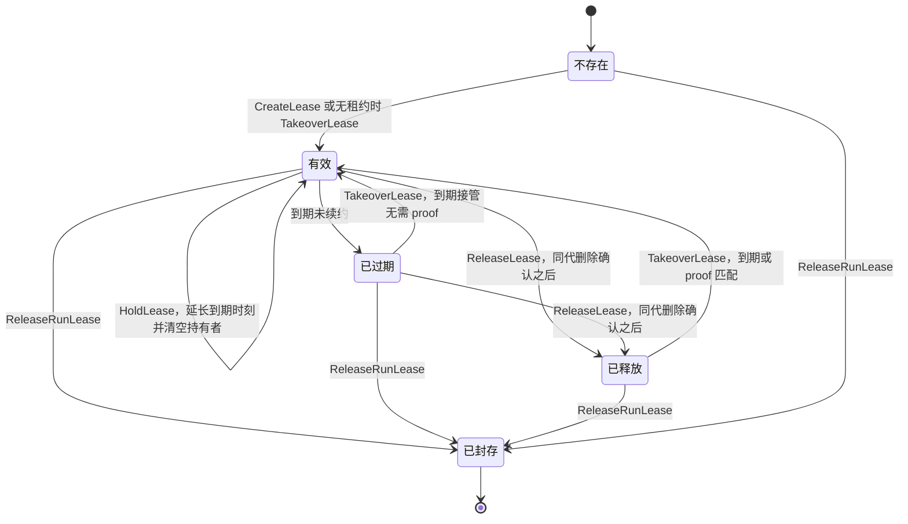
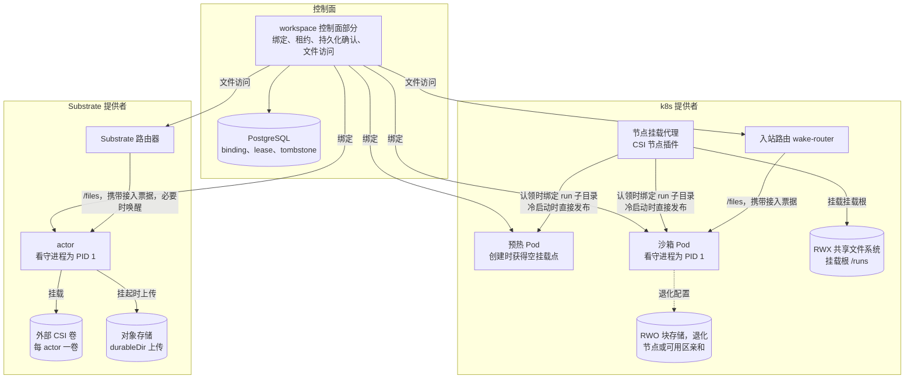
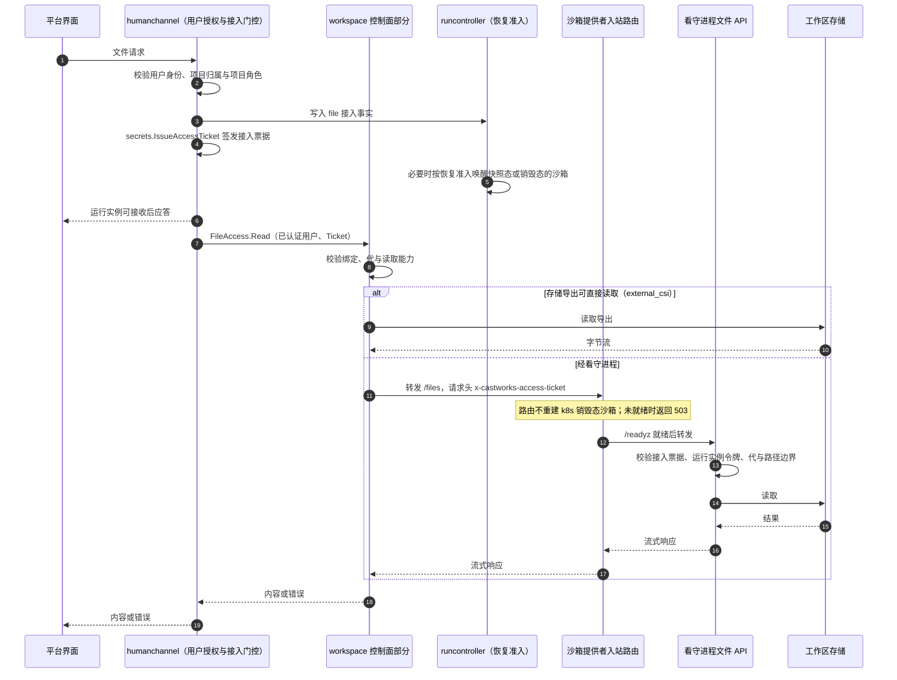

# workspace

`workspace` 位于控制面基础层，并在沙箱内以[看守进程](../../glossary.md)的一部分运行。它为每个[运行实例](../../glossary.md)维护一块跨代存续的[工作区](../../glossary.md)，把存储后端、挂载路径、运行实例 uid 与配额绑定成稳定的绑定记录，用[工作区租约](../../glossary.md)保证同一时刻只有一个[沙箱](../../glossary.md)写入，并在销毁沙箱前给出[持久化确认](../../glossary.md)。它不创建或销毁沙箱，不拥有 Agent 的会话内容，也不决定何时挂起。心智模型：工作区是运行实例跨代不变的家，租约是家门唯一的钥匙；沙箱只是当前住在家里的那一代。

文档较长，不宜顺序通读。第一次阅读按以下顺序：核心概念、职责、走查、绑定与存储模式选择、工作区租约的建立、续约与接管、释放与墓碑、持久化确认、隔离与目录布局、文件访问与文件 API；术语表、外部接口契约、依赖、UML 图与核心数据结构作为核对接口、字段与挂载关系时的参考。并发与事务边界末尾的竞态用例留到最后自测：先按前文的 CAS 规则判断每个交错序列的结果，再与表中结论核对。

## 核心概念

工作区租约是每个运行实例在控制面唯一的一行租约记录，也是工作区写权限的唯一依据。工作区跨代挂载进每一[代](../../glossary.md)沙箱，挂载本身不阻止多个沙箱同时写入；运行实例重建时，旧代与新代的沙箱可能短暂并存。只有持有租约的看守进程可以写；续约、接管与释放都以租约行的条件更新判定，持有者不匹配、租约已释放或已到期时写入被拒绝。租约同时规定换手条件：新代接管必须等旧租约到期，或等[沙箱提供者](../../glossary.md)确认旧沙箱已删除，使“旧代已不再运行”成为可判定的事实，而不是重建路径上的假设。

## 职责

`workspace` 是工作区绑定、持久化确认、沙箱外访问与工作区租约的唯一所有者。职责穷举如下，每条先写本模块执行的动作，再写产生的结果或边界；具体接口、字段与失败处置见后续章节。

- **建立工作区绑定**：在首次预配前为运行实例选择存储模式，分配全局唯一且固定的运行实例 uid，确定各代逐字一致的挂载路径与每运行实例配额，写入绑定记录；绑定在运行实例生命周期内稳定，同一 `run_id` 不能重绑定，换存储模式需要新的运行实例与新的绑定。
- **选择存储模式与退化**：k8s 提供者优先使用 RWX 共享文件系统，块存储为退化配置；Substrate 提供者优先使用每 actor 一卷的外部 CSI 卷（[REF-substrate](../../references.md)），`durableDir` 为退化配置；退化在绑定时决定，不在运行中静默切换持久化语义（[ADR-workspace-persistence-per-provider](../../adr/adr-workspace-persistence-per-provider.md)）。
- **维护工作区租约**：以 `CreateLease` 建立首代租约，以 `TakeoverLease` 在旧租约到期或删除确认到达时把租约交给新代，以 `SetHolderKey` 登记领取沙箱实例的[实例密钥](../../glossary.md)公钥指纹，以 `RenewLease` 接受看守进程附[持有证明](../../glossary.md)的周期续约并绑定持有者，以 `HoldLease` 在[快照](../../glossary.md)期间延长到期时刻并清空持有者，以 `ReleaseLease` 释放当前代租约，以 `ReleaseRunLease` 释放租约并留下墓碑。
- **拒绝非持有者写入**：以租约的 `lease_id`、代与 `holder` 为 CAS 条件，并以 `holder_jkt` 核对续约的持有证明，使同一运行实例在同一时刻只有一个可写沙箱；持有者不匹配、持有证明无效、租约已释放或已到期时拒绝续约与文件写入（[ADR-generation-fencing](../../adr/adr-generation-fencing.md)、[ADR-run-token-audience-and-holder-binding](../../adr/adr-run-token-audience-and-holder-binding.md)）。
- **确认持久化**：在销毁沙箱前按持久化语义执行持久化确认；`sync` 等待工作区写入的 fsync 完成，`on_suspend` 等待同步挂起的对象存储上传完成；确认失败时不产生可销毁的结论。
- **报告持久化语义**：把绑定的 `durability` 随租约建立、接管与查询返回；`runcontroller` 从 `CreateLease`、`TakeoverLease` 的返回与 `GetLease` 的查询取得并持久化，控制面据此选择销毁前的确认方式，不自行推断。
- **提供沙箱外文件访问**：以文件访问接口接收 `humanchannel` 的读取请求，请求携带已认证用户与绑定到运行实例和用户的[接入票据](../../glossary.md)，并原样转发到看守进程的文件 API；按存储模式直接读取导出或经入站路由到达看守进程；文件访问可能唤醒快照态或销毁态的沙箱。
- **提供文件 API**：在看守进程内提供列表、读取、下载与流式读取，路径限定在运行实例子目录内，按[接入票据](../../glossary.md)、看守进程持有的[运行实例令牌](../../glossary.md)、代与[实时接入](../../glossary.md)状态鉴权；写入与上传由 `ToolExec` 的文件写在租约持有者内执行，读写都不绕过租约持有者。
- **施加隔离与配额**：以运行实例 uid、`no_new_privs`、清空 capability bounding set、目录权限 0700 与挂载根 0711、每运行实例目录配额、`no_root_squash` 或 `seteuid` 创建方式，把工作区限制在该运行实例子目录内；`no_root_squash` 只为[节点挂载代理](../../glossary.md)以 root 创建运行实例子目录所需；认领过的预热 Pod 不回收复用。
- **固定工作区布局**：在运行实例子目录内固定 Agent 状态目录、[投递意图日志](../../glossary.md)与已初始化标记的位置，使各代沙箱以逐字一致的路径挂载并以该路径为 Agent 的 cwd；这些状态不放在 rootfs。
- **维护释放墓碑**：在显式结束或放弃时以 `ReleaseRunLease` 释放运行实例的租约并留下墓碑；墓碑之后拒绝该 `run_id` 的一切租约创建与接管，迟到执行器无法在释放之后重建租约。

### 非职责

非职责举例如下，判定标准为职责清单之外、由其他模块拥有的事实与机制。

- 不做沙箱生命周期：预配、认领、冻结、解冻、快照、快照恢复、销毁、预热池与提供者能力归 `sandboxprovider`；本模块只提供绑定与租约，不调用沙箱提供者的生命周期接口。
- 不拥有 Agent 会话内容：会话记录、Agent 状态目录下的文件与 Agent 的读写由 Agent 自身产生；本模块只提供持久化位置与访问边界，不解析、不索引、不改写会话内容。
- 不决定挂起时机与机制：挂起决策、冻结中复评、恢复准入与[安全点](../../glossary.md)的判定归 `suspendpolicy` 与 `runcontroller`；本模块只在被调用时给出持久化确认与租约状态。
- 不执行投递与协议：`Deliver`、`Accepted`、`Consumed`、`LeaseLost` 等协议消息的收发与状态机效果归看守进程与 `runcontroller`；本模块不读写[收件箱](../../glossary.md)、[唤醒信号](../../glossary.md)与运行实例状态机。
- 不签发或校验运行实例令牌与接入票据：两者的签发、轮换与签名校验归 `secrets`；文件 API 的鉴权由看守进程校验接入票据并以自身持有的运行实例令牌核对代与实时接入状态完成，本模块不持有令牌、票据签名密钥，也不校验票据，只把 `FileAccess` 请求中的 `Ticket` 原样转发。
- 不生成出口策略与凭据：允许主机、占位符规则与出口策略归 `connectorhub`；真实凭据归 `secrets` 与密钥库；工作区内不存放长期凭据。
- 不判断实时接入：接入事实的写入、续写与到期归 `humanchannel` 与 `runcontroller`；本模块只读取调用方给出的接入状态与代，不决定是否唤醒运行实例。
- 不提供文件回滚、备份、归档与跨运行实例共享：工作区是单运行实例的私有目录；这些能力不在本模块的接口内。
- 不管理挂载根的创建与存储后端的部署：挂载根、共享文件系统、块存储、外部 CSI 卷与对象存储由部署准备，挂载根在 k8s 共享文件系统模式下由节点挂载代理挂载；本模块在绑定与预配时使用它们，并在缺失时以明确的错误拒绝。

## 术语表

| 术语 | 英文对照 | 适用范围 | 定义 |
| --- | --- | --- | --- |
| 绑定 | binding | workspace | 运行实例到存储模式、卷或导出标识、挂载路径、运行实例 uid、配额与持久化语义的映射，跨代稳定 |
| 存储模式 | storage mode | workspace | 工作区承载方式的闭集：`shared_fs`、`block`、`external_csi`、`durable_dir` |
| 沙箱外访问 | out-of-sandbox access | workspace | 沙箱不运行或人在平台界面时对工作区文件的访问，由 `humanchannel` 以接入票据调用本模块，按存储模式读取导出或经入站路由到达看守进程的文件 API |
| 删除确认 | delete confirmation | workspace | 沙箱提供者整代销毁某一代沙箱后返回的确认（`sandboxprovider` 的 `DestroyReceipt`），携带 `run_id` 与被删除的代；作为接管 `proof` 时其 `run_id` 必须等于租约的 `run_id`，其代必须等于租约所属的代；`DestroySandbox` 的单个沙箱删除确认不构成 `proof` |
| 释放墓碑 | release tombstone | workspace | `ReleaseRunLease` 留下的运行实例级标记，此后拒绝该 `run_id` 的一切租约创建与接管 |

## 外部接口契约

稳定性承诺按接口类别给出：绑定接口对 `sandboxprovider` 稳定；租约接口对 `runcontroller`、`sandboxprovider` 与看守进程稳定；持久化确认接口对看守进程与 `sandboxprovider` 的销毁路径稳定；文件 API 对入站路由稳定；沙箱外读取接口对 `humanchannel` 稳定。新增字段是兼容变更；改变 CAS 条件、`durability` 取值或文件 API 的操作集合则改变契约，须同步修改本模块文档与依赖方。

### 调用方认证与授权

绑定接口、租约接口、持久化确认接口与沙箱外读取接口的网络方法只在内部监听器上提供：对端须以 SPIFFE 身份经 mTLS 认证，监听器不接受非 SPIFFE 对端，也不对沙箱网段开放。各方法允许的调用方取[架构文档授权表](../architecture.md#认证与授权边界)中 `workspace` 的行，穷举为：`LeaseService` 的 `CreateLease`、`TakeoverLease`、`HoldLease`、`ReleaseLease`、`ReleaseRunLease` 与 `GetLease` 只接受 `runcontroller`；`SetHolderKey` 只接受 `sandboxprovider`；`RenewLease` 只接受看守进程，且只在[面向沙箱的端点](../../glossary.md) `lease` 上提供；`BindingService` 的 `Bind` 与 `Resolve` 只接受 `sandboxprovider`，`Unbind` 接受 `sandboxprovider` 与 `runcontroller`；`Ensure` 不经网络，由[节点挂载代理](../../glossary.md)或看守进程的沙箱侧部分本地执行；`Persistence.Confirm(Mode=suspend_upload)` 只接受 `sandboxprovider`，`Confirm(Mode=fsync)` 不经网络，由看守进程的沙箱侧部分本地执行；`FileAccess` 只接受 `humanchannel`。对端不在该方法的允许集合内时以不可重试的未授权错误拒绝并写审计（[ADR-control-plane-call-authentication](../../adr/adr-control-plane-call-authentication.md)）。

### 绑定接口

`sandboxprovider` 在预配或认领沙箱之前调用绑定接口取得存储模式、挂载路径、运行实例 uid 与配额；运行实例子目录由 `Ensure` 创建或校验，执行方按存储模式确定：k8s 共享文件系统模式下由[节点挂载代理](../../glossary.md)在节点上执行，块存储、外部 CSI 卷与 `durable_dir` 模式下由看守进程的沙箱侧部分执行。卷或导出标识由 `sandboxprovider` 在预配或认领时确定并传入。

```go
type BindingService interface {
    Bind(ctx context.Context, req BindRequest) (Binding, error)
    Ensure(ctx context.Context, runID RunID) (Binding, error) // 不经网络：由节点挂载代理或看守进程的沙箱侧部分本地调用
    Resolve(ctx context.Context, runID RunID) (Binding, error)
    Unbind(ctx context.Context, runID RunID) error
}

type BindRequest struct {
    RunID            RunID
    ProjectID        string
    Provider         ProviderKind // k8s | substrate
    PreferredStorage StorageMode  // 可为空；为空时由本模块按提供者能力选择
    VolumeRef        string
}

type Binding struct {
    RunID       RunID
    Provider    ProviderKind
    StorageMode StorageMode    // 实际选定的模式，闭集 shared_fs | block | external_csi | durable_dir
    VolumeRef   string         // sandboxprovider 提供的卷或导出标识
    MountPath   string         // 各代逐字一致的挂载路径
    RunUID      int            // 全局唯一且固定的运行实例 uid
    QuotaBytes  int64
    Durability  Durability     // sync | on_suspend
    Placement   *Placement     // 块存储退化时的节点或可用区亲和
}

type Placement struct {
    NodePool string
    Zone     string
}
```

- `Bind` 以 `run_id` 幂等：同参返回已有绑定，不同参返回冲突错误；`Ensure` 以 `run_id` 幂等创建或校验运行实例子目录（0700、运行实例 uid、配额），执行方见上；`Resolve` 只读，供文件访问与看守进程解析挂载路径；`Unbind` 在运行实例结束后清理绑定，不删除工作区数据。绑定不返回 `lease_id`；`lease_id` 由租约接口建立并在 `Provision` 或 `Claim` 请求中传入，绑定只返回存储与挂载信息。
- `Provider` 与 `StorageMode` 的取值是闭集。`k8s` 允许 `shared_fs` 与 `block`；`substrate` 允许 `external_csi` 与 `durable_dir`。`Bind` 按提供者能力与 `PreferredStorage` 选择实际模式：首选可用时采用首选，不可用且存在退化配置时采用退化并在 `Binding` 中报告实际模式，没有退化配置时返回不可重试错误。调用方以返回的 `StorageMode` 与 `Durability` 为准，不自行推断。
- `RunUID` 由本模块在绑定事务内从全局序列分配并写入绑定；同一 `run_id` 的每一代使用同一 uid，重建不递归 `chown`。
- `QuotaBytes` 取自项目策略；具体数值由部署配置，本模块只保证每运行实例子目录受该配额约束。
- `Durability` 由存储模式决定：`shared_fs`、`block` 与 `external_csi` 为 `sync`，`durable_dir` 为 `on_suspend`。绑定之后不改变，改变需要新的运行实例与新的绑定。
- 错误按类别穷举：不可重试错误为参数非法、首选存储模式不属于提供者闭集、运行实例已封存、存储后端缺失；暂时性错误为数据库不可用、超时与锁等待超时。

### 工作区租约接口

租约接口是 `runcontroller`、`sandboxprovider`、看守进程与本模块之间的唯一租约入口，全部方法按标注的键幂等。签名与依赖方一致：

```go
type LeaseService interface {
    CreateLease(ctx context.Context, runID RunID, generation int, attemptID string) (Lease, error)
    TakeoverLease(ctx context.Context, runID RunID, generation int, attemptID string, proof *DeleteProof) (TakeoverResult, error)
    SetHolderKey(ctx context.Context, runID RunID, leaseID string, generation int, instanceJKT string) error
    RenewLease(ctx context.Context, leaseID string, generation int, sandboxID string, proof HolderProof) error
    HoldLease(ctx context.Context, runID RunID, leaseID string, generation int, until time.Time, holder string) error
    ReleaseLease(ctx context.Context, runID RunID, generation int) error
    ReleaseRunLease(ctx context.Context, runID RunID) error
    GetLease(ctx context.Context, runID RunID) (LeaseState, error)
}

type HolderProof struct {
    InstanceKey json.RawMessage // 实例公钥 JWK
    IAt         int64           // 签名时刻，Unix 秒
    Sig         string          // 实例私钥的 Ed25519 签名，base64url
}

type Lease struct {
    LeaseID    string
    Durability Durability
}

type TakeoverResult struct {
    Lease     *Lease
    NotBefore time.Time // 旧租约未到期且无有效 proof 时返回
}

type DeleteProof struct {
    RunID      RunID
    Generation int
}

type LeaseState struct {
    LeaseID    string
    Generation int
    Holder     string
    HolderJKT  string
    ExpiresAt  time.Time
    Durability Durability
    Released   bool
}
```

- `CreateLease` 只用于第 1 代，以 `(run_id, generation, attempt_id)` 幂等，`attempt_id` 取 `resume_id`；同一幂等键的重复调用返回首次结果。运行实例已有租约时，请求的代必须大于租约的代，否则返回不可重试的代错误；已有未到期且未释放的租约、或运行实例已有墓碑时拒绝。
- `TakeoverLease` 用于重建，以 `(run_id, generation, attempt_id)` 幂等，`attempt_id` 取 `resume_id`；同一幂等键的重复调用返回首次结果。运行实例已有租约且请求的代不大于 `lease.generation` 时返回不可重试的代错误。运行实例尚无租约时直接建立；旧租约已到期时不需要 `proof`；旧租约未到期时只在 `proof` 是沙箱提供者整代销毁的删除确认、其 `run_id` 等于 `run_id`、且其携带的代等于 `lease.generation` 时接管；`DestroySandbox` 的单个沙箱删除确认不构成 `proof`；其余情形返回旧租约的到期时刻作为 `NotBefore`。持有者为空与租约已释放都不构成接管条件。
- `SetHolderKey` 由 `sandboxprovider` 在引导接口返回领取响应之前调用，把沙箱实例的公钥指纹登记为租约的 `holder_jkt`。CAS 条件为 `lease_id` 与代匹配、`released=false`、`holder_jkt` 为空或相等；不满足时返回不可重试错误。`CreateLease` 与 `TakeoverLease` 建立的租约 `holder_jkt` 为空。
- `RenewLease` 由看守进程周期调用，只在面向沙箱的端点 `lease` 上提供。CAS 条件为 `lease_id` 与代匹配、`released=false`、`expires_at > now()`，且持有者为空或等于 `sandbox_id`；持有者为空时由本次续约绑定为该沙箱。调用以 `lease_id`、代与[持有证明](../../glossary.md)认证：`instance_jkt(proof.InstanceKey)` 必须等于 `lease.holder_jkt`，`proof.Sig` 有效且 `|now − proof.IAt| ≤ T_proof_skew`（60 s），否则以不可重试错误拒绝。它不经 `secrets` 校验运行实例令牌，也不以令牌未过期为前提。
- `HoldLease` 用于快照期间：以 `lease_id`、代匹配、`released=false` 且持有者为空或等于 `holder` 为 CAS 条件，把到期时刻设为 `until` 并清空持有者；`holder_jkt` 不清空。快照恢复的沙箱以首次续约重新绑定。持有者已是其他沙箱时为空操作。
- `ReleaseLease` 只在同代沙箱的删除确认之后调用，以 `lease.generation=generation` 为 CAS 条件；租约已被更大的代接管时为空操作。释放把租约标记为已释放并清空持有者，`expires_at` 不变，此后 `RenewLease` 以 CAS 失败返回；释放本身不构成接管条件。
- `ReleaseRunLease` 用于显式结束与放弃，不论租约的代为何值都释放并留下墓碑；此后该 `run_id` 的 `CreateLease` 与 `TakeoverLease` 一律返回不可重试的墓碑错误。
- `GetLease` 只接受 `runcontroller`，返回当前租约行；运行实例没有租约时返回不存在错误，租约已释放时 `Released` 为真。调用失败与结果不符由调用方分别处理：`runcontroller` 把调用失败按可重试拒绝处理。
- `CreateLease` 返回的 `durability` 取该运行实例目标存储模式的配置值：第 1 代在预配之前建立租约，此时尚无绑定记录。`sandboxprovider` 在预配或认领时调用 `Bind`；若存储模式因外部 CSI 不可用而退化为 `durable_dir`，绑定记录的 `Durability` 变为 `on_suspend`，新代沙箱首次 `Hello` 时 `GetLease` 返回绑定后的实际值，`runcontroller` 以它写入 `ws_durability`。预配与 `Hello` 之间不执行以挂起为目的的销毁，暂定值不进入 I9 判定。

### 持久化确认接口

持久化确认接口用于 I9 的工作区持久化检查：`sync` 模式由看守进程在 `ReadyToSuspend` 之前调用，`on_suspend` 模式由 `sandboxprovider` 的销毁路径在同步挂起返回之后调用。

```go
type Persistence interface {
    Confirm(ctx context.Context, req ConfirmRequest) (ConfirmResult, error)
}

type ConfirmRequest struct {
    RunID      RunID
    Generation int
    LeaseID    string
    SuspendID  string      // Mode=suspend_upload 时由销毁路径携带，用于审计与重试关联
    Mode       ConfirmMode // fsync | suspend_upload
}

type ConfirmResult struct {
    Durability  Durability
    ConfirmedAt time.Time
}
```

- `Mode=fsync` 用于 `sync` 语义：由看守进程在 `ReadyToSuspend` 之前调用，确认当前代的工作区写入已关闭并完成 fsync，返回确认时刻。共享文件系统、块存储与外部 CSI 卷在销毁前使用该模式。
- `Mode=suspend_upload` 用于 `on_suspend` 语义：由销毁路径在沙箱提供者的同步挂起返回之后调用，核对 `durableDir` 的上传完成标记并返回确认时刻；上传失败返回暂时性错误。
- `Mode` 与绑定的 `durability` 不符时返回不可重试错误；调用方必须以租约返回的 `durability` 选择模式，不自行推断。
- 确认以 `(run_id, generation, lease_id)` 幂等；重复确认返回同一结果，不重复上传。`SuspendID` 只用于审计与重试关联，不是幂等键的一部分。
- 确认失败不产生“工作区已持久化”的结论：`fsync` 失败时看守进程不得发出 `ReadyToSuspend`；`suspend_upload` 失败时销毁路径不得把沙箱判定为已销毁，`runcontroller` 不进入 `Suspended`。

### 文件 API

文件 API 在看守进程内运行，经沙箱提供者的入站路由到达，供 `humanchannel` 经 `workspace` 转发的沙箱外文件访问使用。操作集合是闭集，只提供读取；写入与上传由 `ToolExec` 的文件写承担。

```go
type FileAPI interface {
    List(ctx context.Context, req FileRequest) (ListResult, error)
    Read(ctx context.Context, req ReadRequest) (io.ReadCloser, error)
    Download(ctx context.Context, req DownloadRequest) (io.ReadCloser, error)
    Stream(ctx context.Context, req StreamRequest) (io.ReadCloser, error)
}

type FileRequest struct {
    RunID      RunID
    Generation int
    Path       string // 运行实例子目录内的相对路径
    Ticket     string // 接入票据，经请求头 x-castworks-access-ticket 原样转发
}

type ReadRequest struct {
    FileRequest
    Offset int64
    Length int64
}

type DownloadRequest struct {
    FileRequest
}

type StreamRequest struct {
    FileRequest
    Offset int64
}

type FileInfo struct {
    Name       string
    Size       int64
    Mode       fs.FileMode
    ModifiedAt time.Time
    IsDir      bool
}

type ListResult struct {
    Entries []FileInfo
}
```

| 操作 | 语义 |
| --- | --- |
| `List` | 列出目录项，返回名称、大小、模式、修改时刻与是否目录；不跟随指向目录外的符号链接 |
| `Read` | 按偏移与长度读取字节流；越过文件末尾时返回已读部分与结束标记 |
| `Download` | 返回整文件字节流，等价于从偏移 0 开始的 `Read` |
| `Stream` | 从给定偏移持续读取，供日志与会话记录的断线续传 |

- 路径以运行实例子目录为根逐段解析，拒绝 `..`、绝对路径与指向根外的符号链接；越界返回不可重试的路径错误。
- `workspace` 把 `FileAccess` 请求中的 `Ticket` 放进请求头 `x-castworks-access-ticket`，经入站路由原样转发。看守进程校验票据的签名、`aud=warden`、`run_id`、代、`channel=file`、有效期与一次性 `jti`（规则见 [agentprotocol](design-agentprotocol.md) 的入站端点契约）；不通过时返回 401、不读文件并计数 `access_ticket_rejected`。看守进程另以自身持有的运行实例令牌核对请求携带的代，并校验当前租约的持有者为自身；读取发生在租约持有者内，不绕过单写者边界。读取要求 `file` 实时接入有效。
- 文件访问可能唤醒快照态与销毁态的沙箱：`humanchannel` 先写入 `file` 接入事实并签发接入票据，再由 `workspace` 携带票据经入站路由到达文件 API；`ui_session` 接入不唤醒沙箱。
- 错误分类：路径越界、接入票据无效、令牌无效、代不匹配、租约非持有者、文件不存在与偏移非法为不可重试；存储暂时不可用为可重试。

### 沙箱外读取接口

沙箱外读取接口是控制面对文件访问的入口，只接受 `humanchannel` 的 SPIFFE 身份调用。`humanchannel` 已按[项目角色](../../glossary.md)授权用户并写入 `file` 接入事实，再把接入票据放进请求。

```go
type FileAccess interface {
    Capability(ctx context.Context, runID RunID) (ReadCapability, error)
    List(ctx context.Context, ref FileRef) ([]FileInfo, error)
    Read(ctx context.Context, ref FileRef, offset, length int64) (io.ReadCloser, error)
    Stream(ctx context.Context, ref FileRef, offset int64) (io.ReadCloser, error)
}

type FileRef struct {
    RunID      RunID
    Generation int
    Path       string
    Ticket     string // 接入票据，原样转发到看守进程的 /files
}

type ReadCapability struct {
    Direct             bool // 存储导出可直接读取
    RequiresFileAttach bool // 读取会唤醒快照态或销毁态的沙箱
    Durability         Durability
}
```

- `Capability` 报告绑定的读取能力：`external_csi` 的导出在可直接读取时 `Direct` 为真；`shared_fs` 只挂载在沙箱节点池、控制面没有该挂载，`block` 为 RWO 在沙箱挂接期间不能由控制面同时读取，`durable_dir` 没有存储级读取接口，三者的 `Direct` 均为假。`Direct` 为假时 `RequiresFileAttach` 为真。
- `humanchannel` 在调用前校验用户身份、项目归属与[项目角色](../../glossary.md)，写入 `file` 接入事实并签发接入票据；本模块校验运行实例、代与绑定的归属，不信任调用方传入的路径根。读取方法（`List`、`Read`、`Stream`）要求 `Ticket` 非空并原样转发。
- 直接读取沿用文件 API 的路径解析：以运行实例子目录为根逐段解析，拒绝 `..`、绝对路径与指向根外的符号链接，越界返回 `ErrPathOutsideWorkspace`。读取在 `Direct` 为真且沙箱无需参与时直接读取存储导出；其余情形经沙箱提供者的入站路由转发到当前代看守进程的文件 API，必要时唤醒沙箱。写入与上传不走直接导出，由 `ToolExec` 的文件写在租约持有者内执行。
- 接入票据由 `humanchannel` 经 `secrets.IssueAccessTicket` 签发，`workspace` 不持有签名密钥，只原样转发；经看守进程的读取由看守进程验签，直接读取的授权由唯一调用方 `humanchannel` 的 SPIFFE 身份与其在调用前完成的项目角色判定保证（[ADR-user-facing-authorization](../../adr/adr-user-facing-authorization.md)）。
- 接口只提供读；下载与流式读取由文件 API 承担；写入与上传由 `ToolExec` 的文件写承担，不经过沙箱外读取接口，使所有写操作经过租约持有者。

## 依赖

依赖方向与[模块依赖图](../architecture.md#模块依赖图)一致：本模块是基础层，不依赖 `runcontroller`、`sandboxprovider`、`warden` 与事件源模块。`runcontroller`、`sandboxprovider` 与 `humanchannel` 依赖本模块；本模块对沙箱提供者入站路由、看守进程文件 API 与 `ToolExec` 文件写的调用是运行时调用，不是代码依赖。`workspace` 的节点侧部分链接进[节点挂载代理](../../glossary.md)、沙箱侧部分链接进看守进程，是模块的实现位置，不构成对 `sandboxprovider` 或 `warden` 模块的调用（[ADR-per-run-workspace-mount](../../adr/adr-per-run-workspace-mount.md)）。

- **PostgreSQL**：保存绑定记录、租约行与释放墓碑；租约的建立、接管、续约、持有者清空与释放都在数据库事务内以条件 UPDATE 完成。
- **RWX 共享文件系统**：k8s 提供者的默认工作区承载，例如 CephFS、JuiceFS、NFS 或 EFS 类。挂载根只由[节点挂载代理](../../glossary.md)在节点上挂载，不进入任何沙箱 Pod 与预热 Pod；Pod 以 CSI 内联临时卷 `castworks-workspace` 挂载工作区挂载路径（`Binding.MountPath`，各代逐字一致），`mountPropagation: HostToContainer`。预热池与认领由 SandboxWarmPool 与 SandboxClaim 承担（[REF-agent-sandbox](../../references.md)）。
- **RWO 块存储**：k8s 提供者的退化配置，有节点或可用区亲和，不能预绑定预热池；挂接与强制分离需要等待，重建时延高于共享文件系统。
- **Substrate actor 卷**：actor 只接受 `durableDir`、`external`、`image` 与 `systemInfo` 卷，不能直挂 PVC 或透传 worker Pod 的卷。`external` 即外部 CSI 卷，每 actor 一卷；`durableDir` 在挂起时上传对象存储。
- **对象存储**：承载 `durableDir` 的上传数据；同步挂起上传完成后，工作区才可被判定为持久化。
- **沙箱提供者的入站路由**：运行时把沙箱外文件访问转发到当前代看守进程的文件 API；k8s 路径为 `wake-router`，Substrate 路径为路由器。本模块不区分路由实现。
- **看守进程**：文件 API 在沙箱侧执行，写入与上传由 `ToolExec` 的文件写在沙箱侧执行；`fsync` 确认由看守进程执行，`on_suspend` 确认在销毁路径执行。看守进程还承担周期续约与 `LeaseLost` 上报，本模块只维护租约本身。
- **`secrets` 与运行实例令牌**：文件 API 的鉴权由看守进程校验接入票据并以自身持有的运行实例令牌核对代与实时接入状态完成；本模块不持有令牌与接入票据签名密钥，也不校验令牌或票据。

## UML 图

租约状态图固定租约行的生命周期与接管条件；提供者部署与挂载图固定 k8s 与 Substrate 的存储位置、挂载路径与退化关系；文件 API 时序图固定沙箱外访问从身份校验到文件内容的调用顺序。图中不表达的约束由每张图后的正文给出。

### 租约状态图



状态按优先级判定：`已封存` 高于 `已释放`，`已释放` 高于 `已过期`，`已过期` 高于 `有效`。租约到期不是一次写入，而是 `expires_at` 与当前时刻的比较结果；状态图把它画成状态，是为了说明接管与续约的条件，不代表数据库中存在 `expired` 列。`TakeoverLease` 成功后产生新的 `lease_id`，运行实例回到 `有效`；旧的 `lease_id` 不再被任何接口接受。

### 提供者部署与挂载图



k8s 路径上，共享文件系统的挂载根只由节点挂载代理挂载；预热 Pod 在创建时获得空白挂载点，认领时 `sandboxprovider` 调用 `NodeMountAgent.BindWorkspace(ctx, BindTarget{PodUID, RunID, Generation, RunUID, QuotaBytes})`，该接口只接受 `sandboxprovider`；代理执行 `Ensure` 并把 `<挂载根>/<run_id>` 绑定挂载到 Pod 的卷发布目录，经传播出现在容器内；冷启动 Pod 在 `NodePublishVolume` 时执行 `Ensure` 并直接把子目录发布到卷，效果与 `subPath` 相同。块存储退化配置不能预绑定预热池，绑定必须携带节点或可用区亲和。Substrate 路径上，外部 CSI 卷由提供者以每 actor 一卷的方式挂载，内容不进快照、`Revert` 不回滚；`durableDir` 没有存储级导出，挂起时上传对象存储，沙箱外读取必须经路由器唤醒 actor 后到达文件 API。控制面对 k8s 与 Substrate 路径的文件访问按存储模式经存储导出或沙箱提供者的入站路由，不直接访问 Pod 或 actor 内部。

### 文件 API 时序图



直接读取分支只用于 `external_csi` 的读，其余读取进入看守进程分支。经看守进程的读取可能唤醒快照态或销毁态的沙箱：`humanchannel` 先校验用户与项目角色、写入 `file` 接入事实并签发票据，`runcontroller` 按恢复准入唤醒；入站路由在 `/readyz` 就绪后转发，不负责 k8s 销毁态沙箱的重建。文件内容经 `humanchannel` 返回界面，不进入收件箱。写入与上传由 `ToolExec` 的文件写经同一租约持有者执行，不经过本时序图的读取路径。入站路由的失败与看守进程的错误分别返回，调用方据错误类别决定重试或向用户呈现。

## 核心数据结构

持久化记录为绑定、租约与释放墓碑，全部存于控制面的 PostgreSQL；工作区文件本身不在数据库事务内。绑定在运行实例生命周期内稳定；租约每个运行实例一行，接管时替换 `lease_id`；墓碑每个运行实例一行，写入后不再删除。

| 记录 | 键 | 字段 | 语义 |
| --- | --- | --- | --- |
| `workspace_binding` | `run_id` | `provider`、`storage_mode`、`volume_ref`、`mount_path`、`run_uid`、`quota_bytes`、`durability`、`placement` | 运行实例到存储与目录的稳定映射；`run_uid` 全局唯一且跨代不变，`placement` 只在块存储退化时非空 |
| `workspace_lease` | `run_id`；幂等键 `(run_id, generation, attempt_id)` | `lease_id`、`generation`、`attempt_id`、`holder`、`holder_jkt`、`expires_at`、`durability`、`released` | 当前租约；`attempt_id` 是产生当前租约的成功尝试，只有成功的建立结果按幂等键返回；`holder` 为空表示尚未绑定或快照期间已清空，`holder_jkt` 为领取时登记的实例公钥指纹，`holder` 清空不清空它；`released` 为真表示已释放；`NotBefore` 不持久化，每次重试重新判定 |
| `workspace_tombstone` | `run_id` | `released_at` | 运行实例结束或放弃的墓碑；存在即拒绝租约创建与接管 |

租约的 `holder_jkt` 由 `sandboxprovider` 在领取时经 `SetHolderKey` 写入，`holder` 由看守进程首次续约绑定，绑定时写入该代沙箱的 `sandbox_id`；`HoldLease` 清空 `holder` 但不改变 `holder_jkt`，快照恢复后的沙箱以首次续约重新绑定。`CreateLease` 与 `TakeoverLease` 建立的租约 `holder_jkt` 为空。`durability` 与绑定一致，不因接管改变；同一运行实例的存储模式在绑定后不变。

### 状态一览

状态按优先级判定；同一租约行可能同时满足多个条件，表中状态是接口与调用方观察到的最高优先级状态。

| 状态 | 一句话含义 | 当前动作 | 直觉画面 |
| --- | --- | --- | --- |
| 不存在 | 运行实例尚无租约行 | `workspace` 只接受 `CreateLease` 或无租约时的 `TakeoverLease` | 登记簿还没有这一行 |
| 有效 | 租约行存在且未释放，持有者为空或为某沙箱，到期时刻在未来 | `workspace` 接受匹配 `lease_id`、代与持有者的续约；不满足接管条件时拒绝接管并返回 `NotBefore` | 登记簿写着谁在用、用到何时 |
| 已过期 | 到期时刻已过，持有者未再续约 | 新代可无 `proof` 接管；`workspace` 对旧持有者的续约返回 CAS 失败；同代删除确认之后可被 `ReleaseLease` 标记为已释放 | 借书卡过期，下一位可以直接接手 |
| 已释放 | 释放标记为真、持有者已清空，但租约行与到期时刻保留 | `workspace` 拒绝续约；接管仍按到期或 `proof` 判定，释放本身不构成接管条件 | 书已归还，柜子占到期满 |
| 已封存 | 运行实例显式结束或放弃后留下的墓碑 | `workspace` 拒绝该 `run_id` 的 `CreateLease` 与 `TakeoverLease` | 整排柜子被封锁，不再办理 |

## 核心算法与流程

### 走查

初始条件：运行实例 `R` 首次预配，存储模式为 `shared_fs`，租约有效期 `T_lease`，沙箱标识 `sb-1` 属于第 1 代。下表逐步给出调用与持久化结果。

| 步骤 | 调用或事件 | 持久化结果 |
| --- | --- | --- |
| 1 | `Bind(R, project, k8s, shared_fs, volume)` 与节点挂载代理执行的 `Ensure(R)` | 绑定 `{storage_mode=shared_fs, mount_path=/runs/R, run_uid=2001, durability=sync}`；运行实例子目录由 `Ensure` 以 0700 创建并设配额 |
| 2 | `CreateLease(R, 1, a1)` | 租约 `{lease_id=L1, generation=1, holder=null, holder_jkt=null, expires_at=now+T_lease, released=false}` |
| 3 | 领取前 `SetHolderKey(R, L1, 1, jkt-1)`；看守进程首次续约 `RenewLease(L1, 1, sb-1, proof)` | `holder_jkt=jkt-1`；`holder=sb-1`，`expires_at` 延长；续约成功之后看守进程才发 `Hello` |
| 4 | 第 1 代整代销毁的删除确认 `{R, 1}` 到达后 `ReleaseLease(R, 1)` | `released=true`，`holder=null`，`expires_at` 不变 |
| 5 | `TakeoverLease(R, 2, a2, proof={R, 1})` | 旧租约未到期，`proof` 的代等于 `L1.generation`，接管成功；新租约 `{lease_id=L2, generation=2, holder=null, holder_jkt=null, durability=sync}` |
| 6 | 显式结束 `ReleaseRunLease(R)` | 写入墓碑；此后 `CreateLease(R, ...)` 与 `TakeoverLease(R, ...)` 均返回墓碑错误 |

第 5 步的替代路径：旧租约已到期时 `proof` 可为空；旧租约未到期且 `proof` 为空、不是整代销毁的删除确认或代不匹配时返回 `NotBefore=expires_at`，调用方等待到期后重试，不产生新租约。第 4 步先释放再接管不是必需顺序：第 1 代整代销毁的删除确认也可以直接作为第 5 步的 `proof`，任一顺序都要求 `proof` 的代为租约所属的代。

Substrate 提供者的运行实例在快照时多出两步，位于第 3 步之后：快照前 `HoldLease(R, L1, 1, until=now+2T_lease, holder=sb-1)`，持久化结果为 `holder=null`、`holder_jkt=jkt-1`、`expires_at=now+2T_lease`；快照恢复沿用同一沙箱，看守进程以首次续约 `RenewLease(L1, 1, sb-1, proof)` 重新绑定 `holder=sb-1`。k8s 提供者不具备快照能力，不经过这两步；第 2 步起的租约步骤在两个提供者上相同，第 1 步的存储模式按提供者选择，见[绑定与存储模式选择](#绑定与存储模式选择)。

### 绑定与存储模式选择

1. `Bind` 在数据库事务内解析项目策略、选择存储模式、分配 `run_uid` 并写入绑定；`Ensure` 在挂载点就绪后以幂等方式创建运行实例子目录，已存在时校验所有者、权限与配额，不重复创建。k8s 共享文件系统模式下 `Ensure` 由节点挂载代理在发布卷或绑定认领时执行，其余模式由看守进程执行。绑定接口不创建卷，卷或导出由 `sandboxprovider` 提供。
2. k8s 提供者优先选择 `shared_fs`：共享文件系统无卷挂接步骤、无节点亲和，预热 Pod 在创建时获得空白挂载点，认领时节点挂载代理执行 `Ensure` 并把运行实例子目录绑定挂载进去。`shared_fs` 不可用时选择 `block`，绑定携带节点或可用区亲和；块存储不能预绑定预热池，认领与重建都受挂接等待约束。
3. Substrate 提供者优先选择 `external_csi`：每 actor 一卷，写穿持久、崩溃不丢，内容不进快照、`Revert` 不回滚；外部 CSI 不可用时选择 `durable_dir`，持久化语义变为 `on_suspend`，绑定时即写入，运行中不切换。
4. 存储模式在绑定时固定。已绑定 `external_csi` 的运行实例在运行中遇到 CSI 不可用时，提供者错误向上返回，`sandboxprovider` 的预配或恢复按自身规则失败；本模块不静默退化为 `durable_dir`，因为退化会改变持久化语义与安全点的判定。
5. 退化配置的补偿由绑定携带：`durable_dir` 的回合边界销毁一律使用同步挂起，上传完成才返回；回合中崩溃按“回合被中断”重投事件，已接受的事件带 `redelivery=true`，该回合的文件改动可能丢失。

### 工作区租约的建立、续约与接管

1. **建立**：第 1 代由 `CreateLease` 建立，`attempt_id` 取 `resume_id`。运行实例已有租约时，请求的代必须大于租约的代，否则返回不可重试的代错误；已有未到期且未释放的租约时返回冲突；已有墓碑时返回墓碑错误。相同 `(run_id, generation, attempt_id)` 的重复调用返回同一 `lease_id` 与 `durability`。
2. **续约**：看守进程按小于租约有效期的周期调用 `RenewLease`，附以实例私钥生成的持有证明。CAS 条件为 `lease_id` 与代匹配、`released=false`、`expires_at > now()`、持有者为空或等于 `sandbox_id`；持有者为空时本次续约绑定持有者。持有证明的实例公钥指纹必须等于 `holder_jkt`，签名与时窗必须有效。持有者不同、持有证明无效、租约已释放或已到期时 CAS 失败，调用方停止写入并按续约失败处理。
3. **快照持有**：快照前调用 `HoldLease`，把到期时刻延长到快照保留期可覆盖的范围并清空持有者，`holder_jkt` 保留。清空持有者使快照恢复的沙箱实例以首次续约重新绑定；旧沙箱在快照期间不再执行，迟到的续约由 CAS 的 `expires_at`、持有证明与执行顺序决定，不与快照恢复并发写入。
4. **接管**：重建时调用 `TakeoverLease`，`attempt_id` 取 `resume_id`。请求的代必须大于当前租约的代，同一幂等键的重复调用除外。运行实例尚无租约时直接建立；旧租约已到期时无需 `proof`；旧租约未到期时只接受沙箱提供者整代销毁的删除确认作为 `proof`，且其 `run_id` 相同、代等于 `lease.generation`；`DestroySandbox` 的单个沙箱删除确认不构成 `proof`；其余返回 `NotBefore`。持有者为空与租约已释放都不构成接管条件。
5. **查询**：`GetLease` 只对 `runcontroller` 开放，返回 `lease_id`、代、持有者、`holder_jkt`、到期时刻、`durability` 与 `released`。调用方以它核对 `Hello`、判断是否可写与选择持久化确认模式。
6. **看守进程的义务**：首次续约成功之后才发 `Hello`；在 `expires_at` 减时钟余量之前停止向工作区写入；续约失败时冻结或杀死 Agent 进程树，并上报 `LeaseLost{lease_id, expires_at}`。本模块不代为执行这些保护动作。

### 释放与墓碑

1. `ReleaseLease` 只在同代沙箱的删除确认之后调用。CAS 条件为 `lease.generation=generation`；租约已被更大的代接管时为空操作。释放标记为真并清空持有者，`holder_jkt` 随租约保留到接管建立新租约，`expires_at` 不变，此后 `RenewLease` 以 CAS 失败返回。
2. 释放不是接管条件：`ReleaseLease` 之后、到期之前，`TakeoverLease` 仍要求 `proof` 或等待到期；这避免一个已释放但仍被旧沙箱引用的租约被无确认地转给新代。
3. `ReleaseRunLease` 在显式结束与放弃时调用，不论租约的代为何值都释放并写入墓碑。墓碑是运行实例级的，存在即拒绝该 `run_id` 的 `CreateLease` 与 `TakeoverLease`；已领取、在途的接管在写事务内看到墓碑后失败，不会在释放之后重建租约。
4. 墓碑不删除：墓碑的保留避免清理与迟到接管之间的窗口。租约行在墓碑写入后不再变化，`GetLease` 仍可读取其最终状态。

### 持久化确认

| 持久化语义 | 存储模式 | 确认方式 | 崩溃后的可见性 |
| --- | --- | --- | --- |
| `sync` | `shared_fs`、`block`、`external_csi` | 关闭当前代的工作区写入并完成 fsync，返回确认时刻 | 已确认的写入在沙箱丢失后仍可读；未确认的写入不构成销毁前提 |
| `on_suspend` | `durable_dir` | 同步挂起，等待对象存储上传完成 | 上次上传之后的写入可能丢失；会话记录与投递意图日志随之回退 |

- `sync` 的销毁顺序为：看守进程关闭 Agent 并取得退出码；关闭工作区写入；调用 `Confirm(fsync)`；确认成功后发出 `ReadyToSuspend`；`runcontroller` 落库[恢复句柄](../../glossary.md)后才调用沙箱提供者销毁。
- `on_suspend` 的销毁顺序为：看守进程关闭 Agent 并取得退出码；发出 `ReadyToSuspend`；`runcontroller` 落库恢复句柄后调用沙箱提供者执行同步挂起；上传完成后销毁路径调用 `Confirm(suspend_upload)`；两者都成功才进入 `Suspended`。
- `sync` 下 fsync 由看守进程对工作区文件与目录执行，`Confirm` 只等待并返回结果；`on_suspend` 下 `Confirm` 核对提供者同步挂起结果中的上传完成标记，上传未完成时不返回成功。
- `durability` 由租约建立、接管与查询返回；`runcontroller` 在 `provision` 完成事务取 `CreateLease`、`TakeoverLease` 的返回，在 `Hello` 处理时取 `GetLease` 的返回，并与运行实例的持久化判定一并持久化，不自行推断存储模式。
- 持久化确认不是数据库事务的一部分：工作区不在任何数据库事务内，确认与状态转移之间以 `ReadyToSuspend` 与效果记录的顺序保证。确认成功之后、销毁调用之前崩溃时，重新驱动的销毁以同一 `suspend_id` 幂等执行，不重复上传。

### 隔离与目录布局

| 约束 | 实现 |
| --- | --- |
| 运行实例 uid | 绑定事务内从全局序列分配，写入绑定并跨代固定；重建复用同一 uid，不递归 `chown` |
| 看守进程权限 | 以 root 运行并作为 PID 1；认领时以运行实例 uid 启动 Agent，设置 `no_new_privs` 并清空 capability bounding set |
| 镜像约束 | 镜像内没有 sudo 与 setuid 二进制；Agent 二进制与依赖缓存放在镜像内，不放共享文件系统 |
| 目录权限 | 运行实例子目录 0700；挂载根 0711，防止其他运行实例枚举 |
| 配额 | 每运行实例子目录设置配额，写满时返回配额错误，不删除已有文件 |
| 共享文件系统属主 | `no_root_squash` 只为节点挂载代理以 root 创建运行实例子目录所需；非共享文件系统路径可由看守进程 `seteuid` 后以运行实例 uid 创建目录；两者都不满足时绑定探测失败 |
| 预热 Pod | 认领过的预热 Pod 不回收复用；每个运行实例获得独立的运行实例子目录 |
| 可选加固 | `hostUsers: false`：仅在共享文件系统支持 idmapped mount 时启用；不改变按运行实例绑定子目录的基线 |
| 租户模型 | 单组织内部平台；多租户时改为每租户一个预热池与挂载根，不在本模块内实现 |

运行实例子目录的布局固定如下；各代沙箱以逐字一致的路径挂载，并以该路径为 Agent 的 cwd。

| 路径 | 内容 | 写入方 |
| --- | --- | --- |
| `<mount_root>/<run_id>/` | 工作区根，权限 0700，配额作用于此 | `Ensure` 创建（共享文件系统下由节点挂载代理执行，其余模式由看守进程执行），Agent 与看守进程读写 |
| `<run_id>/.platform/deliveries.jsonl` | 投递意图日志，`accepted{seq}` 与 `consumed{seq, turn_id}` 按行追加并同步写入 | 看守进程 |
| `<run_id>/.platform/initialized` | 已初始化标记；存在即表示首次初始化完成，重建后据此跳过初始化 | 看守进程 |
| `<run_id>/.platform/hint-state.json` | 情境提示的频率状态，异步写入、不要求同步；缺失或无法解析时从空状态起算，内容只影响提示频率（见 [Claude Code 驱动器](warden/design-warden-driver-claude-code.md)） | 看守进程 |
| `<run_id>/.platform/agent-config/` | `CLAUDE_CONFIG_DIR` 指向的 Agent 状态目录，会话记录与项目状态随工作区持久化（[REF-claude-code-env-vars](../../references.md)） | Agent 进程 |

`.platform` 是平台管理目录，Agent 的普通工作文件位于运行实例子目录的其他路径；Agent 状态目录、投递意图日志与已初始化标记都不放在 rootfs。

### 文件访问与文件 API

1. **身份与归属**：`humanchannel` 先校验用户身份、项目归属与项目角色并签发接入票据；`workspace` 校验运行实例存在、代匹配且绑定属于该项目，再决定直接读取导出还是经入站路由。
2. **路径解析**：文件 API 以运行实例子目录为根逐段解析相对路径，拒绝 `..`、绝对路径与指向根外的符号链接；目录项不跟随越界链接。
3. **读取**：`Read` 按偏移与长度返回字节流；`Download` 返回整文件；`Stream` 从给定偏移持续读取，供日志与会话记录的断线续传。读取不修改文件。
4. **写入与上传**：由 `ToolExec` 的文件写在看守进程内执行，要求当前租约持有者是本沙箱；写入先在同目录写入临时文件，fsync 后原子重命名，上传按幂等键校验配额后原子落盘。文件 API 只提供读取，不承担写与上传。
5. **唤醒**：快照态与销毁态的沙箱不能直接服务文件 API；`humanchannel` 先写入 `file` 接入事实并签发票据，必要时由 `runcontroller` 唤醒沙箱，入站路由在 `/readyz` 就绪后转发。`ui_session` 接入不唤醒沙箱，只约束挂起决策。
6. **直接读取**：`external_csi` 的导出可直接读取且沙箱无需参与时，`FileAccess` 读取导出，不唤醒沙箱；`shared_fs` 只在沙箱节点池挂载，`block` 在沙箱挂接期间不能由控制面同时读取，`durable_dir` 没有存储级导出，三者的读取一律经文件 API。直接读取沿用第 2 步的路径解析，并同样只接受 `humanchannel` 的调用。写入与上传从不走直接导出。
7. **失败**：入站路由失败、沙箱未就绪与文件 API 错误分别返回；调用方按错误类别重试或向用户呈现，不在控制面缓存文件内容。

### 块存储的亲和与 attach 限制

- `block` 是 k8s 提供者的退化配置。RWO 卷只限制挂接节点，不阻止同节点多个 Pod 或旧代沙箱写入，因此块存储的写入仍由工作区租约串行化，不能替代租约。
- 绑定携带节点或可用区亲和；`sandboxprovider` 据此把沙箱调度到可挂接该卷的节点。预热池不能在创建时预绑定块存储，认领与重建都要等待挂接。
- 并发挂接超过存储后端上限时，Pod 启动等待；非正常卸载后，存储控制器在超时后强制分离。预配与恢复的截止时间覆盖这段等待，超时按沙箱提供者的失败路径处理。
- 块存储的重建时延高于共享文件系统；冷启动重建的性能目标按块存储路径单独定义，本模块不改变该目标，也不在运行中把块存储切换为共享文件系统。

### Agent 状态目录、投递意图日志与已初始化标记

- `CLAUDE_CONFIG_DIR` 指向 `<run_id>/.platform/agent-config/`，Claude Code 的 `projects/<project>/<session-id>.jsonl` 随之位于工作区，跨代保留。各代沙箱的 cwd 逐字一致，使工具相对路径与会话记录稳定，`--resume` 按 `session_id` 查找而不依赖 cwd，`--continue` 才以 cwd 为作用域；`cleanupPeriodDays` 不小于工作区保留期（[REF-claude-code-settings](../../references.md)）。
- 投递意图日志位于 `<run_id>/.platform/deliveries.jsonl`；`accepted{seq}` 在喂给 Agent 之前同步写入，`consumed{seq, turn_id}` 在观察到回合开始后同步写入，重建后由控制面从消费位置重投，看守进程按日志去重。
- 已初始化标记位于 `<run_id>/.platform/initialized`；看守进程在首次初始化完成后写入，重建后读取。标记不放在 rootfs，避免销毁重建后重复初始化。
- 这些路径由绑定与看守进程共同固定；`workspace` 保证目录存在与权限，`warden` 保证写入时机与 fsync。`runcontroller` 只要求销毁前持久化完成，不读取内容。

## 错误与失败语义

失败的处置由租约的条件更新与代比较、操作前校验、墓碑拒绝、绑定时的退化以及持久化确认组合而成；操作前校验覆盖路径、配额与权限。下表列出已明确处置路径的失败，各行是举例。

| 失败 | 检测 | 行为 | 调用方可见 |
| --- | --- | --- | --- |
| 租约过期 | `RenewLease` 的 CAS 发现 `expires_at <= now()`；`GetLease` 返回已过期的到期时刻 | 旧持有者停止写入，冻结或杀死 Agent 进程树并上报 `LeaseLost`；新代可无 `proof` 接管 | `ErrLeaseExpired`，或 `GetLease` 返回过期状态 |
| 续约失败 | 数据库不可用、超时、锁等待超时，或持有者不匹配 | 看守进程在到期前重试；仍失败则执行本地保护动作并上报；不自行改写租约 | 暂时性错误或 `ErrNotHolder` |
| 续约持有证明无效 | `instance_jkt(proof.InstanceKey)` 不等于 `lease.holder_jkt`，签名无效，或 `\|now − proof.IAt\| > T_proof_skew` | 拒绝续约，不延长到期时刻；看守进程按续约失败处理 | 不可重试错误 |
| 未授权对端 | 对端不是 SPIFFE 身份，或不在该方法的允许集合内 | 拒绝调用，不写入任何行，写审计 | 不可重试的未授权错误 |
| 接管 `proof` 缺失或代不符 | `TakeoverLease` 发现旧租约未到期，`proof` 为空、不是整代销毁的删除确认、`run_id` 不符或代不等于 `lease.generation` | 不建立新租约，返回旧租约到期时刻；调用方等待到期后重试 | `NotBefore` |
| `durableDir` 上传失败 | 沙箱提供者的同步挂起返回上传错误，或 `Confirm(suspend_upload)` 核对失败 | 不进入 `Suspended`；销毁路径以同一 `suspend_id` 重试同步挂起；不发出新的 `ReadyToSuspend` | 暂时性错误；重试耗尽由 `runcontroller` 的挂起截止处置 |
| CSI 不可用 | 绑定时无法供给外部 CSI 卷，或已绑定卷挂接失败 | 绑定时可退到 `durable_dir` 并写入 `on_suspend`；已绑定 `external_csi` 时不静默退化，错误交给 `sandboxprovider` 的预配或恢复路径 | 不可重试的存储错误，或绑定时的退化结果 |
| 配额耗尽 | 写入或上传前检查失败，或落盘返回空间不足 | 不删除已有文件，不产生部分文件；临时文件清理 | `ErrQuotaExceeded`；Agent 侧写入失败 |
| 权限错误 | 目录属主或模式不符、`no_root_squash` 与 `seteuid` 都不可用、运行实例 uid 不符 | 绑定探测失败或文件操作拒绝；不绕过权限改写目录 | `ErrPermission` |
| 路径越界 | 路径含 `..`、为绝对路径或符号链接指向根外 | 拒绝操作，不解析到根外 | `ErrPathOutsideWorkspace` |
| 代不匹配 | 租约的代与请求的代不同，或请求的代不大于当前租约的代（同一幂等键的重复调用除外） | 拒绝，不产生写入或接管 | `ErrGenerationMismatch` |
| 文件不存在或偏移非法 | `Read`、`Download`、`Stream` 的目标不存在，或偏移为负、越过文件末尾 | 不存在返回错误；越过末尾返回已读部分与结束标记 | `ErrNotFound` 或结束标记 |
| 运行实例已封存 | `CreateLease`、`TakeoverLease` 发现墓碑 | 拒绝，不建立租约 | `ErrRunTombstoned` |

## 并发与事务边界

**单写者租约。** 每个运行实例在 PostgreSQL 中只有一行当前租约，租约的建立、接管、续约、持有者清空与释放都以条件 UPDATE 完成。`RenewLease` 的 CAS 条件包含 `lease_id`、代、`released=false`、未到期与持有者，并在同一事务以 `holder_jkt` 校验持有证明，只有持有实例私钥的一方能够续约；`TakeoverLease` 在行锁内判断旧租约是否到期、`proof` 是否有效；`SetHolderKey` 在领取路径上先于令牌签发执行；`ReleaseLease` 与 `ReleaseRunLease` 同样在行锁内完成。文件系统写入不在数据库事务内，租约是唯一的串行化依据；看守进程在到期前停止写入，新代只在接管成功后写入。

**续约与接管的 CAS。** 续约与接管竞争同一租约行时，按提交顺序决定结果：

| 交错 | 结果 |
| --- | --- |
| 续约先提交，接管携带有效 `proof` | 续约延长到期时刻；接管仍成功，因为 `proof` 不依赖到期；旧持有者的下一次续约 CAS 失败 |
| 接管先提交，旧持有者续约 | 续约的 `lease_id` 与代不匹配，CAS 失败；旧持有者停止写入并上报 `LeaseLost` |
| `HoldLease` 清空持有者后，旧沙箱续约 | 持有者为空，续约重新绑定旧沙箱；快照期间提供者已停止该沙箱执行，恢复实例的首次续约再重新绑定 |
| 释放先提交，接管无 `proof` | 释放不构成接管条件，接管返回 `NotBefore`；只有到期或有效 `proof` 才能接管 |
| `ReleaseRunLease` 与在途接管 | 接管在写事务内看到墓碑则失败；接管先提交时，释放随后写入墓碑，租约最终不再可用 |

**释放墓碑。** 墓碑是运行实例级的最终标记，写入后拒绝一切 `CreateLease` 与 `TakeoverLease`。`ReleaseRunLease` 与最后一次租约写入不在同一事务时，写入墓碑之前的接管仍可能成功；因此显式结束与放弃在调用 `ReleaseRunLease` 之前先停止新的接管尝试，`runcontroller` 的效果记录按 `run_id` 幂等执行，迟到执行器看到墓碑后失败。

**文件写入与直接读取。** 文件写入与上传由 `ToolExec` 在租约持有者内执行，因此不存在多个沙箱并发写同一路径。直接读取导出不获取租约，可能与写入并发；写入以同目录临时文件加原子重命名完成，读取看到旧文件或新文件，不看到部分写入。`durable_dir` 没有直接读取，读取与写入都经租约持有者。

**事务边界。** 绑定记录、租约行与墓碑在 PostgreSQL 事务内写入；运行实例子目录的创建、权限设置与配额在事务提交后以幂等方式执行。持久化确认与 `durableDir` 上传不在数据库事务内，以 `ReadyToSuspend` 与效果记录的顺序保证销毁前提；确认可重复执行，不产生重复上传或重复租约。文件内容不进入数据库，数据库也不保存文件清单。

## 扩展点

- **新增沙箱提供者的存储驱动**：实现绑定接口、持久化确认接口与沙箱外读取能力，声明存储模式与 `durability`；租约接口与文件 API 的语义不变。新驱动必须满足：运行实例子目录可挂载或可导出；共享文件系统类驱动提供节点侧 `Ensure` 并由节点挂载代理按运行实例绑定子目录（[ADR-per-run-workspace-mount](../../adr/adr-per-run-workspace-mount.md)）；运行实例 uid 可隔离；目录权限与配额可施加；销毁前能给出 fsync 或同步挂起上传的确认；沙箱外访问能按 `Direct` 或入站路由表达。不能确认持久化的驱动只能声明 `on_suspend` 并接受崩溃丢失窗口；不能隔离 uid 或施加目录权限的驱动不被接入。
- **新增存储模式**：`StorageMode` 是闭集，新增取值改变绑定接口与持久化语义，须同步修改本模块文档、`sandboxprovider` 的绑定调用与 `runcontroller` 的持久化判定；这不是配置扩展。
- **新增文件 API 操作**：操作集合是闭集，新增操作改变文件 API 契约与鉴权边界，须同步修改本模块文档、入站路由与调用方；新增读取类操作同样经接入票据认证并声明 `channel=file`；文件 API 之外没有额外的读写旁路，`FileAccess` 是独立的只读沙箱外入口，直接读取只在 `Direct` 为真时发生。
- **多租户隔离**：单组织模型下预热池与挂载根共享；多租户时按租户划分预热池与挂载根，租约与绑定接口不变，隔离由部署与 `sandboxprovider` 承担（[ADR-tenant-dimension-without-enforcement](../../adr/adr-tenant-dimension-without-enforcement.md)）。

## 实现状态

| 能力 | 状态 | 代码 |
| --- | --- | --- |
| 统一抽象与绑定 | 未实现 | — |
| k8s 共享文件系统 RWX | 未实现 | — |
| k8s 块存储退化 | 未实现 | — |
| Substrate 外部 CSI 卷 | 未实现 | — |
| Substrate `durableDir` 与同步挂起补偿 | 未实现 | — |
| 工作区租约的建立、续约与接管 | 未实现 | — |
| 释放与运行实例墓碑 | 未实现 | — |
| 持久化确认与 `durability` 报告 | 未实现 | — |
| 运行实例 uid、目录权限与配额 | 未实现 | — |
| 文件 API 与沙箱外访问 | 未实现 | — |
