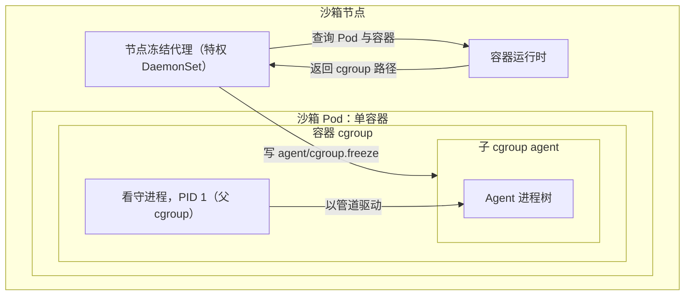
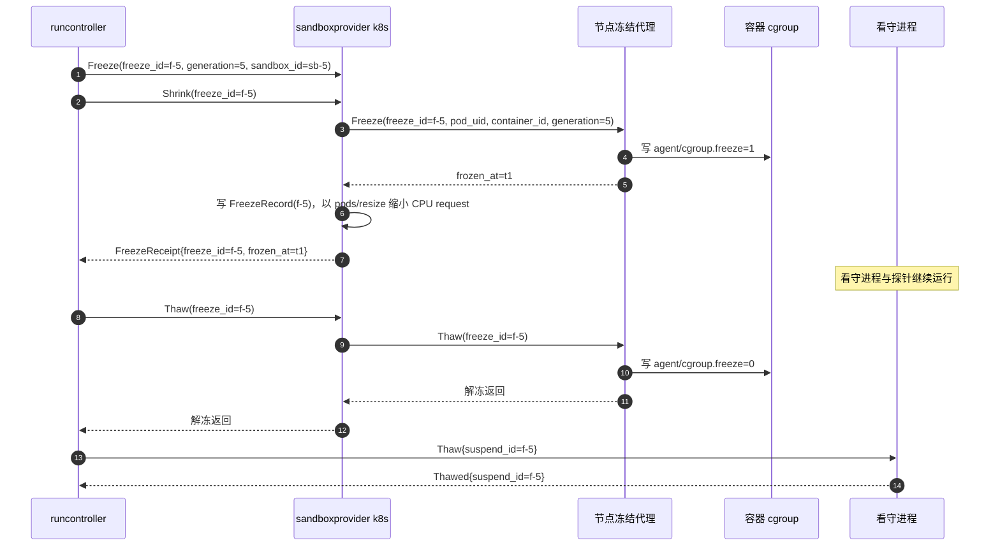
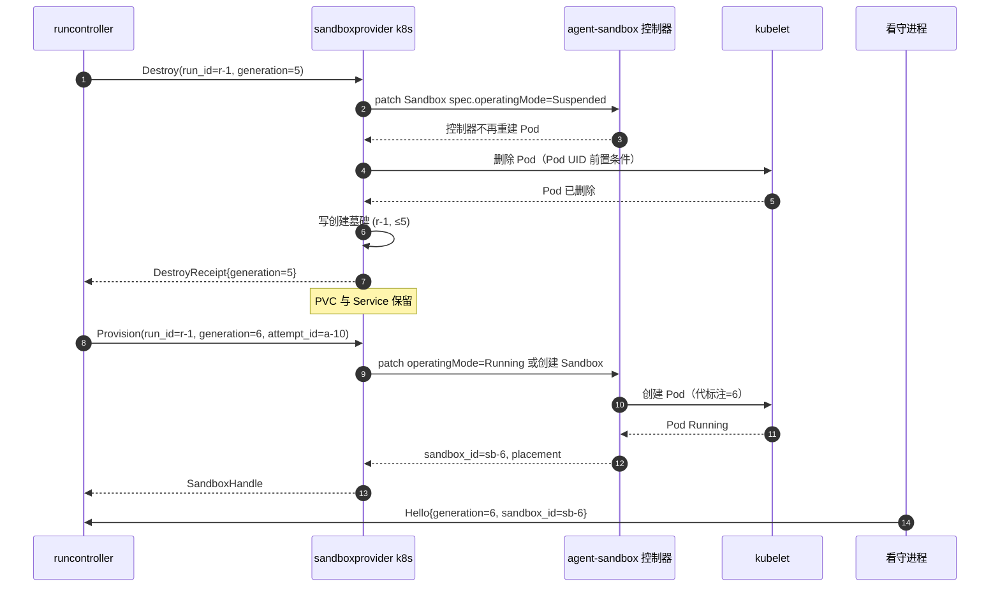
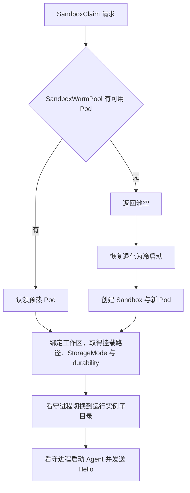

# k8s 子模块

k8s 子模块是 [sandboxprovider](design-sandboxprovider.md) 的提供者实现之一，把主文档定义的提供者接口基于 kubernetes-sigs/agent-sandbox（[REF-agent-sandbox](../../../references.md)）落到 Kubernetes，文档围绕冻结作用域这一机制组织。它不决定何时挂起、不维护[运行实例](../../../glossary.md)状态机、不生成出口策略、不拥有[工作区](../../../glossary.md)绑定。心智模型：Sandbox CR 是跨代保留的外壳，Pod 是某一[代](../../../glossary.md)的执行载体，[节点冻结代理](../../../glossary.md)只冻结 Pod 内的 Agent 进程树，[看守进程](../../../glossary.md)与探针始终运行（[ADR-dual-sandbox-providers](../../../adr/adr-dual-sandbox-providers.md)）。

文档较长，不宜顺序通读。第一次阅读依次取：核心概念、职责、外部接口契约中的接口映射与 RBAC、走查、冻结与解冻、销毁与重建、预热池与认领、入站路由；术语表、依赖、UML 图与核心数据结构作为核对字段与调用顺序的参考；错误与失败语义与并发与事务边界留到最后，按墓碑与幂等规则自测迟到调用。

## 核心概念

本子模块的机制是[冻结](../../../glossary.md)作用域：k8s 路径上的[沙箱](../../../glossary.md)不是一个整体，而是三层可分别处置的载体。Sandbox CR 是跨代保留的外壳，以 `spec.operatingMode` 决定是否重建 Pod，与之配套的 PVC 与 Service 同样跨代保留；Pod 是某一[代](../../../glossary.md)的执行载体，带代标注与 UID；容器内的 Agent 子 cgroup 才是实际被冻结的进程树。冻结只落在子 cgroup，是因为[看守进程](../../../glossary.md)留在父 cgroup 且必须始终可运行：冻结期间它应答探针、续约[工作区租约](../../../glossary.md)并维持[出站流](../../../glossary.md)，控制面因此可以探测沙箱就绪并经出站流驱动解冻与投递。外壳与 Pod 分离，则让[挂起](../../../glossary.md)与重建各自独立：挂起只停 Agent 进程树、保留 Pod，[销毁重建](../../../glossary.md)只换 Pod、保留外壳与[工作区](../../../glossary.md)。两者合起来，系统才能在不结束[运行实例](../../../glossary.md)的前提下释放计算资源（[ADR-freeze-via-node-agent](../../../adr/adr-freeze-via-node-agent.md)）。

## 职责

职责穷举如下，每条先写本子模块执行的动作，再写产生的结果或边界；通用幂等、墓碑与能力协商语义见主文档，本条只写 k8s 提供者层的落地方式。能力集合是闭合集合，本子模块声明 `Freeze{cgroup}`、`Freeze{signal}`、`Destroy`、`WarmPool` 与 `InPlaceResize`，不声明 `Snapshot` 与 `EgressInject`（[ADR-capability-tiered-suspension](../../../adr/adr-capability-tiered-suspension.md)）。

- **Sandbox CR 生命周期**：把预配、认领、整代销毁与按运行实例释放映射为 Sandbox CR、Pod、PVC 与 Service 的操作；`spec.operatingMode` 在 `Running` 与 `Suspended` 之间切换，`Suspended` 使控制器不再重建 Pod，本子模块按 Pod UID 前置条件删除 Pod、保留 PVC 与 Service，`Running` 重建 Pod；返回携带被删除代的销毁确认。
- **按代销毁与删除前置条件**：在 Pod 上记录其所属代，删除 Pod 以 Pod UID 为前置条件；整代销毁在返回确认之前写入创建墓碑，拒绝该代及更早代的预配、认领与快照恢复；单个销毁只作用于调用携带的 `(generation, sandbox_id)`。
- **节点冻结代理**：在沙箱节点池以特权 DaemonSet 运行，经容器运行时定位 Pod 与容器的 cgroup 路径，在容器 cgroup 下维护子 cgroup `agent`，以写 `agent/cgroup.freeze` 执行冻结与解冻；看守进程留在父 cgroup，探针只配置在看守进程上（[ADR-freeze-via-node-agent](../../../adr/adr-freeze-via-node-agent.md)、[REF-linux-cgroup-v2](../../../references.md)）。
- **冻结与解冻的提供者侧执行**：按 `freeze_id` 执行 `Freeze{cgroup}` 与 `Thaw`，返回冻结确认时刻；同一 `freeze_id` 的迟到冻结与迟到缩小被冻结墓碑拒绝；`Freeze{signal}` 由看守进程执行，本子模块只声明能力。
- **原地缩放**：以 `pods/resize` 子资源缩小与放大 CPU request；沙箱 Pod 从创建起为 Burstable（request 小于 limit），容器的 `resizePolicy` 为 `NotRequired`，原始 CPU request 保存在 Pod 注解中；缩小在冻结之后执行，放大与解冻并行；放大进入 `Deferred` 时经 `ResizeStatus` 暴露实际状态（[REF-k8s-in-place-pod-resize](../../../references.md)）。
- **预热池**：维护 SandboxWarmPool 与 SandboxClaim；预热 Pod 在创建时挂载共享文件系统的项目根，认领后看守进程只切换到运行实例子目录；认领的 Pod 不回收复用；池空时认领返回池空，恢复退化为冷启动。
- **网络强制层与出口配置**：落地 NetworkPolicy，默认拒绝出口，只放行控制面地址、LLM 网关与平台出口代理；入站放行 kubelet 探针与 wake-router；向平台出口代理下发按运行实例的出口策略配置，逐请求代校验由平台出口代理完成。
- **入站路由**：wake-router 只服务 `/terminal` 与界面文件访问，按沙箱单飞，受全局停泊上限约束，以 200 ms 周期探测看守进程的 `/readyz`，未就绪或超过停泊预算时返回 503 与 `Retry-After`；事件投递与 `ToolExec` 帧都不经该路由；`ToolExec` 帧随看守进程的出站流往返，不新增沙箱入站端点。
- **恢复触发**：冻结态由 `Thaw` 解冻，以 `Thawed` 为完成观察；销毁态把 Sandbox CR 的 `spec.operatingMode` 改回 `Running` 重建 Pod，或从预热池认领，以看守进程重连并发送新代 `Hello` 为完成观察；事件驱动的恢复由控制面直调提供者。
- **串行化与幂等**：同一运行实例的冻结、解冻、销毁与预配按到达顺序串行；以 `freeze_id`、`(run_id, generation, attempt_id)`、`(run_id, generation)` 与 `(generation, sandbox_id)` 幂等；重复调用返回首次结果。

### 非职责

- 挂起决策、等待时长预测、机制选择、冻结中复评与恢复准入归 `suspendpolicy`；本子模块只执行选定的提供者调用，不判断是否应当冻结或销毁。
- 运行实例状态机、代递增、投递、游标与纠正性对账归 `runcontroller`；本子模块不读写控制面的表，也不持有运行实例状态。
- 工作区绑定、工作区租约、持久化确认与沙箱外文件访问协议归 `workspace`；本子模块只在预配与认领时提供卷或导出标识并调用绑定，不持有租约表。
- 出口策略内容、占位符替换规则与平台出口代理的实现归 `connectorhub`；本子模块只落地 NetworkPolicy 与按运行实例的代理配置。
- Agent 进程监督、`Freeze{signal}` 的执行、`/readyz` 的应答、投递意图日志与本地代理归 `warden`；本子模块不以任何方式冻结看守进程。
- 容器运行时、CNI、CSI 驱动、集群自动扩缩器与 agent-sandbox 控制器本身归基础设施或第三方组件；本子模块只调用其 API，不实现其调度、卷挂接或扩缩逻辑。
- 入站路由不承担事件驱动的恢复；恢复只由控制面调用提供者完成，wake-router 只服务终端与文件访问。

## 术语表

| 术语 | 英文对照 | 适用范围 | 定义 |
| --- | --- | --- | --- |
| 代标注 | generation annotation | k8s 子模块 | Pod 注解中记录其所属代；删除以 Pod UID 为前置条件，迟到删除不得作用于新代 Pod |
| Agent 子 cgroup | agent sub-cgroup | k8s 子模块 | 容器 cgroup 下由节点冻结代理维护的子 cgroup `agent`，承载 Agent 进程树，看守进程留在父 cgroup |
| 单飞 | single-flight | k8s 子模块 | wake-router 对同一沙箱同一时刻只保留一个唤醒探测与一个在途入站请求的约束 |
| 停泊 | parking | k8s 子模块 | wake-router 暂存入站请求直到 `/readyz` 就绪或停泊预算耗尽的处理 |
| 缩容基线 | shrink baseline | k8s 子模块 | 沙箱 Pod 创建时写入注解的原始 CPU request，解冻与放大以它为恢复目标 |

## 外部接口契约

本子模块实现主文档 `Provider` 接口在 k8s 提供者上的下列方法；接口签名、幂等键与失败分类以主文档为准，本表只写提供者层的具体行为。稳定性承诺与主文档一致：生命周期接口对 `runcontroller` 稳定，出口策略接口对 `connectorhub` 稳定。

| 接口 | 本子模块的行为 |
| --- | --- |
| `Capabilities` | 返回 `FreezeCgroup`、`FreezeSignal`、`Destroy` 与 `WarmPool` 为真；`InPlaceResize` 为启动自检通过时的真值，自检不通过时为假；`Snapshot` 与 `EgressInject` 为假 |
| `Provision` | 创建 Sandbox CR 并等待 Pod 就绪；绑定工作区；按 `run_id` 写入出口策略配置与 NetworkPolicy；返回 `sandbox_id`、`placement` 与 `durability` |
| `Claim` | 发起 SandboxClaim 从预热池认领；认领后由看守进程切换工作区子目录；写入该运行实例的出口策略配置与 NetworkPolicy；返回 `sandbox_id` 与放置位置 |
| `Freeze` | 按 `freeze_id` 调用节点冻结代理写 `agent/cgroup.freeze`；返回 `frozen_at` |
| `Shrink` | 按 `freeze_id` 在冻结之后以 `pods/resize` 缩小 CPU request；未冻结或已解冻的标识拒绝 |
| `Thaw` | 按 `freeze_id` 调用节点冻结代理写 `agent/cgroup.freeze=0`；恢复期放大与解冻并行，不等待放大完成 |
| `Destroy` | 把 Sandbox CR 的 `spec.operatingMode` 置为 `Suspended`，按 Pod UID 前置条件删除 Pod，保留 PVC 与 Service；写创建墓碑；返回携带代的确认 |
| `DestroySandbox` | 只删除调用携带的 `(generation, sandbox_id)` 对应的 Pod，不删除更新的代；目标不存在时幂等成功 |
| `ReleaseRun` | 删除 Sandbox CR、Service 与 PVC；写释放墓碑；此后拒绝该运行实例的一切创建 |
| `ListSandboxes`、`GetSandbox` | 列举或查询 Sandbox CR 与 Pod，返回 `run_id`、代、`sandbox_id`、放置位置与是否存在 |
| `NodeMemory` | 按节点汇总冻结态 Pod 的内存 request，并读取节点可分配内存；查询失败不触发升级 |
| `ResizeStatus` | 返回当前 Pod 的实际 request、期望 request 与是否处于 `Deferred` |
| `EstimateResume` | 按解冻、销毁重建与预热池认领分别返回提供者侧的时延估计 |
| `PutEgressPolicy`、`RevokeEgressPolicy` | `PutEgressPolicy` 保存出口策略并按 `run_id` 写入平台出口代理配置与 NetworkPolicy；`RevokeEgressPolicy` 为空操作，出口放行由平台出口代理按运行实例令牌逐请求校验代、终态与作废状态 |
| `Snapshot`、`RevokeSnapshot`、`RestoreSnapshot` | 能力集不含，调用以参数非法拒绝 |

### 对 k8s API 的依赖与 RBAC

提供者以独立的 ServiceAccount 运行，权限按最小集合授予；命名空间内资源只授予控制面命名空间与沙箱节点池所需范围，节点为集群级只读。下列资源与动词是提供者正确工作的最小集合：

| API 资源 | 动词 | 用途 |
| --- | --- | --- |
| agent-sandbox `Sandbox`（API `v1beta1`） | `get`、`list`、`watch`、`create`、`patch`、`delete` | 预配、销毁、重建与列举 |
| agent-sandbox `SandboxClaim` | `create`、`get`、`delete` | 从预热池认领 |
| agent-sandbox `SandboxWarmPool` | `get`、`list`、`watch`、`create`、`patch` | 维护预热池容量与分片 |
| `Pod` | `get`、`list`、`watch`、`delete` | 定位 Pod、读取 UID 与节点、按 UID 前置条件删除 |
| `Pod` 的 `resize` 子资源 | `patch` | 原地缩小与放大 CPU request |
| `Service` | `get`、`create`、`delete` | 运行实例级网络入口的保留与释放 |
| `PersistentVolumeClaim` | `get`、`list`、`create`、`delete` | 块存储降级配置的保留与释放 |
| `NetworkPolicy` | `get`、`list`、`create`、`update`、`delete` | 默认拒绝与出口放行 |
| `Node` | `get`、`list` | 读取可分配内存与放置位置 |

`pods/resize` 的 `patch` 权限、Pod 为 Burstable 与容器 `resizePolicy=NotRequired` 是 `InPlaceResize` 的启动自检项；任一不满足时提供者在启动时判定该能力不可用，`Capabilities` 返回 `InPlaceResize=false`，`suspendpolicy` 因而不选择 `FREEZE_SHRINK`。提供者不在声明能力之后静默降级。集群必须允许特权 DaemonSet，节点冻结代理需要访问容器运行时的 cgroup 信息；这些前提见依赖与部署前提。

### 节点冻结代理的内部契约

提供者与节点冻结代理之间的调用以 `(freeze_id, pod_uid, container_id, generation)` 为键，两个方法都按 `freeze_id` 幂等：

```go
type NodeFreezeTarget struct {
    FreezeID    string
    PodUID      string
    ContainerID string
    Generation  int
}

type NodeFreezeAgent interface {
    Freeze(ctx context.Context, t NodeFreezeTarget) (frozenAt time.Time, err error)
    Thaw(ctx context.Context, t NodeFreezeTarget) error
}
```

`Freeze` 在子 cgroup `agent` 存在时写入 `cgroup.freeze=1` 并返回确认时刻；子 cgroup 不存在或 Pod 已删除时返回确定性错误。`Thaw` 写入 `cgroup.freeze=0`；目标已不存在时返回可区分的未找到错误，提供者映射为「沙箱不存在」的确定性失败，重复解冻幂等。代理按节点批量处理冻结与解冻，按节点 CPU 余量分批解冻，批处理的顺序不改变单个 `freeze_id` 的幂等结果。

### 入站路由的 HTTP 契约

wake-router 是控制面之外的独立进程，只提供两类入口：`/terminal` 转发到当前代看守进程的终端端点，文件访问转发到看守进程的文件 API。它不承载 `/wake`，也不承载事件投递；事件恢复由控制面调用提供者完成。路由对每个请求的约束如下：

- 请求按 `sandbox_id` 定位当前代沙箱；沙箱处于冻结态时直接转发到看守进程，不触发解冻；处于销毁态时直接返回 503。
- 同一沙箱同一时刻只保留一个唤醒探测与一个在途入站请求，其余请求进入停泊队列；停泊总量受全局上限约束，超过上限时返回 503。
- 路由器以 200 ms 周期探测看守进程的 `/readyz`；就绪后转发停泊请求，未就绪超过停泊预算时返回 503 与 `Retry-After`。
- 用户身份由 `humanchannel` 在进入路由之前校验；路由器不解析用户凭据，也不向沙箱传递身份。
- `/terminal` 与文件访问期间，`humanchannel` 写入实时接入事实，`runcontroller` 据此只冻结不销毁。

## 依赖

依赖穷举如下，方向与[模块依赖图](../../architecture.md#模块依赖图)一致：本子模块依赖基础层的 `workspace` 与 `agentprotocol`，以及 k8s 提供者层的控制器、运行时、路由与代理；本子模块不依赖 `runcontroller`、`suspendpolicy` 与 `connectorhub`。

- `workspace`：在预配与认领时调用绑定接口取得挂载路径、`RunUID`、`StorageMode`、`Durability` 与 `Placement`；`lease_id` 取自 `ProvisionRequest`，不来自绑定；k8s 提供者优先使用 RWX 共享文件系统，块存储为降级配置（[ADR-workspace-persistence-per-provider](../../../adr/adr-workspace-persistence-per-provider.md)）。共享文件系统在每个节点的项目根上挂载一次，沙箱 Pod 与预热 Pod 在创建时挂载项目根，认领时只切换到运行实例子目录；块存储不能预绑定预热池，绑定携带节点或可用区亲和。本子模块不持有租约，续约与接管由 `workspace` 与看守进程完成。
- `agentprotocol`：销毁态重建以看守进程发送 `Hello` 为观察，解冻以 `Thawed` 为观察；入站路由使用 `/readyz` 与 `/terminal`；`/readyz` 是就绪探针，`/terminal` 由 `humanchannel` 校验身份后经路由到达。入站端点不承载事件内容，投递只在出站流上进行。
- agent-sandbox 控制器：管理 Sandbox、SandboxClaim 与 SandboxWarmPool 的生命周期；`spec.operatingMode=Suspended` 使控制器不再重建 Pod，本子模块随后按 Pod UID 前置条件删除 Pod、保留 PVC 与 Service，改回 `Running` 重建 Pod。控制器若对现存 Pod 的 `resources` 做对账回滚，提供者按 `ResizeRecord` 的目标值重新提交 `pods/resize` 并对账实际 request；`ResizeStatus` 报告实际值。
- 节点冻结代理：沙箱节点池每个节点一个特权 Pod，经容器运行时定位 Pod 与容器 cgroup，维护子 cgroup `agent`，写 `agent/cgroup.freeze` 执行冻结与解冻；看守进程以停止态启动 Agent 主进程，代理把它移入子 cgroup 后再继续。
- 原地缩放：依赖 Kubernetes In-Place Pod Resize 可用、Pod 为 Burstable、容器 `resizePolicy` 为 `NotRequired`，以及 `pods/resize` 的 `patch` 权限（[REF-k8s-in-place-pod-resize](../../../references.md)）。
- 驱逐保护：冻结态 Pod 标注 `cluster-autoscaler.kubernetes.io/safe-to-evict=false`，只约束集群自动扩缩器，不阻止节点内存压力驱逐（[REF-cluster-autoscaler-faq](../../../references.md)）。
- 平台出口代理：`connectorhub` 的 k8s 路径出口网关；本子模块向其下发按 `run_id` 的出口策略配置，代理对每个出口请求附带的运行实例令牌逐请求校验代、终态与作废状态，不使用缓存。
- NetworkPolicy 实施：由集群 CNI 承担；原生 NetworkPolicy 只提供 L3/L4 控制，域名级控制由平台出口代理承担。
- wake-router：只服务 `/terminal` 与界面文件访问，单飞、停泊与 200 ms 探测的规则见外部接口契约。
- 部署前提：节点为 cgroup v2 且 `cgroup.freeze` 与 PSI 可用；集群允许特权 DaemonSet 并允许其访问容器运行时；In-Place Pod Resize 可用；agent-sandbox 控制器已安装（API `v1beta1`）；RWX 共享文件系统或块存储降级配置；NetworkPolicy 由集群网络实施。

## UML 图

下列图固定 Pod 内部的 cgroup 结构、冻结与解冻的调用顺序、销毁与重建的调用顺序，以及预热池认领的分支；图中不表达的墓碑、幂等与删除前置条件由每张图后的正文与核心算法与流程给出。

### Pod 与 cgroup 结构图



结构固定了冻结的作用域：被冻结的只有子 cgroup `agent` 中的 Agent 进程树，看守进程留在容器 cgroup 的父层，继续应答 `/readyz`、续约工作区租约、维持出站流并持有本地代理的上游连接。探针只配置在看守进程上，因此冻结对 kubelet 透明；Agent 进程树在启动时由看守进程以停止态创建，节点冻结代理把它移入子 cgroup 后再继续，后续 fork 自动继承该子 cgroup。冻结与解冻都是对 `agent/cgroup.freeze` 的一次写入，不涉及看守进程。

### 冻结与解冻时序图



时序图固定了冻结与解冻的两个阶段：提供者先完成 `Freeze{cgroup}` 并持久化 `FreezeRecord`，再返回确认；解冻由提供者先执行，返回之后 `runcontroller` 才经出站流发送协议消息 `Thaw`，看守进程观察到子 cgroup 未冻结后上报 `Thawed`。缩小在冻结之后执行，放大与解冻并行；同一 `freeze_id` 解冻之后到达的冻结与缩小被冻结墓碑拒绝，CPU request 不会停在缩小值。节点冻结代理不可达时返回暂时性错误，`runcontroller` 以同一 `freeze_id` 重驱动，重复冻结返回首次确认时刻。

### 销毁与重建时序图



销毁与重建的调用顺序固定了两条保证：整代销毁在返回确认之前写创建墓碑，该代及更早代此后不再出现沙箱实例；Pod 删除携带 UID 前置条件，迟到执行的旧代删除不会删除新代 Pod。PVC 与 Service 在整代销毁时保留，运行实例结束或失败后由 `ReleaseRun` 删除。重建时新 Pod 携带新代标注，看守进程自行重连并发送新代 `Hello`，提供者不等待 `Hello` 作为预配成功的前提。

### 预热池认领流程图



预热 Pod 在创建时挂载共享文件系统的项目根，因此认领不需要卷挂接步骤；认领之后看守进程只切换到运行实例子目录，不重新挂载。认领是原子操作，同一预热 Pod 不会被多个运行实例认领；认领过的 Pod 不回收复用。池按镜像、规格与节点池或可用区分片，容量按主文档的公式分片计算；池空时认领返回池空，恢复退化为冷启动并受冷启动并发上限约束。

## 核心数据结构

提供者侧记录只服务于幂等、墓碑、预热池、出口配置与观察；运行实例状态仍以 PostgreSQL 中的 `run` 行为唯一事实源。主文档定义的通用记录在本子模块中的映射如下。

| 记录 | 键 | 字段 | 用途 |
| --- | --- | --- | --- |
| `SandboxProjection` | `(run_id, generation)` | `sandbox_id`、`operating_mode`、`pod_uid`、`node`、`placement` | Sandbox CR 与 Pod 的映射 |
| `PodAnnotation` | `pod_uid` | `generation`、`freeze_id`、`shrink_baseline`、`safe_to_evict` | 代标注、冻结标识、缩容基线与驱逐保护 |
| `FreezeTrace` | `freeze_id` | `pod_uid`、`cgroup_path`、`frozen_at`、`thawed_at`、`shrink_applied` | 冻结与解冻的幂等和冻结墓碑 |
| `ResizeRecord` | `freeze_id` | `original_request`、`desired_request`、`applied_request`、`phase` | 缩小、放大与 `Deferred` 状态；`desired_request` 跨 Pod 重建保留，用于恢复后重放 |
| `EgressConfig` | `run_id` | `policy`、`landed_at` | 平台出口代理配置与 NetworkPolicy 的落地；不维护按代副本 |
| `WarmShard` | `(image, spec, node_pool 或可用区)` | `capacity`、`available`、`claimed` | 预热池分片 |
| `RouteEntry` | `sandbox_id` | `inflight`、`parked`、`last_probe`、`retry_after` | wake-router 的单飞与停泊 |

`PodAnnotation.shrink_baseline` 是 Pod 创建时的原始 CPU request，只作为解冻与放大的恢复目标；缩小目标取提供者规格配置，不从注解推断。原始值只从注解读取，不从 `run` 行推断。`FreezeTrace` 在返回 `FreezeReceipt` 之前持久化，`thawed_at` 在返回解冻成功之前写入；`ResizeRecord.phase` 取 `applied`、`deferred` 或 `rejected`，`ResizeStatus` 以 Pod 的实际 request 为准。`RouteEntry` 是路由器的内存状态，不持久化；路由器重启后按 `sandbox_id` 重建。

## 核心算法与流程

### 走查

本条走查把冻结、缩小、解冻、整代销毁、迟到预配、新代预配与释放落到具体值上。初始状态：`run_id=r-1`、`generation=5`、`sandbox_id=sb-5`、`pod_uid=p-77`、`freeze_id=f-5`、原始 CPU request 为 1000m、`EgressConfig(r-1)` 已保存、创建墓碑与释放墓碑为空。下表只列提供者侧状态，`run` 行由 `runcontroller` 维护。

| 步骤 | 调用或事件 | 提供者侧状态 |
| --- | --- | --- |
| 1 | `Freeze(f-5, cgroup)`，随后 `Shrink(f-5)` | `FreezeTrace(f-5)` 写入，`frozen_at=t1`；节点冻结代理写 `agent/cgroup.freeze=1`；`Shrink` 写入 `ResizeRecord(f-5)`，记录原始 request 1000m 与目标 request 并提交 `pods/resize`；沙箱状态 `frozen` |
| 2 | `Thaw(f-5)` | `FreezeTrace(f-5).thawed_at=t2`；节点冻结代理写 `agent/cgroup.freeze=0`；沙箱状态 `running`；同一 `freeze_id` 的迟到冻结与迟到缩小被冻结墓碑拒绝；放大与解冻并行，开始后不等待进入 `Deferred` |
| 3 | `Destroy(r-1, 5)` | Sandbox CR 的 `spec.operatingMode=Suspended`；按 UID `p-77` 删除 Pod；PVC 与 Service 保留；写入创建墓碑 `(r-1, ≤5)`；沙箱状态 `destroyed`；返回 `DestroyReceipt{generation=5}` |
| 4 | 迟到的 `Provision(r-1, 5, a-9)` | 被创建墓碑拒绝；不创建 Sandbox 或 Pod，沙箱状态仍为 `destroyed` |
| 5 | `Provision(r-1, 6, a-10)` | 创建 `sb-6` 与 Pod `p-88`，Pod 注解代标注为 6；按 `r-1` 保存的出口策略与 NetworkPolicy 继续生效；沙箱状态 `running`，`placement` 写入 |
| 6 | 迟到的 `DestroySandbox(5, sb-5)` | Pod UID 前置条件不匹配当前 Pod，幂等返回；不删除 `p-88`，`p-88` 状态仍为 `running` |
| 7 | `RevokeEgressPolicy(r-1, 5)` | 空操作；平台出口代理对该运行实例的出口请求按运行实例令牌逐请求校验代、终态与作废状态，不使用缓存；按 `r-1` 保存的出口策略与 NetworkPolicy 不受影响 |
| 8 | `ReleaseRun(r-1)` | 删除 Sandbox CR、Service 与 PVC；写入释放墓碑 `(r-1)`；沙箱状态 `released`；此后对该 `run_id` 的一切创建被拒绝 |

走查结束时 `generation` 由 `runcontroller` 决定，提供者不递增代；创建墓碑证明第 5 代此后不再出现 Pod，释放墓碑使该运行实例不再接受创建。第 6 步说明销毁的幂等依据是调用携带的 `(generation, sandbox_id)` 与 Pod UID 前置条件，不是到达顺序；第 7 步说明 k8s 路径的出口撤销为空操作，放行由平台出口代理的逐请求代校验决定。

### 预配与认领

1. `runcontroller` 在效果记录提交后调用 `Provision` 或 `Claim`，请求携带 `run_id`、`generation`、`attempt_id`、运行实例令牌、`lease_id` 与工作区绑定；`attempt_id` 取 `resume_id`。
2. 提供者先检查创建墓碑与释放墓碑：代不大于该运行实例最近整代销毁的代，或释放墓碑已存在时，返回确定性拒绝，不创建 Sandbox 或 Pod。
3. 提供者调用 `workspace` 的绑定接口，取得挂载路径、`RunUID`、`StorageMode`、`Durability` 与 `Placement`；`lease_id` 取自请求。共享文件系统模式返回 `sync`；块存储降级配置携带节点或可用区亲和，绑定不能预绑定预热池。
4. 新建路径创建 Sandbox CR，`spec.operatingMode` 为 `Running`；认领路径发起 SandboxClaim。两条路径都在 Pod 创建时写入代标注与缩容基线注解；看守进程以停止态创建 Agent 主进程后，由节点冻结代理把它移入子 cgroup `agent`。
5. 提供者按 `run_id` 保存出口策略，并在预配与认领时写入平台出口代理配置与 NetworkPolicy；配置作用于该运行实例的 Pod 与平台出口代理。按代放行由平台出口代理按运行实例令牌逐请求校验代、终态与作废状态完成，本子模块不为每代维护独立的放行副本。
6. 提供者在创建或认领之前持久化以 `(run_id, generation, attempt_id)` 为键的占有记录，或把该键标注到预热 Pod 上使认领可按同一键重放；创建与认领按该键执行，重驱动识别已认领的 Pod 而不重复认领。完成后补全 `OperationRecord` 并返回 `SandboxHandle`。看守进程随后启动、续约工作区租约并发送 `Hello`；提供者不等待 `Hello`，也不把 `Hello` 作为预配成功的前提。同一 `(run_id, generation, attempt_id)` 的重复调用返回首次结果。

### 冻结与解冻

1. 启动协调：看守进程以停止态创建 Agent 主进程，节点冻结代理把该进程移入容器 cgroup 下的子 cgroup `agent`，随后看守进程继续启动流程。此后的 fork 自动继承子 cgroup；看守进程自身留在父 cgroup。
2. 冻结：`runcontroller` 调用 `Freeze`，请求携带 `freeze_id`、`generation`、`sandbox_id` 与 `shrink`。提供者定位 Pod 与容器，调用节点冻结代理写 `agent/cgroup.freeze=1`，持久化 `FreezeTrace` 并返回 `frozen_at`。冻结期间看守进程继续应答 `/readyz`、续约租约、维持出站流并持有本地代理的上游连接，kubelet 探针不受影响。
3. 缩小：`Freeze` 返回之后，`runcontroller` 以同一 `freeze_id` 调用 `Shrink`；`InPlaceResize` 可用时，提供者在冻结之后以 `pods/resize` 缩小 CPU request。沙箱 Pod 从创建起即 Burstable，容器 `resizePolicy` 为 `NotRequired`，原始 request 保存在注解中；缩小不需要节点余量，立即生效。缩小的目标值由提供者的规格配置决定，不在 `FreezeRequest` 中传递；提供者不缩小内存 request，因为 RSS 不随 request 下降。
4. 解冻：`Thaw` 按 `freeze_id` 写 `agent/cgroup.freeze=0`，恢复期放大与解冻并行。`runcontroller` 在提供者解冻返回之后经出站流发送 `Thaw`，看守进程观察到子 cgroup 未冻结后上报 `Thawed`。已解冻的 `freeze_id` 不再接受冻结与缩小，迟到的冻结与缩小被冻结墓碑拒绝。
5. 批处理：节点冻结代理按节点 CPU 余量分批执行解冻，批内各沙箱的 `freeze_id` 独立幂等；批大小与恢复准入的机制限速共同约束同时在途的解冻数，排队等待时间计入 `EstimateResume` 与准入排队估计，不隐含在解冻路径的 p95 目标内。
6. 驱逐保护：冻结态 Pod 标注 `safe-to-evict=false`；`preStop` 先解冻再终止，避免 SIGTERM 送给冻结进程。节点内存压力下 Pod 仍可能被驱逐，`runcontroller` 把冻结态且沙箱已死的运行实例转入重建路径。
7. 原地放大：放大请求提交后可能进入 `Deferred`，提供者经 `ResizeStatus` 暴露实际 request 与期望 request。`Deferred` 期间期望 request 仍占用调度额度，容量判定以期望 request 为准；超过阈值且处于回合边界时，`runcontroller` 选择销毁重建以迁移，回合中则以低权重继续运行，不等待放大完成。
8. 缩放结果不跨 Pod 重建保留：`spec.operatingMode=Suspended` 会删除 backing Pod，恢复或重建后的新 Pod 只带创建时的原始 request。提供者必须把目标 CPU request 持久化在 `ResizeRecord` 中，并在新 Pod 就绪后重新提交 `pods/resize`，不能依赖旧 Pod 的注解或 kubelet 保留缩放结果。

### 销毁与重建

1. 整代销毁：`Destroy(run_id, generation)` 把 Sandbox CR 的 `spec.operatingMode` 置为 `Suspended`，删除该代 Pod、保留 PVC 与 Service；在返回确认之前写入创建墓碑，拒绝该代及更早代的预配、认领与快照恢复；确认携带被删除的代，证明该代此后不再出现 Pod。
2. 删除前置条件：Pod 上记录其所属代，删除以 Pod UID 为前置条件。旧代 Pod 的迟到删除因 UID 不匹配而失败并返回幂等成功；新代 Pod 的 UID 不同，不会被旧代删除删除。正确性由携带的代与 UID 前置条件给出，不依赖调用的到达顺序。
3. 单个销毁：`DestroySandbox(generation, sandbox_id)` 只删除调用携带的代与沙箱标识对应的 Pod，不删除更新的代；目标不存在时返回成功。单个销毁不写创建墓碑，因为它不证明该代不再出现 Pod。
4. 重建：`runcontroller` 调用 `Provision` 新建 Sandbox，或把同一 Sandbox CR 的 `spec.operatingMode` 改回 `Running`，或调用 `Claim` 从预热池认领。新 Pod 携带新代标注；看守进程自行重连并发送新代 `Hello`。旧代令牌在代递增时失效，旧代 Pod 即使仍然存活也会被判失效。
5. 按运行实例释放：`ReleaseRun(run_id)` 删除 Sandbox CR、Service 与 PVC，写释放墓碑，此后拒绝该运行实例的一切创建。释放幂等；释放之前的整代销毁确认仍可作为工作区租约接管的 `proof`。

### 预热池与认领

预热池由 SandboxWarmPool 与 SandboxClaim 承担。预热 Pod 在创建时挂载共享文件系统的项目根，认领后看守进程只切换到运行实例子目录，不重新挂载；k8s 路径上的 Agent 二进制与依赖缓存在镜像内，缩短冷启动。容量按主文档的公式 `N = λL + z_{1−ε}·√(λL) + B` 分片计算，分片维度为镜像、规格与节点池或可用区。认领是原子操作，同一预热 Pod 不会被多个运行实例认领；认领过的 Pod 不回收复用。池空时认领返回池空，恢复退化为冷启动并受冷启动并发上限约束；`pool_miss_rate` 上升时按公式重算容量。块存储降级配置不能预绑定预热池，认领路径只在共享文件系统模式下使用。

### 网络强制层与平台出口代理

1. NetworkPolicy 默认拒绝出口，只放行控制面地址、LLM 网关与平台出口代理；入站只放行 kubelet 探针与 wake-router。原生 NetworkPolicy 只提供 L3/L4 控制，域名级控制由平台出口代理承担；gVisor 下 CNI 数据面策略有效，socket 级 eBPF 失效。
2. 提供者按 `run_id` 保存 `connectorhub` 推送的出口策略，并在预配与认领时写入平台出口代理的配置。配置内容包括允许的主机与请求头占位符替换规则；策略内容对提供者不透明，提供者只保存与写入。按代放行由平台出口代理按运行实例令牌逐请求校验完成，提供者不维护按代副本。
3. 平台出口代理对每个出口请求按附带的运行实例令牌经代查询接口校验代、终态与本代作废状态，不使用缓存；不通过的请求被拒绝并计入旧代拒绝计数。git 流量经平台反向代理重写，Basic 与 Bearer 头同样由出口侧注入；需要本地签名的客户端改用连接器操作。
4. `RevokeEgressPolicy` 在 k8s 路径为空操作：出口放行不依赖提供者撤销，平台出口代理对每个出口请求按附带的运行实例令牌经代查询接口校验代、终态与本代作废状态，不使用缓存；不通过的请求被拒绝并计入旧代拒绝计数。本子模块不写撤销墓碑，残余请求由逐请求校验拒绝。
5. 本地代理对未放行的目标立即拒绝而不是黑洞，避免冷启动多等数秒；Agent 进程只访问回环地址上的本地代理与平台 MCP 服务器，沙箱内不持有长期凭据。

### 入站路由

wake-router 只服务 `/terminal` 与界面文件访问；事件投递只在看守进程外连控制面的出站流上进行，不进入该路由。请求按 `sandbox_id` 定位当前代沙箱：沙箱处于冻结态时直接转发到看守进程，不触发解冻；处于销毁态时直接返回 503，不触发重建；重建由控制面按恢复准入完成。同一沙箱同一时刻只保留一个唤醒探测与一个在途请求，其余请求进入停泊队列；停泊总量受全局上限约束。路由器以 200 ms 周期探测 `/readyz`，就绪后转发停泊请求；超过停泊预算或队列已满时返回 503 与 `Retry-After`。用户身份由 `humanchannel` 在进入路由之前校验，路由器不解析凭据。终端与文件访问期间，`humanchannel` 写入实时接入事实，`runcontroller` 据此只冻结不销毁。

### 恢复触发

冻结态的恢复由 `Thaw` 完成，节点冻结代理清除 `agent/cgroup.freeze`，看守进程不重新创建，出站流保持或重连。销毁态的恢复由 `Provision` 新建 Pod、把 Sandbox CR 的 `operatingMode` 改回 `Running`，或由 `Claim` 从预热池认领；看守进程自行重连并发送新代 `Hello`。冻结态以 `Thawed` 为完成观察，销毁态以代匹配的 `Hello` 为完成观察；`EstimateResume` 返回提供者侧的恢复时延估计，`runcontroller` 把它与排队位置一起用于 `AdmissionState.EstimatedResume`。事件驱动的恢复由控制面直调提供者，不经 wake-router。

## 错误与失败语义

错误按是否可重试分为确定性与暂时性：确定性错误不重试，调用方丢弃并计数或转重建；暂时性错误按同一幂等键退避重试，提供者返回首次结果。主文档的失败分类适用于本子模块，下表只列 k8s 提供者层特有的失败。

| 失败 | 处置 |
| --- | --- |
| 节点冻结代理不可达或写 `cgroup.freeze` 失败 | 暂时性；`runcontroller` 以同一 `freeze_id` 重驱动，提供者返回首次确认或重新执行；冻结未生效时沙箱保持运行，不进入 `Suspended` |
| 冻结已写入而确认丢失 | 重复 `Freeze` 以同一 `freeze_id` 返回首次 `frozen_at`，不重复写 cgroup；解冻之后到达的同一标识冻结被冻结墓碑拒绝 |
| 解冻超时或节点冻结代理不可达 | 暂时性；提供者返回错误，`runcontroller` 以同一 `freeze_id` 重驱动；看守进程未上报 `Thawed` 超过重驱动上限时按沙箱丢失转入重建路径 |
| `pods/resize` 权限缺失、Pod 非 Burstable 或 `resizePolicy` 不允许 | 启动自检失败，`InPlaceResize` 为假，`suspendpolicy` 不选择 `FREEZE_SHRINK`；冻结仍可用，提供者不以声明能力为前提静默缩小 |
| 放大进入 `Deferred` | 解冻与放大并行，不等待放大；`Deferred` 超过阈值且处于回合边界时销毁重建迁移，回合中以低权重继续运行 |
| agent-sandbox 控制器回滚 Pod 的 `resources` | 提供者按 `ResizeRecord` 的目标值重新提交 `pods/resize` 并对比实际 request；对账完成前 `ResizeStatus` 报告实际值，策略不假定缩小生效 |
| 预热池为空 | 认领返回池空；恢复退化为冷启动，受冷启动并发上限约束，`pool_miss_rate` 上升；不重试同一池空结果，按公式重算容量 |
| Pod 被节点内存压力驱逐 | `ListSandboxes` 或 `GetSandbox` 报告沙箱丢失；`runcontroller` 把冻结态或运行中的丢失转入重建路径；`preStop` 先解冻，`safe-to-evict=false` 不阻止内存压力驱逐 |
| 旧代删除遇到新代 Pod | 删除以 Pod UID 为前置条件，UID 不匹配时返回幂等成功；不删除新代 Pod |
| 整代销毁或释放之后到达的创建 | 创建墓碑或释放墓碑拒绝；不创建 Sandbox、Pod 或运行实例级资源 |
| wake-router 停泊队列已满或 `/readyz` 未就绪超时 | 返回 503 与 `Retry-After`；`humanchannel` 按该值重试；事件不丢失，因为事件只经出站流投递 |
| 沙箱处于销毁态时收到终端或文件访问 | 路由返回 503，不触发重建；恢复由控制面按恢复准入完成 |
| NetworkPolicy 未由集群网络实施 | 部署前提不满足；提供者不以其他机制降级，出口控制失去 L3/L4 强制 |

提供者不把能力缺失暴露为运行时错误：`Snapshot` 与 `RestoreSnapshot` 不在能力集内，调用以参数非法拒绝；`suspendpolicy` 不为此提供者选择快照。删除确认、快照撤销与释放的重复调用都返回首次结果，调用方据此区分“已完成”与“未执行”。

## 并发与事务边界

- **不参与控制面事务**：生命周期调用经 `runcontroller` 的效果记录在数据库事务提交后发出；出口策略推送由 `connectorhub` 直接调用。本子模块不读写控制面的表，也不持有 `run` 行锁；提供者侧 `OperationRecord`、墓碑、`FreezeTrace` 与出口配置在返回确认之前持久化。
- **按运行实例串行**：同一运行实例的冻结、解冻、销毁与预配不并发；提供者按到达顺序串行执行，不同运行实例的调用可以并发。并发重复调用由幂等键与串行化吸收。
- **冻结与删除的先后**：`runcontroller` 保证销毁排在恢复句柄落库之后；以挂起为目的的销毁只在不变量 I9 的安全点执行。提供者不判断安全点，只执行调用；冻结态 Pod 在销毁前先解冻，`preStop` 同样先解冻。
- **缩小与解冻的交错**：缩小只在 `freeze_id` 未解冻时执行；解冻返回之后到达的缩小被冻结墓碑拒绝。放大与解冻并行，提供者不等待放大进入 `applied`。
- **预热池认领**：认领是原子操作，同一预热 Pod 不会被多个运行实例认领；认领过的 Pod 不回收复用，池容量按分片独立计算。
- **入站路由的并发**：同一沙箱的入站请求按单飞约束串行化，停泊总量受全局上限约束；路由不参与控制面事务，也不改变运行实例状态，只读取 `sandbox_id` 与 `/readyz` 的就绪状态。
- **节点冻结代理的并发**：代理按节点批量处理冻结与解冻，按 CPU 余量分批解冻；批内各沙箱以 `freeze_id` 独立幂等，批处理的顺序不改变单个沙箱的结果。

## 扩展点

### 替换冻结执行机制

冻结执行封装在节点冻结代理的内部契约之后，提供者接口只暴露 `Freeze{cgroup}`、`Thaw` 与 `freeze_id`。若集群为沙箱提供原生冻结接口或 cgroup 委派，替换节点冻结代理的实现不改变 `Provider` 接口、`runcontroller` 的调用与 `suspendpolicy` 的机制选择；替换时须保持 `freeze_id` 幂等、看守进程不被冻结、探针对 kubelet 透明与 `preStop` 先解冻的约束（[ADR-freeze-via-node-agent](../../../adr/adr-freeze-via-node-agent.md)）。

### 新增预热池分片维度

预热池分片以 `(image, spec, node_pool 或可用区)` 为键，新增分片维度须同时扩展 `WarmShard` 的键、容量公式的输入与 `Claim` 的匹配条件，并保持认领的原子性与认领后不回收复用。只增加分片数量而不增加维度不改变接口与主文档的容量公式。

## 实现状态

| 能力 | 状态 | 代码 |
| --- | --- | --- |
| Sandbox CR 生命周期 | 未实现 | — |
| 按代销毁与 Pod UID 前置条件 | 未实现 | — |
| 节点冻结代理与 Agent 子 cgroup | 未实现 | — |
| `Freeze{cgroup}` 与 `Thaw` | 未实现 | — |
| 原地缩小与放大 | 未实现 | — |
| 预热池与 SandboxClaim | 未实现 | — |
| NetworkPolicy 与平台出口代理配置 | 未实现 | — |
| 入站路由 wake-router | 未实现 | — |
| 恢复触发 | 未实现 | — |
| 串行化与幂等 | 未实现 | — |
