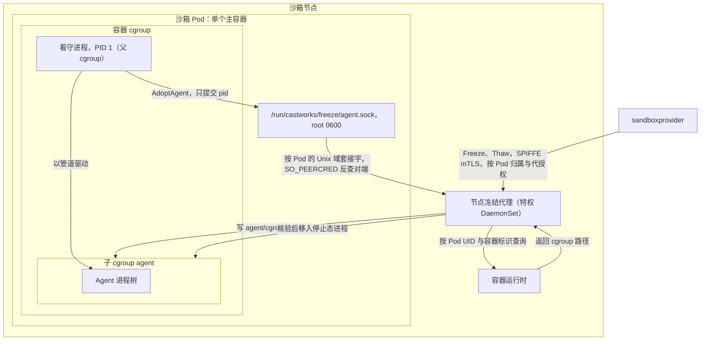
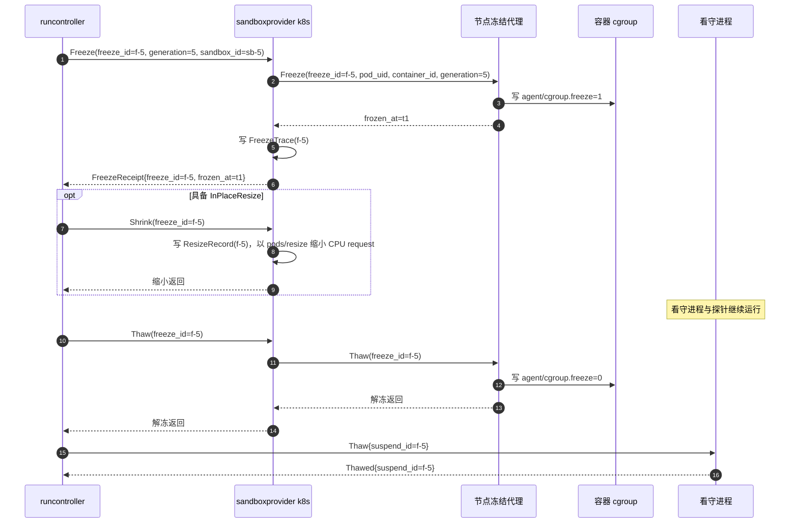
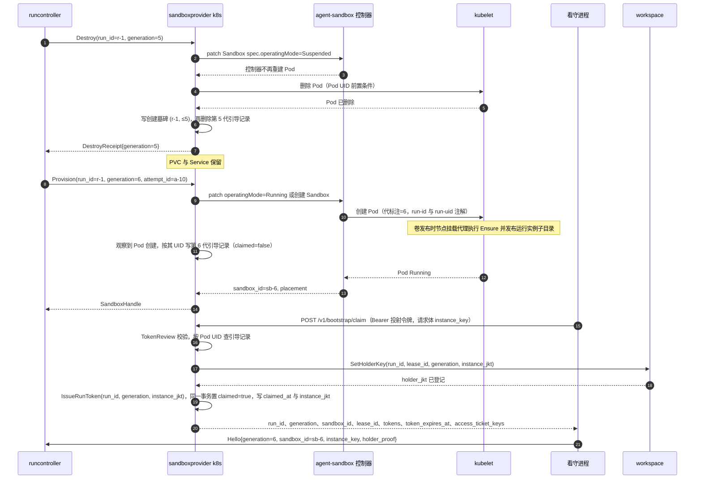
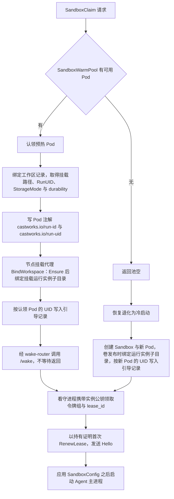

# k8s 子模块

k8s 子模块是 [sandboxprovider](design-sandboxprovider.md) 的提供者实现之一，把主文档定义的提供者接口基于 kubernetes-sigs/agent-sandbox（[REF-agent-sandbox](../../../references.md)）落到 Kubernetes，文档围绕冻结作用域这一机制组织。它不决定何时挂起、不维护[运行实例](../../../glossary.md)状态机、不生成出口策略、不拥有[工作区](../../../glossary.md)绑定。心智模型：Sandbox CR 是跨代保留的外壳，Pod 是某一[代](../../../glossary.md)的执行载体，[节点冻结代理](../../../glossary.md)只冻结 Pod 内的 Agent 进程树，[看守进程](../../../glossary.md)与探针始终运行（[ADR-dual-sandbox-providers](../../../adr/adr-dual-sandbox-providers.md)）。

文档较长，不宜顺序通读。第一次阅读依次取：核心概念、职责、外部接口契约中的接口映射、RBAC、引导认证与沙箱 Pod 安全基线、走查、冻结与解冻、销毁与重建、预热池与认领、网络强制层与平台出口代理、入站路由；术语表、节点冻结代理与[节点挂载代理](../../../glossary.md)的契约、依赖、UML 图与核心数据结构作为核对字段与调用顺序的参考；错误与失败语义与并发与事务边界留到最后，按墓碑与幂等规则自测迟到调用。

## 核心概念

本子模块的机制是[冻结](../../../glossary.md)作用域：k8s 路径上的[沙箱](../../../glossary.md)不是一个整体，而是三层可分别处置的载体。Sandbox CR 是跨代保留的外壳，以 `spec.operatingMode` 决定是否重建 Pod，与之配套的 PVC 与 Service 同样跨代保留；Pod 是某一[代](../../../glossary.md)的执行载体，带代标注与 UID；容器内的 Agent 子 cgroup 才是实际被冻结的进程树。冻结只落在子 cgroup，是因为[看守进程](../../../glossary.md)留在父 cgroup 且必须始终可运行：冻结期间它应答探针、续约[工作区租约](../../../glossary.md)并维持[出站流](../../../glossary.md)，控制面因此可以探测沙箱就绪并经出站流驱动解冻与投递。外壳与 Pod 分离，则让[挂起](../../../glossary.md)与重建各自独立：挂起只停 Agent 进程树、保留 Pod，[销毁重建](../../../glossary.md)只换 Pod、保留外壳与[工作区](../../../glossary.md)。两者合起来，系统才能在不结束[运行实例](../../../glossary.md)的前提下释放计算资源（[ADR-freeze-via-node-agent](../../../adr/adr-freeze-via-node-agent.md)）。

## 职责

职责穷举如下，每条先写本子模块执行的动作，再写产生的结果或边界；通用幂等、墓碑与能力协商语义见主文档，本条只写 k8s 提供者层的落地方式。能力集合是闭合集合，本子模块声明 `Freeze{cgroup}`、`Freeze{signal}`、`Destroy`、`WarmPool` 与 `InPlaceResize`，不声明 `Snapshot` 与 `EgressInject`（[ADR-capability-tiered-suspension](../../../adr/adr-capability-tiered-suspension.md)）。

- **Sandbox CR 生命周期**：把预配、认领、整代销毁与按运行实例释放映射为 Sandbox CR、Pod、PVC 与 Service 的操作；`spec.operatingMode` 在 `Running` 与 `Suspended` 之间切换，`Suspended` 使控制器不再重建 Pod，本子模块按 Pod UID 前置条件删除 Pod、保留 PVC 与 Service，`Running` 重建 Pod；返回携带被删除代的销毁确认。
- **按代销毁与删除前置条件**：在 Pod 上记录其所属代，删除 Pod 以 Pod UID 为前置条件；整代销毁在返回确认之前写入创建墓碑，拒绝该代及更早代的预配、认领与快照恢复；单个销毁只作用于调用携带的 `(generation, sandbox_id)`。
- **节点冻结代理**：在沙箱节点池以特权 DaemonSet 运行，经容器运行时自行解析 Pod 与容器的 cgroup 路径，不接受调用方给出的路径，在容器 cgroup 下维护子 cgroup `agent`，以写 `agent/cgroup.freeze` 执行冻结与解冻；`Freeze`、`Thaw` 只接受 `sandboxprovider` 的 SPIFFE 调用并按 Pod 归属与代授权；经按 Pod 的 Unix 域套接字接受看守进程的 `AdoptAgent`，把停止态的进程移入同一容器的 `agent` 子 cgroup；看守进程留在父 cgroup，探针只配置在看守进程上（[ADR-freeze-via-node-agent](../../../adr/adr-freeze-via-node-agent.md)、[REF-linux-cgroup-v2](../../../references.md)）。
- **节点挂载代理与工作区绑定挂载**：在沙箱节点池以特权 DaemonSet 运行[节点挂载代理](../../../glossary.md)（CSI 节点插件），在节点上挂载共享文件系统的挂载根，为沙箱 Pod 与预热 Pod 发布工作区卷；冷启动 Pod 在卷发布时、预热 Pod 在认领时经 `BindWorkspace` 执行 `Ensure` 并把该运行实例的子目录绑定挂载进 Pod；挂载根不进入任何 Pod，`BindWorkspace` 只接受 `sandboxprovider` 的 SPIFFE 调用（[ADR-per-run-workspace-mount](../../../adr/adr-per-run-workspace-mount.md)）。
- **冻结与解冻的提供者侧执行**：按 `freeze_id` 执行 `Freeze{cgroup}` 与 `Thaw`，返回冻结确认时刻；同一 `freeze_id` 的迟到冻结与迟到缩小被冻结墓碑拒绝；`Freeze{signal}` 由看守进程执行，本子模块只声明能力。
- **原地缩放**：以 `pods/resize` 子资源缩小与放大 CPU request；沙箱 Pod 从创建起为 Burstable（request 小于 limit），容器的 `resizePolicy` 为 `NotRequired`，原始 CPU request 保存在 Pod 注解中；缩小在冻结之后执行，放大与解冻并行；放大进入 `Deferred` 时经 `ResizeStatus` 暴露实际状态（[REF-k8s-in-place-pod-resize](../../../references.md)）。
- **预热池**：维护 SandboxWarmPool 与 SandboxClaim；预热 Pod 只带空的工作区挂载点，认领时由节点挂载代理绑定运行实例子目录；认领的 Pod 不回收复用；池空时认领返回池空，恢复退化为冷启动。
- **沙箱 Pod 安全基线**：为 Sandbox CR 的 Pod 模板与 SandboxWarmPool 模板设置 seccomp Localhost profile、AppArmor 或 SELinux、securityContext、capability 最小集合与 init 容器 `uid-egress-filter`，结果是非 root uid 的出站只到回环、主容器不具备 `NET_ADMIN`；以准入策略强制该基线，提供者启动时自检两类模板，不满足即拒绝启动。
- **引导认证与领取通知**：为沙箱 Pod 与预热 Pod 配置不绑定任何 RBAC 权限、不自动挂载默认令牌的专用 ServiceAccount，并以投射卷挂载 audience 为 `castworks-bootstrap` 的 ServiceAccount 令牌（[REF-k8s-service-accounts](../../../references.md)）；为[引导接口](../../../glossary.md)提供 k8s 路径的认证，以 `TokenReview` 校验该令牌并按 Pod UID 查[引导记录](design-sandboxprovider.md#术语表)；`Provision` 在观察到该代 Pod 创建之后按其 UID 写入引导记录，`Claim` 在写 Pod 注解、调用 `BindWorkspace` 并写入引导记录之后经 wake-router 调用该 Pod 的 `/wake` 通知看守进程领取。结果是首个运行实例令牌组与 `lease_id` 只经引导接口交给看守进程，令牌不进入提供者的任何持久记录。
- **网络强制层与出口配置**：落地 NetworkPolicy，对全部协议默认拒绝出口，只放行到[面向沙箱的端点](../../../glossary.md)（`stream`、`bootstrap`、`lease`、`llm`、`connector`、`human`、`egress`）地址与端口的 TCP，不放行集群 DNS 的 53 端口、节点冻结代理与节点挂载代理；入站只放行 kubelet 探针与 wake-router 到 80 端口；把 `sandbox_facing_endpoints` 中的主机名与固定地址写进 Pod 模板的 `hostAliases`，看守进程不依赖集群 DNS；向平台出口代理下发按运行实例的出口策略配置；逐请求代校验由平台出口代理完成。
- **入站路由**：wake-router 对全部入口以 SPIFFE mTLS 认证调用方，`/terminal` 只接受 `humanchannel`，`/files`（看守进程文件 API）只接受 `workspace`，`/wake` 只接受 `sandboxprovider`；对 `/terminal` 与 `/files` 原样转发请求头 `x-castworks-access-ticket`，由看守进程校验[接入票据](../../../glossary.md)；按沙箱单飞，受全局停泊上限约束，以 200 ms 周期探测看守进程的 `/readyz`，未就绪或超过停泊预算时返回 503 与 `Retry-After`；事件投递与 `ToolExec` 帧都不经该路由；`ToolExec` 帧随看守进程的出站流往返，不新增沙箱入站端点。
- **恢复触发**：冻结态由 `Thaw` 解冻，以 `Thawed` 为完成观察；销毁态把 Sandbox CR 的 `spec.operatingMode` 改回 `Running` 重建 Pod，或从预热池认领，以看守进程重连并发送新代 `Hello` 为完成观察；事件驱动的恢复由控制面直调提供者。
- **串行化与幂等**：同一运行实例的冻结、解冻、销毁与预配按到达顺序串行；以 `freeze_id`、`(run_id, generation, attempt_id)`、`(run_id, generation)` 与 `(generation, sandbox_id)` 幂等；重复调用返回首次结果。

### 非职责

非职责举例如下，判定标准为：职责清单之外、由主文档、同级子模块或其他模块拥有的事实与机制。

- 挂起决策、等待时长预测、机制选择、冻结中复评与恢复准入归 `suspendpolicy`；本子模块只执行选定的提供者调用，不判断是否应当冻结或销毁。
- 运行实例状态机、代递增、投递、游标与纠正性对账归 `runcontroller`；本子模块不读写控制面的表，也不持有运行实例状态。
- 工作区绑定、工作区租约、[持久化确认](../../../glossary.md)与沙箱外文件访问协议归 `workspace`；本子模块只在预配与认领时提供卷或导出标识、调用绑定，并经节点挂载代理执行链接自 `workspace` 节点侧部分的 `Ensure` 与绑定挂载，不持有租约表。
- 出口策略内容、占位符替换规则与平台出口代理的实现归 `connectorhub`；本子模块只落地 NetworkPolicy 与按运行实例的代理配置，不解释策略字段。
- [沙箱侧配置](../../../glossary.md)（`SandboxConfig`）由 `connectorhub` 生成，经 `runcontroller` 在出站流上推送给看守进程；沙箱侧配置不经过本子模块。
- 运行实例令牌的签发归 `secrets`；引导接口的契约、引导记录的字段与一次性领取语义归主文档。本子模块只提供投射令牌的校验、引导记录的写入时机与 `/wake` 通知。
- Agent 进程监督、`Freeze{signal}` 的执行、`/readyz` 的应答、投递意图日志与本地代理归 `warden`；本子模块不以任何方式冻结看守进程。
- 容器运行时、CNI、共享文件系统与块存储的 CSI 驱动、集群自动扩缩器与 agent-sandbox 控制器本身归基础设施或第三方组件；本子模块只调用其 API，不实现其调度、卷挂接或扩缩逻辑。节点冻结代理与节点挂载代理作为 CSI 节点插件只实现驱动 `freeze.castworks.io` 与 `workspace.castworks.io` 的内联临时卷发布。
- 用户授权与接入票据的签发归 `humanchannel` 与 `secrets`，接入票据的校验归 `warden`；wake-router 只认证调用方的 SPIFFE 身份并原样转发票据。
- 入站路由不承担事件驱动的恢复；恢复只由控制面调用提供者完成，wake-router 只服务 `/terminal`、`/files` 与预热认领之后的 `/wake` 通知。

## 术语表

| 术语 | 英文对照 | 适用范围 | 定义 |
| --- | --- | --- | --- |
| 代标注 | generation annotation | k8s 子模块 | Pod 注解中记录其所属代；删除以 Pod UID 为前置条件，迟到删除不得作用于新代 Pod |
| Agent 子 cgroup | agent sub-cgroup | k8s 子模块 | 容器 cgroup 下由节点冻结代理维护的子 cgroup `agent`，承载 Agent 进程树，看守进程留在父 cgroup |
| 单飞 | single-flight | k8s 子模块 | wake-router 对同一沙箱同一时刻只保留一个唤醒探测与一个在途入站请求的约束 |
| 缩容基线 | shrink baseline | k8s 子模块 | 沙箱 Pod 创建时写入注解的原始 CPU request，解冻与放大以它为恢复目标 |

## 外部接口契约

本子模块实现主文档 `Provider` 接口在 k8s 提供者上的下列方法；接口签名、幂等键与失败分类以主文档为准，本表只写提供者层的具体行为。稳定性承诺与主文档一致：生命周期接口对 `runcontroller` 稳定，出口策略接口对 `connectorhub` 稳定。调用方认证按主文档的按方法授权表执行：生命周期方法、只读查询与 `RevokeEgressPolicy` 只接受 `runcontroller`，`PutEgressPolicy` 只接受 `connectorhub`，其他对端以不可重试的未授权错误拒绝并写审计。

| 接口 | 本子模块的行为 |
| --- | --- |
| `Capabilities` | 返回 `FreezeCgroup`、`FreezeSignal`、`Destroy` 与 `WarmPool` 为真；`InPlaceResize` 为启动自检通过时的真值，自检不通过时为假；`Snapshot` 与 `EgressInject` 为假 |
| `Provision` | 绑定工作区；创建 Sandbox CR，Pod 模板写入代标注、`castworks.io/run-id` 与 `castworks.io/run-uid`，工作区卷属性携带绑定参数（`run_id`、`generation`、`run_uid`、`quota_bytes`），卷发布时由节点挂载代理绑定运行实例子目录；观察到 Pod 创建后按其 UID 写入引导记录，并等待 Pod 就绪；按 `run_id` 写入出口策略配置与 NetworkPolicy；返回 `sandbox_id`、`placement` 与 `durability` |
| `Claim` | 发起 SandboxClaim 从预热池认领；认领后写 Pod 注解 `castworks.io/run-id` 与 `castworks.io/run-uid`、调用节点挂载代理 `BindWorkspace`，成功后按认领 Pod 的 UID 写入引导记录，再经 wake-router 调用该 Pod 的 `/wake`，不等待其返回；写入该运行实例的出口策略配置与 NetworkPolicy；返回 `sandbox_id` 与放置位置 |
| `Freeze` | 按 `freeze_id` 调用节点冻结代理写 `agent/cgroup.freeze`；返回 `frozen_at` |
| `Shrink` | 按 `freeze_id` 在冻结之后以 `pods/resize` 缩小 CPU request；未冻结或已解冻的标识拒绝 |
| `Thaw` | 按 `freeze_id` 调用节点冻结代理写 `agent/cgroup.freeze=0`；恢复期放大与解冻并行，不等待放大完成 |
| `Destroy` | 把 Sandbox CR 的 `spec.operatingMode` 置为 `Suspended`，按 Pod UID 前置条件删除 Pod，保留 PVC 与 Service；写创建墓碑；删除该代的引导记录；返回携带代的确认 |
| `DestroySandbox` | 只删除调用携带的 `(generation, sandbox_id)` 对应的 Pod 及以该 Pod UID 为键的引导记录，不删除更新的代及其引导记录；目标不存在时幂等成功 |
| `ReleaseRun` | 写释放墓碑；删除 Sandbox CR、Service、PVC 与该运行实例的引导记录；此后拒绝该运行实例的一切创建 |
| `ListSandboxes`、`GetSandbox` | 列举或查询 Sandbox CR 与 Pod，返回 `run_id`、代、`sandbox_id`、放置位置与是否存在 |
| `NodeMemory` | 按节点汇总冻结态 Pod 的内存 request，并读取节点可分配内存；查询失败不触发升级 |
| `ResizeStatus` | 返回当前 Pod 的实际 request、期望 request 与是否处于 `Deferred` |
| `EstimateResume` | 按解冻、销毁重建与预热池认领分别返回提供者侧的时延估计 |
| `PutEgressPolicy`、`RevokeEgressPolicy` | `PutEgressPolicy` 保存出口策略并按 `run_id` 写入平台出口代理配置与 NetworkPolicy；`RevokeEgressPolicy` 为空操作，出口放行由平台出口代理按运行实例令牌逐请求校验代、终态与作废状态 |
| `Snapshot`、`RevokeSnapshot`、`RestoreSnapshot` | 能力集不含，调用以参数非法拒绝 |

### 对 k8s API 的依赖与 RBAC

提供者以独立的 ServiceAccount 运行，权限按最小集合授予；命名空间内资源只授予控制面命名空间与沙箱节点池所需范围，节点为集群级只读，`tokenreviews` 为集群级 `create`。该 ServiceAccount 与沙箱 Pod 使用的专用 ServiceAccount 不是同一个，后者见引导认证。下列资源与动词是提供者正确工作的最小集合：

| API 资源 | 动词 | 用途 |
| --- | --- | --- |
| agent-sandbox `Sandbox`（API `v1beta1`） | `get`、`list`、`watch`、`create`、`patch`、`delete` | 预配、销毁、重建与列举 |
| agent-sandbox `SandboxClaim` | `create`、`get`、`delete` | 从预热池认领 |
| agent-sandbox `SandboxWarmPool` | `get`、`list`、`watch`、`create`、`patch` | 维护预热池容量与分片 |
| `Pod` | `get`、`list`、`watch`、`patch`、`delete` | 定位 Pod、读取 UID 与节点、写入注解、按 UID 前置条件删除 |
| `Pod` 的 `resize` 子资源 | `patch` | 原地缩小与放大 CPU request |
| `Service` | `get`、`create`、`delete` | 运行实例级网络入口的保留与释放 |
| `PersistentVolumeClaim` | `get`、`list`、`create`、`delete` | 块存储降级配置的保留与释放 |
| `NetworkPolicy` | `get`、`list`、`create`、`update`、`delete` | 默认拒绝与出口放行 |
| `Node` | `get`、`list` | 读取可分配内存与放置位置 |
| `TokenReview`（`authentication.k8s.io`） | `create` | 引导接口校验沙箱 Pod 的投射 ServiceAccount 令牌 |
| `ValidatingAdmissionPolicy`、`ValidatingAdmissionPolicyBinding`（`admissionregistration.k8s.io`） | `get`、`list` | 启动自检确认沙箱命名空间已安装强制沙箱 Pod 安全基线的准入策略 |

`pods/resize` 的 `patch` 权限、Pod 为 Burstable 与容器 `resizePolicy=NotRequired` 是 `InPlaceResize` 的启动自检项；任一不满足时提供者在启动时判定该能力不可用，`Capabilities` 返回 `InPlaceResize=false`，`suspendpolicy` 因而不选择 `FREEZE_SHRINK`。提供者不在声明能力之后静默降级。沙箱 Pod 安全基线的准入策略由部署安装，提供者不创建也不修改它，只以只读权限在启动时自检，规则见[沙箱 Pod 安全基线](#沙箱-pod-安全基线)。集群必须允许特权 DaemonSet，节点冻结代理需要访问容器运行时的 cgroup 信息，节点冻结代理与节点挂载代理以各自的 ServiceAccount 只读读取本节点 Pod 及其注解；这些前提见依赖与部署前提。

### 引导认证

本节给出主文档[引导接口](design-sandboxprovider.md#引导接口)在 k8s 路径上的认证方式与领取触发；领取的请求与响应、错误码与一次性领取语义以主文档为准。

- **沙箱 Pod 的身份**：沙箱 Pod 与预热 Pod 使用专用 ServiceAccount，该 ServiceAccount 不绑定任何 RBAC 权限，Pod 不自动挂载默认令牌。Pod 以投射卷挂载 audience 为 `castworks-bootstrap`、有效期 600 s 的 ServiceAccount 令牌；令牌由 kubelet 经 TokenRequest API 向 kube-apiserver 申请、由 kube-apiserver 签发，kubelet 在令牌存活超过有效期的 80% 时取新令牌替换文件；令牌绑定到该 Pod，Pod 删除后失效，Pod 启动时已存在；600 s 是 `expirationSeconds` 允许的最小值。投射卷的 `defaultMode` 设为 `0400`，令牌文件属主为 root，只有以 root 运行的看守进程可读：`serviceAccountToken` 投射源没有单独的 `mode` 字段，`defaultMode` 未设置时为 `0644`，任意 uid 可读。Pod 不设 `fsGroup`：设置 `fsGroup` 时 kubelet 把令牌文件改为 `0640` 并归属该组，而 `fsGroup` 是容器内进程的附加组。看守进程以非 0 的运行实例 uid 启动 Agent 进程树，同时切换 gid 并清空附加组；Agent 进程树不持有 `CAP_DAC_OVERRIDE`，读不到该文件。投射卷挂载在工作区之外。看守进程每次领取前重新读取令牌文件。
- **校验**：看守进程以 `Authorization: Bearer <投射令牌>` 调用引导接口，请求体携带[实例密钥](../../../glossary.md)的公钥 `{instance_key}`，调用方身份仍只来自 `Authorization` 头；引导接口以 `TokenReview` 校验，`spec.audiences=["castworks-bootstrap"]`，要求 `status.authenticated` 为真、`status.audiences` 含 `castworks-bootstrap`、`status.user.username` 等于沙箱 Pod 专用 ServiceAccount 的 `system:serviceaccount:<命名空间>:<名称>`，不符时返回 401；再从 `status.user.extra` 的 `authentication.kubernetes.io/pod-uid` 取 Pod UID，按 Pod UID 查引导记录。通过后按主文档的处理顺序登记实例公钥指纹并签发令牌组。校验使用提供者 ServiceAccount 的 `tokenreviews` `create` 权限。
- **新建与重建**：Pod UID 由 kube-apiserver 在创建 Pod 时分配，引导记录只能在 Pod 创建之后写入。`Provision` 新建 Sandbox CR 或把 `spec.operatingMode` 改回 `Running` 之后，经 watch 观察到 agent-sandbox 控制器创建的 Pod，核对其代标注等于本次 `generation`，再按该 Pod 的 UID 写入引导记录，在返回 `SandboxHandle` 之前完成；只为本次调用观察到的 Pod 写入，控制器此后自行重建的 Pod 没有引导记录。看守进程在记录写入之前的领取得到 404，按退避重试；Pod 对象的创建通常早于容器启动，首次或下一次退避领取即成功。Agent 主进程在领取成功之前不启动。
- **预热认领**：`Claim` 写 Pod 注解、经节点挂载代理绑定运行实例子目录并写入引导记录之后，经 wake-router 调用该 Pod 的 `/wake` 作为通知，不等待其返回，`Claim` 照常返回；`/wake` 调用失败由看守进程的退避领取兜底。看守进程收到 `/wake` 而尚未领取时立即领取，随后以[持有证明](../../../glossary.md)首次 `RenewLease`、发送 `Hello`，出站流建立之后 `/wake` 返回；已领取时 `/wake` 按 [agentprotocol](../design-agentprotocol.md#入站端点契约) 的入站端点语义处理。
- **认领之前**：预热 Pod 没有引导记录，看守进程的领取得到 404 并按退避重试；`/readyz` 照常应答，不以领取为条件，预热 Pod 在认领之前即可通过就绪探针。
- **Agent 进程不可达**：init 容器 `uid-egress-filter` 安装的规则使非 root uid 的出站只到回环，Agent 进程连不上引导接口；投射令牌文件只有 root 可读，两者独立成立。

### 沙箱 Pod 安全基线

本节同时适用于 Sandbox CR 的 Pod 模板与 SandboxWarmPool 模板；预热 Pod 在认领之前即满足全部要求，认领不改变 Pod 的安全上下文。下列要求为穷举，沙箱命名空间以准入策略强制，提供者启动时自检（[ADR-control-plane-call-authentication](../../../adr/adr-control-plane-call-authentication.md)）。

- **seccomp**：Pod 级 `seccompProfile` 为 Localhost 定制 profile，以 RuntimeDefault 为起点；白名单由 Claude Code 负载与已声明第三方 MCP 服务器的兼容性测试确定，Agent 功能所需的系统调用一律保留，例如 Claude Code 自带 Bash 沙箱所需的 user namespace。保留 user namespace 时，由 AppArmor 或 SELinux 收窄 user namespace 内可达的高危子系统，不以移除系统调用降低 Agent 能力。
- **LSM**：容器配置 AppArmor profile 或 SELinux 类型。
- **securityContext**：`privileged=false`、`allowPrivilegeEscalation=false`、`hostPID`、`hostIPC` 与 `hostNetwork` 均为 `false`、`procMount=Default`。
- **卷**：不使用 hostPath 卷；只允许驱动 `freeze.castworks.io` 与 `workspace.castworks.io` 的 CSI 内联临时卷，以及既有的投射卷（引导用的 ServiceAccount 令牌，以及平台 CA 以运行时注入方式提供时的只读投射卷）。平台 CA 经镜像预置或运行时注入，轮换时新 CA 加入信任库不少于 `T_ca_overlap` 后才开始签发，旧 CA 在信任库中保留不少于 `T_ca_overlap`，`T_ca_overlap` 不短于快照保留期上限；轮换后仍持有旧信任库的进程连接 `mitm` 主机失败，按上游 TLS 失败处理。
- **capability**：主容器先 drop ALL，再显式添加看守进程所需集合 `SETUID`、`SETGID`、`KILL`、`CHOWN`、`FOWNER`、`DAC_OVERRIDE`、`SYS_PTRACE`、`NET_BIND_SERVICE`；Agent 进程树的 bounding set 照旧清空，并设置 `no_new_privs`。
- **init 容器 `uid-egress-filter`**：沙箱 Pod 中唯一具备 `NET_ADMIN` 的容器，镜像内预置，在 Pod 网络命名空间安装 nftables（或 iptables）规则后退出：uid 非 0 的进程发出的报文只允许目的地址为 `127.0.0.0/8` 与 `::1`，其余以拒绝结束，不丢弃，使连接立即失败而不是黑洞；规则对 uid 0 不生效，不依赖具体运行实例 uid，预热 Pod 同样安装。主容器没有 `NET_ADMIN`，看守进程与 Agent 进程都不能修改这些规则。规则不改变 Agent 的任何功能：Agent 的全部流量本来就经看守进程在回环上提供的本地代理、本地 DNS 与透明拦截器转出。
- **准入**：沙箱命名空间以 ValidatingAdmissionPolicy（或等价准入策略）强制以上全部要求，策略由部署安装。Pod Security Admission 的预置级别不适用：看守进程的 `SYS_PTRACE` 与 init 容器的 `NET_ADMIN` 不在其允许集合内。
- **启动自检**：提供者启动时自检两类模板与准入策略，任一要求不满足即拒绝启动，不静默降级。
- **运行时**：k8s 路径不采用强隔离运行时（gVisor、Kata）：其下 Agent 进程不是宿主进程，节点冻结代理的 `Freeze{cgroup}` 不适用（[ADR-freeze-via-node-agent](../../../adr/adr-freeze-via-node-agent.md)）；需要强隔离时改走 Substrate 提供者或另立 ADR。`hostUsers: false` 为可选加固，启用条件是共享文件系统支持 idmapped mount。

### 节点冻结代理的内部契约

提供者与节点冻结代理之间的调用以 `(freeze_id, pod_uid, container_id, generation)` 为键，`Freeze` 与 `Thaw` 都按 `freeze_id` 幂等；看守进程的移入请求是单独的方法 `AdoptAgent`，只经按 Pod 的 Unix 域套接字提供：

```go
type NodeFreezeTarget struct {
    FreezeID    string
    PodUID      string
    ContainerID string
    Generation  int
}

type AdoptRequest struct {
    PID int // 容器 PID 命名空间内的 pid，不携带 cgroup 路径
}

type NodeFreezeAgent interface {
    Freeze(ctx context.Context, t NodeFreezeTarget) (frozenAt time.Time, err error) // 只经 SPIFFE mTLS 提供
    Thaw(ctx context.Context, t NodeFreezeTarget) error                            // 只经 SPIFFE mTLS 提供
    AdoptAgent(ctx context.Context, req AdoptRequest) error                         // 只经按 Pod 的 Unix 域套接字提供
}
```

`Freeze` 在子 cgroup `agent` 存在时写入 `cgroup.freeze=1` 并返回确认时刻；子 cgroup 不存在或 Pod 已删除时返回确定性错误。`Thaw` 写入 `cgroup.freeze=0`；目标已不存在时返回可区分的未找到错误，提供者映射为「沙箱不存在」的确定性失败，重复解冻幂等。代理按节点批量处理冻结与解冻，按节点 CPU 余量分批解冻，批处理的顺序不改变单个 `freeze_id` 的幂等结果。`AdoptAgent` 把一个停止态进程移入同一容器的 `agent` 子 cgroup，核验规则见下节。

### 节点冻结代理的调用方认证与目标授权

节点冻结代理有两个入口，分开授权；任一入口上的请求都不能让代理写调用方所在容器之外的 cgroup，也不能写容器 cgroup 本身（父 cgroup）。下列规则为穷举（[ADR-freeze-via-node-agent](../../../adr/adr-freeze-via-node-agent.md)）。

- **控制面入口**：`Freeze` 与 `Thaw` 只在 SPIFFE mTLS 监听器上提供，白名单只有 `sandboxprovider`，其他对端以不可重试的未授权错误拒绝并写审计。监听地址不出现在沙箱 Pod 与预热 Pod 的 NetworkPolicy 放行列表中。
- **目标授权**：`PodUID` 必须是本节点上、沙箱命名空间内、带 castworks 沙箱标签的 Pod；Pod 的代标注 `castworks.io/generation` 必须等于请求的 `Generation`；`ContainerID` 必须属于该 Pod。cgroup 路径一律由代理按 `PodUID` 与 `ContainerID` 经容器运行时解析，不接受调用方给出的路径；代理只写 `<容器 cgroup>/agent/cgroup.freeze`，拒绝写父 cgroup 或任何其他路径。任一核对不通过返回确定性错误，不写 cgroup。
- **移入入口**：`AdoptAgent` 经按 Pod 的 Unix 域套接字提供。代理同时是 CSI 节点插件（驱动 `freeze.castworks.io`），以内联临时卷向每个沙箱 Pod 与预热 Pod 提供套接字目录，容器内路径 `/run/castworks/freeze/agent.sock`，目录属主 root、权限 0700，套接字属主 root、权限 0600，位于工作区之外；Agent 进程树以非 0 uid 运行且不持有 `CAP_DAC_OVERRIDE`，连不上该套接字。该套接字不承载 `Freeze` 与 `Thaw`。
- **移入的对端核验**：代理以 `SO_PEERCRED` 取对端宿主 pid，按 `/proc/<pid>/cgroup` 反查所属 Pod 与容器，要求对端属于发布该套接字的 Pod、是该容器的 PID 1 且 uid 为 0。
- **移入的目标核验**：请求只携带容器 PID 命名空间内的 pid，不携带 cgroup 路径；代理把它翻译为宿主 pid，核对该进程是对端的直接子进程、uid 等于 Pod 注解 `castworks.io/run-uid`、处于停止态、不是对端本身且尚不在 `agent` 子 cgroup，然后移入同一容器的 `agent` 子 cgroup（不存在时创建）。任一核对不通过返回确定性错误，不移动进程；其余核对都通过而目标进程已在 `agent` 子 cgroup 中时，代理不移动进程并返回成功，响应丢失后的重试因而幂等。
- **注解读取**：代理以只读权限读取本节点 Pod 的注解（代标注与 `castworks.io/run-uid`），不写任何 Kubernetes 对象。

看守进程以运行实例 uid 直接启动的进程都以停止态启动并经 `AdoptAgent` 移入 `agent` 子 cgroup，例如 Agent 主进程与 `/terminal` 的 shell；`AdoptAgent` 被拒绝或不可达时看守进程不让该进程继续执行，按退避重试，重试耗尽时回收这个尚未开始执行的进程并按启动失败上报。

### 节点挂载代理与工作区绑定挂载

[节点挂载代理](../../../glossary.md)是本子模块中的特权 DaemonSet，同时是 CSI 节点插件（驱动 `workspace.castworks.io`），与节点冻结代理分开部署、分开授权。它使沙箱容器内只出现本运行实例的工作区子目录（[ADR-per-run-workspace-mount](../../../adr/adr-per-run-workspace-mount.md)），规则穷举如下。

- **挂载根**：共享文件系统的挂载根只由节点挂载代理在节点上挂载，不进入任何沙箱 Pod 或预热 Pod。
- **工作区卷**：沙箱 Pod 与预热 Pod 以 CSI 内联临时卷 `castworks-workspace` 挂载在工作区挂载路径（`Binding.MountPath`，各代逐字一致），`mountPropagation: HostToContainer`。
- **冷启动 Pod**（`Provision`）：卷属性携带 `run_id`、`generation`、`run_uid`、`quota_bytes`；`NodePublishVolume` 时执行 `Ensure`，并把 `<挂载根>/<run_id>` 直接发布到该卷，效果与 `subPath` 相同。
- **预热 Pod**：创建时发布空挂载点。`Claim` 时 `sandboxprovider` 先在 Pod 上写注解 `castworks.io/run-id` 与 `castworks.io/run-uid`，再调用 `BindWorkspace`，成功后写引导记录并发 `/wake`。
- **调用方与目标授权**：`BindWorkspace` 只在 SPIFFE mTLS 监听器上提供，只接受 `sandboxprovider`；目标必须是本节点、沙箱命名空间内、带沙箱标签的 Pod，Pod 注解 `castworks.io/run-id` 与代标注等于请求，`castworks.io/run-uid` 等于 `RunUID`，且该 Pod 尚未绑定过（同一 `(pod_uid, run_id)` 的重复调用按幂等返回首次结果，不视为再次绑定）。任一核对不通过返回确定性错误，不挂载。监听地址不出现在沙箱 Pod 与预热 Pod 的 NetworkPolicy 放行列表中。
- **绑定**：执行 `Ensure`（创建子目录、属主为运行实例 uid、权限 0700、设配额）后，把 `<挂载根>/<run_id>` 绑定挂载到该 Pod 的卷发布目录，经 `HostToContainer` 传播出现在容器内；以 `(pod_uid, run_id)` 幂等，重复调用返回首次结果；Pod 删除时卷卸载随之解除绑定。
- **`Ensure` 的执行方**：共享文件系统模式下 `Ensure` 由节点挂载代理执行，`workspace` 的节点侧部分链接进节点挂载代理；块存储的卷本身按运行实例划分，`Ensure` 仍由看守进程执行。`no_root_squash` 只为节点挂载代理以 root 创建运行实例子目录所需。

```go
type BindTarget struct {
    PodUID     string
    RunID      RunID
    Generation int
    RunUID     int
    QuotaBytes int64
}

type NodeMountAgent interface {
    BindWorkspace(ctx context.Context, t BindTarget) error // 只接受 sandboxprovider 的 SPIFFE mTLS 调用，以 (pod_uid, run_id) 幂等
}
```

### 入站路由的 HTTP 契约

wake-router 是控制面之外的独立进程，只提供以下入口：`/terminal` 转发到当前代看守进程的终端端点，`/files` 转发到看守进程的文件 API，`/wake` 转发到被认领预热 Pod 的看守进程。它不承载事件投递；事件驱动的恢复由控制面调用提供者完成。路由对每个请求的约束如下：

- 路由器对全部入口以 SPIFFE mTLS 认证调用方：`/terminal` 只接受 `humanchannel`，`/files` 只接受 `workspace`，`/wake` 只接受 `sandboxprovider`；非 SPIFFE 对端、身份不符或路径不符的请求以 403 拒绝并写审计，不转发。
- 用户授权由 `humanchannel` 完成，并以接入票据携带到看守进程：路由器对 `/terminal` 与 `/files` 原样转发请求头 `x-castworks-access-ticket`，不解析、不改写；看守进程验签并核对运行实例、代与接入通道后才建立终端或读取文件，票据缺失或无效时看守进程返回 401，路由器原样返回。
- 请求按 `sandbox_id` 定位当前代沙箱；沙箱处于冻结态时直接转发到看守进程，不触发解冻；处于销毁态时直接返回 503。
- 同一沙箱同一时刻只保留一个唤醒探测与一个在途入站请求，其余请求进入停泊队列；停泊总量受全局上限约束，超过上限时返回 503。
- 路由器以 200 ms 周期探测看守进程的 `/readyz`；就绪后转发停泊请求，未就绪超过停泊预算时返回 503 与 `Retry-After`。
- `/terminal` 与 `/files` 期间，`humanchannel` 写入实时接入事实，`runcontroller` 据此只冻结不销毁。

## 依赖

依赖穷举如下，方向与[模块依赖图](../../architecture.md#模块依赖图)一致：本子模块依赖基础层的 `workspace` 与 `agentprotocol`，经主文档的引导接口依赖 `secrets`，以及 k8s 提供者层的控制器、运行时、认证 API、路由与代理；本子模块不依赖 `runcontroller`、`suspendpolicy` 与 `connectorhub`。

- `workspace`：在预配与认领时调用绑定接口取得挂载路径、`RunUID`、`StorageMode`、`Durability` 与 `Placement`；`lease_id` 取自 `ProvisionRequest`，不来自绑定，写入引导记录后经引导接口交给看守进程；k8s 提供者优先使用 RWX 共享文件系统，块存储为降级配置（[ADR-workspace-persistence-per-provider](../../../adr/adr-workspace-persistence-per-provider.md)）。共享文件系统由节点挂载代理在每个节点的挂载根上挂载一次，挂载根不进入任何 Pod；冷启动在卷发布时、认领时经 `BindWorkspace` 绑定运行实例子目录；块存储不能预绑定预热池，绑定携带节点或可用区亲和。本子模块不持有租约，续约与接管由 `workspace` 与看守进程完成。
- `secrets`：经主文档的引导接口调用 `secrets.IssueRunToken(run_id, generation, instance_jkt)`，在领取时签发按受众划分的首个令牌组，令牌不持久化；本子模块只提供投射令牌的 `TokenReview` 校验。
- `agentprotocol`：销毁态重建以看守进程发送 `Hello` 为观察，解冻以 `Thawed` 为观察；入站路由使用 `/readyz`、`/terminal`、`/files` 与 `/wake`；`/readyz` 是就绪探针，不以领取为条件，`/terminal` 由 `humanchannel`、`/files` 由 `workspace` 经路由调用并携带接入票据，`/wake` 是预热认领之后提供者经路由发出的领取通知。入站端点不承载事件内容，投递只在出站流上进行。
- agent-sandbox 控制器：管理 Sandbox、SandboxClaim 与 SandboxWarmPool 的生命周期；`spec.operatingMode=Suspended` 使控制器不再重建 Pod，本子模块随后按 Pod UID 前置条件删除 Pod、保留 PVC 与 Service，改回 `Running` 重建 Pod。控制器若对现存 Pod 的 `resources` 做对账回滚，提供者按 `ResizeRecord` 的目标值重新提交 `pods/resize` 并对账实际 request；`ResizeStatus` 报告实际值。
- 节点冻结代理：沙箱节点池每个节点一个特权 Pod，经容器运行时解析 Pod 与容器 cgroup，维护子 cgroup `agent`，写 `agent/cgroup.freeze` 执行冻结与解冻；`Freeze` 与 `Thaw` 只接受 `sandboxprovider` 的 SPIFFE 调用并按 Pod 归属与代授权；看守进程以停止态启动 Agent 主进程与 `/terminal` 的 shell，经按 Pod 的 Unix 域套接字以 `AdoptAgent` 只提交 pid，代理核验后把它移入子 cgroup，看守进程再让它继续，规则见[节点冻结代理的调用方认证与目标授权](#节点冻结代理的调用方认证与目标授权)。
- 节点挂载代理：沙箱节点池每个节点一个特权 Pod，作为驱动 `workspace.castworks.io` 的 CSI 节点插件挂载共享文件系统的挂载根、发布工作区卷，并按 `BindWorkspace` 绑定运行实例子目录，规则见[节点挂载代理与工作区绑定挂载](#节点挂载代理与工作区绑定挂载)。
- 原地缩放：依赖 Kubernetes In-Place Pod Resize 可用、Pod 为 Burstable、容器 `resizePolicy` 为 `NotRequired`，以及 `pods/resize` 的 `patch` 权限（[REF-k8s-in-place-pod-resize](../../../references.md)）。
- 驱逐保护：冻结态 Pod 标注 `cluster-autoscaler.kubernetes.io/safe-to-evict=false`，只约束集群自动扩缩器，不阻止节点内存压力驱逐（[REF-cluster-autoscaler-faq](../../../references.md)）。
- 平台出口代理：`connectorhub` 的 k8s 路径出口网关；本子模块向其下发按 `run_id` 的出口策略配置，代理对每个出口请求附带的运行实例令牌逐请求校验代、终态与作废状态，不使用缓存。
- NetworkPolicy 实施：由集群 CNI 承担，须对全部协议生效（含 UDP 与 ICMP 的默认拒绝）；原生 NetworkPolicy 只提供 L3/L4 控制，本子模块只放行到面向沙箱的端点地址与端口的 TCP，不放行集群 DNS、节点冻结代理与节点挂载代理，域名级控制由平台出口代理承担。
- 部署配置 `sandbox_facing_endpoints`：给出 `stream`、`bootstrap`、`lease`、`llm`、`connector`、`human`、`egress` 各条目的 `{host, port, addr}`；本子模块据它生成 Pod 模板的 `hostAliases` 与 NetworkPolicy 放行项，面向沙箱的端点与控制面内部监听器使用不同的主机名与端口。
- Kubernetes ServiceAccount 令牌与 `TokenReview`：沙箱 Pod 的投射令牌由 kubelet 经 TokenRequest API 申请、kube-apiserver 签发，kubelet 在到期前替换令牌文件，令牌绑定到 Pod；引导接口以 `TokenReview` 校验令牌并从 `status.user.extra` 取 Pod UID，规则见引导认证（[REF-k8s-service-accounts](../../../references.md)）。
- wake-router：以 SPIFFE mTLS 认证全部入口，只服务 `humanchannel` 发起的 `/terminal`、`workspace` 发起的 `/files` 与 `sandboxprovider` 发起的 `/wake`，对 `/terminal` 与 `/files` 原样转发请求头 `x-castworks-access-ticket`；单飞、停泊与 200 ms 探测的规则见外部接口契约。
- 部署前提：节点为 cgroup v2 且 `cgroup.freeze` 与 PSI 可用；集群允许特权 DaemonSet 并允许其访问容器运行时；In-Place Pod Resize 可用；agent-sandbox 控制器已安装（API `v1beta1`）；RWX 共享文件系统或块存储降级配置；NetworkPolicy 由集群网络实施且覆盖全部协议；沙箱 Pod 与预热 Pod 的专用 ServiceAccount 已创建且不绑定 RBAC 权限；节点支持 seccomp Localhost profile 与 AppArmor 或 SELinux，profile 已分发到沙箱节点；沙箱命名空间已安装强制沙箱 Pod 安全基线的 ValidatingAdmissionPolicy（或等价准入策略）；集群支持 CSI 内联临时卷与 `HostToContainer` 挂载传播；节点内核与 init 容器镜像支持 nftables 或 iptables 的按 uid（`meta skuid` 或 owner）匹配；部署配置 `sandbox_facing_endpoints` 给出各面向沙箱的端点的固定地址，引导接口的地址经它写入 Pod 模板，不含按运行实例的数据。

## UML 图

下列图固定 Pod 内部的 cgroup 结构、冻结与解冻的调用顺序、销毁与重建的调用顺序，以及预热池认领的分支；图中不表达的墓碑、幂等与删除前置条件由每张图后的正文与核心算法与流程给出。

### Pod 与 cgroup 结构图



结构固定了冻结的作用域：被冻结的只有子 cgroup `agent` 中的 Agent 进程树，看守进程留在容器 cgroup 的父层，继续应答 `/readyz`、续约工作区租约、维持出站流并持有本地代理的上游连接。探针只配置在看守进程上，因此冻结对 kubelet 透明；Agent 进程树在启动时由看守进程以停止态创建，看守进程经按 Pod 的套接字以 `AdoptAgent` 只提交容器内 pid，节点冻结代理以 `SO_PEERCRED` 与 cgroup 反查确认对端是本容器的 PID 1，核验目标进程后把它移入子 cgroup，看守进程再让它继续，后续 fork 自动继承该子 cgroup。冻结与解冻都是对 `agent/cgroup.freeze` 的一次写入，cgroup 路径只由代理经容器运行时解析，不涉及看守进程；`sandboxprovider` 的控制面入口与看守进程的移入入口分开授权，套接字不承载 `Freeze` 与 `Thaw`。

### 冻结与解冻时序图



时序图固定了冻结与解冻的两个阶段：提供者先完成 `Freeze{cgroup}` 并持久化 `FreezeTrace`，再返回确认；解冻由提供者先执行，返回之后 `runcontroller` 才经出站流发送协议消息 `Thaw`，看守进程观察到子 cgroup 未冻结后上报 `Thawed`。缩小在 `Freeze` 返回之后由 `runcontroller` 以同一 `freeze_id` 调用 `Shrink` 执行，放大与解冻并行；同一 `freeze_id` 解冻之后到达的冻结与缩小被冻结墓碑拒绝，CPU request 不会停在缩小值。节点冻结代理不可达时返回暂时性错误，`runcontroller` 以同一 `freeze_id` 重驱动，重复冻结返回首次确认时刻。

### 销毁与重建时序图



销毁与重建的调用顺序固定了以下保证：整代销毁在返回确认之前写创建墓碑，再删除该代的引导记录，该代及更早代此后不再出现沙箱实例；Pod 删除携带 UID 前置条件，迟到执行的旧代删除不会删除新代 Pod。PVC 与 Service 在整代销毁时保留，运行实例结束或失败后由 `ReleaseRun` 删除。重建时控制器创建携带新代标注的 Pod，节点挂载代理在卷发布时只把该运行实例的子目录发布进 Pod，提供者观察到该 Pod 后按其 UID 写入新代的引导记录；看守进程携带实例公钥经引导接口领取令牌组与 `lease_id`，引导接口在置 `claimed` 之前登记实例公钥指纹，看守进程随后以持有证明重连并发送新代 `Hello`，提供者不等待 `Hello` 作为预配成功的前提。

### 预热池认领流程图



预热 Pod 只带空的工作区挂载点，共享文件系统的挂载根不进入 Pod；认领时提供者先写 Pod 注解，再由节点挂载代理执行 `Ensure` 并把运行实例子目录绑定挂载到该 Pod 的卷发布目录，经 `HostToContainer` 传播出现在容器内，绑定成功之后才写引导记录，看守进程领取时工作区已就位。绑定失败时不写引导记录，`Claim` 按同一幂等键重试，看守进程的领取得到 404 并按退避重试。认领路径在写入引导记录之后经 wake-router 调用 `/wake` 通知看守进程立即领取，`/wake` 调用失败由看守进程的退避领取兜底；冷启动路径的运行实例子目录在卷发布时绑定，提供者在观察到 Pod 创建之后按其 UID 写入引导记录，看守进程在此之前的领取得到 404 并按退避重试。看守进程在应用经出站流收到的 `SandboxConfig` 之后才启动 Agent 主进程，见 [warden](../warden/design-warden.md#沙箱侧配置)。认领是原子操作，同一预热 Pod 不会被多个运行实例认领；认领过的 Pod 不回收复用。池按镜像、规格与节点池或可用区分片，容量按主文档的公式分片计算；池空时认领返回池空，恢复退化为冷启动并受冷启动并发上限约束。

## 核心数据结构

提供者侧记录只服务于幂等、墓碑、预热池、出口配置、引导与观察；运行实例状态仍以 PostgreSQL 中的 `run` 行为唯一事实源。主文档定义的通用记录在本子模块中的映射如下。

| 记录 | 键 | 字段 | 用途 |
| --- | --- | --- | --- |
| `SandboxProjection` | `(run_id, generation)` | `sandbox_id`、`operating_mode`、`pod_uid`、`node`、`placement` | Sandbox CR 与 Pod 的映射 |
| `PodAnnotation` | `pod_uid` | `generation`（`castworks.io/generation`）、`run_id`（`castworks.io/run-id`）、`run_uid`（`castworks.io/run-uid`）、`freeze_id`、`shrink_baseline`、`safe_to_evict` | 代标注、运行实例归属、运行实例 uid、冻结标识、缩容基线与驱逐保护的载体；冷启动写在 Sandbox CR 的 Pod 模板中，认领由提供者在绑定与写引导记录之前写入；节点冻结代理与节点挂载代理据它做目标授权 |
| `BootstrapRecord` | `pod_uid` | `run_id`、`generation`、`sandbox_id`、`attempt_id`、`lease_id`、`claimed`、`claimed_at`、`instance_jkt` | 引导记录；`Provision` 在观察到 Pod 创建之后按其 UID 写入，`Claim` 在 `BindWorkspace` 成功之后、`/wake` 通知之前写入，领取时写 `instance_jkt`，整代销毁、单个销毁与释放删除；不含运行实例令牌与私钥 |
| `FreezeTrace` | `freeze_id` | `pod_uid`、`cgroup_path`、`frozen_at`、`thawed_at`、`shrink_applied` | 冻结与解冻的幂等和冻结墓碑 |
| `ResizeRecord` | `freeze_id` | `original_request`、`desired_request`、`applied_request`、`phase` | 缩小、放大与 `Deferred` 状态；`desired_request` 只作用于该 `freeze_id` 所属的 Pod，agent-sandbox 控制器回滚该 Pod 的 `resources` 时按它重新提交 `pods/resize`，不带入重建出的新代 Pod |
| `EgressConfig` | `run_id` | `policy`、`landed_at` | 平台出口代理配置与 NetworkPolicy 的落地；不维护按代副本 |
| `WarmShard` | `(image, spec, node_pool 或可用区)` | `capacity`、`available`、`claimed` | 预热池分片 |
| `RouteEntry` | `sandbox_id` | `inflight`、`parked`、`last_probe`、`retry_after` | wake-router 的单飞与停泊 |

`PodAnnotation.shrink_baseline` 是 Pod 创建时的原始 CPU request，只作为解冻与放大的恢复目标；缩小目标取提供者规格配置，不从注解推断。原始值只从注解读取，不从 `run` 行推断。`FreezeTrace` 在返回 `FreezeReceipt` 之前持久化，`thawed_at` 在返回解冻成功之前写入；`ResizeRecord.phase` 取 `applied`、`deferred` 或 `rejected`，`ResizeStatus` 以 Pod 的实际 request 为准。`RouteEntry` 是路由器的内存状态，不持久化；路由器重启后按 `sandbox_id` 重建。

## 核心算法与流程

### 走查

本条走查把冻结、缩小、解冻、整代销毁、迟到预配、新代预配与释放落到具体值上。初始状态：`run_id=r-1`、`generation=5`、`sandbox_id=sb-5`、`pod_uid=p-77`、`freeze_id=f-5`、原始 CPU request 为 1000m、`EgressConfig(r-1)` 已保存、`BootstrapRecord(p-77)` 已领取（`claimed=true`）、创建墓碑与释放墓碑为空。下表只列提供者侧状态，`run` 行由 `runcontroller` 维护。

| 步骤 | 调用或事件 | 提供者侧状态 |
| --- | --- | --- |
| 1 | `Freeze(f-5, cgroup)`，随后 `Shrink(f-5)` | `FreezeTrace(f-5)` 写入，`frozen_at=t1`；节点冻结代理写 `agent/cgroup.freeze=1`；`Shrink` 写入 `ResizeRecord(f-5)`，记录原始 CPU request 1000m 与目标 CPU request 并提交 `pods/resize`；沙箱状态 `frozen` |
| 2 | `Thaw(f-5)` | `FreezeTrace(f-5).thawed_at=t2`；节点冻结代理写 `agent/cgroup.freeze=0`；沙箱状态 `running`；同一 `freeze_id` 的迟到冻结与迟到缩小被冻结墓碑拒绝；放大与解冻并行，开始后不等待进入 `Deferred` |
| 3 | `Destroy(r-1, 5)` | Sandbox CR 的 `spec.operatingMode=Suspended`；按 UID `p-77` 删除 Pod；PVC 与 Service 保留；写入创建墓碑 `(r-1, ≤5)`；删除 `BootstrapRecord(p-77)`；沙箱状态 `destroyed`；返回 `DestroyReceipt{generation=5}` |
| 4 | 迟到的 `Provision(r-1, 5, a-9)` | 被创建墓碑拒绝；不创建 Sandbox 或 Pod，沙箱状态仍为 `destroyed` |
| 5 | `Provision(r-1, 6, a-10)` | 创建 `sb-6` 与 Pod `p-88`，Pod 注解代标注为 6，随后写入 `BootstrapRecord(p-88)`（第 6 代，`claimed=false`）；看守进程领取后 `BootstrapRecord(p-88).claimed=true`；按 `r-1` 保存的出口策略与 NetworkPolicy 继续生效；沙箱状态 `running`，`placement` 写入 |
| 6 | 迟到的 `DestroySandbox(5, sb-5)` | Pod UID 前置条件不匹配当前 Pod，幂等返回；不删除 `p-88` 与 `BootstrapRecord(p-88)`，`p-88` 状态仍为 `running` |
| 7 | `RevokeEgressPolicy(r-1, 5)` | 空操作；平台出口代理对该运行实例的出口请求按运行实例令牌逐请求校验代、终态与作废状态，不使用缓存；按 `r-1` 保存的出口策略与 NetworkPolicy 不受影响 |
| 8 | `ReleaseRun(r-1)` | 写入释放墓碑 `(r-1)`；删除 Sandbox CR、Service、PVC 与 `BootstrapRecord(p-88)`；沙箱状态 `released`；此后对该 `run_id` 的一切创建被拒绝 |

走查结束时 `generation` 由 `runcontroller` 决定，提供者不递增代；创建墓碑证明第 5 代此后不再出现 Pod，释放墓碑使该运行实例不再接受创建。第 6 步说明销毁的幂等依据是调用携带的 `(generation, sandbox_id)` 与 Pod UID 前置条件，不是到达顺序；第 7 步说明 k8s 路径的出口撤销为空操作，放行由平台出口代理的逐请求代校验决定。

### 预配与认领

1. `runcontroller` 在效果记录提交后调用 `Provision` 或 `Claim`，请求携带 `run_id`、`generation`、`attempt_id`、`lease_id` 与工作区绑定；`attempt_id` 取 `resume_id`。请求不携带运行实例令牌，首个令牌由引导接口在领取时签发。
2. 提供者先检查创建墓碑与释放墓碑：代不大于该运行实例最近整代销毁的代，或释放墓碑已存在时，返回确定性拒绝，不创建 Sandbox 或 Pod。
3. 提供者调用 `workspace` 的绑定接口，取得挂载路径、`RunUID`、`StorageMode`、`Durability` 与 `Placement`；`lease_id` 取自请求并写入引导记录。共享文件系统模式返回 `sync`；块存储降级配置携带节点或可用区亲和，绑定不能预绑定预热池。
4. 新建路径创建 Sandbox CR，`spec.operatingMode` 为 `Running`，Pod 模板写入代标注、`castworks.io/run-id` 与 `castworks.io/run-uid`，工作区卷属性携带 `run_id`、`generation`、`run_uid`、`quota_bytes`，节点挂载代理在卷发布时执行 `Ensure` 并发布运行实例子目录；观察到 Pod 创建之后按其 UID 写入引导记录。认领路径发起 SandboxClaim，认领顺序固定为：写 Pod 注解 `castworks.io/run-id` 与 `castworks.io/run-uid`，调用节点挂载代理 `BindWorkspace`，绑定成功后按该 Pod 的 UID 写入引导记录，再经 wake-router 调用该 Pod 的 `/wake` 作为领取通知，不等待其返回，`/wake` 调用失败由看守进程的退避领取兜底。两条路径都在 Pod 创建时写入代标注与缩容基线注解；看守进程以停止态创建 Agent 主进程后，经按 Pod 的套接字以 `AdoptAgent` 只提交 pid，由节点冻结代理核验后移入子 cgroup `agent`。
5. 提供者按 `run_id` 保存出口策略，并在预配与认领时写入平台出口代理配置与 NetworkPolicy；配置作用于该运行实例的 Pod 与平台出口代理。按代放行由平台出口代理按运行实例令牌逐请求校验代、终态与作废状态完成，本子模块不为每代维护独立的放行副本。
6. 提供者在创建或认领之前持久化以 `(run_id, generation, attempt_id)` 为键的占有记录，或把该键标注到预热 Pod 上使认领可按同一键重放；创建与认领按该键执行，重驱动识别已认领的 Pod 而不重复认领；引导记录只在该 Pod UID 尚无记录时插入，重驱动遇到已存在的记录时不改写，`claimed` 不由真改回假。完成后补全 `OperationRecord` 并返回 `SandboxHandle`。看守进程随后携带实例公钥经引导接口领取令牌组与 `lease_id`，以持有证明首次续约工作区租约并发送 `Hello`；提供者不等待 `Hello`，也不把 `Hello` 作为预配成功的前提。同一 `(run_id, generation, attempt_id)` 的重复调用返回首次结果。

### 冻结与解冻

1. 启动协调：看守进程以停止态创建 Agent 主进程（`/terminal` 的 shell 同样如此），经按 Pod 的 Unix 域套接字调用 `AdoptAgent`，请求只携带容器 PID 命名空间内的 pid；节点冻结代理以 `SO_PEERCRED` 与 `/proc/<pid>/cgroup` 确认对端是本容器的 PID 1 且 uid 为 0，自行解析容器 cgroup 路径，核验目标进程是对端的直接子进程、uid 等于 `castworks.io/run-uid`、处于停止态，再把它移入子 cgroup `agent`，随后看守进程让它继续执行。`AdoptAgent` 被拒绝或不可达时该进程不继续执行，看守进程按退避重试，耗尽时回收该进程并按启动失败上报。此后的 fork 自动继承子 cgroup；看守进程自身留在父 cgroup。
2. 冻结：`runcontroller` 调用 `Freeze`，请求携带 `freeze_id`、`generation` 与 `sandbox_id`。提供者定位 Pod 与容器，以 `sandboxprovider` SPIFFE 身份调用节点冻结代理；代理核对 Pod 归属与代标注后经容器运行时解析 cgroup 路径，写 `agent/cgroup.freeze=1`，持久化 `FreezeTrace` 并返回 `frozen_at`。冻结期间看守进程继续应答 `/readyz`、续约租约、维持出站流并持有本地代理的上游连接，kubelet 探针不受影响。
3. 缩小：`Freeze` 返回之后，`runcontroller` 以同一 `freeze_id` 调用 `Shrink`；`InPlaceResize` 可用时，提供者在冻结之后以 `pods/resize` 缩小 CPU request。沙箱 Pod 从创建起即 Burstable，容器 `resizePolicy` 为 `NotRequired`，原始 CPU request 保存在注解中；缩小不需要节点余量，立即生效。缩小的目标值由提供者的规格配置决定，不在 `FreezeRequest` 中传递；提供者不缩小内存 request，因为 RSS 不随 request 下降。
4. 解冻：`Thaw` 按 `freeze_id` 写 `agent/cgroup.freeze=0`，恢复期放大与解冻并行。`runcontroller` 在提供者解冻返回之后经出站流发送 `Thaw`，看守进程观察到子 cgroup 未冻结后上报 `Thawed`。已解冻的 `freeze_id` 不再接受冻结与缩小，迟到的冻结与缩小被冻结墓碑拒绝。
5. 批处理：节点冻结代理按节点 CPU 余量分批执行解冻，批内各沙箱的 `freeze_id` 独立幂等；批大小与恢复准入的机制限速共同约束同时在途的解冻数，排队等待时间计入 `EstimateResume` 与准入排队估计，不隐含在解冻路径的 p95 目标内。
6. 驱逐保护：冻结态 Pod 标注 `safe-to-evict=false`；`preStop` 先解冻再终止，避免 SIGTERM 送给冻结进程。节点内存压力下 Pod 仍可能被驱逐，`runcontroller` 把冻结态且沙箱已死的运行实例转入重建路径。
7. 原地放大：放大请求提交后可能进入 `Deferred`，提供者经 `ResizeStatus` 暴露实际 request 与期望 request。`Deferred` 期间期望 request 仍占用调度额度，容量判定以期望 request 为准；超过阈值且处于回合边界时，`runcontroller` 选择销毁重建以迁移，回合中则以低权重继续运行，不等待放大完成。
8. 缩放结果不跨 Pod 重建保留：`spec.operatingMode=Suspended` 删除该代 Pod，重建出的新 Pod 属于新代，以其创建时写入缩容基线注解的原始 CPU request 运行。缩小只作用于冻结中的 `freeze_id` 所属的 Pod，提供者不把旧代 `ResizeRecord` 的目标值重放到新 Pod；`ResizeRecord` 的目标值只用于 agent-sandbox 控制器在同一 Pod 上回滚 `resources` 之后重新提交 `pods/resize`。

### 销毁与重建

1. 整代销毁：`Destroy(run_id, generation)` 把 Sandbox CR 的 `spec.operatingMode` 置为 `Suspended`，删除该代 Pod、保留 PVC 与 Service；在返回确认之前写入创建墓碑，拒绝该代及更早代的预配、认领与快照恢复，写入之后删除该代的引导记录；确认携带被删除的代，证明该代此后不再出现 Pod。
2. 删除前置条件：Pod 上记录其所属代，删除以 Pod UID 为前置条件。旧代 Pod 的迟到删除因 UID 不匹配而失败并返回幂等成功；新代 Pod 的 UID 不同，不会被旧代删除删除。正确性由携带的代与 UID 前置条件给出，不依赖调用的到达顺序。
3. 单个销毁：`DestroySandbox(generation, sandbox_id)` 只删除调用携带的代与沙箱标识对应的 Pod，并删除以该 Pod UID 为键的引导记录，不删除更新的代及其引导记录；目标不存在时返回成功。单个销毁不写创建墓碑，因为它不证明该代不再出现 Pod。
4. 重建：`runcontroller` 调用 `Provision` 新建 Sandbox，或把同一 Sandbox CR 的 `spec.operatingMode` 改回 `Running`，或调用 `Claim` 从预热池认领。提供者在 `Provision` 路径上观察到新 Pod 创建之后、在 `Claim` 路径上发出 `/wake` 通知之前，按 Pod UID 写入新代的引导记录；新 Pod 携带新代标注；看守进程领取令牌组与 `lease_id` 之后以持有证明重连并发送新代 `Hello`。旧代令牌在代递增时失效，旧代 Pod 即使仍然存活也会被判失效。
5. 按运行实例释放：`ReleaseRun(run_id)` 先写释放墓碑，再删除 Sandbox CR、Service、PVC 与该运行实例的引导记录，此后拒绝该运行实例的一切创建。释放幂等；释放之前的整代销毁确认仍可作为工作区租约接管的 `proof`。

### 预热池与认领

预热池由 SandboxWarmPool 与 SandboxClaim 承担。预热 Pod 只带空的工作区挂载点，认领时由提供者写 Pod 注解、调用节点挂载代理 `BindWorkspace` 把运行实例子目录绑定挂载进 Pod，不重建 Pod，也不挂接新卷；k8s 路径上的 Agent 二进制与依赖缓存在镜像内，缩短冷启动。容量按主文档的公式 `N = λL + z_{1−ε}·√(λL) + B` 分片计算，分片维度为镜像、规格与节点池或可用区。认领是原子操作，同一预热 Pod 不会被多个运行实例认领；认领过的 Pod 不回收复用。认领成功后提供者依次写 Pod 注解、调用 `BindWorkspace`、写入引导记录，再经 wake-router 调用该 Pod 的 `/wake` 通知看守进程领取，规则见引导认证与[节点挂载代理与工作区绑定挂载](#节点挂载代理与工作区绑定挂载)；绑定时延计入预热池认领的 p95 目标。池空时认领返回池空，恢复退化为冷启动并受冷启动并发上限约束；`pool_miss_rate` 上升时按公式重算容量。块存储降级配置不能预绑定预热池，认领路径只在共享文件系统模式下使用。

### 网络强制层与平台出口代理

1. NetworkPolicy 对全部协议默认拒绝出口；只放行到面向沙箱的端点（`stream`、`bootstrap`、`lease`、`llm`、`connector`、`human`、`egress`）地址与端口的 TCP；不放行集群 DNS 的 53 端口、节点冻结代理与节点挂载代理；入站只放行 kubelet 探针与 wake-router 到 80 端口。控制面主机名由提供者从 `sandbox_facing_endpoints` 写进 Pod 模板的 `hostAliases`，看守进程按配置的地址直连，不依赖集群 DNS；部署确需集群 DNS 时，只能放行到专供沙箱、只应答控制面固定名字、其余返回 NXDOMAIN 且不转发的权威解析器。原生 NetworkPolicy 只提供 L3/L4 控制，域名级控制由平台出口代理承担。Pod 网络命名空间内，init 容器 `uid-egress-filter` 安装的规则使 uid 非 0 的进程只能到达 `127.0.0.0/8` 与 `::1`，其余以拒绝结束；NetworkPolicy 按 Pod 生效、不区分看守进程与 Agent 进程，按 uid 的规则使 Agent 进程连不上任何面向沙箱的端点，只有以 root 运行的看守进程能到达它们，规则见[沙箱 Pod 安全基线](#沙箱-pod-安全基线)。
2. 提供者按 `run_id` 保存 `connectorhub` 推送的出口策略，并在预配与认领时写入平台出口代理的配置。配置内容包括允许的主机、明文主机（`PlaintextHosts`）、请求头占位符替换规则与按主机的通道模式；策略内容对提供者不透明，提供者只保存与写入。按代放行由平台出口代理按运行实例令牌逐请求校验完成，提供者不维护按代副本。
3. 平台出口代理对每个出口请求按附带的运行实例令牌经代查询接口校验代、终态与本代作废状态，不使用缓存；不通过的请求被拒绝并计入旧代拒绝计数。git 流量经平台反向代理重写，Basic 与 Bearer 头同样由出口侧注入；需要本地签名的客户端不受支持。
4. `RevokeEgressPolicy` 在 k8s 路径为空操作：出口放行不依赖提供者撤销，平台出口代理对每个出口请求按附带的运行实例令牌经代查询接口校验代、终态与本代作废状态，不使用缓存；不通过的请求被拒绝并计入旧代拒绝计数。本子模块不写撤销墓碑，残余请求由逐请求校验拒绝。
5. 本地代理与透明拦截器对未放行的目标立即拒绝而不是黑洞；Agent 进程能到达的网络端点与沙箱内凭据的约束见[架构不变量](../../architecture.md#架构不变量) I6。

### 入站路由

wake-router 对全部入口以 SPIFFE mTLS 认证调用方，只服务 `humanchannel` 发起的 `/terminal`、`workspace` 发起的 `/files` 与 `sandboxprovider` 发起的 `/wake`；事件投递只在看守进程外连控制面的出站流上进行，不进入该路由。请求按 `sandbox_id` 定位当前代沙箱：沙箱处于冻结态时直接转发到看守进程，不触发解冻；处于销毁态时直接返回 503，不触发重建；重建由控制面按恢复准入完成。同一沙箱同一时刻只保留一个唤醒探测与一个在途请求，其余请求进入停泊队列；停泊总量受全局上限约束。路由器以 200 ms 周期探测 `/readyz`，就绪后转发停泊请求；超过停泊预算或队列已满时返回 503 与 `Retry-After`。用户授权由 `humanchannel` 完成，并以接入票据携带到看守进程：路由器对 `/terminal` 与 `/files` 原样转发请求头 `x-castworks-access-ticket`，不解析票据，由看守进程验签并核对运行实例、代与接入通道；身份不符的调用方被路由器以 403 拒绝。`/wake` 只接受调用方身份为 `sandboxprovider` 的请求，只在预热认领之后作为领取通知发出，不触发解冻或重建。`/terminal` 与 `/files` 期间，`humanchannel` 写入实时接入事实，`runcontroller` 据此只冻结不销毁。

### 恢复触发

冻结态的恢复由 `Thaw` 完成，节点冻结代理清除 `agent/cgroup.freeze`，看守进程不重新创建，出站流保持或重连。销毁态的恢复由 `Provision` 新建 Pod、把 Sandbox CR 的 `operatingMode` 改回 `Running`，或由 `Claim` 从预热池认领；看守进程经引导接口领取令牌组与 `lease_id` 之后以持有证明重连并发送新代 `Hello`。冻结态以 `Thawed` 为完成观察，销毁态以代匹配的 `Hello` 为完成观察；`EstimateResume` 返回提供者侧的恢复时延估计，`runcontroller` 把它与排队位置一起用于 `AdmissionState.EstimatedResume`。事件驱动的恢复由控制面直调提供者，不经 wake-router。

## 错误与失败语义

错误按是否可重试分为确定性与暂时性：确定性错误不重试，调用方丢弃并计数或转重建；暂时性错误按同一幂等键退避重试，提供者返回首次结果。主文档的失败分类适用于本子模块，下表只列 k8s 提供者层特有的失败，各行是举例。

| 失败 | 处置 |
| --- | --- |
| 节点冻结代理不可达或写 `cgroup.freeze` 失败 | 暂时性；`runcontroller` 以同一 `freeze_id` 重驱动，提供者返回首次确认或重新执行；冻结未生效时沙箱保持运行，不进入 `Suspended` |
| 冻结已写入而确认丢失 | 重复 `Freeze` 以同一 `freeze_id` 返回首次 `frozen_at`，不重复写 cgroup；解冻之后到达的同一标识冻结被冻结墓碑拒绝 |
| 解冻超时或节点冻结代理不可达 | 暂时性；提供者返回错误，`runcontroller` 以同一 `freeze_id` 重驱动；看守进程未上报 `Thawed` 超过重驱动上限时按沙箱丢失转入重建路径 |
| `Freeze`、`Thaw` 的目标授权不通过（Pod 不在本节点或沙箱命名空间、缺沙箱标签、代标注不等于请求、容器不属于该 Pod） | 确定性；节点冻结代理不写 cgroup，提供者把它映射为「沙箱不存在」的确定性失败；调用方身份不是 `sandboxprovider` 时为不可重试的未授权错误并写审计 |
| `AdoptAgent` 被拒绝或不可达 | 看守进程不让该进程执行，按退避重试；重试耗尽时回收这个尚未开始执行的进程，按 Agent 启动失败（`/terminal` 为终端建立失败）上报；对端或目标核验不通过时代理不移动进程并计数 |
| 节点挂载代理不可达或绑定失败 | 暂时性；`Provision` 与 `Claim` 按同一幂等键重试，`BindWorkspace` 以 `(pod_uid, run_id)` 幂等；引导记录在绑定成功前不写入，看守进程的领取得到 404 并退避重试 |
| 绑定目标授权不通过（Pod 不在本节点或沙箱命名空间、注解或代标注与请求不符、Pod 已绑定其他运行实例） | 确定性；节点挂载代理不挂载，提供者返回确定性错误，不写引导记录 |
| 沙箱 Pod 模板或准入策略不满足沙箱 Pod 安全基线 | 提供者启动自检失败，拒绝启动，不静默降级 |
| wake-router 收到非 SPIFFE 对端、身份与路径不符的请求 | 返回 403 并写审计，不转发；接入票据缺失或无效时看守进程返回 401，路由器原样返回 |
| `pods/resize` 权限缺失、Pod 非 Burstable 或 `resizePolicy` 不允许 | 启动自检失败，`InPlaceResize` 为假，`suspendpolicy` 不选择 `FREEZE_SHRINK`；冻结仍可用，提供者不以声明能力为前提静默缩小 |
| 放大进入 `Deferred` | 解冻与放大并行，不等待放大；`Deferred` 超过阈值且处于回合边界时销毁重建迁移，回合中以低权重继续运行 |
| agent-sandbox 控制器回滚 Pod 的 `resources` | 提供者按 `ResizeRecord` 的目标值重新提交 `pods/resize` 并对比实际 request；对账完成前 `ResizeStatus` 报告实际值，策略不假定缩小生效 |
| 预热池为空 | 认领返回池空；恢复退化为冷启动，受冷启动并发上限约束，`pool_miss_rate` 上升；不重试同一池空结果，按公式重算容量 |
| Pod 被节点内存压力驱逐 | `ListSandboxes` 或 `GetSandbox` 报告沙箱丢失；`runcontroller` 把冻结态或运行中的丢失转入重建路径；`preStop` 先解冻，`safe-to-evict=false` 不阻止内存压力驱逐 |
| 旧代删除遇到新代 Pod | 删除以 Pod UID 为前置条件，UID 不匹配时返回幂等成功；不删除新代 Pod |
| 整代销毁或释放之后到达的创建 | 创建墓碑或释放墓碑拒绝；不创建 Sandbox、Pod 或运行实例级资源 |
| wake-router 停泊队列已满或 `/readyz` 未就绪超时 | 返回 503 与 `Retry-After`；`humanchannel` 按该值重试；事件不丢失，因为事件只经出站流投递 |
| 沙箱处于销毁态时收到 `/terminal` 或 `/files` 请求 | 路由返回 503，不触发重建；恢复由控制面按恢复准入完成 |
| 投射令牌未通过 `TokenReview`、audience 不是 `castworks-bootstrap`、`status.user.username` 不是沙箱 Pod 专用 ServiceAccount，或 `status.user.extra` 不含 Pod UID | 引导接口返回 401，不可重试 |
| `TokenReview` 请求失败 | 暂时性；引导接口返回 503，看守进程退避重试 |
| 预热认领之后的 `/wake` 调用失败 | `Claim` 照常返回，不重试 `/wake`；看守进程按退避领取兜底，领取延迟不超过退避上限 30 s |
| NetworkPolicy 未由集群网络实施，或未覆盖 UDP 与 ICMP | 部署前提不满足；提供者不以其他机制降级，出口控制失去对面向沙箱的端点之外地址与非 TCP 协议的 L3/L4 强制；init 容器 `uid-egress-filter` 的按 uid 规则仍使非 root uid 只到回环，但看守进程自身的出站不再受 NetworkPolicy 约束 |

提供者不把能力缺失暴露为运行时错误：`Snapshot` 与 `RestoreSnapshot` 不在能力集内，调用以参数非法拒绝；`suspendpolicy` 不为此提供者选择快照。删除确认、快照撤销与释放的重复调用都返回首次结果，调用方据此区分「已完成」与「未执行」。

## 并发与事务边界

- **不参与控制面事务**：生命周期调用经 `runcontroller` 的效果记录在数据库事务提交后发出；出口策略推送由 `connectorhub` 直接调用。本子模块不读写控制面的表，也不持有 `run` 行锁；提供者侧 `OperationRecord`、墓碑、`FreezeTrace`、引导记录与出口配置在返回确认之前持久化。
- **按运行实例串行**：同一运行实例的冻结、解冻、销毁与预配不并发；提供者按到达顺序串行执行，不同运行实例的调用可以并发。并发重复调用由幂等键与串行化吸收。
- **冻结与删除的先后**：`runcontroller` 保证销毁排在恢复句柄落库之后；以挂起为目的的销毁只在[安全点](../../../glossary.md)执行。提供者不判断安全点，只执行调用；冻结态 Pod 在销毁前先解冻，`preStop` 同样先解冻。
- **缩小与解冻的交错**：缩小只在 `freeze_id` 未解冻时执行；解冻返回之后到达的缩小被冻结墓碑拒绝。放大与解冻并行，提供者不等待放大进入 `applied`。
- **预热池认领**：认领是原子操作，同一预热 Pod 不会被多个运行实例认领；认领过的 Pod 不回收复用，池容量按分片独立计算。引导记录在 `/wake` 通知之前持久化，`/wake` 不在 `Claim` 的返回路径上。
- **入站路由的并发**：同一沙箱的入站请求按单飞约束串行化，停泊总量受全局上限约束；路由不参与控制面事务，也不改变运行实例状态，只读取 `sandbox_id` 与 `/readyz` 的就绪状态。
- **节点冻结代理的并发**：代理按节点批量处理冻结与解冻，按 CPU 余量分批解冻；批内各沙箱以 `freeze_id` 独立幂等，批处理的顺序不改变单个沙箱的结果。`AdoptAgent` 按对端 Pod 串行处理，与同一容器上的 `Freeze`、`Thaw` 互斥，移入不会落在冻结写入的中途。
- **节点挂载代理的并发**：`BindWorkspace` 以 `(pod_uid, run_id)` 幂等，同一 Pod 的并发绑定只执行一次；同一 Pod 已绑定某一运行实例后，其他运行实例的绑定被拒绝。认领顺序保证引导记录在绑定成功之后写入，看守进程领取时工作区已出现在容器内。

## 扩展点

### 替换冻结执行机制

冻结执行封装在节点冻结代理的内部契约之后，提供者接口只暴露 `Freeze{cgroup}`、`Thaw` 与 `freeze_id`。若集群为沙箱提供原生冻结接口或 cgroup 委派，替换节点冻结代理的实现不改变 `Provider` 接口、`runcontroller` 的调用与 `suspendpolicy` 的机制选择；替换时须保持 `freeze_id` 幂等、看守进程不被冻结、探针对 kubelet 透明、`preStop` 先解冻，以及控制面入口与移入入口各自的调用方认证与目标授权、cgroup 路径只由代理解析的约束（[ADR-freeze-via-node-agent](../../../adr/adr-freeze-via-node-agent.md)）。

### 新增预热池分片维度

预热池分片以 `(image, spec, node_pool 或可用区)` 为键，新增分片维度须同时扩展 `WarmShard` 的键、容量公式的输入与 `Claim` 的匹配条件，并保持认领的原子性与认领后不回收复用。只增加分片数量而不增加维度不改变接口与主文档的容量公式。

## 实现状态

| 能力 | 状态 | 代码 |
| --- | --- | --- |
| Sandbox CR 生命周期 | 未实现 | — |
| 按代销毁与 Pod UID 前置条件 | 未实现 | — |
| 节点冻结代理与 Agent 子 cgroup | 未实现 | — |
| 节点冻结代理的调用方认证与目标授权 | 未实现 | — |
| 节点挂载代理与工作区绑定挂载 | 未实现 | — |
| 沙箱 Pod 安全基线与启动自检 | 未实现 | — |
| `Freeze{cgroup}` 与 `Thaw` | 未实现 | — |
| 原地缩小与放大 | 未实现 | — |
| 预热池与 SandboxClaim | 未实现 | — |
| 引导认证与领取通知 | 未实现 | — |
| NetworkPolicy 与平台出口代理配置 | 未实现 | — |
| 入站路由 wake-router | 未实现 | — |
| 恢复触发 | 未实现 | — |
| 串行化与幂等 | 未实现 | — |
