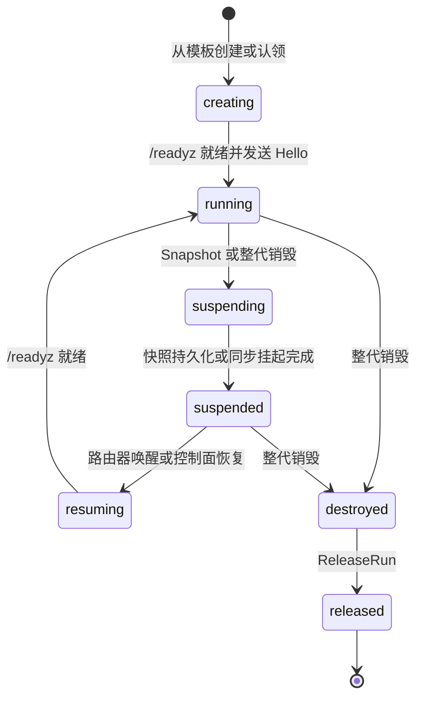
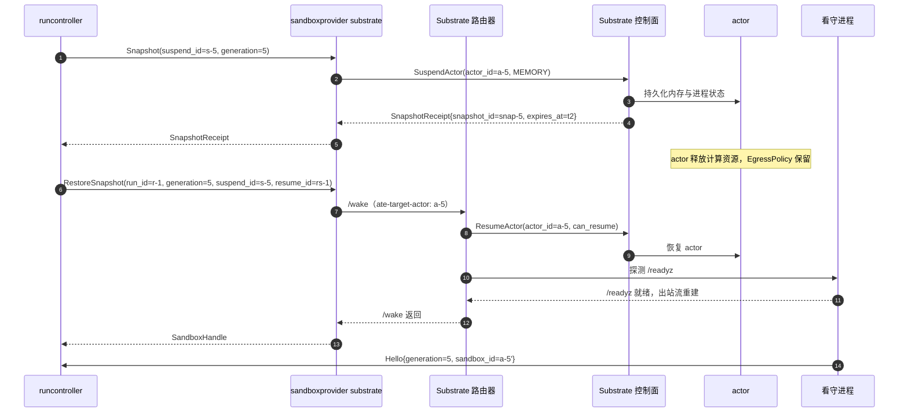
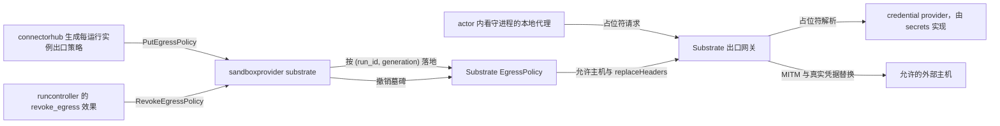

# substrate 子模块

substrate 子模块是 [sandboxprovider](design-sandboxprovider.md) 的提供者实现之一，把主文档定义的提供者接口落到 agent-substrate/substrate（[REF-substrate](../../../references.md)）。它拥有 actor 的创建与认领、[快照](../../../glossary.md)的[挂起](../../../glossary.md)与恢复、入站唤醒的路由承载、[出口策略](../../../glossary.md)的落地与撤销，以及预热 worker 的容量；不具备[冻结](../../../glossary.md)能力，不决定何时挂起、不维护[运行实例](../../../glossary.md)状态机、不生成出口策略、不拥有[工作区](../../../glossary.md)绑定。心智模型：actor 是整体可挂起的进程容器，挂起以内存快照换出计算资源，恢复由经路由器的入站请求唤醒（[ADR-dual-sandbox-providers](../../../adr/adr-dual-sandbox-providers.md)）。

文档较长，不宜顺序通读。第一次阅读依次取：核心概念、职责、外部接口契约中的接口映射与路由器契约、走查、Suspend 与 Resume、EgressPolicy 落地、外部 CSI 卷与 durableDir 退化；术语表、依赖、UML 图与核心数据结构作为核对字段与调用顺序的参考；错误与失败语义与并发与事务边界留到最后，按墓碑、停泊与代的范围自测迟到调用。

## 核心概念

本子模块的机制是内存快照挂起与路由器唤醒。actor 在 Substrate 中整体承载[看守进程](../../../glossary.md)与 Agent 进程；挂起以 MEMORY 保真度把进程内存与运行状态持久化为快照并释放计算资源，快照恢复不重建进程，而是在同一[代](../../../glossary.md)内恢复快照。快照恢复的入口是 Substrate 路由器：提供者以 `ate-target-actor` 头调用 `/wake`，路由器恢复 actor 并把入站请求停泊到 `wakeupProbe` 就绪，恢复窗口内的请求不丢失。

系统需要它，因为托管环境要在 Agent 等待 LLM、外部系统或人类时释放[沙箱](../../../glossary.md)的计算资源，并在依赖解除后以快照恢复替代冷启动，且恢复期间的入站请求不丢失。机制为何按能力分层、为什么在冻结与快照之间这样取舍，见 [ADR-capability-tiered-suspension](../../../adr/adr-capability-tiered-suspension.md)。

## 职责

职责穷举如下，每条先写本子模块执行的动作，再写产生的结果或边界；通用幂等、墓碑与能力协商语义见主文档，本条只写 Substrate 提供者层的落地方式。能力集合是闭合集合，本子模块声明 `Snapshot`、`Destroy`、`WarmPool` 与 `EgressInject`，不声明 `Freeze{cgroup}`、`Freeze{signal}` 与 `InPlaceResize`（[ADR-capability-tiered-suspension](../../../adr/adr-capability-tiered-suspension.md)）。

- **actor 模板与创建**：以 actor 模板声明 actor 镜像、入口、工作区卷、网络与 `wakeupProbe`；镜像以看守进程为 PID 1，可自带 `ENTRYPOINT`；按 `(run_id, generation, attempt_id)` 幂等创建 actor 并返回 `sandbox_id` 与放置位置。
- **预配与认领**：创建 actor 或从预热 worker 认领；调用 `workspace` 绑定工作区并按 `(run_id, generation)` 落地出口策略副本；创建墓碑或释放墓碑之后拒绝该代或该运行实例的创建。
- **Suspend 与快照**：按 `suspend_id` 执行 MEMORY 保真度的内存快照，释放 actor 的计算资源并返回快照标识与保留期限；按 `suspend_id` 撤销尚未确认的快照尝试，撤销即墓碑。
- **Resume 与路由器唤醒**：按 `resume_id` 在同一代内恢复快照；经 Substrate 路由器以 `ate-target-actor` 头调用 `/wake`，路由器恢复 actor 并停泊请求直到 `/readyz` 就绪；`/wake` 返回表示看守进程的出站流已重建；调用方持有 SPIFFE 身份且在路由器的入站白名单内。
- **EgressPolicy 落地与撤销**：保存 `connectorhub` 推送的每运行实例出口策略；在预配与认领时按 `(run_id, generation)` 落地为 EgressPolicy，以 MITM 与 `replaceHeaders` 替换请求头凭据占位符，默认拒绝未列入的主机；策略文档中的 `project_id` 与每条规则的 `system`、`auth_method`、`scopes` 原样透传，供出口网关的凭据提供者换取真实凭据；按代撤销并写撤销墓碑。
- **外部 CSI 卷与 durableDir**：为每个 actor 挂载一卷外部 CSI 卷，写穿持久、崩溃不丢、沙箱外可经同一导出访问、内容不进快照；外部 CSI 不可用时在绑定时退到 `durableDir`，退化配置下回合边界的销毁使用同步挂起。
- **预热 worker**：维护按镜像、规格与节点池或可用区分片的预热 worker 容量；认领时返回可用的 actor；容量按主文档的公式分片计算。
- **恢复完成后的交接**：`/wake` 只在出站流重建完成之后返回；看守进程随后校时、断开 Agent 进程的旧 TCP 连接，并由本地代理按 `request_id` 向 `llmgateway` 取回已完成响应。本子模块只负责把 actor 恢复到可就绪状态，不执行这些看守进程动作。
- **串行化与幂等**：同一运行实例的 Suspend、Resume 与 Destroy 按到达顺序串行；以 `suspend_id`、`(run_id, generation, attempt_id)`、`(run_id, generation)` 与 `(generation, sandbox_id)` 幂等；重复调用返回首次结果。

### 非职责

- 冻结与短冻结归 k8s 提供者；本子模块不具备 `Freeze` 能力，不执行 SIGSTOP，也不提供原地缩放。
- 挂起决策、等待时长预测、机制选择、冻结中复评与恢复准入归 `suspendpolicy`；本子模块只执行选定的提供者调用。
- 运行实例状态机、代递增、投递、游标与纠正性对账归 `runcontroller`；本子模块不读写控制面的表，也不持有运行实例状态。
- 工作区绑定、工作区租约、持久化确认与文件访问协议归 `workspace`；本子模块只提供卷或导出标识并调用绑定，不持有租约表。
- 出口策略内容与占位符替换规则归 `connectorhub`；本子模块只保存与落地策略副本，不解释策略语义。
- Substrate 路由器、出口网关、预热 worker 与 Substrate 控制面本身归 Substrate；本子模块只调用其 API，不实现其恢复、停泊、MITM 或调度逻辑。
- 凭据提供者的实现归 `secrets`；出口网关在解析占位符时调用 `secrets`，本子模块不与 `secrets` 构成代码依赖。
- Agent 进程监督、`/readyz` 的应答、旧连接清理与本地代理取回归 `warden`；本子模块不以任何方式进入 actor 内部执行进程操作。
- CSI 驱动、对象存储与 PostgreSQL 归基础设施；本子模块只使用其接口，不实现存储后端。

## 术语表

| 术语 | 英文对照 | 适用范围 | 定义 |
| --- | --- | --- | --- |
| actor 模板 | actor template | substrate 子模块 | Substrate 中声明 actor 镜像、入口、卷、网络与唤醒探针的创建模板 |
| MEMORY 保真度 | MEMORY fidelity | substrate 子模块 | 快照保留进程内存与运行状态、恢复后继续执行的挂起语义 |
| 请求停泊 | request parking | substrate 子模块 | 路由器暂存入站请求直到 `/readyz` 就绪或停泊预算耗尽的处理 |
| 单飞 | single-flight | substrate 子模块 | 路由器对同一 actor 的并发唤醒只执行一次恢复、其余请求合并等待的约束 |
| 预热 worker | warm worker | substrate 子模块 | Substrate 预创建并可多路复用认领的 worker，缩短 actor 启动时延 |

## 外部接口契约

本子模块实现主文档 `Provider` 接口在 Substrate 提供者上的下列方法；接口签名、幂等键与失败分类以主文档为准，本表只写提供者层的具体行为。稳定性承诺与主文档一致：生命周期接口对 `runcontroller` 稳定，出口策略接口对 `connectorhub` 稳定。

| 接口 | 本子模块的行为 |
| --- | --- |
| `Capabilities` | 返回 `Snapshot`、`Destroy`、`WarmPool` 与 `EgressInject` 为真，`FreezeCgroup`、`FreezeSignal` 与 `InPlaceResize` 为假 |
| `Provision` | 从 actor 模板创建 actor；绑定工作区；按 `(run_id, generation)` 落地 EgressPolicy；返回 `sandbox_id`、`placement` 与 `durability` |
| `Claim` | 从预热 worker 认领 actor；绑定工作区；落地本代 EgressPolicy；返回 `sandbox_id` 与放置位置 |
| `Snapshot` | 按 `suspend_id` 执行 MEMORY 快照；返回 `SnapshotReceipt{snapshot_id, snapshot_expires_at}` |
| `RevokeSnapshot` | 按 `suspend_id` 撤销尚未确认的快照尝试并写快照撤销墓碑；重复撤销返回成功 |
| `RestoreSnapshot` | 在同一代内恢复快照；先检查创建墓碑与释放墓碑，已销毁或已释放的运行实例以确定性错误拒绝；经路由器调用 `/wake` 并等待 `/readyz` 就绪；返回 `SandboxHandle`；快照不存在或已过期为确定性错误 |
| `Destroy` | 挂起或删除该代 actor，保留运行实例级资源；写创建墓碑；返回携带代的确认 |
| `DestroySandbox` | 只删除调用携带的 `(generation, sandbox_id)` 对应的 actor，不删除更新的代；目标不存在时幂等成功 |
| `ReleaseRun` | 释放 actor 相关资源；写释放墓碑；此后拒绝该运行实例的一切创建 |
| `ListSandboxes`、`GetSandbox` | 列举或查询 actor，返回 `run_id`、代、`sandbox_id`、放置位置与是否存在 |
| `NodeMemory` | 返回空集；本提供者没有冻结态内存，策略不以节点内存压力选择升级对象 |
| `ResizeStatus` | 返回不支持；本提供者不具备 `InPlaceResize` |
| `EstimateResume` | 按快照恢复、预热 worker 认领与冷启动分别返回提供者侧的时延估计 |
| `PutEgressPolicy`、`RevokeEgressPolicy` | 保存出口策略并按 `(run_id, generation)` 落地为 EgressPolicy；撤销写墓碑，已撤销的代拒绝再次落地与更新 |
| `Freeze`、`Thaw` | 能力集不含，调用以参数非法拒绝 |

### 对 Substrate API 与路由器的依赖

提供者经 Substrate 控制面的 API 创建、认领、挂起、恢复与删除 actor；以 SPIFFE 身份调用路由器，且该身份必须在路由器的入站白名单内（[REF-spiffe](../../../references.md)）。接口约束如下：

| 依赖 | 用途与约束 |
| --- | --- |
| actor 模板与 actor API | 从模板创建 actor；actor 镜像以看守进程为 PID 1，可自带 `ENTRYPOINT`；卷、网络与 `wakeupProbe` 在模板中声明 |
| Suspend 与 Resume API | 按 `suspend_id` 执行 MEMORY 快照；按 `resume_id` 在同一代内恢复；挂起与恢复对同一 actor 串行 |
| 路由器 `ResumeActor` | 以 `ate-target-actor` 头定位 actor，调用方需具备 `can_resume`；路由器恢复 actor 并停泊请求直到 `wakeupProbe` 就绪 |
| `wakeupProbe` | 在 actor 模板中声明为看守进程的 `/readyz:80`；就绪之前路由器不释放停泊请求 |
| `parked-request-budget` | 路由器停泊请求的预算；默认 5 s，部署时必须调到不小于恢复 p95 加 `/readyz` 余量；约 500 MB actor 的恢复可能超过 5 s，未调大时停泊请求会被提前切断 |
| EgressPolicy API | 以 `(run_id, generation)` 为键落地允许的主机、`replaceHeaders` 规则、凭据引用（`project_id`、`system`、`auth_method`、`scopes`）与通道模式；MITM 由出口网关执行 |
| 凭据提供者协议 | 出口网关在解析占位符时调用 `secrets` 实现的凭据提供者；本子模块不调用该协议 |
| 外部 CSI 卷 | actor 卷类型 `external`，每 actor 一卷；由 CSI 驱动动态供给 |
| `durableDir` | 退化卷类型；挂起时上传对象存储，沙箱外无读取接口 |
| 预热 worker | 预创建 actor 供认领；认领是多路复用的原子操作 |
| 对象存储与 PostgreSQL | 对象存储承载快照与 `durableDir` 数据；PostgreSQL 是 Substrate 控制面的存储 |

## 依赖

依赖穷举如下，方向与[模块依赖图](../../architecture.md#模块依赖图)一致：本子模块依赖基础层的 `workspace` 与 `agentprotocol`，以及 Substrate 控制面、路由器、出口网关与存储；本子模块不依赖 `runcontroller`、`suspendpolicy`、`connectorhub` 与 `secrets`。

- `workspace`：在预配与认领时调用绑定接口取得卷标识、挂载路径、`RunUID`、`StorageMode`、`Durability` 与 `Placement`；`lease_id` 取自 `ProvisionRequest`，不来自绑定；Substrate 提供者优先使用 `external_csi`，`durable_dir` 为退化配置（[ADR-workspace-persistence-per-provider](../../../adr/adr-workspace-persistence-per-provider.md)）。存储模式在绑定时固定，运行中不静默退化；外部 CSI 不可用时预配或恢复按自身规则失败，不在运行中切换到 `durableDir`。
- `agentprotocol`：恢复完成以看守进程发送 `Hello` 为观察；`/readyz` 是路由器的 `wakeupProbe`，`/wake` 返回表示出站流已重建。入站端点不承载事件内容，投递只在出站流上进行。
- Substrate 控制面：执行 actor 的创建、认领、Suspend 与 Resume；快照保留期限由 `SnapshotReceipt` 返回。Substrate 控制面不可达时预配、挂起与恢复返回暂时性错误。
- Substrate 路由器：以 `ate-target-actor` 头调用 `/wake`，恢复 actor 并停泊请求直到 `/readyz` 就绪；调用方持有 SPIFFE 身份并在白名单内。路由器同时承载 `/terminal` 与界面文件访问；事件投递与 `ToolExec` 帧都不经该路由，快照恢复经 `/wake` 触发；`ToolExec` 帧随看守进程的出站流往返，与路由器唤醒路径相互独立。
- Substrate 出口网关：把 EgressPolicy 落地为 MITM 代理，以 `replaceHeaders` 替换请求头中的凭据占位符，默认拒绝未列入的主机；actor 镜像信任出口网关的 CA。出口网关在解析占位符时调用 `secrets` 的凭据提供者，以策略中的 `project_id`、`run_id`、`generation`、`system`、`auth_method` 与 `scopes` 换取真实凭据；真实凭据不进入 actor。EgressPolicy 的 `CredentialHeader` 只携带 `credential_uri` 时，`credential_uri` 编码上述项目、系统、认证方式与作用域，由凭据提供者解析；提供者版本不支持编码时，须扩展其请求字段，不能把字段丢弃后按默认凭据处理。
- 对象存储：承载快照与 `durableDir` 上传数据；GCS 原生支持，S3 经插件。
- PostgreSQL：Substrate 控制面的存储。
- 外部 CSI 驱动：为每 actor 供给一卷外部 CSI 卷；写穿持久、崩溃不丢、沙箱外可经同一导出访问，内容不进快照。该能力仍为预览特性，需开启 ExternalVolumes、注册 CSIDriverConfig，并确认 NFS 导出可从沙箱外访问。
- 部署前提：k8s 具备 PodCertificateRequest 与 ClusterTrustBundle API；节点运行 gVisor，microVM 模式需要 KVM；节点内核 6.7 及以上；PostgreSQL 与对象存储可用；路由器与出口网关可达，SPIFFE 信任域已配置，控制面身份在路由器白名单内；actor 镜像信任出口网关 CA，凭据提供者可达。

**验证前提与已知限制。** 以下条件未满足时，Substrate 提供者不能进入阶段 1：

- 外部 CSI 卷仍是预览特性：需开启 ExternalVolumes、注册 CSIDriverConfig，并确保 NFS 导出可从沙箱外访问；内容不进快照，恢复后不能依赖快照回滚工作区。
- gVisor 下没有 Docker：编译测试类负载不能假设容器内可运行 Docker，需预装工具链或改用外部构建服务。
- `parked-request-budget` 默认 5 s，必须调到不小于恢复 p95 加 `/readyz` 余量；约 500 MB actor 的恢复可能超过 5 s，未调大时停泊请求会被提前切断。
- MEMORY 快照恢复不保证旧 TCP 连接可被及时察觉；看守进程必须在恢复后主动断开 Agent 的旧连接，不能依赖读超时。
- S3 插件在当前版本仍需试点确认；对象存储优先 GCS，S3 作为待验证选项。
- 路由器 `/wake`、EgressPolicy 与凭据提供者需要在目标集群完成端到端试点；仅凭文档与源码不能判定 go。

## UML 图

下列图固定 actor 的生命周期、Suspend 与 Resume 及路由器唤醒的调用顺序，以及 EgressPolicy 从生成到落地与撤销的路径；图中不表达的墓碑、幂等、停泊预算与代的范围由每张图后的正文与核心算法与流程给出。

### actor 生命周期图

生命周期图的约束由提供者操作给出：`creating` 成功后才进入 `running`，看守进程在 `/readyz` 就绪之前不接收投递；`Snapshot` 使 `running` 进入 `suspending`，快照持久化后进入 `suspended`；路由器唤醒使 `suspended` 进入 `resuming`，`/readyz` 就绪后回到 `running`，恢复在同一代内进行，不递增代；整代销毁使 `running` 或 `suspended` 进入 `destroyed`，`ReleaseRun` 使 `destroyed` 进入 `released`。`creating` 的失败不进入生命周期状态，由调用方按暂时性或确定性错误处置。

### Suspend、Resume 与路由器唤醒时序图

时序图固定了恢复的两段：`RestoreSnapshot` 不直接恢复 actor，而是经路由器调用 `/wake`；路由器负责恢复 actor、把请求停泊到 `wakeupProbe` 就绪，`/wake` 返回即表示看守进程的出站流已重建。快照恢复在同一代内进行，不递增代；`SandboxHandle` 的 `sandbox_id` 可能因恢复而改变，代保持不变。恢复后看守进程校时、断开 Agent 进程的旧 TCP 连接，并由本地代理按 `request_id` 向 `llmgateway` 取回已完成响应；这些动作不在路由器或提供者内执行。

### EgressPolicy 落地与撤销图

图固定了职责边界：`connectorhub` 生成策略内容，`sandboxprovider` 以 `(run_id, generation)` 为键落地 EgressPolicy，出口网关执行 MITM、`replaceHeaders` 与默认拒绝，凭据提供者只返回占位符对应的真实凭据。真实凭据不进入 actor，也不物化为 k8s Secret；凭据提供者不查询运行实例当前代，代的范围由 EgressPolicy 的落地与撤销界定。撤销即墓碑，已撤销的代拒绝此后的落地与更新；撤销在效果记录的截止之前生效时，残余窗口不超过该截止。

## 核心数据结构

提供者侧记录只服务于幂等、墓碑、预热、出口策略副本与观察；运行实例状态仍以 PostgreSQL 中的 `run` 行为唯一事实源。主文档定义的通用记录在本子模块中的映射如下。

| 记录 | 键 | 字段 | 用途 |
| --- | --- | --- | --- |
| `ActorRecord` | `(run_id, generation)` | `actor_id`、`sandbox_id`、`worker`、`placement`、`volume_ref`、`state` | actor 与运行实例代的映射 |
| `VolumeBinding` | `run_id` | `volume_ref`、`storage_mode`、`mount_path`、`durability` | 外部 CSI 卷或 `durableDir` 的绑定 |
| `SnapshotTrace` | `suspend_id` | `snapshot_id`、`expires_at`、`cancelled`、`restored` | 快照保留期限、撤销与恢复 |
| `EgressCopy` | `(run_id, generation)` | `policy`、`landed_at`、`revoked` | EgressPolicy 的按代落地与撤销墓碑 |
| `WarmShard` | `(image, spec, node_pool 或可用区)` | `capacity`、`available`、`claimed` | 预热 worker 分片 |
| `ParkedRequest` | `(actor_id, request_id)` | `arrived_at`、`deadline`、`single_flight_group` | 路由器的停泊与单飞状态 |

`SnapshotTrace` 在返回 `SnapshotReceipt` 之前持久化；`cancelled` 为真时同一 `suspend_id` 的迟到快照请求不生效，`restored` 为真时该快照不再接受第二次恢复。`EgressCopy` 以 `revoked` 标记撤销墓碑；`ParkedRequest` 是路由器的内存状态，不持久化，路由器重启后按 `actor_id` 重建。

### 状态一览

下表描述 actor 的生命周期状态；第三列的当前动作由 `sandboxprovider` 或 Substrate 执行。`suspending`、`suspended` 与 `resuming` 是 actor 生命周期的子状态：`suspended` 对应主文档 `SandboxHandle.State` 的 `snapshotted`，`suspending` 与 `resuming` 分别是进入与离开该状态的过渡子状态；`SandboxHandle.State` 的闭集不变。

| 状态 | 一句话含义 | 当前动作 | 直觉画面 |
| --- | --- | --- | --- |
| `creating` | actor 正在从模板创建或从预热 worker 认领 | 绑定工作区，落地 EgressPolicy，等待 `/readyz` | 新房间正在装修 |
| `running` | actor 可执行且出站流已建立 | 等待快照、销毁或查询 | 房间在使用中 |
| `suspending` | 快照或同步挂起进行中 | 持久化内存，或上传 `durableDir` | 房间正在打包 |
| `suspended` | 内存与进程状态已持久化，计算资源已释放 | 保存快照标识与保留期，等待唤醒 | 房间密封存档 |
| `resuming` | 路由器或控制面正在恢复 actor | 恢复 actor，停泊请求直到 `/readyz` 就绪 | 房间正在开封 |
| `destroyed` | actor 已不运行，运行实例级资源保留 | 保留创建墓碑，拒绝该代及更早代的创建 | 房间退租，仓库保留 |
| `released` | 运行实例级资源已释放 | 保留释放墓碑，拒绝该运行实例的一切创建 | 仓库清空，钥匙收回 |

## 核心算法与流程

### 走查

本条走查把快照、路由器唤醒、同代恢复、整代销毁、新代预配与 `durableDir` 退化落到具体值上。初始状态：`run_id=r-1`、`generation=5`、`sandbox_id=a-5`、`suspend_id=s-5`、工作区为外部 CSI 卷 `v-5`、`EgressCopy(r-1, 5)` 已落地、创建墓碑与释放墓碑为空。下表只列提供者侧状态，`run` 行由 `runcontroller` 维护。

| 步骤 | 调用或事件 | 提供者侧状态 |
| --- | --- | --- |
| 1 | `Snapshot(s-5)` | `SnapshotTrace(s-5)` 写入，`snapshot_id=snap-5`、`expires_at=t2`；actor 进入 `suspended`；工作区租约以快照保留期为上限 `HoldLease`；计算资源释放；`EgressCopy(r-1, 5)` 保留 |
| 2 | 控制面调用 `RestoreSnapshot(r-1, 5, s-5, rs-1)`；提供者经路由器以 `ate-target-actor: a-5` 调用 `/wake` | `ParkedRequest(a-5, req-1)` 写入，`deadline` 取停泊预算；路由器调用 `ResumeActor` 恢复 actor |
| 3 | 路由器探测 `/readyz` 就绪 | 看守进程的出站流重建；路由器释放停泊请求，`/wake` 返回 |
| 4 | `RestoreSnapshot` 返回与看守进程 `Hello` | `SnapshotTrace(s-5).restored=true`；`SandboxHandle{generation=5, sandbox_id=a-5'}`；看守进程校时、断开旧 TCP 连接，本地代理按 `request_id` 取回已完成响应；`EgressCopy(r-1, 5)` 不改写 |
| 5 | `Destroy(r-1, 5)` | actor 进入 `destroyed`；写入创建墓碑 `(r-1, ≤5)`；保留运行实例级资源；返回 `DestroyReceipt{generation=5}` |
| 6 | 迟到的 `Provision(r-1, 5, a-9)` | 被创建墓碑拒绝；不创建 actor，状态仍为 `destroyed` |
| 7 | `Provision(r-1, 6, a-10)` | 创建 actor `a-6`，绑定外部 CSI 卷 `v-6`，落地 `EgressCopy(r-1, 6)`；状态 `running`，`placement` 写入 |
| 8 | `ReleaseRun(r-1)` | 释放 actor 相关资源；写入释放墓碑 `(r-1)`；状态 `released`；此后对该 `run_id` 的一切创建被拒绝 |

走查结束时 `generation` 由 `runcontroller` 决定，提供者不递增代；快照恢复在同一代内进行，`snapshot_id` 与 `suspend_id` 保留到撤销或释放。第 5 步的整代销毁与第 8 步的释放都保留运行实例级记录，创建墓碑与释放墓碑使迟到预配不产生第二次副作用。

`durableDir` 退化配置下的回合边界销毁使用同步挂起，走查的差异只在挂起步骤：看守进程发出 `ReadyToSuspend` 后，提供者执行同步挂起并等待对象存储上传完成；上传完成才返回，销毁路径随后调用 `workspace.Confirm(Mode=suspend_upload, run_id, generation, lease_id, suspend_id)`，确认成功后才由 `runcontroller` 进入 `Suspended`。上传失败或确认失败时提供者返回暂时性错误，运行实例不进入 `Suspended`，销毁路径以同一 `suspend_id` 重试；`workspace.Confirm` 以 `(run_id, generation, lease_id)` 幂等。回合中 actor 崩溃时，上次上传之后的写入丢失，`runcontroller` 以「回合被中断」重投事件并接受该回合文件改动丢失。

### actor 创建与认领

1. `runcontroller` 在效果记录提交后调用 `Provision` 或 `Claim`，请求携带 `run_id`、`generation`、`attempt_id` 与工作区绑定；`attempt_id` 取 `resume_id`。
2. 提供者先检查创建墓碑与释放墓碑：代不大于该运行实例最近整代销毁的代，或释放墓碑已存在时，返回确定性拒绝，不创建 actor。
3. 提供者调用 `workspace` 的绑定接口，取得卷标识、挂载路径、`RunUID`、`StorageMode`、`Durability` 与 `Placement`；`lease_id` 取自请求。外部 CSI 可用时选择 `external_csi`，`durability` 为 `sync`；不可用时选择 `durable_dir`，`durability` 为 `on_suspend`。绑定之后不改变存储模式。
4. 新建路径从 actor 模板创建 actor；认领路径从预热 worker 认领。actor 镜像以看守进程为 PID 1，模板声明 `wakeupProbe` 为 `/readyz:80`、工作区卷与网络。预热 worker 不预挂项目根，卷在 actor 认领时挂载。
5. 提供者在 `(run_id, generation)` 上落地 EgressPolicy；该代已被撤销时跳过落地。出口策略的更新只同步到尚未撤销的代。
6. 提供者在创建或认领之前持久化以 `(run_id, generation, attempt_id)` 为键的占有记录，或把该键标注到预热 actor 上使认领可按同一键重放；创建与认领按该键执行，重驱动识别已认领的 actor 而不重复认领。完成后补全 `OperationRecord` 并返回 `SandboxHandle`。看守进程随后启动、续约工作区租约并发送 `Hello`；提供者不等待 `Hello`，也不把 `Hello` 作为预配成功的前提。同一 `(run_id, generation, attempt_id)` 的重复调用返回首次结果。

### Suspend 与快照

1. `runcontroller` 选定快照后调用 `Snapshot`，请求携带 `run_id`、`generation`、`sandbox_id` 与 `suspend_id`；只有具备 `Snapshot` 能力的提供者会收到该调用。
2. Substrate 控制面执行 MEMORY 保真度的快照，持久化进程内存与运行状态并释放 actor 的计算资源；提供者持久化 `SnapshotTrace`，返回 `SnapshotReceipt`，其中 `SnapshotExpiresAt` 是快照保留期限。
3. `runcontroller` 在保留期临近前作废该代，避免恢复落在已过期快照上。快照保留期与工作区租约的覆盖范围一致：工作区以 `HoldLease` 延长到快照保留期加安全余量，快照恢复的 actor 以首次续约重新绑定租约持有者。
4. 撤销尚未确认的快照尝试按 `suspend_id` 执行，提供者写入快照撤销墓碑；撤销确认之后到达的同一 `suspend_id` 的快照请求不生效。快照恢复不递增代，同一代内由新的 actor 实例承载；快照不替代工作区持久化，外部 CSI 卷的内容不进快照。
5. `durableDir` 退化配置下，快照仍按 `Snapshot` 执行；回合边界的销毁改用同步挂起：提供者等待对象存储上传完成才返回，销毁路径再以同一 `suspend_id` 调用 `workspace.Confirm(Mode=suspend_upload, run_id, generation, lease_id)`；确认成功后才进入 `Suspended`。上传或确认失败返回暂时性错误，运行实例停在 `Suspending`，不进入 `Suspended`。同步挂起的上传由同一 `suspend_id` 幂等，重复调用不重复上传；`workspace.Confirm` 以 `(run_id, generation, lease_id)` 幂等。

### Resume 与路由器唤醒

1. `runcontroller` 按 `resume_mode` 调用 `RestoreSnapshot`、`Claim` 或 `Provision`。`RestoreSnapshot` 在同一代内恢复快照，不递增代；请求携带 `run_id`、`generation`、`suspend_id` 与 `attempt_id`，`attempt_id` 取 `resume_id`。调用前检查创建墓碑与释放墓碑；已销毁或已释放时以确定性错误拒绝，不恢复 actor。
2. 提供者经 Substrate 路由器以 `ate-target-actor` 头调用 `/wake`。路由器按该头定位 actor，调用 `ResumeActor` 恢复 actor；调用方必须持有 SPIFFE 身份且在路由器的入站白名单内，并具备 `can_resume`。
3. 路由器把请求停泊到 `wakeupProbe` 就绪；`wakeupProbe` 为看守进程的 `/readyz:80`，就绪之前路由器不释放请求。停泊预算由 `parked-request-budget` 配置，默认 5 s，部署时按快照恢复与冷启动的时延调大；预算耗尽时路由器返回失败，不把未就绪的 actor 标记为恢复完成。
4. `/wake` 返回表示看守进程的出站流已重建。提供者随后返回 `SandboxHandle`；`runcontroller` 以同代 `Hello` 完成 `Resuming` 到 `Active` 的转移。快照不存在或已过期时提供者返回确定性错误，`runcontroller` 转重建意图，不把该错误计入恢复失败次数。
5. 预热 worker 认领与冷启动由提供者取得或创建 actor，随后看守进程连接并发送 `Hello`；这两条路径不经过 `/wake`，路由器只承担快照恢复的入站唤醒与终端、文件访问。
6. 恢复完成后，看守进程先校时、主动断开 Agent 进程的旧 TCP 连接，避免半死连接等到读超时；在途 LLM 请求由本地代理按 `request_id` 向 `llmgateway` 取回已完成响应。提供者不重放请求，也不改写工作区。

### 恢复后校时与旧连接清理

快照恢复重置 guest 时钟并可能使旧 TCP 连接处于半死状态。看守进程在 `/readyz` 就绪之前完成校时，并在恢复之后主动断开 Agent 进程的旧连接，再通知 Agent 驱动器；本地代理向 `llmgateway` 取回已完成响应并按 `request_id` 交付。本子模块只保证 `/wake` 在出站流重建之后返回，不代为执行校时、连接清理或响应取回；这些动作属于 `warden` 的恢复路径，其细节见看守进程模块文档。

### EgressPolicy 落地与撤销

1. `connectorhub` 经 `PutEgressPolicy` 推送每运行实例出口策略；本子模块按 `run_id` 保存，策略内容不解释。
2. 预配与认领时，提供者按 `(run_id, generation)` 生成本代副本并落地为 EgressPolicy；快照恢复沿用同代副本，不重新生成；推送的更新只同步到尚未撤销的代。
3. EgressPolicy 把允许的主机与 `replaceHeaders` 规则交给 Substrate 出口网关。网关以 MITM 终止连接，只替换请求中已存在的占位符请求头，缺头不注入；未列入的主机默认拒绝。策略中的通道模式原样透传给沙箱内本地 DNS 与透明拦截器；拦截器不终止 TLS，只把原始字节流转给出口网关。actor 镜像信任出口网关的 CA；git 的 Basic 与 Bearer 头同样由出口网关替换，需要本地签名的客户端不受支持。
4. 网关在解析占位符时调用 `secrets` 实现的凭据提供者；凭据提供者不查询运行实例当前代，代的范围由 EgressPolicy 的落地与撤销界定。真实凭据只在网关替换请求头时出现，不进入 actor 的文件系统、环境变量或进程内存，也不物化为 k8s Secret。
5. `RevokeEgressPolicy` 按 `(run_id, generation)` 撤销该代副本并写撤销墓碑；已撤销的代拒绝此后的落地与更新。撤销由 `runcontroller` 在代递增、进入 `Degraded`、放弃、显式结束、本代沙箱作废与回合边界销毁的提供者确认的事务内写 `revoke_egress` 效果，提供者在效果执行时撤销。
6. 撤销在效果记录的截止之前生效时，残余窗口不超过该截止；截止前未能生效时，例如 Substrate 控制面不可达，窗口延续到撤销生效或该代 actor 删除完成。凭据提供者不可用时出口请求失败关闭，不回退到 k8s Secret 或静态凭据。

### 外部 CSI 卷与 durableDir 退化

1. actor 只接受 `durableDir`、`external`、`image` 与 `systemInfo` 卷，不能直挂 PVC 或透传 worker Pod 的卷。`external` 即外部 CSI 卷，每 actor 一卷，由 CSI 驱动动态供给；`durableDir` 在挂起时上传对象存储。
2. 外部 CSI 卷写穿持久、崩溃不丢，沙箱外可经同一导出访问；卷内容不进快照，快照恢复不改变卷上的文件，`Revert` 不回滚卷内容。工作区租约仍以控制面记录串行化写者，外部 CSI 卷的单写者由租约与 actor 生命周期共同保证。
3. 外部 CSI 不可用时，绑定时选择 `durable_dir`，`durability` 变为 `on_suspend`；存储模式在绑定时固定，运行中不静默切换。`durableDir` 的数据只在挂起时上传对象存储，actor 崩溃丢失上次快照之后的全部写入，沙箱外没有读取接口。
4. `durableDir` 退化配置的补偿：回合边界的销毁一律使用同步挂起，上传完成才返回；回合中崩溃按「回合被中断」重投事件，已接受的事件带 `redelivery=true`，该回合的文件改动可能丢失；界面读取工作区必须经路由器唤醒 actor 后到达文件 API。
5. 外部 CSI 卷在恢复后仍以同一导出挂载，提供者只把卷标识交给 `workspace` 与 actor 模板；卷的供给、挂接与回收由 CSI 驱动完成。

### 预热 worker

预热 worker 预创建 actor 供认领，认领是多路复用的原子操作；同一预热 actor 不会被多个运行实例认领，认领后的 actor 转为运行实例承载，不回到预热池。预热不预挂项目根，工作区卷在认领时挂载，因此不存在 k8s 路径上预热 Pod 预挂项目根的问题。容量按主文档的公式 `N = λL + z_{1−ε}·√(λL) + B` 分片计算，分片维度为镜像、规格与节点池或可用区；池空时认领返回池空，恢复退化为冷启动并受冷启动并发上限约束。

### 能力集合不含 Freeze 对策略的影响

本子模块不声明 `Freeze{cgroup}`、`Freeze{signal}` 与 `InPlaceResize`。回合中 `suspendpolicy` 只在 `NONE` 与 `SNAPSHOT` 之间选择：预测等待低于 `T_nofreeze` 不挂起，超过 `T_snapshot` 且快照安全条件成立时选择快照；本子模块不存在冻结上限，策略不返回 `FREEZE` 或 `FREEZE_SHRINK`。回合边界仍可选择 `DESTROY`。`T_snapshot` 按 Substrate 的增量快照成本设定，gVisor 增量快照的 `T_snap_min` 见 `suspendpolicy` 的参数表。能力缺失由策略降级，本子模块不把能力缺口暴露为运行时错误。

## 错误与失败语义

错误按是否可重试分为确定性与暂时性：确定性错误不重试，调用方丢弃并计数或转重建；暂时性错误按同一幂等键退避重试，提供者返回首次结果。主文档的失败分类适用于本子模块，下表只列 Substrate 提供者层特有的失败。

| 失败 | 处置 |
| --- | --- |
| Resume 失败 | 暂时性失败按同一 `resume_id` 重驱动；连续达到上限时 `runcontroller` 进入 `Degraded`，经兜底以新会话或恢复句柄重试，或放弃进入 `Failed` |
| 路由器不可达或 `/wake` 未返回 | 暂时性；提供者返回错误，`runcontroller` 以同一 `resume_id` 重驱动；`/wake` 不返回成功即不把 actor 标记为恢复完成，不产生虚假的 `Resuming` 转移 |
| 路由器的 SPIFFE 身份或白名单拒绝 | 确定性；提供者返回认证失败，不重试；部署前提未满足，恢复无法进行 |
| 停泊预算耗尽 | 路由器返回失败；提供者按暂时性错误返回，调用方重试；不把未就绪的 actor 标记为恢复完成 |
| 快照不存在或已过期 | 确定性；`runcontroller` 转重建意图，不把该错误计入恢复失败次数 |
| 快照撤销之后到达的迟到快照 | 确定性；快照撤销墓碑使其不生效 |
| EgressPolicy 撤销在截止前未生效 | 残余窗口延续到撤销生效或该代 actor 删除完成；调用方按效果截止告警，不恢复该代的放行 |
| 凭据提供者不可用 | 出口请求失败关闭；不回退到 k8s Secret 或静态凭据；真实凭据不进入 actor |
| 外部 CSI 不可用 | 绑定时选择 `durable_dir`；已绑定 `external_csi` 的运行实例在运行中遇到 CSI 不可用时，提供者错误向上返回，预配或恢复按自身规则失败，不静默退化 |
| `durableDir` 上传或确认失败 | 同步挂起返回暂时性错误，或 `workspace.Confirm(suspend_upload)` 核对失败；运行实例不进入 `Suspended`，销毁路径以同一 `suspend_id` 重试，上传完成且确认成功才返回 |
| `durableDir` 下回合中 actor 崩溃 | 上次上传之后的写入丢失；`runcontroller` 写入「回合被中断」事件并从回退后的消费位置重投，已接受的事件带 `redelivery=true` |
| 预热 worker 耗尽 | 认领返回池空；恢复退化为冷启动，受冷启动并发上限约束，`pool_miss_rate` 上升 |
| actor 在回合中丢失 | 提供者报告沙箱丢失；`runcontroller` 写「回合被中断」事件，经恢复准入以新代重建 |
| 整代销毁或释放之后到达的创建 | 创建墓碑或释放墓碑拒绝；不创建 actor 或运行实例级资源 |

提供者不把能力缺失暴露为运行时错误：`Freeze` 与 `Thaw` 不在能力集内，调用以参数非法拒绝；`suspendpolicy` 不为此提供者选择冻结。删除确认、快照撤销与释放的重复调用都返回首次结果，调用方据此区分“已完成”与“未执行”。

## 并发与事务边界

- **不参与控制面事务**：生命周期调用经 `runcontroller` 的效果记录在数据库事务提交后发出；出口策略推送由 `connectorhub` 直接调用。本子模块不读写控制面的表，也不持有 `run` 行锁；提供者侧的 `OperationRecord`、墓碑、`SnapshotTrace` 与 EgressPolicy 副本在返回确认之前持久化。
- **按运行实例串行**：同一运行实例的 Suspend、Resume 与 Destroy 不并发；提供者按到达顺序串行执行，不同运行实例的调用可以并发。并发重复调用由幂等键与串行化吸收。
- **快照与恢复的交错**：同一 actor 的挂起与恢复串行；快照恢复在同一代内进行，同一快照只接受一次成功恢复；恢复后的 actor 与旧 actor 不并存的写者由工作区租约串行化，外部 CSI 卷路径也保留控制面租约作为跨提供者的统一失效判定依据。
- **EgressPolicy 的并发**：`PutEgressPolicy` 与 `RevokeEgressPolicy` 按 `run_id` 与 `(run_id, generation)` 串行；策略更新只同步到尚未撤销的代，撤销之后的落地与更新被墓碑拒绝。出口网关的放行以已落地的策略为准，不逐请求查询代。
- **预热认领**：认领是原子操作，同一预热 actor 不会被多个运行实例认领；认领后的 actor 转为运行实例承载，不回到预热池。
- **路由器并发**：同一 actor 的并发唤醒按单飞约束只执行一次恢复，其余请求停泊并合并等待；路由器的停泊状态不参与控制面事务，也不改变运行实例状态。

## 扩展点

### 新增 actor 卷类型

新增卷类型须同时扩展 `VolumeBinding` 的 `storage_mode` 闭集、`workspace` 的绑定接口与 `sandboxprovider` 的预配与恢复路径，并给出该类型的持久化语义、崩溃可见性与沙箱外访问方式。存储模式在绑定时固定，运行中不静默切换；新增卷类型不改变 `Provider` 接口与运行实例状态机。

### 新增 EgressPolicy 策略字段

出口策略内容对提供者不透明，新增策略字段不改变 `Provider` 接口；新增字段须同时扩展 `connectorhub` 的策略生成、Substrate 出口网关的解析与 `secrets` 的凭据提供者协议。提供者只按 `(run_id, generation)` 保存与落地完整策略，不解释新增字段。

## 实现状态

| 能力 | 状态 | 代码 |
| --- | --- | --- |
| actor 模板与创建 | 未实现 | — |
| 预配与预热 worker 认领 | 未实现 | — |
| MEMORY 快照与快照撤销 | 未实现 | — |
| 快照恢复与路由器唤醒 | 未实现 | — |
| EgressPolicy 落地与撤销 | 未实现 | — |
| 外部 CSI 卷 | 未实现 | — |
| `durableDir` 与同步挂起补偿 | 未实现 | — |
| 按代销毁与释放 | 未实现 | — |
| 恢复后校时与旧连接清理的交接 | 未实现 | — |
| 串行化与幂等 | 未实现 | — |
