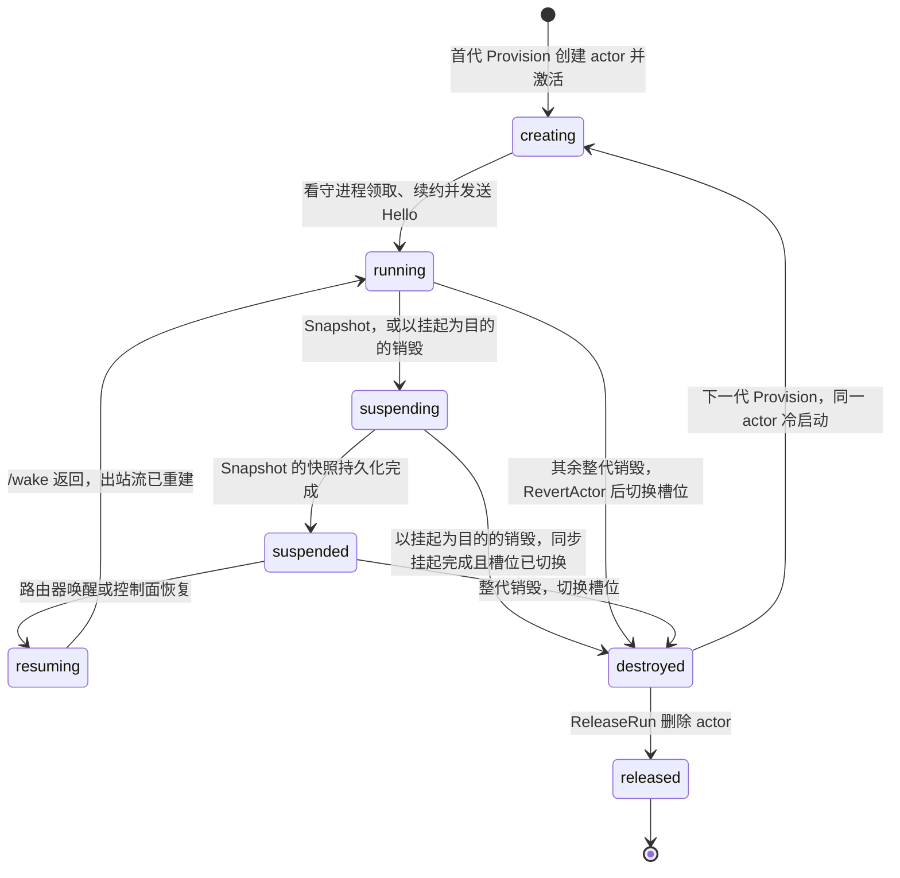
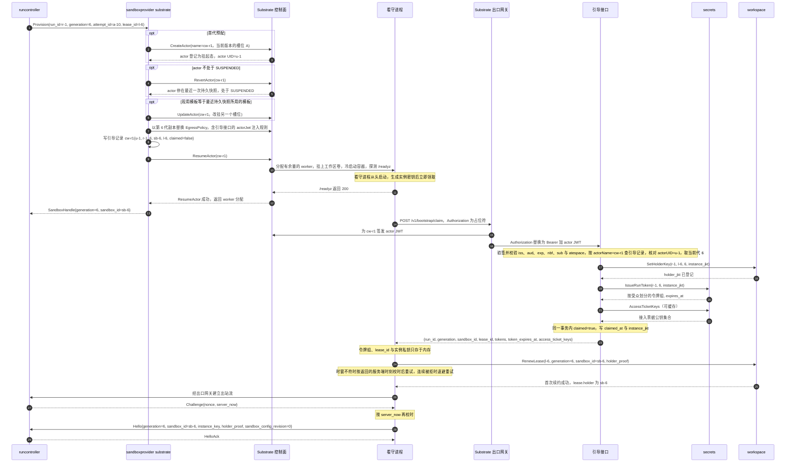
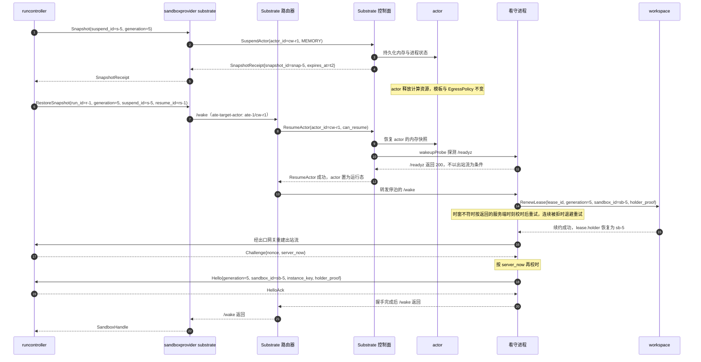
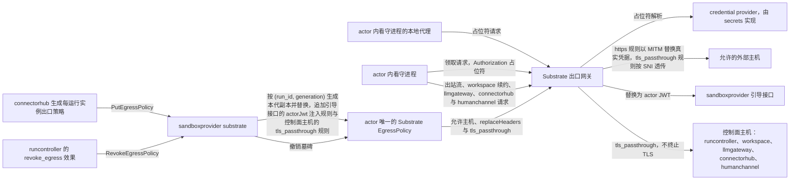

# substrate 子模块

substrate 子模块是 [sandboxprovider](design-sandboxprovider.md) 的提供者实现之一，把主文档定义的提供者接口落到 agent-substrate/substrate（[REF-substrate](../../../references.md)）。它负责 actor 的创建与按代冷启动、[快照](../../../glossary.md)的[挂起](../../../glossary.md)与恢复、按代销毁、入站唤醒的路由承载、[出口策略](../../../glossary.md)的落地与撤销，以及[引导接口](../../../glossary.md)在 Substrate 路径上的认证与领取触发；每个[运行实例](../../../glossary.md)只用一个 actor，首次预配时由 Substrate 分配到预热 worker 并从[模板快照](../../../glossary.md)恢复，此后每一[代](../../../glossary.md)是同一 actor 的一次冷启动。它不具备[冻结](../../../glossary.md)与 `WarmPool` 能力，不决定何时挂起、不维护运行实例状态机、不生成出口策略、不拥有[工作区](../../../glossary.md)绑定。心智模型：actor 是运行实例在 Substrate 上跨代存续的进程容器，工作区卷随它存续；同一代内的挂起以内存快照换出计算资源，恢复由经路由器的入站请求唤醒；换代以冷启动换上新的看守进程与 Agent 进程（[ADR-dual-sandbox-providers](../../../adr/adr-dual-sandbox-providers.md)、[ADR-substrate-actor-per-run](../../../adr/adr-substrate-actor-per-run.md)）。

文档较长，不宜顺序通读。第一次阅读依次取：核心概念、职责、外部接口契约中的接口映射、引导接口的认证与路由器契约、走查、预配与按代冷启动、按代销毁与槽位切换、领取的触发、Suspend 与快照、Resume 与路由器唤醒、EgressPolicy 落地与撤销、外部 CSI 卷与 durableDir 退化；术语表、依赖、UML 图与核心数据结构作为核对字段与调用顺序的参考；错误与失败语义以及并发与事务边界留到最后，按墓碑、停泊与代的范围自测迟到调用。

## 核心概念

本子模块的机制有两条：同一代内的内存快照挂起与路由器唤醒，以及换代时同一 actor 的冷启动。actor 在 Substrate 中整体承载[看守进程](../../../glossary.md)与 Agent 进程；挂起以 MEMORY 保真度把进程内存与运行状态持久化为快照并释放计算资源，`MEMORY` 快照恢复不重建进程，而是在同一[代](../../../glossary.md)内恢复快照；没有运行时兼容的 worker 时降级为 `ROOTFS` 冷启动，进程内存与令牌丢失。快照恢复的入口是 Substrate 路由器：提供者以 `ate-target-actor: <atespace>/<actor>` 头调用 `/wake`，路由器恢复 actor 并把入站请求停泊到 `wakeupProbe` 就绪；停泊预算只约束新的恢复重试，客户端被持有的上限是预算加 5 s，超过上限的请求返回 503。

系统需要它，因为托管环境要在 Agent 等待 LLM、外部系统或人类时释放[沙箱](../../../glossary.md)的计算资源，并在依赖解除后以快照恢复替代冷启动，且恢复期间的入站请求在停泊预算与客户端上限内不丢失。机制为何按能力分层、为什么在冻结与快照之间这样取舍，见 [ADR-capability-tiered-suspension](../../../adr/adr-capability-tiered-suspension.md)。

换代的冷启动由工作区的存续决定。工作区是 actor 的外部 CSI 卷或 `durableDir`，两者都只随 actor 存续，删除 actor 就失去工作区；因此一个运行实例只用一个 actor，只在 `ReleaseRun` 时删除它。新的一代却需要从头启动的看守进程与 Agent 进程，以 `claude -p --resume` 从工作区续接会话。Substrate 在 actor 改用另一个模板之后，把下一次恢复当作模板已替换：只恢复卷与 `durableDir`，容器从镜像冷启动。本子模块为每个模板版本准备两份只差槽位标记的模板，结束一代时让 actor 改挂与其最近持久快照所用模板不同的[模板槽位](#术语表)，下一代的 `ResumeActor` 因而是冷启动；同一代内的快照恢复不换模板，恢复的仍是进程内存。一个 actor 同一时刻只有一个沙箱，下一代冷启动时上一代的进程已不存在。取舍见 [ADR-substrate-actor-per-run](../../../adr/adr-substrate-actor-per-run.md)。

快照同样决定按运行实例的数据如何进入 actor。actor 只引用 actor 模板，首次激活默认从模板快照恢复；环境变量与镜像内文件都在快照里，从同一快照恢复的 actor 彼此相同，不能携带按运行实例的数据。看守进程因此经引导接口领取[运行实例令牌](../../../glossary.md)与 `lease_id`：身份来自出口网关为发出请求的 actor 注入的 actor JWT，首代的领取时机来自 `systemInfo` 卷投射的 `actor-name`，它在快照恢复后仍是本 actor 的值；此后各代冷启动的看守进程从头启动，启动即领取。actor JWT 跨代不变，引导记录按 actor 名保存当前代，每个 `(actor, 代)` 只领取成功一次。[沙箱侧配置](../../../glossary.md)由 `runcontroller` 在出站流上推送给看守进程，不经过本子模块。

## 职责

职责穷举如下，每条先写本子模块执行的动作，再写产生的结果或边界；幂等、墓碑与能力协商的通用语义见主文档，本条只写 Substrate 提供者层的落地方式。能力集合是闭合集合，本子模块声明 `Snapshot`、`Destroy` 与 `EgressInject`，不声明 `Freeze{cgroup}`、`Freeze{signal}`、`InPlaceResize` 与 `WarmPool`（[ADR-capability-tiered-suspension](../../../adr/adr-capability-tiered-suspension.md)）。

- **actor 模板与创建**：以 actor 模板声明 actor 镜像、入口、工作区卷与 `systemInfo` 卷，`wakeupProbe` 在每个容器上声明；每个模板版本提供两个模板槽位，两份模板只差槽位标记，卷、挂载、快照位置与 `preferredFidelity: MEMORY` 相同；模板没有网络字段，actor 网络由 Substrate 固定为私有 netns、内部地址段与 DNS 中继；镜像以看守进程为 PID 1，可自带 `ENTRYPOINT`，容器按镜像的 `USER` 与 `WORKDIR` 运行，看守进程容器以 uid 0 运行并在模板的 capability 白名单内声明所需能力；以 `run_id` 派生 actor 名，每个运行实例一个 actor，按该名幂等创建，actor 名不复用；Substrate 要求 actor 名是不超过 63 字符的 DNS-1123 label，`run_id` 为 UUID，actor 名取固定字母前缀加 `run_id`；返回 `sandbox_id` 与放置位置，`sandbox_id` 标识 actor 的一次激活。
- **预配与按代冷启动**：以 `Provision` 承担首代创建与此后每一代的冷启动；调用 `workspace` 绑定工作区（同一运行实例返回已有绑定）；首代以 `CreateActor` 从当前版本的槽位模板登记 actor，此后各代不新建 actor，先以 `RevertActor` 结束 actor 上遗留的沙箱，并使 actor 改挂与其最近持久快照所用模板不同的槽位；随后把 actor 的 EgressPolicy 替换为本代副本，在激活之前写入[引导记录](design-sandboxprovider.md#术语表)，再以 `ResumeActor` 激活：首代从模板快照恢复，模板没有模板快照时冷启动，此后各代只恢复卷与 `durableDir` 并冷启动；本子模块不传 `sourceTag`，快照的运行时与 worker 不兼容且没有兼容 worker 有余量时降级为 `ROOTFS` 冷启动；创建墓碑或释放墓碑之后拒绝该代或该运行实例的创建。
- **按代销毁与槽位切换**：整代销毁结束 actor 当前承载的该代沙箱实例：以挂起为目的的销毁同步挂起 actor，其余销毁在 actor 处于 `RUNNING` 或 `CRASHED` 时以 `RevertActor` 终止；随后切换槽位，写创建墓碑，删除该代的引导记录，返回携带代的确认，不删除 actor；actor 已承载更新的代时不触动 actor。按运行实例释放时以 `DeleteActor` 删除 actor，工作区随之删除。
- **引导接口的认证与领取触发**：落地每代 EgressPolicy 时追加引导接口的 `actorJwt` 注入规则；为引导接口校验出口网关注入的 actor JWT，以 actor 名与 actor UID 定位引导记录，记录保存 actor 当前承载的代；首代从模板快照恢复时以 `systemInfo` 卷投射的 `actor-name` 的变化让看守进程立即领取，此后各代冷启动的看守进程启动即领取。
- **Suspend 与快照**：按 `suspend_id` 执行 MEMORY 保真度的内存快照，释放 actor 的计算资源并返回快照标识与保留期限；按 `suspend_id` 撤销尚未确认的快照尝试，撤销即墓碑。
- **Resume 与路由器唤醒**：按 `resume_id` 在同一代内恢复快照；经 Substrate 路由器以 `ate-target-actor: <atespace>/<actor>` 头调用 `/wake`，路由器恢复 actor 并停泊请求到 `/readyz` 就绪；停泊预算只约束发起新的恢复重试，不取消已发出的恢复，客户端被持有的上限是停泊预算加 5 s，停泊池满时返回 503；`/wake` 返回表示看守进程的出站流已重建；调用方持有 SPIFFE 身份且在路由器的入站白名单内，白名单是连接级的精确匹配，不按路径或目标 actor 再授权，只有 Envoy 数据面校验客户端证书。
- **EgressPolicy 落地与撤销**：保存 `connectorhub` 推送的每运行实例出口策略；在每代预配时按 `(run_id, generation)` 生成本代副本，替换 actor 唯一的 EgressPolicy：策略中 `PlaintextHosts` 的主机落地为 `http` 规则并带其注入规则，其余有注入规则的主机只落地 `https` 规则，无注入规则的主机落地 `tls_passthrough` 规则并显式列出端口；落地时追加放行控制面主机（`stream`、`lease`、`llm`、`connector`、`human`）的 `tls_passthrough` 规则，使看守进程的出站流、`workspace` 续约、`llmgateway` 请求以及平台 MCP 服务器对 `connectorhub` 与 `humanchannel` 的请求经出口网关透传；`EgressPolicy` 规则上限 256 条，单条规则的主机上限 256，`replaceHeaders` 上限 16，同一主机与端口的规则不得跨 `https` 与 `tls_passthrough` 重复；凭据引用只有 `credential_uri` 与 `actorJwt`，`project_id`、`run_id`、`generation`、`system`、`auth_method` 与 `scopes` 编码在 `ate-secret://<provider-class>/<provider-name>/...` 的路径段中，由凭据提供者解析，出口网关按 URI 的 host 路由到已配置的提供者；按代撤销：actor 的 EgressPolicy 仍承载该代副本时删除它，并写撤销墓碑。
- **外部 CSI 卷与 durableDir**：以运行实例 actor 的外部 CSI 卷承载工作区，卷与 actor 同寿命，跨代保留，写穿持久、崩溃不丢、actor 存在期间沙箱外可经同一导出访问、内容不进快照；所有卷的 bind 挂载带 `nodev`，`mount_path` 不得为 `/dev`，也不得位于 `/dev/pts`、`/proc`、`/sys` 之下；`durableDir` 卷根以 0777 创建（gVisor 下没有 sticky 位），恢复时重放快照记录的模式；外部 CSI 不可用时在绑定时退到 `durableDir`，`durableDir` 随每次挂起上传，回合边界销毁的同步挂起完成即为其持久化。
- **worker 分配与容量耗尽**：以 `ResumeActor` 请求 Substrate 把 actor 分配到 `WorkerPool` 中剩余容量足以容纳 actor 资源上限与运行时开销的预热 worker；microVM 每个 actor 另计 4 MiB 加 8 MiB/GiB 的运行时开销，gVisor 不计，worker 上报容量为 Pod 内存上限减去 64 MiB 预留；不选择具体 worker，不维护预热分片记录；`ResumeActor` 返回 `RESOURCE_EXHAUSTED` 时，`Provision` 与 `RestoreSnapshot` 返回暂时性错误，不存在绕开 worker 的冷启动路径。
- **恢复完成后的交接**：`/wake` 只在出站流重建完成之后返回；看守进程先续约租约（时窗不符时按返回的服务端时刻校时），续约成功后重建出站流并按 `Challenge.server_now` 再校时，随后断开 Agent 进程的旧 TCP 连接，并由本地代理按 `request_id` 向 `llmgateway` 取回已完成响应。本子模块只负责把 actor 恢复到可就绪状态，不执行这些看守进程动作。
- **串行化与幂等**：同一运行实例的 Suspend、Resume 与 Destroy 按到达顺序串行；以 `suspend_id`、`(run_id, generation, attempt_id)`、`(run_id, generation)` 与 `(generation, sandbox_id)` 幂等；重复调用返回首次结果；按运行实例记录 actor 当前承载的代，携带更早代的调用不改变 actor。

### 非职责

非职责举例如下，判定标准为：职责清单之外、由主文档、同级子模块或其他模块拥有的事实与机制。

- 冻结与短冻结归 k8s 提供者；本子模块不具备 `Freeze` 能力，不执行 SIGSTOP，也不提供原地缩放。
- 挂起决策、等待时长预测、机制选择、冻结中复评与恢复准入归 `suspendpolicy`；本子模块只执行选定的提供者调用。
- 运行实例状态机、代递增、投递、游标与纠正性对账归 `runcontroller`；本子模块不读写控制面的表，也不持有运行实例状态。
- 工作区绑定、工作区租约、[持久化确认](../../../glossary.md)与文件访问协议归 `workspace`；本子模块只提供卷或导出标识并调用绑定，不持有租约表。
- 出口策略内容与占位符替换规则归 `connectorhub`；本子模块只保存与落地策略副本，不解释策略语义；引导接口的 `actorJwt` 注入规则与放行控制面主机的 `tls_passthrough` 规则由本子模块追加，不属于出口策略内容。沙箱侧配置由 `connectorhub` 生成、`runcontroller` 推送、`warden` 应用，不经过本子模块。
- 引导接口的端点、一次性领取、令牌签发与错误码归主文档；本子模块只提供 Substrate 路径的认证与领取触发。领取的执行、退避以及令牌与 `lease_id` 的内存保存归 `warden`。
- Substrate 路由器、出口网关、`WorkerPool` 与 Substrate 控制面本身归 Substrate；本子模块只调用其 API，不实现其恢复、停泊、MITM 或 worker 分配逻辑。`WorkerPool` 的 `replicas`、每个 worker 的容量预算与 `--max-actors` 归部署配置，本子模块不维护预热容量。
- 凭据提供者的实现归 `secrets`，由出口网关在解析占位符时调用，本子模块不调用凭据提供者协议。运行实例令牌的签发归 `secrets`，经主文档的引导接口调用 `IssueRunToken`；本子模块不签发令牌，令牌不进入本子模块的任何记录。
- Agent 进程监督、`/readyz` 的应答、`actor-name` 的读取、旧连接清理与本地代理取回归 `warden`；本子模块不以任何方式进入 actor 内部执行进程操作。
- CSI 驱动、对象存储与 PostgreSQL 归基础设施；本子模块只使用其接口，不实现存储后端。

## 术语表

| 术语 | 英文对照 | 适用范围 | 定义 |
| --- | --- | --- | --- |
| actor 模板 | actor template | substrate 子模块 | Substrate 中声明 actor 镜像、入口、卷与容器唤醒探针的创建模板；actor 网络由 Substrate 固定，不在模板中声明 |
| 模板槽位 | template slot | substrate 子模块 | 同一模板版本下两份只差槽位标记的 actor 模板之一；actor 挂起时改挂与其最近持久快照所用模板不同的槽位，下一次 `ResumeActor` 只恢复卷与 `durableDir` 并冷启动 |
| MEMORY 保真度 | MEMORY fidelity | substrate 子模块 | 快照保留进程内存与运行状态、恢复后继续执行的挂起语义；模板的 `preferredFidelity` 是上限，可能因运行时兼容性降级为 `ROOTFS` |
| 单飞 | single-flight | substrate 子模块 | 路由器对同一 actor 的并发唤醒只执行一次恢复、其余请求共享剩余预算与结果并合并等待的约束；不保存逐请求记录 |
| 预热 worker | warm worker | substrate 子模块 | `WorkerPool` 中预先启动、等待分配 actor 的 worker Pod，按容量预算同时承载多个 actor，使 actor 的创建与恢复不经过 Kubernetes 调度 |

## 外部接口契约

本子模块实现主文档 `Provider` 接口在 Substrate 提供者上的下列方法；接口签名、幂等键与失败分类以主文档为准，本表只写提供者层的具体行为。稳定性承诺与主文档一致：生命周期接口对 `runcontroller` 稳定，出口策略接口对 `connectorhub` 稳定，引导接口的认证方式对看守进程稳定。调用方认证按主文档的按方法授权表执行：生命周期方法、只读查询与 `RevokeEgressPolicy` 只接受 `runcontroller`，`PutEgressPolicy` 只接受 `connectorhub`，其他对端以不可重试的未授权错误拒绝并写审计。

| 接口 | 本子模块的行为 |
| --- | --- |
| `Capabilities` | 返回 `Snapshot`、`Destroy` 与 `EgressInject` 为真，`FreezeCgroup`、`FreezeSignal`、`InPlaceResize` 与 `WarmPool` 为假 |
| `Provision` | 绑定工作区；首代以派生的 actor 名经 `CreateActor` 从当前版本的槽位模板登记 actor，不传 `sourceTag`；此后各代不新建 actor，actor 不处于 `SUSPENDED` 时先以 `RevertActor` 结束遗留的沙箱，再使 actor 改挂与其最近持久快照所用模板不同的槽位；把 actor 的 EgressPolicy 替换为本代副本，写入本代的引导记录，随后以 `ResumeActor` 激活 actor，由 Substrate 分配到 `WorkerPool` 中剩余容量足够的 worker：首代从模板快照恢复，模板没有模板快照时冷启动，此后各代只恢复卷与 `durableDir` 并冷启动，快照与 worker 运行时不兼容且没有兼容 worker 时降级为 `ROOTFS` 冷启动；`ResumeActor` 返回 `RESOURCE_EXHAUSTED` 时返回暂时性错误；返回 `sandbox_id`、`placement` 与 `durability` |
| `Claim` | 能力集不含 `WarmPool`，调用以参数非法拒绝；`suspendpolicy` 在本提供者上的销毁重建返回 `cold_start`，`runcontroller` 调用 `Provision` |
| `Snapshot` | 按 `suspend_id` 以 `DURABILITY_MODE_SYNCHRONOUS` 执行 MEMORY 快照，等对象存储中的快照完成后返回；节点在返回后消失仍可从对象存储恢复；返回 `SnapshotReceipt{snapshot_id, snapshot_expires_at}` |
| `RevokeSnapshot` | 按 `suspend_id` 撤销尚未确认的快照尝试并写快照撤销墓碑；重复撤销返回成功 |
| `RestoreSnapshot` | 在同一代内恢复快照，不改挂模板；先检查创建墓碑、释放墓碑与 `ActorRecord` 的代，已销毁、已释放或 actor 已承载更新代的请求以确定性错误拒绝；恢复的是同一 actor，沿用其引导记录与 EgressPolicy；经路由器调用 `/wake` 并等待其返回，`/wake` 在看守进程重建出站流之后返回；返回 `SandboxHandle`；快照不存在或已过期为确定性错误；`ResumeActor` 返回 `RESOURCE_EXHAUSTED` 且路由器在停泊预算内未能发起恢复时返回暂时性错误；`ResumeActor` 对 `CRASHED` actor 返回 `FAILED_PRECONDITION`，路由器立即以 503 失败：`durable_dir` 绑定下提供者以 `RevertActor` 退回最近一次已完成的持久快照后重试，`external_csi` 绑定下不退回重试，按快照不可用返回确定性错误，由新一代冷启动承接；没有运行时兼容的 worker 有余量时，持久快照降级为 `ROOTFS` 冷启动，提供者按沙箱丢失报告，不把该次恢复计为内存恢复 |
| `Destroy` | 请求的 `SuspendID` 非空表示以挂起为目的的销毁；actor 仍承载该代时结束其沙箱实例：以挂起为目的的销毁同步挂起 actor，其余销毁在 actor 处于 `RUNNING` 或 `CRASHED` 时以 `RevertActor` 终止，已处于 `SUSPENDED` 时不需终止；随后切换槽位；actor 已承载更新的代时不触动 actor；不删除 actor；写创建墓碑；删除该代的引导记录；返回携带代的确认 |
| `DestroySandbox` | 只在 actor 当前承载调用携带的 `(generation, sandbox_id)` 时结束该沙箱实例，规则同不以挂起为目的的整代销毁，并删除该实例的引导记录；不触动承载更新代的 actor，不写创建墓碑；目标不存在时幂等成功 |
| `ReleaseRun` | 写释放墓碑；删除该运行实例的引导记录，以 `DeleteActor` 删除 actor，外部 CSI 卷与保存 `durableDir` 的快照随之删除；此后拒绝该运行实例的一切创建 |
| `ListSandboxes`、`GetSandbox` | 列举或查询 actor，返回 `run_id`、actor 当前承载的代与 `sandbox_id`、放置位置与是否存在；该代沙箱实例已结束且 actor 未运行时为不存在，actor 运行中时为存在 |
| `NodeMemory` | 返回空集；本提供者没有冻结态内存，策略不以节点内存压力选择升级对象 |
| `ResizeStatus` | 返回不支持；本提供者不具备 `InPlaceResize` |
| `EstimateResume` | 按快照恢复（`snapshot_restore`）与按代冷启动（`cold_start`）分别返回提供者侧的时延估计；`cold_start` 取同一 actor 冷启动的时延；快照降级为 `ROOTFS` 冷启动时按冷启动时延返回，不能按内存恢复时延 |
| `PutEgressPolicy`、`RevokeEgressPolicy` | 保存出口策略并按 `(run_id, generation)` 生成本代副本，落地为 actor 的 EgressPolicy，按 `PlaintextHosts` 与注入规则选择 `http`、`https` 或带显式端口的 `tls_passthrough` 规则，落地时追加引导接口的 `actorJwt` 注入规则与放行控制面主机的 `tls_passthrough` 规则，并为规则额度预留余量；推送的更新只同步到尚未撤销的代；出口网关按策略缓存 TTL（默认 10 s）生效，撤销后的新请求最多再滞后一个 TTL；撤销在 actor 的 EgressPolicy 仍承载该代副本时删除它，并写墓碑，已撤销的代拒绝再次落地与更新 |
| `Freeze`、`Thaw` | 能力集不含，调用以参数非法拒绝 |

### 引导接口的认证

引导接口的端点、成功响应、一次性领取、令牌签发与错误码以[主文档的引导接口](design-sandboxprovider.md#引导接口)为准；本节只写 Substrate 路径的认证约定，下列各项为穷举。

- **注入规则**：本子模块落地每代 EgressPolicy 时，追加一条由本子模块拥有、不属于 `connectorhub` 策略内容的规则：对引导接口主机的 https 请求，以 `replaceHeaders` 把 `Authorization` 占位符替换为 `actorJwt`，`prefix` 为 `"Bearer "`（含尾随空格），audience 为 `castworks-bootstrap`，`expirationSeconds` 为 300（Substrate 允许的最小值）；引导接口在两条路径上都按 `Bearer <令牌>` 解析 `Authorization` 头。
- **调用方**：看守进程携带 `Authorization` 占位符头调用 `POST /v1/bootstrap/claim`；出口网关只替换请求中已存在的占位符请求头，缺头不注入。出口网关把该头替换为 `Bearer <actor JWT>`，JWT 由 Substrate 控制面为发出请求的 actor 签发，`sub` 为 `actor/<atespace>/<name>`，声明 `actor.ate.dev` 是含 `atespace`、`actorName` 与 `actorUID` 的对象。
- **校验**：引导接口以部署配置固定 Substrate 的签发方 URL（ate-api-server 的 `--actor-jwt-issuer`），只经该签发方的 OIDC 发现（`<iss>/.well-known/openid-configuration`）取验签公钥，不按令牌自带的 `iss` 取公钥；公钥集按刷新周期缓存，遇到未知 `kid` 时限速重新拉取；签发方证书按主机名信任，集群内 `.svc` 主机只信任部署配置的 CA，公网签发方使用系统根或该 CA；有缓存公钥时刷新失败继续使用缓存，没有缓存公钥时返回 503，可重试。验签并校验 `iss` 等于该签发方、`aud` 含 `castworks-bootstrap`、`exp` 与 `nbf` 有效，`sub` 以 `actor/` 开头（拒绝 `worker-for-actor` 形式的令牌），`actor.ate.dev` 声明中的 `atespace` 等于部署配置的 atespace；按该声明中的 `actorName` 查引导记录，记录中的 actor UID 与该声明中的 `actorUID` 不一致时返回 401。
- **沙箱实例身份**：引导记录以 actor 名为键，另存 actor UID 以及 actor 当前承载的代与 `sandbox_id`。actor 名由 `run_id` 派生且不复用，actor JWT 跨代不变，JWT 本身不区分代：领取得到的是记录中的当前代与沙箱实例。提供者在结束上一代的沙箱实例之后才写入下一代的记录，一个 actor 同一时刻只有一个沙箱，领取请求因此来自承载当前代的那次激活；上一代在途的领取请求若在新记录写入之后才被处理，会领走新记录，签发的令牌绑定已终止进程的实例公钥，新代看守进程的领取得到 409，运行实例按沙箱丢失再重建一代。出口网关按 actor 名缓存 JWT，actor UID 的核对拦下同名而 UID 不同的 actor 携带缓存 JWT 的领取。
- **调用方区分**：出口网关不能区分同一 actor 内的看守进程与 Agent 进程，Agent 进程发往引导接口的请求同样带有 actor JWT；看守进程在启动 Agent 主进程之前完成领取，此后的领取请求返回 409。
- **领取响应经过出口网关**：出口网关以 MITM 终止领取请求的 TLS 才能替换请求头，领取响应中的运行实例令牌以明文经过出口网关；部署要求出口网关不记录、不缓存引导接口主机的请求与响应正文，令牌因而不进入出口网关的任何持久记录。
- **引导接口主机**：引导接口使用只承载 `POST /v1/bootstrap/claim` 的独立主机名，注入规则只列这一主机名。出口网关按主机名匹配 `https` 规则，对所列主机名的全部请求终止 TLS，并替换任何携带 `Authorization` 头的请求；看守进程的出站流、`workspace` 续约、`llmgateway` 请求以及平台 MCP 服务器对 `connectorhub` 与 `humanchannel` 的请求若与引导接口共用主机名，也会在出口网关处以明文经过，其 `Authorization` 头被替换为 actor JWT。引导接口的主机名、端口与固定地址取自部署配置 `sandbox_facing_endpoints` 的 `bootstrap` 条目，由本子模块写入 actor 模板的启动参数，不含按运行实例的数据；看守进程按配置的地址直连，不经 DNS 解析该主机名。构建模板快照的 actor 没有 EgressPolicy，出口网关对它的领取请求返回 403，请求在到达引导接口前失败；这条路径不依赖 DNS 中继的 NXDOMAIN。

### 对 Substrate API 与路由器的依赖

提供者经 Substrate 控制面的 API 创建、激活、挂起、恢复与删除 actor；以 `sandboxprovider` 的 SPIFFE 身份调用路由器，且该身份必须在路由器的入站白名单内（[REF-spiffe](../../../references.md)）。castworks 组件的身份由 Substrate 的 Pod 身份签发方（`podidentity.podcert.ate.dev/identity`）签发，与 Substrate 组件同属一个信任域；Substrate 路由器与出口网关的身份是 Substrate 命名空间中的 ServiceAccount，按部署白名单登记；路由器的入站白名单（`--ingress-allowed-spiffe-ids`）穷举为 `sandboxprovider`、`humanchannel` 与 `workspace` 的完整 SPIFFE 身份 `spiffe://<spiffe_trust_domain>/ns/<命名空间>/sa/<名称>`，命名空间的取法见[认证与授权边界](../../architecture.md#认证与授权边界)。接口约束如下：

| 依赖 | 用途与约束 |
| --- | --- |
| actor 模板与 actor API | 从模板创建 actor；actor 只引用 actor 模板，首次激活默认从模板快照恢复；`CreateActor` 登记的 actor 处于挂起态，`ResumeActor` 激活之前不运行，创建即返回 actor UID；`CreateActor` 接受显式 `sourceTag`，本子模块不传，初始快照由模板决定，带外部卷的模板不允许以 `sourceTag` 创建；`UpdateActor` 以 `metadata.uid` 与 `metadata.version` 为前置条件，只在 actor 处于 `SUSPENDED` 时允许改 `actor_template`，新模板须声明相同的卷与挂载并使用相同的快照位置，改后的下一次 `ResumeActor` 只恢复卷与 `durableDir`，容器从镜像冷启动；`DeleteActor` 在任何状态下删除 actor，连同其外部卷与快照；actor 镜像以看守进程为 PID 1，可自带 `ENTRYPOINT`，容器按镜像的 `USER` 与 `WORKDIR` 运行；卷在模板中声明，`wakeupProbe` 在每个容器上声明，模板没有网络字段，actor 网络由 Substrate 固定 |
| Suspend 与 Resume API | 按 `suspend_id` 执行 MEMORY 快照，`DURABILITY_MODE_SYNCHRONOUS` 等对象存储中的快照完成，`DURABILITY_MODE_ASYNCHRONOUS` 返回时快照只在节点本地、后台上传；本子模块使用同步模式；每个 actor 只保留一份快照，每次挂起成功后替换上一份；按 `resume_id` 在同一代内恢复；挂起与恢复对同一 actor 串行；一个 actor 同一时刻至多一个沙箱；`RevertActor` 接受 `RUNNING`、`CRASHED` 与最近快照只在节点本地的 `SUSPENDED`，终止沙箱、卸载卷、丢弃节点本地检查点与未上报完成的上传，使 actor 停在最近一次已完成的持久快照并处于 `SUSPENDED`，没有持久快照时下一次恢复为冷启动；worker 退役时 Substrate 只向 actor 发送 SIGTERM，actor 有 30 分钟以同步挂起保存状态，超时后置为 `CRASHED` |
| 路由器 `ResumeActor` | 以 `ate-target-actor: <atespace>/<actor>` 头定位 actor，调用方需具备 `can_resume`；路由器恢复 actor 并停泊请求到 `wakeupProbe` 就绪；停泊预算只约束新的恢复重试，不取消在途恢复；只有 Envoy 数据面校验客户端证书，白名单是连接级精确匹配，不按路径或目标 actor 再授权 |
| `wakeupProbe` | 在每个容器上声明；看守进程容器的探针为 `/readyz:80`；就绪之前路由器不释放入站停泊请求；`ResumeActor` 只在探针返回 200 后成功，默认 30 s 超时，超时 actor 进入 `CRASHED`；模板控制器构建模板快照也等探针返回 200，每个容器都声明探针时跳过约 20 s 暖机；`/readyz` 因此不以领取为条件；actor 在分配 worker 后进入 `RESUMING`，出口在容器启动前即启用，出口网关接纳 `RESUMING` 与 `RUNNING`，探测期间 actor 可以出站，看守进程的首次领取可在 `ResumeActor` 返回前成功；入站请求仍停泊到探针通过；看守进程的出站流在 `ResumeActor` 成功之后、处理转发来的 `/wake` 时重建 |
| actor JWT 注入与 OIDC 发现 | EgressPolicy 的 `replaceHeaders` 条目设 `actorJwt{audiences, expirationSeconds}`，有效期 300 至 3600 秒；出口网关把请求中已存在的占位符头替换为前缀加 Substrate 控制面为发出请求的 actor 签发的 JWT，按 actor 名缓存；JWT 头 `alg` 为 ES256 或 RS256，安装默认 ES256；依赖方经 `<iss>/.well-known/openid-configuration` 取验签公钥，密钥集包含不再签发的旧公钥，轮换顺序为先添加、等依赖方刷新、再激活、最后移除；遇到未知 `kid` 时限速重取；签发方证书按主机名信任，集群内 `.svc` 主机只信任部署配置的 CA |
| `systemInfo` 卷 | actor 模板声明，`actorMetadata` 以按 actor 的只读 bind mount 投射 `actor-name` 与 `actor-uid`，快照恢复后仍是本 actor 的值；`trustBundle` 数据源在运行时投射出口网关 CA（`egress-mitm.ate.dev`）与公共根证书（`system-roots.ate.dev`），看守进程领取时以它校验出口网关出示的证书；Substrate 要求该 CA 不预置进镜像，预置的 CA 在轮换后失效；出口网关 CA 轮换时，新 CA 加入 `trustBundle` 不少于 `T_ca_overlap` 后才开始签发，旧 CA 在 `trustBundle` 中保留不少于 `T_ca_overlap`，`T_ca_overlap` 不短于快照保留期上限，使快照恢复后仍持有旧信任库的进程在重叠期内重建连接 |
| `parked-request-budget` | 路由器停泊请求的预算；默认 5 s；预算只约束发起新的恢复重试，不取消在途恢复，晚到的成功仍会转发，客户端被持有的上限是预算加 5 s；停泊池满（默认 1024）返回 503；部署时按恢复 p95 加 `/readyz` 余量设置，并同时设置 `drain-timeout` 与 `terminationGracePeriodSeconds` |
| EgressPolicy API | 每个 actor 至多一个 EgressPolicy（名为 `default`），本子模块以它承载 actor 当前代的副本，按代以 `UpdateActorEgressPolicy` 替换、以 `DeleteActorEgressPolicy` 删除，副本以 `(run_id, generation)` 为键记录；规则类型只有三种：`http`（仅 `PlaintextHosts` 中的主机，明文请求）、`https`（按主机名匹配，MITM 终止 TLS，可带 `replaceHeaders` 与凭据引用）与 `tls_passthrough`（按 SNI 透传，必须显式列端口，不解密，不替换请求头）；规则上限 256 条，单条规则主机上限 256，`replaceHeaders` 上限 16，同一主机与端口的规则不得跨 `https` 与 `tls_passthrough` 重复；网络通道属于沙箱侧配置，不进入 EgressPolicy；EgressPolicy 是 actor 的子资源，须在每次 `ResumeActor` 激活新一代之前替换为本代副本；MITM 由出口网关执行；出口网关按策略缓存 TTL（默认 10 s）缓存已编译策略，撤销后的新请求最多再滞后一个 TTL；`tls_passthrough` 连接在建立后不受策略变更影响 |
| 凭据提供者协议 | 出口网关在解析占位符时按 `ate-secret://` URI 的 host 路由到已配置的凭据提供者；可以配置多个提供者，URI 指向未配置的提供者时失败关闭；`FetchSecretRequest` 只有 `uri` 与 `actor_spiffe_id`，项目、系统、认证方式与作用域编码在 URI 路径段中；本子模块不调用该协议 |
| 外部 CSI 卷 | actor 卷类型 `external`，每 actor 一卷；由 CSI 驱动动态供给，卷在 actor 首次 `ResumeActor` 时创建，挂起、`RevertActor` 与崩溃只卸载卷，只有 `DeleteActor` 删除卷；内容不进快照，`RevertActor` 不回滚卷内容；该能力是预览字段，需开启 `ExternalVolumes` 预览门；所有卷以 `nodev` 挂载，`mount_path` 不得为 `/dev` 或位于 `/dev/pts`、`/proc`、`/sys` 之下 |
| `durableDir` | 退化卷类型；内容保存在 actor 的快照里（gVisor 下为 tmpfs），随每次挂起上传对象存储，`DeleteActor` 时删除；沙箱外无读取接口；卷根以 0777 创建（gVisor 下没有 sticky 位） |
| `WorkerPool` 与 worker 分配 | `WorkerPool` 声明预先启动、等待分配 actor 的 worker Pod，由 Kubernetes Deployment 维护，副本数由 `replicas` 决定；每个池只运行一个 sandbox class；每个 worker 按容量预算同时承载多个 actor，放置预算为 actor 资源上限加运行时开销（microVM 为 4 MiB 加 8 MiB/GiB，gVisor 不计），worker 上报容量为 Pod 内存上限减 64 MiB 预留，另受 `--max-actors`（默认 1000）约束；worker Pod 的入站由按池生成的 NetworkPolicy 限制为只接受系统命名空间中 `app=atenet-router` 的 Pod，worker 出站不由 Kubernetes NetworkPolicy 管理；`ResumeActor` 在 Substrate 状态存储中原子地完成分配，首次运行恢复模板快照，模板没有模板快照时冷启动，之后恢复该 actor 自己的快照，actor 改用另一模板之后只恢复卷与 `durableDir` 并冷启动；快照与 worker 运行时不兼容且没有兼容 worker 有余量时降级为 `ROOTFS` 冷启动；没有 worker 有余量时返回 `RESOURCE_EXHAUSTED`，不存在绕开 worker 的冷启动路径；路由器在停泊预算内重试 `RESOURCE_EXHAUSTED`，预算耗尽后新的尝试返回 503 |
| 对象存储与 PostgreSQL | 对象存储承载快照与 `durableDir` 数据，由 in-tree `objectstore-plugin` sidecar 访问：atelet 与 ate-api-server 主进程不直接持有存储凭据；GCS 上 node sidecar 以 actor JWT 经 control sidecar 换取只覆盖该 actor 前缀的凭据，S3 上 node sidecar 使用插件 Pod 自身凭据且凭据交换返回 UNIMPLEMENTED；PostgreSQL 是 Substrate 控制面的存储 |

## 依赖

依赖穷举如下，方向与[模块依赖图](../../architecture.md#模块依赖图)一致：本子模块依赖基础层的 `workspace` 与 `agentprotocol`，经主文档的引导接口依赖 `secrets`，以及 Substrate 控制面、路由器、出口网关与存储；本子模块不依赖 `runcontroller`、`suspendpolicy` 与 `connectorhub`。

- `workspace`：在预配时调用绑定接口取得卷标识、挂载路径、`RunUID`、`StorageMode`、`Durability` 与 `Placement`；`lease_id` 取自 `ProvisionRequest`，不来自绑定；Substrate 提供者优先使用 `external_csi`，`durable_dir` 为退化配置（[ADR-workspace-persistence-per-provider](../../../adr/adr-workspace-persistence-per-provider.md)）。存储模式在绑定时固定，运行中不静默退化；外部 CSI 不可用时预配或恢复按自身规则失败，不在运行中切换到 `durableDir`。
- `agentprotocol`：恢复完成以看守进程发送 `Hello` 为观察；`/readyz` 是路由器的 `wakeupProbe`，照常应答，不以领取为条件，也不以出站流为条件；`/wake` 返回表示出站流已重建。入站端点不承载事件内容，投递只在出站流上进行。
- `secrets`：经主文档的引导接口调用 `secrets.IssueRunToken(run_id, generation, instance_jkt)`，在领取时签发同代、同一实例公钥指纹、按受众划分的首个令牌组，并调用 `secrets.AccessTicketKeys` 取得[接入票据](../../../glossary.md)公钥集合；令牌不持久化。凭据提供者由出口网关按 `ate-secret://` URI 的 host 路由调用；`FetchSecretRequest` 只有 `uri` 与 `actor_spiffe_id`，项目、系统、认证方式与作用域编码在 URI 路径段中；本子模块不调用凭据提供者协议。
- Substrate 控制面：执行 actor 的创建、worker 分配、Suspend、Resume、`RevertActor`、改用模板（`UpdateActor`）与删除；同步快照等待对象存储中的快照完成；快照保留期限由 `SnapshotReceipt` 返回；为发出请求的 actor 签发 actor JWT，签发方经 OIDC 发现公开验签公钥；处于 `CRASHED` 的 actor 由 `ResumeActor` 以 `FAILED_PRECONDITION` 拒绝，须先以 `RevertActor` 退回最近一次已完成的持久快照；worker 退役时只向 actor 发送 SIGTERM，actor 有 30 分钟以同步挂起保存状态。Substrate 控制面不可达时预配、挂起与恢复返回暂时性错误；`ResumeActor` 返回 `RESOURCE_EXHAUSTED` 时预配与快照恢复返回暂时性错误。
- Substrate 路由器：以 `ate-target-actor: <atespace>/<actor>` 头调用 `/wake`，恢复 actor 并停泊请求到 `/readyz` 就绪；停泊预算只约束新的恢复重试，不取消在途恢复，客户端被持有的上限是预算加 5 s，停泊池满返回 503；调用方持有 SPIFFE 身份并在白名单内，入站白名单为 `sandboxprovider`、`humanchannel` 与 `workspace` 的完整 SPIFFE 身份，白名单是连接级的精确匹配，不按路径或目标 actor 再授权，只有 Envoy 数据面校验客户端证书，`agentgateway` 数据面尚不认证客户端，空白名单时路由器不服务任何入口；路由器不按路径区分调用方时 `/terminal` 与 `/files` 的授权由看守进程的接入票据校验承担。路由器同时承载 `/terminal` 与界面文件访问；事件投递与 `ToolExec` 帧都不经该路由，快照恢复经 `/wake` 触发；`ToolExec` 帧随看守进程的出站流往返，与路由器唤醒路径相互独立。
- Substrate 出口网关：按 EgressPolicy 的规则处理出口连接。`https` 规则以 MITM 终止 TLS，并以 `replaceHeaders` 替换请求头中的凭据占位符；连接层要求 ClientHello 的 SNI 匹配某条 `https` 规则，请求层要求内层 `Host` 等于 `:authority` 且 `:authority` 匹配某条 `https` 规则，SNI 与内层 authority 可以指向不同的允许主机；`http` 规则只对 `PlaintextHosts` 中的主机执行注入，携带占位符的其他主机请求返回 403；`tls_passthrough` 规则（含本子模块追加的控制面主机）要求 ClientHello 的 SNI 存在且等于规则主机，规则显式列出端口，不终止 TLS；默认拒绝未列入的主机。SNI 缺失或不匹配时在 ClientHello 阶段关闭连接，请求层不一致时 `https`、`http` 规则返回 403；拒绝以 `atenet.router.route.duration{outcome=denied}` 观测，不存在 `egress_destination_mismatch` 计数。出口网关接纳 `RESUMING` 与 `RUNNING` 状态的 actor，启动期出站在容器启动前即启用。出口网关按策略缓存 TTL（默认 10 s）缓存已编译策略，撤销后的新请求最多再滞后一个 TTL，`tls_passthrough` 长连接持续到连接结束。actor 经 `systemInfo` 卷的 `trustBundle` 数据源（`egress-mitm.ate.dev` 与 `system-roots.ate.dev`）在运行时取得出口网关 CA 与公共根证书，CA 不预置进镜像；CA 轮换使新旧 CA 同时受信的重叠期不短于快照保留期上限。出口网关按本子模块追加的注入规则，把看守进程发往引导接口的 `Authorization` 占位符替换为 `Bearer <actor JWT>`。出口网关按 `ate-secret://` URI 的 host 路由到已配置的凭据提供者，可以配置多个提供者，URI 指向未配置的提供者时失败关闭；真实凭据不进入 actor。`CredentialHeader` 只有 `header`、`prefix`、`credential_uri` 与 `actor_jwt`，项目、系统、认证方式与作用域编码在 `credential_uri` 的路径段中，扩展提供者请求字段在固定 v1.0.0 的前提下不可行。
- 对象存储：承载快照与 `durableDir` 上传数据；GCS 与 S3 都由 in-tree `objectstore-plugin` sidecar 访问，`ATE_STORAGE_BACKEND` 选择后端；atelet 与 ate-api-server 主进程不直接持有存储凭据；GCS 上 node sidecar 以 actor JWT 经 control sidecar 换取只覆盖该 actor 前缀的凭据，S3 上 node sidecar 使用插件 Pod 自身凭据，凭据交换返回 UNIMPLEMENTED。
- PostgreSQL：Substrate 控制面的存储。
- 外部 CSI 驱动：为每个运行实例的 actor 供给一卷外部 CSI 卷；写穿持久、崩溃不丢、actor 存在期间沙箱外可经同一导出访问，内容不进快照。该能力仍为预览特性，需开启 ExternalVolumes、注册 CSIDriverConfig，并确认 NFS 导出可从沙箱外访问；hostpath 驱动只用于 kind。所有卷以 `nodev` 挂载，`mount_path` 不得为 `/dev` 或位于 `/dev/pts`、`/proc`、`/sys` 之下。
- 部署前提：k8s 具备 PodCertificateRequest 与 ClusterTrustBundle API；节点运行 gVisor，microVM 模式需要 KVM；节点内核 6.7 及以上；PostgreSQL 与对象存储可用；快照位于 `<location>/atespaces/<atespace>/actors/<actor uid>/snapshots/<snapshot name>` 与 `<location>/atespaces/<atespace>/tags/<tag uid>`，`--snapshot-location` 的每个路径段必须匹配 `^[A-Za-z0-9_-]+$`、不得为空、不得等于 `atespaces`（任意大小写），模板级 `snapshotConfig.storageLocation` 受 `PerTemplateSnapshotLocation` 预览门约束；路由器与出口网关可达，控制面服务从 Substrate 的 Pod 身份签发方取得 SPIFFE 身份，`spiffe_trust_domain` 取该签发方的信任域，控制面身份在路由器白名单内；actor 模板以 `systemInfo` 卷的 `trustBundle` 数据源在运行时投射出口网关 CA 与公共根证书，CA 不预置进镜像，凭据提供者可达；出口网关不记录、不缓存引导接口主机的请求与响应正文；引导接口的部署配置写入 Substrate 签发方 URL 与 atespace，引导接口以只承载领取端点的独立主机名部署，可经出口网关到达，并可访问该签发方的 OIDC 发现端点；签发方证书按主机名信任，集群内 `.svc` 主机只信任部署配置的 CA。actor 模板以 uid 0 运行看守进程，容器按镜像的 `USER` 与 `WORKDIR` 运行，`capabilities.add` 白名单穷举为 `AUDIT_WRITE`、`CHOWN`、`DAC_OVERRIDE`、`FOWNER`、`FSETID`、`KILL`、`NET_BIND_SERVICE`、`SETFCAP`、`SETGID`、`SETPCAP`、`SETUID` 与 `SYS_CHROOT`，看守进程至少需要 `SETUID`、`SETGID` 与 `DAC_OVERRIDE`，`SYS_PTRACE` 不可用；模板固定 `preferredFidelity: MEMORY`，每个容器声明 `wakeupProbe`；atespace 名不复用；`sandboxprovider` 在 atespace 上持有 editor 角色（`can_create_actor`、`can_use_template`、`can_update`、`can_suspend`、`can_resume`、`can_revert`、`can_delete` 与 EgressPolicy 的 create/update/delete），创建模板的身份另需 `can_create_actor_template`，只读查询需 viewer，角色由 Substrate 的 access policy 配置。部署使用 Substrate v1.0.0 发布的官方镜像与预编译 `kubectl-ate`（[REF-substrate](../../../references.md)），安装器从 v1.0.0 的 checkout 运行；1.0.0 起 patch 与 minor 版本兼容，minor 不能跳过，组件按 `podcertificate-controller`、`atelet`、worker、`ate-api-server`、`ate-controller`、`atenet`、客户端的顺序升级，只能回滚一个版本，预览门控字段不在兼容承诺内。节点上的 `/var/lib/ate/image-cache` 必须为 v1.0.0 的 layout version 3，旧版本缓存须在无 actor 运行时删除。actor 的 `/tmp` 是 tmpfs（上限为 actor 内存的一半，占用计入内存限额，遮盖镜像自带 `/tmp`），`/dev/shm` 是 64 MiB tmpfs；需要保留的内容挂载 `durableDir`。所有卷以 `nodev` 挂载。网络前提穷举如下：actor 网络为 IPv4-only，内部 `169.254.17.0/30` 承载网关、DNS 中继、入站与探针；actor 内 uid 非 0 的出站只到回环；对离开内部网络的目的地，actor 的非 TCP 出站除 DNS 查询外不可用，UDP 被静默丢弃，其他非 TCP/UDP 以 ICMP unreachable 拒绝；DNS 中继对有出口策略的 actor 只应答 EgressPolicy 所列主机与控制面主机，其余返回 NXDOMAIN，不递归解析；出口网关对 `https` 规则在连接层要求 SNI 匹配、请求层要求 `Host` 等于 `:authority`，对 `tls_passthrough` 规则要求 SNI 等于规则主机；ECH 的处理须在目标集群实测；出口网关 CA 轮换使新旧 CA 同时受信的重叠期不短于快照保留期上限。这些网络前提列入[技术验证](../../../milestone/verification.md)，验证通过前 Substrate 路径不上线。

**验证前提与已知限制。** 以下条件未满足时，Substrate 提供者不能用于正式部署：

- 外部 CSI 卷仍是预览特性：需开启 ExternalVolumes、注册 CSIDriverConfig，并确保 NFS 导出可从沙箱外访问；hostpath 驱动只用于 kind；所有卷以 `nodev` 挂载，`mount_path` 不得为 `/dev` 或位于 `/dev/pts`、`/proc`、`/sys` 之下；内容不进快照，恢复后不能依赖快照回滚工作区。卷在挂起、`RevertActor`、崩溃与槽位切换后的冷启动之后保留内容、只随 `DeleteActor` 删除，以及 actor 挂起期间能否经导出读取，须在目标集群实测。
- NFS CSI 驱动为每个 actor 创建的子目录属主为 root:root、权限 0755，以运行实例 uid 运行的 Agent 不能写入；须以 StorageClass 的 `mountPermissions` 或 chown 使看守进程的 `Ensure` 能建立属于运行实例 uid 的工作区子目录，取哪一种由实测决定。
- 槽位切换须实测：actor 处于 `SUSPENDED` 时改挂另一个槽位之后，下一次 `ResumeActor` 是否只恢复卷与 `durableDir` 并冷启动，冷启动之后的挂起是否仍按 MEMORY 保真度快照；同一 actor 冷启动加 `claude -p --resume` 的时延决定 `EstimateResume` 的 `cold_start` 估计。
- gVisor 下没有 Docker：编译测试类负载不能假设容器内可运行 Docker，需预装工具链或改用外部构建服务；actor 的 `/tmp` 与 `/dev/shm` 是 tmpfs，`/tmp` 上限为 actor 内存的一半并遮盖镜像自带内容，`/dev/shm` 只有 64 MiB，需要更多空间或持久性的内容挂载 `durableDir`。
- capability 白名单不含 `SYS_PTRACE`：看守进程以 uid 0 运行、Agent 与工具进程以运行实例 uid 运行时，`/proc/<pid>/wchan`、`stat`、`fd` 与 `/proc/net/tcp` 的可读性须实测；不可读时活动度采集与冻结确认的接收队列检查改由 Agent 驱动器报告，或让看守进程以运行实例 uid 观察这些进程。
- 网络前提未验证：actor 网络为 IPv4-only，内部 `169.254.17.0/30` 承载网关、DNS 中继、入站与探针；UDP 被静默丢弃而不是拒绝，其他非 TCP/UDP 以 ICMP unreachable 拒绝；DNS 中继不递归；出口网关对 `https` 在连接层要求 SNI 匹配、请求层要求 `Host` 等于 `:authority`，对 `tls_passthrough` 要求 SNI 等于规则主机；带 ECH 的 ClientHello 没有 v1.0.0 实现依据，须实测；CA 轮换重叠期也须实测。任一不成立时 Substrate 路径不上线。
- `trustBundle` 的运行时投射与 CA 轮换须端到端验证：确认 actor 在快照恢复后读到的信任库、新旧 CA 的重叠期与 `T_ca_overlap` 的取值一致，预置 CA 的镜像在轮换后不再受信。
- `parked-request-budget` 默认 5 s，只约束发起新的恢复重试，不取消在途恢复；客户端被持有的上限是预算加 5 s，停泊池满时返回 503。部署按恢复 p95 加 `/readyz` 余量设置，并同时设置 `drain-timeout` 与 `terminationGracePeriodSeconds`。
- MEMORY 快照恢复后的 guest 时钟行为按运行时不同：microVM 在 Cloud Hypervisor 53 及以上由 VMM 自行推进到当前墙钟，gVisor 的行为没有文档依据；看守进程不依赖恢复后的时钟行为：续约时窗不符按返回的服务端时刻校时，每次握手再以 `Challenge.server_now` 校时，`Resumed.wall_clock_now` 只用于核对偏移，不是校时来源；不能把“快照恢复重置时钟”写成所有沙箱的必然事实。旧 TCP 连接也不能依赖读超时，看守进程必须在恢复后主动断开 Agent 的旧连接。
- 对象存储由 in-tree `objectstore-plugin` sidecar 访问；GCS 上需要 control 侧交换服务能签发只覆盖 actor 前缀的凭据，S3 上 node sidecar 使用插件 Pod 自身凭据、没有按 actor 的存储凭据隔离；S3 路径仍需试点确认。
- 看守进程以退出原因退出、actor 的主容器随之退出之后，Substrate 中 actor 的实际状态没有文档依据：是否进入 `CRASHED`、`ListSandboxes` 与 `GetSandbox` 据以判定沙箱丢失的状态字段、之后 `ResumeActor`、`RevertActor` 与删除的行为，都须在目标集群实测；主容器退出按沙箱丢失报告的判定依据，以及新一代预配以 `RevertActor` 结束这种 actor 的前提，取决于实测结果。
- 路由器 `/wake`、EgressPolicy、凭据提供者、actor JWT 注入、同步快照、`CRASHED` 后的 `RevertActor` 恢复、槽位切换后的冷启动、worker 退役时的 30 分钟同步挂起窗口与 `image-cache` 升级路径需要在目标集群完成端到端试点；仅凭文档与源码不能判定 go。

## UML 图

下列图固定 actor 的生命周期、预配与引导领取的调用顺序、Suspend 与 Resume 及路由器唤醒的调用顺序，以及 EgressPolicy 从生成到落地与撤销的路径；图中不表达的墓碑、幂等、停泊预算与代的范围由每张图后的正文以及核心算法与流程给出。

### actor 生命周期图

生命周期图描述运行实例的 actor 跨代的状态，图中状态是 actor 承载当前代沙箱实例的状态。约束由提供者操作给出：`creating` 成功后才进入 `running`，看守进程在 `/readyz` 就绪之前不接收投递，领取成功并首次续约之后才发送 `Hello`；`Snapshot` 使 `running` 进入 `suspending`，快照持久化后进入 `suspended`；路由器唤醒使 `suspended` 进入 `resuming`，`/wake` 返回、看守进程的出站流重建后回到 `running`，恢复在同一代内进行，不递增代。以挂起为目的的销毁以同步挂起使 `running` 进入 `suspending`，挂起完成（`durableDir` 随之上传）并切换槽位、写创建墓碑之后进入 `destroyed`；其余整代销毁使 `running` 经 `RevertActor` 进入 `destroyed`，actor 崩溃时同样经 `RevertActor`；整代销毁使 `suspended` 只切换槽位即进入 `destroyed`。`destroyed` 的 actor 仍存在，外部 CSI 卷与保存 `durableDir` 的快照都保留；下一代的 `Provision` 使它回到 `creating` 并冷启动，`ReleaseRun` 使它进入 `released`。`creating` 的失败不进入生命周期状态，由调用方按暂时性或确定性错误处置。

### 预配与引导领取时序图

时序图以第 6 代为例固定预配与领取的顺序。提供者先使 actor 处于 `SUSPENDED` 并改挂合适的槽位，再替换 EgressPolicy、写入引导记录，最后以 `ResumeActor` 激活：遗留的沙箱在新记录与新策略出现之前已经结束，看守进程的首次领取也不会落在记录或规则缺失的窗口里。三个可选段落分别对应首代、actor 上有遗留沙箱（上一代的整代销毁未完成即以旧租约到期接管，或入站请求冷启动了销毁态的 actor）与需要切换槽位的情形；上一代的整代销毁已经切换过槽位时，第三段不执行。首代从模板快照恢复，快照中的看守进程停在等待领取的状态，`wakeupProbe` 探测 `/readyz` 时它读到的 `actor-name` 与快照中记下的值不同，立即领取，不等退避到期；此后各代的冷启动只恢复卷与 `durableDir`，看守进程从头启动、立即领取，图中画的是这种情形。actor 在分配 worker 后进入 `RESUMING`，出口在容器启动前即启用，领取可以在 `ResumeActor` 返回之前成功，图中画的是 `ResumeActor` 成功之后到达引导接口的那次领取。唤醒中途失败并从同一快照重试时，唤醒期间已经发出的出站请求可能重复发送。引导接口先以实例公钥指纹调用 `SetHolderKey` 登记工作区租约，再以同一指纹签发令牌组并取接入票据公钥集合，在同一事务内把 `claimed` 置真后返回，令牌不进入提供者的任何记录；看守进程首次续约成功后经出口网关建立出站流，收到 `Challenge` 并按其 `server_now` 校时，再发送携带 `instance_key` 与 `holder_proof` 的 `Hello`，`HelloAck` 之后握手完成，`sandbox_config_revision=0` 使 `runcontroller` 随后在出站流上发送 `SandboxConfig`。`ResumeActor` 在 `wakeupProbe` 返回 200 后成功，提供者随后返回 `SandboxHandle`，不等待领取或 `Hello`。

### Suspend、Resume 与路由器唤醒时序图

时序图固定了恢复的两段：`RestoreSnapshot` 不直接恢复 actor，而是经路由器调用 `/wake`；路由器负责恢复 actor、把请求停泊到 `wakeupProbe` 就绪，`/wake` 返回即表示看守进程的出站流已重建。`wakeupProbe` 在 `ResumeActor` 把 actor 置为运行态之前探测；actor 处于 `RESUMING` 时出口已放行，看守进程的 `/readyz` 仍不以出站流为条件；`ResumeActor` 成功后，路由器把停泊的 `/wake` 转发给看守进程，看守进程先调用 `RenewLease`（时窗不符时按返回的服务端时刻校时后重试，连续被拒时按可重试错误退避重试，期间不建立传输），续约成功、`lease.holder` 恢复为本沙箱之后经出口网关重建出站流，收到 `Challenge` 并按 `server_now` 再校时、发送 `Hello`，收到 `HelloAck`（握手完成）后 `/wake` 返回。快照恢复在同一代内进行，不递增代；快照恢复的是同一 actor：快照与恢复之间不改挂模板，Substrate 把它分配到有余量的 worker 并恢复进程内存，actor 名与 actor UID 不变，`SandboxHandle` 的 `sandbox_id` 与代都保持不变；没有运行时兼容的 worker 有余量时，持久快照降级为 `ROOTFS` 冷启动，进程内存、令牌与出站流状态丢失，不能按内存恢复处理；看守进程以领取响应中的 `sandbox_id` 续约，续约成功后才发送 `Hello`。恢复后看守进程在续约时与握手时先后校时，断开 Agent 进程的旧 TCP 连接，并由本地代理按 `request_id` 向 `llmgateway` 取回已完成响应；这些动作不在路由器或提供者内执行。

### EgressPolicy 落地与撤销图

图固定了职责边界：`connectorhub` 生成策略内容，`sandboxprovider` 以 `(run_id, generation)` 为键生成本代副本，替换 actor 唯一的 EgressPolicy，并追加引导接口的注入规则与控制面主机的 `tls_passthrough` 规则，出口网关执行 MITM、`replaceHeaders`、透传与默认拒绝，凭据提供者只返回占位符对应的真实凭据。领取请求的 actor JWT 由出口网关向 Substrate 控制面取得，不经过凭据提供者。看守进程与控制面之间的连接同样经过出口网关，但只按 SNI 透传，出口网关不终止其 TLS，也不替换其请求头。真实凭据不进入 actor，也不物化为 k8s Secret；凭据提供者不查询运行实例当前代，代的范围由 EgressPolicy 的落地与撤销界定。撤销即墓碑，已撤销的代拒绝此后的落地与更新；撤销在效果记录的截止之前生效时，残余窗口不超过该截止。

## 核心数据结构

提供者侧记录只服务于幂等、墓碑、出口策略副本、引导与观察；运行实例状态仍以 PostgreSQL 中的 `run` 行为唯一事实源。主文档定义的通用记录在本子模块中的映射如下。

| 记录 | 键 | 字段 | 用途 |
| --- | --- | --- | --- |
| `ActorRecord` | `run_id` | `actor_name`、`actor_uid`、`generation`、`sandbox_id`、`ended`、`slot`、`egress_generation`、`worker`、`placement`、`volume_ref`、`state` | 运行实例唯一的 actor 及其当前承载的代；`ended` 表示该代沙箱实例已结束，`slot` 为现用模板槽位，`egress_generation` 为 EgressPolicy 当前承载副本的代 |
| `VolumeBinding` | `run_id` | `volume_ref`、`storage_mode`、`mount_path`、`durability` | 外部 CSI 卷或 `durableDir` 的绑定；`volume_ref` 指向 actor 的工作区卷，跨代不变 |
| `SnapshotTrace` | `suspend_id` | `snapshot_id`、`expires_at`、`cancelled`、`restored` | 快照保留期限、撤销与恢复 |
| `EgressCopy` | `(run_id, generation)` | `policy`、`landed_at`、`revoked` | EgressPolicy 的按代落地与撤销墓碑 |
| 引导记录 | actor 名 | `actor_uid`、`run_id`、`generation`、`sandbox_id`、`attempt_id`、`lease_id`、`claimed`、`claimed_at`、`instance_jkt` | 引导接口按 actor JWT 中的 actor 名定位领取对象并核对 actor UID；`generation` 与 `sandbox_id` 是 actor 当前承载的代与沙箱实例；`instance_jkt` 为领取时登记的实例公钥指纹 |
| `ResumeFlight` | actor | `budget_deadline`、`result`、`waiters` | 路由器的单飞恢复；后来请求共享剩余预算与结果，不保存逐请求明细 |

`SnapshotTrace` 在返回 `SnapshotReceipt` 之前持久化；`cancelled` 为真时同一 `suspend_id` 的迟到快照请求不生效，`restored` 为真时该快照不再接受第二次恢复。`EgressCopy` 以 `revoked` 标记撤销墓碑。引导记录在激活 actor 之前持久化，同一代的重驱动遇到已存在的记录时不改写；新一代的预配在结束上一代的沙箱实例之后写入本代记录，上一代的记录仍在时以本代记录替换；整代销毁与 `DestroySandbox` 只在记录仍属于该代时删除它，`ReleaseRun` 删除该运行实例的引导记录；运行实例令牌不进入任何提供者记录。`ActorRecord` 在 `Provision` 改变 actor 承载的代之前持久化新的代与 `sandbox_id`，整代销毁在返回确认之前把 `ended` 置真；迟到的旧代调用据 `ActorRecord.generation` 判定 actor 已承载更新的代。`ResumeFlight` 是路由器的内存状态，不持久化；路由器重启后表为空，旧停泊请求不重建。

### 状态一览

下表描述 actor 的生命周期状态；第三列的当前动作在句首写明执行方：`sandboxprovider`、Substrate 控制面或 Substrate 路由器。`suspending`、`suspended` 与 `resuming` 是 actor 生命周期的子状态：`suspended` 对应主文档 `SandboxHandle.State` 的 `snapshotted`，`suspending` 是进入该状态的过渡子状态；`resuming` 对应主文档的 `creating`，快照恢复受理后到 `/wake` 返回之前 `SandboxHandle.State` 为 `creating`；`SandboxHandle.State` 的闭集不变。

| 状态 | 一句话含义 | 当前动作 | 直觉画面 |
| --- | --- | --- | --- |
| `creating` | actor 正在以新的一代激活：首代从模板创建，此后为冷启动 | `sandboxprovider` 绑定工作区，首代创建 actor，此后各代按需退回遗留沙箱并切换槽位，替换 EgressPolicy、写入引导记录后以 `ResumeActor` 激活 actor（Substrate 分配剩余容量足够的 worker，首代从模板快照恢复，此后只恢复卷与 `durableDir` 并冷启动，`wakeupProbe` 返回 200 后成功），actor 在 `RESUMING` 期间已可出站，领取可在激活返回之前完成；随后返回 `SandboxHandle`，不等待领取与 `Hello` | 新住户搬进房间 |
| `running` | actor 可执行且出站流已建立 | `sandboxprovider` 等待快照、销毁或查询 | 房间在使用中 |
| `suspending` | 快照或以挂起为目的的销毁的同步挂起进行中 | Substrate 控制面以同步模式持久化内存与 `durableDir` 并等对象存储完成 | 房间正在打包 |
| `suspended` | 内存与进程状态已持久化，计算资源已释放 | `sandboxprovider` 保存快照标识与保留期，等待唤醒 | 房间密封存档 |
| `resuming` | 路由器或控制面正在恢复 actor | Substrate 路由器恢复 actor，停泊 `/wake` 到 `ResumeActor` 成功，再转发给看守进程重建出站流；actor 在 `RESUMING` 期间已可出站，入站请求仍停泊到探针通过 | 房间正在开封 |
| `destroyed` | 该代沙箱实例已结束，actor 已挂起并改挂另一个槽位，工作区保留 | `sandboxprovider` 保留创建墓碑，拒绝该代及更早代的创建，等待下一代的 `Provision` 或 `ReleaseRun` | 住户搬走，房间换锁，家具留在原处 |
| `released` | actor 已删除，工作区随之删除 | `sandboxprovider` 保留释放墓碑，拒绝该运行实例的一切创建 | 房间拆除，钥匙收回 |

## 核心算法与流程

### 走查

本条走查把快照、路由器唤醒、同代恢复、以挂起为目的的整代销毁、同一 actor 冷启动为新一代与引导领取，以及 `durableDir` 退化与崩溃落到具体值上。初始状态：`run_id=r-1`，运行实例的 actor 为 `cw-r1`（actor UID `u-1`），现用槽位 A，`ActorRecord(r-1)` 记录 `generation=5`、`sandbox_id=sb-5`；`suspend_id=s-5`；工作区为 `cw-r1` 的外部 CSI 卷 `v-1`；`EgressCopy(r-1, 5)` 已落地为 `cw-r1` 的 EgressPolicy；`cw-r1` 的引导记录属于第 5 代，`claimed=true`；创建墓碑与释放墓碑为空。下表只列提供者侧状态，`run` 行由 `runcontroller` 维护。

| 步骤 | 调用或事件 | 提供者侧状态 |
| --- | --- | --- |
| 1 | `Snapshot(s-5)` | 提供者以 `DURABILITY_MODE_SYNCHRONOUS` 执行 MEMORY 快照，等对象存储中的快照完成；`SnapshotTrace(s-5)` 写入，`snapshot_id=snap-5`、`expires_at=t2`；actor 进入 `suspended`；工作区租约以快照保留期为上限 `HoldLease`；计算资源释放；`EgressCopy(r-1, 5)` 保留 |
| 2 | 控制面调用 `RestoreSnapshot(r-1, 5, s-5, rs-1)`；提供者经路由器以 `ate-target-actor: <atespace>/cw-r1` 调用 `/wake` | 路由器以 actor 为键建立单飞恢复，后来请求共享剩余预算与结果，不写逐请求记录；路由器调用 `ResumeActor` 恢复 actor |
| 3 | `wakeupProbe` 探测 `/readyz` 返回 200，`ResumeActor` 成功并把 actor 置为运行态 | actor 在 `RESUMING` 期间已可出站；路由器把停泊的 `/wake` 转发给看守进程；看守进程先 `RenewLease` 并校时，续约成功后经出口网关重建出站流，以 `Challenge` 再校时并发送 `Hello`，握手完成后 `/wake` 返回 |
| 4 | `RestoreSnapshot` 返回 | `SnapshotTrace(s-5).restored=true`；`SandboxHandle{generation=5, sandbox_id=sb-5}`；租约 `holder` 已在 `Hello` 之前恢复为 `sb-5`，看守进程断开旧 TCP 连接，本地代理按 `request_id` 取回已完成响应；`EgressCopy(r-1, 5)` 与引导记录不改写，看守进程不重新领取 |
| 5 | 回合边界上 Agent 正常退出、看守进程发出 `ReadyToSuspend` 之后，`Destroy(r-1, 5, suspend_id=s-6)` | 以 `DURABILITY_MODE_SYNCHRONOUS` 挂起 `cw-r1`，新快照（槽位 A 下拍摄）替换上一份；`UpdateActor` 把 `cw-r1` 改挂槽位 B；`ActorRecord(r-1).ended=true`、`slot=B`；写入创建墓碑 `(r-1, ≤5)`；删除第 5 代的引导记录；`v-1` 已卸载，内容保留；返回 `DestroyReceipt{generation=5}`；actor 进入 `destroyed`，不删除 |
| 6 | 迟到的 `Provision(r-1, 5, a-9)` | 被创建墓碑拒绝；actor 不变，状态仍为 `destroyed` |
| 7 | `Provision(r-1, 6, a-10)`，`lease_id=l-6` | 绑定返回已有的 `v-1` 绑定；`cw-r1` 已存在且处于 `SUSPENDED`，现用槽位 B 不同于最近快照所用的槽位 A，不再切换；`ActorRecord(r-1)` 写入 `generation=6`、`sandbox_id=sb-6`、`ended=false`；以 `EgressCopy(r-1, 6)` 替换 `cw-r1` 的 EgressPolicy 并追加引导接口的注入规则，`egress_generation=6`；写入引导记录 `cw-r1{actor_uid=u-1, run_id=r-1, generation=6, sandbox_id=sb-6, lease_id=l-6, claimed=false}`；以 `ResumeActor` 激活，Substrate 把它分配到剩余容量足够的 worker，重新挂上 `v-1`，容器冷启动，`worker` 与 `placement` 写入 |
| 8 | 看守进程从头启动后立即领取；actor 处于 `RESUMING`，领取请求可在 `ResumeActor` 返回之前经出口网关到达引导接口 | 引导接口验签 actor JWT 并核对 `u-1`，取引导记录中的第 6 代，以实例公钥指纹调用 `SetHolderKey` 后签发令牌组与接入票据公钥集合；引导记录 `claimed=true`，`claimed_at` 与 `instance_jkt` 写入；看守进程首次续约后发送 `Hello{generation=6, sandbox_id=sb-6, instance_key, holder_proof}`，Agent 以 `claude -p --resume` 从 `v-1` 上的会话记录续接；状态 `running` |
| 9 | `ReleaseRun(r-1)` | 写入释放墓碑 `(r-1)`；删除该运行实例的引导记录；`DeleteActor(cw-r1)` 删除 actor，`v-1` 与快照随之删除；状态 `released`；此后对该 `run_id` 的一切创建被拒绝 |

走查结束时 `generation` 由 `runcontroller` 决定，提供者不递增代；快照恢复在同一代内进行，`snapshot_id` 与 `suspend_id` 保留到撤销或释放。第 5 步拍下的内存快照不会再被恢复：改挂槽位 B 之后，`cw-r1` 的下一次恢复只取卷与 `durableDir`。整代销毁保留 actor 与工作区，创建墓碑与释放墓碑使迟到预配不产生第二次副作用；运行实例令牌在任何一步都不进入提供者侧状态。

`durableDir` 退化配置下，走查的差异在第 5 步与第 7 步：第 5 步的同步挂起同时上传 `durableDir`，上传完成才返回，销毁路径随后调用 `workspace.Confirm(Mode=suspend_upload, run_id, generation, lease_id, suspend_id)`，确认成功后才由 `runcontroller` 进入 `Suspended`；上传失败或确认失败时提供者返回暂时性错误，运行实例不进入 `Suspended`，销毁路径以同一 `suspend_id` 重试，`workspace.Confirm` 以 `(run_id, generation, lease_id)` 幂等。第 7 步的冷启动从第 5 步的快照恢复 `durableDir`。

第 6 代在回合中崩溃时，actor 进入 `CRASHED`，提供者按沙箱丢失报告，`runcontroller` 以第 7 代重建。`Provision(r-1, 7, …)` 先以 `RevertActor` 使 `cw-r1` 停在最近一次持久快照：第 6 代没有拍过快照时是第 5 步那份（槽位 A 下拍摄），现用槽位 B 与之不同，不再切换；第 6 代拍过回合中快照时是槽位 B 下的那份，提供者改挂槽位 A。随后的冷启动不恢复内存，外部 CSI 卷保留第 6 代崩溃前的全部写入，Agent 以 `--resume` 续接；`durableDir` 承载工作区时工作区回退到那份快照，`runcontroller` 以“回合被中断”重投事件并接受该回合文件改动丢失。

### 预配与按代冷启动

1. `runcontroller` 在效果记录提交后调用 `Provision`，请求携带 `run_id`、`generation`、`attempt_id`、`lease_id` 与工作区绑定；`attempt_id` 取 `resume_id`。首代与此后每一代都经 `Provision`：本子模块不声明 `WarmPool`，`suspendpolicy` 的销毁重建返回 `cold_start`，`Claim` 以参数非法拒绝。请求不携带运行实例令牌，首个令牌由引导接口在领取时签发。
2. 提供者先检查创建墓碑与释放墓碑：代不大于该运行实例最近整代销毁的代，或释放墓碑已存在时，返回确定性拒绝，不改变 actor。`ActorRecord.generation` 大于请求的代时同样确定性拒绝：actor 已承载更新的代。
3. 提供者调用 `workspace` 的绑定接口，取得卷标识、挂载路径、`RunUID`、`StorageMode`、`Durability` 与 `Placement`；`lease_id` 取自请求。外部 CSI 可用时选择 `external_csi`，`durability` 为 `sync`；不可用时选择 `durable_dir`，`durability` 为 `on_suspend`。绑定以 `run_id` 幂等，此后各代得到同一绑定，存储模式不变。
4. 首代：提供者以 `run_id` 派生 actor 名，经 `CreateActor` 从当前模板版本的槽位 A 登记 actor；新登记的 actor 处于挂起态，不运行，创建返回 actor UID。actor 镜像以看守进程为 PID 1，容器按镜像的 `USER` 与 `WORKDIR` 运行，看守进程容器以 uid 0 运行并在 capability 白名单内声明所需能力；模板在每个容器上声明 `wakeupProbe`（看守进程为 `/readyz:80`），并声明工作区卷与 `systemInfo` 卷，模板没有网络字段。预热 worker 不预挂工作区挂载根，外部 CSI 卷在 actor 首次分配到 worker 时创建并挂载。创建按 actor 名幂等：同名 actor 已存在时提供者取回它，不重复创建。
5. 此后各代：actor 已存在，`ActorRecord.generation` 小于请求的代。actor 不处于 `SUSPENDED` 时，提供者先结束其上遗留的沙箱：`RUNNING` 与 `CRASHED` 以 `RevertActor` 退回，`RESUMING`、`SUSPENDING` 与 `REVERTING` 等过渡状态返回暂时性错误，重驱动时再判定。遗留的沙箱来自三种情形：上一代的整代销毁尚未完成而新代以旧租约到期接管、上一代崩溃，或入站请求经路由器冷启动了销毁态的 actor。随后提供者核对槽位：actor 现用的模板等于其最近一次持久快照所用的模板，或不属于当前模板版本时，以 `UpdateActor` 改挂当前版本中与该快照所用模板不同的槽位，前置条件为读到的 actor UID 与版本。上一代的整代销毁已经切换过槽位时不再切换。
6. 提供者持久化 `ActorRecord`：`generation` 取请求的代，`sandbox_id` 由 actor 名与 `(generation, attempt_id)` 派生，`ended` 为假。此后迟到的旧代销毁与旧代撤销据它判定 actor 已承载更新的代。
7. 提供者按 `(run_id, generation)` 生成本代出口策略副本，替换 actor 唯一的 EgressPolicy（不存在时创建），并追加引导接口的注入规则，`egress_generation` 取本代；该代已被撤销时不落地，删除 actor 的 EgressPolicy，不保留上一代副本。出口策略的更新只同步到尚未撤销的代。
8. 提供者以 actor 名为键写入本代的引导记录，字段为 `actor_uid`、`run_id`、`generation`、`sandbox_id`、`attempt_id` 与 `lease_id`，`claimed` 为假；上一代的记录仍在时以本代记录替换，同一代的已有记录不改写。
9. 提供者以 `ResumeActor` 激活 actor：Substrate 在状态存储中原子地把 actor 分配到剩余容量足够的 worker。首代从模板快照恢复，本子模块不传 `sourceTag`，模板没有模板快照时冷启动；此后各代的现用模板不同于最近快照所用的模板，Substrate 只恢复卷与 `durableDir`，容器从镜像冷启动。快照与 worker 运行时不兼容且没有兼容 worker 时降级为 `ROOTFS` 冷启动。引导记录与 EgressPolicy 都在激活之前就绪，看守进程的首次领取不会遇到记录或注入规则缺失。没有 worker 有余量时 `ResumeActor` 返回 `RESOURCE_EXHAUSTED`，提供者返回暂时性错误，调用方按同一幂等键退避重试。
10. 重驱动从已持久化的 `ActorRecord`、引导记录与 `OperationRecord` 继续，已完成的步骤不重做。完成后补全 `OperationRecord` 并返回 `SandboxHandle`。看守进程随后领取、续约工作区租约并发送 `Hello`，Agent 以 `claude -p --resume` 续接；提供者不等待领取或 `Hello`，也不把 `Hello` 作为预配成功的前提。同一 `(run_id, generation, attempt_id)` 的重复调用返回首次结果。

### 按代销毁与槽位切换

1. `runcontroller` 以 `Destroy(run_id, generation, suspend_id)` 发起整代销毁。以挂起为目的的销毁由挂起尝试的效果发出，携带该尝试的 `suspend_id`；其余整代销毁（本代沙箱作废、进入 `Degraded`、放弃、显式结束与 `fence_and_bump` 对旧代的销毁）不携带。
2. `ActorRecord.generation` 大于请求的代时，actor 已承载更新的代：提供者不触动 actor，只写创建墓碑并返回确认。`ActorRecord` 属于该代且 `ended` 为真时返回首次确认。
3. 以挂起为目的的销毁：Agent 已正常退出，看守进程已发出 `ReadyToSuspend`。提供者以 `DURABILITY_MODE_SYNCHRONOUS` 挂起 actor，等对象存储中的快照完成，`durableDir` 随这次挂起上传；`durable_dir` 绑定下随后以同一 `suspend_id` 调用 `workspace.Confirm(Mode=suspend_upload, run_id, generation, lease_id, suspend_id)`。挂起或确认失败返回暂时性错误，运行实例停在 `Suspending`，销毁路径以同一 `suspend_id` 重试；同步挂起的上传由同一 `suspend_id` 幂等，`workspace.Confirm` 以 `(run_id, generation, lease_id)` 幂等。这次挂起拍下的内存快照不会再被恢复，它只为 `durableDir` 的上传与使 actor 停在 `SUSPENDED`。
4. 其余整代销毁：actor 处于 `RUNNING` 或 `CRASHED` 时以 `RevertActor` 终止当前沙箱，丢弃节点本地检查点与未上报完成的上传，actor 停在最近一次已完成的持久快照；已处于 `SUSPENDED` 时不需终止；过渡状态返回暂时性错误。旧代进程因 actor 只有一个沙箱而停止，`durable_dir` 绑定下工作区停在那份快照。
5. 切换槽位：提供者读取 actor，确认它处于 `SUSPENDED`，现用模板等于其最近一次持久快照所用的模板时，以 `UpdateActor` 改挂当前版本中的另一个槽位，前置条件为读到的 actor UID 与版本。前置条件不符或 actor 已不处于 `SUSPENDED`（例如入站请求在挂起完成后经路由器恢复了 actor）时回到第 3 步或第 4 步重新判定。
6. 提供者把 `ActorRecord.ended` 置真并记录槽位，在返回确认之前写创建墓碑 `(run_id, ≤generation)`，随后删除仍属于该代的引导记录，返回 `DestroyReceipt{run_id, generation}`；actor、外部 CSI 卷与保存 `durableDir` 的快照都保留。
7. 删除确认之后该代不再出现沙箱实例：创建墓碑拒绝该代及更早代的 `Provision` 与 `RestoreSnapshot`；actor 同一时刻只有一个沙箱，此后任何恢复都是冷启动，冷启动的看守进程领取不到该代的引导记录，不会以该代身份运行 Agent。
8. `DestroySandbox(generation, sandbox_id)` 只在 `ActorRecord` 的代与 `sandbox_id` 都等于调用携带的值时结束该沙箱实例，按第 4、5 步执行，并删除该实例的引导记录；不写创建墓碑，其确认不构成工作区接管的 `proof`。
9. `ReleaseRun(run_id)` 写释放墓碑，删除该运行实例的引导记录，再以 `DeleteActor` 删除 actor，actor 的 EgressPolicy、外部 CSI 卷与快照随之删除，工作区不再可读；actor 已不存在时幂等成功。

### 领取的触发

1. `/readyz` 照常应答，不以领取为条件：`ResumeActor` 只在 `wakeupProbe` 返回 200 后成功，模板控制器构建模板快照也等探针返回 200；每个容器都声明探针时跳过约 20 s 暖机。
2. 看守进程尚未领取时按退避重试领取，退避参数见 [warden](../warden/design-warden.md)；每次 `/readyz` 被探测时读取 `systemInfo` 卷中的 `actor-name`，与上次读取不同即立即领取一次，不受此前领取失败的影响。已领取的看守进程不再领取。
3. 构建模板快照的 actor 没有引导记录，它的领取不会成功：actor 模板不设 `goldenEgressPolicy`，该 actor 没有 EgressPolicy，出口网关以 403 拒绝它的领取请求，请求在到达引导接口前失败，看守进程按退避重试。看守进程停在等待领取的状态，`actor-name` 变化触发的领取不受这次失败的影响，该状态随模板快照进入新 actor。新 actor 激活时 `wakeupProbe` 探测 `/readyz`，看守进程读到本 actor 的 `actor-name`，与快照中记下的值不同，立即领取一次；actor 处于 `RESUMING`，出口已放行，这次领取不再被出口网关拒绝，可以在 `ResumeActor` 返回之前完成。
4. 首代在 actor 模板尚无模板快照时不从快照恢复，此后各代是冷启动，两种情形下看守进程都从头启动并立即领取：引导记录与 EgressPolicy 在激活之前已就绪，actor 处于 `RESUMING` 时出口已放行，领取可以在 `ResumeActor` 返回之前成功。actor 名与 actor UID 跨代不变，引导接口按记录中的当前代签发，同一 actor 的上一代在本代记录写入之前已经结束。
5. 入站请求经路由器唤醒销毁态的 actor 时，actor 冷启动，看守进程从头启动并领取；该代的引导记录已被整代销毁删除，下一代的记录尚未写入，领取得到 404，看守进程按退避重试，不启动 Agent。提供者在 `ListSandboxes` 与 `GetSandbox` 中把这个运行中的 actor 报告为 actor 最近承载的代的沙箱，`runcontroller` 的“沙箱丢失”守卫按反向求差以 `DestroySandbox` 回收；下一代的 `Provision` 也会先以 `RevertActor` 结束它。
6. 领取成功后，看守进程把令牌与 `lease_id` 只保存在进程内存，首次 `RenewLease` 成功后发送 `Hello`。
7. `MEMORY` 快照恢复不重新领取，令牌与 `lease_id` 已在快照的进程内存中。快照恢复的是同一 actor 的同一代，actor 名、actor UID 与模板都不变，沿用其引导记录与 EgressPolicy；Substrate 路径上不存在由另一 actor 承载的快照恢复。快照降级为 `ROOTFS` 冷启动时进程内存与令牌全部丢失，引导记录仍为 `claimed=true`，看守进程不能再次领取，提供者按沙箱丢失报告。

### Suspend 与快照

1. `runcontroller` 选定快照后调用 `Snapshot`，请求携带 `run_id`、`generation`、`sandbox_id` 与 `suspend_id`；只有具备 `Snapshot` 能力的提供者会收到该调用。
2. Substrate 控制面以 `DURABILITY_MODE_SYNCHRONOUS` 执行 MEMORY 快照，等对象存储中的快照完成后释放 actor 的计算资源；提供者持久化 `SnapshotTrace`，返回 `SnapshotReceipt`，其中 `SnapshotExpiresAt` 是快照保留期限。默认的异步模式返回时快照只在节点本地，节点丢失时快照也一起丢失，本子模块不使用。
3. `runcontroller` 在保留期临近前作废该代，避免恢复落在已过期快照上。快照保留期与工作区租约的覆盖范围一致：工作区以 `HoldLease` 延长到快照保留期加安全余量，快照恢复的 actor 以首次续约重新绑定租约持有者。
4. 撤销尚未确认的快照尝试按 `suspend_id` 执行，提供者写入快照撤销墓碑；撤销确认之后到达的同一 `suspend_id` 的快照请求不生效。快照恢复不递增代，同一代内仍由同一 actor 承载，Substrate 可能把它分配到另一 worker；没有运行时兼容的 worker 有余量时降级为 `ROOTFS` 冷启动；快照不替代工作区持久化，外部 CSI 卷的内容不进快照。
5. `Snapshot` 不切换槽位，快照恢复因而恢复进程内存；冷启动之后的代仍以模板的 `preferredFidelity: MEMORY` 拍快照。`durableDir` 退化配置下 `Snapshot` 照常执行，`durableDir` 随快照上传。以挂起为目的的销毁不经 `Snapshot`，它的同步挂起与 `durableDir` 的上传确认在整代销毁中执行，见[按代销毁与槽位切换](#按代销毁与槽位切换)。

### Resume 与路由器唤醒

1. `runcontroller` 按 `resume_mode` 调用 `RestoreSnapshot` 或 `Provision`：`snapshot_restore` 调用 `RestoreSnapshot`，`cold_start` 调用 `Provision`；本子模块不声明 `WarmPool`，`suspendpolicy` 不为它返回 `warm_claim`。`RestoreSnapshot` 在同一代内恢复快照，不递增代；请求携带 `run_id`、`generation`、`suspend_id` 与 `attempt_id`，`attempt_id` 取 `resume_id`。调用前检查创建墓碑与释放墓碑；已销毁或已释放时以确定性错误拒绝，不恢复 actor。
2. 提供者经 Substrate 路由器以 `ate-target-actor: <atespace>/<actor>` 头调用 `/wake`。路由器按该头定位 actor，调用 `ResumeActor` 恢复 actor；调用方必须持有 SPIFFE 身份且在路由器的入站白名单内，并具备 `can_resume`；白名单是连接级精确匹配，不按路径或目标 actor 再授权，只有 Envoy 数据面校验客户端证书。
3. 路由器把请求停泊到 `wakeupProbe` 就绪；`wakeupProbe` 为看守进程的 `/readyz:80`，就绪之前路由器不释放入站请求。停泊预算由 `parked-request-budget` 配置，默认 5 s，只约束发起新的恢复重试，不取消在途恢复；预算耗尽后新的尝试返回 503，停泊池满（默认 1024）同样返回 503，客户端被持有的上限是预算加 5 s；晚到的恢复成功仍会转发，不把未就绪的 actor 标记为恢复完成。
4. `ResumeActor` 成功、actor 置为运行态之后，路由器把停泊的 `/wake` 转发给看守进程，看守进程经出口网关重建出站流，握手完成后 `/wake` 返回；`/wake` 返回表示看守进程的出站流已重建。提供者随后返回 `SandboxHandle`；`runcontroller` 以同代 `Hello` 完成 `Resuming` 到 `Active` 的转移。快照不存在或已过期时提供者返回确定性错误，`runcontroller` 转重建意图，不把该错误计入恢复失败次数。actor 处于 `CRASHED` 时 `ResumeActor` 返回 `FAILED_PRECONDITION`，路由器立即以 503 失败而不停泊重试。`durable_dir` 绑定下，提供者以 `RevertActor` 退回最近一次已完成的持久快照后重试，未上报完成的快照上传会被 `RevertActor` 删除，退回的内存与 `durableDir` 一同回到那份快照；退回后的快照不属于本代（所用模板不同于现用模板，重试会成为冷启动）时不重试，按快照不可用返回确定性错误；这次重试只发生在 `RestoreSnapshot` 内部，单次调用内 `RevertActor` 之后至多重试一次，不处理看守进程退出所致的沙箱丢失。`external_csi` 绑定下不退回重试：卷上的会话记录与投递意图日志可能比那份快照的内存新，提供者按快照不可用返回确定性错误，`runcontroller` 转重建意图，由下一代冷启动以 `--resume` 承接；失败的恢复尝试由 `runcontroller` 以 `resume_attempts` 计数、受 `N_resume` 约束。从旧快照恢复出的看守进程版本不受支持时不按恢复失败计数：它的同代 `Hello` 由 `runcontroller` 按版本不支持作废本代沙箱，计入 `proto_voids`、受 `N_proto_void` 约束，并以当前镜像重建新代，不再恢复这份快照，见 [runcontroller](../design-runcontroller.md#hello-的处理)。
5. 销毁重建由 `Provision` 以同一 actor 的冷启动承载新代，Substrate 把它分配到剩余容量足够的 worker，只恢复卷与 `durableDir`，随后看守进程从头启动、领取、续约并发送 `Hello`，Agent 以 `claude -p --resume` 续接；这条路径不经过 `/wake`，领取在看守进程启动时发出，路由器只承担快照恢复的入站唤醒与终端、文件访问。快照恢复与销毁重建在没有 worker 有余量时都返回暂时性错误，调用方按同一幂等键退避重试。
6. 恢复完成后，看守进程先调用 `RenewLease`（时窗不符时按返回的服务端时刻校时后重试，连续被拒时按可重试错误退避重试，期间不建立传输），续约成功之后重建出站流，以 `Challenge` 再校时，再发送 `Hello`，并主动断开 Agent 进程的旧 TCP 连接，避免半死连接等到读超时；在途 LLM 请求由本地代理按 `request_id` 向 `llmgateway` 取回已完成响应。提供者不重放请求，也不改写工作区。

### 恢复后校时与旧连接清理

快照恢复可能使旧 TCP 连接处于半死状态；guest 时钟的行为按运行时不同，microVM 在 Cloud Hypervisor 53 及以上由 VMM 自行推进到当前墙钟，gVisor 没有文档依据。看守进程的顺序为先调用 `RenewLease`，时窗不符时按返回的服务端时刻校时后重试，连续被拒时按可重试错误退避重试、期间不建立传输，这一步同时完成校时；续约成功、`lease.holder` 恢复为本沙箱之后重建传输，收到 `Challenge` 并按 `server_now` 再校时，再发送 `Hello`，`Hello` 租约核对要求的持有者因而先于 `Hello` 就位；`Resumed.wall_clock_now` 只用于核对偏移，偏差超过 `T_proof_skew` 时计数告警，不是校时来源；看守进程还在恢复之后主动断开 Agent 进程的旧连接，再通知 Agent 驱动器；本地代理向 `llmgateway` 取回已完成响应并按 `request_id` 交付。本子模块只保证 `/wake` 在出站流重建之后返回，不代为执行校时、连接清理或响应取回；这些动作属于 `warden` 的恢复路径，其细节见看守进程模块文档。

### EgressPolicy 落地与撤销

1. `connectorhub` 经 `PutEgressPolicy` 推送每运行实例出口策略；本子模块按 `run_id` 保存，策略内容不解释。
2. 每代预配时，提供者按 `(run_id, generation)` 生成本代副本，在结束上一代的沙箱实例之后、激活 actor 之前替换 actor 唯一的 EgressPolicy，落地时追加引导接口的注入规则（见[引导接口的认证](#引导接口的认证)）；上一代副本随替换失效，替换不早于上一代沙箱结束，上一代进程拿不到本代的放行；快照恢复沿用同代副本，不重新生成；推送的更新只同步到 actor 当前承载且尚未撤销的代。
3. EgressPolicy 把规则交给 Substrate 出口网关：`PlaintextHosts` 中的主机落地为 `http` 规则并带其注入规则；其余有注入规则的主机只落地 `https` 规则，网关以 MITM 终止连接，连接层要求 ClientHello 的 SNI 匹配某条 `https` 规则，请求层要求内层 `Host` 等于 `:authority` 且 `:authority` 匹配某条 `https` 规则；没有注入规则的主机（含证书固定目标）落地为 `tls_passthrough` 规则并显式列出端口，网关要求 ClientHello 的 SNI 存在且等于规则主机；未列入的主机默认拒绝。SNI 缺失或不匹配时网关在 ClientHello 阶段关闭连接，请求层不一致时返回 403；拒绝以 `atenet.router.route.duration{outcome=denied}` 观测，不存在 `egress_destination_mismatch` 计数；ECH 的 ClientHello 没有专门处理，须在目标集群实测。网关只替换请求中已存在的占位符请求头，缺头不注入；`http` 规则之外的明文请求携带占位符时返回 403，不带占位符的明文请求照常放行。actor 网络为 IPv4-only，内部 `169.254.17.0/30` 承载网关、DNS 中继、入站与探针；actor 除 DNS 之外的全部 TCP 出口都经出口网关；对离开内部网络的目的地，非 TCP 出站除 DNS 查询外不可用，UDP 被静默丢弃，其他非 TCP/UDP 以 ICMP unreachable 拒绝；DNS 中继对有出口策略的 actor 只应答 EgressPolicy 所列主机与控制面主机，其余返回 NXDOMAIN，不递归解析。看守进程的出站流、`workspace` 续约、`llmgateway` 请求以及平台 MCP 服务器对 `connectorhub` 与 `humanchannel` 的请求同样经过出口网关；本子模块落地每代 EgressPolicy 时，与引导接口的注入规则一同追加放行这些控制面主机的 `tls_passthrough` 规则，出口网关不终止其 TLS，该规则不属于 `connectorhub` 策略内容。看守进程的本地 DNS 与透明拦截器按沙箱侧配置中的按主机通道模式工作，拦截器不终止 TLS，只把原始字节流转给出口网关；沙箱侧配置由 `runcontroller` 在出站流上推送给看守进程，不经过本子模块。actor 经 `systemInfo` 卷的 `trustBundle` 数据源取得出口网关 CA，CA 不预置进镜像；git 的 Basic 与 Bearer 头同样由出口网关替换，需要本地签名的客户端不受支持。
4. 网关在解析占位符时按 `ate-secret://` URI 的 host 路由到已配置的凭据提供者，可以配置多个提供者；URI 指向未配置的提供者时失败关闭。凭据提供者不查询运行实例当前代，代的范围由 EgressPolicy 的落地与撤销界定。真实凭据只在网关替换请求头时出现，不进入 actor 的文件系统、环境变量或进程内存，也不物化为 k8s Secret。
5. `RevokeEgressPolicy` 按 `(run_id, generation)` 撤销该代副本并写撤销墓碑：`ActorRecord.egress_generation` 等于该代时，以读到的版本为前置条件删除 actor 的 EgressPolicy；actor 已承载更新代的副本时不触动 EgressPolicy。已撤销的代拒绝此后的落地与更新。撤销由 `runcontroller` 在代递增、进入 `Degraded`、放弃、显式结束、本代沙箱作废与回合边界销毁的提供者确认的事务内写 `revoke_egress` 效果，提供者在效果执行时撤销。
6. 撤销在效果记录的截止之前生效时，新请求的残余窗口不超过该截止加一个策略缓存 TTL（默认 10 s）；`tls_passthrough` 连接在建立后不受策略变更影响，长连接可持续到连接结束。截止前未能生效时，例如 Substrate 控制面不可达，窗口延续到撤销生效或该代沙箱实例结束。凭据提供者不可用时出口请求失败关闭，不回退到 k8s Secret 或静态凭据。

### 外部 CSI 卷与 durableDir 退化

1. actor 只接受 `durableDir`、`external`、`image` 与 `systemInfo` 卷，不能直挂 PVC 或透传 worker Pod 的卷。`external` 即外部 CSI 卷，每 actor 一卷，由 CSI 驱动动态供给；`durableDir` 保存在 actor 的快照里，随挂起上传对象存储。两者都与 actor 同寿命：运行实例只用一个 actor，工作区因而跨代保留，`ReleaseRun` 删除 actor 时随之删除。所有卷以 `nodev` 挂载，`mount_path` 不得为 `/dev` 或位于 `/dev/pts`、`/proc`、`/sys` 之下；actor 的 `/tmp` 与 `/dev/shm` 是 tmpfs，`/tmp` 上限为 actor 内存的一半并遮盖镜像自带内容，`/dev/shm` 只有 64 MiB。
2. 外部 CSI 卷写穿持久、崩溃不丢，actor 存在期间沙箱外可经同一导出访问；卷在 actor 首次 `ResumeActor` 时创建，挂起、`RevertActor`、崩溃与冷启动只卸载与重新挂接，不删除；卷内容不进快照，快照恢复不改变卷上的文件，`RevertActor` 不回滚卷内容。工作区租约仍以控制面记录串行化写者，外部 CSI 卷的单写者由租约与 actor 同一时刻只有一个沙箱共同保证。卷子目录的属主与运行实例 uid 的可写性见[依赖](#依赖)一节的验证前提。
3. 外部 CSI 不可用时，绑定时选择 `durable_dir`，`durability` 变为 `on_suspend`；存储模式在绑定时固定，运行中不静默切换。`durableDir` 的数据只在挂起时上传对象存储，actor 崩溃丢失上次快照之后的全部写入，沙箱外没有读取接口；卷根以 0777 创建（gVisor 下没有 sticky 位），恢复时重放快照记录的模式；冷启动只恢复卷与 `durableDir`，`durableDir` 的内容取自 actor 最近一次持久快照。
4. `durableDir` 退化配置的补偿：回合边界销毁的同步挂起上传完成并经 `Confirm(suspend_upload)` 确认后才返回；回合中崩溃按“回合被中断”重投事件，已接受的事件带 `redelivery=true`，该回合的文件改动可能丢失；界面读取工作区必须经恢复准入唤醒运行实例后到达文件 API。
5. 外部 CSI 卷在快照恢复与冷启动之后仍以同一导出挂载，提供者只把卷标识交给 `workspace` 与 actor 模板；卷的供给、挂接与回收由 Substrate 与 CSI 驱动完成。

### worker 容量与分配

`WorkerPool` 中的预热 worker 预先启动，每个 worker 按容量预算同时承载多个 actor。每个池只运行一个 sandbox class。`ResumeActor` 把 actor 分配到剩余容量足以容纳 actor 资源上限与运行时开销的 worker；microVM 每个 actor 另计 4 MiB 加 8 MiB/GiB，gVisor 不计，worker 上报容量为 Pod 内存上限减去 64 MiB 预留，另受 `--max-actors` 约束，分配在 Substrate 状态存储中原子完成；提供者不选择 worker。worker Pod 的入站由按池生成的 NetworkPolicy 限制为只接受系统命名空间中 `app=atenet-router` 的 Pod，worker 出站不由 Kubernetes NetworkPolicy 管理。actor 名由 `run_id` 派生且不复用，同一 actor 不会被多个运行实例使用。预热 worker 不预挂工作区挂载根，外部 CSI 卷在 actor 分配到 worker 时挂载，因此不存在 k8s 路径上预热 Pod 预挂工作区挂载根的问题。销毁态的 actor 不占 worker 容量，下一代冷启动时重新分配。

`WorkerPool` 的 `replicas`、每个 worker 的容量预算与 `--max-actors` 是部署配置，按同时运行的 actor 数与规格确定；本子模块不维护预热分片记录，主文档的预热池容量公式只适用于具备 `WarmPool` 的提供者。没有 worker 有余量时 `ResumeActor` 返回 `RESOURCE_EXHAUSTED`，`Provision` 与 `RestoreSnapshot` 返回暂时性错误，调用方按同一幂等键退避重试；不存在绕开 worker 的冷启动路径；冷启动发生在模板没有模板快照、actor 改挂了另一个槽位或快照与 worker 运行时不兼容时。actor 模板的 `workerSelector` 只匹配 gVisor 池，`T_snapshot` 的增量快照成本按 gVisor 设定。

### 能力集合不含 Freeze 对策略的影响

本子模块不声明 `Freeze{cgroup}`、`Freeze{signal}` 与 `InPlaceResize`。回合中 `suspendpolicy` 只在 `NONE` 与 `SNAPSHOT` 之间选择：预测等待低于 `T_nofreeze` 不挂起，超过 `T_snapshot` 且快照安全条件成立时选择快照；本子模块不存在冻结上限，策略不返回 `FREEZE` 或 `FREEZE_SHRINK`。回合边界仍可选择 `DESTROY`。`T_snapshot` 按 Substrate 的增量快照成本设定，gVisor 增量快照的 `T_snap_min` 见 `suspendpolicy` 的参数表。能力缺失由策略降级，本子模块不把能力缺口暴露为运行时错误。

## 错误与失败语义

错误按是否可重试分为确定性与暂时性：确定性错误不重试，调用方丢弃并计数或转重建；暂时性错误按同一幂等键退避重试，提供者返回首次结果。主文档的失败分类适用于本子模块，下表只列 Substrate 提供者层特有的失败，各行是举例。

| 失败 | 处置 |
| --- | --- |
| Resume 失败 | 暂时性失败按同一 `resume_id` 重驱动；连续达到上限时 `runcontroller` 进入 `Degraded`，经兜底以新会话或恢复句柄重试，或放弃进入 `Failed`。actor 处于 `CRASHED` 时 `ResumeActor` 返回 `FAILED_PRECONDITION`，路由器立即以 503 失败；`durable_dir` 绑定下提供者以 `RevertActor` 退回最近一次已完成的持久快照后重试，未上报完成的快照上传会被删除，该重试只发生在 `RestoreSnapshot` 内部，单次调用内至多一次，失败的恢复尝试仍计入 `resume_attempts`，受 `N_resume` 约束；`external_csi` 绑定下不做内存恢复，按快照不可用返回确定性错误，`runcontroller` 转重建意图 |
| 路由器不可达或 `/wake` 未返回 | 暂时性；提供者返回错误，`runcontroller` 以同一 `resume_id` 重驱动；`/wake` 不返回成功即不把 actor 标记为恢复完成，不产生虚假的 `Resuming` 转移 |
| 路由器的 SPIFFE 身份或白名单拒绝 | 确定性；提供者返回认证失败，不重试；部署前提未满足，恢复无法进行 |
| 停泊预算耗尽 | 路由器不再发起新的恢复重试，返回 503；在途恢复继续，晚到的成功仍会转发；提供者按暂时性错误返回，调用方重试；不把未就绪的 actor 标记为恢复完成；停泊池满同样返回 503 |
| 快照不存在或已过期 | 确定性；`runcontroller` 转重建意图，不把该错误计入恢复失败次数 |
| 快照撤销之后到达的迟到快照 | 确定性；快照撤销墓碑使其不生效 |
| EgressPolicy 撤销在截止前未生效 | 新请求的残余窗口延续到撤销生效或该代沙箱实例结束，并再加一个策略缓存 TTL；`tls_passthrough` 长连接持续到连接结束；调用方按效果截止告警，不恢复该代的放行 |
| 凭据提供者不可用 | 出口请求失败关闭；不回退到 k8s Secret 或静态凭据；真实凭据不进入 actor |
| 引导接口的 actor JWT 验签失败 | 签名无效、`iss` 不是部署配置的 Substrate 签发方、`sub` 不以 `actor/` 开头、`aud` 不含 `castworks-bootstrap`、`actor.ate.dev` 中的 `atespace` 不是部署配置的 atespace、未到 `nbf` 或已过 `exp` 时返回 401，不可重试；请求未携带 `Authorization` 占位符头时出口网关不注入 JWT，同样返回 401；取不到验签公钥且没有缓存公钥时返回 503，可重试，有缓存时继续使用缓存 |
| 引导记录的 actor UID 与 JWT 不一致 | 返回 401，不可重试；该核对拦下同名而 UID 不同的 actor 携带缓存 JWT 的领取 |
| 上一代在途的领取晚于本代引导记录写入被处理 | 该请求领走本代记录，令牌绑定已终止进程的实例公钥；本代看守进程的领取得到 409，停止领取、不启动 Agent，`runcontroller` 按沙箱丢失以新一代重建 |
| 槽位切换失败 | `UpdateActor` 以 `ABORTED` 返回或 actor 已不处于 `SUSPENDED` 时，提供者重新读取 actor，按整代销毁的第 3、4 步重新结束沙箱后再切换；仍失败时返回暂时性错误，调用方按同一幂等键重试；切换完成之前不返回删除确认 |
| 入站请求经路由器冷启动了销毁态的 actor | 看守进程领取得到 404 并退避，不启动 Agent；提供者把它报告为 actor 最近承载的代的沙箱，“沙箱丢失”守卫按反向求差以 `DestroySandbox` 回收，下一代的 `Provision` 也会先以 `RevertActor` 结束它 |
| 出口网关取不到 actor JWT | Substrate 控制面不可达或超时时出口网关返回 503，看守进程按退避重试；actor 已不存在时返回 403，失败关闭 |
| 外部 CSI 不可用 | 绑定时选择 `durable_dir`；已绑定 `external_csi` 的运行实例在运行中遇到 CSI 不可用时，提供者错误向上返回，预配或恢复按自身规则失败，不静默退化 |
| `durableDir` 上传或确认失败 | 同步挂起返回暂时性错误，或 `workspace.Confirm(suspend_upload)` 核对失败；运行实例不进入 `Suspended`，销毁路径以同一 `suspend_id` 重试，上传完成且确认成功才返回 |
| `durableDir` 下回合中 actor 崩溃 | 新一代的 `Provision` 以 `RevertActor` 使 actor 停在最近一次持久快照，冷启动恢复那份快照里的 `durableDir`，上次上传之后的写入丢失；`runcontroller` 写入“回合被中断”事件并从回退后的消费位置重投，已接受的事件带 `redelivery=true` |
| worker 容量耗尽 | `ResumeActor` 返回 `RESOURCE_EXHAUSTED`；`Provision` 与 `RestoreSnapshot` 返回暂时性错误，调用方按同一幂等键退避重试；快照恢复路径上路由器在停泊预算内发起重试，预算耗尽后新的尝试返回 503，在途恢复晚到的成功仍会转发；不存在绕开 worker 的冷启动路径 |
| actor 在回合中丢失 | 提供者报告沙箱丢失；`runcontroller` 写“回合被中断”事件，经恢复准入以新代重建；新代的 `Provision` 以 `RevertActor` 退回崩溃的 actor、按需切换槽位后冷启动，外部 CSI 卷保留崩溃前的全部写入，Agent 以 `--resume` 续接 |
| 看守进程在不可恢复的协议状态下以退出原因退出（原因闭集与写入格式见 [warden](../warden/design-warden.md)） | 看守进程是 PID 1，其退出使 actor 的主容器退出；提供者在 `ListSandboxes` 与 `GetSandbox` 中按沙箱丢失报告，走与 actor 丢失相同的路径，`runcontroller` 据此转入重建路径，不必等待出站流的连接宽限。本子模块没有读取主容器终止信息或日志的机制，只按沙箱丢失上报，不区分原因。主容器退出之后 actor 的实际状态没有文档依据，列入[依赖](#依赖)一节的验证前提与已知限制；`RestoreSnapshot` 内部的退回重试不用于这条路径，新一代的 `Provision` 以 `RevertActor` 结束这个 actor 后冷启动 |
| 整代销毁或释放之后到达的创建 | 创建墓碑或释放墓碑拒绝；不创建 actor 或运行实例级资源 |

提供者不把能力缺失暴露为运行时错误：`Freeze` 与 `Thaw` 不在能力集内，调用以参数非法拒绝；`suspendpolicy` 不为此提供者选择冻结。删除确认、快照撤销与释放的重复调用都返回首次结果，调用方据此区分“已完成”与“未执行”。

## 并发与事务边界

- **不参与控制面事务**：生命周期调用经 `runcontroller` 的效果记录在数据库事务提交后发出；出口策略推送由 `connectorhub` 直接调用。本子模块不读写控制面的表，也不持有 `run` 行锁；提供者侧的 `OperationRecord`、墓碑、`SnapshotTrace`、EgressPolicy 副本与引导记录在返回确认之前持久化。领取在引导接口的事务内完成，不参与控制面事务。
- **按运行实例串行**：同一运行实例的 Suspend、Resume 与 Destroy 不并发；提供者按到达顺序串行执行，不同运行实例的调用可以并发。并发重复调用由幂等键与串行化吸收。
- **快照与恢复的交错**：同一 actor 的挂起与恢复串行；快照恢复在同一代内进行，同一快照只接受一次成功恢复；快照恢复的是同一 actor，挂起期间该 actor 不执行，恢复前后不存在并存的写者；跨代的写者由工作区租约串行化，外部 CSI 卷路径也保留控制面租约作为跨提供者的统一失效判定依据。
- **代之间的交接**：一个 actor 同一时刻只有一个沙箱，新一代的冷启动开始之前上一代的进程已经停止；提供者在结束上一代沙箱、切换槽位并持久化 `ActorRecord` 之后，才替换 EgressPolicy、写入本代引导记录并激活。整代销毁的同步挂起或退回返回之后、槽位切换之前，入站请求可能经路由器恢复同一代的内存快照；`UpdateActor` 以读到的版本为前置条件，actor 状态或版本变化时切换失败，提供者重新结束沙箱后再切换，删除确认只在切换完成之后返回。迟到的旧代整代销毁、单个销毁与撤销以 `ActorRecord` 的代与 `egress_generation` 判定，不触动已承载更新代的 actor 与其 EgressPolicy。
- **EgressPolicy 的并发**：`PutEgressPolicy` 与 `RevokeEgressPolicy` 按 `run_id` 与 `(run_id, generation)` 串行；actor 只有一个 EgressPolicy，替换与删除以读到的版本为前置条件；策略更新只同步到 actor 当前承载且尚未撤销的代，撤销之后的落地与更新被墓碑拒绝。出口网关按策略缓存 TTL（默认 10 s）缓存已编译策略，撤销后的新请求最多再滞后一个 TTL；`tls_passthrough` 长连接持续到连接结束。
- **worker 分配**：actor 每次激活时的 worker 分配由 Substrate 控制面在其状态存储中原子执行，提供者不选择 worker；actor 名由 `run_id` 派生且不复用，同一 actor 不会被多个运行实例使用。
- **路由器并发**：同一 actor 的并发唤醒按单飞约束只执行一次恢复，后来请求共享剩余预算与结果，不写逐请求记录；路由器的停泊状态不参与控制面事务，也不改变运行实例状态；路由器重启后单飞表为空，旧停泊请求不重建。

## 扩展点

### 新增 actor 卷类型

新增卷类型须同时扩展 `VolumeBinding` 的 `storage_mode` 闭集、`workspace` 的绑定接口与 `sandboxprovider` 的预配与恢复路径，并给出该类型的持久化语义、崩溃可见性、沙箱外访问方式，以及它在挂起、`RevertActor`、槽位切换后的冷启动与 `DeleteActor` 中的去留；用作工作区的卷必须至少与 actor 同寿命。存储模式在绑定时固定，运行中不静默切换；新增卷类型不改变 `Provider` 接口与运行实例状态机。

### 新增 EgressPolicy 策略字段

出口策略内容对提供者不透明，新增策略字段不改变 `Provider` 接口；新增字段须同时扩展 `connectorhub` 的策略生成、Substrate 出口网关的解析与 `secrets` 的凭据提供者协议。提供者只按 `(run_id, generation)` 保存与落地完整策略，不解释新增字段。

## 实现状态

| 能力 | 状态 | 代码 |
| --- | --- | --- |
| actor 模板槽位与创建 | 未实现 | — |
| 预配、按代冷启动与 worker 分配 | 未实现 | — |
| MEMORY 快照与快照撤销 | 未实现 | — |
| 快照恢复与路由器唤醒 | 未实现 | — |
| EgressPolicy 落地与撤销 | 未实现 | — |
| 引导接口的 actor JWT 认证与领取触发 | 未实现 | — |
| 外部 CSI 卷 | 未实现 | — |
| `durableDir` 与上传确认 | 未实现 | — |
| 按代销毁、槽位切换与释放 | 未实现 | — |
| 恢复后校时与旧连接清理的交接 | 未实现 | — |
| 串行化与幂等 | 未实现 | — |
