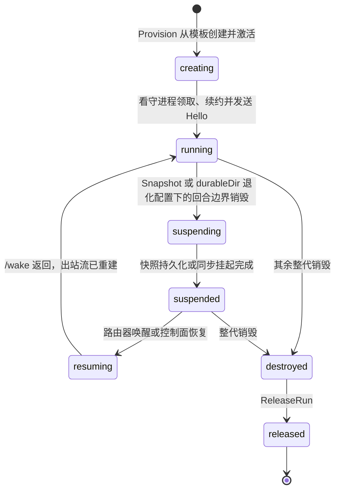
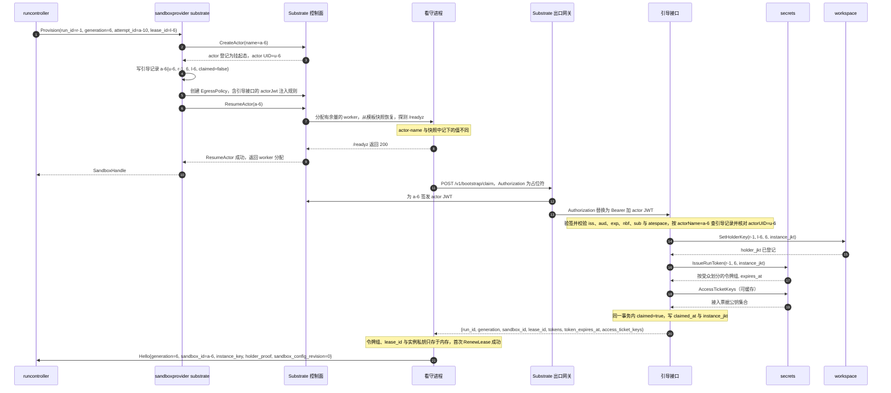
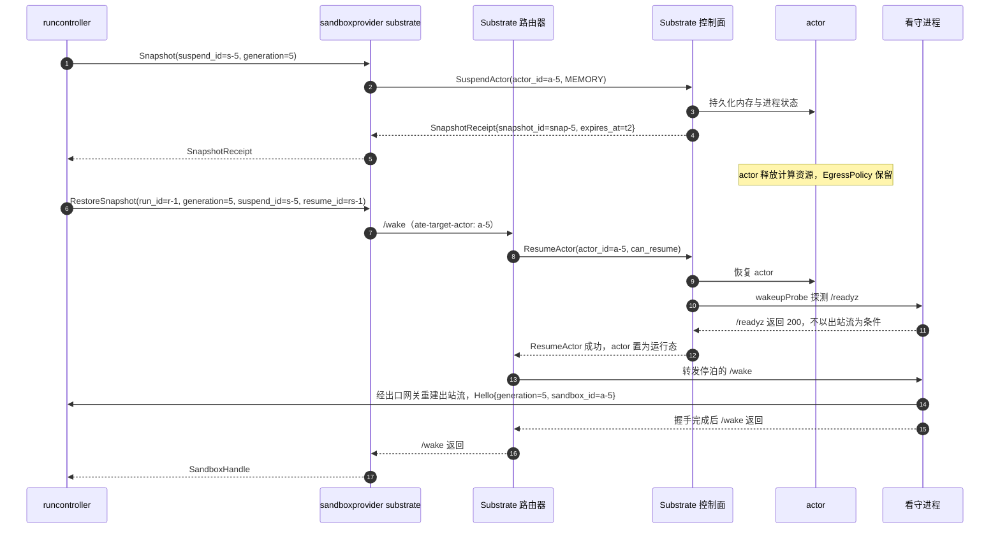
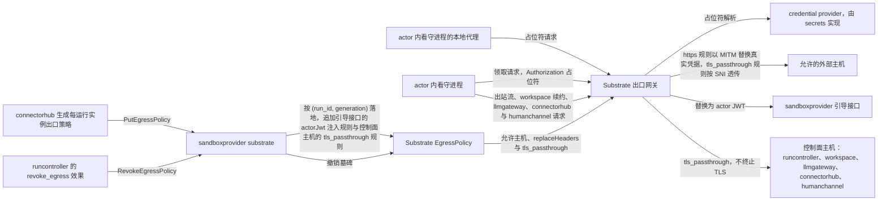

# substrate 子模块

substrate 子模块是 [sandboxprovider](design-sandboxprovider.md) 的提供者实现之一，把主文档定义的提供者接口落到 agent-substrate/substrate（[REF-substrate](../../../references.md)）。它拥有 actor 的创建与激活、[快照](../../../glossary.md)的[挂起](../../../glossary.md)与恢复、入站唤醒的路由承载、[出口策略](../../../glossary.md)的落地与撤销，以及[引导接口](../../../glossary.md)在 Substrate 路径上的认证与领取触发；新 actor 由 Substrate 分配到预热 worker 并从[模板快照](../../../glossary.md)恢复。它不具备[冻结](../../../glossary.md)与 `WarmPool` 能力，不决定何时挂起、不维护[运行实例](../../../glossary.md)状态机、不生成出口策略、不拥有[工作区](../../../glossary.md)绑定。心智模型：actor 是整体可挂起的进程容器，挂起以内存快照换出计算资源，恢复由经路由器的入站请求唤醒（[ADR-dual-sandbox-providers](../../../adr/adr-dual-sandbox-providers.md)）。

文档较长，不宜顺序通读。第一次阅读依次取：核心概念、职责、外部接口契约中的接口映射、引导接口的认证与路由器契约、走查、领取的触发、Suspend 与快照、Resume 与路由器唤醒、EgressPolicy 落地与撤销、外部 CSI 卷与 durableDir 退化；术语表、依赖、UML 图与核心数据结构作为核对字段与调用顺序的参考；错误与失败语义与并发与事务边界留到最后，按墓碑、停泊与代的范围自测迟到调用。

## 核心概念

本子模块的机制是内存快照挂起与路由器唤醒。actor 在 Substrate 中整体承载[看守进程](../../../glossary.md)与 Agent 进程；挂起以 MEMORY 保真度把进程内存与运行状态持久化为快照并释放计算资源，快照恢复不重建进程，而是在同一[代](../../../glossary.md)内恢复快照。快照恢复的入口是 Substrate 路由器：提供者以 `ate-target-actor` 头调用 `/wake`，路由器恢复 actor 并把入站请求停泊到 `wakeupProbe` 就绪，恢复窗口内的请求不丢失。

系统需要它，因为托管环境要在 Agent 等待 LLM、外部系统或人类时释放[沙箱](../../../glossary.md)的计算资源，并在依赖解除后以快照恢复替代冷启动，且恢复期间的入站请求不丢失。机制为何按能力分层、为什么在冻结与快照之间这样取舍，见 [ADR-capability-tiered-suspension](../../../adr/adr-capability-tiered-suspension.md)。

快照同样决定按运行实例的数据如何进入 actor。actor 只引用 actor 模板，新 actor 默认从模板快照恢复；环境变量与镜像内文件都在快照里，从同一快照恢复的 actor 彼此相同，不能携带按运行实例的数据。看守进程因此经引导接口领取[运行实例令牌](../../../glossary.md)与 `lease_id`：身份来自出口网关为发出请求的 actor 注入的 actor JWT，领取时机来自 `systemInfo` 卷投射的 `actor-name`，它在快照恢复后仍是本 actor 的值。[沙箱侧配置](../../../glossary.md)由 `runcontroller` 在出站流上推送给看守进程，不经过本子模块。

## 职责

职责穷举如下，每条先写本子模块执行的动作，再写产生的结果或边界；通用幂等、墓碑与能力协商语义见主文档，本条只写 Substrate 提供者层的落地方式。能力集合是闭合集合，本子模块声明 `Snapshot`、`Destroy` 与 `EgressInject`，不声明 `Freeze{cgroup}`、`Freeze{signal}`、`InPlaceResize` 与 `WarmPool`（[ADR-capability-tiered-suspension](../../../adr/adr-capability-tiered-suspension.md)）。

- **actor 模板与创建**：以 actor 模板声明 actor 镜像、入口、工作区卷、`systemInfo` 卷、网络与 `wakeupProbe`；镜像以看守进程为 PID 1，可自带 `ENTRYPOINT`；以 `(run_id, generation, attempt_id)` 派生 actor 名，按该名幂等创建 actor，actor 名不复用；Substrate 要求 actor 名是不超过 63 字符的 DNS-1123 label，`run_id` 为 UUID，三元组直接拼接会超出上限，派生取固定字母前缀加三元组 SHA-256 摘要前 160 位的小写 base32 编码；返回 `sandbox_id` 与放置位置。
- **预配**：以 `Provision` 承担首次创建与销毁重建；调用 `workspace` 绑定工作区并按 `(run_id, generation)` 落地出口策略副本；在激活 actor 之前写入[引导记录](design-sandboxprovider.md#术语表)；以 `ResumeActor` 激活 actor，由 Substrate 分配 worker 并从模板快照恢复，模板没有模板快照时冷启动，调用方不能逐次选择；创建墓碑或释放墓碑之后拒绝该代或该运行实例的创建。
- **引导接口的认证与领取触发**：落地每代 EgressPolicy 时追加引导接口的 `actorJwt` 注入规则；为引导接口校验出口网关注入的 actor JWT，并以 actor 名与 actor UID 定位引导记录；以 `systemInfo` 卷投射的 `actor-name` 让看守进程在新 actor 激活时立即领取。
- **Suspend 与快照**：按 `suspend_id` 执行 MEMORY 保真度的内存快照，释放 actor 的计算资源并返回快照标识与保留期限；按 `suspend_id` 撤销尚未确认的快照尝试，撤销即墓碑。
- **Resume 与路由器唤醒**：按 `resume_id` 在同一代内恢复快照；经 Substrate 路由器以 `ate-target-actor` 头调用 `/wake`，路由器恢复 actor 并停泊请求直到 `/readyz` 就绪；`/wake` 返回表示看守进程的出站流已重建；调用方持有 SPIFFE 身份且在路由器的入站白名单内。
- **EgressPolicy 落地与撤销**：保存 `connectorhub` 推送的每运行实例出口策略；在预配时按 `(run_id, generation)` 落地为 EgressPolicy：策略中 `PlaintextHosts` 的主机落地为 `http` 规则并带其注入规则，其余有注入规则的主机只落地 `https` 规则，无注入规则的主机落地 `tls_passthrough`；落地时追加放行控制面主机（`stream`、`lease`、`llm`、`connector`、`human`）的 `tls_passthrough` 规则，使看守进程的出站流、`workspace` 续约、`llmgateway` 请求以及平台 MCP 服务器对 `connectorhub` 与 `humanchannel` 的请求经出口网关透传；策略文档中的 `project_id` 与每条规则的 `system`、`auth_method`、`scopes` 原样透传，供出口网关的凭据提供者换取真实凭据；按代撤销并写撤销墓碑。
- **外部 CSI 卷与 durableDir**：为每个 actor 挂载一卷外部 CSI 卷，写穿持久、崩溃不丢、沙箱外可经同一导出访问、内容不进快照；外部 CSI 不可用时在绑定时退到 `durableDir`，退化配置下回合边界的销毁使用同步挂起。
- **worker 分配与容量耗尽**：以 `ResumeActor` 请求 Substrate 把 actor 分配到 `WorkerPool` 中有余量的预热 worker，不选择具体 worker，不维护预热分片记录；`ResumeActor` 返回 `RESOURCE_EXHAUSTED` 时，`Provision` 与 `RestoreSnapshot` 返回暂时性错误，不存在绕开 worker 的冷启动路径。
- **恢复完成后的交接**：`/wake` 只在出站流重建完成之后返回；看守进程随后校时、断开 Agent 进程的旧 TCP 连接，并由本地代理按 `request_id` 向 `llmgateway` 取回已完成响应。本子模块只负责把 actor 恢复到可就绪状态，不执行这些看守进程动作。
- **串行化与幂等**：同一运行实例的 Suspend、Resume 与 Destroy 按到达顺序串行；以 `suspend_id`、`(run_id, generation, attempt_id)`、`(run_id, generation)` 与 `(generation, sandbox_id)` 幂等；重复调用返回首次结果。

### 非职责

非职责举例如下，判定标准为：职责清单之外、由主文档、同级子模块或其他模块拥有的事实与机制。

- 冻结与短冻结归 k8s 提供者；本子模块不具备 `Freeze` 能力，不执行 SIGSTOP，也不提供原地缩放。
- 挂起决策、等待时长预测、机制选择、冻结中复评与恢复准入归 `suspendpolicy`；本子模块只执行选定的提供者调用。
- 运行实例状态机、代递增、投递、游标与纠正性对账归 `runcontroller`；本子模块不读写控制面的表，也不持有运行实例状态。
- 工作区绑定、工作区租约、[持久化确认](../../../glossary.md)与文件访问协议归 `workspace`；本子模块只提供卷或导出标识并调用绑定，不持有租约表。
- 出口策略内容与占位符替换规则归 `connectorhub`；本子模块只保存与落地策略副本，不解释策略语义；引导接口的 `actorJwt` 注入规则与放行控制面主机的 `tls_passthrough` 规则由本子模块追加，不属于出口策略内容。沙箱侧配置由 `connectorhub` 生成、`runcontroller` 推送、`warden` 应用，不经过本子模块。
- 引导接口的端点、一次性领取、令牌签发与错误码归主文档；本子模块只提供 Substrate 路径的认证与领取触发。领取的执行、退避以及令牌与 `lease_id` 的内存保存归 `warden`。
- Substrate 路由器、出口网关、`WorkerPool` 与 Substrate 控制面本身归 Substrate；本子模块只调用其 API，不实现其恢复、停泊、MITM 或 worker 分配逻辑。`WorkerPool` 的 `replicas`、每个 worker 的容量预算与 `--max-actors` 归部署配置，本子模块不维护预热容量。
- 凭据提供者的实现归 `secrets`，由出口网关在解析占位符时调用，本子模块不调用凭据提供者协议。运行实例令牌的签发归 `secrets`，经主文档的引导接口调用 `IssueRunToken`；本子模块不签发令牌，令牌不进入本子模块的任何记录。
- Agent 进程监督、`/readyz` 的应答、`actor-name` 的读取、旧连接清理与本地代理取回归 `warden`；本子模块不以任何方式进入 actor 内部执行进程操作。
- CSI 驱动、对象存储与 PostgreSQL 归基础设施；本子模块只使用其接口，不实现存储后端。

## 术语表

| 术语 | 英文对照 | 适用范围 | 定义 |
| --- | --- | --- | --- |
| actor 模板 | actor template | substrate 子模块 | Substrate 中声明 actor 镜像、入口、卷、网络与唤醒探针的创建模板 |
| MEMORY 保真度 | MEMORY fidelity | substrate 子模块 | 快照保留进程内存与运行状态、恢复后继续执行的挂起语义 |
| 单飞 | single-flight | substrate 子模块 | 路由器对同一 actor 的并发唤醒只执行一次恢复、其余请求合并等待的约束 |
| 预热 worker | warm worker | substrate 子模块 | `WorkerPool` 中预先启动、等待分配 actor 的 worker Pod，按容量预算同时承载多个 actor，使 actor 的创建与恢复不经过 Kubernetes 调度 |

## 外部接口契约

本子模块实现主文档 `Provider` 接口在 Substrate 提供者上的下列方法；接口签名、幂等键与失败分类以主文档为准，本表只写提供者层的具体行为。稳定性承诺与主文档一致：生命周期接口对 `runcontroller` 稳定，出口策略接口对 `connectorhub` 稳定，引导接口的认证方式对看守进程稳定。调用方认证按主文档的按方法授权表执行：生命周期方法、只读查询与 `RevokeEgressPolicy` 只接受 `runcontroller`，`PutEgressPolicy` 只接受 `connectorhub`，其他对端以不可重试的未授权错误拒绝并写审计。

| 接口 | 本子模块的行为 |
| --- | --- |
| `Capabilities` | 返回 `Snapshot`、`Destroy` 与 `EgressInject` 为真，`FreezeCgroup`、`FreezeSignal`、`InPlaceResize` 与 `WarmPool` 为假 |
| `Provision` | 绑定工作区；以派生的 actor 名经 `CreateActor` 从 actor 模板登记 actor；写入引导记录，按 `(run_id, generation)` 落地 EgressPolicy，随后以 `ResumeActor` 激活 actor，由 Substrate 分配到 `WorkerPool` 中有余量的 worker 并从模板快照恢复，模板没有模板快照时冷启动；`ResumeActor` 返回 `RESOURCE_EXHAUSTED` 时返回暂时性错误；返回 `sandbox_id`、`placement` 与 `durability` |
| `Claim` | 能力集不含 `WarmPool`，调用以参数非法拒绝；`suspendpolicy` 在本提供者上的销毁重建返回 `cold_start`，`runcontroller` 调用 `Provision` |
| `Snapshot` | 按 `suspend_id` 执行 MEMORY 快照；返回 `SnapshotReceipt{snapshot_id, snapshot_expires_at}` |
| `RevokeSnapshot` | 按 `suspend_id` 撤销尚未确认的快照尝试并写快照撤销墓碑；重复撤销返回成功 |
| `RestoreSnapshot` | 在同一代内恢复快照；先检查创建墓碑与释放墓碑，已销毁或已释放的运行实例以确定性错误拒绝；恢复的是同一 actor，沿用其引导记录与 EgressPolicy；经路由器调用 `/wake` 并等待其返回，`/wake` 在看守进程重建出站流之后返回；返回 `SandboxHandle`；快照不存在或已过期为确定性错误；`ResumeActor` 返回 `RESOURCE_EXHAUSTED` 且路由器在停泊预算内未能恢复时返回暂时性错误 |
| `Destroy` | 挂起或删除该代 actor，保留运行实例级资源；写创建墓碑；删除该代的引导记录；返回携带代的确认 |
| `DestroySandbox` | 只删除调用携带的 `(generation, sandbox_id)` 对应的 actor 及以该 actor 名为键的引导记录，不删除更新的代及其引导记录；目标不存在时幂等成功 |
| `ReleaseRun` | 写释放墓碑；释放 actor 相关资源并删除该运行实例的引导记录；此后拒绝该运行实例的一切创建 |
| `ListSandboxes`、`GetSandbox` | 列举或查询 actor，返回 `run_id`、代、`sandbox_id`、放置位置与是否存在 |
| `NodeMemory` | 返回空集；本提供者没有冻结态内存，策略不以节点内存压力选择升级对象 |
| `ResizeStatus` | 返回不支持；本提供者不具备 `InPlaceResize` |
| `EstimateResume` | 按快照恢复（`snapshot_restore`）与新建 actor（`cold_start`）分别返回提供者侧的时延估计；新建 actor 的估计取模板快照恢复的时延，模板没有模板快照时取冷启动时延 |
| `PutEgressPolicy`、`RevokeEgressPolicy` | 保存出口策略并按 `(run_id, generation)` 落地为 EgressPolicy，按 `PlaintextHosts` 与注入规则选择 `http`、`https` 或 `tls_passthrough` 规则，落地时追加引导接口的 `actorJwt` 注入规则与放行控制面主机的 `tls_passthrough` 规则；推送的更新只同步到尚未撤销的代；撤销写墓碑，已撤销的代拒绝再次落地与更新 |
| `Freeze`、`Thaw` | 能力集不含，调用以参数非法拒绝 |

### 引导接口的认证

引导接口的端点、成功响应、一次性领取、令牌签发与错误码以[主文档的引导接口](design-sandboxprovider.md#引导接口)为准；本节只写 Substrate 路径的认证约定，下列各项为穷举。

- **注入规则**：本子模块落地每代 EgressPolicy 时，追加一条由本子模块拥有、不属于 `connectorhub` 策略内容的规则：对引导接口主机的 https 请求，以 `replaceHeaders` 把 `Authorization` 占位符替换为 `actorJwt`，`prefix` 为 `"Bearer "`（含尾随空格），audience 为 `castworks-bootstrap`，`expirationSeconds` 为 300（Substrate 允许的最小值）；引导接口在两条路径上都按 `Bearer <令牌>` 解析 `Authorization` 头。
- **调用方**：看守进程携带 `Authorization` 占位符头调用 `POST /v1/bootstrap/claim`；出口网关只替换请求中已存在的占位符请求头，缺头不注入。出口网关把该头替换为 `Bearer <actor JWT>`，JWT 由 Substrate 控制面为发出请求的 actor 签发，`sub` 为 `actor/<atespace>/<name>`，声明 `actor.ate.dev` 是含 `atespace`、`actorName` 与 `actorUID` 的对象。
- **校验**：引导接口以部署配置固定 Substrate 的签发方 URL（ate-api-server 的 `--actor-jwt-issuer`），只经该签发方的 OIDC 发现（`<iss>/.well-known/openid-configuration`）取验签公钥，不按令牌自带的 `iss` 取公钥；验签并校验 `iss` 等于该签发方、`aud` 含 `castworks-bootstrap`、`exp` 与 `nbf`，`sub` 以 `actor/` 开头（拒绝 `worker-for-actor` 形式的令牌），`actor.ate.dev` 声明中的 `atespace` 等于部署配置的 atespace；按该声明中的 `actorName` 查引导记录，记录中的 actor UID 与该声明中的 `actorUID` 不一致时返回 401。
- **沙箱实例身份**：引导记录以 actor 名为键，另存 actor UID。actor 名由 `(run_id, generation, attempt_id)` 派生且不复用；出口网关按 actor 名缓存 JWT，同名重建的 actor 可能拿到前任的 JWT，actor 名不复用与 actor UID 的核对共同排除这一情形。
- **调用方区分**：出口网关不能区分同一 actor 内的看守进程与 Agent 进程，Agent 进程发往引导接口的请求同样带有 actor JWT；看守进程在启动 Agent 主进程之前完成领取，此后的领取请求返回 409。
- **领取响应经过出口网关**：出口网关以 MITM 终止领取请求的 TLS 才能替换请求头，领取响应中的运行实例令牌以明文经过出口网关；部署要求出口网关不记录、不缓存引导接口主机的请求与响应正文，令牌因而不进入出口网关的任何持久记录。
- **引导接口主机**：引导接口使用只承载 `POST /v1/bootstrap/claim` 的独立主机名，注入规则只列这一主机名。出口网关按主机名匹配 `https` 规则，对所列主机名的全部请求终止 TLS，并替换任何携带 `Authorization` 头的请求；看守进程的出站流、`workspace` 续约、`llmgateway` 请求以及平台 MCP 服务器对 `connectorhub` 与 `humanchannel` 的请求若与引导接口共用主机名，也会在出口网关处以明文经过，其 `Authorization` 头被替换为 actor JWT。引导接口的主机名、端口与固定地址取自部署配置 `sandbox_facing_endpoints` 的 `bootstrap` 条目，由本子模块写入 actor 模板的启动参数，不含按运行实例的数据；看守进程按配置的地址直连，不经 DNS 解析该主机名。

### 对 Substrate API 与路由器的依赖

提供者经 Substrate 控制面的 API 创建、激活、挂起、恢复与删除 actor；以 `sandboxprovider` 的 SPIFFE 身份调用路由器，且该身份必须在路由器的入站白名单内（[REF-spiffe](../../../references.md)）。Substrate 路由器与出口网关使用 Substrate 信任域中的 SPIFFE 身份，按部署白名单登记；路由器的入站白名单穷举为 `sandboxprovider`、`humanchannel` 与 `workspace`。接口约束如下：

| 依赖 | 用途与约束 |
| --- | --- |
| actor 模板与 actor API | 从模板创建 actor；actor 只引用 actor 模板，新 actor 默认从模板快照恢复；`CreateActor` 登记的 actor 处于挂起态，`ResumeActor` 激活之前不运行，创建即返回 actor UID；actor 镜像以看守进程为 PID 1，可自带 `ENTRYPOINT`；卷、网络与 `wakeupProbe` 在模板中声明 |
| Suspend 与 Resume API | 按 `suspend_id` 执行 MEMORY 快照；按 `resume_id` 在同一代内恢复；挂起与恢复对同一 actor 串行 |
| 路由器 `ResumeActor` | 以 `ate-target-actor` 头定位 actor，调用方需具备 `can_resume`；路由器恢复 actor 并停泊请求直到 `wakeupProbe` 就绪 |
| `wakeupProbe` | 在 actor 模板中声明为看守进程的 `/readyz:80`；就绪之前路由器不释放停泊请求；`ResumeActor` 只在探针返回 200 后成功，默认 30 s 超时，超时 actor 进入 `CRASHED`；模板控制器构建模板快照也等探针返回 200，`/readyz` 因此不以领取为条件；`ResumeActor` 在探针返回 200 之后才把 actor 置为运行态，出口网关拒绝非运行态 actor 的出口连接，探测期间 actor 发出的请求不能出站，看守进程的出站流在 `ResumeActor` 成功之后、处理转发来的 `/wake` 时重建 |
| actor JWT 注入与 OIDC 发现 | EgressPolicy 的 `replaceHeaders` 条目设 `actorJwt{audiences, expirationSeconds}`，有效期 300 至 3600 秒；出口网关把请求中已存在的占位符头替换为前缀加 Substrate 控制面为发出请求的 actor 签发的 JWT，按 actor 名缓存；依赖方经 `<iss>/.well-known/openid-configuration` 取验签公钥 |
| `systemInfo` 卷 | actor 模板声明，`actorMetadata` 以按 actor 的只读 bind mount 投射 `actor-name` 与 `actor-uid`，快照恢复后仍是本 actor 的值；`trustBundle` 数据源在运行时投射出口网关 CA（`egress-mitm.ate.dev`）与公共根证书（`system-roots.ate.dev`），看守进程领取时以它校验出口网关出示的证书；Substrate 要求该 CA 不预置进镜像，预置的 CA 在轮换后失效；出口网关 CA 轮换时，新 CA 加入 `trustBundle` 不少于 `T_ca_overlap` 后才开始签发，旧 CA 在 `trustBundle` 中保留不少于 `T_ca_overlap`，`T_ca_overlap` 不短于快照保留期上限，使快照恢复后仍持有旧信任库的进程在重叠期内重建连接 |
| `parked-request-budget` | 路由器停泊请求的预算；默认 5 s，部署时必须调到不小于恢复 p95 加 `/readyz` 余量；约 500 MB actor 的恢复可能超过 5 s，未调大时停泊请求会被提前切断 |
| EgressPolicy API | 以 `(run_id, generation)` 为键落地规则；规则类型只有三种：`http`（仅 `PlaintextHosts` 中的主机，明文请求）、`https`（按主机名匹配，MITM 终止 TLS，可带 `replaceHeaders` 与凭据引用 `project_id`、`system`、`auth_method`、`scopes`）与 `tls_passthrough`（按 SNI 透传，不解密，不替换请求头）；网络通道属于沙箱侧配置，不进入 EgressPolicy；EgressPolicy 是 actor 的子资源，须在 `ResumeActor` 激活之前创建；MITM 由出口网关执行 |
| 凭据提供者协议 | 出口网关在解析占位符时调用 `secrets` 实现的凭据提供者；本子模块不调用该协议 |
| 外部 CSI 卷 | actor 卷类型 `external`，每 actor 一卷；由 CSI 驱动动态供给 |
| `durableDir` | 退化卷类型；挂起时上传对象存储，沙箱外无读取接口 |
| `WorkerPool` 与 worker 分配 | `WorkerPool` 声明预先启动、等待分配 actor 的 worker Pod，由 Kubernetes Deployment 维护，副本数由 `replicas` 决定；每个 worker 按容量预算同时承载多个 actor，调度器只把 actor 放到剩余容量不小于该 actor 资源上限的 worker 上，另受 `--max-actors`（默认 1000）约束；`ResumeActor` 在 Substrate 状态存储中原子地完成分配，首次运行恢复模板快照，模板没有模板快照时冷启动，之后恢复该 actor 自己的快照；没有 worker 有余量时返回 `RESOURCE_EXHAUSTED`，不存在绕开 worker 的冷启动路径；路由器在停泊预算内重试 `RESOURCE_EXHAUSTED`，预算耗尽后 `/wake` 返回 503 |
| 对象存储与 PostgreSQL | 对象存储承载快照与 `durableDir` 数据；PostgreSQL 是 Substrate 控制面的存储 |

## 依赖

依赖穷举如下，方向与[模块依赖图](../../architecture.md#模块依赖图)一致：本子模块依赖基础层的 `workspace` 与 `agentprotocol`，经主文档的引导接口依赖 `secrets`，以及 Substrate 控制面、路由器、出口网关与存储；本子模块不依赖 `runcontroller`、`suspendpolicy` 与 `connectorhub`。

- `workspace`：在预配时调用绑定接口取得卷标识、挂载路径、`RunUID`、`StorageMode`、`Durability` 与 `Placement`；`lease_id` 取自 `ProvisionRequest`，不来自绑定；Substrate 提供者优先使用 `external_csi`，`durable_dir` 为退化配置（[ADR-workspace-persistence-per-provider](../../../adr/adr-workspace-persistence-per-provider.md)）。存储模式在绑定时固定，运行中不静默退化；外部 CSI 不可用时预配或恢复按自身规则失败，不在运行中切换到 `durableDir`。
- `agentprotocol`：恢复完成以看守进程发送 `Hello` 为观察；`/readyz` 是路由器的 `wakeupProbe`，照常应答，不以领取为条件，也不以出站流为条件；`/wake` 返回表示出站流已重建。入站端点不承载事件内容，投递只在出站流上进行。
- `secrets`：经主文档的引导接口调用 `secrets.IssueRunToken(run_id, generation, instance_jkt)`，在领取时签发同代、同一实例公钥指纹、按受众划分的首个令牌组，并调用 `secrets.AccessTicketKeys` 取得[接入票据](../../../glossary.md)公钥集合；令牌不持久化。凭据提供者由出口网关调用，本子模块不调用凭据提供者协议。
- Substrate 控制面：执行 actor 的创建、worker 分配、Suspend 与 Resume；快照保留期限由 `SnapshotReceipt` 返回；为发出请求的 actor 签发 actor JWT，签发方经 OIDC 发现公开验签公钥。Substrate 控制面不可达时预配、挂起与恢复返回暂时性错误；`ResumeActor` 返回 `RESOURCE_EXHAUSTED` 时预配与快照恢复返回暂时性错误。
- Substrate 路由器：以 `ate-target-actor` 头调用 `/wake`，恢复 actor 并停泊请求直到 `/readyz` 就绪；调用方持有 SPIFFE 身份并在白名单内，入站白名单为 `sandboxprovider`、`humanchannel` 与 `workspace`，路由器不按路径区分调用方时 `/terminal` 与 `/files` 的授权由看守进程的接入票据校验承担。路由器同时承载 `/terminal` 与界面文件访问；事件投递与 `ToolExec` 帧都不经该路由，快照恢复经 `/wake` 触发；`ToolExec` 帧随看守进程的出站流往返，与路由器唤醒路径相互独立。
- Substrate 出口网关：按 EgressPolicy 的规则处理出口连接。鉴权确定的规则主机是请求唯一的目的地：`https` 规则以 MITM 终止 TLS，要求客户端 SNI（若有）与内层 `Host`/`:authority` 都等于规则主机，并以 `replaceHeaders` 替换请求头中的凭据占位符；`http` 规则只对 `PlaintextHosts` 中的主机执行注入，携带占位符的其他主机请求返回 403；`tls_passthrough` 规则（含本子模块追加的控制面主机）要求 ClientHello 的 SNI 存在且等于规则主机，带 ECH 扩展的 ClientHello 按不一致处理并关闭隧道，不终止 TLS；默认拒绝未列入的主机。目的地不一致时 `https`、`http` 档返回 403，`tls_passthrough` 档关闭隧道，计数 `egress_destination_mismatch` 并审计。actor 经 `systemInfo` 卷的 `trustBundle` 数据源（`egress-mitm.ate.dev` 与 `system-roots.ate.dev`）在运行时取得出口网关 CA 与公共根证书，CA 不预置进镜像；CA 轮换保留不短于快照保留期上限的新旧 CA 同时受信重叠期。出口网关按本子模块追加的注入规则，把看守进程发往引导接口的 `Authorization` 占位符替换为 `Bearer <actor JWT>`。出口网关在解析占位符时调用 `secrets` 的凭据提供者，以策略中的 `project_id`、`run_id`、`generation`、`system`、`auth_method` 与 `scopes` 换取真实凭据；真实凭据不进入 actor。EgressPolicy 的 `CredentialHeader` 只携带 `credential_uri` 时，`credential_uri` 编码上述项目、系统、认证方式与作用域，由凭据提供者解析；提供者版本不支持编码时，须扩展其请求字段，不能把字段丢弃后按默认凭据处理。
- 对象存储：承载快照与 `durableDir` 上传数据；GCS 原生支持，S3 经插件。
- PostgreSQL：Substrate 控制面的存储。
- 外部 CSI 驱动：为每 actor 供给一卷外部 CSI 卷；写穿持久、崩溃不丢、沙箱外可经同一导出访问，内容不进快照。该能力仍为预览特性，需开启 ExternalVolumes、注册 CSIDriverConfig，并确认 NFS 导出可从沙箱外访问。
- 部署前提：k8s 具备 PodCertificateRequest 与 ClusterTrustBundle API；节点运行 gVisor，microVM 模式需要 KVM；节点内核 6.7 及以上；PostgreSQL 与对象存储可用；路由器与出口网关可达，SPIFFE 信任域已配置，控制面身份在路由器白名单内；actor 模板以 `systemInfo` 卷的 `trustBundle` 数据源在运行时投射出口网关 CA 与公共根证书，CA 不预置进镜像，凭据提供者可达；出口网关不记录、不缓存引导接口主机的请求与响应正文；引导接口的部署配置写入 Substrate 签发方 URL 与 atespace，引导接口以只承载领取端点的独立主机名部署，可经出口网关到达，并可访问该签发方的 OIDC 发现端点。网络前提穷举如下：actor 内 uid 非 0 的出站只到回环；actor 的非 TCP 出站（UDP 含 QUIC、ICMP）除发往 DNS 中继的查询外一律拒绝；DNS 中继对有出口策略的 actor 只应答 EgressPolicy 所列主机与控制面主机，其余返回 NXDOMAIN，不递归解析；出口网关对 `https` 规则核对客户端 SNI 与内层 `Host` 等于规则主机，对 `tls_passthrough` 规则要求 SNI 等于规则主机并拒绝带 ECH 的 ClientHello；出口网关 CA 轮换保留不短于快照保留期上限的新旧 CA 同时受信重叠期。这些网络前提列入[实施路线与技术验证](../../../roadmap.md)，验证通过前 Substrate 路径不上线。

**验证前提与已知限制。** 以下条件未满足时，Substrate 提供者不能进入阶段 1：

- 外部 CSI 卷仍是预览特性：需开启 ExternalVolumes、注册 CSIDriverConfig，并确保 NFS 导出可从沙箱外访问；内容不进快照，恢复后不能依赖快照回滚工作区。
- gVisor 下没有 Docker：编译测试类负载不能假设容器内可运行 Docker，需预装工具链或改用外部构建服务。
- 网络前提未验证：actor 的非 TCP 出站拒绝与 DNS 中继不递归、出口网关对 `https` 的主机名与 SNI 一致性、对 `tls_passthrough` 的 SNI 核对与 ECH 拒绝，以及 CA 轮换重叠期，均须在目标集群实测；任一不成立时 Substrate 路径不上线。
- `trustBundle` 的运行时投射与 CA 轮换须端到端验证：确认 actor 在快照恢复后读到的信任库、新旧 CA 的重叠期与 `T_ca_overlap` 的取值一致，预置 CA 的镜像在轮换后不再受信。
- `parked-request-budget` 默认 5 s，必须调到不小于恢复 p95 加 `/readyz` 余量；约 500 MB actor 的恢复可能超过 5 s，未调大时停泊请求会被提前切断。
- MEMORY 快照恢复不保证旧 TCP 连接可被及时察觉；看守进程必须在恢复后主动断开 Agent 的旧连接，不能依赖读超时。
- S3 插件在当前版本仍需试点确认；对象存储优先 GCS，S3 作为待验证选项。
- 路由器 `/wake`、EgressPolicy、凭据提供者与 actor JWT 注入需要在目标集群完成端到端试点；仅凭文档与源码不能判定 go。

## UML 图

下列图固定 actor 的生命周期、预配与引导领取的调用顺序、Suspend 与 Resume 及路由器唤醒的调用顺序，以及 EgressPolicy 从生成到落地与撤销的路径；图中不表达的墓碑、幂等、停泊预算与代的范围由每张图后的正文与核心算法与流程给出。

### actor 生命周期图

生命周期图的约束由提供者操作给出：`creating` 成功后才进入 `running`，看守进程在 `/readyz` 就绪之前不接收投递，领取成功并首次续约之后才发送 `Hello`；`Snapshot` 使 `running` 进入 `suspending`，快照持久化后进入 `suspended`；路由器唤醒使 `suspended` 进入 `resuming`，`/wake` 返回、看守进程的出站流重建后回到 `running`，恢复在同一代内进行，不递增代；`durableDir` 退化配置下的回合边界销毁以同步挂起使 `running` 进入 `suspending`，上传完成后进入 `suspended`，写创建墓碑后进入 `destroyed`；其余整代销毁使 `running` 直接进入 `destroyed`；整代销毁使 `suspended` 进入 `destroyed`；`ReleaseRun` 使 `destroyed` 进入 `released`。`creating` 的失败不进入生命周期状态，由调用方按暂时性或确定性错误处置。

### 预配与引导领取时序图

时序图固定了预配与领取的顺序：提供者在 `ResumeActor` 激活 actor 之前写入引导记录并创建含注入规则的 EgressPolicy，看守进程的首次领取不会落在记录或规则缺失的窗口里。新 actor 从模板快照恢复，快照中的看守进程停在等待领取的状态；`wakeupProbe` 探测 `/readyz` 时，看守进程读到的 `actor-name` 与快照中记下的值不同，立即领取，不等退避到期；这次领取早于 `ResumeActor` 把 actor 置为运行态时会被出口网关拒绝，看守进程从 1 s 起退避重试，图中画的是 `ResumeActor` 成功之后到达引导接口的那次领取。引导接口先以实例公钥指纹调用 `SetHolderKey` 登记工作区租约，再以同一指纹签发令牌组并取接入票据公钥集合，在同一事务内把 `claimed` 置真后返回，令牌不进入提供者的任何记录；看守进程首次续约后发送携带 `instance_key` 与 `holder_proof` 的 `Hello`，`sandbox_config_revision=0` 使 `runcontroller` 随后在出站流上发送 `SandboxConfig`。`ResumeActor` 在 `wakeupProbe` 返回 200 后成功，提供者随后返回 `SandboxHandle`，不等待领取或 `Hello`。

### Suspend、Resume 与路由器唤醒时序图

时序图固定了恢复的两段：`RestoreSnapshot` 不直接恢复 actor，而是经路由器调用 `/wake`；路由器负责恢复 actor、把请求停泊到 `wakeupProbe` 就绪，`/wake` 返回即表示看守进程的出站流已重建。`wakeupProbe` 在 `ResumeActor` 把 actor 置为运行态之前探测，出口网关此时拒绝 actor 的全部出口连接，看守进程的 `/readyz` 因而不以出站流为条件；`ResumeActor` 成功后，路由器把停泊的 `/wake` 转发给看守进程，看守进程经出口网关重建出站流，握手完成后 `/wake` 返回。快照恢复在同一代内进行，不递增代；快照恢复的是同一 actor：Substrate 把它分配到有余量的 worker 并恢复，actor 名与 actor UID 不变，`SandboxHandle` 的 `sandbox_id` 与代都保持不变；看守进程以领取响应中的 `sandbox_id` 续约并发送 `Hello`。恢复后看守进程校时、断开 Agent 进程的旧 TCP 连接，并由本地代理按 `request_id` 向 `llmgateway` 取回已完成响应；这些动作不在路由器或提供者内执行。

### EgressPolicy 落地与撤销图

图固定了职责边界：`connectorhub` 生成策略内容，`sandboxprovider` 以 `(run_id, generation)` 为键落地 EgressPolicy 并追加引导接口的注入规则与控制面主机的 `tls_passthrough` 规则，出口网关执行 MITM、`replaceHeaders`、透传与默认拒绝，凭据提供者只返回占位符对应的真实凭据。领取请求的 actor JWT 由出口网关向 Substrate 控制面取得，不经过凭据提供者。看守进程与控制面之间的连接同样经过出口网关，但只按 SNI 透传，出口网关不终止其 TLS，也不替换其请求头。真实凭据不进入 actor，也不物化为 k8s Secret；凭据提供者不查询运行实例当前代，代的范围由 EgressPolicy 的落地与撤销界定。撤销即墓碑，已撤销的代拒绝此后的落地与更新；撤销在效果记录的截止之前生效时，残余窗口不超过该截止。

## 核心数据结构

提供者侧记录只服务于幂等、墓碑、出口策略副本、引导与观察；运行实例状态仍以 PostgreSQL 中的 `run` 行为唯一事实源。主文档定义的通用记录在本子模块中的映射如下。

| 记录 | 键 | 字段 | 用途 |
| --- | --- | --- | --- |
| `ActorRecord` | `(run_id, generation)` | `actor_id`、`sandbox_id`、`worker`、`placement`、`volume_ref`、`state` | actor 与运行实例代的映射 |
| `VolumeBinding` | `run_id` | `volume_ref`、`storage_mode`、`mount_path`、`durability` | 外部 CSI 卷或 `durableDir` 的绑定 |
| `SnapshotTrace` | `suspend_id` | `snapshot_id`、`expires_at`、`cancelled`、`restored` | 快照保留期限、撤销与恢复 |
| `EgressCopy` | `(run_id, generation)` | `policy`、`landed_at`、`revoked` | EgressPolicy 的按代落地与撤销墓碑 |
| 引导记录 | actor 名 | `actor_uid`、`run_id`、`generation`、`sandbox_id`、`attempt_id`、`lease_id`、`claimed`、`claimed_at`、`instance_jkt` | 引导接口按 actor JWT 中的 actor 名定位领取对象并核对 actor UID；`instance_jkt` 为领取时登记的实例公钥指纹 |
| `ParkedRequest` | `(actor_id, request_id)` | `arrived_at`、`deadline`、`single_flight_group` | 路由器的停泊与单飞状态 |

`SnapshotTrace` 在返回 `SnapshotReceipt` 之前持久化；`cancelled` 为真时同一 `suspend_id` 的迟到快照请求不生效，`restored` 为真时该快照不再接受第二次恢复。`EgressCopy` 以 `revoked` 标记撤销墓碑。引导记录在激活 actor 之前持久化，重驱动遇到已存在的记录时不改写；整代销毁删除该代的引导记录，`DestroySandbox` 删除该 actor 的引导记录，`ReleaseRun` 删除该运行实例的引导记录；运行实例令牌不进入任何提供者记录。`ParkedRequest` 是路由器的内存状态，不持久化，路由器重启后按 `actor_id` 重建。

### 状态一览

下表描述 actor 的生命周期状态；第三列的当前动作在句首写明执行方：`sandboxprovider`、Substrate 控制面或 Substrate 路由器。`suspending`、`suspended` 与 `resuming` 是 actor 生命周期的子状态：`suspended` 对应主文档 `SandboxHandle.State` 的 `snapshotted`，`suspending` 是进入该状态的过渡子状态；`resuming` 对应主文档的 `creating`，快照恢复受理后到 `/wake` 返回之前 `SandboxHandle.State` 为 `creating`；`SandboxHandle.State` 的闭集不变。

| 状态 | 一句话含义 | 当前动作 | 直觉画面 |
| --- | --- | --- | --- |
| `creating` | actor 正在从模板创建并激活 | `sandboxprovider` 绑定工作区，写入引导记录，落地 EgressPolicy 后以 `ResumeActor` 激活 actor（Substrate 分配有余量的 worker 并从模板快照恢复，`wakeupProbe` 返回 200 后成功），随后返回 `SandboxHandle`，不等待领取与 `Hello` | 新房间正在装修 |
| `running` | actor 可执行且出站流已建立 | `sandboxprovider` 等待快照、销毁或查询 | 房间在使用中 |
| `suspending` | 快照或同步挂起进行中 | Substrate 控制面持久化内存，或上传 `durableDir` | 房间正在打包 |
| `suspended` | 内存与进程状态已持久化，计算资源已释放 | `sandboxprovider` 保存快照标识与保留期，等待唤醒 | 房间密封存档 |
| `resuming` | 路由器或控制面正在恢复 actor | Substrate 路由器恢复 actor，停泊 `/wake` 直到 `ResumeActor` 成功，再转发给看守进程重建出站流 | 房间正在开封 |
| `destroyed` | actor 已不运行，运行实例级资源保留 | `sandboxprovider` 保留创建墓碑，拒绝该代及更早代的创建 | 房间退租，仓库保留 |
| `released` | 运行实例级资源已释放 | `sandboxprovider` 保留释放墓碑，拒绝该运行实例的一切创建 | 仓库清空，钥匙收回 |

## 核心算法与流程

### 走查

本条走查把快照、路由器唤醒、同代恢复、整代销毁、新代预配与引导领取以及 `durableDir` 退化落到具体值上。初始状态：`run_id=r-1`、`generation=5`、`sandbox_id=a-5`、`suspend_id=s-5`、工作区为外部 CSI 卷 `v-5`、`EgressCopy(r-1, 5)` 已落地、actor `a-5` 的引导记录 `claimed=true`、创建墓碑与释放墓碑为空。下表只列提供者侧状态，`run` 行由 `runcontroller` 维护。

| 步骤 | 调用或事件 | 提供者侧状态 |
| --- | --- | --- |
| 1 | `Snapshot(s-5)` | `SnapshotTrace(s-5)` 写入，`snapshot_id=snap-5`、`expires_at=t2`；actor 进入 `suspended`；工作区租约以快照保留期为上限 `HoldLease`；计算资源释放；`EgressCopy(r-1, 5)` 保留 |
| 2 | 控制面调用 `RestoreSnapshot(r-1, 5, s-5, rs-1)`；提供者经路由器以 `ate-target-actor: a-5` 调用 `/wake` | `ParkedRequest(a-5, req-1)` 写入，`deadline` 取停泊预算；路由器调用 `ResumeActor` 恢复 actor |
| 3 | `wakeupProbe` 探测 `/readyz` 返回 200，`ResumeActor` 成功并把 actor 置为运行态 | 路由器把停泊的 `/wake` 转发给看守进程；看守进程经出口网关重建出站流，握手完成后 `/wake` 返回 |
| 4 | `RestoreSnapshot` 返回 | `SnapshotTrace(s-5).restored=true`；`SandboxHandle{generation=5, sandbox_id=a-5}`；看守进程校时、断开旧 TCP 连接，本地代理按 `request_id` 取回已完成响应；`EgressCopy(r-1, 5)` 与引导记录不改写，看守进程不重新领取 |
| 5 | `Destroy(r-1, 5)` | actor 进入 `destroyed`；写入创建墓碑 `(r-1, ≤5)`；删除第 5 代的引导记录；保留运行实例级资源；返回 `DestroyReceipt{generation=5}` |
| 6 | 迟到的 `Provision(r-1, 5, a-9)` | 被创建墓碑拒绝；不创建 actor，状态仍为 `destroyed` |
| 7 | `Provision(r-1, 6, a-10)`，`lease_id=l-6` | 绑定外部 CSI 卷 `v-6`；以 `(r-1, 6, a-10)` 派生的名称创建 actor `a-6`，actor 处于挂起态，actor UID 为 `u-6`；写入引导记录 `a-6{actor_uid=u-6, run_id=r-1, generation=6, lease_id=l-6, claimed=false}`；落地 `EgressCopy(r-1, 6)` 并追加引导接口的注入规则；以 `ResumeActor` 激活 actor，Substrate 把它分配到有余量的 worker 并从模板快照恢复，`ActorRecord(r-1, 6)` 的 `worker` 与 `placement` 写入 |
| 8 | `wakeupProbe` 探测 `/readyz`，看守进程读到 `actor-name=a-6` 后领取；`ResumeActor` 成功、actor 进入运行态之后，领取请求经出口网关到达引导接口 | 引导接口验签 actor JWT 并核对 `u-6`，以实例公钥指纹调用 `SetHolderKey` 后签发令牌组与接入票据公钥集合；引导记录 `claimed=true`，`claimed_at` 与 `instance_jkt` 写入；看守进程首次续约后发送 `Hello{generation=6, sandbox_id=a-6, instance_key, holder_proof}`；状态 `running` |
| 9 | `ReleaseRun(r-1)` | 写入释放墓碑 `(r-1)`；释放 actor 相关资源；删除该运行实例的引导记录；状态 `released`；此后对该 `run_id` 的一切创建被拒绝 |

走查结束时 `generation` 由 `runcontroller` 决定，提供者不递增代；快照恢复在同一代内进行，`snapshot_id` 与 `suspend_id` 保留到撤销或释放。整代销毁与释放都保留运行实例级记录，创建墓碑与释放墓碑使迟到预配不产生第二次副作用；运行实例令牌在任何一步都不进入提供者侧状态。

`durableDir` 退化配置下的回合边界销毁使用同步挂起，走查的差异只在挂起步骤：看守进程发出 `ReadyToSuspend` 后，提供者执行同步挂起并等待对象存储上传完成；上传完成才返回，销毁路径随后调用 `workspace.Confirm(Mode=suspend_upload, run_id, generation, lease_id, suspend_id)`，确认成功后才由 `runcontroller` 进入 `Suspended`。上传失败或确认失败时提供者返回暂时性错误，运行实例不进入 `Suspended`，销毁路径以同一 `suspend_id` 重试；`workspace.Confirm` 以 `(run_id, generation, lease_id)` 幂等。回合中 actor 崩溃时，上次上传之后的写入丢失，`runcontroller` 以「回合被中断」重投事件并接受该回合文件改动丢失。

### actor 创建与激活

1. `runcontroller` 在效果记录提交后调用 `Provision`，请求携带 `run_id`、`generation`、`attempt_id`、`lease_id` 与工作区绑定；`attempt_id` 取 `resume_id`。首次创建与销毁重建都经 `Provision`：本子模块不声明 `WarmPool`，`suspendpolicy` 的销毁重建返回 `cold_start`，`Claim` 以参数非法拒绝。请求不携带运行实例令牌，首个令牌由引导接口在领取时签发。
2. 提供者先检查创建墓碑与释放墓碑：代不大于该运行实例最近整代销毁的代，或释放墓碑已存在时，返回确定性拒绝，不创建 actor。
3. 提供者调用 `workspace` 的绑定接口，取得卷标识、挂载路径、`RunUID`、`StorageMode`、`Durability` 与 `Placement`；`lease_id` 取自请求。外部 CSI 可用时选择 `external_csi`，`durability` 为 `sync`；不可用时选择 `durable_dir`，`durability` 为 `on_suspend`。绑定之后不改变存储模式。
4. 提供者以 `(run_id, generation, attempt_id)` 派生 actor 名，经 `CreateActor` 从 actor 模板登记 actor；新登记的 actor 处于挂起态，不运行，创建返回 actor UID。actor 镜像以看守进程为 PID 1，模板声明 `wakeupProbe` 为 `/readyz:80`、工作区卷、`systemInfo` 卷与网络。预热 worker 不预挂工作区挂载根，外部 CSI 卷在 actor 分配到 worker 时挂载。
5. 提供者以 actor 名为键写入引导记录，字段为 `actor_uid`、`run_id`、`generation`、`sandbox_id`、`attempt_id` 与 `lease_id`，`claimed` 为假。
6. 提供者在 `(run_id, generation)` 上落地 EgressPolicy，并追加引导接口的注入规则；该代已被撤销时跳过落地。出口策略的更新只同步到尚未撤销的代。
7. 提供者以 `ResumeActor` 激活 actor：Substrate 在状态存储中原子地把 actor 分配到 `WorkerPool` 中有余量的 worker，并从模板快照恢复；模板没有模板快照时冷启动，调用方不能逐次选择。引导记录与 EgressPolicy 都在激活之前就绪，看守进程的首次领取不会遇到记录或注入规则缺失。没有 worker 有余量时 `ResumeActor` 返回 `RESOURCE_EXHAUSTED`，提供者返回暂时性错误，调用方按同一幂等键退避重试。
8. 创建按派生的 actor 名幂等；重驱动以同一名称创建时，Substrate 以名称已存在拒绝，提供者识别并取回已创建的 actor 继续后续步骤，不重复创建；已存在的引导记录不改写。完成后补全 `OperationRecord` 并返回 `SandboxHandle`。看守进程随后领取、续约工作区租约并发送 `Hello`；提供者不等待领取或 `Hello`，也不把 `Hello` 作为预配成功的前提。同一 `(run_id, generation, attempt_id)` 的重复调用返回首次结果。

### 领取的触发

1. `/readyz` 照常应答，不以领取为条件：`ResumeActor` 只在 `wakeupProbe` 返回 200 后成功，模板控制器构建模板快照也等探针返回 200。
2. 看守进程尚未领取时按退避重试领取，退避参数见 [warden](../warden/design-warden.md)；每次 `/readyz` 被探测时读取 `systemInfo` 卷中的 `actor-name`，与上次读取不同即立即领取一次，不受此前领取失败的影响。已领取的看守进程不再领取。
3. 构建模板快照的 actor 没有引导记录，它的领取不会成功：actor 模板不设 `goldenEgressPolicy`，该 actor 没有 EgressPolicy，沙箱的 DNS 中继对引导接口主机返回 NXDOMAIN，请求在网络层失败，看守进程按退避重试。看守进程停在等待领取的状态，`actor-name` 变化触发的领取不受这次失败的影响，该状态随模板快照进入新 actor。新 actor 激活时 `wakeupProbe` 探测 `/readyz`，看守进程读到本 actor 的 `actor-name`，与快照中记下的值不同，立即领取一次；此时 `ResumeActor` 尚未把 actor 置为运行态，出口网关只接受运行态 actor 的出口连接，这次领取可能在网络层被拒绝，看守进程从 1 s 起退避重试，`ResumeActor` 成功之后的重试领取成功。
4. actor 模板尚无模板快照时，新 actor 不从快照恢复，看守进程从头启动后立即领取：引导记录与 EgressPolicy 在激活之前已就绪，但 `wakeupProbe` 返回 200 之前 actor 不处于运行态，出口网关拒绝其出口连接，领取在 `ResumeActor` 成功之后的退避重试中成功。
5. 领取成功后，看守进程把令牌与 `lease_id` 只保存在进程内存，首次 `RenewLease` 成功后发送 `Hello`。
6. 快照恢复不重新领取，令牌与 `lease_id` 已在快照的进程内存中。快照恢复的是同一 actor，actor 名与 actor UID 不变，沿用其引导记录与 EgressPolicy；Substrate 路径上不存在由另一 actor 承载的快照恢复。

### Suspend 与快照

1. `runcontroller` 选定快照后调用 `Snapshot`，请求携带 `run_id`、`generation`、`sandbox_id` 与 `suspend_id`；只有具备 `Snapshot` 能力的提供者会收到该调用。
2. Substrate 控制面执行 MEMORY 保真度的快照，持久化进程内存与运行状态并释放 actor 的计算资源；提供者持久化 `SnapshotTrace`，返回 `SnapshotReceipt`，其中 `SnapshotExpiresAt` 是快照保留期限。
3. `runcontroller` 在保留期临近前作废该代，避免恢复落在已过期快照上。快照保留期与工作区租约的覆盖范围一致：工作区以 `HoldLease` 延长到快照保留期加安全余量，快照恢复的 actor 以首次续约重新绑定租约持有者。
4. 撤销尚未确认的快照尝试按 `suspend_id` 执行，提供者写入快照撤销墓碑；撤销确认之后到达的同一 `suspend_id` 的快照请求不生效。快照恢复不递增代，同一代内仍由同一 actor 承载，Substrate 可能把它分配到另一 worker；快照不替代工作区持久化，外部 CSI 卷的内容不进快照。
5. `durableDir` 退化配置下，快照仍按 `Snapshot` 执行；回合边界的销毁改用同步挂起：提供者等待对象存储上传完成才返回，销毁路径再以同一 `suspend_id` 调用 `workspace.Confirm(Mode=suspend_upload, run_id, generation, lease_id, suspend_id)`；确认成功后才进入 `Suspended`。上传或确认失败返回暂时性错误，运行实例停在 `Suspending`，不进入 `Suspended`。同步挂起的上传由同一 `suspend_id` 幂等，重复调用不重复上传；`workspace.Confirm` 以 `(run_id, generation, lease_id)` 幂等。

### Resume 与路由器唤醒

1. `runcontroller` 按 `resume_mode` 调用 `RestoreSnapshot` 或 `Provision`：`snapshot_restore` 调用 `RestoreSnapshot`，`cold_start` 调用 `Provision`；本子模块不声明 `WarmPool`，`suspendpolicy` 不为它返回 `warm_claim`。`RestoreSnapshot` 在同一代内恢复快照，不递增代；请求携带 `run_id`、`generation`、`suspend_id` 与 `attempt_id`，`attempt_id` 取 `resume_id`。调用前检查创建墓碑与释放墓碑；已销毁或已释放时以确定性错误拒绝，不恢复 actor。
2. 提供者经 Substrate 路由器以 `ate-target-actor` 头调用 `/wake`。路由器按该头定位 actor，调用 `ResumeActor` 恢复 actor；调用方必须持有 SPIFFE 身份且在路由器的入站白名单内，并具备 `can_resume`。
3. 路由器把请求停泊到 `wakeupProbe` 就绪；`wakeupProbe` 为看守进程的 `/readyz:80`，就绪之前路由器不释放请求。停泊预算由 `parked-request-budget` 配置，默认 5 s，部署时调到不小于恢复 p95 加 `/readyz` 余量；预算耗尽时路由器返回失败，不把未就绪的 actor 标记为恢复完成。
4. `ResumeActor` 成功、actor 置为运行态之后，路由器把停泊的 `/wake` 转发给看守进程，看守进程经出口网关重建出站流，握手完成后 `/wake` 返回；`/wake` 返回表示看守进程的出站流已重建。提供者随后返回 `SandboxHandle`；`runcontroller` 以同代 `Hello` 完成 `Resuming` 到 `Active` 的转移。快照不存在或已过期时提供者返回确定性错误，`runcontroller` 转重建意图，不把该错误计入恢复失败次数。
5. 销毁重建由 `Provision` 创建并激活新代 actor，Substrate 把它分配到有余量的 worker 并从模板快照恢复，随后看守进程领取、续约并发送 `Hello`；这条路径不经过 `/wake`，领取由 `actor-name` 的变化或退避触发，路由器只承担快照恢复的入站唤醒与终端、文件访问。快照恢复与销毁重建在没有 worker 有余量时都返回暂时性错误，调用方按同一幂等键退避重试。
6. 恢复完成后，看守进程先校时、主动断开 Agent 进程的旧 TCP 连接，避免半死连接等到读超时；在途 LLM 请求由本地代理按 `request_id` 向 `llmgateway` 取回已完成响应。提供者不重放请求，也不改写工作区。

### 恢复后校时与旧连接清理

快照恢复重置 guest 时钟并可能使旧 TCP 连接处于半死状态。看守进程在出站流重建之后按 `Resumed.wall_clock_now` 校时，并在恢复之后主动断开 Agent 进程的旧连接，再通知 Agent 驱动器；本地代理向 `llmgateway` 取回已完成响应并按 `request_id` 交付。本子模块只保证 `/wake` 在出站流重建之后返回，不代为执行校时、连接清理或响应取回；这些动作属于 `warden` 的恢复路径，其细节见看守进程模块文档。

### EgressPolicy 落地与撤销

1. `connectorhub` 经 `PutEgressPolicy` 推送每运行实例出口策略；本子模块按 `run_id` 保存，策略内容不解释。
2. 预配时，提供者按 `(run_id, generation)` 生成本代副本并在激活 actor 之前落地为 EgressPolicy，落地时追加引导接口的注入规则（见[引导接口的认证](#引导接口的认证)）；快照恢复沿用同代副本，不重新生成；推送的更新只同步到尚未撤销的代。
3. EgressPolicy 把规则交给 Substrate 出口网关：`PlaintextHosts` 中的主机落地为 `http` 规则并带其注入规则；其余有注入规则的主机只落地 `https` 规则，网关以 MITM 终止连接并核对客户端 SNI（若有）与内层 `Host`/`:authority` 等于规则主机；没有注入规则的主机（含证书固定目标）落地为 `tls_passthrough` 规则，网关要求 ClientHello 的 SNI 存在且等于规则主机，带 ECH 扩展时按不一致处理并关闭隧道；未列入的主机默认拒绝。网关只替换请求中已存在的占位符请求头，缺头不注入；`http` 规则之外的明文请求携带占位符时返回 403，不带占位符的明文请求照常放行。目的地不一致时 `https`、`http` 档返回 403，`tls_passthrough` 档关闭隧道，计数 `egress_destination_mismatch` 并审计。actor 除 DNS 之外的全部 TCP 出口都经出口网关；非 TCP 出站（UDP 含 QUIC、ICMP）除发往 DNS 中继的查询外一律拒绝；DNS 中继对有出口策略的 actor 只应答 EgressPolicy 所列主机与控制面主机，其余返回 NXDOMAIN，不递归解析。看守进程的出站流、`workspace` 续约、`llmgateway` 请求以及平台 MCP 服务器对 `connectorhub` 与 `humanchannel` 的请求同样经过出口网关；本子模块落地每代 EgressPolicy 时，与引导接口的注入规则一同追加放行这些控制面主机的 `tls_passthrough` 规则，出口网关不终止其 TLS，该规则不属于 `connectorhub` 策略内容。看守进程的本地 DNS 与透明拦截器按沙箱侧配置中的按主机通道模式工作，拦截器不终止 TLS，只把原始字节流转给出口网关；沙箱侧配置由 `runcontroller` 在出站流上推送给看守进程，不经过本子模块。actor 经 `systemInfo` 卷的 `trustBundle` 数据源取得出口网关 CA，CA 不预置进镜像；git 的 Basic 与 Bearer 头同样由出口网关替换，需要本地签名的客户端不受支持。
4. 网关在解析占位符时调用 `secrets` 实现的凭据提供者；凭据提供者不查询运行实例当前代，代的范围由 EgressPolicy 的落地与撤销界定。真实凭据只在网关替换请求头时出现，不进入 actor 的文件系统、环境变量或进程内存，也不物化为 k8s Secret。
5. `RevokeEgressPolicy` 按 `(run_id, generation)` 撤销该代副本并写撤销墓碑；已撤销的代拒绝此后的落地与更新。撤销由 `runcontroller` 在代递增、进入 `Degraded`、放弃、显式结束、本代沙箱作废与回合边界销毁的提供者确认的事务内写 `revoke_egress` 效果，提供者在效果执行时撤销。
6. 撤销在效果记录的截止之前生效时，残余窗口不超过该截止；截止前未能生效时，例如 Substrate 控制面不可达，窗口延续到撤销生效或该代 actor 删除完成。凭据提供者不可用时出口请求失败关闭，不回退到 k8s Secret 或静态凭据。

### 外部 CSI 卷与 durableDir 退化

1. actor 只接受 `durableDir`、`external`、`image` 与 `systemInfo` 卷，不能直挂 PVC 或透传 worker Pod 的卷。`external` 即外部 CSI 卷，每 actor 一卷，由 CSI 驱动动态供给；`durableDir` 在挂起时上传对象存储。
2. 外部 CSI 卷写穿持久、崩溃不丢，沙箱外可经同一导出访问；卷内容不进快照，快照恢复不改变卷上的文件，`Revert` 不回滚卷内容。工作区租约仍以控制面记录串行化写者，外部 CSI 卷的单写者由租约与 actor 生命周期共同保证。
3. 外部 CSI 不可用时，绑定时选择 `durable_dir`，`durability` 变为 `on_suspend`；存储模式在绑定时固定，运行中不静默切换。`durableDir` 的数据只在挂起时上传对象存储，actor 崩溃丢失上次快照之后的全部写入，沙箱外没有读取接口。
4. `durableDir` 退化配置的补偿：回合边界的销毁一律使用同步挂起，上传完成才返回；回合中崩溃按「回合被中断」重投事件，已接受的事件带 `redelivery=true`，该回合的文件改动可能丢失；界面读取工作区必须经路由器唤醒 actor 后到达文件 API。
5. 外部 CSI 卷在恢复后仍以同一导出挂载，提供者只把卷标识交给 `workspace` 与 actor 模板；卷的供给、挂接与回收由 CSI 驱动完成。

### worker 容量与分配

`WorkerPool` 中的预热 worker 预先启动，每个 worker 按容量预算同时承载多个 actor。`ResumeActor` 把 actor 分配到剩余容量不小于该 actor 资源上限的 worker，另受 `--max-actors` 约束，分配在 Substrate 状态存储中原子完成；提供者不选择 worker。actor 名由 `(run_id, generation, attempt_id)` 派生且不复用，同一 actor 不会被多个运行实例使用。预热 worker 不预挂工作区挂载根，外部 CSI 卷在 actor 分配到 worker 时挂载，因此不存在 k8s 路径上预热 Pod 预挂工作区挂载根的问题。

`WorkerPool` 的 `replicas`、每个 worker 的容量预算与 `--max-actors` 是部署配置，按同时运行的 actor 数与规格确定；本子模块不维护预热分片记录，主文档的预热池容量公式只适用于具备 `WarmPool` 的提供者。没有 worker 有余量时 `ResumeActor` 返回 `RESOURCE_EXHAUSTED`，`Provision` 与 `RestoreSnapshot` 返回暂时性错误，调用方按同一幂等键退避重试；不存在绕开 worker 的冷启动路径，冷启动只发生在模板没有模板快照时。

### 能力集合不含 Freeze 对策略的影响

本子模块不声明 `Freeze{cgroup}`、`Freeze{signal}` 与 `InPlaceResize`。回合中 `suspendpolicy` 只在 `NONE` 与 `SNAPSHOT` 之间选择：预测等待低于 `T_nofreeze` 不挂起，超过 `T_snapshot` 且快照安全条件成立时选择快照；本子模块不存在冻结上限，策略不返回 `FREEZE` 或 `FREEZE_SHRINK`。回合边界仍可选择 `DESTROY`。`T_snapshot` 按 Substrate 的增量快照成本设定，gVisor 增量快照的 `T_snap_min` 见 `suspendpolicy` 的参数表。能力缺失由策略降级，本子模块不把能力缺口暴露为运行时错误。

## 错误与失败语义

错误按是否可重试分为确定性与暂时性：确定性错误不重试，调用方丢弃并计数或转重建；暂时性错误按同一幂等键退避重试，提供者返回首次结果。主文档的失败分类适用于本子模块，下表只列 Substrate 提供者层特有的失败，各行是举例。

| 失败 | 处置 |
| --- | --- |
| Resume 失败 | 暂时性失败按同一 `resume_id` 重驱动；连续达到上限时 `runcontroller` 进入 `Degraded`，经兜底以新会话或恢复句柄重试，或放弃进入 `Failed` |
| 路由器不可达或 `/wake` 未返回 | 暂时性；提供者返回错误，`runcontroller` 以同一 `resume_id` 重驱动；`/wake` 不返回成功即不把 actor 标记为恢复完成，不产生虚假的 `Resuming` 转移 |
| 路由器的 SPIFFE 身份或白名单拒绝 | 确定性；提供者返回认证失败，不重试；部署前提未满足，恢复无法进行 |
| 停泊预算耗尽 | 路由器返回失败；提供者按暂时性错误返回，调用方重试；不把未就绪的 actor 标记为恢复完成 |
| 快照不存在或已过期 | 确定性；`runcontroller` 转重建意图，不把该错误计入恢复失败次数 |
| 快照撤销之后到达的迟到快照 | 确定性；快照撤销墓碑使其不生效 |
| EgressPolicy 撤销在截止前未生效 | 残余窗口延续到撤销生效或该代 actor 删除完成；调用方按效果截止告警，不恢复该代的放行 |
| 凭据提供者不可用 | 出口请求失败关闭；不回退到 k8s Secret 或静态凭据；真实凭据不进入 actor |
| 引导接口的 actor JWT 验签失败 | 签名无效、`iss` 不是部署配置的 Substrate 签发方、`sub` 不以 `actor/` 开头、`aud` 不含 `castworks-bootstrap`、`actor.ate.dev` 中的 `atespace` 不是部署配置的 atespace、未到 `nbf` 或已过 `exp` 时返回 401，不可重试；请求未携带 `Authorization` 占位符头时出口网关不注入 JWT，同样返回 401 |
| 引导记录的 actor UID 与 JWT 不一致 | 返回 401，不可重试；该核对拦下同名重建的 actor 携带前任缓存 JWT 的领取 |
| 出口网关取不到 actor JWT | Substrate 控制面不可达或超时时出口网关返回 503，看守进程按退避重试；actor 已不存在时返回 403，失败关闭 |
| 外部 CSI 不可用 | 绑定时选择 `durable_dir`；已绑定 `external_csi` 的运行实例在运行中遇到 CSI 不可用时，提供者错误向上返回，预配或恢复按自身规则失败，不静默退化 |
| `durableDir` 上传或确认失败 | 同步挂起返回暂时性错误，或 `workspace.Confirm(suspend_upload)` 核对失败；运行实例不进入 `Suspended`，销毁路径以同一 `suspend_id` 重试，上传完成且确认成功才返回 |
| `durableDir` 下回合中 actor 崩溃 | 上次上传之后的写入丢失；`runcontroller` 写入「回合被中断」事件并从回退后的消费位置重投，已接受的事件带 `redelivery=true` |
| worker 容量耗尽 | `ResumeActor` 返回 `RESOURCE_EXHAUSTED`；`Provision` 与 `RestoreSnapshot` 返回暂时性错误，调用方按同一幂等键退避重试；快照恢复路径上路由器先在停泊预算内重试，预算耗尽后 `/wake` 返回 503；不存在绕开 worker 的冷启动路径 |
| actor 在回合中丢失 | 提供者报告沙箱丢失；`runcontroller` 写「回合被中断」事件，经恢复准入以新代重建 |
| 整代销毁或释放之后到达的创建 | 创建墓碑或释放墓碑拒绝；不创建 actor 或运行实例级资源 |

提供者不把能力缺失暴露为运行时错误：`Freeze` 与 `Thaw` 不在能力集内，调用以参数非法拒绝；`suspendpolicy` 不为此提供者选择冻结。删除确认、快照撤销与释放的重复调用都返回首次结果，调用方据此区分「已完成」与「未执行」。

## 并发与事务边界

- **不参与控制面事务**：生命周期调用经 `runcontroller` 的效果记录在数据库事务提交后发出；出口策略推送由 `connectorhub` 直接调用。本子模块不读写控制面的表，也不持有 `run` 行锁；提供者侧的 `OperationRecord`、墓碑、`SnapshotTrace`、EgressPolicy 副本与引导记录在返回确认之前持久化。领取在引导接口的事务内完成，不参与控制面事务。
- **按运行实例串行**：同一运行实例的 Suspend、Resume 与 Destroy 不并发；提供者按到达顺序串行执行，不同运行实例的调用可以并发。并发重复调用由幂等键与串行化吸收。
- **快照与恢复的交错**：同一 actor 的挂起与恢复串行；快照恢复在同一代内进行，同一快照只接受一次成功恢复；快照恢复的是同一 actor，挂起期间该 actor 不执行，恢复前后不存在并存的写者；跨代的写者由工作区租约串行化，外部 CSI 卷路径也保留控制面租约作为跨提供者的统一失效判定依据。
- **EgressPolicy 的并发**：`PutEgressPolicy` 与 `RevokeEgressPolicy` 按 `run_id` 与 `(run_id, generation)` 串行；策略更新只同步到尚未撤销的代，撤销之后的落地与更新被墓碑拒绝。出口网关的放行以已落地的策略为准，不逐请求查询代。
- **worker 分配**：actor 激活时的 worker 分配由 Substrate 控制面在其状态存储中原子执行，提供者不选择 worker；actor 名派生且不复用，同一 actor 不会被多个运行实例使用。
- **路由器并发**：同一 actor 的并发唤醒按单飞约束只执行一次恢复，其余请求停泊并合并等待；路由器的停泊状态不参与控制面事务，也不改变运行实例状态。

## 扩展点

### 新增 actor 卷类型

新增卷类型须同时扩展 `VolumeBinding` 的 `storage_mode` 闭集、`workspace` 的绑定接口与 `sandboxprovider` 的预配与恢复路径，并给出该类型的持久化语义、崩溃可见性与沙箱外访问方式。存储模式在绑定时固定，运行中不静默切换；新增卷类型不改变 `Provider` 接口与运行实例状态机。

### 新增 EgressPolicy 策略字段

出口策略内容对提供者不透明，新增策略字段不改变 `Provider` 接口；新增字段须同时扩展 `connectorhub` 的策略生成、Substrate 出口网关的解析与 `secrets` 的凭据提供者协议。提供者只按 `(run_id, generation)` 保存与落地完整策略，不解释新增字段。

## 实现状态

| 能力 | 状态 | 代码 |
| --- | --- | --- |
| actor 模板与创建 | 未实现 | — |
| 预配与 worker 分配 | 未实现 | — |
| MEMORY 快照与快照撤销 | 未实现 | — |
| 快照恢复与路由器唤醒 | 未实现 | — |
| EgressPolicy 落地与撤销 | 未实现 | — |
| 引导接口的 actor JWT 认证与领取触发 | 未实现 | — |
| 外部 CSI 卷 | 未实现 | — |
| `durableDir` 与同步挂起补偿 | 未实现 | — |
| 按代销毁与释放 | 未实现 | — |
| 恢复后校时与旧连接清理的交接 | 未实现 | — |
| 串行化与幂等 | 未实现 | — |
