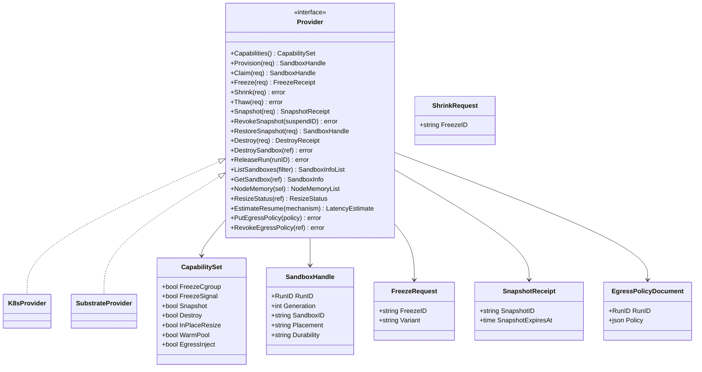
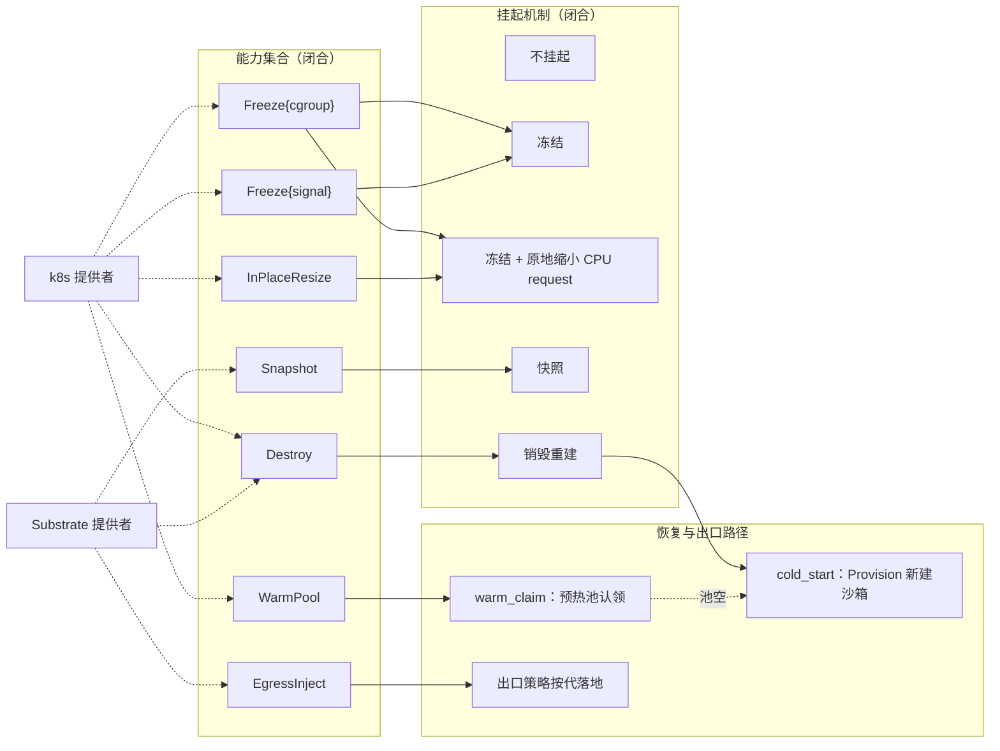

# sandboxprovider

本模块实现[沙箱提供者](../../../glossary.md)：把控制面选定的预配、认领、[冻结](../../../glossary.md)、解冻、[快照](../../../glossary.md)、快照恢复、销毁与资源释放翻译为具体提供者层的调用，并把提供者能力与[出口策略](../../../glossary.md)落地结果暴露给控制面。k8s 子模块基于 kubernetes-sigs/agent-sandbox（[REF-agent-sandbox](../../../references.md)），覆盖冻结层；substrate 子模块基于 agent-substrate/substrate（[REF-substrate](../../../references.md)），覆盖快照层；k8s 子模块与 substrate 子模块共用[看守进程](../../../glossary.md)、协议与控制面（[ADR-dual-sandbox-providers](../../../adr/adr-dual-sandbox-providers.md)）。本模块在控制面服务中提供[引导接口](../../../glossary.md)，看守进程经它一次性领取按受众划分的[运行实例令牌](../../../glossary.md)组与 `lease_id`。本模块不决定何时[挂起](../../../glossary.md)，不维护[运行实例](../../../glossary.md)状态机，不生成出口策略内容，不拥有[工作区](../../../glossary.md)绑定；这些分别归 `suspendpolicy`、`runcontroller`、`connectorhub` 与 `workspace`。心智模型：本模块是控制面与提供者层之间的适配层，把“把这一[代](../../../glossary.md)的[沙箱](../../../glossary.md)冻结、快照、销毁或重建”翻译成各提供者的原语；重复调用、迟到调用与旧代调用由按代墓碑与幂等键吸收。

文档较长，不宜顺序通读。第一次阅读依次取：核心概念、职责、外部接口契约中的调用语义与引导接口、核心数据结构中的能力集合与降级、走查、恢复时延分解；术语表、依赖、UML 图与核心数据结构作为核对接口与字段的参考；错误与失败语义、并发与事务边界、扩展点留到最后，按墓碑与幂等规则自测迟到调用与旧代调用的处置。

## 核心概念

同一[运行实例](../../../glossary.md)的提供者调用会因控制面重驱动、响应丢失与迟到执行而重复到达，也可能落在更新代的操作之后。按代墓碑是本模块为此维护的持久记录：在返回删除、释放、撤销或解冻的确认之前写入，声明某个[代](../../../glossary.md)、某个运行实例、某个 `freeze_id` 或某个 `suspend_id` 此后不再接受某一类调用，拒绝范围随墓碑种类而定（见[术语表](#术语表)）；此后到达的同类调用被确定性拒绝，不产生第二次副作用；撤销墓碑只使提供者跳过该代副本的落地与更新，所在的 `Provision`、`Claim` 或 `PutEgressPolicy` 调用不因此失败。墓碑与幂等键使正确性不依赖调用到达顺序：提供者不持有运行实例状态，也不参与控制面事务，调用方按[效果记录](../../../glossary.md)重驱动、按[沙箱](../../../glossary.md)列举结果对账，迟到的旧代调用既不会删除新代沙箱，也不会在释放之后重建资源。

## 职责

职责穷举如下，每条先写本模块执行的动作，再写产生的结果或边界；能力集合是闭合集合，机制选择由 `suspendpolicy` 完成（[ADR-capability-tiered-suspension](../../../adr/adr-capability-tiered-suspension.md)）。

- **能力自描述**：返回能力集合的闭合取值 `{Freeze{cgroup | signal}, Snapshot, Destroy, InPlaceResize, WarmPool, EgressInject}`；能力集合是 `suspendpolicy` 选择机制的唯一依据，本模块不替调用方选择机制。
- **预配与认领**：按 `(run_id, generation, attempt_id)` 幂等创建沙箱，或在具备 `WarmPool` 的提供者上从预热池认领沙箱，调用 `workspace` 绑定工作区，k8s 共享文件系统模式下经[节点挂载代理](../../../glossary.md)只把本运行实例的工作区子目录挂进沙箱 Pod（[ADR-per-run-workspace-mount](../../../adr/adr-per-run-workspace-mount.md)），写入[引导记录](#术语表)，按代落地出口策略，返回 `sandbox_id`、放置位置与工作区持久化语义；创建请求在整代销毁或按运行实例释放的墓碑之后被拒绝。
- **引导接口**：在[面向沙箱的端点](../../../glossary.md) `bootstrap` 上以 HTTPS 暴露引导接口，按沙箱实例身份查引导记录，把领取请求携带的[实例密钥](../../../glossary.md)公钥指纹登记到工作区租约与引导记录，向看守进程一次性返回按受众划分的运行实例令牌组、`lease_id` 与[接入票据](../../../glossary.md)公钥集合；令牌组在领取时调用 `secrets.IssueRunToken` 签发并绑定实例公钥指纹，令牌在任何路径上都不进入提供者的持久记录。
- **冻结与解冻**：按 `freeze_id` 执行 `Freeze{cgroup}`，并在 `InPlaceResize` 能力允许时缩小 CPU request；`Freeze{signal}` 的冻结与解冻由看守进程执行，本模块只声明该能力；已解冻的 `freeze_id` 不再接受冻结与缩小，冻结只作用于 Agent 子 cgroup，看守进程保持可运行（[ADR-freeze-via-node-agent](../../../adr/adr-freeze-via-node-agent.md)）。
- **快照与快照恢复**：按 `suspend_id` 执行快照并报告快照保留期限；按 `resume_id` 在同一代内恢复快照并返回沙箱标识；快照不存在或已过期时明确报告；按 `suspend_id` 撤销尚未确认的快照尝试，撤销即墓碑。
- **销毁与释放**：按 `(run_id, generation)` 整代销毁并返回携带被删除代的确认，以挂起为目的的整代销毁另携带挂起尝试的 `suspend_id`，提供者据此区分两类销毁（substrate 子模块前者同步挂起、后者退回 actor）；按 `(generation, sandbox_id)` 单个销毁；整代销毁与单个销毁都只作用于该代的沙箱实例，不删除更新的代；按 `run_id` 幂等释放运行实例级资源，释放之后拒绝该运行实例的一切创建（[ADR-generation-fencing](../../../adr/adr-generation-fencing.md)）；整代销毁在写入创建墓碑之后删除该代的引导记录，单个销毁删除该沙箱实例的引导记录，按运行实例释放在写入释放墓碑之后删除该运行实例的引导记录。
- **查询**：批量列举沙箱并返回每个沙箱的 `run_id`、代、`sandbox_id` 与放置位置；按 `sandbox_id` 查询单个沙箱；按节点查询冻结态内存、可分配内存与节点内存和 CPU 之比；查询原地放大的 `Deferred` 状态；按机制给出提供者侧的恢复时延估计。
- **出口策略**：保存 `connectorhub` 推送的每运行实例出口策略；在预配与认领时按 `(run_id, generation)` 落地本代副本；推送的更新只同步到尚未撤销的代；按 `(run_id, generation)` 撤销该代副本，撤销即墓碑，已撤销的代拒绝此后的落地与更新。
- **预热池**：为具备 `WarmPool` 的提供者维护按镜像、规格与节点池或可用区分片的预热池容量；认领时返回可用的沙箱；容量按 `N = λL + z_{1−ε}·√(λL) + B` 计算，分片的容量各自计算。
- **恢复触发**：为 substrate 子模块的快照恢复经 Substrate 路由器调用 `/wake` 触发恢复，销毁态重建由 `Provision` 以运行实例 actor 的一次冷启动承载新代；为 k8s 子模块执行解冻、把 Sandbox CR 改回 `Running` 或从预热池认领，认领预热 Pod 后经 wake-router 调用 `/wake` 通知看守进程领取；解冻以 `Thawed` 为完成观察，快照恢复与销毁态重建以同代或新代 `Hello` 为完成观察。
- **串行化与幂等**：对同一运行实例的 `Suspend`、`Resume` 与 `Destroy` 按到达顺序串行；每个调用以 `freeze_id`、`suspend_id`、`resume_id`、`(run_id, generation)` 或 `(generation, sandbox_id)` 幂等，重复调用返回首次结果。

### 非职责

非职责举例如下，判定标准为：职责清单之外、由其他模块拥有的事实与机制。

- 挂起决策归 `suspendpolicy`：等待时长预测、机制选择、冻结中复评与升级梯、恢复准入的限速与优先级、抖动预算。本模块只提供能力集合、生命周期调用与恢复时延估计。
- 运行实例状态机归 `runcontroller`：状态、子状态、代递增、游标、唤醒谓词、投递与对账。本模块只执行状态机选定的提供者操作，并返回确认、删除代与错误。
- 工作区绑定与持久化归 `workspace`：租约、绑定、[持久化确认](../../../glossary.md)与沙箱外访问。本模块在预配与认领时调用绑定，不持有租约表。
- 出口策略内容生成归 `connectorhub`：允许主机、占位符替换规则与平台出口代理的请求级校验。本模块只保存、落地与撤销策略副本。
- [沙箱侧配置](../../../glossary.md)（`SandboxConfig`）的生成归 `connectorhub`，推送归 `runcontroller`，应用归 `warden`：配置经 `runcontroller` 的出站流送达看守进程，不经过本模块，不进入提供者的任何记录。
- 运行实例令牌的签名与校验归 `secrets`，轮换归 `runcontroller` 的 `rotate_token` 效果；工作区租约的建立归 `runcontroller` 与 `workspace`；[持有证明](../../../glossary.md)的校验归 `runcontroller`（`Hello`）与 `workspace`（`RenewLease`）。本模块只在领取时调用 `SetHolderKey` 登记实例公钥指纹、调用 `IssueRunToken` 取得首个令牌组，并把随请求传入的 `lease_id` 写入引导记录。
- 沙箱内进程监督、Agent 驱动器与 `Freeze{signal}` 的看守进程侧执行归 `warden`；本模块只提供节点冻结代理的 `Freeze{cgroup}` 执行与提供者层调用。
- 以挂起为目的的销毁的[安全点](../../../glossary.md)检查归 `runcontroller` 与 `warden`（I9）；本模块不判断 `ReadyToSuspend` 的前置条件。
- 协议信封、消息定义与出站流归 `agentprotocol`；本模块只使用 `/readyz` 与 `/wake` 入站端点触发恢复，并在 k8s 预热认领时以 `/wake` 通知看守进程领取。

## 术语表

| 术语 | 英文对照 | 适用范围 | 定义 |
| --- | --- | --- | --- |
| 能力集合 | capability set | sandboxprovider | 提供者自描述的闭合能力取值，`suspendpolicy` 只在其中选择机制 |
| 创建墓碑 | creation tombstone | sandboxprovider | 整代销毁或按运行实例释放之后，提供者据以拒绝该代或该运行实例后续创建的持久记录 |
| 撤销墓碑 | revocation tombstone | sandboxprovider | 出口策略按代撤销之后，提供者据以拒绝该代后续落地与更新的持久记录 |
| 快照撤销墓碑 | snapshot cancellation tombstone | sandboxprovider | 按 `suspend_id` 撤销未确认的快照尝试之后，同一 `suspend_id` 的迟到快照请求不生效的持久记录 |
| 冻结墓碑 | freeze tombstone | sandboxprovider | 按 `freeze_id` 解冻之后，同一 `freeze_id` 的迟到冻结与缩小请求不生效的持久记录 |
| 出口策略副本 | egress policy copy | sandboxprovider | 以 `(run_id, generation)` 为键、由 `connectorhub` 推送策略生成的本代落地对象 |
| 冻结标识 | freeze_id | sandboxprovider | 一次冻结尝试的标识，冻结、解冻与缩小 CPU request 以它幂等 |
| 预热池分片 | warm pool shard | sandboxprovider | 按镜像、规格与节点池或可用区划分的独立预热池，容量各自计算 |
| 引导记录 | bootstrap record | sandboxprovider | 提供者以沙箱实例身份为键持久保存的记录，引导接口据它确定该沙箱实例所属的运行实例、代与 `lease_id`，并保证令牌只被领取一次 |
| 停泊 | parking | sandboxprovider | k8s 子模块的 wake-router 或 Substrate 路由器暂存入站请求直到 `/readyz` 就绪的处理；Substrate 的停泊预算只约束新的恢复重试，不取消在途恢复 |

## 外部接口契约

稳定性承诺按接口类别给出：生命周期接口对 `runcontroller` 稳定；出口策略接口对 `connectorhub` 稳定；引导接口的路径、响应字段与错误码对看守进程稳定；提供者在能力集合内声明的能力可以增加，扩展能力集合的闭合取值、删除能力或改变已有能力的语义是破坏性变更；墓碑与幂等语义是提供者必须满足的契约，不满足的实现不是合规提供者。生命周期调用经 `runcontroller` 的效果记录在数据库事务提交后发出；出口策略推送由 `connectorhub` 直接调用；引导接口由看守进程以 HTTPS 调用。`sandboxprovider` 不读写控制面的表，也不参与控制面事务。

调用方认证按[认证与授权边界](../../architecture.md#认证与授权边界)的按方法授权表执行（[ADR-control-plane-call-authentication](../../../adr/adr-control-plane-call-authentication.md)）。`Provider` 接口只在内部监听器上提供：只接受 mTLS 对端，对端的 SPIFFE 工作负载身份（[REF-spiffe](../../../references.md)）须在授权表中该方法的允许集合内；生命周期方法、只读查询与 `RevokeEgressPolicy` 只接受 `runcontroller`，`PutEgressPolicy` 只接受 `connectorhub`。内部监听器不接受非 SPIFFE 对端，也不对沙箱网段开放；对端不在授权表中，或调用了授权表不允许该对端调用的方法时，以不可重试的未授权错误拒绝并写审计，不执行调用。引导接口部署在[面向沙箱的端点](../../../glossary.md) `bootstrap` 上，与内部监听器使用不同的主机名与端口，调用方为看守进程，认证见[引导接口](#引导接口)。`Provider.Thaw` 是提供者方法；协议消息 `Thaw{freeze_id}` 由 `runcontroller` 经出站流发送给看守进程，不调用本接口。

```go
type Provider interface {
    Capabilities(ctx context.Context) CapabilitySet
    Provision(ctx context.Context, req ProvisionRequest) (SandboxHandle, error)
    Claim(ctx context.Context, req ProvisionRequest) (SandboxHandle, error)
    Freeze(ctx context.Context, req FreezeRequest) (FreezeReceipt, error)
    Shrink(ctx context.Context, req ShrinkRequest) error
    Thaw(ctx context.Context, req ThawRequest) error
    Snapshot(ctx context.Context, req SnapshotRequest) (SnapshotReceipt, error)
    RevokeSnapshot(ctx context.Context, suspendID string) error
    RestoreSnapshot(ctx context.Context, req RestoreRequest) (SandboxHandle, error)
    Destroy(ctx context.Context, req DestroyRequest) (DestroyReceipt, error)
    DestroySandbox(ctx context.Context, ref SandboxRef) error
    ReleaseRun(ctx context.Context, runID RunID) error
    ListSandboxes(ctx context.Context, filter SandboxFilter) ([]SandboxInfo, error)
    GetSandbox(ctx context.Context, ref SandboxRef) (SandboxInfo, error)
    NodeMemory(ctx context.Context, sel NodeSelector) ([]NodeMemory, error)
    ResizeStatus(ctx context.Context, ref SandboxRef) (ResizeStatus, error)
    EstimateResume(ctx context.Context, mechanism ResumeMechanism) (LatencyEstimate, error)
    PutEgressPolicy(ctx context.Context, policy EgressPolicyDocument) error
    RevokeEgressPolicy(ctx context.Context, ref GenerationRef) error
}

type CapabilitySet struct {
    FreezeCgroup  bool
    FreezeSignal  bool
    Snapshot      bool
    Destroy       bool
    InPlaceResize bool
    WarmPool      bool
    EgressInject  bool
}

type ProvisionRequest struct {
    RunID      RunID
    Generation int
    AttemptID  string              // 取 resume_id
    LeaseID    string              // 工作区租约标识，写入引导记录；看守进程领取后用于首次续约与 Hello
    Workspace  WorkspaceBinding
}

type SandboxHandle struct {
    RunID      RunID
    Generation int
    SandboxID  string
    Placement  string
    Durability string              // sync 或 on_suspend
    State      string              // creating、running、frozen、snapshotted、destroyed、released
}

type FreezeRequest struct {
    RunID      RunID
    Generation int
    SandboxID  string
    FreezeID   string              // 取冻结尝试的 suspend_id
    Variant    FreezeVariant       // cgroup；signal 由看守进程执行，提供者收到 signal 以参数非法拒绝
}

type FreezeReceipt struct {
    FreezeID string
    FrozenAt time.Time
}

type ShrinkRequest struct {
    RunID      RunID
    Generation int
    SandboxID  string
    FreezeID   string              // 必须是已冻结且未解冻的标识
}

type ThawRequest struct {
    RunID      RunID
    Generation int
    SandboxID  string
    FreezeID   string
    Variant    FreezeVariant       // cgroup；signal 由看守进程执行，提供者收到 signal 以参数非法拒绝
}

type SnapshotRequest struct {
    RunID      RunID
    Generation int
    SandboxID  string
    SuspendID  string
}

type SnapshotReceipt struct {
    SnapshotID        string
    SnapshotExpiresAt time.Time
}

type DestroyRequest struct {
    RunID      RunID
    Generation int
    SuspendID  string              // 以挂起为目的的销毁携带挂起尝试的 suspend_id；其余整代销毁为空
}

type DestroyReceipt struct {
    RunID      RunID
    Generation int
}

type RestoreRequest struct {
    RunID      RunID
    Generation int
    SuspendID  string
    AttemptID  string              // 取 resume_id
}

type GenerationRef struct {
    RunID      RunID
    Generation int
}

type SandboxRef struct {
    Generation int
    SandboxID  string
}

type EgressPolicyDocument struct {
    RunID  RunID
    Policy json.RawMessage        // connectorhub 序列化后的出口策略，提供者不解释其字段
}
```

### 调用语义与稳定承诺

| 调用 | 调用方 | 幂等键 | 结果 | 失败分类 |
| --- | --- | --- | --- | --- |
| `Provision`、`Claim` | `runcontroller` | `(run_id, generation, attempt_id)` | `SandboxHandle` | 墓碑拒绝与参数非法为确定性，不具备 `WarmPool` 的提供者收到 `Claim` 属于参数非法；提供者不可达、超时与提供者层容量耗尽为暂时性 |
| `Freeze` | `runcontroller` | `freeze_id` | `FreezeReceipt` | 已解冻标识的迟到冻结为确定性拒绝 |
| `Thaw` | `runcontroller` | `freeze_id` | 空 | 幂等；重复调用返回成功 |
| `Shrink` | `runcontroller` | `freeze_id` | 空 | 已解冻标识的迟到缩小为确定性拒绝；提供者不具备 `InPlaceResize` 时返回能力缺失 |
| `Snapshot` | `runcontroller` | `suspend_id` | `SnapshotReceipt`，含保留期限 | 快照撤销墓碑之后的迟到请求为确定性拒绝 |
| `RevokeSnapshot` | `runcontroller` | `suspend_id` | 空 | 幂等；重复撤销返回成功，撤销即快照撤销墓碑 |
| `RestoreSnapshot` | `runcontroller` | `(run_id, generation, attempt_id)` | `SandboxHandle` | 快照不存在或已过期为确定性；提供者不可达与提供者层容量耗尽为暂时性 |
| `Destroy` | `runcontroller` | `(run_id, generation)` | `DestroyReceipt`，携带被删除代 | 幂等；重复调用返回首次确认；`SuspendID` 不参与幂等键 |
| `DestroySandbox` | `runcontroller` | `(generation, sandbox_id)` | 空 | 幂等；目标不存在返回成功 |
| `ReleaseRun` | `runcontroller` | `run_id` | 空 | 幂等；重复调用返回成功 |
| `PutEgressPolicy` | `connectorhub` | `run_id` | 空 | 释放墓碑拒绝与参数非法为确定性；存在已撤销的代不构成失败，更新只同步到尚未撤销的代；提供者不可达与超时为暂时性 |
| `RevokeEgressPolicy` | `runcontroller` | `(run_id, generation)` | 空 | 幂等；重复调用返回成功 |
| `ListSandboxes`、`GetSandbox`、`NodeMemory`、`ResizeStatus`、`EstimateResume`、`Capabilities` | `runcontroller` | 无 | 观察结果 | 只读调用，失败不改变提供者状态 |

- **调用方**：“调用方”列取自授权表，是穷举的允许集合，按对端 SPIFFE 身份判定；请求中的任何字段都不改变调用方的判定。对端不在授权表中，或调用了该列之外的方法时，提供者返回不可重试的未授权错误并写审计，不执行调用，不写 `OperationRecord` 与墓碑。
- **稳定承诺**：`runcontroller` 可以依赖生命周期调用、墓碑语义与幂等语义；`connectorhub` 可以依赖出口策略的保存、按代落地与按代撤销。新增提供者实现同一接口，不修改调用方；提供者在闭合集合内新增一项已声明能力是兼容变更，扩展闭合取值、删除能力或改变能力语义需要同时修改调用方与 `suspendpolicy`。
- **顺序**：对同一运行实例的 `Suspend`、`Resume` 与 `Destroy` 不并发；调用方按效果记录的先后发出，提供者按到达顺序串行执行。不同运行实例的调用可以并发。
- **只读调用**：`ListSandboxes`、`GetSandbox`、`NodeMemory`、`ResizeStatus`、`EstimateResume` 与 `Capabilities` 不改变提供者状态，可在控制面事务之外调用；调用方把结果与 `run` 行核对，查询失败时不据以判定。
- **不持有控制面状态**：`sandboxprovider` 不读取 `runcontroller` 的表，不持有运行实例状态；提供者侧记录只服务于幂等、墓碑、预热池、引导与观察。

### 与 suspendpolicy 的能力协商

- `runcontroller` 在挂起决策前读取 `Capabilities`，把能力集合作为上下文传给 `suspendpolicy.decide` 与 `review`；`suspendpolicy` 只返回能力集合允许的机制，没有可用机制时返回不挂起。
- `Freeze{signal}` 只允许短冻结，冻结时长上限与升级梯由 `suspendpolicy` 定义；`FREEZE_SHRINK` 只与 `Freeze{cgroup}` 和 `InPlaceResize` 组合；`Snapshot` 只在提供者声明该能力时进入候选；`Destroy` 只在提供者声明该能力时进入候选。
- `WarmPool` 与 `EgressInject` 不是挂起机制：`WarmPool` 影响销毁重建的恢复路径，`EgressInject` 影响出口路径；`WarmPool` 与 `EgressInject` 不进入 `decide` 的机制选择。
- 能力缺失时由 `suspendpolicy` 降级，`sandboxprovider` 不把能力缺口暴露为运行时错误：substrate 子模块没有冻结，回合中只有不挂起与快照，没有 `WarmPool`，销毁重建的 `resume_mode` 取 `cold_start`，由 `Provision` 冷启动运行实例的 actor（首代从[模板快照](../../../glossary.md)恢复，[ADR-substrate-actor-per-run](../../../adr/adr-substrate-actor-per-run.md)）；k8s 子模块没有快照，回合中冻结到上限后由 `suspendpolicy` 选择 `DRAIN`，回合边界仍可销毁重建。
- 调用方把能力集合之外的机制传给 `sandboxprovider` 时，提供者以参数非法拒绝；这属于调用方缺陷，不是提供者的降级路径。

### 与 connectorhub 的出口策略接口

- `PutEgressPolicy` 保存每运行实例的出口策略；`EgressPolicyDocument` 是提供者不解释的信封，`connectorhub` 的 `EgressPolicySink` 由一层适配把其 `EgressPolicy` 序列化为 `Policy` 后调用本接口，`sandboxprovider` 不导入 `connectorhub` 的类型。提供者只按 `run_id` 保存，并在预配与认领时按 `(run_id, generation)` 生成本代副本。推送的更新只同步到该运行实例尚未撤销的代副本。
- 沙箱侧配置不经过本接口：`connectorhub` 经 `runcontroller` 的 `PutSandboxConfig` 推送，`runcontroller` 在出站流上以 `SandboxConfig` 消息发给看守进程；看守进程的应用规则见 [warden](../warden/design-warden.md#沙箱侧配置)。
- `RevokeEgressPolicy` 按 `(run_id, generation)` 撤销该代副本，撤销即墓碑；已撤销的代拒绝此后的落地与更新，重复撤销幂等。
- Substrate 路径把出口策略落地为 EgressPolicy：`PlaintextHosts` 中的主机落地为 `http` 规则并带其注入规则，其余有注入规则的主机只落地 `https` 规则，无注入规则的主机落地 `tls_passthrough` 规则并显式列出端口，以 MITM 与 `replaceHeaders` 替换请求头凭据占位符，默认拒绝未列入的主机，并追加不属于策略内容的引导接口主机 `actorJwt` 注入规则，以及只列面向沙箱的端点主机名（`stream`、`lease`、`llm`、`connector`、`human`）的 `tls_passthrough` 规则；`EgressPolicy` 规则上限 256 条，单条规则主机上限 256，`replaceHeaders` 上限 16；出口网关按策略缓存 TTL（默认 10 s）生效，撤销后的新请求最多再滞后一个 TTL；控制面内部监听器的主机名不进入任何规则（见[出口策略落地与按代撤销](#出口策略落地与按代撤销)）。actor 经 `systemInfo` 卷的 `trustBundle` 数据源取得出口网关 CA，CA 不预置进镜像，凭据来源为按 `ate-secret://` URI 的 host 路由的 credential provider，可以配置多个提供者。
- k8s 路径的占位符替换由 `connectorhub` 的平台出口代理完成，`sandboxprovider` 在出口侧只落地平台出口代理配置与 NetworkPolicy，并按运行实例保存策略；平台出口代理对每个出口请求按附带的运行实例令牌经代查询接口校验代、终态与作废状态，不使用缓存，按代撤销为空操作。
- 出口策略的撤销由 `runcontroller` 在代递增、进入 `Degraded`、放弃、显式结束、本代沙箱作废与回合边界销毁的提供者确认的事务内写 `revoke_egress` 效果；提供者在效果执行时撤销，撤销生效前的残余窗口以效果记录的截止为上界。

### 引导接口

引导接口归本模块，k8s 子模块与 substrate 子模块共用同一领取语义，只在认证方式与触发方式上不同；认证与触发的细节见 [k8s 子模块](design-sandboxprovider-k8s.md)与 [substrate 子模块](design-sandboxprovider-substrate.md)。

- **端点**：控制面服务在面向沙箱的端点 `bootstrap` 上以 HTTPS 暴露 `POST /v1/bootstrap/claim`，由看守进程调用；请求体为 `{instance_key}`（实例密钥的公钥 JWK，不是凭据），调用方身份仍只来自 `Authorization` 头。请求体缺失、无法解析，或 `instance_key` 不是 `kty=OKP`、`crv=Ed25519` 且 `x` 为 32 字节公钥的 JWK 时返回 400。引导接口的主机名、端口与固定地址取自部署配置 `sandbox_facing_endpoints` 的 `bootstrap` 条目，由提供者写入 Pod 模板的 `hostAliases`（k8s）或 actor 模板的启动参数（Substrate），不含按运行实例的数据；看守进程按配置的地址直连，不经 DNS 解析该主机名。引导接口使用只承载该端点的独立主机名：Substrate 出口网关按主机名对引导接口主机终止 TLS 并替换 `Authorization` 头，其他控制面接口若与引导接口共用主机名，这些接口的请求也会在出口网关处以明文经过，`Authorization` 头同样替换为 actor JWT（见 [substrate 子模块](design-sandboxprovider-substrate.md)）。
- **认证**：k8s 路径的 `Authorization` 头携带绑定到 Pod 的投射 ServiceAccount 令牌，引导接口以 `TokenReview` 校验并取 Pod UID（[REF-k8s-service-accounts](../../../references.md)）；Substrate 路径的 `Authorization` 头由出口网关替换为 actor JWT，引导接口以部署配置固定的 Substrate 签发方（ate-api-server 的 `--actor-jwt-issuer`）经 OIDC 发现取验签公钥，验签并校验 `iss`、`aud` 与 `exp`，从 `actor.ate.dev` 声明取 actor 名与 actor UID。两条路径的 audience 都是 `castworks-bootstrap`。引导接口以取得的沙箱实例身份查引导记录。
- **成功响应**：`{run_id, generation, sandbox_id, lease_id, tokens, token_expires_at, access_ticket_keys}`。`tokens` 是以受众为键的对象 `{runcontroller, llmgateway, connectorhub, humanchannel, egress}`，每个值是该受众的运行实例令牌；`access_ticket_keys` 是接入票据的公钥集合（JWKS），看守进程据它校验 `/terminal` 与 `/files` 携带的接入票据。
- **一次性领取**：处理顺序固定为：认证；按沙箱实例身份查引导记录；确认 `claimed` 为假；以实例公钥指纹调用 `workspace.SetHolderKey(run_id, lease_id, generation, instance_jkt)` 登记到工作区租约；调用 `secrets.IssueRunToken(run_id, generation, instance_jkt)` 签发令牌组；取 `secrets.AccessTicketKeys`（可缓存）；在同一事务内把 `claimed` 置真并写 `claimed_at` 与 `instance_jkt`；提交后返回响应。`claimed` 已为真时返回 409，不调用 `SetHolderKey` 与 `IssueRunToken`；存储要求与墓碑核对见[并发与事务边界](#并发与事务边界)。出口网关与 Pod 内文件权限都不能可靠区分看守进程与 Agent 进程，看守进程因此在生成实例密钥之后、启动 Agent 主进程之前完成领取；此后 Agent 进程即使请求引导接口也拿不到令牌，运行实例令牌与实例私钥只由看守进程持有（I6）。k8s 路径上非 root uid 的出站只到回环，Agent 进程连不上引导接口（见 [k8s 子模块](design-sandboxprovider-k8s.md#沙箱-pod-安全基线)）。
- **实例公钥指纹**：`instance_jkt` 对 `instance_key` 的成员 `crv`、`kty`、`x` 按键名排序、无空白序列化后求 SHA-256，再做 base64url 编码。指纹同时写入工作区租约的 `holder_jkt`、每张令牌的 `cnf.jkt` 与引导记录的 `instance_jkt`；`runcontroller` 在 `Hello` 与 `workspace` 在 `RenewLease` 上要求调用方以对应私钥出示持有证明，仅取得令牌与 `lease_id` 的一方不能接管出站流或续约（[ADR-run-token-audience-and-holder-binding](../../../adr/adr-run-token-audience-and-holder-binding.md)）。
- **令牌签发**：引导接口在领取时调用 `secrets.IssueRunToken(run_id, generation, instance_jkt)`，一次签发同 `run_id`、同代、同 `exp`、同 `cnf.jkt`、按受众（`runcontroller`、`llmgateway`、`connectorhub`、`humanchannel`、`egress`）各一张的令牌组，`token_expires_at` 取签发结果的 `ExpiresAt`；令牌不持久化。`runcontroller` 从被接受的 `Hello` 取得首个令牌组的到期时刻与实例公钥指纹；轮换由 `runcontroller` 的 `rotate_token` 效果以 `run.instance_jkt` 调用 `IssueRunToken`，不经过引导接口。
- **`lease_id`**：随 `ProvisionRequest` 传入，提供者写入引导记录；领取时以实例公钥指纹调用 `SetHolderKey` 登记到租约，随响应返回。
- **快照恢复**：快照恢复沿用原沙箱实例及其引导记录，不写入新的引导记录，`sandbox_id` 与代保持不变；看守进程不重新领取，令牌组、`lease_id` 与实例私钥已在快照的进程内存中；令牌在挂起期间过期时由 `rotate_token` 处理，新令牌组的 `cnf.jkt` 不变。

错误码穷举如下；失败的领取不改变引导记录。退避参数与领取的触发见 [warden](../warden/design-warden.md)。

| 状态码 | 条件 | 看守进程的处置 |
| --- | --- | --- |
| 400 | 请求体缺失或无法解析实例公钥 | 不可重试 |
| 401 | 凭据无效或 audience 不符；Substrate 路径另含引导记录中的 actor UID 与 JWT 不一致 | 不可重试 |
| 404 | 没有对应的引导记录，包括记录尚未写入的沙箱实例，以及记录已被整代销毁、单个销毁或释放删除的沙箱实例 | 退避重试 |
| 409 | 引导记录已领取；或 `workspace` 拒绝 `SetHolderKey`（租约已释放、代不符或租约已登记另一实例公钥指纹） | 停止领取，不启动 Agent 主进程；`runcontroller` 按沙箱丢失以新代重建 |
| 410 | 该代已有创建墓碑，或运行实例已有释放墓碑 | 以退出原因 `claim_gone` 退出（见 [warden](../warden/design-warden.md)） |
| 503 | `secrets`、`workspace` 或存储不可达；k8s 路径另含 `TokenReview` 请求失败 | 退避重试 |

## 依赖

依赖穷举如下，方向与[模块依赖图](../../architecture.md#模块依赖图)一致：本模块依赖基础层的 `workspace`、`agentprotocol` 与 `secrets`，以及各提供者层的控制器、代理与存储；`runcontroller` 与 `connectorhub` 依赖本模块；本模块不依赖 `runcontroller`、`suspendpolicy` 与 `connectorhub`。

- 调用身份：本模块调用 `secrets`、`workspace`、节点冻结代理、节点挂载代理与入站路由（k8s 的 wake-router、Substrate 路由器）时，一律以 `sandboxprovider` SPIFFE 身份做 mTLS，各被调用方按授权表只放行本模块被允许的方法；节点冻结代理以 `node-freeze-agent`、节点挂载代理以 `node-mount-agent` 的身份提供监听器，Substrate 路由器与出口网关的身份是 Substrate 命名空间中的 ServiceAccount，按部署白名单登记。
- `workspace`：在预配与认领时调用 `BindingService.Bind` 绑定工作区，取得挂载路径、`RunUID`、`StorageMode`、`Durability` 与 `Placement`，把绑定交给沙箱；k8s 共享文件系统模式下 `Ensure` 由节点挂载代理执行，挂载根不进入任何 Pod，只有该运行实例的子目录经绑定挂载出现在沙箱 Pod 内（[ADR-per-run-workspace-mount](../../../adr/adr-per-run-workspace-mount.md)）；`lease_id` 取自 `ProvisionRequest.LeaseID`，由 `runcontroller` 建立租约后随请求传入，不来自绑定，提供者把它写入引导记录；引导接口在领取时调用 `LeaseService.SetHolderKey(run_id, lease_id, generation, instance_jkt)`，把实例公钥指纹登记为租约的 `holder_jkt`，CAS 条件为 `lease_id` 与代匹配、租约未释放、`holder_jkt` 为空或相等；工作区持久化按提供者选择，k8s 子模块以共享文件系统为默认、块存储为退化配置，substrate 子模块优先外部 CSI 卷、`durableDir` 为退化配置（[ADR-workspace-persistence-per-provider](../../../adr/adr-workspace-persistence-per-provider.md)）。本模块不持有租约，续约与接管由 `workspace` 与看守进程完成；`on_suspend` 语义下，以挂起为目的的整代销毁在同步挂起返回之后，以 `DestroyRequest.SuspendID` 调用 `workspace.Confirm(Mode=suspend_upload, run_id, generation, lease_id, suspend_id)`，确认成功才视为工作区已持久化；确认以 `(run_id, generation, lease_id)` 幂等。
- `secrets`：引导接口在领取时调用 `IssueRunToken(run_id, generation, instance_jkt)` 签发按受众划分的首个令牌组，并调用 `AccessTicketKeys` 取得接入票据公钥集合（可缓存）随领取响应下发；调用经控制面 mTLS 发出，`sandboxprovider` 的调用方身份在 `secrets` 的 `IssueRunToken` 与 `AccessTicketKeys` 白名单内，不允许任何凭据换取目标。令牌不持久化；轮换由 `runcontroller` 调用 `IssueRunToken`，不经过本模块。
- `agentprotocol`：恢复触发使用 `/readyz` 与 `/wake` 入站端点；`/readyz` 是就绪探针，不以领取为条件；`/wake` 返回表示看守进程的出站流已重建。k8s 预热认领以 `/wake` 通知看守进程领取，提供者不等待其返回。入站端点不承载事件内容，投递只在出站流上进行。
- k8s 提供者层：agent-sandbox 控制器管理 Sandbox、SandboxClaim 与 SandboxWarmPool；节点冻结代理是特权 DaemonSet，经容器运行时解析 Pod 与容器 cgroup，在容器 cgroup 下维护子 cgroup `agent`，写 `agent/cgroup.freeze` 执行冻结与解冻（[REF-linux-cgroup-v2](../../../references.md)）；`Freeze` 与 `Thaw` 只接受本模块的 SPIFFE 调用并按 Pod 归属与代授权，看守进程的移入请求经按 Pod 的 Unix 域套接字提交，cgroup 路径只由代理解析，规则见 [k8s 子模块](design-sandboxprovider-k8s.md#节点冻结代理的调用方认证与目标授权)。节点挂载代理是特权 DaemonSet，同时是 CSI 节点插件（驱动 `workspace.castworks.io`），在节点上挂载共享文件系统的挂载根；冷启动在卷发布时经 `NodePublishVolume`、认领时经 `BindWorkspace` 执行 `Ensure` 并把运行实例子目录绑定挂载进 Pod，`BindWorkspace` 只接受本模块调用，规则见 [k8s 子模块](design-sandboxprovider-k8s.md#节点挂载代理与工作区绑定挂载)。原地缩放依赖 Kubernetes In-Place Pod Resize（[REF-k8s-in-place-pod-resize](../../../references.md)），需要 `pods/resize` 子资源的 patch 权限；引导接口以 `TokenReview` 校验沙箱 Pod 的投射 ServiceAccount 令牌，需要 `tokenreviews` 的 `create` 权限；k8s 入站路由 wake-router 以 SPIFFE mTLS 认证全部入口，`/terminal` 只接受 `humanchannel`，`/files` 只接受 `workspace`，`/wake` 只接受本模块，不承载事件投递，事件驱动的恢复由控制面直调提供者。
- substrate 提供者层：Substrate 控制面执行 actor 的 Suspend 与 Resume；路由器以 `ate-target-actor: <atespace>/<actor>` 头调用 `/wake`，恢复 actor 并停泊请求到 `/readyz` 就绪；出口网关落地 EgressPolicy 并实现占位符替换，连接层要求客户端 SNI 匹配 `https` 规则，请求层要求内层 `Host` 等于 `:authority` 且 `:authority` 匹配 `https` 规则，对 `tls_passthrough` 规则要求 SNI 等于规则主机并显式列出端口，ECH 的处理须实测，并按 substrate 子模块追加的规则把引导接口请求的 `Authorization` 占位符替换为 actor JWT；引导接口经部署配置固定的 Substrate 签发方的 OIDC 发现取验签公钥；对象存储由 in-tree `objectstore-plugin` sidecar 访问，承载快照与 `durableDir` 数据。控制面调用路由器的身份是 Substrate 的 Pod 身份签发方签发的 SPIFFE 身份，与 Substrate 组件同属一个信任域，且必须在路由器的入站白名单内；白名单是连接级精确匹配，不按路径或目标 actor 再授权；Substrate 路由器与出口网关的身份是 Substrate 命名空间中的 ServiceAccount，按部署白名单登记，路由器的入站白名单穷举为 `sandboxprovider`、`humanchannel` 与 `workspace` 的完整 SPIFFE 身份 `spiffe://<spiffe_trust_domain>/ns/<命名空间>/sa/<名称>`。
- 部署前提：k8s 提供者要求节点为 cgroup v2、集群允许特权 DaemonSet、In-Place Pod Resize 可用、agent-sandbox 已安装、NetworkPolicy 由集群网络实施；沙箱 Pod 与预热 Pod 满足沙箱 Pod 安全基线（seccomp Localhost profile、AppArmor 或 SELinux、securityContext、capability 最小集合与 init 容器 `uid-egress-filter` 安装的按 uid 出站规则），沙箱命名空间以 ValidatingAdmissionPolicy（或等价准入策略）强制该基线，CSI 内联临时卷与挂载传播可用，规则见 [k8s 子模块](design-sandboxprovider-k8s.md#沙箱-pod-安全基线)；k8s 路径的平台 CA 经镜像预置或运行时注入（只读投射卷），轮换保留新旧 CA 同时受信的重叠期 `T_ca_overlap`，`T_ca_overlap` 不短于快照保留期上限。substrate 提供者要求 k8s 具备 PodCertificateRequest 与 ClusterTrustBundle API、节点运行 gVisor、节点内核 6.7 及以上、PostgreSQL 与对象存储，并满足以下网络与存储前提：actor 模板以 uid 0 运行看守进程，容器按镜像的 `USER` 与 `WORKDIR` 运行，所需 capability 只能从白名单中选择；actor 网络为 IPv4-only；actor 内 uid 非 0 的出站只到回环；对离开内部网络的目的地，非 TCP 出站除 DNS 查询外不可用，UDP 静默丢弃，其他非 TCP/UDP 以 ICMP unreachable 拒绝；DNS 中继对有出口策略的 actor 只应答 EgressPolicy 所列主机与控制面主机，其余返回 NXDOMAIN，不递归解析；出口网关对 `https` 规则在连接层要求 SNI 匹配、请求层要求 `Host` 等于 `:authority`，对 `tls_passthrough` 规则要求 SNI 等于规则主机；ECH 的处理须实测；快照对象由 `objectstore-plugin` sidecar 访问，atelet 与 ate-api-server 主进程不直接持有存储凭据；`/tmp` 与 `/dev/shm` 是 tmpfs，所有卷以 `nodev` 挂载；出口网关 CA 轮换保留不短于快照保留期上限的新旧 CA 同时受信重叠期。Substrate 前提列入[技术验证](../../../milestone/verification.md)，验证通过前 Substrate 路径不上线，规则见 [substrate 子模块](design-sandboxprovider-substrate.md)。
- 本模块与 `warden` 之间没有代码依赖；`/readyz` 与 `/wake` 是运行时 HTTP 入口，看守进程对引导接口的调用是运行时 HTTPS 调用，都不是模块间的代码调用。

## UML 图

类图固定提供者接口与数据类型的边界，时序图固定预配与恢复的调用顺序，能力映射图固定能力集合到挂起机制与恢复路径的对应关系。图中不表达的约束由每张图后的正文给出。

### 提供者接口类图



`Provider` 是控制面调用提供者的唯一入口，`K8sProvider` 与 `SubstrateProvider` 是同一接口的可互换实现；能力集合是数据而不是行为，调用方读取它后自行选择机制。`SandboxHandle` 是预配、认领与快照恢复的共同结果，携带代与放置位置；`FreezeRequest` 与 `SnapshotReceipt` 分别承载冻结标识与快照保留期限；`EgressPolicyDocument` 只保存 `connectorhub` 推送的内容，提供者不解释其语义。图中不表达墓碑、幂等记录、引导记录、引导接口与串行化，这些由外部接口契约、核心数据结构与核心算法与流程定义。

### 预配与恢复时序图

```mermaid
sequenceDiagram
    autonumber
    participant C as connectorhub
    participant R as runcontroller
    participant P as sandboxprovider
    participant S as secrets
    participant W as workspace
    participant L as 提供者层
    participant D as 看守进程

    C->>P: PutEgressPolicy(run_id, policy)
    R->>P: Provision(run_id, generation, attempt_id, lease_id)
    P->>W: 绑定工作区
    W-->>P: 挂载路径、RunUID、StorageMode、Durability、Placement
    P->>L: 创建沙箱，substrate 首代创建处于挂起态的 actor
    L-->>P: k8s 返回 sandbox_id、placement 与 Pod UID，substrate 返回 sandbox_id 与 actor UID
    P->>P: 按沙箱实例身份写入引导记录，claimed=false
    P->>P: 落地该代出口策略
    opt substrate 提供者
        P->>L: ResumeActor 激活 actor，分配到剩余容量足够的 worker，首代从模板快照恢复
        L-->>P: ResumeActor 成功，返回 worker 分配作为 placement
    end
    P-->>R: SandboxHandle
    Note over D: 生成实例密钥对，私钥只在进程内存
    D->>P: POST /v1/bootstrap/claim，请求体 {instance_key}
    P->>W: SetHolderKey(run_id, lease_id, generation, instance_jkt)
    W-->>P: holder_jkt 已登记
    P->>S: IssueRunToken(run_id, generation, instance_jkt)
    S-->>P: 按受众划分的令牌组, expires_at
    P->>S: AccessTicketKeys（可缓存）
    S-->>P: 接入票据公钥集合
    P->>P: 同一事务内 claimed=true，写 claimed_at 与 instance_jkt
    P-->>D: run_id, generation, sandbox_id, lease_id, tokens, token_expires_at, access_ticket_keys
    D->>W: RenewLease(lease_id, generation, sandbox_id, holder_proof)
    Note over D: 时窗不符时按返回的服务端时刻校时后重试，连续被拒时退避重试
    W-->>D: 首次续约成功，lease.holder 为本沙箱
    D->>R: 建立出站流
    R-->>D: Challenge(nonce, server_now)
    Note over D: 按 server_now 再校时
    D->>R: Hello(generation, sandbox_id, instance_key, holder_proof)
    R-->>D: HelloAck

    Note over R,P: 回合中冻结
    R->>P: Freeze(freeze_id, cgroup)
    P->>L: 节点冻结代理写 agent/cgroup.freeze
    P-->>R: FreezeReceipt
    opt 具备 InPlaceResize
        R->>P: Shrink(freeze_id)
        P-->>R: 缩小返回
    end
    R->>P: Thaw(freeze_id)
    P->>L: 解冻
    P-->>R: 解冻返回
    R->>D: Thaw(freeze_id)
    D-->>R: Thawed

    Note over R,P: 恢复按 resume_mode 分派
    alt snapshot_restore，substrate 提供者
        R->>P: RestoreSnapshot(run_id, generation, suspend_id, resume_id)
        Note over P,L: 沿用原 actor 及其引导记录，sandbox_id 与代不变
        P->>L: 经路由器调用 /wake
        L->>D: 恢复同一 actor 并停泊请求直到 /readyz
        D-->>L: /readyz 就绪
        L->>D: ResumeActor 成功、actor 置为运行态后转发停泊的 /wake
        D->>W: RenewLease(lease_id, generation, sandbox_id, holder_proof)
        Note over D: 时窗不符时按返回的服务端时刻校时后重试，连续被拒时退避重试
        W-->>D: 续约成功，lease.holder 恢复为本沙箱
        D->>R: 经出口网关重建出站流
        R-->>D: Challenge(nonce, server_now)
        Note over D: 按 server_now 再校时
        D->>R: Hello(generation, sandbox_id, instance_key, holder_proof)
        R-->>D: HelloAck
        D-->>L: 握手完成后 /wake 返回
        L-->>P: /wake 返回
        P-->>R: SandboxHandle
    else thaw，k8s 提供者
        R->>P: Thaw(freeze_id)
        P->>L: 节点冻结代理解冻
        P-->>R: 解冻返回
        D-->>R: Thawed
    else warm_claim，k8s 提供者
        R->>P: Claim(run_id, generation, attempt_id, lease_id)
        P->>L: 认领预热 Pod
        L-->>P: sandbox_id, placement
        P->>L: 写 Pod 注解 run-id 与 run-uid
        P->>L: 节点挂载代理 BindWorkspace，绑定运行实例子目录
        L-->>P: 绑定成功
        P->>P: 写入引导记录，claimed=false
        P-)D: 经 wake-router 调用 /wake，不等待返回
        P-->>R: SandboxHandle
        D->>P: 领取，请求体 {instance_key}
        P-->>D: 令牌组、lease_id 与接入票据公钥集合
        D->>W: RenewLease(lease_id, generation, sandbox_id, holder_proof)
        W-->>D: 首次续约成功，lease.holder 为本沙箱
        D->>R: 建立出站流
        R-->>D: Challenge(nonce, server_now)
        D->>R: Hello(generation, sandbox_id, instance_key, holder_proof)
        R-->>D: HelloAck
    else cold_start，k8s 提供者
        R->>P: Provision(run_id, generation, attempt_id, lease_id)
        P->>L: 把 Sandbox CR 改回 Running，或创建沙箱
        Note over L: 卷发布时节点挂载代理执行 Ensure 并发布运行实例子目录
        L-->>P: sandbox_id, placement, Pod UID
        P->>P: 按 Pod UID 写入引导记录，claimed=false
        P-->>R: SandboxHandle
        D->>P: 领取，请求体 {instance_key}
        P-->>D: 令牌组、lease_id 与接入票据公钥集合
        D->>W: RenewLease(lease_id, generation, sandbox_id, holder_proof)
        W-->>D: 首次续约成功，lease.holder 为本沙箱
        D->>R: 建立出站流
        R-->>D: Challenge(nonce, server_now)
        D->>R: Hello(generation, sandbox_id, instance_key, holder_proof)
        R-->>D: HelloAck
    else cold_start，substrate 提供者
        R->>P: Provision(run_id, generation, attempt_id, lease_id)
        P->>L: 运行实例的 actor 不处于挂起态时 RevertActor，按需改挂另一个模板槽位
        L-->>P: actor 处于挂起态，下一次恢复为冷启动
        P->>P: 记录 actor 承载的代与 sandbox_id，替换为该代出口策略，按 actor 名写入本代引导记录，claimed=false
        P->>L: ResumeActor 分配到剩余容量足够的 worker，只恢复卷与 durableDir 并冷启动
        L-->>P: ResumeActor 成功，返回 worker 分配作为 placement
        P-->>R: SandboxHandle
        D->>P: 领取，请求体 {instance_key}
        P-->>D: 令牌组、lease_id 与接入票据公钥集合
        D->>W: RenewLease(lease_id, generation, sandbox_id, holder_proof)
        W-->>D: 首次续约成功，lease.holder 为本沙箱
        D->>R: 经出口网关建立出站流
        R-->>D: Challenge(nonce, server_now)
        D->>R: Hello(generation, sandbox_id, instance_key, holder_proof)
        R-->>D: HelloAck
    end
```



时序图固定预配、冻结与恢复的消息顺序：预配先保存出口策略并绑定工作区，`Provision` 在取得沙箱实例身份之后写入引导记录，substrate 子模块在激活 actor 之前写入并在出口策略落地之后激活，k8s 子模块在观察到 Pod 创建之后按 Pod UID 写入，写入之前看守进程的领取得到 404 并退避重试；k8s 子模块的 `Claim` 在认领之后依次写 Pod 注解、经节点挂载代理绑定运行实例子目录、写入引导记录，再通知看守进程，冷启动 Pod 的运行实例子目录在卷发布时绑定；看守进程携带实例公钥领取，引导接口先登记实例公钥指纹再签发令牌组，看守进程以持有证明首次续约成功后建立出站流，收到 `Challenge` 并按其 `server_now` 校时，再发送携带 `instance_key` 与 `holder_proof` 的 `Hello`，`HelloAck` 之后握手完成；提供者不等待领取与 `Hello`。冻结先由提供者执行 `Freeze{cgroup}`，解冻返回后由 `runcontroller` 经出站流发送协议消息 `Thaw{freeze_id}`；恢复按提供者分流，substrate 子模块的 `MEMORY` 快照恢复经路由器 `/wake` 恢复同一 actor 并等待 `/readyz`，沿用原沙箱实例及其引导记录，不写入新的引导记录，`sandbox_id` 与代保持不变，看守进程不重新领取，恢复后的顺序为先调用 `RenewLease`（时窗不符时按返回的服务端时刻校时后重试，连续被拒时按可重试错误退避重试，期间不建立传输）、续约成功后重建出站流、收到 `Challenge` 并按 `server_now` 再校时、发送 `Hello`，首次续约成功后才发 `Hello` 的规则对初次领取与快照恢复相同；快照与 worker 运行时不兼容且没有兼容 worker 时降级为 `ROOTFS` 冷启动，进程内存与令牌丢失；substrate 子模块的销毁态重建只走 `cold_start`，不新建 actor：`Provision` 先结束 actor 上遗留的沙箱并按需切换[模板槽位](design-sandboxprovider-substrate.md#术语表)，再替换出口策略、写入本代引导记录，以 `ResumeActor` 把运行实例的 actor 分配到剩余容量足够的 worker 并冷启动；k8s 子模块解冻、把 Sandbox CR 改回 `Running` 或认领预热 Pod，看守进程领取后连接。substrate 子模块快照恢复的 `/wake` 返回即表示出站流已重建；k8s 预热认领经 wake-router 调用 `/wake` 只作通知，`/wake` 失败由看守进程的退避领取兜底；k8s 路径的事件驱动恢复由控制面直调提供者，不经入站路由。每步之后的持久化结果见走查。

### 能力集合与机制映射图



能力集合与挂起机制都是闭合集合。`Freeze{cgroup}` 与 `Freeze{signal}` 都映射到冻结，`Freeze{cgroup}` 与 `InPlaceResize` 组合映射到冻结加原地缩小；`Freeze{signal}` 只允许短冻结，不能与原地缩小组合；`Snapshot` 映射到快照；`Destroy` 映射到销毁重建，销毁重建的恢复路径是 `cold_start`，由 `Provision` 为新的一代建立沙箱实例。`WarmPool` 不产生新的挂起机制，它为销毁重建增加 `warm_claim` 路径，池空时退化为 `cold_start`；`EgressInject` 也不产生挂起机制，它只影响出口策略的落地方式。k8s 提供者声明冻结、销毁、原地缩小与预热池；Substrate 提供者声明快照、销毁与出口注入，不声明预热池，每个运行实例只用一个 actor，`Provision` 首代从模板快照恢复，此后每代是该 actor 的一次冷启动，快照与 worker 运行时不兼容时降级为 `ROOTFS` 冷启动。缺失的能力由 `suspendpolicy` 降级，图中不画不可选的机制。`InPlaceResize` 的结果不跨 Pod 重建保留：重建出的新代 Pod 以创建时的原始 CPU request 运行，缩小只作用于冻结中的 `freeze_id` 所属的 Pod，不重放到新 Pod。

## 核心数据结构

提供者侧的数据结构不是控制面的表：运行实例状态仍以 PostgreSQL 中的 `run` 行为唯一事实源，提供者记录只服务于幂等、墓碑、预热池、出口策略副本、引导记录与观察结果。下列记录在返回确认之前持久化，否则重驱动可能产生第二次副作用。

### 状态一览

下表描述提供者侧沙箱实例与运行实例级资源的状态，不描述运行实例状态机；运行实例状态机归 `runcontroller`。第三列的当前动作均由 `sandboxprovider` 执行。

| 状态 | 一句话含义 | 当前动作 | 直觉画面 |
| --- | --- | --- | --- |
| `creating` | 预配、认领或快照恢复已受理，沙箱尚未就绪 | 预配与认领：创建沙箱或认领预热池，绑定工作区，写入引导记录，落地出口策略；快照恢复：唤醒原沙箱实例，沿用其引导记录与同代出口策略副本 | 房间正在搭建，门还没开 |
| `running` | 沙箱实例存在并可执行 | 等待冻结、快照、销毁或查询 | 房间在使用中 |
| `frozen` | Agent 子 cgroup 已冻结，内存保留 | 重复 `Freeze` 返回首次 `FreezeReceipt` 且不重复写 cgroup；解冻之后到达的冻结与缩小由冻结墓碑拒绝 | 房间灯关了，家具原位 |
| `snapshotted` | 内存已持久化，快照有保留期限 | 保存快照标识与到期时刻，等待恢复或销毁 | 房间拍照存档，房间清空 |
| `destroyed` | 该代沙箱实例已结束（k8s 删除 Pod，Substrate 挂起或退回 actor 并切换模板槽位），运行实例级资源保留 | 保留创建墓碑，拒绝该代及更早代的创建 | 房间退租，仓库里还留着柜子 |
| `released` | 运行实例级资源已释放 | 保留释放墓碑，拒绝该运行实例的一切创建 | 仓库清空，钥匙收回 |

状态转移由提供者操作驱动：`creating` 成功后进入 `running`；`Freeze{cgroup}` 使 `running` 进入 `frozen`，`Thaw` 使其回到 `running`；`Snapshot` 使 `running` 进入 `snapshotted`；`frozen` 先经 `Thaw` 回到 `running` 才能快照；快照恢复经 `creating` 回到 `running`；整代销毁使当前状态进入 `destroyed`；`ReleaseRun` 使 `destroyed` 进入 `released`。`destroyed` 之后的创建只允许更大的代，同一代与更早代由创建墓碑拒绝；`released` 是运行实例级资源的终态。

### 能力集合与降级

| 能力 | 语义 | k8s 子模块 | substrate 子模块 | 缺失时的降级 |
| --- | --- | --- | --- | --- |
| `Freeze{cgroup}` | 由节点冻结代理对 Agent 子 cgroup 写 `cgroup.freeze`，看守进程不冻结 | 具备 | 不具备 | 回合中不冻结；有快照能力时用快照，否则不挂起；回合边界仍可销毁重建 |
| `Freeze{signal}` | 由看守进程对 Agent 进程树执行 SIGSTOP，只允许短冻结 | 具备 | 不具备 | 没有短冻结；回合中按其他能力处置 |
| `Snapshot` | 持久化沙箱内存并释放资源，恢复在同一代内进行 | 不具备 | 具备 | 回合中冻结到上限后由 `suspendpolicy` 选择 `DRAIN`；长等待释放内存只能走回合边界销毁重建 |
| `Destroy` | 按代销毁与按运行实例释放，携带墓碑 | 具备 | 具备 | 无法销毁重建；k8s 子模块与 substrate 子模块都具备该能力 |
| `InPlaceResize` | 冻结后缩小 CPU request，恢复时放大；不缩内存 request | 具备（启动自检通过时） | 不具备 | 冻结只释放 CPU 用量，不释放调度额度；恢复不涉及放大 |
| `WarmPool` | 预创建可认领的沙箱，缩短销毁重建的恢复时延 | 具备 | 不具备；`Provision` 首代从模板快照恢复，此后每代冷启动运行实例的 actor | 销毁重建只走 `cold_start`，由 `Provision` 建立新一代的沙箱实例，受冷启动并发上限约束；`Claim` 以参数非法拒绝 |
| `EgressInject` | 提供者按运行实例落地允许主机与请求头凭据占位符替换 | 不具备 | 具备 | k8s 路径由 `connectorhub` 的平台出口代理做占位符替换与逐请求代校验，提供者只落地代理配置与 NetworkPolicy |

能力集合是闭合集合，`suspendpolicy` 不得选择提供者未声明支持的机制。`Freeze{signal}` 只允许短冻结；`FREEZE_SHRINK` 只与 `Freeze{cgroup}` 和 `InPlaceResize` 组合。`WarmPool` 与 `EgressInject` 不是挂起机制，不出现在挂起机制闭集中。

### 沙箱句柄与操作记录

| 记录 | 键 | 字段 | 用途 |
| --- | --- | --- | --- |
| `SandboxHandle` | `(run_id, generation, sandbox_id)` | `placement`、`durability`、`state` | 预配、认领与快照恢复的结果 |
| `FreezeRecord` | `freeze_id` | `variant`、`frozen_at`、`thawed_at`、`shrink_applied` | 冻结与解冻的幂等和冻结墓碑 |
| `SnapshotRecord` | `suspend_id` | `snapshot_id`、`expires_at`、`cancelled`、`restored` | 快照保留期限、撤销与恢复 |
| `OperationRecord` | `(run_id, generation, attempt_id)` 或调用自身的幂等键 | `result`、`completed_at` | 重复调用返回首次结果 |
| `EgressCopy` | `(run_id, generation)` | `policy`、`landed_at`、`revoked` | 出口策略的按代落地与撤销 |
| `BootstrapRecord` | 沙箱实例身份：k8s 为 Pod UID，Substrate 为 actor 名 | `actor_uid`（只用于 Substrate）、`run_id`、`generation`、`sandbox_id`、`attempt_id`、`lease_id`、`claimed`、`claimed_at`、`instance_jkt` | 引导接口的一次性领取；`instance_jkt` 为领取时登记的实例公钥指纹 |
| `WarmPoolShard` | `(image, spec, node_pool 或可用区)` | `capacity`、`available` | 具备 `WarmPool` 的提供者的预热池容量与分片 |
| `NodeMemory` | `node` | `frozen_mem`、`allocatable_mem`、`node_mem_cpu` | 节点内存压力查询；`node_mem_cpu` 供 `suspendpolicy` 计算 ρ |
| `LatencyEstimate` | `mechanism` | `p95`、`sampled_at` | 恢复准入的时延估计 |

`SandboxHandle` 不携带运行实例状态；`FreezeRecord` 与 `SnapshotRecord` 只记录提供者侧的执行结果；`OperationRecord` 是幂等依据，必须在返回确认之前写入；`EgressCopy` 以 `revoked` 标记撤销墓碑；`BootstrapRecord` 是引导记录，不含令牌与私钥，`instance_jkt` 只是公钥指纹；`NodeMemory` 与 `LatencyEstimate` 是观察结果，不是权威状态。

### 引导记录的写入与删除

引导记录的写入与删除时机穷举如下；领取在 `claimed` 为假时把它置真并写 `claimed_at` 与 `instance_jkt`，规则见[引导接口](#引导接口)。引导记录只在该沙箱实例身份尚无本代记录时写入；`Provision` 与 `Claim` 的重驱动、重复调用与迟到调用遇到已存在的本代记录时不改写，任何路径都不把同一代记录的 `claimed` 由真改回假。看守进程领取之后 Agent 进程已在运行，记录若被改回未领取，Agent 进程可经引导接口再次领取到运行实例令牌。substrate 子模块的沙箱实例身份是 actor 名，跨代不变：新一代的 `Provision` 在上一代沙箱实例结束之后才以本代记录替换上一代的记录，此时上一代的 Agent 进程已不存在。快照恢复沿用原沙箱实例及其引导记录，不写入新的引导记录，`sandbox_id` 与代保持不变；看守进程不重新领取。

| 操作 | 动作与时机 | 写入时的 `claimed` |
| --- | --- | --- |
| `Provision` | substrate 子模块在结束上一代沙箱实例之后、激活 actor 之前写入，替换上一代仍在的记录；k8s 子模块在 Pod 创建之后按 Pod UID 写入，写入之前看守进程的领取得到 404 并退避重试 | 假 |
| `Claim` | k8s 子模块在认领、写 Pod 注解并经节点挂载代理绑定运行实例子目录成功之后，经 `/wake` 通知看守进程之前按认领 Pod 的 UID 写入 | 假 |
| `Destroy(run_id, generation)` | 写入创建墓碑之后删除该代的引导记录；substrate 子模块只删除仍属于该代的记录 | — |
| `DestroySandbox(generation, sandbox_id)` | 删除该沙箱实例的引导记录；substrate 子模块只删除仍属于该代的记录 | — |
| `ReleaseRun(run_id)` | 写入释放墓碑之后删除该运行实例的引导记录 | — |

### 墓碑与保留

| 墓碑 | 写入时机 | 拒绝的对象 | 保留期 |
| --- | --- | --- | --- |
| 创建墓碑 | `Destroy(run_id, generation)` 返回确认之前 | 该代及更早代的 `Provision`、`Claim` 与 `RestoreSnapshot` | 不短于控制面效果记录的重驱动窗口 |
| 释放墓碑 | `ReleaseRun(run_id)` 返回成功之前 | 该运行实例的一切创建，含沙箱、运行实例级资源与出口策略 | 随提供者的运行实例级记录保留 |
| 撤销墓碑 | `RevokeEgressPolicy(run_id, generation)` 返回成功之前 | 该代的出口策略落地与更新 | 直到该代沙箱与副本不再存在 |
| 快照撤销墓碑 | 撤销未确认的快照尝试返回之前 | 同一 `suspend_id` 的迟到快照请求 | 不短于快照保留期 |
| 冻结墓碑 | `Thaw(freeze_id)` 返回成功之前 | 同一 `freeze_id` 的迟到冻结与缩小请求 | 不短于挂起尝试的记录窗口 |

## 核心算法与流程

### 走查

本条走查把按代销毁、创建墓碑、释放墓碑与幂等落到具体值上。初始状态：`run_id=r-1`、`generation=5`、`sandbox_id=sb-5`，k8s 子模块，`EgressConfig(r-1)` 已保存（k8s 路径按运行实例保存出口策略，不维护按代副本），`sb-5` 的引导记录 `claimed=true`，创建墓碑与释放墓碑为空，`freeze_id=f-5` 尚未使用。下表只列提供者侧状态，`run` 行由 `runcontroller` 维护。

| 步骤 | 调用或事件 | 提供者侧状态 |
| --- | --- | --- |
| 1 | `Freeze(f-5, cgroup)`，随后 `Shrink(f-5)` | `FreezeRecord(f-5)` 写入，`frozen_at=t1`；节点冻结代理写 `agent/cgroup.freeze=1`；`Shrink` 成功后 `shrink_applied=true`；沙箱状态 `frozen` |
| 2 | `Thaw(f-5)` | `FreezeRecord(f-5).thawed_at=t2`；节点冻结代理写 `agent/cgroup.freeze=0`；沙箱状态 `running`；同一 `freeze_id` 的迟到冻结与缩小被冻结墓碑拒绝 |
| 3 | `Destroy(r-1, 5)` | 删除 Pod，保留 PVC 与 Service；写入创建墓碑 `(r-1, ≤5)`；删除第 5 代的引导记录；沙箱状态 `destroyed`；返回 `DestroyReceipt{generation=5}` |
| 4 | 迟到的 `Provision(r-1, 5, a-9)` | 被创建墓碑拒绝；不创建沙箱，沙箱状态仍为 `destroyed` |
| 5 | `Provision(r-1, 6, a-10)` | 创建 `sb-6`，观察到其 Pod 后按 Pod UID 写入引导记录（`generation=6`、`attempt_id=a-10`、`claimed=false`），沿用 `EgressConfig(r-1)`（k8s 路径不生成按代副本）；沙箱状态 `running`，`placement` 写入 |
| 6 | 迟到的 `DestroySandbox(5, sb-5)` | 幂等返回；不删除 `sb-6`，`sb-6` 状态仍为 `running` |
| 7 | `RevokeEgressPolicy(r-1, 5)` | k8s 路径为空操作；平台出口代理按运行实例令牌逐请求校验代、终态与作废状态；`EgressConfig(r-1)` 不受影响 |
| 8 | `ReleaseRun(r-1)` | 写入释放墓碑 `(r-1)`；删除 Sandbox CR、Service 与 PVC；删除该运行实例的引导记录；沙箱状态 `released`；此后对该 `run_id` 的一切创建被拒绝 |

走查结束时 `generation` 由 `runcontroller` 决定，提供者不递增代；创建墓碑证明第 5 代此后不再出现沙箱实例，释放墓碑使该运行实例不再接受创建。第 6 步说明销毁的幂等依据是调用携带的 `(generation, sandbox_id)`，不是到达顺序；第 7 步说明 k8s 路径的出口撤销为空操作，放行由平台出口代理的逐请求代校验决定。

### 能力协商与机制选择

1. `runcontroller` 读取 `Capabilities`，把能力集合作为上下文传给 `suspendpolicy.decide` 与 `review`。
2. `suspendpolicy` 只在能力集合允许的机制中返回一个机制；没有可用机制时返回不挂起。机制闭集为不挂起、冻结、冻结加原地缩小、快照、销毁重建。
3. `runcontroller` 把机制映射为提供者调用：不挂起不调用；冻结调用 `Freeze{cgroup}`，或在只有 `Freeze{signal}` 时由看守进程执行短冻结；冻结加原地缩小先调用 `Freeze{cgroup}`，再以同一 `freeze_id` 调用 `Shrink`；快照调用 `Snapshot`；销毁重建先经看守进程的安全点检查，再调用 `Destroy`。
4. 能力缺失时 `suspendpolicy` 选择降级机制：substrate 子模块在回合中只有不挂起与快照，回合边界可销毁重建；k8s 子模块在回合中冻结到上限后选择 `DRAIN`，回合边界可销毁重建；没有 `InPlaceResize` 时冻结只释放 CPU 用量；没有 `WarmPool` 时销毁重建的 `resume_mode` 只取 `cold_start`，`runcontroller` 调用 `Provision`，substrate 子模块的 `Provision` 冷启动运行实例的 actor；没有 `EgressInject` 时出口路径由平台出口代理与 NetworkPolicy 承担。
5. `WarmPool` 与 `EgressInject` 不进入 `decide` 的机制选择：`WarmPool` 影响恢复路径，`EgressInject` 影响出口路径。把能力集合之外的机制传给提供者属于调用方缺陷，提供者以参数非法拒绝。

### 子模块共性与差异

| 维度 | k8s 子模块 | substrate 子模块 |
| --- | --- | --- |
| 底座 | agent-sandbox 的 Sandbox、SandboxClaim 与 SandboxWarmPool | Substrate actor 模板槽位、模板快照与 WorkerPool；每个运行实例一个 actor，由首代的 `CreateActor` 登记、`ReleaseRun` 删除，`ResumeActor` 每次激活时把它分配到剩余容量足够的 worker |
| 能力集合 | `Freeze{cgroup}`、`Freeze{signal}`、`Destroy`、`WarmPool`、`InPlaceResize` | `Snapshot`、`Destroy`、`EgressInject` |
| 冻结执行 | 节点冻结代理对 Agent 子 cgroup 执行，看守进程留在父 cgroup；`Freeze{signal}` 由看守进程执行 | 不具备冻结能力 |
| 恢复触发 | 解冻、Sandbox CR 改回 `Running` 或认领预热池；冻结态的看守进程自行重连，新建或认领的 Pod 中看守进程先领取再连接 | 快照恢复经路由器 `/wake` 恢复 actor，请求停泊到 `/readyz` 就绪；停泊预算只约束新的恢复重试，客户端被持有的上限是预算加 5 s；销毁态重建由 `Provision` 冷启动同一 actor，只恢复卷与 `durableDir`，看守进程从头启动，先领取再连接 |
| 引导认证与触发 | 投射 ServiceAccount 令牌，`TokenReview` 校验后按 Pod UID 查引导记录；预热认领经 wake-router 调用 `/wake` 通知领取 | 出口网关注入的 actor JWT，经 OIDC 发现验签后按 actor 名查引导记录并核对 actor UID，记录保存 actor 当前承载的代；首代从模板快照恢复，被 `wakeupProbe` 探测时看守进程读到 `actor-name` 变化即领取一次，此后各代冷启动的看守进程启动即领取，actor 处于 `RESUMING` 时出口已放行，领取可以在 `ResumeActor` 返回之前成功；`MEMORY` 快照恢复的 actor 名不变，不重新领取 |
| 工作区 | 共享文件系统为默认，块存储为退化配置；挂载根只在节点上，预热 Pod 只带空的工作区挂载点，认领时由节点挂载代理绑定运行实例子目录 | 外部 CSI 卷优先，`durableDir` 为退化配置，两者随运行实例的 actor 跨代保留；外部 CSI 卷在 actor 分配到 worker 时挂载；`durableDir` 随回合边界销毁的同步挂起上传 |
| 出口 | 平台出口代理配置加 NetworkPolicy；NetworkPolicy 只放行到面向沙箱的端点的 TCP，Pod 内按 uid 的出站规则使非 root uid 只到回环；平台出口代理逐请求校验代，按代撤销为空操作 | EgressPolicy 以 MITM 与 `replaceHeaders` 落地，`PlaintextHosts` 只落地 `http` 规则，面向沙箱的端点主机以 `tls_passthrough` 透传；按 uid 的出站收敛、非 TCP 限制与 DNS 中继不递归为部署前提；按代撤销即墓碑，新请求最多再滞后一个策略缓存 TTL |
| 快照 | 不具备 | 内存快照，恢复在同一代内进行；恢复的是同一 actor，不改挂模板，actor 名、actor UID 与 `sandbox_id` 不变，可能换到另一个 worker；恢复后先续约租约（时窗不符时按返回的服务端时刻校时），再重建出站流并以 `Challenge.server_now` 再校时，并清理旧连接 |
| 预热 | SandboxWarmPool 与 SandboxClaim；认领过的 Pod 不回收复用 | 不具备 `WarmPool`，没有可认领的 actor；计算容量由 WorkerPool 中的[预热 worker](design-sandboxprovider-substrate.md#术语表)提供，首代从模板快照恢复 |

共性：k8s 子模块与 substrate 子模块实现同一 `Provider` 接口，共用看守进程、协议与控制面，遵循同一套墓碑、幂等与按代销毁语义，共用引导接口的领取语义，接受同一出口策略推送与工作区绑定抽象。差异留在各自子模块：k8s 的 Sandbox CR、节点冻结代理、节点挂载代理、原地缩放、沙箱 Pod 安全基线、NetworkPolicy、投射 ServiceAccount 令牌与 wake-router 见 [k8s 子模块](design-sandboxprovider-k8s.md)；substrate 的 actor 模板、Suspend 与 Resume、路由器唤醒、EgressPolicy、actor JWT、`systemInfo` 卷与 credential provider 见 [substrate 子模块](design-sandboxprovider-substrate.md)。

### 预配与认领

1. `runcontroller` 在效果记录提交后调用 `Provision` 或 `Claim`，请求携带 `run_id`、`generation`、`attempt_id`、`lease_id` 与工作区绑定；`attempt_id` 取 `resume_id`。`Claim` 只在 `resume_mode` 为 `warm_claim` 时调用，`suspendpolicy` 只对具备 `WarmPool` 的提供者返回该取值；不具备 `WarmPool` 的提供者收到 `Claim` 时以参数非法拒绝。请求不携带运行实例令牌，令牌在看守进程经引导接口领取时签发（见[引导接口](#引导接口)）。
2. 提供者先检查创建墓碑：代不大于该运行实例最近整代销毁的代，或释放墓碑已存在时，返回确定性拒绝，不创建沙箱。
3. 提供者调用 `workspace` 绑定工作区，取得挂载路径、`RunUID`、`StorageMode`、`Durability` 与 `Placement`；`lease_id` 取自请求，工作区租约归 `workspace`；提供者把绑定交给沙箱，k8s 共享文件系统模式下沙箱内只出现该运行实例的子目录，由节点挂载代理在卷发布时或认领时绑定。
4. 提供者创建沙箱或认领预热池，并写入 `claimed` 为假的引导记录（`lease_id` 取自请求）。`Provision` 由 substrate 子模块执行时，每个运行实例只用一个 actor：首代以 `run_id` 派生的 actor 名经 `CreateActor` 登记挂起态 actor，此后各代先结束 actor 上遗留的沙箱并按需切换模板槽位；在激活之前写入本代引导记录，激活时 `ResumeActor` 把 actor 分配到剩余容量足够的 worker，首代从模板快照恢复（actor 模板尚无模板快照时冷启动），此后各代冷启动，快照与 worker 运行时不兼容时降级为 `ROOTFS` 冷启动；本子模块不传 `sourceTag`，初始快照由 actor 模板决定；没有 worker 有余量时 `ResumeActor` 返回 `RESOURCE_EXHAUSTED`，`Provision` 返回暂时性错误，调用方按同一幂等键退避重试。由 k8s 子模块创建 Sandbox CR 或把其 `operatingMode` 改回 `Running`，Pod UID 由 API server 在创建时分配，k8s 子模块在观察到 Pod 创建之后按其 UID 写入引导记录，写入之前看守进程的领取得到 404 并退避重试，Agent 主进程在领取成功之前不启动；冷启动 Pod 的工作区卷由节点挂载代理在卷发布时执行 `Ensure` 并直接发布运行实例子目录。`Claim` 由 k8s 子模块发起 SandboxClaim，认领顺序固定为：写 Pod 注解 `castworks.io/run-id` 与 `castworks.io/run-uid`，调用节点挂载代理 `BindWorkspace` 把运行实例子目录绑定挂载进该 Pod，绑定成功后按认领 Pod 的 UID 写入引导记录，再经 wake-router 调用该 Pod 的 `/wake` 通知看守进程领取，不等待其返回，`/wake` 失败由看守进程的退避领取兜底；绑定失败时不写引导记录，`Claim` 按同一幂等键重试；substrate 子模块在出口策略副本落地之后激活 actor，领取的触发见 [substrate 子模块](design-sandboxprovider-substrate.md)。
5. 提供者在 `(run_id, generation)` 上落地出口策略副本；该代已被撤销时跳过落地，已撤销的代拒绝此后的落地与更新。
6. k8s 子模块在创建或认领之前持久化以 `(run_id, generation, attempt_id)` 为键的占有记录，或把该键标注到预热 Pod 上使认领可按同一键重放，重驱动识别已认领的 Pod 而不重复认领；substrate 子模块按派生的 actor 名幂等创建 actor，重驱动遇到同名 actor 时取回已创建的 actor，不重复创建，并按持久化的 actor 当前代判定哪些步骤已完成。重驱动遇到已存在的本代引导记录时不改写。完成后补全 `OperationRecord` 并返回 `SandboxHandle`；看守进程随后领取、首次续约并发送 `Hello`，`runcontroller` 在 `Hello` 通过校验后完成预配。提供者不等待领取与 `Hello`，也不把二者作为预配成功的前提。
7. 同一 `(run_id, generation, attempt_id)` 的重复调用返回首次结果；响应丢失后的重驱动不会创建重复沙箱。认领的预热 Pod 在认领之后不回收复用；k8s 预热 Pod 只带空的工作区挂载点，认领时绑定运行实例子目录。

### 冻结与解冻

1. `runcontroller` 选定冻结后调用 `Freeze`，请求携带 `freeze_id`、`generation` 与 `sandbox_id`；`freeze_id` 取冻结尝试的 `suspend_id`。
2. `Freeze{cgroup}` 由节点冻结代理执行：代理核对目标 Pod 属于本节点的沙箱命名空间、代标注等于请求的代，按 Pod UID 与容器标识经容器运行时解析容器 cgroup 路径，不接受调用方给出的路径，在容器 cgroup 下维护子 cgroup `agent`，写 `agent/cgroup.freeze=1`；看守进程留在父 cgroup，继续应答探针、续约工作区租约、维持出站流并持有本地代理的上游连接。`Freeze{signal}` 由看守进程对 Agent 进程树执行 SIGSTOP，只允许短冻结，提供者不执行该变体。
3. `Freeze` 返回之后，`runcontroller` 以同一 `freeze_id` 调用 `Shrink`；提供者具备 `InPlaceResize` 时只缩小 CPU request，不缩内存 request；沙箱 Pod 从创建起即 Burstable，原始 CPU request 存注解，容器 `resizePolicy` 为 `NotRequired`；缩小立即生效，恢复时的放大可能进入 `Deferred`。
4. 提供者持久化 `FreezeRecord` 并返回 `FreezeReceipt`；`frozen_at` 取节点冻结代理的确认时刻。`Freeze{signal}` 的冻结确认由看守进程的 `ReadyToSuspend` 承担。
5. `Thaw(freeze_id)` 由提供者执行 `Freeze{cgroup}` 的解冻：节点冻结代理写 `agent/cgroup.freeze=0`；返回后 `runcontroller` 经出站流发送协议消息 `Thaw{freeze_id}`，看守进程观察到 Agent 子 cgroup 未冻结后上报 `Thawed`。`Freeze{signal}` 的解冻由看守进程自行执行，协议消息仍由 `runcontroller` 发送。
6. 已解冻的 `freeze_id` 不再接受冻结与缩小；迟到的冻结与缩小请求不生效，CPU request 不会停在缩小值。冻结中升级先解冻；解冻与恢复时的原地放大并行，不等待放大完成。
7. 冻结态 Pod 标注 `cluster-autoscaler.kubernetes.io/safe-to-evict=false`（[REF-cluster-autoscaler-faq](../../../references.md)）；`preStop` 先解冻再终止，否则 SIGTERM 会送给冻结进程。节点内存压力下 Pod 仍可能被驱逐，`runcontroller` 把“冻结态且沙箱已死”转入重建路径。
8. 原地放大进入 `Deferred` 时，解冻与放大并行；`Deferred` 超过阈值且处于回合边界时销毁重建以迁移，回合中则以低权重继续运行。提供者经 `ResizeStatus` 暴露 `Deferred` 状态。

### 快照与快照恢复

1. `runcontroller` 选定快照后调用 `Snapshot`，请求携带 `run_id`、`generation`、`sandbox_id` 与 `suspend_id`；只有具备 `Snapshot` 能力的提供者会收到该调用。
2. 提供者持久化快照并返回 `SnapshotReceipt`，其中 `SnapshotExpiresAt` 是快照保留期限；`runcontroller` 在保留期临近前作废该代，避免恢复落在已过期快照上。
3. 撤销尚未确认的快照尝试按 `suspend_id` 执行，提供者写入快照撤销墓碑；撤销确认之后到达的同一 `suspend_id` 的快照请求不生效。
4. `RestoreSnapshot` 在同一代内恢复，不递增代；请求携带 `run_id`、`generation`、`suspend_id` 与 `attempt_id`，返回 `SandboxHandle`。快照恢复沿用原沙箱实例及其引导记录，不写入新的引导记录，`sandbox_id` 与代保持不变；看守进程不重新领取，令牌组、`lease_id` 与实例私钥已在快照的进程内存中，令牌在挂起期间过期时由 `runcontroller` 的 `rotate_token` 效果处理。快照不存在或已过期时返回确定性错误，`runcontroller` 转重建意图，不把该错误计入恢复失败次数。
5. 恢复完成后，看守进程先调用 `RenewLease`（时窗不符时按返回的服务端时刻校时后重试，连续被拒时按可重试错误退避重试、期间不建立传输，这一步同时完成校时），续约成功、`lease.holder` 恢复为本沙箱之后重建出站流，收到 `Challenge` 并按其 `server_now` 再校时，再发送 `Hello`，并主动断开 Agent 进程的旧 TCP 连接；`Resumed.wall_clock_now` 只用于核对校时偏移，不作为校时来源；在途 LLM 请求由本地代理按 `request_id` 向 `llmgateway` 取回已完成响应。工作区按提供者持久化，快照不替代工作区持久化；同一代的出口策略副本沿用，不重新生成。
6. substrate 子模块的快照恢复后 guest 时钟与旧连接的状态按运行时而不同，不作必然断言，看守进程不依赖恢复后的时钟：续约时窗不符按返回的服务端时刻校时，握手时再以 `Challenge.server_now` 校时，并主动断开旧连接（见 [substrate 子模块](design-sandboxprovider-substrate.md#恢复后校时与旧连接清理)）；k8s 子模块不具备快照能力，`suspendpolicy` 不选择快照。

### 恢复触发

恢复按提供者分述如下；`runcontroller` 按 `resume_mode` 选择调用，`sandboxprovider` 不决定恢复方式。

- **substrate 子模块**：`runcontroller` 按 `resume_mode` 只调用 `RestoreSnapshot` 或 `Provision`：`snapshot_restore` 由 `resume` 效果调用 `RestoreSnapshot`，`cold_start` 由 `provision` 效果调用 `Provision`；substrate 子模块不具备 `WarmPool`，`suspendpolicy` 对销毁态返回 `cold_start`。快照恢复经 Substrate 路由器以 `ate-target-actor: <atespace>/<actor>` 头调用 `/wake`，路由器恢复同一 actor 并停泊请求到 `/readyz` 就绪，actor 名与 actor UID 不变，可能换到另一个 worker；停泊预算只约束新的恢复重试，客户端被持有的上限是预算加 5 s；`/wake` 返回即表示看守进程的出站流已重建。销毁态重建由 `Provision` 冷启动运行实例的 actor：结束 actor 上遗留的沙箱并按需切换模板槽位，替换出口策略副本、写入本代引导记录之后以 `ResumeActor` 激活，Substrate 把 actor 分配到剩余容量足够的 worker，只恢复卷与 `durableDir`，容器冷启动；看守进程随后领取并发送 `Hello`，Agent 以 `claude -p --resume` 续接。快照恢复与重建在没有 worker 有余量时得到 `RESOURCE_EXHAUSTED`，`RestoreSnapshot` 与 `Provision` 返回暂时性错误，调用方按同一幂等键退避重试，不改走其他恢复路径。`CRASHED` actor 由 `ResumeActor` 返回 `FAILED_PRECONDITION`，路由器立即以 503 失败；快照恢复只在 `durableDir` 承载工作区时先 `RevertActor` 再重试，外部 CSI 卷承载工作区时转重建，由下一代冷启动承接（见 [substrate 子模块](design-sandboxprovider-substrate.md)）。调用方必须持有 SPIFFE 身份且在路由器的入站白名单内；`parked-request-budget` 按冷恢复时延调大，并同时设置 `drain-timeout` 与 `terminationGracePeriodSeconds`。
- **k8s 子模块，冻结态**：`runcontroller` 调用 `Thaw`，节点冻结代理清除 `agent/cgroup.freeze`；看守进程不重新创建，出站流保持或重连。
- **k8s 子模块，销毁态**：`runcontroller` 调用 `Provision` 新建沙箱、把 Sandbox CR 的 `operatingMode` 改回 `Running`，或调用 `Claim` 从预热池认领；看守进程领取后连接并发送新代 `Hello`。预热认领时提供者经 wake-router 调用该 Pod 的 `/wake` 通知看守进程立即领取，不等待其返回。事件驱动的恢复由控制面直调提供者；wake-router 服务 `humanchannel` 发起的 `/terminal` 与 `workspace` 发起的 `/files`，并只为预热认领转发本模块发出的 `/wake`，不承载事件投递。
- 解冻以 `Thawed` 为完成观察；快照恢复与销毁态重建以同代或新代 `Hello` 为完成观察；恢复准入的放行由 `runcontroller` 与 `suspendpolicy` 完成，提供者只执行调用并返回确认或确定性错误。`EstimateResume` 返回提供者侧的恢复时延估计，`runcontroller` 把它与排队位置一起用于 `AdmissionState.EstimatedResume`。

### 按代销毁、墓碑与幂等

1. **整代销毁**：`Destroy(run_id, generation, suspend_id)` 结束该代的沙箱实例。k8s 子模块把 Sandbox CR 的 `operatingMode` 置为 `Suspended`，删除 Pod、保留 PVC 与 Service；substrate 子模块不删除 actor：携带 `suspend_id` 的以挂起为目的的销毁同步挂起 actor，其余整代销毁在 actor 运行中或崩溃时以 `RevertActor` 终止，随后都切换模板槽位，使 actor 的下一次恢复只能是冷启动；actor 已承载更新的代时不触动 actor。提供者在返回删除确认之前写入创建墓碑，拒绝该代及更早代的 `Provision`、`Claim` 与 `RestoreSnapshot`；删除确认携带被删除的代，证明该代此后不再出现沙箱实例。整代销毁在写入创建墓碑之后删除该代的引导记录。
2. **单个销毁**：`DestroySandbox(generation, sandbox_id)` 只删除该代的指定沙箱实例，携带代，不删除更新的代；它用于完成事务校验失败后的清理、对账器按列举结果回收，以及 `sandbox_id` 核对不符的单个销毁。单个销毁删除该沙箱实例的引导记录，不写入该代的创建墓碑，因为它不证明该代不再出现沙箱实例。
3. **按运行实例释放**：`ReleaseRun(run_id)` 删除运行实例级资源，k8s 子模块删除 Sandbox CR、Service 与 PVC，substrate 子模块删除运行实例的 actor，其外部 CSI 卷与保存 `durableDir` 的快照随之删除；释放幂等，释放之前写入释放墓碑，释放之后拒绝该运行实例的一切创建，含沙箱、运行实例级资源与出口策略；释放在写入释放墓碑之后删除该运行实例的引导记录。
4. **正确性不依赖到达顺序**：整代销毁与单个销毁都携带代，只作用于该代的沙箱实例，不作用于更新的代；新代沙箱不会被迟到执行的旧代销毁删除。整代销毁之后的迟到预配被创建墓碑拒绝；释放之后的迟到预配被释放墓碑拒绝；出口策略撤销之后的迟到落地与更新被撤销墓碑拒绝。
5. **幂等**：同一 `(run_id, generation)` 的整代销毁返回首次确认；同一 `(generation, sandbox_id)` 的单个销毁重复执行返回成功；同一 `run_id` 的释放重复执行返回成功；同一 `freeze_id` 的解冻、同一 `suspend_id` 的快照撤销重复执行不产生第二次副作用。提供者按到达顺序串行执行同一运行实例的调用，重复调用返回首次结果。
6. **创建墓碑与工作区租约**：整代销毁的删除确认携带的代等于工作区租约所属的代时，可作为 `workspace` 接管租约的 `proof`；创建墓碑保证删除确认之后该代不再出现沙箱实例，因而该证明成立。substrate 子模块上这一保证另依赖 actor 同一时刻只有一个沙箱，以及切换模板槽位之后 actor 的恢复只能是冷启动，冷启动的看守进程领取不到已销毁代的引导记录。`DestroySandbox` 的单个沙箱删除确认不写创建墓碑，不证明该代不再出现沙箱实例，因而不构成 `proof`。

### 预热池容量与分片

本节的容量公式与分片只适用于具备 `WarmPool` 的提供者。预热池容量按 `N = λL + z_{1−ε}·√(λL) + B` 计算。λ 为峰值认领率，L 为补充前置时间，ε 为允许的缺池概率，`z_{1−ε}` 为标准正态分布的 `1−ε` 分位数，B 为需吸收的最大相关唤醒突发。补充前置时间包括镜像预拉与节点扩容：镜像预拉通常为 5～30 s，需要扩节点时达到分钟级。

池按 `(image, spec, node_pool 或可用区)` 分片，每个分片的容量各自计算，总容量为各分片容量之和。分片使镜像、规格与放置约束不同的沙箱不互相挤占；k8s 子模块使用 SandboxWarmPool 与 SandboxClaim。认领失败即池空，恢复退化为冷启动，受冷启动并发上限约束；`pool_miss_rate` 上升时按公式重算池容量。

substrate 子模块不具备 `WarmPool`，不维护预热池分片记录。WorkerPool 的 `replicas`、每个 worker 的容量预算与 `--max-actors` 是部署配置，按同时运行的 actor 数与规格确定；每个池只运行一个 sandbox class；放置预算为 actor 资源上限加运行时开销（microVM 为 4 MiB 加 8 MiB/GiB，gVisor 不计），worker 上报容量为 Pod 内存上限减 64 MiB 预留；没有 worker 有余量时 `ResumeActor` 返回 `RESOURCE_EXHAUSTED`，`Provision` 与 `RestoreSnapshot` 返回暂时性错误，调用方按同一幂等键退避重试，不存在池空退化为冷启动的路径；冷启动发生在模板没有模板快照、模板被替换或快照与 worker 运行时不兼容时。

### 恢复时延分解

下表是端到端目标，覆盖 `runcontroller`、`sandboxprovider` 与看守进程；`EstimateResume` 只返回提供者侧的部分，`runcontroller` 另加排队时间。数值取自性能与容量目标。

| 机制 | 组成步骤 | p95 目标 | 前提 |
| --- | --- | --- | --- |
| 解冻 | 准入放行，提供者解冻返回，看守进程观察到 Agent 子 cgroup 未冻结，Agent 可接收 | 决策完成到 Agent 可接收小于 100 ms；事件到达至 Agent 可接收小于 200 ms | 冻结机制；看守进程未被冻结 |
| 快照恢复 | 准入放行，快照读取，actor 恢复，看守进程续约租约并校时，重建出站流并以 `Challenge` 再校时，同代 `Hello`，旧连接清理，在途响应取回 | 同节点本地快照且无在途请求小于 2 s；通用小于 5 s | 快照机制；快照未过期 |
| 预热池认领 | 准入放行，认领，写 Pod 注解与工作区子目录绑定挂载，看守进程领取与 `Hello`，重投 | 小于 10 s | 共享文件系统；Agent 二进制与依赖缓存在镜像内；启动期外联快速失败；池非空 |
| 冷启动 | 准入放行，放置与资源挂接，沙箱启动，工作区挂载，看守进程启动与 `Hello`，重投 | 共享文件系统小于 20 s；块存储小于 60 s | k8s 子模块；共享文件系统；块存储退化配置有节点或可用区亲和 |

substrate 子模块的 `cold_start` 由 `Provision` 冷启动运行实例的 actor，组成步骤为准入放行、按需退回 actor 与切换模板槽位、worker 分配与卷挂接、容器冷启动、看守进程领取与 `Hello`、`claude -p --resume` 续接、重投；首代以 `CreateActor` 登记 actor 并从模板快照恢复。上表冷启动行的前提不适用于它，`EstimateResume` 对它返回同一 actor 冷启动的时延，快照降级为 `ROOTFS` 冷启动时也按冷启动时延返回；该时延列入[技术验证](../../../milestone/verification.md)。

### 出口策略落地与按代撤销

1. `connectorhub` 经 `PutEgressPolicy` 推送每运行实例出口策略；`sandboxprovider` 按 `run_id` 保存，策略内容不解释。
2. 预配与认领时，提供者按 `(run_id, generation)` 生成本代副本并落地；快照恢复沿用同代副本；推送的更新只同步到尚未撤销的代。
3. substrate 子模块把副本落地为 actor 唯一的 EgressPolicy，每代预配在上一代沙箱实例结束之后以本代副本替换它，撤销只在它仍承载该代副本时删除：`PlaintextHosts` 中的主机落地为 `http` 规则并带其注入规则，其余有注入规则的主机只落地 `https` 规则，无注入规则的主机落地 `tls_passthrough` 规则并显式列出端口；`https` 规则以 MITM 与 `replaceHeaders` 替换请求头凭据占位符，默认拒绝未列入的主机；规则上限 256 条，单条规则主机上限 256，`replaceHeaders` 上限 16；出口网关按策略缓存 TTL（默认 10 s）生效。落地时另行追加不属于 `connectorhub` 策略内容的规则：引导接口主机的 `actorJwt` 注入规则，以及只列面向沙箱的端点主机名（`stream`、`lease`、`llm`、`connector`、`human`）的 `tls_passthrough` 规则，控制面内部监听器的主机名不进入任何规则（actor 除 DNS 之外的全部 TCP 出口都经出口网关，非 TCP 出站受到限制，属于部署前提）；actor 经 `systemInfo` 卷的 `trustBundle` 数据源取得出口网关 CA，CA 不预置进镜像，凭据来源为按 `ate-secret://` URI 的 host 路由的 credential provider，可以配置多个提供者。
4. k8s 子模块落地平台出口代理配置与 NetworkPolicy；NetworkPolicy 对全部协议默认拒绝出口，只放行到面向沙箱的端点地址与端口的 TCP，不放行集群 DNS、节点冻结代理与节点挂载代理；平台出口代理对每个出口请求按附带的运行实例令牌经代查询接口校验代、终态与作废状态，不使用缓存；按代撤销为空操作。
5. `RevokeEgressPolicy(run_id, generation)` 写入撤销墓碑并返回；已撤销的代拒绝此后的落地与更新。撤销由 `runcontroller` 在代递增、进入 `Degraded`、放弃、显式结束、本代沙箱作废与回合边界销毁的提供者确认的事务内写入 `revoke_egress` 效果，提供者在效果执行时撤销。
6. 撤销在效果记录的截止之前生效时，残余窗口不超过该截止；截止前未能生效时，例如 Substrate 控制面不可达，窗口延续到撤销生效或该代沙箱销毁完成。k8s 路径的逐请求代校验不依赖撤销，按代撤销为空操作。

### 串行化与幂等

- 同一运行实例的 `Suspend`、`Resume` 与 `Destroy` 不并发；提供者按到达顺序串行执行，调用方不依赖到达顺序保证正确性，正确性由代、墓碑与幂等键给出。
- 提供者在返回确认之前持久化 `OperationRecord` 与相应墓碑；响应丢失后的重驱动返回首次结果，不产生第二次副作用。副作用已完成但记录未持久化时，提供者不得返回成功。
- 同一 `freeze_id` 的冻结、解冻与缩小幂等；同一 `suspend_id` 的快照与撤销幂等；同一 `(run_id, generation, attempt_id)` 的预配、认领与快照恢复幂等；同一 `(run_id, generation)` 的整代销毁与出口策略撤销幂等；同一 `(generation, sandbox_id)` 的单个销毁幂等；同一 `run_id` 的释放幂等。
- 预热池认领是原子操作；同一预热沙箱不会被多个运行实例认领。出口策略的落地与撤销按 `(run_id, generation)` 串行；策略更新只作用于尚未撤销的代。
- 领取不按幂等键重放：同一引导记录只有首次领取返回令牌组，此后的领取返回 409。引导记录只在不存在时插入，预配与认领的重驱动不改写已存在的记录；快照恢复沿用原沙箱实例及其引导记录，不写入引导记录。
- 提供者可以并发处理不同运行实例的调用；同一运行实例的并发重复调用由串行化与幂等键吸收，调用方不需要额外的全局锁。

## 错误与失败语义

错误按是否可重试分为确定性与暂时性：确定性错误不重试，调用方丢弃并计数或转重建；暂时性错误按同一幂等键退避重试，提供者返回首次结果。下表是已明确处置路径的失败，各行是举例。

| 失败 | 处置 |
| --- | --- |
| 提供者不可达或超时 | 暂时性；`runcontroller` 以同一幂等键重驱动，提供者若已完成则返回首次结果 |
| 对端不是 SPIFFE 对端、对端身份不在授权表中，或调用了不允许该对端调用的方法 | 确定性；不可重试的未授权错误，不执行调用，不写 `OperationRecord` 与墓碑，写审计 |
| 沙箱不存在 | 确定性；解冻与快照恢复转重建意图，销毁返回幂等成功，查询返回空结果 |
| 快照不存在或已过期 | 确定性；转重建意图，不计入恢复失败次数 |
| 创建墓碑或释放墓碑拒绝 | 确定性；调用方丢弃并计数，不创建沙箱，不产生第二次副作用 |
| 撤销墓碑拒绝出口策略落地或更新 | 不构成调用失败；提供者跳过该代副本的落地与更新并计数，`Provision`、`Claim` 与 `PutEgressPolicy` 不因此返回错误，不恢复该代的放行 |
| 快照撤销之后的迟到快照 | 确定性；快照撤销墓碑使其不生效 |
| 已解冻 `freeze_id` 的迟到冻结或缩小 | 确定性；冻结墓碑使其不生效，CPU request 不停在缩小值 |
| 预热池为空（具备 `WarmPool` 的提供者） | 认领返回池空；恢复退化为冷启动，受冷启动并发上限约束，`pool_miss_rate` 上升 |
| 提供者层容量耗尽（Substrate 的 `ResumeActor` 返回 `RESOURCE_EXHAUSTED`） | 暂时性；`Provision` 与 `RestoreSnapshot` 返回暂时性错误，`runcontroller` 以同一幂等键退避重试，不改走其他恢复路径 |
| 节点内存压力或 Pod 被驱逐 | 提供者报告沙箱丢失；`runcontroller` 把冻结态或运行中的丢失转入重建路径；`preStop` 先解冻再终止 |
| 看守进程在不可恢复的协议状态下以退出原因退出（原因闭集与写入格式见 [warden](../warden/design-warden.md)） | 看守进程是 PID 1，退出即沙箱退出；提供者经 `ListSandboxes` 与 `GetSandbox` 观察到沙箱已终止，按沙箱丢失报告，`runcontroller` 据此转入重建路径，不必等待出站流的连接宽限；退出原因取自容器终止信息或日志末行 `castworks-warden-exit: <原因>`，由各子模块按自身机制读取，只进入日志与指标，不改变丢失报告；子模块取不到时只按沙箱丢失上报，不区分原因 |
| 原地放大进入 `Deferred` | 解冻与放大并行；`Deferred` 超过阈值且处于回合边界时销毁重建迁移，回合中以低权重继续运行 |
| `ReleaseRun` 之后的迟到预配 | 释放墓碑拒绝；不创建沙箱或运行实例级资源 |
| 预配已创建沙箱但响应丢失 | 重驱动返回首次 `SandboxHandle`；完成事务校验失败时 `runcontroller` 写单个销毁，遗留沙箱由列举结果回收 |
| 出口策略撤销在截止前未生效 | 残余窗口延续到撤销生效或该代沙箱销毁完成；调用方按效果截止告警，不用缓存的代放行 |
| 提供者能力缺失 | `suspendpolicy` 不选择该机制；调用方仍传入能力之外的机制，或向不具备 `WarmPool` 的提供者调用 `Claim` 时，提供者以参数非法拒绝 |
| 领取被拒绝或失败 | 按[引导接口](#引导接口)的错误码处置 |
| 领取已提交但响应丢失 | 看守进程的重试得到 409，停止领取且不启动 Agent 主进程；`runcontroller` 按沙箱丢失以新代重建 |
| k8s 预热认领的 `/wake` 通知失败 | 不构成 `Claim` 失败；看守进程的退避领取兜底 |

提供者不把能力缺失暴露为运行时错误；能力缺失是设计输入，由 `suspendpolicy` 选择降级机制。删除确认、快照撤销与释放的重复调用都返回首次结果，调用方据此区分“已完成”与“未执行”。

## 并发与事务边界

- **不参与控制面事务**：生命周期调用经 `runcontroller` 的效果记录在数据库事务提交后发出；出口策略推送由 `connectorhub` 直接调用。提供者不读写控制面的表，也不持有 `run` 行锁。提供者侧的 `OperationRecord`、墓碑、出口策略副本与引导记录在返回确认之前持久化。
- **按运行实例串行**：同一运行实例的 `Suspend`、`Resume` 与 `Destroy` 不并发；提供者按到达顺序串行执行，不同运行实例的调用可以并发。并发重复调用由幂等键与串行化吸收。
- **顺序与墓碑**：`runcontroller` 保证新代预配排在旧代销毁确认或旧租约到期之后；提供者不依赖这一顺序保证正确性，整代销毁与单个销毁携带的代、创建墓碑、释放墓碑与撤销墓碑使迟到的旧代调用不删除新代沙箱，也不在释放之后创建资源。
- **完成事务校验**：`runcontroller` 在调用提供者之前于 `run` 行锁内复核运行实例未终态、代与尝试标识未变；调用期间显式结束、降级或代递增已提交时，完成事务校验失败，提供者结果含 `sandbox_id` 时同一事务写单个销毁的效果记录。执行者在提供者返回之后、完成事务之前崩溃时，遗留沙箱由对账器按 `ListSandboxes` 的反向求差回收。
- **只读调用**：`ListSandboxes`、`GetSandbox`、`NodeMemory`、`ResizeStatus` 与 `EstimateResume` 在事务外调用；调用方把结果与 `run` 行核对，查询失败时不据以判定，节点内存压力查询失败不触发升级。
- **出口策略的并发**：`PutEgressPolicy` 与 `RevokeEgressPolicy` 按 `run_id` 与 `(run_id, generation)` 串行；策略更新只同步到尚未撤销的代，撤销之后的落地与更新被墓碑拒绝。k8s 路径的逐请求代校验由平台出口代理完成，不依赖提供者的撤销顺序。
- **预热池认领**：认领是原子操作，同一预热沙箱不会被多个运行实例认领；认领过的 Pod 不回收复用，池容量按分片独立计算。
- **领取的事务**：引导记录与墓碑保存在所有提供引导接口的控制面副本共享、支持事务与行锁的持久存储中，不保存在副本内存或最终一致的存储中。引导接口在锁定引导记录的事务内判定 `claimed`，并按记录中的 `(run_id, generation)` 核对创建墓碑与释放墓碑，命中时返回 410，不签发；未命中且 `claimed` 为假时依次调用 `SetHolderKey` 登记实例公钥指纹、调用 `IssueRunToken` 签发令牌组、取 `AccessTicketKeys`，再把 `claimed` 置真并写 `claimed_at` 与 `instance_jkt`，提交之后返回响应；任一调用或提交失败时事务回滚，引导记录不变。`SetHolderKey` 以 `holder_jkt` 为空或相等为 CAS 条件，同一实例密钥的重试领取幂等通过，另一实例公钥的领取被拒绝。无论请求落在哪个副本，并发的领取只有一个成功，其余返回 409。整代销毁与释放先写墓碑再删除引导记录；记录删除之后，该沙箱实例的领取得到 404。

## 扩展点

### 新增提供者

新增提供者实现 `Provider` 接口并声明 `CapabilitySet`，满足墓碑、幂等、按代销毁与恢复触发语义，提供 `ListSandboxes`、`GetSandbox`、`NodeMemory`、`ResizeStatus` 与 `EstimateResume`，接入 `workspace` 的绑定接口与 `agentprotocol` 的 `/readyz`、`/wake` 端点，并为引导接口提供沙箱实例身份的认证方式、引导记录的键与领取的触发方式。满足这些条件时不修改 `runcontroller`、`suspendpolicy` 与 `connectorhub`；提供者特有行为留在其子模块，子模块文档与集成测试随提供者新增。能力集合必须是闭合集合的子集；需要新能力时按“新增能力或机制”处理。

### 新增能力或机制

新增能力须同时扩展 `CapabilitySet`、挂起机制闭集、`suspendpolicy` 的决策函数、恢复准入的机制限速与测试矩阵；只增加能力而不增加机制没有意义。新增恢复触发方式须扩展 `runcontroller` 的 `resume_mode` 闭集、`AdmissionState` 的机制字段与 `EstimateResume` 的机制取值，并提供对应的提供者调用与完成观察。删除能力或改变已有能力的语义是破坏性变更，须同时修改调用方与 `suspendpolicy`。出口策略内容对提供者不透明，新增策略字段不改变提供者接口。

## 实现状态

| 能力 | 状态 | 代码 |
| --- | --- | --- |
| 能力自描述 | 未实现 | — |
| 调用方认证与按方法授权 | 未实现 | — |
| 预配与认领 | 未实现 | — |
| 引导接口 | 未实现 | — |
| 实例公钥指纹登记与令牌组签发 | 未实现 | — |
| `Freeze{cgroup}` | 未实现 | — |
| `Freeze{signal}` | 未实现 | — |
| 快照与快照恢复 | 未实现 | — |
| 按代销毁与单个销毁 | 未实现 | — |
| 按运行实例释放资源 | 未实现 | — |
| 沙箱列举与查询 | 未实现 | — |
| 节点冻结态内存查询 | 未实现 | — |
| 原地缩放与放大状态查询 | 未实现 | — |
| 按机制恢复时延估计 | 未实现 | — |
| 出口策略落地与按代撤销 | 未实现 | — |
| 预热池容量与分片 | 未实现 | — |
| 串行化与幂等 | 未实现 | — |
