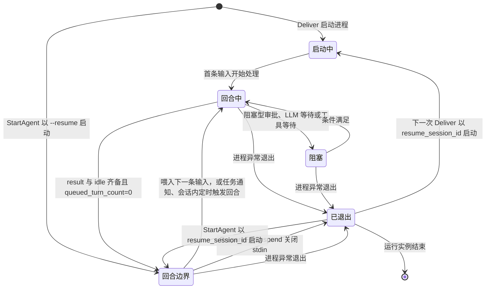
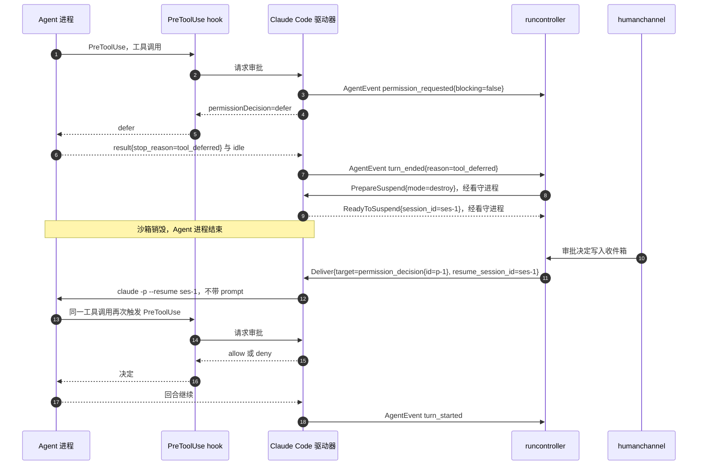
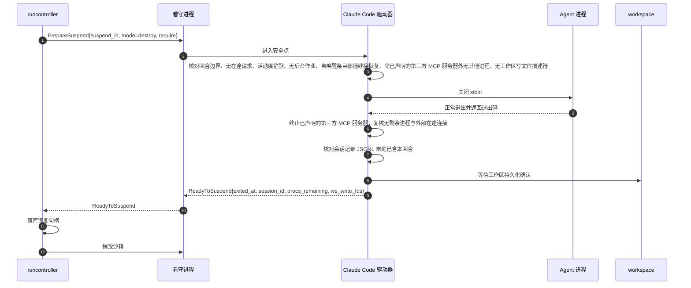
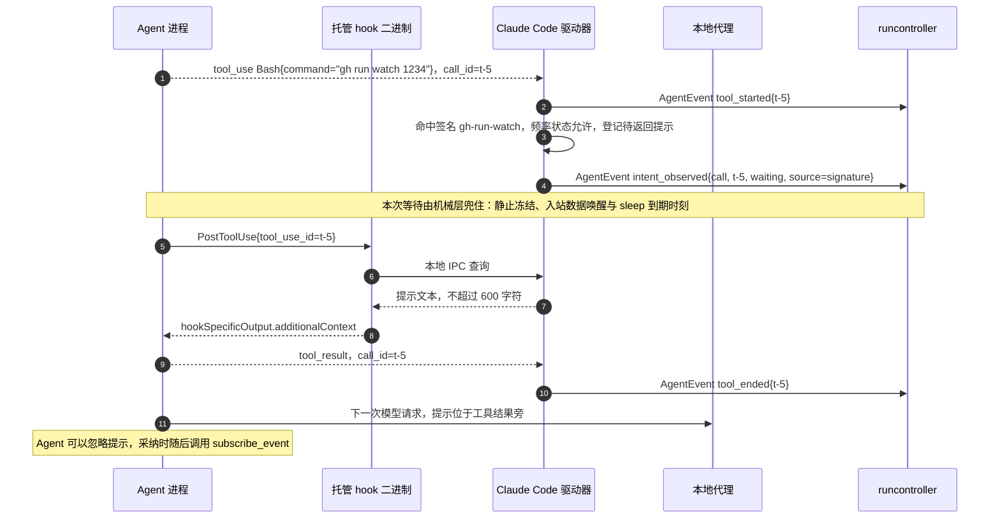

# Claude Code 驱动器

Claude Code 驱动器是[看守进程](../../../glossary.md)内的[进程驱动器](../../../glossary.md)，以无头 `stream-json` 协议驱动完整的 Claude Code 进程。它把 Claude Code 的[回合](../../../glossary.md)、工具、权限询问、等待、后台任务与[自唤醒源](../../../glossary.md)翻译为协议事件，从同一批原生信号解析[等待意图](../../../glossary.md)并在开启时附上可忽略的情境提示，把 `Deliver` 的 `target` 与 `StartAgent` 翻译为原生输入，管理流式输入会话的存活、会话续接与以挂起为目的的退出。它不拥有协议信封与重放、[运行实例](../../../glossary.md)状态机、挂起决策、[沙箱](../../../glossary.md)冻结、[本地代理](../../../glossary.md)与平台 MCP 服务器的工具实现、[等待签名](../../../glossary.md)的定义；这些分别归 `agentprotocol`、`runcontroller`、`suspendpolicy`、`sandboxprovider`、看守进程的其他子模块与 `connectorhub`。心智模型：驱动器是一台长期在线的翻译器，把 Agent 的原生信号翻译为控制面可判定的事件（[REF-claude-code-headless](../../../references.md)、[ADR-warden-is-pid1](../../../adr/adr-warden-is-pid1.md)）。

文档较长，第一次阅读按以下顺序：核心概念、职责、外部接口契约、走查、启动命令与环境变量、流式输入会话、回合边界判定、LLM 等待信号、审批路径、安全点；术语表、依赖、UML 图、核心数据结构、后台作业登记、自唤醒源镜像、等待意图解析与情境提示、终止路径、错误与失败语义与并发与事务边界作为参考，在核对字段、事件顺序或失败路径时查阅。

## 核心概念

本模块围绕流式输入会话组织。Claude Code 以 `--input-format stream-json` 启动后是一个长期存活的进程，而不是一回合一个进程：驱动器在 stdin 上逐行写入用户消息、工具结果与权限决定，从 stdout 读出回合、工具、会话状态与结果消息；回合结束后不关闭 stdin，下一条投递进入同一进程。托管环境据此把进程的生命周期切成回合：回合结束后进程仍在，这个位置是唯一允许以挂起为目的销毁的位置（[ADR-turn-boundary-destroy](../../../adr/adr-turn-boundary-destroy.md)）。沙箱销毁后进程随之消失，跨代延续由会话标识上的 `--resume` 承担，而不是由进程承担。回合边界上的进程未必静止：后台任务结束时 Claude Code 注入任务通知回合，会话内定时到点时 Claude Code 自行开始回合；驱动器因此同时上报后台任务集合与自唤醒条目，控制面据此判定一个回合边界能否销毁，或只能冻结。系统需要这个机制：托管环境只在回合边界释放沙箱，又要在重建后从上一回合继续；把 Agent 的原生协议翻译为闭集事件，`runcontroller` 才能判定回合位置并选择[安全点](../../../glossary.md)。

## 职责

Claude Code 驱动器的职责穷举如下，每条先写执行的动作，再写产生的结果或边界；具体字段、事件与算法见后续章节。

- **启动与保持进程**：以固定命令启动 Claude Code，在回合之间保持同一进程存活，只在 stdin 关闭或进程退出时结束；收到 `StartAgent{resume_session_id}` 时以 `--resume` 启动而不写入任何输入，进程已在运行时不做任何事。结果是同一代沙箱内的会话不需要每回合重建，恢复句柄只在跨代或进程退出后使用，没有投递时会话内定时也有进程承接。
- **流式输入输出**：以 `stream-json` 读写 stdin 与 stdout，把用户消息、工具结果与权限决定写入 stdin，把 Assistant、User、Result、Session State 与任务消息读出；结果是 Agent 的原生信号成为可解析的事件流。
- **环境变量注入**：为 Agent 进程设置 `ANTHROPIC_BASE_URL`、`CLAUDE_CONFIG_DIR`、会话状态与后台任务上报相关变量，并注入项目作用域工具接入声明中的凭据占位符环境变量与非秘密配置；结果是 LLM 流量只到达本地代理，会话状态落在[工作区](../../../glossary.md)，第三方工具经占位符使用出口凭据通道，`idle` 只表示主循环空闲。
- **托管策略设置注入**：以工作区之外的托管策略设置文件（Linux 为 `/etc/claude-code/managed-settings.json`，随镜像提供）注入 hooks 与权限设置，并以 `allowManagedHooksOnly` 屏蔽工作区内声明的 hooks；审批用的 `PreToolUse`，对账、旁证与意图解析用的 `Stop`、`SubagentStop` 与 `UserPromptSubmit`，提示用的 `PostToolUse`、`PostToolBatch`（兼作旁证）与 `SubagentStart` 都由看守进程提供的托管 hook 二进制实现，二进制随镜像放在工作区之外，经本地 IPC 向驱动器查询并同步返回。结果是审批、安全检查与提示不被 Agent 自身的写入改变。
- **回合边界判定**：等待 `session_state_changed: idle` 与 `result.queued_turn_count=0` 都到齐，结合 `result.origin` 区分人类回合与任务通知回合；结果是驱动器只在回合边界发出 `turn_ended`，并向控制面报告回合位置；`queued_turn_count` 不计任务通知，后台作业非空的回合边界不构成安全点。
- **事件翻译**：把工具开始与结束、权限询问、会话状态、订阅创建、定时请求、等待开始、后台任务集合与自唤醒条目的变化翻译为 `AgentEvent`；结果是 `runcontroller` 收到与控制面循环驱动器相同的闭集事件，另有只由本驱动器产生的 `self_wake_changed` 与 `intent_observed`（控制面循环驱动器的等待由 `WaitDeclared` 显式表达，不产生意图事件）。
- **LLM 等待旁证**：以本地代理的 `llm.request.started` 为主信号，以 `UserPromptSubmit`、`PostToolBatch`、`Stop` 等 hook 事件为旁证；结果是 LLM 等待的开始与结束有独立于 Agent 自述的证据。
- **审批路径**：实现 `PreToolUse` hook 的询问、`permissionDecision: "defer"` 的延迟、`stop_reason: tool_deferred` 的回合结束、以 `--resume` 不改写 prompt 的续接，以及实时接入中的阻塞等待；结果是回合中审批可以转为回合边界，或在不销毁沙箱时等待决定。
- **平台 MCP 服务器接入**：向 Agent 提供平台 MCP 服务器的工具，设置工具超时，把阻塞型工具调用翻译为 `wait_started` 与 `tool_ended`，把 Agent 经可选参数 `expected_wait` 自报的预计等待时长翻译为 `subscription_created` 与 `wait_started` 的 `agent_expected_ms`，并在阻塞型调用被 Claude Code 自动转后台时通知平台 MCP 服务器以转换结果结束该调用；结果是 Agent 每一次可能阻塞的对外交互对托管环境可见（I1）。
- **第三方 MCP 服务器接入**：合并项目作用域工具接入声明中已批准的第三方 MCP 服务器配置，只支持 stdio 本地子进程，注入其环境变量并管理生命周期，被自动转后台的第三方 MCP 调用计入后台作业；结果是第三方 MCP 工具经本地代理或[透明拦截器](../../../glossary.md)到出口代理执行，平台不为其增加平台工具。
- **安全点检查**：在回合边界执行 I9 检查，核对后台作业为空与自唤醒条目都随续接恢复，关闭 stdin、等待正常退出，在 Agent 正常退出之后终止已声明的第三方 MCP 服务器（挂起路径中唯一终止的进程），复核本地代理与透明拦截器无外部在途连接、核对会话记录 JSONL 末尾、工作区持久化、进程与工作区写文件描述符，并上报 `ReadyToSuspend`；任一检查不满足时回 `Busy`，不为满足检查而终止后台作业、残留进程或孤儿进程。结果是销毁前会话已落盘，`--resume` 不丢失最后一回合，也不丢失 Agent 的运行态。
- **快照恢复后的衔接**：在看守进程校时并清理旧 TCP 连接之后恢复事件处理，丢弃按旧时钟计算的 hook 截止时间，重新建立超时；结果是半死连接与时钟跳变不使驱动器误判回合状态。
- **后台作业登记**：以 Claude Code 的 `background_tasks_changed` 为准、以 `task_started`、`task_updated`、`task_notification` 补充维护后台作业集合，不计 `ambient=true` 的任务，以进程表把 `local_bash` 任务关联到 PID 并发现孤儿进程，在集合变化时发出 `bg_jobs_changed`；结果是后台作业存活的运行实例不以挂起为目的销毁，冻结只在静止证据成立时发生。
- **自唤醒源镜像**：从 `CronCreate`、`CronDelete`、`ScheduleWakeup`、Bash 工具的 `timeout` 与 `Monitor` 的 `timeout_ms` 维护自唤醒条目，在回合结束时以 `Stop` hook 输入的 `session_crons` 对账，在集合变化时发出带 `crons_synced` 的 `self_wake_changed`；结果是 Agent 自行触发的唤醒时刻进入唤醒集合，到点时进程可运行，托管侧不禁用、不拦截这些功能（[ADR-host-owns-external-wake-sources](../../../adr/adr-host-owns-external-wake-sources.md)）。
- **等待意图解析**：从 Agent 本来就产生的信号（Bash 的 `command`、`description`、`timeout` 与 `run_in_background`，Agent 工具的 `description` 与 `subagent_type`，workflow 的描述，`Monitor` 的命令或 URL，`Stop` hook 输入的 `last_assistant_message`，本地代理观察到的周期性连接）解析前台工具调用、后台作业与回合的等待意图，按规则分类并匹配沙箱侧配置下发的等待签名，在 `intent.classifier` 开启时把规则判不了的文本交给宿主侧分类模型，以 `intent_observed` 上报。结果是控制面在机械层判不清的地方得到在等什么、预计多久、进程在工作、等待还是提供服务的软输入；意图只进入等待时长预测、宽限期选择、提示决策与指标，不进入单一条件门控、静止证据、I9 与唤醒集合（[ADR-wait-intent-as-soft-input](../../../adr/adr-wait-intent-as-soft-input.md)）。
- **情境提示**：在 `intent.hints` 开启时，对意图为 `waiting` 且命中等待签名的调用或作业建议改用 `subscribe_event`，对纯定时等待建议改用 `sleep_until`，提示经托管 hook 的 `PostToolUse` 与 `PostToolBatch` 输出的 `additionalContext` 搭载在 Agent 下一次本来就要发出的模型请求上，按签名控制频率并判定采纳；`SubagentStart` 常驻向子代理注入与平台 MCP 服务器 `instructions` 相同的等待方式契约。结果是同类等待的下一次可以改用订阅或定时，从只能冻结变为回合边界可销毁；提示可以被 Agent 忽略，驱动器不拒绝、不阻塞、不让对话继续、不强制转后台、不终止，也不为提示额外发出模型请求。
- **终止路径**：按优雅程度关闭 stdin 或发送 `SIGTERM`，杀死 Bash 进程树并执行 `SessionEnd` hook；结果是终止只用于失效判定与超时，以挂起为目的的销毁走正常退出路径；挂起路径中驱动器唯一终止的进程是 Agent 正常退出之后的已声明第三方 MCP 服务器（含其子进程），后台作业、残留进程与孤儿进程都不终止。
- **投递意图日志写入**：在喂入事件之前追加并同步写入 `accepted{seq}`，观察到 `turn_started` 后追加并同步写入 `consumed{seq, turn_id}`；结果是跨代重建后的事件去重有工作区内的持久依据（[ADR-delivery-intent-log](../../../adr/adr-delivery-intent-log.md)）。

### 非职责

非职责举例如下，判定标准为：职责清单之外、由主文档、同级子模块或其他模块拥有的事实与机制。

- 协议信封、消息序号、重放、按 `(generation, msg_seq)` 去重与协议版本归 `agentprotocol`；本模块只产生每条消息的沙箱侧内容。
- 运行实例状态机、收件箱、唤醒谓词与自唤醒到期、`StartAgent` 的发出时机、投递游标、代与失效判定归 `runcontroller`；本模块只报告回合、工具、等待、后台作业、自唤醒条目与退出信号，并执行 `StartAgent`。
- 挂起决策、静止证据与忙信号的解释、冻结上限取值、DRAIN 与冻结中复评归 `suspendpolicy`；本模块只执行 `PrepareSuspend` 的沙箱侧检查并报告结果。
- 冻结与解冻的执行归 `sandboxprovider` 与节点冻结代理；本模块不写 cgroup，也不向 Agent 发送 `SIGSTOP`。
- 活动度采集（含定时睡眠进程的识别）与入站数据唤醒（`conn.inbound`）归[看守进程](design-warden.md)；本模块不读取 PSI 与套接字接收队列。
- 限制 Agent 的功能不在本模块之内，托管侧也没有其他模块承担：驱动器不禁用、不拦截、不终止会话内定时、`Monitor`、后台 Bash、后台子代理、workflow 与长 MCP 调用的自动转后台，也不设置改变这些功能的环境变量；本模块只观测它们并翻译为事件（[ADR-host-owns-external-wake-sources](../../../adr/adr-host-owns-external-wake-sources.md)）。
- LLM 请求的代理、模式选择、缓冲与回放取回归本地代理；本模块只消费其请求事件。
- 平台 MCP 服务器的工具实现、令牌附加、订阅登记、`instructions` 文本与可选参数 `expected_wait`、`reason` 的定义与解析归看守进程的平台 MCP 服务器；本模块只接入工具、设置超时、翻译工具事件与 `agent_expected_ms`，并在 `SubagentStart` 注入同一份 `instructions` 文本。
- 等待意图的使用归 `suspendpolicy`（等待时长预测与宽限期选择）与 `runcontroller`（`run.intents` 的保存与删除、决策上下文与意图指标）；本模块只解析意图并发出 `intent_observed`。
- 等待签名的定义、装载校验与下发归 `connectorhub`；本模块只按沙箱侧配置中的 `wait_signatures` 匹配。
- 宿主侧分类请求的转发、令牌附加与按运行实例计费归本地代理与 `llmgateway`；本模块只构造分类请求并解析结果。
- 向 Agent 索取等待意图不在本模块之内，托管侧也没有其他模块承担：驱动器不定期向 Agent 提问，不以 `PreToolUse` 的 deny 或 ask、`Stop` 或 `SubagentStop` 的 `additionalContext`、`UserPromptSubmit` 介入 Agent 的回合，也不为获取意图额外发出 Agent 的模型请求；本模块只被动解析，并在事件触发点附上可以忽略的提示（[ADR-wait-intent-as-soft-input](../../../adr/adr-wait-intent-as-soft-input.md)）。
- 审批决定的内容、人类身份与实时接入状态归 `humanchannel`；本模块只把决定交给 hook，或在阻塞等待中返回给 Claude Code。
- Agent 会话记录的内容归 Agent 自身；本模块只保证状态目录位于工作区，并在安全点核对末尾与持久化。
- 控制面循环驱动器、`ToolExec` 的使用与控制面原生循环归 [控制面循环驱动器](design-warden-driver-native.md)；本模块只实现进程驱动器一侧。

## 术语表

| 术语 | 英文对照 | 适用范围 | 定义 |
| --- | --- | --- | --- |
| 流式输入会话 | streaming input session | warden Claude Code 驱动器 | 以 `--input-format stream-json` 启动的 Claude Code 会话；回合之间保持存活，stdin 关闭时退出。 |
| 回合边界信号 | turn boundary signal | warden Claude Code 驱动器 | `session_state_changed: idle` 与 `result.queued_turn_count=0` 都到齐；`result` 与 `idle` 的先后不固定，缺一不判定边界。 |
| 延迟审批 | deferred permission | warden Claude Code 驱动器 | `PreToolUse` hook 返回 `permissionDecision: "defer"`，回合以 `stop_reason: tool_deferred` 结束，决定到达后以 `--resume` 续接同一工具调用。 |
| 托管策略设置 | managed policy settings | warden Claude Code 驱动器 | 位于工作区之外、Agent 只读的 Claude Code 设置文件（Linux 为 `/etc/claude-code/managed-settings.json`）；hooks 与权限设置经它注入，`allowManagedHooksOnly` 使工作区内声明的 hooks 不生效，hook 二进制随镜像放在工作区之外（[REF-claude-code-settings](../../../references.md)）。 |
| 旁证信号 | corroborating hook signal | warden Claude Code 驱动器 | `UserPromptSubmit`、`PostToolBatch`、`Stop` 等 hook 事件；用于确认 LLM 等待的开始与结束，不单独触发阻塞。 |
| 任务通知回合 | task-notification turn | warden Claude Code 驱动器 | `result.origin = task-notification` 的回合；后台任务结束（含被自动转后台的工具调用完成）时由 Claude Code 注入，不是人类输入触发的回合，不计入 `result.queued_turn_count`。 |

## 外部接口契约

本模块实现 [控制面循环驱动器](design-warden-driver-native.md) 定义的 Agent 驱动器接口，并对 `runcontroller` 输出同一套 `AgentEvent`。接口操作面、`Deliver` 的翻译种类与挂起语义对两种驱动器稳定；事件字段受 `agentprotocol` 的协议版本约束；Claude Code 的启动命令、环境变量、stream-json 消息、hook 输入与输出（`additionalContext`）与定时类工具的输入受 `REF-claude-code-headless`、`REF-claude-code-hooks` 与 `REF-claude-agent-sdk-typescript` 的版本约束；后台作业登记、自唤醒源镜像与等待意图解析依赖其中的工具、消息与 hook 契约，Claude Code 版本变化时随之核对。情境提示的文本面向 Agent 而不是面向其他模块，措辞不属于稳定承诺，约束只有[提示内容](#等待意图解析与情境提示)一段所列各项。

### 驱动器接口的实现面

| 操作 | Claude Code 实现 |
| --- | --- |
| `Start` | 以固定命令启动进程，设置环境变量与托管策略设置，必要时带 `--resume <session_id>`；进程的 cgroup 迁移由看守进程的进程监督完成。`StartAgent{resume_session_id}` 经 `Start` 以 `--resume <session_id>` 启动，不写入 stdin，启动后阶段为 `boundary`；进程已在运行时为空操作 |
| `Feed` | 把 `Deliver` 的 `target` 翻译为 stdin 上的 `stream-json` 用户消息；返回是否喂入、回合标识与 Agent 是否已退出 |
| `PrepareForSuspend` | 只在回合边界执行 I9 检查；核对后台作业为空、自唤醒条目都随续接恢复，关闭 stdin、等待退出码，之后终止已声明的第三方 MCP 服务器（挂起路径中唯一终止的进程），核对 JSONL 末尾与工作区持久化；返回 `ReadyToSuspend` 字段 |
| `Resume` | 同一代解冻时继续原进程；新代或进程已退出时以 `--resume <session_id>` 启动，必要时不带 prompt |
| `Terminate` | 优雅终止关闭 stdin；强制终止发送 `SIGTERM`、杀死 Bash 进程树并执行 `SessionEnd` hook |
| `SnapshotRestored` | 校时完成后重新建立超时，丢弃按旧时钟计算的 hook 截止时间；进程保留时继续驱动 |
| `Events` | 输出 `AgentEvent` 流；回合内事件按 `event_seq` 在同一回合内单调，没有进行中回合时发出的事件 `turn_id` 与 `event_seq` 为空，顺序由出站流的 `msg_seq` 保证 |
| `State` | 返回 `agent_state` 所需的阶段、回合标识、阻塞条件、会话标识、后台作业集合、自唤醒条目与 `crons_synced` |

实现面的变更须同时覆盖进程驱动器与控制面循环驱动器，并以同一套契约测试约束（[ADR-dual-agent-loop-location](../../../adr/adr-dual-agent-loop-location.md)）。

### Agent 原生输入的翻译规则

`Deliver` 的 `target` 是闭集，翻译规则按目标给出；`redelivery=true` 不改变翻译形态，只表示该输入可能已被处理。`StartAgent` 不经 `Deliver`、不携带输入，在表末单列一行。

| `target` | Claude Code 输入 | 约束 |
| --- | --- | --- |
| `next_user_message` | stdin 上的 `stream-json` 用户消息 | 回合边界上直接写入；进程已退出或本代尚未启动时先以 `resume_session_id` 启动再写入；回合进行中到达的投递由驱动器暂存，`turn_ended` 之后按到达顺序喂入 |
| `tool_result{call_id}` | 含 `tool_result` 块的用户消息，`tool_use_id` 取 `call_id` | 只在对应工具调用未结束时送达；目标已失效时回 `DeliveryFailed{reason=target_gone}` |
| `permission_decision{id}` | `PreToolUse` hook 的决定 | 进程存在时交给挂起的 hook；进程已销毁时以 `--resume` 不带 prompt 启动，同一工具调用再次触发 hook 后交给它 |
| 回合边界续接 | `--resume <session_id>` 不带 prompt | 用于 `defer` 的审批决定与回合边界续接；不写入新的用户消息 |
| `StartAgent{resume_session_id}` | `--resume <session_id>` 启动，stdin 保持打开、不写入任何消息 | 进程已在运行时为空操作；启动后阶段为 `boundary`（进程存活、无回合）；会话内定时由 Claude Code 自行恢复并触发，触发产生的回合是 Agent 自行开始的回合，`turn_started.delivery_id` 为空；之后到达的 `Deliver` 按回合边界上的规则直接写入 |

`resume_session_id` 非空时，驱动器以 `--resume <session_id>` 启动；`-p` 创建的会话只能按 `session_id` 续接。`redelivery=true` 的输入照常翻译，驱动器在投递记录与本地状态中保留该标记，不自行去重；重复识别由 Agent 侧按输入内容承担。

### 事件输出

驱动器把 Claude Code 的原生消息翻译为 `AgentEvent`，事件种类、字段与顺序由 `agentprotocol` 定义。下表按原生信号列出翻译结果。

| Claude Code 原生信号 | `AgentEvent` | 说明 |
| --- | --- | --- |
| 开始处理一条输入 | `turn_started{session_id, delivery_id}` | `delivery_id` 为本回合消费的投递；Agent 自行开始的回合（任务通知回合、会话内定时触发的回合）为空 |
| `session_state_changed: idle` | `state_changed{idle}` | 与 `result` 共同构成回合边界；单独到达不结束回合 |
| `session_state_changed: requires_action` | `state_changed{requires_action}` | 表示会话停在权限询问等请求上，不构成回合边界 |
| `result` | 回合结果摘要 | 提供 `queued_turn_count`、`origin` 与 `stop_reason`；与 `idle` 齐备后发出 `turn_ended` |
| Assistant 消息中的 `tool_use` | `tool_started{call_id}` | 每个 `call_id` 一次 |
| User 消息中的 `tool_result` | `tool_ended{call_id}` | 与 `tool_started` 配对；未配对的调用在进程退出时清理 |
| 被自动转后台的工具调用的占位 `tool_result` | `tool_ended{call_id}` | 照常配对；真实结果随带 `tool_use_id` 的 `task_notification` 到达；平台 MCP 阻塞型调用另按自动转后台规则转换，其余调用作为后台任务计入 `bg_jobs` |
| 权限询问 | `permission_requested{id, call_id, blocking}` | `blocking=true` 用于实时接入与并行工具调用退回的阻塞等待，`false` 用于延迟审批 |
| 平台 MCP 工具 `list_events` | 无额外事件 | 只产生 `tool_started` 与 `tool_ended`，不产生阻塞等待 |
| 平台 MCP 工具 `subscribe_event` 完成 | `subscription_created{sub_id, since_cursor, agent_expected_ms}` | 订阅登记由平台 MCP 服务器完成；`agent_expected_ms` 取 Agent 在该调用中自报的 `expected_wait`，未填时为空 |
| 平台 MCP 工具 `sleep_until` | `timer_requested{timer_id, fire_at, scope}`；阻塞型另发 `wait_started{call_id, kind=timer, ref, fire_at, predicted_ms, agent_expected_ms}` | `scope` 只取 `run`；`agent_expected_ms` 只随阻塞型的 `wait_started` 上报，规则同上 |
| 平台 MCP 工具 `wait_for` | `wait_started{call_id, kind=wait_for, ref, fire_at, predicted_ms, agent_expected_ms}` | 阻塞等待开始时发出；`agent_expected_ms` 与平台给出的 `predicted_ms` 分开上报，来源不混 |
| system 消息 `background_tasks_changed` | `bg_jobs_changed{job_ids}` | 以推送的完整集合替换驱动器的后台任务集合，`ambient=true` 的任务不计入；后台作业集合变化时发出 |
| `task_started{is_backgrounded}`、`task_updated`、`task_notification{status, tool_use_id}` | `bg_jobs_changed{job_ids}` | 逐任务补充两次集合推送之间的变化；后台作业集合变化时发出 |
| 进程表中不属于任何任务的进程 | `bg_jobs_changed{job_ids}` | 孤儿进程以 `proc:<pid>` 计入；已声明的第三方 MCP 服务器进程与托管 hook 二进制进程不计入 |
| `CronCreate`、`CronDelete`、`ScheduleWakeup` 的 `tool_use` 与 `tool_result` | `self_wake_changed{entries, crons_synced}` | `CronCreate` 产生 `kind=cron` 条目，`ScheduleWakeup` 产生 `kind=wakeup` 条目，`CronDelete` 移除对应条目；cron 表达式无法解析时 `fire_at` 为空 |
| Bash 工具调用的 `timeout`、`Monitor` 的 `timeout_ms` | `self_wake_changed{entries, crons_synced}` | 分别产生 `kind=tool_timeout` 与 `kind=monitor_deadline` 条目 |
| `Stop` 与 `SubagentStop` hook 输入的 `session_crons` | `self_wake_changed{entries, crons_synced}` | 回合结束（`Stop`）或子代理结束（`SubagentStop`）时以它为准增删 `kind=cron` 条目；本进程首次取得时 `crons_synced` 置真；集合与 `crons_synced` 都不变时不发 |
| 前台工具调用的 `tool_use` 输入（Bash、Agent 工具、workflow、`Monitor`），以及归属于该调用的周期性连接 | `intent_observed{ref_kind=call, ref=call_id, class, target, expected_ms, source, confidence}` | 在该调用的 `tool_started` 之后、`tool_ended` 之前发出；`run_in_background=true` 的调用不发 `call` 意图 |
| 后台作业进入 `bg_jobs`，作业发起调用的输入，以及归属于该作业的周期性连接 | `intent_observed{ref_kind=job, ref=job_id, class, target, expected_ms, source, confidence}` | 作业进入 `bg_jobs` 之后发出，离开之后不发；被自动转后台的调用产生的作业继承该调用的意图 |
| `Stop` hook 输入的 `last_assistant_message` | `intent_observed{ref_kind=turn, ref=turn_id, class, target, expected_ms, source, confidence}` | 处理该回合的 `Stop` 输入时发出；下一回合已开始时丢弃 |
| 宿主侧分类模型的结果 | `intent_observed{..., source=classifier, confidence=0.6}` | 覆盖同一对象的规则结果；对象已结束（调用已 `tool_ended`、作业已离开 `bg_jobs`、下一回合已开始）时丢弃 |
| 进程退出 | `turn_ended{reason, agent_exited=true, bg_procs}`；自唤醒条目变化时另发 `self_wake_changed{entries, crons_synced}` | 不就地重启；下一次投递或 `StartAgent` 以 `resume_session_id` 启动；后台作业集合清空，`survives_resume=false` 的自唤醒条目移除，意图表清空，不为清空发出 `intent_observed` |

`turn_ended` 只在回合边界或进程退出时发出。回合边界的条件是 `result` 与 `idle` 齐备且 `result.queued_turn_count=0`；`queued_turn_count` 不计任务通知，`result.origin=task-notification` 的回合照常发出 `turn_ended`，但不视为人类回合。`bg_jobs_changed` 与 `self_wake_changed` 都携带完整集合：`bg_jobs_changed` 按替换语义处理，`self_wake_changed` 按 `crons_synced` 整体替换，或替换非 `cron` 条目并按 `entry_id` 合并 `cron` 条目（见[自唤醒源镜像](#自唤醒源镜像)）。这两种事件、`state_changed` 与 `intent_observed` 不受回合位置限制，没有进行中回合时同样发出。`intent_observed` 以 `(ref_kind, ref)` 标识对象，同一对象后到的覆盖先到的；`ref_kind=turn` 时 `ref` 为该回合的 `turn_id`，与回合外事件为空的信封字段 `turn_id` 无关。`class` 为 `unknown` 且 `target` 与 `expected_ms` 都为空的意图不发出，除非它覆盖同一对象已发出的意图；接收方没有某个对象的意图即按 `unknown` 处理。回合内事件的 `event_seq` 在同一回合内单调，接收方按它丢弃重复或乱序的回合内事件；没有进行中回合时发出的事件（下称回合外事件）`turn_id` 与 `event_seq` 为空，不按 `event_seq` 丢弃，顺序由出站流的 `msg_seq` 保证，集合类事件的重复与乱序不改变结果。

## 依赖

代码依赖只有 `agentprotocol`，与[模块依赖图](../../architecture.md#模块依赖图)一致；对本地代理、平台 MCP 服务器与工作区的调用是同一进程内的组件协作或运行时调用，不是代码依赖。

- `agentprotocol`：`AgentEvent` 的种类、字段、`event_seq` 与出站流发送；驱动器只负责事件内容。
- Claude Code 无头模式：`-p`、`--output-format stream-json`、`--input-format stream-json`、`--verbose` 与 `--resume`（[REF-claude-code-headless](../../../references.md)）。
- Claude Code hooks：`PreToolUse` 的 `defer`、`timeout` 与 `onFailure`，`Stop` 与 `SubagentStop` 输入中的 `background_tasks` 与 `session_crons{id, schedule, recurring, prompt}`，`Stop` 输入中的 `last_assistant_message`，`PostToolUse` 输入中的 `tool_name`、`tool_input` 与 `tool_use_id`，`PostToolUse`、`PostToolBatch` 与 `SubagentStart` 输出的 `hookSpecificOutput.additionalContext`（上限 10000 字符；前两者出现在工具结果旁，模型在下一次模型请求时读到，`SubagentStart` 的出现在子代理开始时；`Stop` 与 `SubagentStop` 的 `additionalContext` 会让对话继续，本模块不使用），以及 `UserPromptSubmit`、`StopFailure`、`SessionEnd`（[REF-claude-code-hooks](../../../references.md)、[REF-claude-agent-sdk-typescript](../../../references.md)）。
- Claude Code 设置：托管策略设置文件的作用域、优先级与 `allowManagedHooksOnly`（[REF-claude-code-settings](../../../references.md)）。
- Claude Code 环境变量：`ANTHROPIC_BASE_URL`、`HTTP_PROXY`、`HTTPS_PROXY`、`NO_PROXY`、`CLAUDE_CONFIG_DIR`、`CLAUDE_CODE_*` 与 `API_TIMEOUT_MS`，以及 `CLAUDE_CODE_BG_TASKS_REPORT_RUNNING=0` 下每个回合结束都报 `idle` 的行为（[REF-claude-code-env-vars](../../../references.md)）。
- Claude Code 网络行为：流式空闲看门狗与停滞处理（[REF-claude-code-network-config](../../../references.md)）。
- Agent SDK 的 stream-json 消息类型：`session_state_changed`、`result.queued_turn_count` 与 `result.origin`、`tool_use` 与 `tool_result`、system 消息 `background_tasks_changed{task_id, task_type, ambient, parent_task_id}`、`task_started{is_backgrounded}`、`task_updated` 与 `task_notification{status, tool_use_id}`；定时类工具的输入：`CronCreate` 的 5 字段 cron 表达式（本地时区）与 `recurring`、`CronDelete`、`ScheduleWakeup` 的 `delaySeconds`、`Monitor` 的 `timeout_ms` 与 Bash 的 `timeout`（[REF-claude-agent-sdk-typescript](../../../references.md)）。
- MCP：平台 MCP 服务器的工具与传输，以及服务器在初始化时提供的 `instructions`（[REF-mcp](../../../references.md)）。
- `connectorhub`：沙箱侧配置中的 `wait_signatures` 与 `intent{hints, classifier}`，由 `connectorhub` 生成、看守进程按 `revision` 应用，是运行时数据而不是代码依赖。
- 本地代理：`llm.request.started` 等事件与回环地址、按主机与归属对象记录的连接建立时刻（周期性连接判定使用），以及宿主侧分类请求到 `llmgateway` 的转发；平台 MCP 服务器：工具调用、超时、阻塞型调用被自动转后台时的转换、`expected_wait` 换算后的毫秒值与 `instructions` 文本；看守进程的进程监督：进程表与 Agent 进程树；`workspace`：`CLAUDE_CONFIG_DIR` 与工作区[持久化确认](../../../glossary.md)。

方向约束：驱动器只依赖 `agentprotocol`，因此不修改 `runcontroller` 与 `suspendpolicy`；新增一个原生信号只扩展翻译表，不改变协议消息集合。

## UML 图

下列图分别固定回合的生命周期、延迟审批的续接顺序、安全点的检查顺序与情境提示的搭载顺序；图中不表达的约束由每张图后的正文给出。

### 回合生命周期状态图



阶段闭集为 `starting`、`in_turn`、`blocked`、`boundary` 与 `exited`，与 `agent_state.phase` 一致。`blocked` 的子状态包括 LLM 等待、工具等待、阻塞型审批与阻塞型 MCP 等待；`requires_action` 是权限询问的会话状态，不单独成为阶段。`boundary` 表示进程存活而没有进行中的回合，是唯一允许以挂起为目的销毁的位置；以 `StartAgent` 启动的进程不写入输入，启动后直接处于 `boundary`。回合边界上 Claude Code 可能自行开始回合：后台任务结束时注入任务通知回合，会话内定时到点时开始定时触发的回合，两者的 `turn_started.delivery_id` 都为空。后台作业非空或存在 `survives_resume=false` 的自唤醒条目时，`boundary` 不构成安全点。`exited` 保留恢复句柄与退出码，下一次投递或 `StartAgent` 以它启动新进程，不就地重启。

### 审批 defer 与续接时序图



图固定延迟审批的关键点：回合以 `stop_reason: tool_deferred` 结束，而不是以阻塞等待结束；决定到达后的续接以 `--resume` 不带 prompt 启动，同一工具调用再次触发 `PreToolUse`，hook 才从驱动器取回决定。并行工具调用使 `defer` 被忽略时，退回阻塞等待，各调用的决定以定向投递分别送达；只剩一个阻塞调用时才允许冻结。

### 安全点时序图



图固定检查与销毁的先后：任一检查不满足时回 `Busy`，不进入销毁；恢复句柄在销毁之前落库；`ReadyToSuspend.session_id` 取本代 Agent 进程使用的会话标识，本代未启动进程时取最近一次收到的 `resume_session_id`。以挂起为目的的销毁不以 `SIGTERM` 终止 Agent 主进程；已声明的第三方 MCP 服务器在 Agent 正常退出之后终止，这是挂起路径中唯一的进程终止动作；存在后台作业或其他进程时回 `Busy`，驱动器不终止它们。

### 情境提示时序图



图固定情境提示的时机：提示在工具结束之后经 `PostToolUse` 交给 Claude Code，模型在下一次本来就要发出的模型请求中读到，因此只改善同类等待的下一次，当前这一次由机械层兜住。驱动器在 `tool_started` 时完成签名匹配与频率判定，hook 查询只读取内存中的待返回提示，不执行网络调用、不等待分类请求，耗时目标 10 ms 以内；驱动器不依赖 `PostToolUse` 与 stream-json 中 `tool_result` 的先后。查询失败或超时时 hook 不输出 `additionalContext`，工具结果与回合照常继续。

## 核心数据结构

### 驱动器状态

| 字段 | 含义 |
| --- | --- |
| `phase` | `starting`、`in_turn`、`blocked`、`boundary` 或 `exited`；`agent_state.phase` 的来源 |
| `pid`、`pgid` | Agent 主进程及其进程组；用于终止 Bash 进程树 |
| `stdin`、`stdout` | `stream-json` 管道；stdin 关闭使进程在回合之间退出 |
| `session_id` | 最近一次观察到的会话标识；`turn_started` 与 `ReadyToSuspend` 携带 |
| `turn` | 当前或最近一个回合的记录 |
| `pending_delivery` | 已写入 stdin 但尚未观察到 `turn_started` 的投递 |
| `pending_permissions` | 按 `permission_id` 索引的待决审批记录 |
| `running_tools` | 未配对的 `tool_started` 调用集合 |
| `bg_tasks` | 最近一次 `background_tasks_changed` 推送并经 `task_*` 补充的存活后台任务集合，含 `ambient=true` 的任务；进程启动或重启时置空 |
| `bg_jobs` | 按 `job_id` 索引的后台作业记录：`bg_tasks` 中 `ambient=false` 的任务与孤儿进程；`bg_jobs_changed` 的来源 |
| `self_wake` | 按 `entry_id` 索引的自唤醒条目；`self_wake_changed.entries` 的来源 |
| `crons_synced` | 当前 Agent 进程启动后是否已取得 `session_crons` 并据此对账；每次 Agent 进程启动时置假（同代进程重启同样从假起算），首次取得 `Stop` 或 `SubagentStop` 输入的 `session_crons` 后置真；`self_wake_changed.crons_synced` 的来源 |
| `intents` | 意图表：按 `(ref_kind, ref)` 索引的意图记录；`intent_observed` 的来源；调用结束、作业离开 `bg_jobs`、下一回合开始与进程退出时移除对应项 |
| `pending_hints` | 已判定应提示、尚未经 hook 返回的提示；每项记录频率键、触发对象与所在上下文 |
| `hint_state` | 提示频率状态：运行实例回合序号与按频率键索引的条目；持久化在工作区 `.platform/hint-state.json`，跨进程与跨代保留 |
| `wait_signatures`、`intent_config` | 最近一次应用的沙箱侧配置中的等待签名与 `intent{hints, classifier}` 开关；缺失或无法解析时签名为空、两个开关都关闭 |
| `last_result`、`last_idle` | 最近一次 `result` 与 `idle` 信号；回合边界判定使用 |
| `event_seq` | 当前回合的事件序号；回合外事件不取序号，`turn_id` 与 `event_seq` 为空 |
| `config_dir`、`cwd` | 工作区内的 `CLAUDE_CONFIG_DIR` 与逐字一致的启动目录 |
| `resume_handle` | 最近一次可用的 `session_id`；跨代恢复使用 |

### 状态一览

| 状态 | 一句话含义 | 当前动作（Claude Code 驱动器） | 直觉画面 |
| --- | --- | --- | --- |
| `starting` | 进程已启动但尚未开始处理输入 | 写入首条输入并等待属于它的首个回合事件 | 刚点火，尚未挂挡 |
| `in_turn` | 正在处理一条输入 | 翻译工具、权限与会话状态事件 | 引擎运转，仪表在跳 |
| `blocked` | 回合停在需要外部条件的等待点 | 上报阻塞条件，保持进程与 stdin 存活 | 车停在红灯前 |
| `boundary` | 进程存活，没有进行中的回合 | 保持 stdin 打开，等待下一条投递、Agent 自行开始的回合或 `PrepareSuspend`；继续维护后台作业与自唤醒条目 | 到站开门，不上客 |
| `exited` | 进程已退出 | 清理未配对工具与后台作业，移除不随续接恢复的自唤醒条目，保留退出码与恢复句柄 | 熄火，钥匙留在车上 |

### 回合记录

| 字段 | 含义 |
| --- | --- |
| `turn_id` | 驱动器分配的回合标识，同一代内唯一 |
| `delivery_id` | 本回合消费的投递；Agent 自行开始的回合为空 |
| `started_at`、`ended_at` | 回合开始与边界时刻 |
| `origin` | `result.origin`；`task-notification` 表示任务通知回合 |
| `queued_turn_count` | `result.queued_turn_count`；为 0 才可能构成边界 |
| `stop_reason` | `result.stop_reason`；`tool_deferred` 表示延迟审批 |
| `agent_exited` | 回合是否因进程退出而结束 |
| `bg_procs` | 回合结束时仍未结束的后台作业标识集合（含后台子代理与孤儿进程），取值与同一时刻的 `bg_jobs` 相同；控制面以它写 `run.bg_jobs` |

### 待决审批记录

| 字段 | 含义 |
| --- | --- |
| `permission_id` | 权限询问标识；与 `Deliver.target=permission_decision{id}` 匹配 |
| `call_id` | 触发询问的工具调用 |
| `blocking` | 是否以阻塞等待处理；实时接入与并行工具调用退回时为真 |
| `deferred` | 是否已返回 `defer` 并以回合边界结束 |
| `decision` | 允许或拒绝；允许可携带 `updatedInput`，拒绝携带消息 |
| `deadline` | 阻塞等待的截止时间；取 hook 超时、per-server timeout 与 MCP 传输上限的较小值 |

### 后台作业记录

| 字段 | 含义 |
| --- | --- |
| `job_id` | 后台任务的 `task_id`；孤儿进程为 `proc:<pid>` |
| `task_type` | Claude Code 的 `task_type`：`local_bash`（含 `Monitor`）、`local_agent` 或 `remote_agent`；孤儿进程为空 |
| `kind` | 按 `task_type` 映射的闭集：`local_bash` 为 `bash`，`local_agent` 为 `subagent`，`remote_agent` 为 `remote_agent`；孤儿进程为 `orphan_proc` |
| `parent_task_id` | 发起该任务的父任务；顶层任务为空 |
| `tool_use_id` | 被自动转后台的工具调用的 `call_id`，由 `task_notification.tool_use_id` 关联；其余为空 |
| `pids` | 经进程表关联到该任务的 PID；`local_agent` 在 Claude Code 主进程内运行，为空 |
| `started_at`、`last_seen` | 开始与最近一次观察到的时间 |
| `status` | 运行中或已结束；离开 `background_tasks_changed` 集合或收到终态 `task_notification` 时为已结束，孤儿进程退出时为已结束；未结束的作业使回合边界不构成安全点 |

### 自唤醒条目

| 字段 | 含义 |
| --- | --- |
| `entry_id` | `kind=cron` 取 `CronCreate` 的 `tool_result` 中的作业标识（与 `session_crons[].id` 相同）；其余种类取产生该条目的工具调用的 `call_id` |
| `kind` | 闭集 `cron`、`wakeup`、`tool_timeout`、`monitor_deadline` |
| `fire_at` | 下一次触发的绝对时刻；为空表示触发时刻未知，只出现在 cron 表达式无法解析的 `kind=cron` 条目上 |
| `survives_resume` | 销毁重建后该项是否经 `--resume` 由 Agent 自行恢复：`cron` 为真，其余为假 |
| `schedule`、`recurring` | 只用于 `kind=cron`：5 字段 cron 表达式与是否周期触发；`recurring` 为真时触发后重算 `fire_at` |

`self_wake_changed{entries, crons_synced}` 的 `entries` 每项取 `{entry_id, kind, fire_at, survives_resume}`，`crons_synced` 取驱动器状态中的同名字段；`schedule` 与 `recurring` 只在驱动器内使用。

### 意图记录

| 字段 | 含义 |
| --- | --- |
| `ref_kind` | 闭集 `call`（前台工具调用）、`job`（后台作业）、`turn`（回合） |
| `ref` | `call` 为 `call_id`，`job` 为 `job_id`，`turn` 为 `turn_id` |
| `class` | `call` 与 `job` 取闭集 `waiting`、`working`、`serving`、`unknown`；`turn` 取闭集 `question`、`completed`、`unknown` |
| `target` | 等待对象的描述性标识，例如 `github:workflow_run:1234`；可空 |
| `expected_ms` | 预计等待时长；可空 |
| `source` | 闭集 `signature`、`self_report`、`keyword`、`classifier`；本驱动器发出的意图只取 `signature`、`keyword` 或 `classifier` |
| `confidence` | 0～1；`signature` 为 0.9，`keyword` 为 0.3，`classifier` 为 0.6 |
| `signature_id` | 命中的等待签名的 `id`；未命中为空 |
| `correlation` | 按签名的 `correlation` 规则从匹配结果提取的[关联键身份键](../../../glossary.md)取值；未命中为空 |
| `context` | 对象所在的上下文：主会话或某个子代理，按 stream-json 消息的 `parent_tool_use_id` 判定；只用于选择返回提示的 hook |
| `classifier_pending` | 是否有进行中的宿主侧分类请求；每个对象至多一个 |

`intent_observed` 携带 `{ref_kind, ref, class, target, expected_ms, source, confidence}`；`signature_id`、`correlation`、`context` 与 `classifier_pending` 只在驱动器内使用。

### 提示频率状态

提示频率状态由运行实例回合序号 `turn_ordinal` 与按频率键索引的条目组成。`turn_ordinal` 在每个 `turn_started` 加一，随频率状态持久化，跨进程与跨代连续；频率键为等待签名的 `(system, id)`，纯定时等待取固定键 `timer`。

| 字段 | 含义 |
| --- | --- |
| `key` | 频率键 |
| `k` | 连续未采纳次数；采纳时归零，达到 2 时该键在本运行实例中此后不提示 |
| `last_hint_turn` | 最近一次返回提示时的 `turn_ordinal`；从未提示为空 |
| `window` | 待判定的提示：`{correlation, until_turn}`，`until_turn` 为 `last_hint_turn + N_adopt`；判定之后为空 |
| `hinted`、`adopted`、`unadopted` | 已返回的提示、判为采纳与判为未采纳的计数；进入指标 |

频率状态文件位于工作区，Agent 可以写入；其内容只影响提示的频率，不影响意图、事件与挂起。

## 核心算法与流程

### 走查

**延迟审批、回合边界销毁与续接。** 初始条件：运行实例 `run-7` 处于第 6 代，工作区投递意图日志已记 `consumed{10, turn-8}`，控制面 `cursor_accepted=10`、`cursor_consumed=10`，`run.session_id=ses-1`；收到 `Deliver{delivery_id=d-4, batch=[11], through_seq=11, target=next_user_message, resume_session_id=ses-1}`。

| 步骤 | 事件或调用 | 驱动器状态 | 持久写入 |
| --- | --- | --- | --- |
| 1 | 收到 `Deliver`，按日志去重后 `11` 未消费；追加 `accepted{11}` 并同步写入后回 `Accepted{fed=true}` | 启动前 | 追加 `accepted{11}` 并同步写入工作区 |
| 2 | 以 `--resume ses-1` 启动 Claude Code，PID 4101 | `starting` | 无 |
| 3 | 把事件作为下一条用户消息写入 stdin | `starting` | 无 |
| 4 | Agent 开始处理，驱动器观察到属于该输入的首个 Assistant 事件 | `in_turn`；`turn_id=turn-9` | 追加 `consumed{11, turn-9}` 并同步写入；随后发 `Consumed{11, turn-9}` |
| 5 | 工具调用触发 `PreToolUse`，异步渠道返回 `defer` | `in_turn`；`pending_permissions` 新增 `permission_id=p-1`，`blocking=false` | 无；返回 `defer` 之前发出 `permission_requested{id=p-1, blocking=false}` |
| 6 | Agent 返回 `result{stop_reason=tool_deferred}` 与 `idle`，`queued_turn_count=0` | `boundary` | 无；发出 `turn_ended{reason=tool_deferred}` |
| 7 | 收到 `PrepareSuspend{mode=destroy}`，关闭 stdin 之前的检查通过；关闭 stdin，等待退出码 0 | `exited` | 无 |
| 8 | 终止已声明的第三方 MCP 服务器，复核进程树无剩余进程、外部在途连接计数为 0；核对 JSONL 末尾含 `turn-9` | `exited` | 等待工作区持久化确认；上报 `ReadyToSuspend{session_id=ses-1}`；控制面落库后销毁沙箱 |
| 9 | 审批决定到达，`Deliver{target=permission_decision{id=p-1}, resume_session_id=ses-1}` | 启动前 | 追加接受记录；定向投递的消费只记日志 |
| 10 | 以 `claude -p --resume ses-1` 不带 prompt 启动；同一工具调用再次触发 `PreToolUse` | `starting` | 无 |
| 11 | hook 取回决定并返回 allow；Agent 继续本回合 | `in_turn`；`turn_id=turn-10` | 追加该定向投递的消费记录；不发 `Consumed` |

走查确认投递日志、延迟审批与续接的结论。`accepted` 在喂入之前写入，`consumed` 在观察到 `turn_started` 之后写入，两者都先于对应的出站确认。延迟审批使回合以 `tool_deferred` 结束，销毁发生在回合边界，安全点检查通过后才上报 `ReadyToSuspend`。续接使用上一代落库的 `ses-1`，不带 prompt；同一工具调用再次触发 hook 是决定交付的观察点。

**会话内定时、销毁与 `StartAgent` 续接。** 初始条件：运行实例 `run-7` 处于第 6 代，回合 `turn-12` 进行中，`run.session_id=ses-1`；驱动器的 `self_wake` 为空，`crons_synced=true`（上一回合的 `Stop` 输入 `session_crons=[]`）；`bg_jobs` 为空。时刻按沙箱本地时区。

| 步骤 | 事件或调用 | 驱动器状态 | 持久写入 |
| --- | --- | --- | --- |
| 1 | 10:00:00 Agent 调用 `CronCreate{cron="0 9 * * *", recurring=true}`（`call_id=t-1`），`tool_result` 返回作业标识 `c-1` | `in_turn`；`self_wake` 加入 `c-1`（`cron`，`fire_at` 为次日 09:00，`survives_resume=true`） | 无；发出 `self_wake_changed{[c-1], crons_synced=true}` |
| 2 | 10:00:05 Agent 调用 `ScheduleWakeup{delaySeconds=600}`（`call_id=t-2`），`tool_result` 成功 | `in_turn`；`self_wake` 加入 `t-2`（`wakeup`，`fire_at=10:10:05`，`survives_resume=false`） | 无；发出 `self_wake_changed{[c-1, t-2], crons_synced=true}` |
| 3 | `result` 与 `idle` 齐备，`queued_turn_count=0`；`Stop` 输入 `session_crons=[c-1]` | `boundary`；对账无变化 | 无；发出 `turn_ended` |
| 4 | 控制面的 I9 预检因 `t-2` 不通过，选择冻结；10:10:05 之前按 `run.self_wake_at` 解冻 | `boundary`；进程冻结后解冻 | 无 |
| 5 | 10:10:05 Claude Code 触发 `t-2`，自行开始回合 | `in_turn`；`turn_id=turn-13`；`t-2` 的 `fire_at` 已过且回合已开始，移除 | 无；发出 `turn_started{delivery_id=∅}` 与 `self_wake_changed{[c-1], crons_synced=true}` |
| 6 | 回合结束，`Stop` 输入 `session_crons=[c-1]` | `boundary` | 无；发出 `turn_ended` |
| 7 | 收到 `PrepareSuspend{mode=destroy}`；第 1 至 7 步通过（`c-1` 随续接恢复），关闭 stdin 并完成其余步骤 | `exited` | 等待工作区持久化确认；上报 `ReadyToSuspend{session_id=ses-1}`；控制面落库后销毁沙箱，`run.self_wake` 保留 `c-1` |
| 8 | 次日 09:00 之前，控制面按 `run.self_wake_at` 重建第 7 代；回合边界上 `self_wake` 非空而 Agent 进程未运行，发出 `StartAgent{resume_session_id=ses-1}` | 启动前；新驱动器的 `self_wake` 为空，`crons_synced=false` | 无 |
| 9 | 以 `claude -p --resume ses-1` 启动，不写入 stdin | `boundary`；`self_wake` 为空，`crons_synced=false` | 无；集合与 `crons_synced` 都未变化，不发 `self_wake_changed` |
| 10 | 09:00 Claude Code 恢复 `c-1` 并在到点时触发，自行开始回合 | `in_turn`；`turn_id=turn-14` | 无；发出 `turn_started{delivery_id=∅}` |
| 11 | 回合结束，`Stop` 输入 `session_crons=[c-1]` | `boundary`；`self_wake` 加入 `c-1`，`fire_at` 为下一日 09:00；`crons_synced=true` | 无；发出 `turn_ended` 与 `self_wake_changed{[c-1], crons_synced=true}`，控制面整体替换 `run.self_wake` |

走查确认自唤醒源镜像的结论。`wakeup` 条目不随续接恢复，存在时回合边界不构成安全点，运行实例只冻结并在到点之前解冻；`cron` 条目随续接恢复，不阻止销毁，控制面跨代保留 `run.self_wake`，到点之前重建并以 `StartAgent` 启动进程。新进程取得 `session_crons` 之前 `crons_synced` 为假，此间若有 `self_wake_changed`（例如新进程调用 `ScheduleWakeup`），控制面只整体替换非 `cron` 条目，`cron` 条目按 `entry_id` 合并，保留的 `c-1` 不因新驱动器的集合中没有它而丢失；第 11 步取得 `session_crons` 之后，控制面以 `crons_synced=true` 的集合整体替换。定时触发的回合不带投递标识。

**等待意图、情境提示与采纳。** 初始条件：运行实例 `run-7` 处于第 6 代，回合 `turn-20` 进行中，`hint_state.turn_ordinal=41` 且没有任何频率键的条目，`bg_jobs` 为空；已应用的沙箱侧配置中 `intent.hints=true`、`intent.classifier=false`，`wait_signatures` 含 GitHub 定义中的签名 `(github, gh-run-watch)`：`match.command` 为 `\bgh\s+run\s+watch\s+(?P<run_id>\d+)`，`event_type=workflow_run.completed`，`correlation` 把 `run_id` 映射为 `workflow_run.id`，`prior` 为 p25 2 min、p50 6 min、p90 20 min。

| 步骤 | 事件或调用 | 驱动器状态 | 持久写入 |
| --- | --- | --- | --- |
| 1 | Agent 在主会话调用 `Bash{command="gh run watch 1234", run_in_background=true}`（`call_id=t-5`） | 命中 `gh-run-watch`，算得意图 `waiting`、`target=github:workflow_run:1234`、`expected_ms=360000`、`signature`、0.9、`correlation={workflow_run.id: 1234}`；`run_in_background=true`，不登记 `call` 意图 | 无；发出 `tool_started{t-5}` |
| 2 | `tool_result` 返回后台任务标识 `b-1`，`b-1` 进入后台任务集合 | `intents` 加入 `(job, b-1)`，继承第 1 步的意图；`gh-run-watch` 没有条目，首次命中，`pending_hints` 加入 `b-1`（主会话） | 无；发出 `tool_ended{t-5}`、`bg_jobs_changed{[b-1]}` 与 `intent_observed{job, b-1, waiting, github:workflow_run:1234, 360000, signature, 0.9}` |
| 3 | Agent 在主会话调用 `Read`（`t-6`），其 `PostToolUse` 是作业登记之后主会话的首个 hook 查询 | `pending_hints` 清空；`gh-run-watch`：`k=0`、`last_hint_turn=41`、`window={workflow_run.id: 1234, until_turn=44}`、`hinted=1` | 异步写入 `.platform/hint-state.json`；hook 返回订阅建议作为 `additionalContext` |
| 4 | Agent 在下一次模型请求读到提示，调用 `subscribe_event`（外部系统 github，事件 `workflow_run.completed`，`correlation={workflow_run.id: 1234}`，`expected_wait=10m`，`call_id=t-7`），平台 MCP 服务器登记 `sub-3` | `gh-run-watch`：窗口内出现同一关联对象的订阅，判为采纳；`window` 置空，`k=0`，`adopted=1` | 异步写入频率状态；发出 `tool_started{t-7}`、`subscription_created{sub-3, since_cursor, agent_expected_ms=600000}` 与 `tool_ended{t-7}` |
| 5 | 回合结束，`Stop` 输入的 `last_assistant_message` 为「已登记 workflow run 1234 的完成订阅，本回合的修改已全部提交。」 | `intents` 加入 `(turn, turn-20)`：`completed`、`keyword`、0.3 | 无；发出 `intent_observed{turn, turn-20, completed, keyword, 0.3}`；`result` 与 `idle` 齐备后发出 `turn_ended` |

走查确认意图层的结论。`run_in_background=true` 的调用立即返回，意图挂在它产生的作业上，作业触发的提示在作业登记之后同一上下文的首个 `PostToolUse` 返回，Agent 在下一次模型请求才读到；采纳按窗口内同一关联对象的 `subscribe_event` 判定，`expected_wait` 只随 `subscription_created.agent_expected_ms` 上报，不产生 `intent_observed`。`b-1` 仍在运行，回合边界不构成安全点，这一次等待由静止冻结与入站数据唤醒兜住；回合意图为 `completed`，宽限期的选择归 [suspendpolicy](../design-suspendpolicy.md)。若 Agent 忽略提示（第 4 步没有发生），并在 `turn_ordinal=42` 的回合再次以 `gh run watch` 等待，该提示判为未采纳（`k=1`），退避到 `turn_ordinal ≥ 43` 才再次提示；再次提示后仍未采纳时 `k=2`，本运行实例此后不提示该签名。

### 启动命令与环境变量

启动命令固定为：

```text
claude -p --output-format stream-json --input-format stream-json --verbose [--resume <session_id>]
```

`--verbose` 与两种 `stream-json` 同时使用；`-p` 创建的会话只能按 `session_id` 续接。环境变量由下表与项目作用域工具接入声明中的 `credential_env`、`config_env` 组成；保留名不注入，两者之外的变量同样不注入。

| 环境变量 | 取值 | 作用 |
| --- | --- | --- |
| `ANTHROPIC_BASE_URL` | `http://127.0.0.1:<port>` | LLM 请求只到达本地代理；端口由看守进程在启动时选定 |
| `HTTP_PROXY` | `http://127.0.0.1:<port>` | 外部系统的 HTTP 请求经本地代理以绝对 URI 转发到出口代理 |
| `HTTPS_PROXY` | `http://127.0.0.1:<port>` | 外部系统的 HTTPS 请求经本地代理以 CONNECT 隧道转发到出口代理 |
| `NO_PROXY` | `127.0.0.1` | 回环地址的 LLM 请求不经代理，避免回环流量再次进入本地代理 |
| `CLAUDE_CONFIG_DIR` | 工作区内目录 | 会话记录 `projects/<project>/<session-id>.jsonl` 随工作区持久化 |
| `CLAUDE_CODE_EMIT_SESSION_STATE_EVENTS` | `1` | 产生 `session_state_changed` 的 `idle` 与 `requires_action` |
| `CLAUDE_CODE_BG_TASKS_REPORT_RUNNING` | `0` | 每个回合结束都报告 `idle`，后台子代理或 workflow 存活时同样如此；`idle` 只表示主循环空闲，会话级后台活动由后台任务集合表达 |
| `CLAUDE_CODE_RESUME_INTERRUPTED_TURN` | `1` | 被中断回合在 `--resume` 时自动续接，作为降级路径 |
| `CLAUDE_CODE_RESUME_INTERRUPTED_TURN_MAX_AGE_MS` | 不超过工作区保留期 | 只对年龄不超过该值的被中断回合自动续接；超过时按新会话或合成摘要处理 |
| `CLAUDE_CODE_MAX_RETRIES` | 默认 10 | Claude Code 对上游请求的重试次数 |
| `API_TIMEOUT_MS` | 默认 600000 | 响应头超时；不限制流式响应体的总时长 |
| `CLAUDE_CODE_DISABLE_NONESSENTIAL_TRAFFIC` | `1` | 关闭遥测与更新检查等非必要外联，避免冷启动等待 |
| `MCP_TIMEOUT` | 显式下调，覆盖默认值 | MCP 服务器启动与初始化超时；默认值可能使冷启动等满 30 s |
| `MCP_CONNECT_TIMEOUT_MS` | 显式下调 | MCP 连接超时 |
| `MCP_TOOL_TIMEOUT` | per-server timeout = `F_cap + safety_margin` | 工具调用超时；不得超过 MCP 传输上限 |

工具接入声明可以追加 `GH_TOKEN={{github.token}}`、`GITHUB_PERSONAL_ACCESS_TOKEN={{github.token}}` 这类凭据占位符环境变量与非秘密配置；保留名（`PATH`、`LD_*`、`PYTHONPATH`、`NODE_OPTIONS`、`GIT_CONFIG_*`、`SSH_*`、`HTTP(S)_PROXY`、`NO_PROXY`、`ANTHROPIC_*`、`CLAUDE_*`）被拒绝。`ToolExec.exec` 启动的命令注入同一组变量。看守进程只注入字面占位符，不解析、不换取、不缓存真实凭据。表外的 Claude Code 功能开关一律不设置：后台任务、会话内定时、workflow 与长 MCP 调用的自动转后台保持 Claude Code 的默认行为，驱动器以后台作业登记与自唤醒源镜像观测它们（[ADR-host-owns-external-wake-sources](../../../adr/adr-host-owns-external-wake-sources.md)）。

`ANTHROPIC_BASE_URL` 是 Agent 与本地代理之间唯一的 LLM 配置；Agent 不持有令牌。`CLAUDE_CONFIG_DIR` 与 cwd 在各代沙箱逐字一致，使工具相对路径与会话记录稳定；`--resume` 按 `session_id` 查找，不依赖 cwd，`--continue` 才以 cwd 为作用域。`cleanupPeriodDays` 不小于工作区保留期。

**续接与悬空工具调用。** 空提示续接对非 defer 的悬空 `tool_use` 直接拒绝并中止启动，不重跑该调用。带提示续接则保留被切断的调用，并合成一个 `is_error` 的 interrupted `tool_result` 交回模型，模型可能据此重试；有副作用的调用必须按可能重试设计幂等，不能假设被切断的调用一定被丢弃。启用 `CLAUDE_CODE_RESUME_INTERRUPTED_TURN` 时同时设置最大年龄，避免把过旧的被中断回合当作当前回合自动续接。

### 流式输入会话

`--input-format stream-json` 使会话在回合之间保持存活：驱动器在 stdin 上按行写入 JSON 消息，回合结束后不关闭 stdin，下一条 `Deliver` 直接写入同一进程；只有 stdin 关闭、`SIGTERM` 或进程异常才结束会话。

写入按以下规则串行化：同一时刻只有一个写入者；每条消息写完整一行；写入失败（例如 `EPIPE`）表示进程已退出，按 `exited` 处理并上报 `turn_ended{agent_exited=true}`。回合进行中收到的常规投递不写入 stdin，由驱动器暂存；在 `turn_ended` 之后按到达顺序喂入。`result.queued_turn_count=0` 表示没有排队的人类输入，回合边界判定要求它为 0；任务通知不计入该值。以 `StartAgent` 启动的进程不经 stdin 写入就处于回合边界，stdin 同样保持打开。

### 回合边界判定

回合边界由 `session_state_changed: idle` 与 `result.queued_turn_count=0` 共同判定：

1. `session_state_changed: idle` 到达，且
2. `result.queued_turn_count=0` 到达。

`result` 与 `idle` 的先后不固定，两者都到齐才判定；缺少任一个都不发 `turn_ended`，也不进入 `boundary`。`result.origin=task-notification` 的回合照常判定边界，但在事件中保留 `origin`，由 `runcontroller` 区分人类回合与任务通知回合。`requires_action` 不是边界；它表示会话停在权限询问等请求上。

同一回合只发一次 `turn_ended`。`result` 到达时 `queued_turn_count` 大于 0 表示还有排队的回合，当前回合不结束；队列排空后由后续的 `result` 与 `idle` 判定。进程在回合中退出时，驱动器立即发 `turn_ended{agent_exited=true}`，不等待缺失的信号。

`result.queued_turn_count` 只计 human 来源的消息，不计任务通知（[REF-claude-agent-sdk-typescript](../../../references.md)）。`queued_turn_count=0` 因而只说明没有排队的人类输入：`bg_jobs` 非空的回合边界上，任一后台任务结束都会使 Claude Code 注入 `origin=task-notification` 的回合，这样的边界随时可能被 Agent 自行开始的回合打断。驱动器照常为它发 `turn_ended` 并进入 `boundary`，但该边界不构成安全点，控制面也不从它起算宽限期，宽限期从后台作业集合变为空时起算（[runcontroller](../design-runcontroller.md)）。会话内定时触发的回合同样由 Claude Code 自行开始，判定规则相同。

### LLM 等待信号与 hooks 旁证

LLM 等待的主信号是本地代理的 `llm.request.started`；驱动器不根据 hook 事件单独制造 LLM 阻塞。hooks 提供旁证：

- `UserPromptSubmit`：人类输入提交，确认回合开始前的新模型请求；
- `PostToolBatch`：一批工具结束、下一次模型请求之前，确认没有工具在运行；
- `Stop`：Agent 停止，确认回合已结束或即将结束；其输入中的 `session_crons` 另用于自唤醒源镜像的对账。

旁证用于核对 `runcontroller` 的阻塞门控（无未配对 `tool_started`），不改变阻塞条件的种类与 `ref`。`PostToolBatch` 另作为情境提示的载体，`Stop` 的 `last_assistant_message` 另用于回合意图的分类（见[等待意图解析与情境提示](#等待意图解析与情境提示)）；这些用途不改变旁证语义，`Stop` 的输出不携带 `additionalContext`，也不阻止 Agent 停止。平台 MCP 的阻塞型调用由平台 MCP 服务器发出 `wait_started`，驱动器随工具事件翻译为 `AgentEvent`。第三方工具调用的开始与结束同样翻译为 `tool_started` 与 `tool_ended`，不产生新的唤醒信号；它们不是可挂起的阻塞条件。

### 审批路径

`PreToolUse` hook 由看守进程提供的本地二进制实现，二进制随镜像放在工作区之外；`allowManagedHooksOnly` 使工作区内声明的 hooks 不生效。驱动器在 hook 与 Claude Code 之间传递询问与决定。按渠道分别处置：

**异步渠道。** 驱动器先发出 `permission_requested{blocking=false}`，hook 再返回 `permissionDecision: "defer"`，阶段保持 `in_turn`，不经过 `blocked`；Claude Code 以 `stop_reason: tool_deferred` 结束回合后，驱动器发出 `turn_ended`，回合进入边界，可由 `runcontroller` 在安全点销毁。决定到达后，`Deliver` 的 `target=permission_decision{id}` 与 `resume_session_id` 触发续接：以 `--resume` 不带 prompt 启动，同一工具调用再次触发 `PreToolUse`，hook 从驱动器取回决定并返回 allow（可携带 `updatedInput`）或 deny（携带消息）。

**实时接入。** hook 阻塞等待，驱动器发出 `permission_requested{blocking=true}`；决定到达后交给挂起的 hook。hook 显式设置 `timeout` 与 `onFailure: block`，覆盖 Claude Code 超时后默认放行的行为；超时按阻塞处理并返回拒绝结果，不默认放行。阻塞等待的冻结上限 `F_cap(approval)` 取 hook 超时与 MCP 传输上限的较小值减去 60 s，各项按墙钟计时，冻结期间照常流逝；取值归 `suspendpolicy`。

同一回合有多个并行工具调用时，`defer` 被忽略，退回阻塞等待；各调用的审批决定以定向投递分别送达，只有剩一个阻塞调用时才允许冻结。审批决定在沙箱销毁之前到达时，在同一代的已建立流上送达；销毁之后到达时，在新代以 `--resume` 续接。

### 平台 MCP 与第三方 MCP 接入

驱动器向 Claude Code 注入平台 MCP 服务器的连接配置，并合并项目作用域工具接入声明中已批准的第三方 MCP 服务器；工作区内的 `.mcp.json` 被忽略，`--strict-mcp-config` 或等效配置只使用平台下发的服务器集合。工具集合与语义归平台 MCP 服务器与第三方服务器；本模块负责以下接入工作：把工具调用的开始与结束翻译为 `tool_started` 与 `tool_ended`，阻塞型工具调用在开始时另发 `wait_started{kind=...}`，把 `subscribe_event`、`sleep_until` 与 `wait_for` 的结果翻译为 `subscription_created`、`timer_requested{scope=run}` 与 `wait_started`，处置被自动转后台的调用，以及设置 `MCP_TOOL_TIMEOUT`。

**自报等待时长与 `instructions`。** Agent 调用 `subscribe_event`、`wait_for` 与 `sleep_until` 时可以填写可选参数 `expected_wait`（预计等待时长）与 `reason`（短文本），不填就没有；参数定义与解析归看守进程的[平台 MCP 工具](design-warden.md#平台-mcp-工具)，平台不提供单独的意图回报工具。平台 MCP 服务器把 `expected_wait` 换算为毫秒随工具事件交给驱动器，驱动器写入 `subscription_created.agent_expected_ms` 与 `wait_started.agent_expected_ms`（`wait_for` 与阻塞型 `sleep_until`），未填或无法解析时为空；它与平台给出的 `predicted_ms` 分开上报，来源不混，置信度由 `suspendpolicy` 按该运行实例的自报历史计算。非阻塞 `sleep_until` 只产生 `timer_requested`，到点时刻已由 `fire_at` 给出，`expected_wait` 不上报；`reason` 不进入协议事件。平台 MCP 服务器在初始化时以 `instructions` 提供等待方式的选择规则，内容与工具描述一致（见[等待方式的选择](design-warden.md#等待方式的选择)），驱动器的 `SubagentStart` hook 向子代理注入同一文本。

第三方 MCP 服务器只支持 stdio 本地子进程，可执行文件来自镜像内预置并固定版本与摘要；进程是 Agent 的子进程，位于 `agent` 子 cgroup，随 Agent 冻结与解冻，服务器进程本身不进入 `bg_jobs`。本文所称已声明的第三方 MCP 服务器进程包含这些服务器进程的子进程，与 `Activity.mcp_procs` 的计数范围相同；安全点检查第 6、9 步与孤儿进程的判定都按此口径。Agent 退出后这些服务器没有客户端，驱动器终止它们；以挂起为目的的销毁中，终止发生在 Agent 正常退出之后（安全点第 9 步），这是挂起路径中唯一的进程终止动作，口径见[安全点](#安全点)。快照恢复后重连或重启，销毁重建后必然重启。远程 MCP 视为普通外部系统流量，经本地代理或透明拦截器到出口代理，不在沙箱内起进程。

`MCP_TOOL_TIMEOUT` 的默认值约 28 小时，不构成冻结上限；实际约束是 MCP 客户端的 HTTP 首字节 60 s、首字节后 idle 300 s 加 30 s 检查粒度，以及 stdio idle 1800 s 加 30 s 检查粒度。per-server timeout 配置为 `F_cap(approval / wait_for)` 加 `safety_margin`，且不得大于对应的传输上限；超过传输上限时以传输上限为准。平台 MCP 服务器应在调用开始立即发送首字节并周期发送进度，使首字节后的窗口生效；`wait_for` 在冻结临近上限时返回已转为订阅的结果。工具超时返回错误结果，不无限占用回合；已经转为订阅或定时的阻塞型调用按转换结果返回。工具调用的开始与结束必须配对；进程退出时未配对的调用由驱动器清理，仍存活的后台作业（含孤儿进程）随 `turn_ended{bg_procs}` 报告。

**自动转后台。** Claude Code 可把长 MCP 调用与超时的 shell 命令自动移到后台：该调用的 `tool_result` 只是占位，真实结果随带 `tool_use_id` 的 `task_notification` 到达（[REF-claude-agent-sdk-typescript](../../../references.md)、[REF-claude-code-env-vars](../../../references.md)）。驱动器把占位 `tool_result` 照常翻译为 `tool_ended{call_id}`，按调用来源分别处置：

- 平台 MCP 的阻塞型 `wait_for` 与阻塞型 `sleep_until`：驱动器通知平台 MCP 服务器，平台 MCP 服务器立即以转换结果结束该调用，`wait_for` 返回「已转为订阅」与 `sub_id`，`sleep_until` 先转为运行实例范围定时器再返回「已转为定时」，与临近冻结上限时的转换语义一致；转换结果随 `task_notification` 回到 Agent，对应的后台任务随之结束。
- 第三方 MCP 调用与超时的 shell 命令：作为后台作业计入 `bg_jobs`，结果随 `task_notification` 到达后移出。

驱动器不设置也不改动 MCP 自动转后台相关的环境变量，转后台的时机由 Claude Code 决定。

启动期非必要外联必须由 `CLAUDE_CODE_DISABLE_NONESSENTIAL_TRAFFIC=1` 关闭；RST 与黑洞在启动期都约 5 s，不能只依赖本地代理立即拒绝。MCP 初始化默认可等满 30 s，必须显式下调 `MCP_TIMEOUT` 与 `MCP_CONNECT_TIMEOUT_MS`，否则冷启动目标会被默认值拖到阈值之外。

### 安全点

`PrepareSuspend{mode=destroy}` 只在回合边界处理。驱动器按以下顺序执行检查，任一不满足时回 `Busy{reason, retry_after}`，不进入销毁：

1. 回合边界成立：`idle` 与 `result` 齐备，`queued_turn_count=0`。
2. 本代无在途请求：本地代理的 LLM 在途请求为空，且本地代理与透明拦截器的外部在途连接计数为 0。
3. 活动度静默不短于 `Q_quiet`：由看守进程的活动度采集提供，忙信号的解释归 `suspendpolicy`。
4. 后台作业为空：`bg_jobs` 为空（含孤儿进程），对应 `PrepareSuspend.require.no_bg_procs`。
5. 自唤醒条目都随续接恢复：`self_wake` 中不存在 `survives_resume=false` 的项。
6. 进程树中除 Agent 主进程与已声明的第三方 MCP 服务器进程外无其他进程；存在残留进程或孤儿进程时回 `Busy`，驱动器不终止这些进程。
7. 无工作区写文件描述符：`ws_write_fds` 为 0。
8. 关闭 stdin，等待进程正常退出并取得退出码。
9. 终止已声明的第三方 MCP 服务器进程（含其子进程），复核进程树中无剩余进程且外部在途连接计数为 0：`procs_remaining` 为 0。
10. 核对会话记录 JSONL 末尾已含本回合；transcript 写入是异步的，退出后仍可能滞后，核对在退出码之后执行。
11. 等待工作区持久化确认：共享文件系统为 fsync 完成；`durableDir` 退化配置下为同步挂起上传完成。

第 4、5 步保证销毁不丢失 Agent 的运行态：后台任务与 `survives_resume=false` 的自唤醒条目（`wakeup`、`tool_timeout`、`monitor_deadline`）都只存在于当前进程，`--resume` 不恢复它们；`cron` 条目由 Claude Code 经 `--resume` 自行恢复，不阻止销毁。任一步不满足时运行实例只能冻结，冻结的条件由 `runcontroller` 与 `suspendpolicy` 判定。

任何挂起路径都不终止进程，唯一的例外是第 9 步：已声明的第三方 MCP 服务器（含其子进程）是 Agent 按声明启动的子进程，Agent 正常退出后没有客户端，销毁重建后本来就要重启，驱动器在第 8 步取得退出码之后终止它们，不损失 Agent 的能力。后台作业、残留进程与孤儿进程都不终止，存在时回 `Busy`（第 4、6 步），由 Agent 自行结束。

第 2 步的外部在途连接计数按连接从建立到关闭计算，包含已声明的第三方 MCP 服务器进程经本地代理或透明拦截器持有的连接；本地代理与透明拦截器不终止 TLS，无法区分空闲长连接与在途请求。已声明的第三方 MCP 服务器在回合边界保持外部长连接（空闲连接池或流式订阅）时，第 2 步持续不满足，驱动器回 `Busy`，不为满足检查而提前终止该服务器；运行实例回到 `Active`，`runcontroller` 在 `retry_after` 之后重新调用挂起决策；控制面的 I9 预检不含外部在途连接，连接关闭之前以挂起为目的的销毁不会成功。

检查通过后上报 `ReadyToSuspend{suspend_id, mode=destroy, exited_at, session_id, procs_remaining, ws_write_fds}`。`session_id` 取本代进程使用的会话标识；本代未启动 Agent 进程时取最近一次收到的 `resume_session_id`，都没有时为空。控制面只在非空时落库恢复句柄，落库后才销毁沙箱。

关闭 stdin 后进程在截止时间之前未退出时回 `Busy`，不发送 `SIGTERM` 完成以挂起为目的的销毁；JSONL 末尾不含本回合时同样回 `Busy`，等待 transcript 刷盘后重试。检查第 1 至 7 步在关闭 stdin 之前完成，任一不满足时进程保持原状，Agent 的后台任务与会话内定时照常运行。

### 快照恢复后的衔接

快照恢复后，看守进程先以 `Resumed.wall_clock_now` 校准本地时钟，再主动断开 Agent 进程的旧 TCP 连接，最后通知驱动器。驱动器在此之后：

- 丢弃按旧时钟计算的 hook 截止时间与等待超时，按校时后的时钟重新建立；
- 不重放已交付的输入，不重复发出 `turn_started`；
- 在途 LLM 请求由本地代理按 `request_id` 取回，驱动器只等待其 `llm.request.completed` 或 `llm.request.failed`；
- 进程保留时继续驱动；进程状态不再可驱动时按 `agent_exited` 处理，下一次投递以恢复句柄重新启动；
- 进行中的宿主侧分类请求按失败处理，保留规则结果；意图表、待返回的提示与提示频率状态保留，周期性连接的建立记录清空后重新累计。

校时与旧连接清理先于驱动器恢复，避免半死连接把恢复拖到读超时，也避免旧时钟使超时立即触发。

### 后台作业登记

后台作业以 Claude Code 自己的后台任务集合为准，进程表只做关联与补漏（[REF-claude-agent-sdk-typescript](../../../references.md)）。登记按以下规则维护 `bg_tasks` 与 `bg_jobs`：

1. **集合推送为准**：system 消息 `background_tasks_changed` 推送完整的存活后台任务集合，条目含 `task_id`、`task_type`、`ambient` 与 `parent_task_id`；驱动器以它替换 `bg_tasks`。
2. **逐任务事件补充**：`task_started{is_backgrounded}`、`task_updated` 与 `task_notification{status, tool_use_id}` 在两次集合推送之间更新单个任务；`is_backgrounded=true` 的 `task_started` 加入任务，报告终态的 `task_notification` 移除任务，并以 `tool_use_id` 关联被自动转后台的工具调用。下一次 `background_tasks_changed` 到达时以它为准覆盖。
3. **空集起算**：Claude Code 进程启动时不推送集合；进程启动或重启时 `bg_tasks` 与 `bg_jobs` 从空集起算。
4. **`ambient` 不计入**：`ambient=true` 的任务保留在 `bg_tasks` 中，不计入 `bg_jobs`。
5. **进程表只做关联与补漏**：子代理在 Claude Code 主进程内运行，进程表看不到，只能由任务集合登记。进程表用于把 `local_bash` 任务（含 `Monitor`）关联到 PID，并发现孤儿进程：Agent 进程树中不是 Agent 主进程、不属于任何任务、也不是已声明的第三方 MCP 服务器进程或托管 hook 二进制进程的进程计入 `bg_jobs`，作业标识为 `proc:<pid>`，进程退出时移除。前台工具调用的进程不计为孤儿：孤儿判定只在 `running_tools` 为空时执行，结果保留到下一次判定。
6. **hook 输入只做核对**：`Stop` 与 `SubagentStop` 的输入带 `background_tasks`；与 `bg_tasks` 不一致时以 `background_tasks_changed` 为准并计数。

`bg_jobs` 的成员变化时发出 `bg_jobs_changed{job_ids}`，`job_ids` 为完整集合。`ambient=true` 任务的增减不改变 `bg_jobs`，不发事件。

后台作业存活只阻止销毁，不一律阻止冻结：I9 的 `no_bg_procs` 要求 `bg_jobs` 为空，带后台作业的回合边界不构成安全点；后台作业存活时的冻结只取[静止冻结](../../../glossary.md)，条件由 `runcontroller` 按 `suspendpolicy` 的静止证据判定。驱动器不终止后台作业，不为挂起关闭后台任务。

`CLAUDE_CODE_BG_TASKS_REPORT_RUNNING=0` 使每个回合结束都报告 `idle`，后台子代理或 workflow 存活时同样如此；`idle` 只表示主循环空闲，会话级后台活动由后台任务集合表达（[REF-claude-code-env-vars](../../../references.md)）。安全点只在 `bg_jobs` 为空之后关闭 stdin，`-p` 在退出前等待后台命令的行为不进入以挂起为目的的销毁路径。

### 自唤醒源镜像

会话内定时、`ScheduleWakeup`、工具超时与 `Monitor` 截止是 Agent 的[自唤醒源](../../../glossary.md)：它们由 Agent 自己触发，托管侧不持有。驱动器观测这些来源，维护 `self_wake` 条目，经 `self_wake_changed` 镜像进控制面的唤醒集合，使运行实例在到点之前回到可运行状态（[ADR-host-owns-external-wake-sources](../../../adr/adr-host-owns-external-wake-sources.md)）。驱动器只观测，不拦截、不改写、不拒绝这些工具调用；到点后的触发由 Claude Code 自己完成，驱动器不注入输入。条目按来源维护如下（[REF-claude-agent-sdk-typescript](../../../references.md)）：

| `kind` | 来源 | `fire_at` | `survives_resume` | 移除 |
| --- | --- | --- | --- | --- |
| `cron` | `CronCreate` 的 `tool_use` 输入（5 字段 cron 表达式与 `recurring`）与 `tool_result` 中的作业标识；`session_crons` 对账 | 按沙箱本地时区计算的下一次匹配时刻；`recurring` 条目在 `fire_at` 过后重算；表达式无法解析时为空 | 真 | `CronDelete` 指向该作业；对账时不在 `session_crons` 中；`recurring=false` 的条目在 `fire_at` 过后且随后的回合开始时 |
| `wakeup` | `ScheduleWakeup` 的 `delaySeconds` | `tool_started` 时刻加 `delaySeconds`，`delaySeconds` 先按 Claude Code 的规则夹在 60～3600 s | 假 | `fire_at` 过后且随后的回合开始时；进程退出 |
| `tool_timeout` | Bash 工具调用输入的 `timeout`（毫秒） | `tool_started` 时刻加 `timeout`，未给出时取默认 120 s | 假 | 对应调用的 `tool_ended`（含被自动转后台时的占位 `tool_result`）；进程退出 |
| `monitor_deadline` | `Monitor` 的 `timeout_ms` | `tool_started` 时刻加 `timeout_ms`，超过有效上限 30 min 或未给出时取 30 min | 假 | 对应的 `Monitor` 任务结束（离开后台任务集合，或终态 `task_notification` 的 `tool_use_id` 等于该条目的 `entry_id`）；进程退出 |

维护规则：

1. **建立时机**：`tool_timeout` 条目在 `tool_started` 时建立；`cron`、`wakeup` 与 `monitor_deadline` 条目在对应调用的 `tool_result` 成功返回时建立，`fire_at` 仍以 `tool_started` 时刻起算；`tool_result` 为错误结果时不建立。
2. **对账**：`Stop`（每个回合结束）与 `SubagentStop` 的输入带 `session_crons{id, schedule, recurring, prompt}`。驱动器以它为准增删 `kind=cron` 条目：其中有而 `self_wake` 中没有的 `id` 加入，`schedule` 与 `recurring` 取自该项；`self_wake` 中有而其中没有的 `cron` 条目移除。对账不改动其余种类的条目。本进程第一次完成对账后 `crons_synced` 置真。
3. **cron 表达式无法解析**：`fire_at` 置空并计数告警，条目照常加入集合，`survives_resume` 仍为真。`fire_at` 为空表示触发时刻未知，控制面无法保证到点时进程可运行，存在这样的条目时运行实例不挂起（`suspendpolicy.decide` 返回 `NONE`），直到该条目被 `CronDelete` 或对账移除。
4. **进程退出**：移除 `survives_resume=false` 的条目（它们只存在于已退出的进程中），集合变化时发出；`cron` 条目保留，`crons_synced` 保持退出前的取值，下一个以 `--resume` 启动的进程由 Claude Code 自行恢复这些作业。
5. **发出时机**：`self_wake` 的成员、任一 `fire_at` 或 `crons_synced` 变化时发出 `self_wake_changed{entries, crons_synced}`，`entries` 为完整集合。驱动器在本代 Agent 进程启动后即可发出，不等待首次取得 `session_crons`：每次 Agent 进程启动时 `crons_synced` 置假，同代进程重启同样从假起算；为假时集合中的 `cron` 条目可能不完整（例如缺少 Claude Code 经 `--resume` 恢复的作业），首次取得 `session_crons` 并对账之后为真。接收方按 `crons_synced` 处理，规则归 [runcontroller](../design-runcontroller.md)：为真时整体替换 `run.self_wake`；为假时整体替换 `kind≠cron` 的条目，`cron` 条目按 `entry_id` 合并，集合中出现的覆盖同 `entry_id` 的已有条目，`run.self_wake` 中已有而集合中未出现的保留。同代进程重启后以 `crons_synced=false` 发出的集合因此清除上一进程遗留的 `wakeup`、`tool_timeout` 与 `monitor_deadline` 条目，保留 `cron` 条目；`crons_synced` 为假期间被 `CronDelete` 移除的 `cron` 条目留在 `run.self_wake` 中，直到下一次对账后以 `crons_synced=true` 的集合整体替换。
6. **到点之前的恢复**：条目只用于让控制面在到点之前恢复运行实例。冻结中由控制面按 `run.self_wake_at` 解冻；销毁重建后，控制面在回合边界上 `self_wake` 非空而本代 Agent 进程未运行时发出 `StartAgent`，规则归 [runcontroller](../design-runcontroller.md)。控制面只以有效条目计算 `run.self_wake_at` 与等待上界：`fire_at` 非空且不早于 `now − (L_self_wake(substate) + P_quiesce)` 的条目；`fire_at` 早于该界限的条目视为已触发、待驱动器对账，不阻止挂起，驱动器按上表的移除条件、`recurring` 重算与 `session_crons` 对账更新或移除它们（规则归 runcontroller 与 [suspendpolicy](../design-suspendpolicy.md)）。
7. **`StartAgent` 之后**：驱动器以 `--resume <session_id>` 启动 Claude Code，不写入 stdin，阶段为 `boundary`。会话内定时由 Claude Code 自行恢复并在到点时触发，触发产生的回合是 Agent 自行开始的回合，`turn_started.delivery_id` 为空。

`survives_resume=false` 的条目使回合边界不构成安全点（安全点第 5 步）：销毁会丢失只存在于当前进程的定时，运行实例因此只能冻结，到点前由控制面解冻。

### 等待意图解析与情境提示

宿主在机械层判不清的地方缺的是 Agent 的等待意图：在等什么、预计多久、某个进程是在工作、等待还是提供服务。意图层与机械层分工：静止冻结、入站数据唤醒与 `sleep` 到期时刻兜住当下这一次等待；意图层改善下一次（提示 Agent 让同类等待改用订阅或定时，从只能冻结变为回合边界可销毁），并为等待时长预测提供输入（[ADR-wait-intent-as-soft-input](../../../adr/adr-wait-intent-as-soft-input.md)）。意图层受以下边界约束：

- **不降级**：驱动器不拒绝、不阻塞工具调用，不以 `Stop` 或 `SubagentStop` 的 `additionalContext` 让对话继续，不强制转后台，不终止进程；提示可以被 Agent 忽略。
- **只作软输入**：意图只进入等待时长预测、宽限期选择、提示决策与指标，不进入单一条件门控、静止证据、I9 与唤醒集合；意图解析与提示不参与[安全点](#安全点)检查。
- **不额外调用 Agent 的模型**：提示只搭载在 Agent 下一次本来就要发出的模型请求上；宿主侧分类请求由看守进程发出，不经 Agent 进程，不进入 Agent 上下文。
- **不定期**：只在事件触发点提示，按频率键限频，未采纳后退避。
- **可关闭、可度量**：情境提示与宿主侧分类各有开关；意图分布、提示、采纳与未采纳都计数。

**意图来源。** 驱动器按成本从低到高取用以下来源：

1. 零成本的已有信号：Bash 的 `command`、`description`、`timeout` 与 `run_in_background`；Agent 工具的 `description` 与 `subagent_type`；workflow 的描述；`Monitor` 的命令或 URL；`Stop` hook 输入的 `last_assistant_message`；本地代理与透明拦截器观察到的周期性连接。前台调用的信号取自 Assistant 消息中的 `tool_use` 输入，`PostToolUse` 输入中的 `tool_name`、`tool_input` 与 `tool_use_id` 用于核对。
2. Agent 自愿回报：平台 MCP 工具的可选参数 `expected_wait` 与 `reason`。自报只随 `subscription_created` 与 `wait_started` 的 `agent_expected_ms` 上报（见[平台 MCP 与第三方 MCP 接入](#平台-mcp-与第三方-mcp-接入)），驱动器不以 `source=self_report` 发出 `intent_observed`：这些调用的等待已由 `wait_started` 或订阅表达，自报的置信度取决于该运行实例的自报历史命中率，历史保存在 `suspendpolicy` 的 `policy_state` 中，驱动器不持有。
3. 宿主侧分类模型：可选，默认关闭，只处理规则判不了的文本，见下文「宿主侧分类」。

**分类规则。** 判定标准：`waiting` 表示对象在等外部状态变化或时间流逝，本身不推进任务；`serving` 表示对象提供服务，等待入站连接或请求；`working` 表示对象消耗计算推进任务；都不成立或相互冲突时为 `unknown`。规则按以下顺序判定，先命中者为准；各条中的模式是举例，不是穷举：

1. 等待签名命中：`waiting`，`source=signature`，见下文「签名匹配」。
2. 纯定时等待：命令只由定时组成，例如 `sleep 600`，或循环条件与循环体都只有定时的循环；带检查命令的轮询循环不属于此类。`waiting`，`source=keyword`，`expected_ms` 能算出时取定时总长（`sleep 600` 为 600000），频率键为 `timer`。
3. 关键词与结构规则，`source=keyword`：带检查命令与 `sleep` 的轮询循环（`until`、`while`）、带 `--watch` 参数或 `watch` 子命令的命令，以及 `description`、Agent 工具或 workflow 的描述中表示等待的词（「等待」「轮询」、`wait for`、`poll`）为 `waiting`；启动服务或监听端口的命令（`npm run dev`、`python -m http.server`、带 `serve` 子命令或 `--port` 参数的命令）为 `serving`；构建、测试、安装、编译与静态检查命令（`make`、`go test`、`npm install`、`cargo build`），以及描述中不含等待词的 Agent 工具与 workflow 为 `working`；周期性连接为 `waiting`，见下文「周期性连接」。
4. 以上都不成立：`unknown`；`intent.classifier` 开启时交给宿主侧分类。

`timeout` 是该调用的时长上界，`expected_ms` 不超过它；`run_in_background=true` 使意图挂在作业上而不是调用上。Bash 的 `timeout` 与 `Monitor` 的 `timeout_ms` 照常按[自唤醒源镜像](#自唤醒源镜像)建立条目，意图层不改变这些条目。

**最后一条消息的分类。** 回合意图取自 `Stop` hook 输入的 `last_assistant_message`，按规则分类，`source=keyword`：去掉末尾空白与代码块后以问号（`?` 或 `？`）结尾，或请求确认、选择（例如「是否」「请确认」「选哪一个」、`should I`、`would you like`）的为 `question`；陈述任务完成且没有提出问题（例如「已完成」「已全部提交」、`done`）的为 `completed`；其余为 `unknown`。回合意图的 `target` 与 `expected_ms` 为空，只为主会话的回合产生，`SubagentStop` 的输入不产生回合意图。`Stop` 输入先于 `result` 到达时，回合意图在 `turn_ended` 之前作为回合内事件发出；晚于 `turn_ended` 时按回合外事件发出，`ref` 仍为该回合的 `turn_id`；下一回合已开始时丢弃。驱动器不为等待 `Stop` 输入推迟 `turn_ended`，回合边界判定不变。

**签名匹配。** `wait_signatures` 是运行实例可用外部系统定义中的等待签名，由 `connectorhub` 放进沙箱侧配置下发（字段语义见 [connectorhub](../connectorhub/design-connectorhub.md#等待签名)），每项为 `{system, id, match, event_type, correlation, prior}`，`(system, id)` 标识一条签名。驱动器按下发顺序取首个命中的签名：

- `match.command` 是正则，在 Bash 的 `command`（作业取其发起调用的 `command`）与 `Monitor` 的命令中查找。
- `match.request{host, method, path_regex}` 对 `Monitor` 的 URL 按主机与路径匹配。对网络请求的匹配需要路径级观察，路径只在出口代理可见，这一观察是可选能力；不具备时驱动器不以网络请求判定 `match.request` 命中，同一主机的重复连接只按周期性连接分类。
- 命中后按 `correlation` 规则从匹配结果（正则的命名分组）提取关联键身份键的取值；`target` 由外部系统名、`event_type` 的对象部分与身份键取值拼成（`github:workflow_run:1234`），`expected_ms` 取 `prior` 的 p50，`class=waiting`，`confidence=0.9`。
- `event_type` 属于该外部系统事件目录（与 `list_events` 一致）由 `connectorhub` 在装载时校验，驱动器不重复校验；正则无法编译的签名跳过并计数。
- 没有签名命中的等待只做分类，不给订阅建议；纯定时等待另按频率键 `timer` 建议 `sleep_until`。

**周期性连接。** 本地代理与透明拦截器按主机与归属对象记录 Agent 外部连接的建立时刻并判定周期性连接，承载 LLM 请求与平台 MCP 交互的回环连接不在记录之列；判据与参数见[本地代理](design-warden-llmproxy.md#周期性连接观测)。归属对象由驱动器按连接所属进程判定：该进程或其祖先进程属于某个作业的 `pids` 时归该作业；否则 `running_tools` 中恰好有一个 Bash 调用时归该调用；其余情形不归属。归属为空的观测不产生意图；有归属的观测判为 `class=waiting`，`target` 取主机名，`source=keyword`，`confidence=0.3`，对象已有更高置信度的意图时不发出；撤销通知不改变已发出的意图。

**宿主侧分类。** `intent.classifier` 开启时，规则结果为 `unknown` 的调用与作业（命令与描述）以及回合（最后一条消息）由看守进程经本地代理向 `llmgateway` 发出分类请求。请求只含待分类的文本与 `class` 闭集，不含会话记录，不经 Agent 进程，不进入 Agent 上下文，附运行实例令牌、按运行实例计费。本地代理把它标为宿主侧请求，不为它发出 `llm.request.*` 事件，不计入本地代理的请求记录、外部在途连接与 `Activity.llm_last_request_at`，因此它不形成 LLM 阻塞，不影响静止证据与看守进程侧的安全点复核；`llmgateway` 按普通请求登记在途请求事实，请求在网关结束之前 I9 预检中的「本代无在途请求」不成立（见[本地代理](design-warden-llmproxy.md#宿主侧分类请求)）。每个对象至多一个请求，失败与超时不重试；结果属于闭集时以 `source=classifier`、`confidence=0.6` 发出并覆盖规则结果，越出闭集按 `unknown` 处理，对象已结束时丢弃。hook 查询与回合边界判定都不等待分类结果；进入安全点时放弃进行中的分类请求。

**发出规则。** 每个对象先按规则得到意图，宿主侧分类在规则之后补判；同一对象后到的结果只在置信度不低于当前意图时发出，接收方以它覆盖先到者。

- `call` 意图在该调用的 `tool_started` 之后发出，`tool_ended` 之后不发；`run_in_background=true` 的调用不发 `call` 意图。
- `job` 意图在作业进入 `bg_jobs` 并发出 `bg_jobs_changed` 之后发出，作业离开 `bg_jobs` 之后不发。作业继承发起调用的意图：关联取任务消息携带的 `tool_use_id`，`run_in_background=true` 的 Bash 调用按其 `tool_result` 返回的后台任务标识关联；关联不上时不产生意图。周期性连接可以在作业存续期间更新它的意图。
- `turn` 意图按上文「最后一条消息的分类」发出。
- 意图的移除不发事件：接收方在调用 `tool_ended`、作业离开 `bg_jobs` 与下一回合开始时删除对应意图（规则归 [runcontroller](../design-runcontroller.md)）；驱动器在同样的时刻从 `intents` 移除对应项，进程退出时清空。
- 驱动器按 `ref_kind`、`source` 与 `class` 对全部判定结果计数（含不发出的 `unknown`），与命中签名的前台等待时长、提示与采纳的计数经看守进程的指标通道导出；`runcontroller` 按收到的 `intent_observed` 统计的分类分布不含不发出的 `unknown`。

**提示触发。** `intent.hints` 开启时，以下对象触发一次提示判定：意图为 `waiting` 且命中签名的调用或作业，建议 `subscribe_event` 并给出事件类型与关联键；纯定时等待的调用或作业，建议 `sleep_until`。`serving`、`working`、`unknown` 与未命中签名的 `waiting` 不触发。每个对象至多触发一次：`run_in_background=true` 的调用由它产生的作业触发；被自动转后台的调用产生的作业继承意图，不算新的触发。判定通过的提示进入 `pending_hints`，按以下规则返回：

- 调用触发的提示附在同一 `tool_use_id` 的 `PostToolUse` 上；该调用以错误结束、没有触发 `PostToolUse` 时，附在随后的 `PostToolBatch` 上。
- 作业触发的提示附在作业登记之后、与发起调用处于同一上下文的首个 `PostToolUse` 上。
- 每次 hook 查询至多返回一条提示，其余留待后续查询。
- 待返回的提示在以下时刻丢弃，丢弃的提示不计为已提示：调用触发的提示所在回合结束；作业触发的提示对应的作业离开 `bg_jobs`；`intent.hints` 关闭；进程退出。

`PostToolUse` 与 `PostToolBatch` 的 `additionalContext` 出现在工具结果旁，模型在工具结束后的下一次模型请求才读到（[REF-claude-code-hooks](../../../references.md)），情境提示因此只改善同类等待的下一次，当下这一次由机械层兜住。这两个 hook 与审批 hook 同一机制，由看守进程提供的托管 hook 二进制实现，注册在托管策略设置中，在 `allowManagedHooksOnly` 下生效；二进制经本地 IPC 向驱动器查询后同步返回，耗时目标 10 ms 以内，查询失败或超时时以成功退出、不输出 `additionalContext`，不设置 `onFailure: block`。`Stop` 与 `SubagentStop` 的 `additionalContext`（会让对话继续）、`PreToolUse` 的 deny 与 ask（属于拦截）以及 `UserPromptSubmit` 不作为提示载体。

**提示内容。** 提示只含事实、可选做法与可以忽略的说明，开头标明来自平台而不是用户，不超过 600 字符。订阅建议给出触发对象的命令、等待对象，以及 `subscribe_event` 所需的外部系统、事件类型与关联键，并写明「需要继续当前工作时可以登记订阅后继续」；纯定时建议给出定时时长与 `sleep_until` 的到点时刻，并写明「需要继续当前工作时可以登记定时后继续」。拼接后超过 600 字符时省略命令原文，仍超过时不提示并计数。订阅建议示例：

```text
[平台提示，不是用户消息] 刚才的 `gh run watch 1234` 在等待 GitHub workflow run 1234 完成。可选做法：调用 subscribe_event（外部系统 github，事件 workflow_run.completed，关联键 workflow_run.id=1234）后结束本回合，事件到达后作为下一回合的输入，等待期间沙箱可以挂起。需要继续当前工作时可以登记订阅后继续。此提示可以忽略。
```

**频率与采纳判定。** 频率按[提示频率状态](#提示频率状态)的条目判定：同一频率键在每个运行实例首次命中时提示；之后仍出现同键的等待而上一次提示尚未采纳时判为未采纳，按 2^k 个回合退避；连续两次未采纳后本运行实例此后不提示该键。采纳指提示后 `N_adopt`（3）个回合内出现同一关联对象的 `subscribe_event`，或在纯定时提示后出现 `sleep_until`；判定以登记成功为准（`subscription_created`，或 `timer_requested`、阻塞型的 `wait_started`），事件类型与关联键取该调用的 `tool_use` 输入。

```text
on_trigger(key, obj):                      # obj 的意图为 waiting 且命中签名，或为纯定时等待
  if pending_hints 中已有 key: return
  e = hint_state[key]                      # 没有条目时 k=0，last_hint_turn 与 window 为空
  if e.window ≠ ∅:                         # 上一次提示尚未判定，又出现同键的等待
    e.window = ∅; e.k += 1; e.unadopted += 1
  if e.k ≥ 2: return                       # 连续两次未采纳
  if e.k > 0 and turn_ordinal < e.last_hint_turn + 2^e.k: return   # 退避
  pending_hints.add(key, obj)

on_hint_returned(key, obj):                # hook 查询返回了该提示
  e.last_hint_turn = turn_ordinal
  e.window = {obj.correlation, until_turn: turn_ordinal + N_adopt}
  e.hinted += 1

on_turn_started():
  turn_ordinal += 1
  for e in hint_state where e.window ≠ ∅ and turn_ordinal > e.window.until_turn:
    e.window = ∅; e.k += 1; e.unadopted += 1        # 窗口内未采纳

on_registered(call):                       # subscribe_event 或 sleep_until 登记成功
  for e in hint_state where e.window ≠ ∅:
    if (e.key = timer and call 为 sleep_until) or
       (call 为 subscribe_event and call.event = 签名(e.key).event_type
        and call.correlation 含 e.window.correlation):
      e.window = ∅; e.k = 0; e.adopted += 1
```

每次触发与每次返回的开销为 O(1)；`on_turn_started` 与 `on_registered` 遍历窗口非空的条目，条目数不超过下发的签名数加一。`hint_state` 每次变化后在驱动器锁外异步写入 `.platform/hint-state.json`，不要求同步写入；驱动器启动时从文件恢复，文件缺失或无法解析时从空状态起算（`turn_ordinal` 为 0），最坏情况是每个频率键多提示一次。

**静态契约。** 平台 MCP 服务器的 `instructions` 承载等待方式的选择规则，与工具描述一致；`SubagentStart` hook 常驻向子代理注入同一文本作为 `additionalContext`，长度在 10000 字符上限之内。静态契约不受 `intent.hints` 控制。

**开关。** 沙箱侧配置中的 `intent{hints, classifier}` 由 `connectorhub` 生成、看守进程按 `revision` 应用：`intent.hints` 控制情境提示，默认关闭；`intent.classifier` 控制宿主侧分类，默认关闭；意图解析与 `intent_observed` 始终开启，不受开关控制。开关与 `wait_signatures` 的更新从应用时起对此后的触发生效，已发出的意图不重算；`intent.hints` 关闭时丢弃待返回的提示，频率状态保留。

### 终止路径

- **优雅终止**：关闭 stdin，等待进程正常退出；用于 `Shutdown{graceful=true}` 与以挂起为目的的销毁。
- **强制终止**：发送 `SIGTERM`，退出码 143，杀死 Bash 进程树并执行 `SessionEnd` hook；只用于 `Fenced`、`Shutdown{graceful=false}` 与超时，不用于任何挂起路径。

进程退出后，驱动器发出 `turn_ended{agent_exited=true}`，清理未配对的工具与后台作业，按自唤醒源镜像的进程退出规则移除不随续接恢复的条目，保留 `session_id` 与退出码。看守进程不就地重启同名进程；下一次 `Deliver` 或 `StartAgent` 以 `resume_session_id` 启动新进程。

### 投递意图日志写入

投递处理的顺序固定：

1. 按日志去重：已记 `consumed` 的事件跳过；已记 `accepted` 未记 `consumed` 的事件带 `redelivery=true` 重喂。
2. 对需要喂入的事件追加 `accepted{seq}` 并同步写入工作区；写入失败时不回 `Accepted`、不喂事件，回 `DeliveryFailed{retryable=true}`；写入成功后回 `Accepted{fed=true}`。
3. 把事件翻译为原生输入并写入 stdin。
4. 观察到 `turn_started` 后追加 `consumed{seq, turn_id}` 并同步写入；写入成功后才发 `Consumed`。
5. 定向投递与回合边界续接的消费只写日志，不发 `Consumed`。

日志条目按 `seq` 索引，内存索引由工作区日志在启动时重建。日志的保留长度、清理与跨代重投规则见 [看守进程](design-warden.md)；本模块只保证写入时机与同步顺序。

## 错误与失败语义

失败的处置由回合边界、恢复句柄与投递日志组合表达。下表列出已明确处置路径的失败，各行是举例。

| 失败 | 处置 |
| --- | --- |
| 启动失败，例如二进制缺失或环境变量非法 | 先回该投递的 `Accepted{fed=true}`，再发 `turn_ended{agent_exited=true}`；驱动器不进入 `in_turn`；`runcontroller` 按 `start_failures` 连续计数，达到 `N_resume` 后进入 `Degraded` |
| `--resume` 找不到会话或会话损坏 | 按启动失败处理：先回 `Accepted`，再发 `turn_ended{agent_exited=true}`；达到次数上限后进入 `Degraded`，兜底路径改用新会话并合成摘要 |
| `StartAgent` 启动失败，或以 `StartAgent` 启动的进程在回合开始前退出 | 发 `turn_ended{agent_exited=true}`，没有对应的投递，不发 `Accepted`；`runcontroller` 同样计入 `start_failures` |
| 进程在回合中异常退出 | 发 `turn_ended{agent_exited=true}`；清理未配对工具与后台作业，移除不随续接恢复的自唤醒条目；下一次投递或 `StartAgent` 以 `resume_session_id` 启动 |
| stdin 写入失败或 `EPIPE` | 视为进程已退出；上报 `turn_ended{agent_exited=true}`，不重试写入 |
| 关闭 stdin 后进程未在截止时间退出 | 回 `Busy{reason, retry_after}`；不发送 `SIGTERM` 完成以挂起为目的的销毁，由控制面在 `retry_after` 后复评 |
| 会话记录 JSONL 末尾不含本回合 | 回 `Busy`；等待 transcript 刷盘后重试，不销毁 |
| 工作区持久化确认未完成 | 回 `Busy`；不销毁，恢复句柄不落库 |
| 存在其他进程或工作区写文件描述符 | 回 `Busy`；不终止这些进程，不绕过 Agent 正常退出，由控制面在 `retry_after` 后复评 |
| 自唤醒条目中存在 `survives_resume=false` 的项 | 回 `Busy`；不取消、不改写 Agent 的定时，回合边界不构成安全点 |
| 已声明的第三方 MCP 服务器在回合边界保持外部长连接 | 回 `Busy`；不提前终止该服务器，由控制面在 `retry_after` 后复评；连接关闭之前不销毁 |
| `PreToolUse` hook 超时 | `onFailure: block` 生效，返回拒绝结果并带消息；不默认放行，不无限阻塞 |
| 审批决定的目标已失效 | 回 `DeliveryFailed{reason=target_gone}`；控制面把事件回退为常规投递 |
| 并行工具调用使 `defer` 被忽略 | 退回阻塞等待；各决定以定向投递分别送达，不销毁 |
| 平台 MCP 传输定时器或 per-server timeout 到期 | 工具返回错误结果，回合继续；已转为订阅或定时的调用按转换结果返回 |
| 平台 MCP 阻塞型调用被自动转后台 | 占位 `tool_result` 照常翻译为 `tool_ended`；驱动器通知平台 MCP 服务器以转换结果结束该调用，结果随 `task_notification` 回到 Agent |
| 第三方 MCP 调用被自动转后台 | 占位 `tool_result` 照常翻译为 `tool_ended`；该调用作为后台作业计入 `bg_jobs`，结果随 `task_notification` 到达后移出 |
| 第三方 MCP 服务器崩溃或初始化超时 | 该服务器的工具返回错误结果并计数；服务器按声明重启或在下一次启动时重新拉起，不影响 Agent 回合 |
| 第三方工具返回 401 或 403 | 工具未发送认证头时上游返回 401；占位符发往未允许主机或没有匹配注入规则时出口代理返回 403；错误作为工具结果返回 Agent，平台不补头、不重试 |
| 占位符未被替换 | 工具未把占位符放进请求头时上游收到占位符并返回错误；出口代理按头名与主机匹配规则，不感知工具身份 |
| 快照恢复后时钟跳变 | 丢弃旧截止时间并按校时后的时钟重建；不重放已交付输入 |
| 后台作业未结束 | 回合边界不构成安全点，安全点检查回 `Busy`；驱动器不终止后台作业，运行实例只能经静止冻结挂起 |
| `Stop` 或 `SubagentStop` 输入的 `background_tasks` 与 `background_tasks_changed` 的集合不一致 | 以 `background_tasks_changed` 为准并计数；不改变 `bg_jobs` |
| cron 表达式无法解析 | `fire_at` 置空并计数告警，条目照常随 `self_wake_changed` 发出；存在 `fire_at` 为空的条目时运行实例不挂起（`suspendpolicy.decide` 返回 `NONE`），直到该条目被 `CronDelete` 或对账移除 |
| 定时类工具调用的 `tool_result` 为错误结果 | 不建立条目；Bash 调用的 `tool_timeout` 条目随 `tool_ended` 移除 |
| 托管 hook 二进制向驱动器查询超时，或驱动器不可达 | hook 以成功退出、不输出 `additionalContext`，工具结果与回合照常继续；该提示不计为已提示，留在 `pending_hints` 中等待后续查询或按丢弃规则丢弃；计数 |
| 沙箱侧配置中的 `wait_signatures` 或 `intent` 缺失、无法解析 | 按签名为空、`intent.hints` 与 `intent.classifier` 都关闭处理；规则分类与 `intent_observed` 照常 |
| 等待签名的正则无法编译 | 跳过该签名并计数，其余签名照常匹配 |
| 宿主侧分类请求失败或超时 | 保留规则结果，不重试并计数；不影响回合、安全点与挂起 |
| 分类结果在对象结束之后到达 | 丢弃，不发出 `intent_observed` |
| `Stop` hook 输入缺少 `last_assistant_message` | 取 stream-json 中该回合最后一条 Assistant 消息的文本块分类；都取不到时不产生回合意图并计数 |
| 平台 MCP 工具的 `expected_wait` 无法解析 | `agent_expected_ms` 为空并计数；工具调用照常执行 |
| 提示文本超过 600 字符 | 省略命令原文；仍超过时不提示并计数，不计为已提示 |
| 周期性连接的归属不唯一或查不到 | 不产生意图 |
| 提示频率状态文件缺失、无法解析或写入失败 | 从空状态起算或保留内存状态，计数；不影响意图、事件与挂起 |
| `Fenced` 或 `Shutdown{graceful=false}` | 强制终止：`SIGTERM`、退出码 143、杀死 Bash 进程树、执行 `SessionEnd` hook |
| 未知或无法解析的 stream-json 消息 | 丢弃并计数；不改变回合状态，不产生 `AgentEvent` |
| 会话标识在 `--resume` 后变化 | 以新报告的值更新 `session_id` 并用于后续 `turn_started` 与 `ReadyToSuspend`；控制面按新值落库 |

## 并发与事务边界

驱动器不参与数据库事务；它的持久化边界是工作区内的投递意图日志同步写入与 Agent 自身异步写入的会话记录。控制面 PostgreSQL 是运行实例状态的权威，驱动器只上报派生事件。

- **单进程单回合**：同一代沙箱内只有一个 Agent 主进程和一个活动回合；驱动器不并发启动第二个进程，`StartAgent` 在进程已运行时为空操作，与同时到达的 `Deliver` 在进程监督锁内串行，先到者启动进程，后到者按进程已存在处理。回合进行中收到的常规投递由驱动器暂存，不写入 stdin，在 `turn_ended` 之后按到达顺序喂入。
- **集合事件**：`bg_tasks`、`bg_jobs` 与 `self_wake` 的更新在驱动器锁内执行，`bg_jobs_changed` 与 `self_wake_changed` 按更新顺序发出，后发的完整集合覆盖先发者；`self_wake_changed` 在 `crons_synced` 为假时只覆盖非 `cron` 条目，`cron` 条目按 `entry_id` 合并。驱动器在看守进程内运行、不随 Agent 冻结，冻结期间照常维护条目并发出变化。
- **意图与提示状态**：`intents`、`pending_hints` 与 `hint_state` 的更新在驱动器锁内执行。托管 hook 的查询只读写内存状态，不执行网络调用、不等待分类请求、不写盘，也不持有进程监督锁，耗时目标 10 ms 以内；`hint_state` 的持久化在锁外异步执行。宿主侧分类请求在锁外异步执行，结果回到锁内按对象是否仍存在决定发出或丢弃。`intent_observed{ref_kind=call}` 在同一回合内按 `event_seq` 位于该调用的 `tool_started` 与 `tool_ended` 之间；`job` 意图位于使该作业进入集合的 `bg_jobs_changed` 之后。
- **stdin 单写者**：所有写入由同一协程串行执行；写入与进程退出通过 `closed` 标志协调，不向已关闭的管道写入。
- **回合边界串行**：`result` 与 `idle` 的到达可能并发，边界判定在驱动器锁内执行；同一回合只发一次 `turn_ended`。
- **事件顺序**：同一回合的 `turn_started` 先于工具与等待事件，`turn_ended` 最后；回合内事件的 `event_seq` 单调，重复或乱序的回合内事件按它丢弃。回合外事件的 `turn_id` 与 `event_seq` 为空，不按 `event_seq` 丢弃，顺序由出站流的 `msg_seq` 保证，集合类事件按替换或合并语义处理，重复与乱序不改变结果。
- **审批决定**：按 `permission_id` 索引，每个询问只接受一个决定；允许与拒绝同时到达时以先到者为准，后到者计数丢弃。
- **进程监督锁**：启动、正常退出、强制终止与冻结检查共用看守进程的进程监督锁；持有该锁时不执行网络调用与日志同步写入。
- **投递日志顺序**：`accepted` 的同步写入与 `Accepted` 先于喂入，`consumed` 的同步写入先于 `Consumed`；同一时刻只有一个投递批被处理。日志写入串行化，不同批的 `Deliver` 按到达顺序处理。
- **快照屏障**：快照恢复期间驱动器不产生新事件；校时与旧连接清理完成后才恢复事件处理，避免旧时钟下的超时误触发。
- **会话记录**：JSONL 由 Agent 异步写入；驱动器只读末尾做核对，不写入、不修改。销毁前的核对与工作区持久化确认在同一安全点内完成。

## 扩展点

### 新增原生输入目标

新增 `Deliver.target` 的种类须同时修改 `agentprotocol`、`runcontroller` 的投递选择与两种驱动器的翻译表；本模块的翻译表按目标给出原生输入形态，未列出的目标回 `DeliveryFailed`。新增目标不得改变 `Accepted` 与 `Consumed` 的两级确认语义。

### 新增 hook 信号

新增 hook 事件作为旁证时，须定义它确认的是等待开始还是结束、与现有 `UserPromptSubmit`、`PostToolBatch`、`Stop` 的关系，以及它是否改变阻塞门控。旁证不新增 `AgentEvent` 种类；新增协议事件须同时修改 `agentprotocol` 与 `runcontroller`。作为情境提示载体的 hook 只取 `additionalContext` 出现在工具结果旁或会话、子代理开始时、不让对话继续的事件；`Stop` 与 `SubagentStop` 的 `additionalContext`、`PreToolUse` 的 deny 与 ask 以及 `UserPromptSubmit` 不作为载体。

### 新增等待签名

新增等待签名只改 `connectorhub` 外部系统定义中的 `wait_signatures`：给出 `match`（`command` 正则，或 `request{host, method, path_regex}`）、该外部系统事件目录中的 `event_type`、从匹配结果提取关联键身份键的 `correlation` 与时长先验 `prior`。签名随沙箱侧配置下发，本模块的匹配、提示与采纳判定不变；`match.request` 依赖路径级观察，不具备时只对 `Monitor` 的 URL 生效。

### 新增意图来源

新增意图来源须说明信号从何处取得、对应的 `ref_kind`、可产出的 `class`、映射到 `source` 闭集中的哪个取值与置信度，以及对象结束后如何丢弃。新来源同样受意图层的边界约束：被动获取，不拒绝、不阻塞、不让对话继续、不为获取意图额外发出 Agent 的模型请求，只作软输入。能映射到现有 `source` 与 `class` 时只扩展本模块的解析规则；需要新的 `source` 或 `class` 取值时须同时修改 `agentprotocol`、`runcontroller` 与 `suspendpolicy`。

### 新增第三方工具或 MCP 服务器

新增第三方工具只改项目作用域的工具接入声明：声明凭据占位符环境变量、stdio MCP 服务器与允许主机；平台 MCP 闭集不变，本模块不新增工具翻译，第三方工具调用只产生 `tool_started` 与 `tool_ended`，被自动转后台时另计入 `bg_jobs`。可执行文件必须来自镜像内预置并固定版本与摘要，工作区 `.mcp.json` 不生效。

### 新增 Agent 版本或环境变量

新增 Claude Code 版本或环境变量时，须登记变量的取值、作用与失效条件，并核对 `stream-json` 消息类型、后台任务消息（`background_tasks_changed`、`task_*`）、`Stop` 与 `SubagentStop` 的 hook 输入（含 `last_assistant_message`）、`PostToolUse`、`PostToolBatch` 与 `SubagentStart` 输出的 `additionalContext` 的可见位置与上限、定时类工具的输入与托管策略设置的生效方式。环境变量不改变驱动器接口与协议事件；改变 Agent 功能的开关不进入环境变量表。

### 新增自唤醒源

Claude Code 出现新的由 Agent 自己触发的唤醒来源时（新的定时类工具或带截止的后台机制），驱动器在自唤醒源镜像的来源表中增加一行：说明条目来源、`fire_at` 的计算、`survives_resume` 的取值与移除条件。`kind` 是 `agentprotocol` 的闭集，新来源能映射到现有 `kind` 时只扩展翻译表；需要新 `kind` 时须同时修改 `agentprotocol`、`runcontroller` 与 `suspendpolicy`。新来源同样只观测，不禁用、不拦截。

### 新增 Agent 驱动器

新增驱动器（例如 Codex、OpenHands 或 Gemini CLI）实现 [控制面循环驱动器](design-warden-driver-native.md) 定义的同一套接口：翻译该 Agent 的回合、工具、权限与后台作业，Agent 有自唤醒源时镜像为 `self_wake_changed`，能从原生信号解析等待意图时发出 `intent_observed`、只经不介入回合的载体提示，定义以挂起为目的的退出路径与恢复句柄。新增驱动器不修改 `runcontroller`、`suspendpolicy` 或本模块的协议消息；接口变更须同时覆盖两种驱动器。

## 实现状态

| 能力 | 状态 | 代码 |
| --- | --- | --- |
| 进程启动与流式输入会话 | 未实现 | — |
| 环境变量与托管策略设置注入 | 未实现 | — |
| 会话持久化与 `--resume` 续接 | 未实现 | — |
| 回合边界判定 | 未实现 | — |
| 事件翻译 | 未实现 | — |
| LLM 等待旁证 | 未实现 | — |
| 延迟审批与续接 | 未实现 | — |
| 实时接入阻塞审批 | 未实现 | — |
| 平台 MCP 服务器接入与超时 | 未实现 | — |
| 第三方 MCP 服务器接入 | 未实现 | — |
| 工具接入声明的环境变量注入 | 未实现 | — |
| 安全点与 `ReadyToSuspend` | 未实现 | — |
| 快照恢复后的衔接 | 未实现 | — |
| 后台作业登记 | 未实现 | — |
| 自唤醒源镜像 | 未实现 | — |
| `StartAgent` 启动 | 未实现 | — |
| 自动转后台调用的处置 | 未实现 | — |
| 等待意图解析与 `intent_observed` | 未实现 | — |
| 等待签名匹配 | 未实现 | — |
| 情境提示与频率控制 | 未实现 | — |
| `SubagentStart` 静态契约注入 | 未实现 | — |
| 宿主侧分类请求 | 未实现 | — |
| `agent_expected_ms` 翻译 | 未实现 | — |
| 终止路径 | 未实现 | — |
| 投递意图日志写入 | 未实现 | — |
