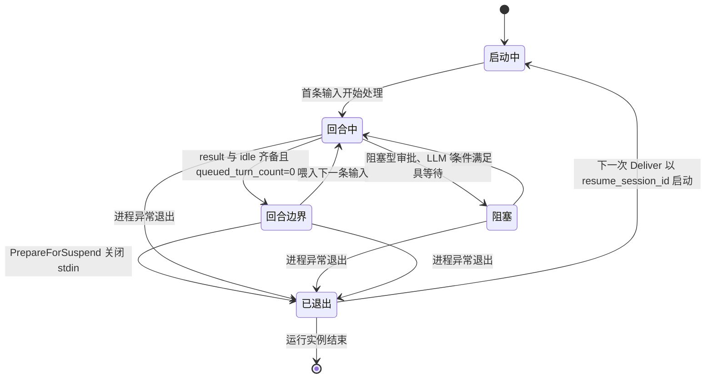
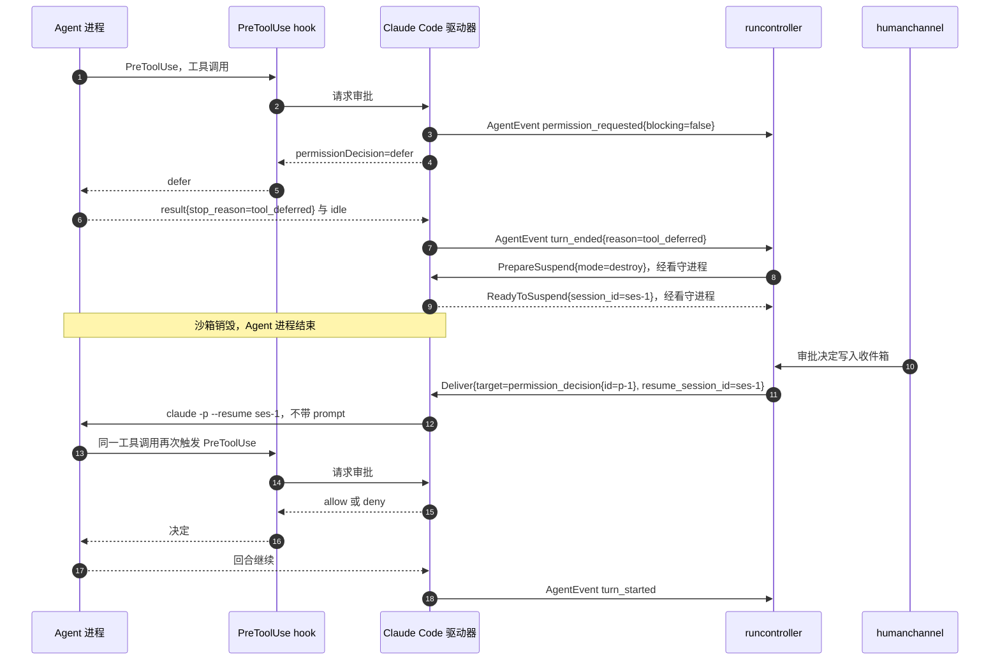
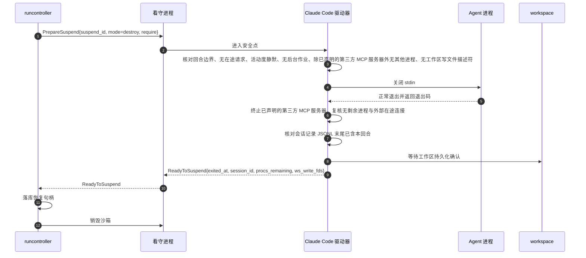

# Claude Code 驱动器

Claude Code 驱动器是[看守进程](../../../glossary.md)内的[进程驱动器](../../../glossary.md)，以无头 `stream-json` 协议驱动完整的 Claude Code 进程。它把 Claude Code 的[回合](../../../glossary.md)、工具、权限询问、等待与后台作业翻译为协议事件，把 `Deliver` 的 `target` 翻译为原生输入，管理流式输入会话的存活、会话续接与以挂起为目的的退出。它不拥有协议信封与重放、[运行实例](../../../glossary.md)状态机、挂起决策、[沙箱](../../../glossary.md)冻结、[本地代理](../../../glossary.md)与平台 MCP 服务器的工具实现；这些分别归 `agentprotocol`、`runcontroller`、`suspendpolicy`、`sandboxprovider` 与看守进程的其他子模块。心智模型：驱动器是一台长期在线的翻译器，把 Agent 的原生信号翻译为控制面可判定的事件（[REF-claude-code-headless](../../../references.md)、[ADR-warden-is-pid1](../../../adr/adr-warden-is-pid1.md)）。

文档较长，第一次阅读按以下顺序：核心概念、职责、外部接口契约、走查、启动命令与环境变量、流式输入会话、回合边界判定、LLM 等待信号、审批路径、安全点；术语表、依赖、UML 图、核心数据结构、后台作业、终止路径、错误与失败语义与并发与事务边界作为参考，在核对字段、事件顺序或失败路径时查阅。

## 核心概念

本模块围绕流式输入会话组织。Claude Code 以 `--input-format stream-json` 启动后是一个长期存活的进程，而不是一回合一个进程：驱动器在 stdin 上逐行写入用户消息、工具结果与权限决定，从 stdout 读出回合、工具、会话状态与结果消息；回合结束后不关闭 stdin，下一条投递进入同一进程。托管环境据此把进程的生命周期切成回合：回合结束后进程仍在，这个位置是唯一允许以挂起为目的销毁的位置（[ADR-turn-boundary-destroy](../../../adr/adr-turn-boundary-destroy.md)）。沙箱销毁后进程随之消失，跨代延续由会话标识上的 `--resume` 承担，而不是由进程承担。系统需要这个机制：托管环境只在回合边界释放沙箱，又要在重建后从上一回合继续；把 Agent 的原生协议翻译为闭集事件，`runcontroller` 才能判定回合位置并选择[安全点](../../../glossary.md)。

## 职责

Claude Code 驱动器的职责穷举如下，每条先写执行的动作，再写产生的结果或边界；具体字段、事件与算法见后续章节。

- **启动与保持进程**：以固定命令启动 Claude Code，在回合之间保持同一进程存活，只在 stdin 关闭或进程退出时结束；结果是同一代沙箱内的会话不需要每回合重建，恢复句柄只在跨代时使用。
- **流式输入输出**：以 `stream-json` 读写 stdin 与 stdout，把用户消息、工具结果与权限决定写入 stdin，把 Assistant、User、Result、Session State 与任务消息读出；结果是 Agent 的原生信号成为可解析的事件流。
- **环境变量注入**：为 Agent 进程设置 `ANTHROPIC_BASE_URL`、`CLAUDE_CONFIG_DIR`、会话状态与后台作业相关变量，并注入项目作用域工具接入声明中的凭据占位符环境变量与非秘密配置；结果是 LLM 流量只到达本地代理，会话状态落在[工作区](../../../glossary.md)，第三方工具经占位符使用出口凭据通道，后台作业对驱动器可见。
- **托管策略设置注入**：以工作区之外的托管策略设置文件（Linux 为 `/etc/claude-code/managed-settings.json`，随镜像提供）注入 hooks 与权限设置，并以 `allowManagedHooksOnly` 屏蔽工作区内声明的 hooks；审批 hook 的二进制随镜像放在工作区之外。结果是审批与安全检查不被 Agent 自身的写入改变。
- **回合边界判定**：等待 `session_state_changed: idle` 与 `result.queued_turn_count=0` 都到齐，结合 `result.origin` 区分人类回合与任务通知回合；结果是驱动器只在回合边界发出 `turn_ended`，并向控制面报告可销毁的位置。
- **事件翻译**：把工具开始与结束、权限询问、会话状态、订阅创建、定时请求、等待开始与后台作业变化翻译为 `AgentEvent`；结果是 `runcontroller` 收到与控制面循环驱动器相同的闭集事件。
- **LLM 等待旁证**：以本地代理的 `llm.request.started` 为主信号，以 `UserPromptSubmit`、`PostToolBatch`、`Stop` 等 hook 事件为旁证；结果是 LLM 等待的开始与结束有独立于 Agent 自述的证据。
- **审批路径**：实现 `PreToolUse` hook 的询问、`permissionDecision: "defer"` 的延迟、`stop_reason: tool_deferred` 的回合结束、以 `--resume` 不改写 prompt 的续接，以及实时接入中的阻塞等待；结果是回合中审批可以转为回合边界，或在不销毁沙箱时等待决定。
- **平台 MCP 服务器接入**：向 Agent 暴露平台 MCP 服务器的工具，设置工具超时，并把阻塞型工具调用翻译为 `wait_started` 与 `tool_ended`；结果是 Agent 每一次可能阻塞的对外交互对托管环境可见（I1）。
- **第三方 MCP 服务器接入**：合并项目作用域工具接入声明中已批准的第三方 MCP 服务器配置，只支持 stdio 本地子进程，注入其环境变量并管理生命周期；结果是第三方 MCP 工具经本地代理或[透明拦截器](../../../glossary.md)到出口代理执行，平台不为其增加平台工具。
- **安全点检查**：在回合边界执行 I9 检查，关闭 stdin、等待正常退出、终止已声明的第三方 MCP 服务器、复核本地代理与透明拦截器无外部在途连接、核对会话记录 JSONL 末尾、工作区持久化、进程与工作区写文件描述符，并上报 `ReadyToSuspend`；结果是销毁前会话已落盘，`--resume` 不丢失最后一回合。
- **快照恢复后的衔接**：在看守进程校时并清理旧 TCP 连接之后恢复事件处理，丢弃按旧时钟计算的 hook 截止时间，重新建立超时；结果是半死连接与时钟跳变不使驱动器误判回合状态。
- **后台作业登记**：通过 `PostToolUse` 与进程表登记后台 Bash 作业与子代理，在集合变化时发出 `bg_jobs_changed`；结果是存在后台作业的运行实例不被判定为空闲。
- **终止路径**：按优雅程度关闭 stdin 或发送 `SIGTERM`，杀死 Bash 进程树并执行 `SessionEnd` hook；结果是终止只用于失效判定与超时，以挂起为目的的销毁走正常退出路径。
- **投递意图日志写入**：在喂入事件之前追加并同步写入 `accepted{seq}`，观察到 `turn_started` 后追加并同步写入 `consumed{seq, turn_id}`；结果是跨代重建后的事件去重有工作区内的持久依据（[ADR-delivery-intent-log](../../../adr/adr-delivery-intent-log.md)）。

### 非职责

非职责举例如下，判定标准为：职责清单之外、由主文档、同级子模块或其他模块拥有的事实与机制。

- 协议信封、消息序号、重放、按 `(generation, msg_seq)` 去重与协议版本归 `agentprotocol`；本模块只产生每条消息的沙箱侧内容。
- 运行实例状态机、收件箱、唤醒谓词、投递游标、代与失效判定归 `runcontroller`；本模块只报告回合、工具、等待与退出信号。
- 挂起决策、冻结上限取值、DRAIN 与冻结中复评归 `suspendpolicy`；本模块只执行 `PrepareSuspend` 的沙箱侧检查并报告结果。
- 冻结与解冻的执行归 `sandboxprovider` 与节点冻结代理；本模块不写 cgroup，也不向 Agent 发送 `SIGSTOP`。
- LLM 请求的代理、模式选择、缓冲与回放取回归本地代理；本模块只消费其请求事件。
- 平台 MCP 服务器的工具实现、令牌附加与订阅登记归看守进程的平台 MCP 服务器；本模块只接入工具、设置超时并翻译工具事件。
- 审批决定的内容、人类身份与实时接入状态归 `humanchannel`；本模块只把决定交给 hook，或在阻塞等待中返回给 Claude Code。
- Agent 会话记录的内容归 Agent 自身；本模块只保证状态目录位于工作区，并在安全点核对末尾与持久化。
- 控制面循环驱动器、`ToolExec` 的使用与控制面原生循环归 [控制面循环驱动器](design-warden-driver-native.md)；本模块只实现进程驱动器一侧。

## 术语表

| 术语 | 英文对照 | 适用范围 | 定义 |
| --- | --- | --- | --- |
| 流式输入会话 | streaming input session | warden Claude Code 驱动器 | 以 `--input-format stream-json` 启动的 Claude Code 会话；回合之间保持存活，stdin 关闭时退出。 |
| 回合边界信号 | turn boundary signal | warden Claude Code 驱动器 | `session_state_changed: idle` 与 `result.queued_turn_count=0` 都到齐；`result` 与 `idle` 的先后不固定，缺一不判定边界。 |
| 延迟审批 | deferred permission | warden Claude Code 驱动器 | `PreToolUse` hook 返回 `permissionDecision: "defer"`，回合以 `stop_reason: tool_deferred` 结束，决定到达后以 `--resume` 续接同一工具调用。 |
| 托管策略设置 | managed policy settings | warden Claude Code 驱动器 | 位于工作区之外、Agent 只读的 Claude Code 设置文件（Linux 为 `/etc/claude-code/managed-settings.json`）；hooks 与权限设置经它注入，`allowManagedHooksOnly` 使工作区内声明的 hooks 不生效，hook 二进制随镜像放在工作区之外（[REF-claude-code-settings](../../../references.md)）。 |
| 旁证信号 | corroborating hook signal | warden Claude Code 驱动器 | `UserPromptSubmit`、`PostToolBatch`、`Stop` 等 hook 事件；用于确认 LLM 等待的开始与结束，不单独触发阻塞。 |
| 任务通知回合 | task-notification turn | warden Claude Code 驱动器 | `result.origin = task-notification` 的回合；由后台任务或子代理触发，不是人类输入触发的回合。 |

## 外部接口契约

本模块实现 [控制面循环驱动器](design-warden-driver-native.md) 定义的 Agent 驱动器接口，并对 `runcontroller` 输出同一套 `AgentEvent`。接口操作面、`Deliver` 的翻译种类与挂起语义对两种驱动器稳定；事件字段受 `agentprotocol` 的协议版本约束；Claude Code 的启动命令、环境变量与 stream-json 消息受 `REF-claude-code-headless` 与 `REF-claude-agent-sdk-typescript` 的版本约束。

### 驱动器接口的实现面

| 操作 | Claude Code 实现 |
| --- | --- |
| `Start` | 以固定命令启动进程，设置环境变量与托管策略设置，必要时带 `--resume <session_id>`；进程的 cgroup 迁移由看守进程的进程监督完成 |
| `Feed` | 把 `Deliver` 的 `target` 翻译为 stdin 上的 `stream-json` 用户消息；返回是否喂入、回合标识与 Agent 是否已退出 |
| `PrepareForSuspend` | 只在回合边界执行 I9 检查；关闭 stdin、等待退出码、终止已声明的第三方 MCP 服务器、核对 JSONL 末尾与工作区持久化；返回 `ReadyToSuspend` 字段 |
| `Resume` | 同一代解冻时继续原进程；新代或进程已退出时以 `--resume <session_id>` 启动，必要时不带 prompt |
| `Terminate` | 优雅终止关闭 stdin；强制终止发送 `SIGTERM`、杀死 Bash 进程树并执行 `SessionEnd` hook |
| `SnapshotRestored` | 校时完成后重新建立超时，丢弃按旧时钟计算的 hook 截止时间；进程保留时继续驱动 |
| `Events` | 输出 `AgentEvent` 流；事件按 `event_seq` 在同一回合内单调 |
| `State` | 返回 `agent_state` 所需的阶段、回合标识、阻塞条件、会话标识与后台作业集合 |

实现面的变更须同时覆盖进程驱动器与控制面循环驱动器，并以同一套契约测试约束（[ADR-dual-agent-loop-location](../../../adr/adr-dual-agent-loop-location.md)）。

### Agent 原生输入的翻译规则

`Deliver` 的 `target` 是闭集，翻译规则按目标给出；`redelivery=true` 不改变翻译形态，只表示该输入可能已被处理。

| `target` | Claude Code 输入 | 约束 |
| --- | --- | --- |
| `next_user_message` | stdin 上的 `stream-json` 用户消息 | 回合边界上直接写入；进程已退出或本代尚未启动时先以 `resume_session_id` 启动再写入；回合进行中到达的投递由驱动器暂存，`turn_ended` 之后按到达顺序喂入 |
| `tool_result{call_id}` | 含 `tool_result` 块的用户消息，`tool_use_id` 取 `call_id` | 只在对应工具调用未结束时送达；目标已失效时回 `DeliveryFailed{reason=target_gone}` |
| `permission_decision{id}` | `PreToolUse` hook 的决定 | 进程存在时交给挂起的 hook；进程已销毁时以 `--resume` 不带 prompt 启动，同一工具调用再次触发 hook 后交给它 |
| 回合边界续接 | `--resume <session_id>` 不带 prompt | 用于 `defer` 的审批决定与回合边界续接；不写入新的用户消息 |

`resume_session_id` 非空时，驱动器以 `--resume <session_id>` 启动；`-p` 创建的会话只能按 `session_id` 续接。`redelivery=true` 的输入照常翻译，驱动器在投递记录与本地状态中保留该标记，不自行去重；重复识别由 Agent 侧按输入内容承担。

### 事件输出

驱动器把 Claude Code 的原生消息翻译为 `AgentEvent`，事件种类、字段与顺序由 `agentprotocol` 定义。下表按原生信号列出翻译结果。

| Claude Code 原生信号 | `AgentEvent` | 说明 |
| --- | --- | --- |
| 开始处理一条输入 | `turn_started{session_id, delivery_id}` | `delivery_id` 为本回合消费的投递；Agent 自行开始的回合为空 |
| `session_state_changed: idle` | `state_changed{idle}` | 与 `result` 共同构成回合边界；单独到达不结束回合 |
| `session_state_changed: requires_action` | `state_changed{requires_action}` | 表示会话停在权限询问等请求上，不构成回合边界 |
| `result` | 回合结果摘要 | 提供 `queued_turn_count`、`origin` 与 `stop_reason`；与 `idle` 齐备后发出 `turn_ended` |
| Assistant 消息中的 `tool_use` | `tool_started{call_id}` | 每个 `call_id` 一次 |
| User 消息中的 `tool_result` | `tool_ended{call_id}` | 与 `tool_started` 配对；未配对的调用在进程退出时清理 |
| 权限询问 | `permission_requested{id, call_id, blocking}` | `blocking=true` 用于实时接入与并行工具调用退回的阻塞等待，`false` 用于延迟审批 |
| 平台 MCP 工具 `list_events` | 无额外事件 | 只产生 `tool_started` 与 `tool_ended`，不产生阻塞等待 |
| 平台 MCP 工具 `subscribe_event` 完成 | `subscription_created{sub_id, since_cursor}` | 订阅登记由平台 MCP 服务器完成 |
| 平台 MCP 工具 `sleep_until` | `timer_requested{timer_id, fire_at, scope}` | `scope` 只取 `run` |
| 平台 MCP 工具 `wait_for` | `wait_started{call_id, kind=wait_for, ref, fire_at, predicted_ms}` | 阻塞等待开始时发出 |
| 后台作业或子代理集合变化 | `bg_jobs_changed{job_ids}` | 集合变化时发出，未结束时运行实例视为活动 |
| 进程退出 | `turn_ended{reason, agent_exited=true, bg_procs}` | 不就地重启；下一次投递以 `resume_session_id` 启动 |

`turn_ended` 只在回合边界或进程退出时发出。回合边界的条件是 `result` 与 `idle` 齐备且 `result.queued_turn_count=0`；`result.origin=task-notification` 的回合照常发出 `turn_ended`，但不视为人类回合。`event_seq` 在同一回合内单调，重复或乱序的原生消息按它丢弃。

## 依赖

代码依赖只有 `agentprotocol`，与[模块依赖图](../../architecture.md#模块依赖图)一致；对本地代理、平台 MCP 服务器与工作区的调用是同一进程内的组件协作或运行时调用，不是代码依赖。

- `agentprotocol`：`AgentEvent` 的种类、字段、`event_seq` 与出站流发送；驱动器只负责事件内容。
- Claude Code 无头模式：`-p`、`--output-format stream-json`、`--input-format stream-json`、`--verbose` 与 `--resume`（[REF-claude-code-headless](../../../references.md)）。
- Claude Code hooks：`PreToolUse` 的 `defer`、`timeout` 与 `onFailure`，以及 `UserPromptSubmit`、`PostToolUse`、`PostToolBatch`、`Stop`、`StopFailure`、`SessionEnd`（[REF-claude-code-hooks](../../../references.md)）。
- Claude Code 设置：托管策略设置文件的作用域、优先级与 `allowManagedHooksOnly`（[REF-claude-code-settings](../../../references.md)）。
- Claude Code 环境变量：`ANTHROPIC_BASE_URL`、`HTTP_PROXY`、`HTTPS_PROXY`、`NO_PROXY`、`CLAUDE_CONFIG_DIR`、`CLAUDE_CODE_*` 与 `API_TIMEOUT_MS`（[REF-claude-code-env-vars](../../../references.md)）。
- Claude Code 网络行为：流式空闲看门狗与停滞处理（[REF-claude-code-network-config](../../../references.md)）。
- Agent SDK 的 stream-json 消息类型：`session_state_changed`、`result.queued_turn_count`、`tool_use` 与 `tool_result`（[REF-claude-agent-sdk-typescript](../../../references.md)）。
- MCP：平台 MCP 服务器的工具与传输（[REF-mcp](../../../references.md)）。
- 本地代理：`llm.request.started` 等事件与回环地址；平台 MCP 服务器：工具调用与超时；`workspace`：`CLAUDE_CONFIG_DIR` 与工作区[持久化确认](../../../glossary.md)。

方向约束：驱动器只依赖 `agentprotocol`，因此不修改 `runcontroller` 与 `suspendpolicy`；新增一个原生信号只扩展翻译表，不改变协议消息集合。

## UML 图

下列图分别固定回合的生命周期、延迟审批的续接顺序与安全点的检查顺序；图中不表达的约束由每张图后的正文给出。

### 回合生命周期状态图



阶段闭集为 `starting`、`in_turn`、`blocked`、`boundary` 与 `exited`，与 `agent_state.phase` 一致。`blocked` 的子状态包括 LLM 等待、工具等待、阻塞型审批与阻塞型 MCP 等待；`requires_action` 是权限询问的会话状态，不单独成为阶段。`boundary` 表示回合已结束而进程仍存活，是唯一允许以挂起为目的销毁的位置。`exited` 保留恢复句柄与退出码，下一次投递以它启动新进程，不就地重启。

### 审批 defer 与续接时序图



图固定延迟审批的关键点：回合以 `stop_reason: tool_deferred` 结束，而不是以阻塞等待结束；决定到达后的续接以 `--resume` 不带 prompt 启动，同一工具调用再次触发 `PreToolUse`，hook 才从驱动器取回决定。并行工具调用使 `defer` 被忽略时，退回阻塞等待，各调用的决定以定向投递分别送达；只剩一个阻塞调用时才允许冻结。

### 安全点时序图



图固定检查与销毁的先后：任一检查不满足时回 `Busy`，不进入销毁；恢复句柄在销毁之前落库；`ReadyToSuspend.session_id` 取本代 Agent 进程使用的会话标识，本代未启动进程时取最近一次收到的 `resume_session_id`。以挂起为目的的销毁不以 `SIGTERM` 终止 Agent 主进程；`force` 只终止 Agent 主进程与已声明的第三方 MCP 服务器进程之外的进程，已声明的第三方 MCP 服务器在 Agent 正常退出之后才终止。

## 核心数据结构

### 驱动器状态

| 字段 | 含义 |
| --- | --- |
| `phase` | `starting`、`in_turn`、`blocked`、`boundary` 或 `exited`；`agent_state.phase` 的来源 |
| `pid`、`pgid` | Agent 主进程及其进程组；用于终止 Bash 进程树 |
| `stdin`、`stdout` | `stream-json` 管道；stdin 关闭使进程在回合之间退出 |
| `session_id` | 最近一次观察到的会话标识；`turn_started` 与 `ReadyToSuspend` 携带 |
| `turn` | 当前或最近一个回合的记录 |
| `pending_delivery` | 已写入 stdin 但尚未观察到 `turn_started` 的投递 |
| `pending_permissions` | 按 `permission_id` 索引的待决审批记录 |
| `running_tools` | 未配对的 `tool_started` 调用集合 |
| `bg_jobs` | 未结束的后台 Bash 作业与子代理集合 |
| `last_result`、`last_idle` | 最近一次 `result` 与 `idle` 信号；回合边界判定使用 |
| `event_seq` | 当前回合的事件序号 |
| `config_dir`、`cwd` | 工作区内的 `CLAUDE_CONFIG_DIR` 与逐字一致的启动目录 |
| `resume_handle` | 最近一次可用的 `session_id`；跨代恢复使用 |

### 状态一览

| 状态 | 一句话含义 | 当前动作（Claude Code 驱动器） | 直觉画面 |
| --- | --- | --- | --- |
| `starting` | 进程已启动但尚未开始处理输入 | 写入首条输入并等待属于它的首个回合事件 | 刚点火，尚未挂挡 |
| `in_turn` | 正在处理一条输入 | 翻译工具、权限与会话状态事件 | 引擎运转，仪表在跳 |
| `blocked` | 回合停在需要外部条件的等待点 | 上报阻塞条件，保持进程与 stdin 存活 | 车停在红灯前 |
| `boundary` | 回合已结束，进程仍存活 | 保持 stdin 打开，等待下一条投递或 `PrepareSuspend` | 到站开门，不上客 |
| `exited` | 进程已退出 | 清理未配对工具与后台作业，保留退出码与恢复句柄 | 熄火，钥匙留在车上 |

### 回合记录

| 字段 | 含义 |
| --- | --- |
| `turn_id` | 驱动器分配的回合标识，同一代内唯一 |
| `delivery_id` | 本回合消费的投递；Agent 自行开始的回合为空 |
| `started_at`、`ended_at` | 回合开始与边界时刻 |
| `origin` | `result.origin`；`task-notification` 表示任务通知回合 |
| `queued_turn_count` | `result.queued_turn_count`；为 0 才可能构成边界 |
| `stop_reason` | `result.stop_reason`；`tool_deferred` 表示延迟审批 |
| `agent_exited` | 回合是否因进程退出而结束 |
| `bg_procs` | 回合结束时仍在运行的子进程或子代理数量 |

### 待决审批记录

| 字段 | 含义 |
| --- | --- |
| `permission_id` | 权限询问标识；与 `Deliver.target=permission_decision{id}` 匹配 |
| `call_id` | 触发询问的工具调用 |
| `blocking` | 是否以阻塞等待处理；实时接入与并行工具调用退回时为真 |
| `deferred` | 是否已返回 `defer` 并以回合边界结束 |
| `decision` | 允许或拒绝；允许可携带 `updatedInput`，拒绝携带消息 |
| `deadline` | 阻塞等待的截止时间；取 hook 超时、per-server timeout 与 MCP 传输上限的较小值 |

### 后台作业记录

| 字段 | 含义 |
| --- | --- |
| `job_id` | Bash 后台作业或子代理的标识 |
| `kind` | `bash` 或 `subagent` |
| `started_at`、`last_seen` | 开始与最近一次观察到的时间 |
| `status` | 运行中或已结束；未结束的作业使运行实例保持活动 |

## 核心算法与流程

### 走查

**延迟审批、回合边界销毁与续接。** 初始条件：运行实例 `run-7` 处于第 6 代，工作区投递意图日志已记 `consumed{10, turn-8}`，控制面 `cursor_accepted=10`、`cursor_consumed=10`，`run.session_id=ses-1`；收到 `Deliver{delivery_id=d-4, batch=[11], through_seq=11, target=next_user_message, resume_session_id=ses-1}`。

| 步骤 | 事件或调用 | 驱动器状态 | 持久写入 |
| --- | --- | --- | --- |
| 1 | 收到 `Deliver`，按日志去重后 `11` 未消费；追加 `accepted{11}` 并同步写入后回 `Accepted{fed=true}` | 启动前 | 追加 `accepted{11}` 并同步写入工作区 |
| 2 | 以 `--resume ses-1` 启动 Claude Code，PID 4101 | `starting` | 无 |
| 3 | 把事件作为下一条用户消息写入 stdin | `starting` | 无 |
| 4 | Agent 开始处理，驱动器观察到属于该输入的首个 Assistant 事件 | `in_turn`；`turn_id=turn-9` | 追加 `consumed{11, turn-9}` 并同步写入；随后发 `Consumed{11, turn-9}` |
| 5 | 工具调用触发 `PreToolUse`，异步渠道返回 `defer` | `in_turn`；`pending_permissions` 新增 `permission_id=p-1`，`blocking=false` | 无；返回 `defer` 之前发出 `permission_requested{id=p-1, blocking=false}` |
| 6 | Agent 返回 `result{stop_reason=tool_deferred}` 与 `idle`，`queued_turn_count=0` | `boundary` | 无；发出 `turn_ended{reason=tool_deferred}` |
| 7 | 收到 `PrepareSuspend{mode=destroy}`，关闭 stdin 之前的检查通过；关闭 stdin，等待退出码 0 | `exited` | 无 |
| 8 | 终止已声明的第三方 MCP 服务器，复核进程树无剩余进程、外部在途连接计数为 0；核对 JSONL 末尾含 `turn-9` | `exited` | 等待工作区持久化确认；上报 `ReadyToSuspend{session_id=ses-1}`；控制面落库后销毁沙箱 |
| 9 | 审批决定到达，`Deliver{target=permission_decision{id=p-1}, resume_session_id=ses-1}` | 启动前 | 追加接受记录；定向投递的消费只记日志 |
| 10 | 以 `claude -p --resume ses-1` 不带 prompt 启动；同一工具调用再次触发 `PreToolUse` | `starting` | 无 |
| 11 | hook 取回决定并返回 allow；Agent 继续本回合 | `in_turn`；`turn_id=turn-10` | 追加该定向投递的消费记录；不发 `Consumed` |

走查确认投递日志、延迟审批与续接的结论。`accepted` 在喂入之前写入，`consumed` 在观察到 `turn_started` 之后写入，两者都先于对应的出站确认。延迟审批使回合以 `tool_deferred` 结束，销毁发生在回合边界，安全点检查通过后才上报 `ReadyToSuspend`。续接使用上一代落库的 `ses-1`，不带 prompt；同一工具调用再次触发 hook 是决定交付的观察点。

### 启动命令与环境变量

启动命令固定为：

```text
claude -p --output-format stream-json --input-format stream-json --verbose [--resume <session_id>]
```

`--verbose` 与两种 `stream-json` 同时使用；`-p` 创建的会话只能按 `session_id` 续接。环境变量由下表与项目作用域工具接入声明中的 `credential_env`、`config_env` 组成；保留名不注入，两者之外的变量同样不注入。

| 环境变量 | 取值 | 作用 |
| --- | --- | --- |
| `ANTHROPIC_BASE_URL` | `http://127.0.0.1:<port>` | LLM 请求只到达本地代理；端口由看守进程在启动时选定 |
| `HTTP_PROXY` | `http://127.0.0.1:<port>` | 外部系统的 HTTP 请求经本地代理以绝对 URI 转发到出口代理 |
| `HTTPS_PROXY` | `http://127.0.0.1:<port>` | 外部系统的 HTTPS 请求经本地代理以 CONNECT 隧道转发到出口代理 |
| `NO_PROXY` | `127.0.0.1` | 回环地址的 LLM 请求不经代理，避免回环流量再次进入本地代理 |
| `CLAUDE_CONFIG_DIR` | 工作区内目录 | 会话记录 `projects/<project>/<session-id>.jsonl` 随工作区持久化 |
| `CLAUDE_CODE_EMIT_SESSION_STATE_EVENTS` | `1` | 产生 `session_state_changed` 的 `idle` 与 `requires_action` |
| `CLAUDE_CODE_BG_TASKS_REPORT_RUNNING` | `0` | 存在后台任务时仍报告 `idle`；后台作业由驱动器另行登记 |
| `CLAUDE_CODE_RESUME_INTERRUPTED_TURN` | `1` | 被中断回合在 `--resume` 时自动续接，作为降级路径 |
| `CLAUDE_CODE_RESUME_INTERRUPTED_TURN_MAX_AGE_MS` | 不超过工作区保留期 | 只对年龄不超过该值的被中断回合自动续接；超过时按新会话或合成摘要处理 |
| `CLAUDE_CODE_MAX_RETRIES` | 默认 10 | Claude Code 对上游请求的重试次数 |
| `API_TIMEOUT_MS` | 默认 600000 | 响应头超时；不限制流式响应体的总时长 |
| `CLAUDE_CODE_DISABLE_NONESSENTIAL_TRAFFIC` | `1` | 关闭遥测与更新检查等非必要外联，避免冷启动等待 |
| `CLAUDE_CODE_DISABLE_BACKGROUND_TASKS` | 策略开关 | 置位时禁用后台任务；是否置位由策略决定 |
| `MCP_TIMEOUT` | 显式下调，覆盖默认值 | MCP 服务器启动与初始化超时；默认值可能使冷启动等满 30 s |
| `MCP_CONNECT_TIMEOUT_MS` | 显式下调 | MCP 连接超时 |
| `MCP_TOOL_TIMEOUT` | per-server timeout = `F_cap + safety_margin` | 工具调用超时；不得超过 MCP 传输上限 |

工具接入声明可以追加 `GH_TOKEN={{github.token}}`、`GITHUB_PERSONAL_ACCESS_TOKEN={{github.token}}` 这类凭据占位符环境变量与非秘密配置；保留名（`PATH`、`LD_*`、`PYTHONPATH`、`NODE_OPTIONS`、`GIT_CONFIG_*`、`SSH_*`、`HTTP(S)_PROXY`、`NO_PROXY`、`ANTHROPIC_*`、`CLAUDE_*`）被拒绝。`ToolExec.exec` 启动的命令注入同一组变量。看守进程只注入字面占位符，不解析、不换取、不缓存真实凭据。

`ANTHROPIC_BASE_URL` 是 Agent 与本地代理之间唯一的 LLM 配置；Agent 不持有令牌。`CLAUDE_CONFIG_DIR` 与 cwd 在各代沙箱逐字一致，使工具相对路径与会话记录稳定；`--resume` 按 `session_id` 查找，不依赖 cwd，`--continue` 才以 cwd 为作用域。`cleanupPeriodDays` 不小于工作区保留期。

**续接与悬空工具调用。** 空提示续接对非 defer 的悬空 `tool_use` 直接拒绝并中止启动，不重跑该调用。带提示续接则保留被切断的调用，并合成一个 `is_error` 的 interrupted `tool_result` 交回模型，模型可能据此重试；有副作用的调用必须按可能重试设计幂等，不能假设被切断的调用一定被丢弃。启用 `CLAUDE_CODE_RESUME_INTERRUPTED_TURN` 时同时设置最大年龄，避免把过旧的被中断回合当作当前回合自动续接。

### 流式输入会话

`--input-format stream-json` 使会话在回合之间保持存活：驱动器在 stdin 上按行写入 JSON 消息，回合结束后不关闭 stdin，下一条 `Deliver` 直接写入同一进程；只有 stdin 关闭、`SIGTERM` 或进程异常才结束会话。

写入按以下规则串行化：同一时刻只有一个写入者；每条消息写完整一行；写入失败（例如 `EPIPE`）表示进程已退出，按 `exited` 处理并上报 `turn_ended{agent_exited=true}`。回合进行中收到的常规投递不写入 stdin，由驱动器暂存；在 `turn_ended` 之后按到达顺序喂入。`result.queued_turn_count=0` 表示 Agent 队列已空，回合边界判定要求它为 0。

### 回合边界判定

回合边界由 `session_state_changed: idle` 与 `result.queued_turn_count=0` 共同判定：

1. `session_state_changed: idle` 到达，且
2. `result.queued_turn_count=0` 到达。

`result` 与 `idle` 的先后不固定，两者都到齐才判定；缺少任一个都不发 `turn_ended`，也不进入 `boundary`。`result.origin=task-notification` 的回合照常判定边界，但在事件中保留 `origin`，由 `runcontroller` 区分人类回合与任务通知回合。`requires_action` 不是边界；它表示会话停在权限询问等请求上。

同一回合只发一次 `turn_ended`。`result` 到达时 `queued_turn_count` 大于 0 表示还有排队的回合，当前回合不结束；队列排空后由后续的 `result` 与 `idle` 判定。进程在回合中退出时，驱动器立即发 `turn_ended{agent_exited=true}`，不等待缺失的信号。

### LLM 等待信号与 hooks 旁证

LLM 等待的主信号是本地代理的 `llm.request.started`；驱动器不根据 hook 事件单独制造 LLM 阻塞。hooks 提供旁证：

- `UserPromptSubmit`：人类输入提交，确认回合开始前的新模型请求；
- `PostToolBatch`：一批工具结束、下一次模型请求之前，确认没有工具在运行；
- `Stop`：Agent 停止，确认回合已结束或即将结束。

旁证用于核对 `runcontroller` 的阻塞门控（无未配对 `tool_started`），不改变阻塞条件的种类与 `ref`。平台 MCP 的阻塞型调用由平台 MCP 服务器发出 `wait_started`，驱动器随工具事件翻译为 `AgentEvent`。第三方工具调用的开始与结束同样翻译为 `tool_started` 与 `tool_ended`，不产生新的唤醒信号；它们不是可挂起的阻塞条件。

### 审批路径

`PreToolUse` hook 由看守进程提供的本地二进制实现，二进制随镜像放在工作区之外；`allowManagedHooksOnly` 使工作区内声明的 hooks 不生效。驱动器在 hook 与 Claude Code 之间传递询问与决定。按渠道分别处置：

**异步渠道。** 驱动器先发出 `permission_requested{blocking=false}`，hook 再返回 `permissionDecision: "defer"`，阶段保持 `in_turn`，不经过 `blocked`；Claude Code 以 `stop_reason: tool_deferred` 结束回合后，驱动器发出 `turn_ended`，回合进入边界，可由 `runcontroller` 在安全点销毁。决定到达后，`Deliver` 的 `target=permission_decision{id}` 与 `resume_session_id` 触发续接：以 `--resume` 不带 prompt 启动，同一工具调用再次触发 `PreToolUse`，hook 从驱动器取回决定并返回 allow（可携带 `updatedInput`）或 deny（携带消息）。

**实时接入。** hook 阻塞等待，驱动器发出 `permission_requested{blocking=true}`；决定到达后交给挂起的 hook。hook 显式设置 `timeout` 与 `onFailure: block`，覆盖 Claude Code 超时后默认放行的行为；超时按阻塞处理并返回拒绝结果，不默认放行。阻塞等待的冻结上限 `F_cap(approval)` 取 hook 超时与 MCP 传输上限的较小值减去 60 s，各项按墙钟计时，冻结期间照常流逝；取值归 `suspendpolicy`。

同一回合有多个并行工具调用时，`defer` 被忽略，退回阻塞等待；各调用的审批决定以定向投递分别送达，只有剩一个阻塞调用时才允许冻结。审批决定在沙箱销毁之前到达时，在同一代的已建立流上送达；销毁之后到达时，在新代以 `--resume` 续接。

### 平台 MCP 与第三方 MCP 接入

驱动器向 Claude Code 注入平台 MCP 服务器的连接配置，并合并项目作用域工具接入声明中已批准的第三方 MCP 服务器；工作区内的 `.mcp.json` 被忽略，`--strict-mcp-config` 或等效配置只使用平台下发的服务器集合。工具集合与语义归平台 MCP 服务器与第三方服务器；本模块负责以下接入工作：把工具调用的开始与结束翻译为 `tool_started` 与 `tool_ended`，阻塞型工具调用在开始时另发 `wait_started{kind=...}`，把 `subscribe_event`、`sleep_until` 与 `wait_for` 的结果翻译为 `subscription_created`、`timer_requested{scope=run}` 与 `wait_started`，以及设置 `MCP_TOOL_TIMEOUT`。

第三方 MCP 服务器只支持 stdio 本地子进程，可执行文件来自镜像内预置并固定版本与摘要；进程是 Agent 的子进程，位于 `agent` 子 cgroup，随 Agent 冻结与解冻，不进入 `bg_jobs`。本文所称已声明的第三方 MCP 服务器进程包含这些服务器进程的子进程，与 `Activity.mcp_procs` 的计数范围相同；安全点检查第 5、8 步与 `force` 的作用范围都按此口径。Agent 退出后驱动器终止它们；快照恢复后重连或重启，销毁重建后必然重启。远程 MCP 视为普通外部系统流量，经本地代理或透明拦截器到出口代理，不在沙箱内起进程。

`MCP_TOOL_TIMEOUT` 的默认值约 28 小时，不构成冻结上限；实际约束是 MCP 客户端的 HTTP 首字节 60 s、首字节后 idle 300 s 加 30 s 检查粒度，以及 stdio idle 1800 s 加 30 s 检查粒度。per-server timeout 配置为 `F_cap(approval / wait_for)` 加 `safety_margin`，且不得大于对应的传输上限；超过传输上限时以传输上限为准。平台 MCP 服务器应在调用开始立即发送首字节并周期发送进度，使首字节后的窗口生效；`wait_for` 在冻结临近上限时返回已转为订阅的结果。工具超时返回错误结果，不无限占用回合；已经转为订阅或定时的阻塞型调用按转换结果返回。工具调用的开始与结束必须配对；进程退出时未配对的调用由驱动器清理，并在 `turn_ended{bg_procs}` 中报告剩余进程。

启动期非必要外联必须由 `CLAUDE_CODE_DISABLE_NONESSENTIAL_TRAFFIC=1` 关闭；RST 与黑洞在启动期都约 5 s，不能只依赖本地代理立即拒绝。MCP 初始化默认可等满 30 s，必须显式下调 `MCP_TIMEOUT` 与 `MCP_CONNECT_TIMEOUT_MS`，否则冷启动目标会被默认值拖到阈值之外。

### 安全点

`PrepareSuspend{mode=destroy}` 只在回合边界处理。驱动器按以下顺序执行检查，任一不满足时回 `Busy{reason, retry_after}`，不进入销毁：

1. 回合边界成立：`idle` 与 `result` 齐备，`queued_turn_count=0`。
2. 本代无在途请求：本地代理的 LLM 在途请求为空，且本地代理与透明拦截器的外部在途连接计数为 0。
3. 活动度静默不短于 `Q_quiet`：由看守进程的活动度采集提供。
4. 后台作业为空：`bg_jobs` 为空，对应 `PrepareSuspend.require.no_bg_procs`。
5. 进程树中除 Agent 主进程与已声明的第三方 MCP 服务器进程外无其他进程；`force` 只终止这些其他进程，不终止 Agent 主进程与已声明的第三方 MCP 服务器进程。
6. 无工作区写文件描述符：`ws_write_fds` 为 0。
7. 关闭 stdin，等待进程正常退出并取得退出码。
8. 终止已声明的第三方 MCP 服务器进程，复核进程树中无剩余进程且外部在途连接计数为 0：`procs_remaining` 为 0。
9. 核对会话记录 JSONL 末尾已含本回合；transcript 写入是异步的，退出后仍可能滞后，核对在退出码之后执行。
10. 等待工作区持久化确认：共享文件系统为 fsync 完成；`durableDir` 退化配置下为同步挂起上传完成。

第 2 步的外部在途连接计数按连接从建立到关闭计算，包含已声明的第三方 MCP 服务器进程经本地代理或透明拦截器持有的连接；本地代理与透明拦截器不终止 TLS，无法区分空闲长连接与在途请求。已声明的第三方 MCP 服务器在回合边界保持外部长连接（空闲连接池或流式订阅）时，第 2 步持续不满足，驱动器回 `Busy`，不为满足检查而提前终止该服务器；运行实例回到 `Active`，`runcontroller` 在 `retry_after` 之后重新调用挂起决策；控制面的 I9 预检不含外部在途连接，连接关闭之前以挂起为目的的销毁不会成功。

检查通过后上报 `ReadyToSuspend{suspend_id, mode=destroy, exited_at, session_id, procs_remaining, ws_write_fds}`。`session_id` 取本代进程使用的会话标识；本代未启动 Agent 进程时取最近一次收到的 `resume_session_id`，都没有时为空。控制面只在非空时落库恢复句柄，落库后才销毁沙箱。

关闭 stdin 后进程在截止时间之前未退出时回 `Busy`，不发送 `SIGTERM` 完成以挂起为目的的销毁；JSONL 末尾不含本回合时同样回 `Busy`，等待 transcript 刷盘后重试。

### 快照恢复后的衔接

快照恢复后，看守进程先以 `Resumed.wall_clock_now` 校准本地时钟，再主动断开 Agent 进程的旧 TCP 连接，最后通知驱动器。驱动器在此之后：

- 丢弃按旧时钟计算的 hook 截止时间与等待超时，按校时后的时钟重新建立；
- 不重放已交付的输入，不重复发出 `turn_started`；
- 在途 LLM 请求由本地代理按 `request_id` 取回，驱动器只等待其 `llm.request.completed` 或 `llm.request.failed`；
- 进程保留时继续驱动；进程状态不再可驱动时按 `agent_exited` 处理，下一次投递以恢复句柄重新启动。

校时与旧连接清理先于驱动器恢复，避免半死连接把恢复拖到读超时，也避免旧时钟使超时立即触发。

### 后台作业登记

驱动器通过以下路径登记后台作业：`PostToolUse` 中对后台 Bash 命令的识别，以及进程表中属于 Agent 进程树的子进程与子代理。集合变化时发出 `bg_jobs_changed{job_ids}`；存在未结束作业时运行实例视为活动，`suspendpolicy` 不对其挂起。

`CLAUDE_CODE_BG_TASKS_REPORT_RUNNING=0` 使存在后台任务时仍报告 `idle`，回合边界照常成立；I9 的 `no_bg_procs` 检查仍要求后台作业为空，因此带后台作业的回合边界不构成安全点。`-p` 在回合结束后等待主会话的后台命令，默认等待上限与总上限由 Claude Code 给出；超时按策略终止。`CLAUDE_CODE_DISABLE_BACKGROUND_TASKS` 置位时禁用后台任务，作业集合为空。

### 终止路径

- **优雅终止**：关闭 stdin，等待进程正常退出；用于 `Shutdown{graceful=true}` 与以挂起为目的的销毁。
- **强制终止**：发送 `SIGTERM`，退出码 143，杀死 Bash 进程树并执行 `SessionEnd` hook；只用于 `Fenced`、`Shutdown{graceful=false}` 与超时，不用于以挂起为目的的销毁。

进程退出后，驱动器发出 `turn_ended{agent_exited=true}`，清理未配对的工具与后台作业，保留 `session_id` 与退出码。看守进程不就地重启同名进程；下一次 `Deliver` 以 `resume_session_id` 启动新进程。

### 投递意图日志写入

投递处理的顺序固定：

1. 按日志去重：已记 `consumed` 的事件跳过；已记 `accepted` 未记 `consumed` 的事件带 `redelivery=true` 重喂。
2. 对需要喂入的事件追加 `accepted{seq}` 并同步写入工作区；写入失败时不回 `Accepted`、不喂事件，回 `DeliveryFailed{retryable=true}`；写入成功后回 `Accepted{fed=true}`。
3. 把事件翻译为原生输入并写入 stdin。
4. 观察到 `turn_started` 后追加 `consumed{seq, turn_id}` 并同步写入；写入成功后才发 `Consumed`。
5. 定向投递与回合边界续接的消费只写日志，不发 `Consumed`。

日志条目按 `seq` 索引，内存索引由工作区日志在启动时重建。日志的保留长度、清理与跨代重投规则见 [看守进程](design-warden.md)；本模块只保证写入时机与同步顺序。

## 错误与失败语义

失败的处置由回合边界、恢复句柄与投递日志组合表达。下表列出已明确处置路径的失败，各行是举例。

| 失败 | 处置 |
| --- | --- |
| 启动失败，例如二进制缺失或环境变量非法 | 先回该投递的 `Accepted{fed=true}`，再发 `turn_ended{agent_exited=true}`；驱动器不进入 `in_turn`；`runcontroller` 按 `start_failures` 连续计数，达到 `N_resume` 后进入 `Degraded` |
| `--resume` 找不到会话或会话损坏 | 按启动失败处理：先回 `Accepted`，再发 `turn_ended{agent_exited=true}`；达到次数上限后进入 `Degraded`，兜底路径改用新会话并合成摘要 |
| 进程在回合中异常退出 | 发 `turn_ended{agent_exited=true}`；清理未配对工具与后台作业；下一次投递以 `resume_session_id` 启动 |
| stdin 写入失败或 `EPIPE` | 视为进程已退出；上报 `turn_ended{agent_exited=true}`，不重试写入 |
| 关闭 stdin 后进程未在截止时间退出 | 回 `Busy{reason, retry_after}`；不发送 `SIGTERM` 完成以挂起为目的的销毁，由控制面在 `retry_after` 后复评 |
| 会话记录 JSONL 末尾不含本回合 | 回 `Busy`；等待 transcript 刷盘后重试，不销毁 |
| 工作区持久化确认未完成 | 回 `Busy`；不销毁，恢复句柄不落库 |
| 存在其他进程或工作区写文件描述符 | 回 `Busy`；`force` 只终止 Agent 主进程与已声明的第三方 MCP 服务器进程之外的进程，不绕过 Agent 正常退出 |
| 已声明的第三方 MCP 服务器在回合边界保持外部长连接 | 回 `Busy`；不提前终止该服务器，由控制面在 `retry_after` 后复评；连接关闭之前不销毁 |
| `PreToolUse` hook 超时 | `onFailure: block` 生效，返回拒绝结果并带消息；不默认放行，不无限阻塞 |
| 审批决定的目标已失效 | 回 `DeliveryFailed{reason=target_gone}`；控制面把事件回退为常规投递 |
| 并行工具调用使 `defer` 被忽略 | 退回阻塞等待；各决定以定向投递分别送达，不销毁 |
| 平台 MCP 传输定时器或 per-server timeout 到期 | 工具返回错误结果，回合继续；已转为订阅或定时的调用按转换结果返回 |
| 第三方 MCP 服务器崩溃或初始化超时 | 该服务器的工具返回错误结果并计数；服务器按声明重启或在下一次启动时重新拉起，不影响 Agent 回合 |
| 第三方工具返回 401 或 403 | 工具未发送认证头时上游返回 401；占位符发往未允许主机或没有匹配注入规则时出口代理返回 403；错误作为工具结果返回 Agent，平台不补头、不重试 |
| 占位符未被替换 | 工具未把占位符放进请求头时上游收到占位符并返回错误；出口代理按头名与主机匹配规则，不感知工具身份 |
| 快照恢复后时钟跳变 | 丢弃旧截止时间并按校时后的时钟重建；不重放已交付输入 |
| 后台作业未结束 | 运行实例视为活动，不挂起；超时按策略终止，或回合边界不构成安全点 |
| `Fenced` 或 `Shutdown{graceful=false}` | 强制终止：`SIGTERM`、退出码 143、杀死 Bash 进程树、执行 `SessionEnd` hook |
| 未知或无法解析的 stream-json 消息 | 丢弃并计数；不改变回合状态，不产生 `AgentEvent` |
| 会话标识在 `--resume` 后变化 | 以新报告的值更新 `session_id` 并用于后续 `turn_started` 与 `ReadyToSuspend`；控制面按新值落库 |

## 并发与事务边界

驱动器不参与数据库事务；它的持久化边界是工作区内的投递意图日志同步写入与 Agent 自身异步写入的会话记录。控制面 PostgreSQL 是运行实例状态的权威，驱动器只上报派生事件。

- **单进程单回合**：同一代沙箱内只有一个 Agent 主进程和一个活动回合；驱动器不并发启动第二个进程。回合进行中收到的常规投递由驱动器暂存，不写入 stdin，在 `turn_ended` 之后按到达顺序喂入。
- **stdin 单写者**：所有写入由同一协程串行执行；写入与进程退出通过 `closed` 标志协调，不向已关闭的管道写入。
- **回合边界串行**：`result` 与 `idle` 的到达可能并发，边界判定在驱动器锁内执行；同一回合只发一次 `turn_ended`。
- **事件顺序**：同一回合的 `turn_started` 先于工具与等待事件，`turn_ended` 最后；`event_seq` 单调，重复或乱序事件按它丢弃。
- **审批决定**：按 `permission_id` 索引，每个询问只接受一个决定；允许与拒绝同时到达时以先到者为准，后到者计数丢弃。
- **进程监督锁**：启动、正常退出、强制终止与冻结检查共用看守进程的进程监督锁；持有该锁时不执行网络调用与日志同步写入。
- **投递日志顺序**：`accepted` 的同步写入与 `Accepted` 先于喂入，`consumed` 的同步写入先于 `Consumed`；同一时刻只有一个投递批被处理。日志写入串行化，不同批的 `Deliver` 按到达顺序处理。
- **快照屏障**：快照恢复期间驱动器不产生新事件；校时与旧连接清理完成后才恢复事件处理，避免旧时钟下的超时误触发。
- **会话记录**：JSONL 由 Agent 异步写入；驱动器只读末尾做核对，不写入、不修改。销毁前的核对与工作区持久化确认在同一安全点内完成。

## 扩展点

### 新增原生输入目标

新增 `Deliver.target` 的种类须同时修改 `agentprotocol`、`runcontroller` 的投递选择与两种驱动器的翻译表；本模块的翻译表按目标给出原生输入形态，未列出的目标回 `DeliveryFailed`。新增目标不得改变 `Accepted` 与 `Consumed` 的两级确认语义。

### 新增 hook 信号

新增 hook 事件作为旁证时，须定义它确认的是等待开始还是结束、与现有 `UserPromptSubmit`、`PostToolBatch`、`Stop` 的关系，以及它是否改变阻塞门控。旁证不新增 `AgentEvent` 种类；新增协议事件须同时修改 `agentprotocol` 与 `runcontroller`。

### 新增第三方工具或 MCP 服务器

新增第三方工具只改项目作用域的工具接入声明：声明凭据占位符环境变量、stdio MCP 服务器与允许主机；平台 MCP 闭集不变，本模块不新增工具翻译，第三方工具调用仍只产生 `tool_started` 与 `tool_ended`。可执行文件必须来自镜像内预置并固定版本与摘要，工作区 `.mcp.json` 不生效。

### 新增 Agent 版本或环境变量

新增 Claude Code 版本或环境变量时，须登记变量的取值、作用与失效条件，并核对 `stream-json` 消息类型与托管策略设置的生效方式。环境变量不改变驱动器接口与协议事件。

### 新增 Agent 驱动器

新增驱动器（例如 Codex、OpenHands 或 Gemini CLI）实现 [控制面循环驱动器](design-warden-driver-native.md) 定义的同一套接口：翻译该 Agent 的回合、工具、权限与后台作业，定义以挂起为目的的退出路径与恢复句柄。新增驱动器不修改 `runcontroller`、`suspendpolicy` 或本模块的协议消息；接口变更须同时覆盖两种驱动器。

## 实现状态

| 能力 | 状态 | 代码 |
| --- | --- | --- |
| 进程启动与流式输入会话 | 未实现 | — |
| 环境变量与托管策略设置注入 | 未实现 | — |
| 会话持久化与 `--resume` 续接 | 未实现 | — |
| 回合边界判定 | 未实现 | — |
| 事件翻译 | 未实现 | — |
| LLM 等待旁证 | 未实现 | — |
| 延迟审批与续接 | 未实现 | — |
| 实时接入阻塞审批 | 未实现 | — |
| 平台 MCP 服务器接入与超时 | 未实现 | — |
| 第三方 MCP 服务器接入 | 未实现 | — |
| 工具接入声明的环境变量注入 | 未实现 | — |
| 安全点与 `ReadyToSuspend` | 未实现 | — |
| 快照恢复后的衔接 | 未实现 | — |
| 后台作业登记 | 未实现 | — |
| 终止路径 | 未实现 | — |
| 投递意图日志写入 | 未实现 | — |
