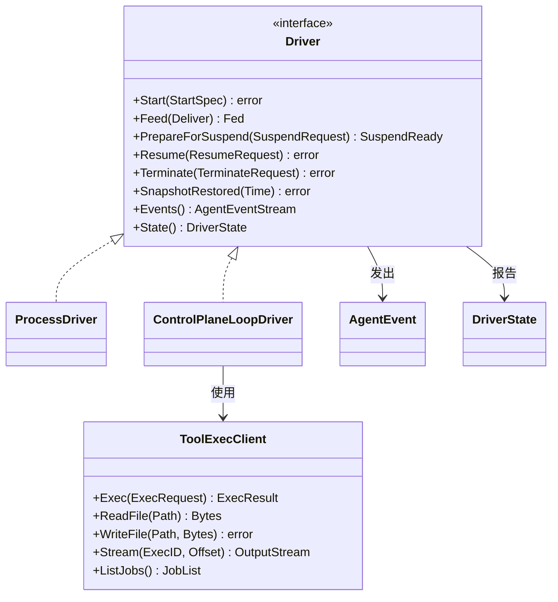
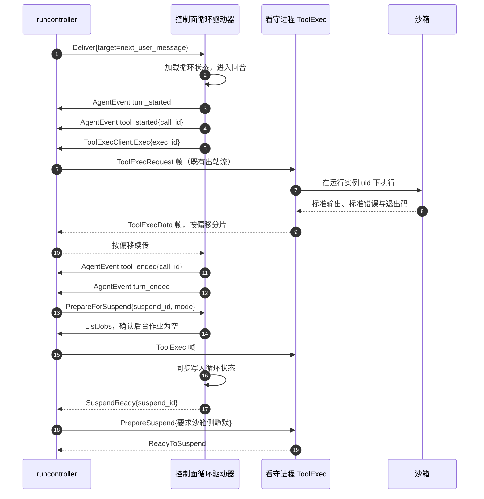

# 控制面循环驱动器

控制面循环驱动器是 [Agent 驱动器接口](../../../glossary.md)的定义者与实现之一，与[沙箱](../../../glossary.md)内的[进程驱动器](../../../glossary.md)共用同一接口。其实现运行在控制面，以链接进 `runcontroller` 进程的库形式存在，运行平台原生 Agent 的模型循环；第一版只定义该接口。它不拥有协议信封与重放、运行实例状态机、挂起决策、沙箱生命周期与 `ToolExec` 的沙箱侧实现；这些分别归 `agentprotocol`、`runcontroller`、`suspendpolicy`、`sandboxprovider` 与看守进程。心智模型：接口是两种循环共用的插座，进程驱动器把 Claude Code 进程插进去，控制面循环驱动器把一个运行在控制面的模型循环插进去，沙箱对控制面循环驱动器只是工具执行器（[ADR-dual-agent-loop-location](../../../adr/adr-dual-agent-loop-location.md)）。

文档较长，第一次阅读按以下顺序：核心概念、职责、外部接口契约、走查、回合生命周期、输入翻译、事件输出、挂起与恢复、`ToolExec` 的使用；术语表、依赖、UML 图、核心数据结构、错误与失败语义与并发与事务边界作为参考，在核对接口操作、字段或失败路径时查阅。

## 核心概念

本模块围绕两种循环共用的 Agent 驱动器接口组织：接口把 Agent 循环与 `runcontroller` 之间的交互固定为同一套契约，循环位置不改变 `runcontroller` 看到的事件、投递与挂起恢复语义。沙箱内的进程驱动器驱动 Claude Code 进程，本模块的控制面循环驱动器在控制面运行平台原生 Agent 的模型循环；两者实现同一接口，[收件箱](../../../glossary.md)、游标与[唤醒谓词](../../../glossary.md)共用一套规则。控制面循环把沙箱只当工具执行器，不假定其中存在 Agent 进程、会话文件或 hook；实现形式是链接进 `runcontroller` 进程的库，`ToolExec` 帧沿该运行实例已有的[出站流](../../../glossary.md)往返。系统需要这个机制：控制面循环因此不持有[运行实例令牌](../../../glossary.md)，也不建立第二条协议会话；平台原生 Agent 的循环不必打包进沙箱镜像，新增一种循环不改变 `runcontroller`、`suspendpolicy` 或协议消息。

## 职责

控制面循环驱动器的职责穷举如下，每条先写执行的动作，再写产生的结果或边界；具体接口、字段与算法见后续章节。

- **定义 Agent 驱动器接口**：规定启动、喂入、挂起准备、恢复、终止、快照恢复衔接、事件流与状态查询操作，以及每个操作的输入、输出与前置条件；结果是两种循环共用同一套翻译层，`runcontroller` 不按循环位置分支。
- **规定事件集合与顺序**：要求两种驱动器使用同一套 `AgentEvent` 种类与字段，规定回合开始与结束、工具、权限询问、等待、订阅、定时与后台作业事件的触发点与顺序，自唤醒条目事件只由存在自唤醒源的驱动器发出，[等待意图](../../../glossary.md)事件只由解析等待意图的驱动器发出；结果是收件箱、游标与唤醒谓词不依赖循环位置。
- **规定 `Deliver` 翻译**：为 `next_user_message`、`tool_result{call_id}`、`permission_decision{id}` 与 `resume_session_id` 规定翻译语义，两种驱动器各自实现原生形态；结果是投递的两级确认对两种循环一致。
- **规定挂起与恢复语义**：定义回合边界、恢复点、以挂起为目的的退出、恢复句柄与快照恢复后的衔接；结果是两种循环的挂起决策与恢复准入使用同一套规则。
- **规定 `ToolExec` 的使用**：定义 exec、文件读写、流式输出与后台作业在控制面循环中的用法、帧关联、偏移续传与错误处置；结果是沙箱内没有 Agent 进程时仍可作为工具执行器使用。
- **实现控制面循环驱动器**：作为库链接进 `runcontroller`，运行原生 Agent 循环，经出站流上的 `ToolExec` 帧调用沙箱，按接口发出事件、接收 `Deliver`、执行挂起准备与恢复；结果是平台原生 Agent 不需要打包进沙箱镜像，也不需要独立的沙箱凭据与协议会话。
- **持久化循环状态**：在恢复点保存回合位置、待决工具调用、已交付输入与恢复句柄；结果是不依赖 Agent 原生会话持久化也能跨代续接。
- **维护两类驱动器的契约一致性**：以同一套事件、目标闭集与契约测试约束两种实现；结果是新增一种驱动器不修改 `runcontroller`、`suspendpolicy` 或协议消息。

### 非职责

非职责举例如下，判定标准为：职责清单之外、由主文档、同级子模块或其他模块拥有的事实与机制。

- 协议信封、消息序号、重放、按 `(generation, msg_seq)` 去重与协议版本归 `agentprotocol`；本模块只声明接口级事件与翻译语义。
- 运行实例状态机、收件箱、唤醒谓词、投递游标、代与失效判定归 `runcontroller`；本模块只发出同一套事件并按 `Deliver` 喂入。
- 挂起决策、冻结上限、DRAIN 与冻结中复评归 `suspendpolicy`；本模块只执行挂起准备并报告恢复点。
- 沙箱预配、冻结、快照、销毁与工作区租约归 `sandboxprovider` 与 `workspace`；本模块不管理沙箱生命周期。
- `ToolExec` 的沙箱侧实现、出站流鉴权、路径边界与进程执行归看守进程；本模块只按契约调用。
- Claude Code 的启动命令、hooks、托管设置与 stream-json 翻译归 [Claude Code 驱动器](design-warden-driver-claude-code.md)；本模块只定义它必须实现的接口。
- 审批决定的内容与人类身份归 `humanchannel`；本模块只接收决定并解除循环中的等待。
- 控制面循环的模型调用在控制面执行，其上游选择与凭据由实现该循环的模块决定；看守进程不代理控制面的模型调用。
- 投递意图日志的跨代去重规则归看守进程主文档；控制面循环驱动器按同一两级确认语义报告 `fed` 与消费位置，不自行重定义协议。

## 术语表

| 术语 | 英文对照 | 适用范围 | 定义 |
| --- | --- | --- | --- |
| 循环状态 | loop state | warden 控制面循环驱动器 | 控制面循环自行持久化的回合位置、对话、待决工具调用、已交付输入与恢复句柄；用于跨代续接。 |
| 恢复点 | resume point | warden 控制面循环驱动器 | 控制面循环可以安全挂起或重启的位置：无在途模型调用、无未确认工具调用、循环状态已同步写入。 |
| 输入翻译 | delivery translation | warden Agent 驱动器接口 | 把 `Deliver.target` 映射为某 Agent 原生输入的函数；接口规定映射的种类，驱动器实现具体形态。 |
| 工具执行记录 | tool execution record | warden 控制面循环驱动器 | 控制面循环为一次工具调用保存的 `call_id`、`exec_id`、输出偏移与结果；用于恢复后查询而不重发。 |

## 外部接口契约

本模块的接口对两种驱动器实现稳定：进程驱动器与控制面循环驱动器逐项实现同一接口，`runcontroller` 不感知循环位置。事件字段受 `agentprotocol` 的协议版本约束；`ToolExec` 帧对控制面循环稳定；挂起与恢复语义对 `runcontroller` 与 `suspendpolicy` 稳定。新增操作、事件种类或目标种类都改变跨模块契约，须同时修改 `agentprotocol`、`runcontroller` 与两种驱动器。控制面循环驱动器在宿主进程内使用 `runcontroller` 注入的事件入口与 `ToolExecClient`；它不持有运行实例令牌，不发起 `Hello`，也不参与出站流的序号与重放。

### Agent 驱动器接口

```go
type Driver interface {
    Start(ctx context.Context, spec StartSpec) error
    Feed(ctx context.Context, d Deliver) (Fed, error)
    PrepareForSuspend(ctx context.Context, req SuspendRequest) (SuspendReady, error)
    Resume(ctx context.Context, req ResumeRequest) error
    Terminate(ctx context.Context, req TerminateRequest) error
    SnapshotRestored(ctx context.Context, at time.Time) error
    Events() <-chan AgentEvent
    State() DriverState
}

type StartSpec struct {
    ResumeHandle string        // 恢复句柄；为空表示新会话
    Cwd          string        // 与工作区挂载路径逐字一致
    Env          []string      // 驱动器专属环境变量；含工具接入声明的凭据占位符环境变量与非秘密配置
}

type Fed struct {
    Fed         bool           // 按去重后是否仍有事件喂入
    TurnID      string         // 喂入后开始的回合；未喂入时为空
    AgentExited bool           // 喂入时 Agent 是否已退出
}

type SuspendReady struct {
    ExitedAt       time.Time
    SessionID      string
    ProcsRemaining int
    WsWriteFDs     int
}

type DriverState struct {
    Phase        string        // starting、in_turn、blocked、boundary、exited
    TurnID       string
    SessionID    string
    BlockedOn    *BlockedOn
    BgJobs       []string
    SelfWake     []SelfWakeEntry // 自唤醒条目，项结构取自 agentprotocol 的 self_wake_changed；没有自唤醒源的驱动器为空
    CronsSynced  bool          // 语义同 agentprotocol 的 self_wake_changed.crons_synced；没有自唤醒源的驱动器不使用
    RunningTools []string
}
```

`Deliver` 与 `AgentEvent` 的字段取自 `agentprotocol`；`SuspendRequest`、`ResumeRequest` 与 `TerminateRequest` 由本接口定义，分别复用 `PrepareSuspend`、`Resumed` 与 `Shutdown` 的字段语义；`BlockedOn` 取 `agentprotocol` 中 `Hello.agent_state.blocked_on` 的结构。`Start` 只在无活动实例时调用；`Feed` 按到达顺序串行调用；`PrepareForSuspend` 只在回合边界调用；`Resume` 在同一代解冻与新代续接时调用；`Terminate` 按优雅程度区分；`SnapshotRestored` 在看守进程完成校时之后调用。

| 操作 | 前置条件 | 结果与边界 |
| --- | --- | --- |
| `Start` | 无活动实例；`ResumeHandle` 为空或指向可读的会话 | 启动原生 Agent 或控制面循环；失败时返回错误，不发出 `turn_started`。看守进程处理 `StartAgent` 时只调用 `Start`、不调用 `Feed`，进程驱动器启动后处于 `boundary`；控制面循环没有自唤醒源，`runcontroller` 不为它发出 `StartAgent` |
| `Feed` | 接口处于 `starting`、`in_turn`、`blocked` 或 `boundary` | 返回 `fed`、`turn_id` 与 `agent_exited`；`fed=false` 时不启动回合 |
| `PrepareForSuspend` | 回合边界；I9 前置检查可执行 | 返回 `SuspendReady`，或返回 `Busy` 语义的错误；不绕过检查 |
| `Resume` | 同一代解冻，或新代已预配 | 恢复原生 Agent 或循环状态；失败时按恢复失败处置 |
| `Terminate` | 任意阶段 | 优雅终止或强制终止；之后释放工具执行与循环资源 |
| `SnapshotRestored` | 看守进程已校时并清理旧连接 | 重建超时与流偏移；不重放已交付输入 |
| `Events` | 任意阶段 | 事件流；回合内事件的 `event_seq` 在同一回合内单调，回合外事件的 `turn_id` 与 `event_seq` 为空；终止后关闭 |
| `State` | 任意阶段 | 返回阶段、回合、会话、阻塞条件、后台作业与自唤醒条目快照 |

### 对 `runcontroller` 的事件

两种驱动器使用同一套 `AgentEvent` 种类与字段，由 `agentprotocol` 定义。下表按接口操作列出触发点；控制面循环没有原生 `session_state_changed` 时，以回合结束作为等价信号并发出 `state_changed{idle}`，事件种类不变。`self_wake_changed{entries, crons_synced}` 只由存在[自唤醒源](../../../glossary.md)的驱动器发出（[Claude Code 驱动器](design-warden-driver-claude-code.md)）；控制面循环没有会话内定时等自唤醒源，定时只经 `timer_requested` 登记，控制面循环驱动器不产生该事件，运行实例的自唤醒集合因而为空，`runcontroller` 不为其发出 `StartAgent`。`intent_observed` 只由解析等待意图的驱动器发出（Claude Code 驱动器）；控制面循环的阻塞点由 `WaitDeclared` 显式声明，控制面循环驱动器不产生该事件。`subscription_created` 与 `wait_started` 的 `agent_expected_ms` 只取 Agent 经工具参数 `expected_wait` 自报的预计等待时长，没有自报时为空，与 `predicted_ms` 分开上报。

| 事件 | 触发点 | 约束 |
| --- | --- | --- |
| `turn_started{session_id, delivery_id}` | `Feed` 返回 `fed=true` 且回合开始 | `delivery_id` 为本回合消费的投递；循环自行开始的回合为空 |
| `turn_ended{reason, agent_exited, bg_procs}` | 回合到达恢复点，或 `Terminate` 后 | 回合结束的判定由驱动器实现；`agent_exited` 为真时表示原生 Agent 退出 |
| `tool_started{call_id}` | 开始一次工具调用，或发出一次 `ToolExec` 调用之前 | `call_id` 由驱动器分配，同一回合唯一 |
| `tool_ended{call_id}` | 工具调用结束或失败 | 与 `tool_started` 配对；未配对的调用在 `turn_ended` 时清理 |
| `permission_requested{id, call_id, blocking}` | 循环需要审批 | `blocking` 表示是否在回合中阻塞等待 |
| `wait_started{call_id, kind, ref, fire_at, predicted_ms, agent_expected_ms}` | 循环开始一次阻塞等待 | `kind` 取 `wait_for`、`timer`，与 `runcontroller` 的 `blocked_on.kind` 中对应种类一致；`sleep_until` 映射为 `timer`；`agent_expected_ms` 没有自报时为空 |
| `subscription_created{sub_id, since_cursor, agent_expected_ms}` | 循环登记订阅 | 由平台 MCP 服务器或控制面循环自身登记；`agent_expected_ms` 没有自报时为空 |
| `timer_requested{timer_id, fire_at, scope}` | 循环登记定时 | `scope` 只取 `run` |
| `bg_jobs_changed{job_ids}` | `ToolExec` 后台作业集合变化 | 携带完整集合；未结束的作业使回合边界不构成安全点；回合结束之后集合变化时作为回合外事件发出 |
| `self_wake_changed{entries, crons_synced}` | 控制面循环驱动器不发出 | 由存在自唤醒源的驱动器发出；可作为回合外事件发出 |
| `intent_observed{ref_kind, ref, class, target, expected_ms, prior, source, confidence}` | 控制面循环驱动器不发出 | 由解析等待意图的驱动器发出；`prior{p25, p50, p90}` 只在 `source=signature` 时非空；同一 `(ref_kind, ref)` 后到的覆盖先到的；`ref_kind`、`class`、`source` 越出闭集或 `class` 不属于 `ref_kind` 对应的闭集时，接收方丢弃该事件并计数，不终止传输；可作为回合外事件发出 |
| `state_changed{idle\|requires_action}` | 驱动器有对应的原生状态时；控制面循环没有原生状态时在回合结束发出 `state_changed{idle}` | 不替代 `turn_ended`；进程驱动器在没有进行中回合时发出的为回合外事件 |

回合内事件在 `turn_started` 之后、`turn_ended` 之前按发生顺序发出，`event_seq` 在同一回合内单调。`turn_ended` 只在恢复点或终止后发出；回合进行中的工具与等待事件不得晚于它。`bg_jobs_changed`、`self_wake_changed`、`intent_observed` 与 `state_changed` 等事件也可以在没有进行中回合时发出，这类回合外事件的 `turn_id` 与 `event_seq` 为空，`event_seq` 的单调约束只及于回合内事件。回合外事件的顺序：进程驱动器的事件经看守进程的出站流发送，由 `msg_seq` 保证；控制面循环驱动器的事件经宿主的事件入口按发出顺序交给 `runcontroller`。集合类事件按替换语义处理，`self_wake_changed` 按 [runcontroller](../design-runcontroller.md) 的合并规则处理，`intent_observed` 按 `(ref_kind, ref)` 以后到者覆盖先到者，重复与乱序不改变结果。

`WaitDeclared` 的生产者是 L2 协作式 Agent 的驱动器。控制面循环驱动器在循环进入一个可持久化的阻塞点时，经宿主 `runcontroller` 注入的事件入口提交声明，由宿主调用 `RunService.DeclareWait`，字段与 `agentprotocol` 的 `WaitDeclared` 相同（`wait_id`、`scope`、`conditions`、`deadline`、`safe_to`），以 `wait_id` 幂等；条件种类与 `runcontroller` 的 `declared_kind` 闭集一致（`llm`、`timer`、`approval`、`wait_for`），`scope=run` 时只取 `approval`、`wait_for`、`timer`；`timer` 条件必须引用同范围且存在的定时器。沙箱内运行 L2 Agent 的进程驱动器经看守进程的出站流发送同一消息。第一版托管的 Claude Code 属于 L1，不发送 `WaitDeclared`；该消息与接口为 L2 保留。

### `Deliver` 的翻译规则

`Deliver.target` 是闭集，两种驱动器按同一张表翻译，原生形态不同。

| `target` | 进程驱动器 | 控制面循环驱动器 |
| --- | --- | --- |
| `next_user_message` | 写入 `stream-json` 用户消息；进程已退出时先以 `resume_session_id` 启动 | 追加到循环状态的对话，启动或继续模型循环 |
| `tool_result{call_id}` | 写入含 `tool_result` 块的用户消息 | 解除对应待决工具调用，把结果交回循环 |
| `permission_decision{id}` | 交给挂起的 `PreToolUse` hook；进程已销毁时以 `--resume` 续接 | 解除对应待决审批，把允许或拒绝交回循环 |
| `resume_session_id` | 以 `--resume <session_id>` 启动 | 按恢复句柄加载循环状态 |

`redelivery=true` 不改变翻译形态，只表示输入可能已被处理；驱动器不自行去重，`Feed` 的 `fed` 报告按去重后是否仍有事件喂入。定向投递与回合边界续接的消费按两级确认语义报告，不推进 `cursor_accepted`。

### 挂起与恢复语义

以挂起为目的的销毁只在回合边界；回合中只允许冻结或快照。`PrepareForSuspend` 的检查按 I9 与恢复点执行：

1. 回合已到达恢复点：无在途模型调用，无未确认的工具调用，循环状态已同步写入。
2. `ToolExec` 无在途执行；后台作业为空，驱动器不为挂起终止后台作业。
3. 活动度静默不短于 `Q_quiet`：由看守进程的活动度采集提供；控制面循环没有 Agent 进程时，静默窗内无工具执行与后台作业时成立。
4. 工作区[持久化确认](../../../glossary.md)完成；本代没有工作区写文件描述符。
5. 需要销毁时，恢复句柄已确定并由 `SuspendReady.SessionID` 报告；控制面落库后才销毁。

控制面循环没有自唤醒条目，I9 中关于自唤醒条目随续接恢复的一项恒成立；`SuspendRequest` 复用 `PrepareSuspend` 的字段语义，其中的 `self_wake_cutoff` 对控制面循环驱动器不起作用。进程驱动器在安全点只检查 `fire_at` 为空或不早于 `self_wake_cutoff` 的自唤醒条目，规则见 [Claude Code 驱动器](design-warden-driver-claude-code.md)。

`Resume` 分两种：同一代解冻时继续原循环，`SnapshotRestored` 重建超时与流偏移；新代续接时按恢复句柄加载循环状态，重新建立 `ToolExec` 调用，不重放未确认的工具调用。工具调用以 `call_id` 与 `exec_id` 标识，恢复后先查询结果，查询不到时把该调用作为失败结果交回循环，不重新执行有副作用的命令。

### `ToolExec` 的操作集合

控制面循环通过下列操作使用沙箱；操作语义、路径边界与鉴权由 [看守进程](design-warden.md) 定义，本模块只规定调用方式。

| 操作 | 控制面循环的用法 |
| --- | --- |
| exec | 执行工具命令，返回退出码与标准输出、标准错误流；命令继承工具接入声明的凭据占位符环境变量与非秘密配置 |
| 文件读 | 读取运行实例子目录内的文件，作为工具结果的一部分 |
| 文件写 | 在运行实例子目录内写入文件，作为工具副作用 |
| 流式输出 | 按输出偏移续传一次执行或后台作业的输出；断线后从上次偏移继续 |
| 后台作业 | 列出、查询与终止后台作业；未结束的作业计入后台作业集合 |

每次调用经宿主写入本代出站流并按代校验；`Shutdown` 与 `Fenced` 到达后停止新调用并终止在途执行。控制面循环不得假定沙箱内存在 Agent 进程、会话文件或 hook；它只把沙箱当作工具执行器。

### `ToolExec` 的传输与鉴权

`ToolExec` 是看守进程在出站流上处理的一组帧，不是沙箱地址上的独立 gRPC 服务。控制面循环驱动器在宿主进程内调用 `ToolExecClient`，由 `runcontroller` 把请求帧写入该运行实例已有的出站流；看守进程在同一流上以响应帧与数据帧应答。请求、数据与应答以 `(run_id, generation, exec_id)` 关联，`msg_seq`、`ack_msg_seq`、重放与去重沿用出站流，不建立第二个序号域。帧集合为 `Exec`、`ReadFile`、`WriteFile`、`Stream`、`ListJobs`、`GetJob`、`TerminateJob` 与 `Cancel`；`Exec` 与 `Stream` 的输出以带偏移的数据帧分片返回。

鉴权由出站流承担：流由看守进程主动建立并以运行实例令牌通过 `Hello` 认证，只有当前代的流接受 `ToolExec` 帧。控制面循环驱动器不持有令牌，也不得直接连接沙箱；宿主只在该运行实例由本进程拥有、帧的代等于当前代且运行实例未终态时写入请求帧。错误以响应帧返回：令牌或代问题在流层已按 `Fenced`、可重试关闭或认证失败处置；路径越界与未知执行标识返回未找到，偏移无效返回参数非法，输出超出上限返回资源耗尽，`Shutdown` 与 `Fenced` 之后的请求返回已中止。

每次调用携带截止时间；截止到期只结束本次流，已启动的执行不被终止，调用方以 `GetJob` 查询结果。`ToolExec` 帧不承载 `AgentEvent`：控制面循环驱动器经宿主提供的事件入口把 `AgentEvent` 交给 `runcontroller` 的同一套进入规则，并从中接收 `Deliver`、挂起准备与恢复通知；它不发送 `Hello`，也不与看守进程争用 `msg_seq`。

### 稳定性承诺

- 接口操作、事件种类（`self_wake_changed` 只由存在自唤醒源的驱动器发出，`intent_observed` 只由解析等待意图的驱动器发出）、`Deliver.target` 闭集、`agent_state.phase` 闭集与挂起/恢复语义对两种驱动器稳定；新增一种驱动器实现不修改 `runcontroller`、`suspendpolicy` 或协议消息。
- `ToolExec` 的操作集合对控制面循环稳定；新增操作须同时修改看守进程主文档、本模块与 `agentprotocol`。
- 接口变更须同时覆盖进程驱动器与控制面循环驱动器，并以同一套契约测试约束；事件种类变化另须提升协议版本。

## 依赖

代码依赖只有 `agentprotocol`，与[模块依赖图](../../architecture.md#模块依赖图)一致；对 `ToolExec` 的调用是运行时接口调用，不是代码依赖。

- `agentprotocol`：`AgentEvent`、`Deliver`、`PrepareSuspend`、`Resumed`、`Shutdown` 与 `ToolExec` 帧的字段与发送；本模块只声明接口级操作与触发点。
- 看守进程的 `ToolExec`：exec、文件读写、流式输出与后台作业的运行时契约；沙箱侧实现归看守进程，帧在已认证的出站流上传输。
- `runcontroller`：状态机效果、投递选择、游标推进与恢复准入；本模块不复制其规则。
- `suspendpolicy`：挂起决策、冻结上限与恢复点相关的策略参数；本模块只执行挂起准备。
- 循环状态的持久化：位置由实现选定，约束是跨代可读、在恢复点同步写入，并与工作区或控制面持久化同寿命；恢复句柄经 `Deliver.resume_session_id` 与 `SuspendReady.SessionID` 传递。
- 控制面循环的模型调用：在控制面执行，上游与凭据由实现该循环的模块决定；不经过看守进程的本地代理。

方向约束：本模块只依赖 `agentprotocol`；`ToolExecClient` 与事件入口由宿主 `runcontroller` 注入，本模块不引用 `runcontroller` 导出的接口或类型。`runcontroller` 以库的形式链接本模块并调用 Agent 驱动器接口，对应模块依赖图中 `runcontroller` 到 `warden` 的边，该边只及于本模块。新增一种驱动器实现不改变本模块的接口，只增加一个实现面。把控制面循环驱动器部署为独立进程需要另行定义受限的驱动器身份与会话，第一版不做。

## UML 图

下列图分别固定接口的实现关系与控制面循环使用沙箱的顺序；图中不表达的约束由每张图后的正文给出。

### 驱动器接口类图



图固定两种实现与接口的关系：`ProcessDriver` 与 `ControlPlaneLoopDriver` 实现同一接口，`ProcessDriver` 驱动沙箱内的 Claude Code，`ControlPlaneLoopDriver` 在控制面运行循环；只有控制面循环驱动器依赖 `ToolExecClient`，进程驱动器不依赖它。接口不定义协议字段，`AgentEvent` 与 `Deliver` 的字段归 `agentprotocol`。

### 控制面循环驱动器与看守进程的交互时序图



图固定控制面循环与沙箱之间的边界：循环在控制面运行并链接进 `runcontroller`，沙箱只执行工具；`ToolExec` 帧经看守进程已认证的出站流往返，输出按偏移续传；驱动器不持有令牌，也不建立第二条会话。挂起准备由驱动器先停循环、确认后台作业为空并持久化循环状态，看守进程再确认沙箱侧静默；后台作业未结束时驱动器返回 `Busy` 语义的错误，不为挂起终止作业。沙箱内没有 Agent 进程，因此 `ReadyToSuspend.session_id` 不来自沙箱内的进程，恢复句柄由循环状态与 `Deliver.resume_session_id` 承载。

## 核心数据结构

### 驱动器状态

| 字段 | 含义 |
| --- | --- |
| `phase` | `starting`、`in_turn`、`blocked`、`boundary` 或 `exited`；与 `agent_state.phase` 一致 |
| `turn_id` | 当前或最近一个回合的标识 |
| `session_id` | 循环的恢复句柄；由控制面循环定义并持久化 |
| `blocked_on` | 当前的阻塞条件；`kind` 取 `llm`、`timer`、`approval` 或 `wait_for` |
| `bg_jobs` | 未结束的 `ToolExec` 后台作业 |
| `running_tools` | 未配对的工具调用 |
| `loop_state_ref` | 循环状态的引用；恢复时按它加载 |

### 状态一览

| 状态 | 一句话含义 | 当前动作（控制面循环驱动器） | 直觉画面 |
| --- | --- | --- | --- |
| `starting` | 循环已加载但尚未开始处理输入 | 把首条输入加入循环状态并等待首个事件 | 刚上电，尚未开跑 |
| `in_turn` | 正在执行一个回合 | 运行模型循环，经 `ToolExec` 调用工具 | 流水线运转 |
| `blocked` | 回合停在需要外部条件的等待点 | 上报阻塞条件，等待唤醒信号或 `Deliver` | 停在收费站前 |
| `boundary` | 回合已结束，循环可挂起 | 持久化循环状态，等待下一条输入或挂起准备 | 到站熄火但未拔钥匙 |
| `exited` | 循环已终止 | 释放工具执行与循环资源，保留恢复句柄 | 已熄火拔钥匙 |

### 循环状态

| 字段 | 含义 |
| --- | --- |
| `turn_position` | 当前回合的位置：`idle`、`in_turn` 或 `boundary` |
| `conversation` | 控制面循环的对话与模型调用历史；由实现定义格式 |
| `pending_tool_calls` | 已发出但未确认结果的工具调用，按 `call_id` 索引 |
| `consumed_deliveries` | 已喂入的投递标识；用于重投时的去重与 `fed` 判定 |
| `next_event_seq` | 下一回合内事件的序号 |
| `resume_handle` | 恢复句柄；`Deliver.resume_session_id` 与 `SuspendReady.SessionID` 使用 |
| `updated_at` | 最近一次同步写入的时刻 |

循环状态在恢复点同步写入；写入未完成时不得报告 `SuspendReady`。状态格式与存储位置由实现选定，接口只要求跨代可读。

### 工具执行记录

| 字段 | 含义 |
| --- | --- |
| `call_id` | 驱动器分配的工具调用标识；`tool_started` 与 `tool_ended` 使用 |
| `exec_id` | 驱动器分配的执行标识，随 `exec` 请求帧发出；流式输出与查询使用 |
| `operation` | exec、文件读、文件写、流式输出或后台作业 |
| `args_digest` | 调用参数的摘要；用于恢复后核对，不用于重发 |
| `output_offset` | 已消费的输出偏移；断线后从此处续传 |
| `state` | 已发出、运行中、已完成或失败 |
| `result` | 退出码、输出摘要或错误 |

## 核心算法与流程

### 走查

**控制面循环的一次工具调用、回合边界与跨代续接。** 初始条件：运行实例 `run-9` 处于第 2 代，循环状态为 `boundary`，无待决工具调用；收到 `Deliver{delivery_id=d-7, batch=[3], through_seq=3, target=next_user_message, resume_session_id=ls-4}`。

| 步骤 | 事件或调用 | 循环状态 | 工具执行记录 |
| --- | --- | --- | --- |
| 1 | `Feed` 收到投递，按 `consumed_deliveries` 去重后 `3` 未消费 | 追加输入；`turn_position=in_turn`；`fed=true` | 无 |
| 2 | 发出 `turn_started{turn_id=turn-11, delivery_id=d-7}` | `turn_id=turn-11` | 无 |
| 3 | 循环决定调用工具；发出 `tool_started{call_id=call-1}` | `running_tools={call-1}` | 建立 `call-1`，状态 `已发出` |
| 4 | 经宿主转发 `ToolExec exec` 帧，代与当前代一致 | 无变化 | `exec_id=x-1`，状态 `运行中` |
| 5 | 沙箱执行并返回标准输出、标准错误与退出码 | 无变化 | `output_offset` 随流式输出前进；状态 `已完成` |
| 6 | 发出 `tool_ended{call_id=call-1}`，把结果加入循环状态 | `running_tools` 清空 | 保存结果 |
| 7 | 循环完成模型调用，进入恢复点；发出 `turn_ended` | `turn_position=boundary`；同步写入循环状态 | 无在途记录 |
| 8 | `PrepareForSuspend`：查询在途 `ToolExec`、确认后台作业为空、循环状态已写入 | 保持 `boundary` | 全部记录终态 |
| 9 | 返回 `SuspendReady{SessionID=ls-4}`；控制面销毁沙箱，进入 `Suspended{destroyed}`；下一次重建准入放行时代递增为 3 | 循环状态保留 | 工具记录保留 |
| 10 | 新代 `Deliver{resume_session_id=ls-4}`；`Resume` 加载循环状态 | 从 `boundary` 进入 `in_turn` | 无待决调用 |

走查确认工具配对、恢复点与跨代续接的结论。`tool_started` 先于 `ToolExec exec` 发出，`tool_ended` 在结果写入循环状态之后发出，`runcontroller` 看到的工具配对与控制面循环的实际执行一致。恢复点要求无在途模型调用、无未确认工具调用与循环状态已写入；`ToolExec` 的记录在终态后才允许 `SuspendReady`。跨代续接按 `ls-4` 加载循环状态，不重新执行 `call-1`；若恢复后需要确认该调用的结果，先按 `exec_id` 查询，查询不到时把失败结果交回循环。

### 回合生命周期

一个回合从 `Feed` 返回 `fed=true` 开始，到恢复点结束。回合进行中只有一次模型调用与零到多次工具调用；工具调用可以并行，但 `turn_ended` 必须晚于全部 `tool_ended`。回合结束的条件由驱动器实现定义：控制面循环没有原生 `idle` 信号时，以模型调用完成、无待决工具调用且无待处理输入作为等价条件。

同一时刻只有一个回合。回合进行中收到的 `next_user_message` 追加到循环状态，在当前回合结束后作为下一条输入处理；`Deliver` 的 `fed` 报告本批是否已喂入，未喂入时 `TurnID` 为空。循环自行开始的回合（例如后台任务触发）`turn_started.delivery_id` 为空，仍按同一生命周期结束。

### 输入翻译

`Deliver.target` 的翻译按外部接口契约中的表执行。控制面循环的翻译不涉及 stdin、hook 或 `--resume`：`next_user_message` 追加到对话，`tool_result` 解除待决工具调用，`permission_decision` 解除待决审批，`resume_session_id` 加载循环状态。

翻译的边界：`target` 未在闭集中时回 `DeliveryFailed{retryable=false}`；目标已失效（对应的工具调用或审批已结束）时回 `DeliveryFailed{reason=target_gone}`；`redelivery=true` 不改变翻译，去重由 `consumed_deliveries` 与 `fed` 报告承担。

### 事件输出

事件按外部接口契约中的触发点发出，顺序约束为：`turn_started` 先于本回合全部工具、等待与状态事件，`turn_ended` 最后；回合内事件的 `event_seq` 在同一回合内单调，按 `event_seq` 丢弃重复或乱序事件的规则只适用于回合内事件。`tool_started` 与 `tool_ended` 按 `call_id` 配对；`bg_jobs_changed` 在集合变化时以完整集合发出，未结束的作业使回合边界不构成安全点。回合结束之后 `ToolExec` 后台作业结束时，`bg_jobs_changed` 作为回合外事件发出，`turn_id` 与 `event_seq` 为空，接收方按替换语义处理。

控制面循环没有 `requires_action` 概念；此时以回合结束作为等价信号发出 `state_changed{idle}`，由 `turn_ended` 表达回合边界。事件种类由 `agentprotocol` 定义，不因实现而增加；控制面循环驱动器不产生 `self_wake_changed` 与 `intent_observed`，循环的阻塞点经 `WaitDeclared` 显式声明，不需要宿主推断等待意图。

### 挂起与恢复

**挂起。** `PrepareForSuspend` 只在回合边界调用。驱动器先停止接受新的模型调用与工具调用，等待在途 `ToolExec` 完成或记录其终态，确认后台作业为空，把循环状态同步写入，再返回 `SuspendReady`。任一条件不满足时返回 `Busy` 语义的错误，不报告成功。

**同一代解冻。** `Resume` 继续原循环；`SnapshotRestored` 在校时之后重建超时与流偏移，按 `output_offset` 续传，不重放已交付输入。

**新代续接。** `Resume` 按恢复句柄加载循环状态；待决工具调用先按 `exec_id` 查询结果，查询不到时作为失败结果交回循环；不重新执行有副作用的命令。循环状态中的 `consumed_deliveries` 防止重投的事件被再次喂入。

**终止。** `Terminate` 停止新调用，取消在途执行，释放工具执行与循环资源；优雅终止允许在途调用完成，强制终止直接取消。终止后事件流关闭。

### `ToolExec` 的使用

`ToolExec` 的调用按以下规则：

1. 每次调用经宿主写入本代出站流；流已关闭、代不匹配或运行实例已终态时，调用按不可重试错误返回，循环把错误作为工具结果。
2. 驱动器为每次 `exec` 分配同一代内唯一的 `exec_id` 并随请求帧发出，以 `call_id` 与 `exec_id` 建立工具执行记录；`tool_started` 在调用之前发出，`tool_ended` 在结果写入循环状态之后发出。
3. 流式输出按 `output_offset` 续传；断线后先查询执行状态，再从上次偏移继续，不从零重放。
4. 后台作业由 `exec` 启动；驱动器按循环的需要列出、查询与终止作业，并在集合变化时发出 `bg_jobs_changed`。未结束的作业使回合边界不构成[安全点](../../../glossary.md)，运行实例不以挂起为目的销毁；驱动器不为挂起终止作业。
5. 文件读写在运行实例子目录内进行，路径越界按错误返回。
6. `Shutdown` 与 `Fenced` 到达后停止新调用，终止在途执行，不再接受新的工具调用。

### 复杂度

接口操作为 O(1) 次事件或状态写入；工具输出转发为 O(B)，B 为输出字节数；循环状态同步写入为 O(S)，S 为状态大小。恢复时的工具结果查询为每个待决调用一次，不重放执行。

## 错误与失败语义

失败的处置由恢复点、循环状态与两级确认组合表达。下表列出已明确处置路径的失败，各行是举例。

| 失败 | 处置 |
| --- | --- |
| 接口处于不合适的阶段调用 `Start` 或 `Feed` | 返回状态错误；不发出事件，不改变循环状态 |
| `Feed` 按去重后无事件可喂 | 返回 `fed=false`，`TurnID` 为空；不启动回合 |
| `Deliver.target` 越出闭集 | 回 `DeliveryFailed{retryable=false}`；不喂入 |
| 目标工具调用或审批已结束 | 回 `DeliveryFailed{reason=target_gone}`；控制面回退为常规投递 |
| `ToolExec` 鉴权失败、代不匹配或运行实例终态 | 调用返回不可重试错误；循环把错误作为工具结果，不重试 |
| `ToolExec` 执行启动失败 | 返回错误；`tool_ended` 携带失败结果，回合继续 |
| 流式输出偏移无效或执行已过期 | 返回错误；该工具调用按失败结果交回循环，不重放执行 |
| 后台作业未结束 | 不报告 `SuspendReady`，回合边界不构成安全点；不为挂起终止作业 |
| 循环状态同步写入失败 | 不报告 `SuspendReady`；按退避重试，控制面在 `retry_after` 后复评 |
| 在途工具调用未确认时请求挂起 | 返回 `Busy` 语义的错误；等待调用终态后重试 |
| 恢复句柄不可读或循环状态损坏 | 恢复失败达到上限后进入 `Degraded`；兜底路径改用新循环并合成摘要 |
| 同一代解冻后进程或循环不可继续 | 按终止处理；下一次投递以恢复句柄重新启动 |
| 模型调用失败 | 由控制面循环的重试策略处置；本接口只要求失败不被报告为回合成功 |
| `Shutdown{graceful=false}` 或 `Fenced` | 停止新调用，终止在途执行；事件流关闭 |
| `Shutdown{graceful=true}` | 停止新调用，允许在途调用按截止时间完成；未完成调用返回错误 |

## 并发与事务边界

控制面循环驱动器不参与看守进程的数据库事务；它的持久化边界是循环状态的同步写入与 `ToolExec` 记录的终态。运行实例状态的权威仍在控制面 PostgreSQL，接口只提交事件与喂入结果。

- **每运行实例单实例**：同一运行实例同一代只有一个循环驱动器实例；`Feed` 串行调用，回合不并发。
- **事件顺序**：回合内事件的 `event_seq` 在同一回合内单调；`turn_started` 先于工具与等待事件，`turn_ended` 最后；回合外事件不带 `event_seq`，按事件流的发出顺序交付；事件流是单写者。
- **挂起屏障**：`PrepareForSuspend` 先停止新调用，再等待在途调用终态，再同步写入循环状态，最后返回 `SuspendReady`；从停止新调用到返回 `SuspendReady` 之间不插入新的 `Feed`。
- **工具执行记录**：按 `call_id` 与 `exec_id` 索引；同一 `exec_id` 的流式输出只有单读者，偏移前进串行化。恢复后的查询不重发执行。
- **循环状态写入**：恢复点的写入先于 `SuspendReady`；写入失败时不报告成功。循环状态与事件流的顺序不跨代保证，跨代以状态为准。
- **`ToolExec` 调用的串行边界**：同一工具调用内的读写按调用顺序；不同调用可并发，`bg_jobs_changed` 的集合变化在驱动器锁内合并。
- **终止与恢复**：`Terminate` 与 `Resume` 不并发；终止后不再接受 `Feed`，恢复前不发出事件。
- **快照恢复**：`SnapshotRestored` 在看守进程校时与旧连接清理之后调用；调用之前驱动器不产生新事件。

## 扩展点

### 新增驱动器实现

新增驱动器实现同一接口：定义原生输入的翻译、回合结束的判定、恢复点与恢复句柄。新增实现不修改 `runcontroller`、`suspendpolicy` 或协议消息；接口变更须同时覆盖全部实现，并以同一套契约测试约束。

### 新增 `Deliver` 目标

新增目标种类须同时修改 `agentprotocol`、`runcontroller` 的投递选择与全部驱动器的翻译表；未列出的目标回 `DeliveryFailed`。新增目标不得改变 `Accepted` 与 `Consumed` 的两级确认语义。

### 新增 `ToolExec` 操作

新增操作须同时修改看守进程主文档、本模块的调用规则与 `agentprotocol` 的对应消息；操作须保持出站流鉴权与代校验、路径边界与错误分类。

### 新增事件种类

新增 `AgentEvent` 种类须提升协议版本，并同时修改 `agentprotocol`、`runcontroller` 的进入规则与全部驱动器；只用于旁证的信号不新增事件，按现有事件或内部记录表达。

## 实现状态

| 能力 | 状态 | 代码 |
| --- | --- | --- |
| Agent 驱动器接口定义 | 未实现 | — |
| 事件集合与顺序约束 | 未实现 | — |
| `Deliver` 翻译语义 | 未实现 | — |
| 挂起与恢复语义 | 未实现 | — |
| `ToolExec` 使用规则 | 未实现 | — |
| 控制面循环实现 | 未实现 | — |
| 循环状态持久化 | 未实现 | — |
| 两类驱动器的契约测试 | 未实现 | — |
