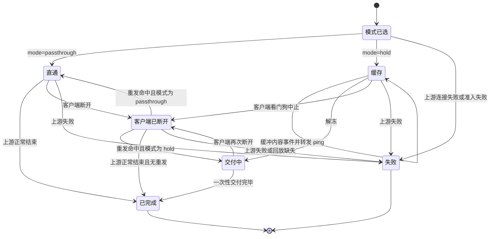
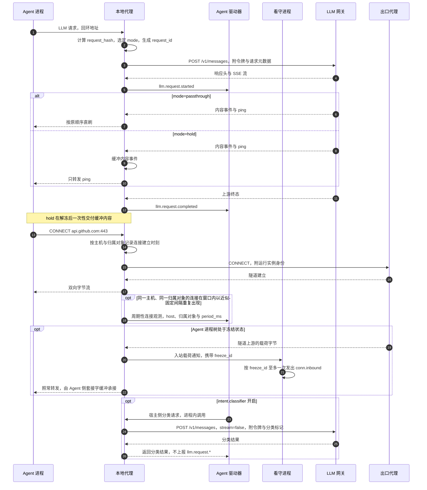

# 本地代理

[本地代理](../../../glossary.md)是[看守进程](../../../glossary.md)内不被[冻结](../../../glossary.md)的 HTTP 代理，是 Agent 进程使用代理变量的 LLM 与外部系统 HTTP 出口；`mitm` 与 `passthrough` 主机的流量由[本地 DNS](../../../glossary.md)指向同一看守进程内的[透明拦截器](../../../glossary.md)。它终止 Agent 的连接，把 LLM 请求附[运行实例令牌](../../../glossary.md)转发到 [LLM 网关](../../../glossary.md)，把外部系统请求以 CONNECT 或 HTTP 前置转发到[出口代理](../../../glossary.md)；透明拦截器把 `mitm` 与 `passthrough` 主机的原始 TLS 字节以 CONNECT 隧道转给出口代理。两者都不终止 TLS，TLS 终止与凭据替换由出口代理承担。每个 LLM 请求在开始时一次性选定[直通模式](../../../glossary.md)或[缓存模式](../../../glossary.md)，整个请求期间不再改变；[快照](../../../glossary.md)恢复后按 `request_id` 取回已完成响应。它还为看守进程记录最近一次 LLM 请求与最近一次可重试失败的时刻，按连接记录用途，在 Agent 进程树冻结期间观察非 LLM 上游连接上的入站载荷，按主机与归属对象识别周期性连接供 Agent 驱动器解析[等待意图](../../../glossary.md)，并把 Agent 驱动器的宿主侧分类请求转发到 `llmgateway`。它不拥有凭据换取、代校验、在途请求表与回放存储，这些归 `llmgateway`；也不拥有[出口策略](../../../glossary.md)与凭据替换，这些归 `connectorhub` 与出口代理；它不做 MITM，也不解释等待意图。心智模型：本地代理是 Agent 在[沙箱](../../../glossary.md)内按代理变量出站时经过的门，Agent 在门内，门在看守进程继续运行时保持开启（[ADR-two-tier-llm-proxy](../../../adr/adr-two-tier-llm-proxy.md)）。

文档较长，第一次阅读按以下顺序：核心概念、职责、外部接口契约、走查、请求接入与分类、模式选择、上游转发与流式处理、冻结与解冻期间的交付、客户端中止与重发、令牌轮换、恢复后取回、冻结期间的入站数据唤醒、周期性连接观测、宿主侧分类请求；术语表、依赖、UML 图、核心数据结构、错误与失败语义与并发与事务边界作为参考，在核对字段、事件顺序或失败路径时查阅。

## 核心概念

本地代理为每个 LLM 请求在开始时一次性选定请求模式，此后整个请求期间不再改变，客户端看门狗中止后的重发沿用原模式。`passthrough` 把内容事件按原顺序直刷给 Agent，写入受阻时对上游施加背压；`hold` 把内容事件全部缓冲在本地，只向 Agent 转发 `ping` 保活事件并持有上游连接，解冻后一次性交付。模式同时决定冻结的上限：`passthrough` 取 `F_stream`，`hold` 取 `F_cap(llm)`。

系统需要它，是因为[挂起](../../../glossary.md)发生在 Agent 等待 LLM 的时候：冻结期间 Agent 进程树不再读取连接，而本地代理不被冻结，仍持有到网关的上游连接，内容事件的去留必须逐请求决定。模式由请求开始时对等待时长的保守预测选定，把这个预测变成整个请求期内固定的处置，使冻结上限、客户端连接的维持方式与本地缓冲的内存占用都可判定，不受冻结、解冻、客户端中止与重发的影响。冻结上限、来源先验与置信度归 `suspendpolicy`；本地代理只给出单点预测 `predicted_ms` 并按模式执行。

## 职责

本地代理的职责穷举如下，每条先写执行的动作，再写产生的结果或边界；具体字段、状态与算法见后续章节。

- **终止 Agent 的出站连接**：在回环地址监听，接受 Agent 进程的 LLM 请求与外部系统请求，按请求形态分类；结果是 Agent 不需要、也不能直接到达回环地址之外的网络端点（I6）。
- **附加运行实例令牌**：为每个转发到 `llmgateway` 的 LLM 请求附加看守进程持有的运行实例令牌与请求元数据，并剥离 Agent 请求中的分类标记请求头 `x-castworks-purpose`；结果是 Agent 进程不持有任何令牌，凭据换取与代校验在网关完成，Agent 的请求不能以宿主侧分类请求的身份到达网关。
- **前置外部系统请求**：以 CONNECT 或 HTTP 前置把外部系统请求转发到出口代理，保持方法、路径、请求头与请求体不变，不替换凭据占位符；结果是出口策略与凭据替换只在托管侧执行，本地代理不做 MITM。
- **一次性选定请求模式**：在请求开始时选定 `passthrough` 或 `hold`，整个请求期间不再改变；结果是同一请求不会在直刷与缓冲之间切换，冻结上限由模式唯一决定。
- **直通转发**：在 `passthrough` 下按原顺序把 SSE 事件直刷给 Agent，冻结期间继续写入，写入受阻时对上游施加背压；结果是已向 Agent 转发内容的请求不进入缓冲，冻结不超过 `F_stream`，且一旦转发内容就不再延长。
- **缓存与保活**：在 `hold` 下缓冲全部内容事件，只向 Agent 转发 `ping` 保活事件，持有上游连接；结果是冻结期间客户端连接由保活事件维持，内容事件在解冻后一次性交付。
- **单次回放**：按 `(run_id, generation, request_hash)` 保存本地回放条目或进行中的上游流，客户端看门狗中止并重发时命中；结果是同一逻辑请求至多产生一次上游调用。
- **生成请求标识**：为每个逻辑请求生成 `request_id`，在同一运行实例内唯一（跨代不复用），不从 `request_hash` 派生；结果是请求事件、网关在途行与恢复取回共用同一标识。
- **上报请求事件**：向 Agent 驱动器发出 `llm.request.started`、`llm.first_token`、`llm.request.completed` 与 `llm.request.failed`；结果是 LLM 等待的主信号对托管环境可见，`mode` 决定 `runcontroller` 写入的冻结上限。
- **记录 LLM 请求时刻**：记录最近一次发出 LLM 请求与最近一次收到可重试失败（429、5xx、overloaded）的时刻，供看守进程填入 `Activity.llm_last_request_at` 与 `Activity.llm_last_retryable_failure_at`；结果是 `suspendpolicy` 能识别可重试失败之后 Agent 自身的重试窗，不在 Agent 进程内的重试定时器到点之前判定静止。
- **记录连接用途**：每次请求分类时按 Agent 侧连接端点记录该连接的用途，取 `llm` 或 `external`，并向看守进程提供按端点的查询；结果是冻结确认时的接收队列检查能排除承载 LLM 请求的连接，LLM 响应与保活事件在 Agent 侧未读的字节不触发入站数据唤醒，外部转发连接照常检查。
- **观察冻结期间的入站载荷**：Agent 进程树处于冻结状态时，在 CONNECT 隧道、HTTP 前置请求与透明拦截器的拦截连接的上游一侧读到载荷字节，即通知看守进程发出 `conn.inbound{freeze_id}`，字节照常转发；结果是冻结期间到达 Agent 外部连接的数据触发唤醒，不被搁置到冻结上限。
- **识别周期性连接**：按主机与归属对象（发起连接的工具调用或后台作业）记录外部系统连接的建立时刻，同一主机、同一归属对象的连接在窗口内以近似固定间隔重复出现时，向 Claude Code 驱动器提供周期性连接观测；结果是 Agent 以 Bash、curl 或脚本轮询外部系统而命令文本看不出等待时，驱动器仍能识别轮询型等待，观测只作等待意图的软输入，不进入 `conn.inbound`、安全点复核与 `Activity`。
- **转发宿主侧分类请求**：沙箱侧配置的 `intent.classifier` 开启时，接受 Claude Code 驱动器的进程内分类请求，附运行实例令牌与分类标记 `x-castworks-purpose: classifier` 转发到 `llmgateway`；结果是分类不经 Agent 进程、不进入 Agent 上下文，按运行实例计费；它不产生 `llm.request.*` 事件，`llmgateway` 按分类标记不为它登记在途请求事实、不写唤醒信号，也不让它参与事件源实例租约，分类请求因而不进入在途请求、阻塞条件、静止证据与 `Activity.llm_last_request_at`，不改变 Agent 的 LLM 等待信号与活动度观测。
- **令牌轮换期间暂停转发**：令牌过期或临近到期且未收到 `TokenRotate` 时，不向上游发起新请求，已准入的请求继续；结果是沙箱内不出现长期凭据，也不使用过期令牌。
- **快照恢复后取回**：恢复后按 `request_id` 向 `llmgateway` 取回已完成响应，按已转发的事件序号续传；结果是半死的上游连接不会把恢复拖到读超时，已到达的内容不重复交付。
- **拒绝未放行目标**：对出口策略未放行的外部目标立即返回错误，不建立上游连接，不黑洞；结果是 Agent 的失败可见且可自行处理。

### 非职责

非职责举例如下，判定标准为：职责清单之外、由主文档、同级子模块或其他模块拥有的事实与机制。

- LLM 凭据换取、代校验、在途请求表、回放存储与限流计费归 `llmgateway`；本地代理只生成 `request_id` 与 `request_hash`，持有本地回放条目，并按 `request_id` 取回。
- 出口策略的生成归 `connectorhub`，策略落地、凭据占位符替换与默认拒绝归出口代理；本地代理不读取或生成策略内容，只按放行结果转发或拒绝。
- TLS 终止、MITM、证书固定与请求头凭据注入不在本地代理，也不在透明拦截器；两者只把字节流转给出口代理。Substrate 路径的出口策略以出口网关的 EgressPolicy 落地，k8s 路径由平台出口代理落地。
- 挂起决策、冻结上限取值、冻结中复评与静止证据（含可重试失败后的重试窗）归 `suspendpolicy`；`F_stream` 与 `F_cap(llm)` 的定义与取值由该模块给出，本地代理只按模式决定直刷或缓冲，只记录请求与失败时刻。
- 冻结与解冻的执行归 `sandboxprovider` 与节点冻结代理；本地代理不受冻结影响，也不发起冻结。冻结确认、接收队列检查及其连接过滤与 `conn.inbound` 的至多一次归看守进程主文档；本地代理只提供连接用途记录，本地代理与透明拦截器只报告上游载荷到达。
- 投递、回合位置、收件箱与唤醒谓词归 `runcontroller`；本地代理只把请求事件与入站载荷通知交给看守进程。
- 协议信封、消息序号、重放与按 `(generation, msg_seq)` 去重归 `agentprotocol`。
- Agent 的 LLM 配置、重试与看门狗语义归 Claude Code 驱动器；本地代理只提供回环地址、端口与流式行为。
- 等待意图的解析、进程到工具调用或后台作业的映射、分类请求的发起时机与请求体、分类结果的解释与情境提示归 Claude Code 驱动器，意图的使用归 `suspendpolicy` 与 `runcontroller`；本地代理只提供周期性连接观测并转发分类请求。

## 术语表

| 术语 | 英文对照 | 适用范围 | 定义 |
| --- | --- | --- | --- |
| 请求模式 | request mode | warden 本地代理 | `passthrough` 或 `hold`；请求开始时一次性选定，整个请求期间不变，重发沿用原模式。 |
| 逻辑请求 | logical request | warden 本地代理 | 一次上游调用对应的请求；客户端看门狗中止后的重发仍是同一逻辑请求，不产生第二次上游调用。 |
| 内容事件 | content event | warden 本地代理 | SSE 流中除 `ping` 外的全部事件，携带模型输出或流的结构信息（[REF-anthropic-streaming](../../../references.md)）。 |
| 保活事件 | keepalive event | warden 本地代理 | SSE 流中的 `ping` 事件；不携带内容，缓存模式下唯一向 Agent 转发的事件。 |
| 客户端看门狗 | client watchdog | warden 本地代理 | Claude Code 的流式空闲超时；未收到任何内容时中止请求并重发一次，已收到部分内容时保留截断结果（[REF-claude-code-network-config](../../../references.md)）。 |
| 本地回放缓存 | local replay cache | warden 本地代理 | 本地代理按 `(run_id, generation, request_hash)` 保存的上游响应或进行中的上游流；权威回放条目归 `llmgateway`。 |

## 外部接口契约

本地代理对外的可调用面为：Agent 看到的回环端点、对 `llmgateway` 与出口代理的上游调用、向 Agent 驱动器上报的请求事件、向看守进程提供的观测，以及 Claude Code 驱动器发起宿主侧分类请求的进程内入口。回环端点与请求分类对 Agent 驱动器稳定；上游请求头名称、状态码区分与取回语义对 `llmgateway` 与出口代理稳定；请求事件的字段受 `agentprotocol` 的协议版本约束；观测的语义对看守进程主文档稳定，经看守进程进入 `Activity`、`conn.inbound` 与冻结确认时的接收队列检查，进入协议消息的字段同样受协议版本约束。新增或删除其中任一项都改变跨模块契约，须同步修改 `llmgateway`、出口代理或 `agentprotocol` 的对应文档。

### Agent 看到的回环地址与端口

本地代理只绑定回环地址 `127.0.0.1`，端口由看守进程在启动时选定，写入 Agent 进程的 `ANTHROPIC_BASE_URL` 与 `HTTP_PROXY`、`HTTPS_PROXY`、`NO_PROXY`；端口在沙箱生命周期内不变，快照恢复后继续使用同一端口。Agent 进程不持有令牌，连接不携带认证信息；本地代理按请求形态分类，不按调用方身份区分。工具接入声明的凭据占位符环境变量不属于代理配置，由看守进程另行注入；本地代理不读取它们。

| 请求形态 | 目标 | 本地代理行为 |
| --- | --- | --- |
| `CONNECT host:port` | 外部系统 | 向出口代理建立隧道，双向转发字节流 |
| 绝对 URI 的 HTTP 请求 | 外部系统 | 以 HTTP 前置把完整请求转发到出口代理 |
| 其余 HTTP 请求 | LLM | 附运行实例令牌后转发到 `llmgateway` |

回环地址不暴露到沙箱之外。外部系统请求的放行集合由出口策略决定；本地代理对未放行的目标立即返回错误，不建立上游连接。

### 网关与出口代理的上游契约

**对 `llmgateway`。** LLM 请求沿用 Anthropic Messages API 的请求体格式，平台元数据放在请求头中，认证头由网关以换取的凭据替换。请求头与状态码的稳定承诺由 [llmgateway](../design-llmgateway.md) 定义，本地代理按其契约调用。

| 请求 | 携带 | 响应与处置 |
| --- | --- | --- |
| `POST /v1/messages` | `x-castworks-run-token`、`x-castworks-request-id`、`x-castworks-request-hash`、`x-castworks-mode`，以及 Agent 的 Anthropic 请求头（剥离其中的 `x-castworks-purpose`）；宿主侧分类请求另带 `x-castworks-purpose: classifier` | 终态条目直接返回；`in_flight` 且由同一网关实例持有返回 `202`；由另一实例持有返回 `409`；`request_id` 跨代复用返回 `422`；上游流为 SSE |
| `GET /v1/requests/{request_id}` | 同一运行实例令牌 | `200` 返回终态条目；`202` 仍在途；`403` 归属不符；`404` 条目缺失或已过保留期；`409` 由另一实例持有 |

`202` 与 `409` 都不新建上游调用。本地代理在 `202` 时挂接已有的本地上游流或退避后再次取回；在 `409` 时不向上游重发，退避后取回。`422` 只表示 `request_id` 与运行实例内已有行冲突，本地代理重新生成 `request_id`、保持同一 `request_hash` 与模式后重发，不执行取回；`request_hash` 与唯一索引使重发仍命中同一逻辑请求。

宿主侧分类请求沿用同一请求契约：以 `POST /v1/messages` 发往 `llmgateway`，携带运行实例令牌、本地代理新生成的 `request_id`、`request_hash` 与分类标记 `x-castworks-purpose: classifier`，`x-castworks-mode` 取 `passthrough`，请求体为 `stream=false` 的 Messages API 请求。网关照常校验令牌、计费并写回放条目，但不经 `SetRunFact{inflight_request}` 登记在途请求事实，也不写 `llm_completed` 或 `llm_failed` 唤醒信号；分类请求不参与事件源实例租约，网关只在本实例存在 Agent 请求（`purpose=agent`）的在途事实时调用 `RenewSourceLease`，分类请求在网关内的跟踪按网关自身的超时处理；本地代理不为它上报 `llm.request.*`。分类请求因此不影响 I9 预检中的「本代无在途请求」，也不进入阻塞条件与静止证据。分类标记只出现在看守进程自身发起的分类请求上：本地代理转发 Agent 进程的 LLM 请求之前剥离其中的 `x-castworks-purpose`，Agent 无法让网关把自己的请求按分类请求处理。处置规则见[宿主侧分类请求](#宿主侧分类请求)。

**对出口代理。** 外部系统请求保持方法、路径、请求头与请求体不变，本地代理附加运行实例身份并转发；`Authorization` 等头中的凭据占位符原样保留，由出口代理在发往允许主机时替换。占位符可以来自 Agent 的命令参数，也可以来自看守进程注入的工具环境变量；本地代理不区分来源。CONNECT 隧道建立后，本地代理只转发字节流，不解析隧道内的 TLS。k8s 路径的出口代理对每个请求按运行实例令牌校验代、终态与作废状态；Substrate 路径按以运行实例与代为键的出口策略放行（[REF-substrate](../../../references.md)）。出口代理的校验与撤销归 `connectorhub` 与 `sandboxprovider`，本地代理不缓存放行结果。

### 向驱动器上报的事件

请求事件由看守进程的出站流承载，消息序号、重放与去重归 `agentprotocol`；本地代理只决定事件的内容与时机。

| 事件 | 时机 | 字段 | 约束 |
| --- | --- | --- | --- |
| `llm.request.started` | 获得上游响应头，或确认同一逻辑请求在途之后 | `request_id`、`mode`、`predicted_ms` | 每个逻辑请求一次；在任何内容事件转发之前发出；`mode` 自此不再改变 |
| `llm.first_token` | 收到首个内容事件 | `request_id` | 每个逻辑请求至多一次；`ping` 不计入 |
| `llm.request.completed` | 上游流正常结束 | `request_id` | 每个逻辑请求一次；与网关的 `llm_completed` 命中同一阻塞条件 |
| `llm.request.failed` | 上游失败、取回缺失或不可重试的准入失败 | `request_id`、`reason` | 每个逻辑请求一次；`reason` 取 `upstream_error`、`upstream_timeout`、`stream_interrupted`、`admission_failed`、`replay_missing`；客户端看门狗中止不单独构成失败；可在 `started` 之前发出 |

`predicted_ms` 是等待时长的单点预测，由本地代理按请求形态在请求开始时给出；分位区间与置信度由 `suspendpolicy` 展开，本地代理不解释该值。`first_token`、`completed` 与 `failed` 每个逻辑请求至多出现一次；除准入失败或网关不可达时先发的 `failed` 外，它们都在 `started` 之后按 `first_token`、`completed` 或 `failed` 的顺序出现；重发命中不重复上报 `started`。

### 向看守进程提供的观测

本地代理与透明拦截器在看守进程内存中维护下列观测，看守进程按自身的规则读取并上报；观测本身不进入收件箱，也不改变请求模式与转发。

| 观测 | 取值 | 看守进程的用途 |
| --- | --- | --- |
| `llm_last_request_at` | 最近一次向 `llmgateway` 发出 `POST /v1/messages` 的时刻；从未发出时为空 | 填入 `Activity.llm_last_request_at` |
| `llm_last_retryable_failure_at` | 最近一次收到可重试失败的时刻：响应状态为 429 或 5xx，或流内 `error` 事件的类型为 `overloaded_error`；从未发生时为空 | 填入 `Activity.llm_last_retryable_failure_at` |
| 入站载荷通知 | Agent 进程树处于冻结状态时，非 LLM 上游连接读到载荷字节，携带当前生效的 `freeze_id` | 按 `freeze_id` 至多一次发出 `conn.inbound{freeze_id}` |
| 连接用途 | 以 Agent 侧连接端点（Agent 套接字的本地地址与端口）查询，返回 `llm`、`external` 或无记录：CONNECT 隧道与绝对 URI 转发为 `external`，其余请求为 `llm` | 冻结确认时的接收队列检查排除用途为 `llm` 的连接，`external` 与无记录的照常检查 |
| 外部在途连接计数 | 本地代理的 CONNECT 隧道与 HTTP 前置请求以及透明拦截器的拦截连接的在途数 | `PrepareSuspend{destroy}` 的安全点复核 |
| 周期性连接 | 按主机与归属对象给出 `{host, ref_kind, ref, period_ms, count, last_at}`：同一主机、同一归属对象的外部连接在窗口内以近似固定间隔重复出现时产生，判据不再成立时撤销；`ref_kind` 取 `call` 或 `job`，归属未能解析时两者为空；透明拦截器的连接同样记录 | 交给 Claude Code 驱动器的意图解析；分类规则见 [Claude Code 驱动器](design-warden-driver-claude-code.md) |

两个时刻按发生顺序以原子写更新；连接用途的写入规则见[请求接入与分类](#请求接入与分类)，周期性连接的判据见[周期性连接观测](#周期性连接观测)。宿主侧分类请求不更新这两个时刻，也不进入连接用途记录与外部在途连接计数。透明拦截器接管的连接，其对端是拦截器而不是本地代理，不进入连接用途记录，看守进程照常检查。入站载荷通知的去重与发送、接收队列检查的过滤规则归看守进程主文档的[入站数据唤醒](design-warden.md#入站数据唤醒)。

## 依赖

代码依赖只有 `agentprotocol`，与[模块依赖图](../../architecture.md#模块依赖图)一致；对 `llmgateway` 与出口代理的调用是运行时 HTTP 调用，不是代码依赖。

- `agentprotocol`：请求事件的信封、消息类型、发送顺序与重放；本地代理只实现事件内容与时序。
- `llmgateway`：`POST /v1/messages` 与 `GET /v1/requests/{request_id}` 的请求头、状态码与回放取回语义，宿主侧分类请求沿用同一契约并另带分类标记，网关按该标记不登记在途请求事实、不写唤醒信号，也不为它续租事件源实例租约；凭据换取、代校验、在途请求表与回放存储归该模块（[ADR-two-tier-llm-proxy](../../../adr/adr-two-tier-llm-proxy.md)）。
- 出口代理：CONNECT 与 HTTP 前置的目标、运行实例身份与凭据占位符语义；k8s 路径为 `connectorhub` 的平台出口代理，Substrate 路径为 Substrate 出口网关。
- Claude Code 的网络行为：流式空闲看门狗在未收到内容时中止并重发一次，已收到部分内容时保留截断结果（[REF-claude-code-network-config](../../../references.md)）。
- Anthropic Messages API 的 SSE 格式：内容事件与 `ping` 保活事件的区分（[REF-anthropic-streaming](../../../references.md)）。

方向约束：本地代理只依赖 `agentprotocol`，因此可独立于控制面模块演进；新增一个上游或一种 SSE 事件类型不改变本模块对 `runcontroller` 的事件集合。

## UML 图

下列图分别固定单个请求的状态与跨模块的转发顺序；图中不表达的约束由每张图后的正文给出。

### 请求状态图

状态闭集为 `selected`、`passthrough`、`hold`、`aborted`、`delivering`、`completed` 与 `failed`。冻结不是独立状态：`passthrough` 与 `hold` 都可以在冻结期间保持，区别只在内容事件是否已转发给 Agent。`aborted` 表示客户端连接已断开而上游可能仍在途；模式在重发时不变，重发不产生新的逻辑请求。`selected` 在上游连接失败或准入失败时直接进入 `failed`；`aborted` 在上游正常结束且无重发时进入 `completed`。`failed` 是终态，客户端之后的重发按新逻辑请求处理，除非本地回放缓存仍有可用条目。

### 与 Agent、网关、出口代理的时序图

图固定 LLM 与外部系统流量的分界：LLM 请求只到达 `llmgateway`，外部系统请求只到达出口代理，两者不交叉。`mode` 只改变本地代理向 Agent 转发内容事件的方式，网关对直通与缓存执行相同的转发与回放写入。外部系统请求不产生 `llm.request.*` 事件，也不进入收件箱；它们的在途连接由本地代理观察，用于[安全点](../../../glossary.md)复核，Agent 进程树冻结期间上游读到载荷字节时另触发看守进程的 `conn.inbound`，由 `runcontroller` 写为唤醒信号。LLM 请求的上游连接不触发入站载荷通知。周期性连接观测只交给驱动器的意图解析，不触发 `conn.inbound`，也不参与安全点复核；宿主侧分类请求由驱动器发起，不经过 Agent 进程与回环端点，也不产生 `llm.request.*` 事件，`llmgateway` 按分类标记不为它登记在途请求事实、不写唤醒信号，`runcontroller` 看到的 LLM 等待、在途请求与事件源实例租约的续租只来自 Agent 自己的请求。

## 核心数据结构

### 请求记录

| 字段 | 含义 |
| --- | --- |
| `run_id`、`generation` | 运行实例与请求开始时的代；代递增后旧记录不再接受新数据 |
| `request_id` | 逻辑请求标识，在同一运行实例内唯一（跨代不复用），不从 `request_hash` 派生 |
| `request_hash` | 对影响上游结果的请求体计算的稳定摘要；同一逻辑请求的重发保持一致 |
| `mode` | `passthrough` 或 `hold`；选定后不变 |
| `state` | 请求状态闭集中的一个值 |
| `upstream` | 到 `llmgateway` 的连接句柄；快照恢复后为空 |
| `forwarded_seq` | 已向 Agent 转发的 SSE 事件序号；快照恢复后据此续传 |
| `buffer` | `hold` 模式下尚未交付的内容事件序列 |
| `first_token_at`、`finished_at` | 首个内容事件与上游终态的时刻 |
| `replay_key` | `(run_id, generation, request_hash)`；本地回放缓存的索引 |

请求记录只在看守进程内存中存在，不写入工作区，也不进入控制面数据库。快照保留内存，请求记录与 `forwarded_seq` 随快照恢复；销毁重建不保留请求记录，销毁前的 I9 检查要求本代无在途请求。宿主侧分类请求不建立请求记录，`llmgateway` 也不为它登记在途请求事实，它不影响这项检查。

### 状态一览

| 状态 | 一句话含义 | 当前动作（本地代理） | 直觉画面 |
| --- | --- | --- | --- |
| `selected` | 请求已到达且模式已一次性选定 | 建立上游连接并转发请求 | 道岔已锁定 |
| `passthrough` | 内容事件已开始发往 Agent | 按原顺序直刷，写入受阻时施加背压 | 水管直连，边流边看 |
| `hold` | 内容事件全部留在本地 | 缓冲内容，只转发 `ping`，持有上游连接 | 蓄水池只冒泡不出水 |
| `aborted` | 客户端连接已断开而上游可能仍在途 | 继续读取上游并写入本地回放缓存；`passthrough` 已转发内容后客户端中止时结束请求、释放本地缓冲，上游由网关继续到终态 | 收件人离开，信件仍送到前台 |
| `delivering` | 解冻后正在交付缓冲内容 | 从 `forwarded_seq` 之后顺序写出 | 开闸放水 |
| `completed` | 上游终态已到且内容已全部交付 | 释放上游连接与缓冲，保留回放条目至请求关闭 | 水位归零，回执归档 |
| `failed` | 请求以失败终止 | 返回错误，释放上游连接，保留失败原因 | 断管 |

### 事件分类

| 类别 | 取值 | 处理 |
| --- | --- | --- |
| 保活事件 | `ping` | 直通与缓存都向 Agent 转发；`hold` 下是冻结期间唯一转发的事件 |
| 内容事件 | 除 `ping` 外的全部 SSE 事件 | `passthrough` 按原顺序直刷；`hold` 全部缓冲，解冻后按序交付 |

本地代理不合并、不重排、不改写事件；`ping` 不参与 `first_token` 判定、不进入缓冲、不计入用量。新增 SSE 事件类型时，默认归入内容事件，只有明确声明为保活的事件才按保活处理。

### 观测记录

| 字段 | 含义 |
| --- | --- |
| `llm_last_request_at` | 最近一次向 `llmgateway` 发出 `POST /v1/messages` 的时刻 |
| `llm_last_retryable_failure_at` | 最近一次收到可重试失败（429、5xx、overloaded）的时刻 |
| `ext_conns` | 外部在途连接计数，覆盖 CONNECT 隧道、HTTP 前置请求与透明拦截器的拦截连接 |
| `conn_purpose` | 按 Agent 侧连接端点索引的连接用途，取 `llm` 或 `external`；只覆盖本地代理接受的连接，连接关闭时删除 |
| `inbound_freeze_id` | 当前生效的入站载荷检测所属的冻结标识；看守进程在冻结确认时设置，在得知解冻开始时清空，为空时上游载荷不触发通知 |
| `conn_starts` | 按 `(host, 归属对象)` 索引的外部连接建立时刻序列，只保留窗口 `W_periodic` 内的时刻；覆盖 CONNECT 隧道、绝对 URI 转发与透明拦截器的拦截连接，归属未能解析的连接以空归属对象计入 |
| `periodic_conns` | 当前判定为周期性连接的 `(host, 归属对象)`，每项为 `{period_ms, count, last_at}`；判据不再成立时删除 |

观测记录只在看守进程内存中存在，不写入工作区，也不进入控制面数据库；快照随内存保留，销毁重建后从空值与零起算。

## 核心算法与流程

### 走查

**缓存模式下冻结、客户端看门狗中止、重发命中与解冻交付。** 初始条件：运行实例 `run-7` 处于第 6 代，本地代理监听回环端口，`llm_request` 中没有 `request_id` 为 `r-3` 的行；Agent 发出一个 `stream=true` 的 LLM 请求，请求体摘要为 `h-9`；本次冻结的实际时长超过 300 s，超出 `F_cap(llm)` 预留的余量。

| 步骤 | 事件或调用 | 请求记录 | 本地回放缓存 | 出站事件 |
| --- | --- | --- | --- | --- |
| 1 | Agent 向回环地址发送请求 | 请求形态为 LLM；计算 `request_hash=h-9`，选定 `mode=hold`，生成 `request_id=r-3`；状态 `selected` | 无 | 无 |
| 2 | 本地代理向网关发送 `POST /v1/messages`，携带令牌、`r-3`、`h-9`、`hold` | 状态仍为 `selected`；建立上游连接 | 无 | 无 |
| 3 | 网关返回响应头并开始转发 SSE | 状态转 `hold`；`buffer` 为空 | 建立进行中的条目，键为 `(run-7, 6, h-9)` | `llm.request.started{request_id=r-3, mode=hold, predicted_ms}` |
| 4 | 首个内容事件到达 | 写入 `buffer`；`forwarded_seq` 不前进 | 条目追加事件 | `llm.first_token{request_id=r-3}` |
| 5 | `runcontroller` 决定冻结，节点冻结代理冻结 Agent 进程树 | 本地代理不被冻结，上游连接保持；继续缓冲内容事件，只向 Agent 转发 `ping` | 条目继续增长 | 无 |
| 6 | `runcontroller` 决定解冻，节点冻结代理解冻 Agent 进程树；看门狗计时跨越冻结期继续推进，Claude Code 判定 300 s 未收到内容，中止并重发同一请求 | 状态转 `aborted`；上游不取消，继续读入本地缓存 | 条目仍为进行中 | 无 |
| 7 | 重发到达，`request_hash` 仍为 `h-9` | 命中进行中的条目，挂接同一上游流；不生成新的 `request_id`，不发起第二次上游请求 | 条目被两个连接共享 | 无重复 `started` |
| 8 | 上游 `message_stop`，网关提交终态并写 `llm_completed` | 条目转终态；`finished_at` 写入 | 条目完整 | `llm.request.completed{request_id=r-3}` |
| 9 | 看守进程处理 `Resumed` 后通知本地代理 | 状态转 `delivering`；从 `forwarded_seq` 之后交付全部内容事件 | 条目保留至请求关闭 | 无 |
| 10 | 交付完毕 | 状态转 `completed`；释放上游连接与缓冲 | 条目按本地保留策略保留 | 无 |

走查确认模式、重发与完成事件的结论。模式在步骤 1 选定后在步骤 6、7、9 都没有改变，冻结、解冻与重发都不触发重新选择。步骤 6 的中止发生在进程树解冻之后、本地代理收到解冻通知之前；冻结期间 Agent 进程树不运行，Claude Code 不会在冻结中中止或重发。重发命中依赖 `(run-7, 6, h-9)`，不依赖 `request_id` 相同；`request_id` 由首次请求生成，重发通过 `request_hash` 找到它。`llm.request.completed` 在上游终态时发出，早于步骤 9 的交付；它满足 LLM 等待的阻塞条件，解冻与交付由 `runcontroller` 与看守进程驱动。

**直通模式的对照。** 同一运行实例的另一个请求预测等待低于冻结门槛，`mode=passthrough`。内容事件到达后立即转发，`forwarded_seq` 逐事件前进；冻结期间继续写入，冻结上限取 `F_stream`，到达上限后由 `runcontroller` 解冻，本地代理不改变模式。客户端在收到内容后中止时不重发，本地代理结束请求并释放本地缓冲，上游由网关继续到终态，回放条目保留至保留期结束。

### 请求接入与分类

本地代理在回环地址上接受连接，按请求行分类：`CONNECT` 方法或请求目标为绝对 URI 时按外部系统请求处理，其余按 LLM 请求处理。分类在读取完整请求头之后、建立上游连接之前完成，分类结果写入请求记录并决定后续路径；同一连接上的后续请求重新分类。

分类结果同时以该连接的 Agent 侧端点（即本地代理所接受连接的对端地址与端口，等于 Agent 套接字的本地地址与端口）为键写入观测记录的 `conn_purpose`：CONNECT 与绝对 URI 请求记为 `external`，其余记为 `llm`。同一连接上的后续请求重新分类时覆盖该记录，记录因而反映最近一次请求的用途，Agent 侧未读的响应字节属于这一请求；CONNECT 建立隧道后该连接只转发隧道字节，记录保持 `external`。连接关闭时删除记录。看守进程只在冻结确认时的接收队列检查中按端点查询该记录。

LLM 请求的请求体原样转发，不解析模型、消息或工具字段。`request_hash` 对影响上游结果的请求体计算，同一逻辑请求的重发得到相同值；具体摘要算法不属于跨模块契约，网关只要求同一请求得到同一值。外部系统请求的请求体与请求头原样转发，本地代理不解析协议内容。

复杂度：分类、请求记录创建与连接用途记录的写入和查询为 O(1)，请求体摘要为 O(B)，B 为请求体字节数；外部系统的 CONNECT 隧道建立后按字节转发，为 O(N)。

### 本地 DNS 与透明拦截

外部系统定义的 `access.mode` 与 `access.host_modes` 决定该主机的[网络通道](../../../glossary.md)：

- `proxy`：只设置 `HTTP_PROXY` 与 `HTTPS_PROXY`，由工具主动使用本地代理。
- `mitm`：设置代理变量，并由看守进程在沙箱内提供本地 DNS，把该主机解析到回环地址上的拦截器；拦截器按 SNI 识别目标，把原始 TLS 字节作为 CONNECT 隧道转给出口代理，不终止 TLS。出口代理按注入规则终止客户端 TLS、替换凭据，再向上游重新发起 TLS。客户端信任平台 CA，信任来源由镜像预置或运行时注入信任库；平台 CA 私钥只在出口代理侧。
- `passthrough`：同样由本地 DNS 指向拦截器，拦截器按主机白名单把原始字节流转给出口代理；出口代理按无注入规则使用 `tls_passthrough` 档，不终止 TLS，因而不能注入 HTTPS 请求头。

平台不按工具绑定通道：同一组环境变量与同一个本地 DNS 可被多个工具共用。NetworkPolicy 默认拒绝沙箱访问外部 DNS（53/853），防止 DoH 与 DoT 绕过本地解析；经 443 的 DoH 按出口策略的允许主机判定。本地 DNS 与透明拦截器是看守进程内与本地代理并列的组件，两者都以出口代理为上游，随看守进程在冻结期间继续运行。

### 模式选择

模式在请求开始时一次性选定，判据为等待时长的保守预测：保守值低于冻结门槛时选 `passthrough`，否则选 `hold`。冻结门槛、来源先验与置信度归 `suspendpolicy`；本地代理按请求形态给出单点预测 `predicted_ms`，并随 `llm.request.started` 上报。

模式选定后写入请求记录、上游请求头与 `llm.request.started`，之后不再改变：

- 冻结与解冻不改变模式；`hold` 在解冻后一次性交付，`passthrough` 在解冻后继续直刷。
- 客户端中止与重发不改变模式；重发按原模式继续。
- 上游重试不改变模式；网关在未转发任何内容前的上游重试仍使用同一 `request_id` 与同一模式。

### 上游转发与流式处理

LLM 请求转发到 `llmgateway` 时，本地代理设置平台请求头（`x-castworks-run-token`、`x-castworks-request-id`、`x-castworks-request-hash`、`x-castworks-mode`），剥离 Agent 请求中的分类标记 `x-castworks-purpose`，并透传 Agent 的 Anthropic 请求头；认证头由网关替换，本地代理不读取、不记录凭据。响应为 SSE 时，本地代理按到达顺序解析事件，`ping` 归保活事件，其余归内容事件，按模式处理：

- `passthrough`：每个事件立即写入 Agent 连接；写入返回阻塞时暂停读取上游，形成背压，不把该请求转为缓冲。
- `hold`：内容事件追加到请求记录的 `buffer`，`ping` 立即写入 Agent 连接；`buffer` 的顺序与上游一致。

`first_token` 在首个内容事件到达时上报，`ping` 不触发。上游终态到达时，`hold` 可能仍有未交付的内容，`completed` 仍在此刻上报；交付由解冻事件驱动，与上游终态解耦。

本地代理在每次向 `llmgateway` 发出 `POST /v1/messages` 时更新 `llm_last_request_at`；收到响应状态 429 或 5xx，或流内 `error` 事件的类型为 `overloaded_error` 时更新 `llm_last_retryable_failure_at`。可重试失败转交 Agent 之后，Agent 自身的退避重试在 Agent 进程内计时，托管侧观测不到该定时器；`suspendpolicy` 以这两个时刻判定重试窗。记录时刻不改变请求模式、转发与失败处置。

复杂度：每个事件的处理为 O(1)，`buffer` 的写入与交付为 O(E)，E 为事件数；内存占用与未交付内容的事件总量成正比。

### 冻结与解冻期间的交付

冻结只作用于 Agent 子 cgroup，本地代理继续运行并持有上游连接。直通与缓存在冻结期间的行为不同：

- `passthrough`：内容事件继续写入 Agent 连接。Agent 不读取时写入阻塞，本地代理对上游施加背压，上游连接不关闭；冻结不超过 `F_stream`，到达上限由 `runcontroller` 解冻，本地代理不自行中止。
- `hold`：内容事件继续缓冲，`ping` 继续转发。客户端连接由保活事件维持，冻结上限取 `F_cap(llm)`；默认 240 s 低于 300 s 看门狗并保留余量，只有两级看门狗已调高的部署才使用 `客户端请求超时 − 60 s`。上游可能在冻结期间完成，`completed` 照常上报。

收到看守进程的解冻通知（处理 `Resumed` 之后）时，本地代理对每个处于 `hold` 且 `buffer` 非空的请求转入 `delivering`，从 `forwarded_seq` 之后按序写出全部缓冲事件，写完后转 `completed`。多个请求各自交付，不合并、不重排；同一 Agent 连接上的事件顺序保持。若解冻由 DRAIN 触发，本地代理按同一规则交付已到达的内容；上游尚未完成时继续转发后续事件直到终态，DRAIN 不改变模式。

外部系统连接（CONNECT 隧道、HTTP 前置请求与透明拦截器的拦截连接）在冻结期间照常转发字节；上游一侧读到载荷字节时按[冻结期间的入站数据唤醒](#冻结期间的入站数据唤醒)通知看守进程。

### 客户端中止与重发

客户端连接的写失败或读端关闭表示中止。本地代理不因客户端中止取消上游请求；网关同样继续读取到终态并提交回放条目。按模式与已转发状态处置：

| 情形 | 处置 |
| --- | --- |
| `hold`，未交付任何内容 | 状态转 `aborted`，继续读入本地回放缓存；重发按 `request_hash` 命中同一进行中条目或已完成的本地条目 |
| `passthrough`，尚未转发内容 | 状态转 `aborted`，继续读入本地回放缓存；重发命中同一逻辑请求，按原模式重新直刷 |
| `passthrough`，已转发内容 | Claude Code 保留截断结果且不重发；本地代理结束请求，释放本地缓冲，上游由网关继续到终态 |
| 重发命中本地回放缓存 | 挂接同一条目，不发起第二次上游请求，不重复上报 `started` |
| 重发未命中本地缓存 | 以同一 `request_hash`、同一 `request_id` 再次 `POST`；网关按唯一索引返回终态条目、`202`、`409`，或 `422`（`request_id` 冲突，重新生成后重发），都不新建上游调用 |
| 网关返回 `409` | 不由本地代理重发上游，退避后 `GET /v1/requests/{request_id}` 取回 |

单次回放的保证是同一 `(run_id, generation, request_hash)` 至多产生一次上游调用，不限制同一响应被交付的次数；本地回放条目在请求关闭前可被多次重发命中，交付内容一致。

### 令牌轮换

本地代理为每个新上游请求读取当前运行实例令牌。令牌过期或临近到期且未收到 `TokenRotate` 时，本地代理不向上游发起新请求，把它们按到达顺序排队；排队期间不建立到网关的连接，也不向 Agent 返回成功。收到 `TokenRotate` 后，本地代理原子替换令牌并按队列顺序转发。

已准入的请求不因令牌轮换中断：令牌在准入时校验，已换取的凭据由网关按其到期时间使用。排队请求在客户端请求超时之前仍未获得新令牌时，本地代理返回可重试错误并上报 `llm.request.failed`；`Shutdown` 或 `Fenced` 到达时，排队请求按失败返回，不再转发。

### 恢复后取回

快照恢复保留看守进程内存，请求记录与 `forwarded_seq` 随快照恢复；到网关的上游连接在快照时已断开。恢复后看守进程先校时、断开 Agent 进程的旧 TCP 连接，再通知本地代理与驱动器。本地代理对每个非终态请求执行：

1. 以运行实例令牌调用 `GET /v1/requests/{request_id}`。
2. `200` 返回终态条目：按请求记录中的 `mode` 与 `forwarded_seq` 续传。`passthrough` 从 `forwarded_seq` 之后继续直刷；`hold` 把尚未交付的内容事件一次性交付，`ping` 可重复转发。
3. `202` 表示条目仍在途：本地代理不重发上游，退避后再次取回。
4. `403`、`404` 或超过保留期的条目：本地代理上报 `llm.request.failed`，按失败释放请求。
5. `409` 表示条目由另一网关实例持有：本地代理不重发上游，退避后再次取回。
6. 条目为完成时，若该请求尚未上报完成，补发 `llm.request.completed`；条目为失败时补发 `llm.request.failed`；已上报过的事件不重复。

取回完成之前，本地代理不向 Agent 交付该请求的后续内容。销毁重建路径不保留请求记录，I9 检查要求销毁前本代无在途请求，因此该路径不产生按 `request_id` 的取回。

复杂度：取回为每个在途请求一次 HTTP 调用，退避重试的轮次由实现配置；处理回放条目为 O(E)，E 为条目事件数。

### 外部系统在途连接与安全点

看守进程为每个外部系统请求维护在途连接计数，覆盖本地代理的 CONNECT 隧道与 HTTP 前置请求以及透明拦截器的拦截连接；连接建立时加一，关闭或失败时减一。计数只保存在进程内存中，不写入工作区、不进入收件箱、不产生唤醒信号。看守进程在 `PrepareSuspend{destroy}` 的复核中读取该计数，非零时回 `Busy`，直到在途连接全部结束。第三方工具的长调用不进入 `blocked_on`；回合中只在静止证据成立时[静止冻结](../../../glossary.md)，冻结期间该调用的上游返回数据时经入站数据唤醒恢复运行实例。Agent 等待外部事件仍应转为订阅并结束回合。

### 冻结期间的入站数据唤醒

看守进程在冻结类挂起尝试的冻结确认时设置 `inbound_freeze_id`，在得知解冻开始时清空，开启与关闭的时机见[看守进程](design-warden.md#入站数据唤醒)。`inbound_freeze_id` 非空期间：

- CONNECT 隧道与透明拦截器的拦截连接在出口代理一侧读到载荷字节，或 HTTP 前置请求读到上游响应字节时，本地代理与透明拦截器通知看守进程，携带当前的 `inbound_freeze_id`；看守进程按该标识至多一次发出 `conn.inbound{freeze_id}`。同一连接或不同连接的后续载荷照常通知，去重由看守进程的冻结执行记录承担。
- LLM 请求的上游连接不参与：其数据到达由 `llm.first_token`、`llm.request.completed` 与 `llm.request.failed` 表达，冻结上限由请求模式决定。冻结确认时的接收队列检查同样排除承载 LLM 请求的 Agent 侧连接：`hold` 转发的 `ping` 与 `passthrough` 直刷的内容事件在 Agent 未读取时留在这类连接的 Agent 侧接收队列中，看守进程按 `conn_purpose` 把用途为 `llm` 的连接排除在检查之外。
- 字节照常转发给 Agent 侧连接，不缓冲到本地、不丢弃；Agent 未读取的数据由 Agent 侧套接字缓冲承接，缓冲写满时对上游施加背压，与 `passthrough` 的背压方式相同。
- 判定只看读取返回的字节数：TCP 保活等无载荷报文由内核处理，用户态读不到，不计入；本地代理与透明拦截器不终止 TLS，无法区分 TLS 记录中的保活帧与业务数据，由此产生的误唤醒按普通唤醒处理。

复杂度：每次上游读取的判定为 O(1)。

### 周期性连接观测

本地代理与透明拦截器每接受一个外部系统连接，就记下目标主机与建立时刻：CONNECT 取请求行中的主机，绝对 URI 转发取 URI 的主机，透明拦截器取 SNI。LLM 请求与宿主侧分类请求不进入该记录。归属对象在转发路径之外异步解析：以该连接的 Agent 侧端点按[看守进程](design-warden.md#入站数据唤醒)接收队列检查的同一方法找到持有该套接字的进程，再由 Claude Code 驱动器按进程表把进程映射为工具调用（`call`）或后台作业（`job`）；连接在解析完成之前关闭，或进程不属于任何调用与作业时，归属对象为空。解析完成后把建立时刻追加到 `conn_starts` 中 `(host, 归属对象)` 的序列，并丢弃窗口 `W_periodic`（默认 10 min）之外的时刻。

判据为同一 `(host, 归属对象)` 在窗口内的连接建立次数不少于 `N_periodic`（默认 4），且每个相邻间隔与这些间隔的中位数之差都不超过中位数的 20%；该中位数即 `period_ms`。

- 判据由不成立变为成立时，写入 `periodic_conns` 并通知 Claude Code 驱动器，携带 `{host, ref_kind, ref, period_ms, count, last_at}`。
- 判据保持成立时，每次新增连接都更新该项并再次通知。
- 新间隔与中位数之差超过中位数的 20%，或距 `last_at` 超过 `2 × period_ms` 仍无新连接时，判据不再成立，删除该项并通知驱动器撤销；后一条件在按 `period_ms` 设置的定时检查中判定。归属对象结束（调用的 `tool_ended`、作业离开 `bg_jobs`）时，其全部记录随之删除。

判据只看连接的建立时刻，不看连接内的请求：复用同一条隧道的轮询只产生一次连接建立，不被识别；长连接事件流不是周期性连接，其冻结期间到达的数据由[冻结期间的入站数据唤醒](#冻结期间的入站数据唤醒)处理。本地代理与透明拦截器不终止 TLS，观测不含方法与路径。观测不区分轮询与周期性遥测、镜像访问等其他周期性外联，误判只影响作为软输入的等待意图。

复杂度：每次连接的归属解析为 O(P·F + S)，P 为 Agent 进程树的进程数、F 为每个进程的文件描述符数、S 为 `/proc/net/tcp` 与 `/proc/net/tcp6` 的行数，不在转发路径上；判定为 O(k log k)，k 为该 `(host, 归属对象)` 窗口内的连接数；内存占用与窗口内的连接总数成正比。

### 宿主侧分类请求

`intent.classifier` 开启时，Claude Code 驱动器把规则判不了的命令、描述或最后一条消息构造成分类请求体，连同截止时间经进程内入口交给本地代理，截止时间短于 `llmgateway` 的 `T_classifier_timeout` 减时钟余量，网关因超时中止之前本地代理已按截止时间结束该请求；请求体的内容与模型由驱动器决定，见 [Claude Code 驱动器](design-warden-driver-claude-code.md)。本地代理按以下步骤处理：

1. 令牌过期或临近到期且未收到 `TokenRotate` 时不排队，直接按失败返回。
2. 生成新的 `request_id` 与 `request_hash`，附运行实例令牌与平台请求头，`x-castworks-mode` 取 `passthrough`，`x-castworks-purpose` 取 `classifier`，以 `POST /v1/messages` 发往 `llmgateway`；同一代内请求体相同的分类请求命中网关的回放条目，不产生第二次上游调用。
3. 终态条目直接返回驱动器；`202` 与 `409` 在截止时间内退避后以 `GET /v1/requests/{request_id}` 取回；`422` 重新生成 `request_id` 后重发；截止时间到期或其余失败按失败返回，不重试。
4. 全程不上报 `llm.request.*`，不更新 `llm_last_request_at` 与 `llm_last_retryable_failure_at`，不写 `conn_purpose`、`ext_conns`、请求记录与本地回放缓存。

分类请求只携带驱动器交来的请求体，不读取工作区文件，也不附加 Agent 的请求头；它与 Agent 的请求不共享上游连接。冻结期间看守进程继续运行，分类请求照常进行；快照恢复后在途的分类请求按失败返回，不按 `request_id` 取回；销毁重建时在途的分类请求随沙箱丢弃，不计入看守进程侧安全点复核的外部在途连接；`llmgateway` 按分类标记不经 `SetRunFact{inflight_request}` 登记在途请求事实、不写 `llm_completed` 或 `llm_failed`，也不让它参与事件源实例租约：网关只在本实例存在 Agent 请求（`purpose=agent`）的在途事实时调用 `RenewSourceLease`，分类请求在网关内的跟踪按网关自身的超时处理（见 [llmgateway](../design-llmgateway.md#凭据换取与在途登记)）。分类请求因此不影响 I9 预检中的「本代无在途请求」，不进入阻塞条件与静止证据，网关实例失联时也没有为它合成的唤醒信号，本地代理在取回失败或截止时间到期时按失败返回驱动器。`Fenced` 或 `Shutdown` 到达时停止接受新的分类请求，在途的按失败返回。

分类标记只由进程内入口附加。回环端点上接受的 LLM 请求都来自 Agent 进程，本地代理在转发前剥离其中的 `x-castworks-purpose`，剥离后按 Agent 的 LLM 请求照常处理：选定模式、上报 `llm.request.*`、更新 `llm_last_request_at`，网关照常登记在途请求事实。Agent 因而无法借该标记让自己的请求脱离在途请求、阻塞条件与静止证据。

复杂度：每个分类请求为一次上游 HTTP 调用加至多截止时间内的取回，请求体摘要为 O(B)，B 为请求体字节数。

## 错误与失败语义

失败的处置由模式、本地回放缓存与网关回放组合表达。下表列出已明确处置路径的失败，各行是举例。

| 失败 | 处置 |
| --- | --- |
| 工具未发送认证头 | 出口代理按头名匹配规则，缺头不注入；上游返回 401，作为工具结果返回 Agent |
| 工具忽略代理变量 | 未启用透明拦截的主机在 NetworkPolicy 默认拒绝下连接失败；启用 `mitm` 或 `passthrough` 的主机由本地 DNS 指向拦截器 |
| 占位符未被替换 | 请求头含占位符但没有匹配规则时出口代理返回 403；`tls_passthrough` 档不解析请求头，占位符可能原样到达上游 |
| 网关不可达或连接被拒 | 上报 `llm.request.failed`；向 Agent 返回错误；不建立本地回放条目 |
| 网关返回 `401`、`403` 或 `503` | 按不可重试或暂时性错误分类：`401` 与 `403` 失败并上报；`503` 按退避重试，重试耗尽后失败 |
| 上游返回错误或流中断 | 网关提交失败回放条目并写 `llm_failed`；本地代理上报 `llm.request.failed`；已到达的内容按模式交付或丢弃 |
| 网关返回 `202` | 不新建上游调用；挂接已有本地上游流，或退避后取回 |
| 网关返回 `409` | 不重发上游；退避后取回条目 |
| 网关返回 `422` | `request_id` 与运行实例内已有行冲突；重新生成 `request_id`，保持 `request_hash` 与模式后重发，不取回 |
| 客户端在未收到内容时中止 | 状态转 `aborted`，上游继续；重发按 `request_hash` 命中同一逻辑请求 |
| 客户端在 `passthrough` 已收到内容后中止 | 不重发；本地代理结束请求，上游由网关继续到终态 |
| 冻结到达 `F_stream` 或 `F_cap(llm)` | 由 `runcontroller` 解冻或升级；本地代理不改变模式，继续按原模式处理后续事件 |
| 冻结期间非 LLM 上游连接读到载荷字节 | 通知看守进程，由其按 `freeze_id` 至多一次发出 `conn.inbound`；字节照常转发，不丢弃 |
| 上游返回 429、5xx 或流内 `overloaded_error` | 更新 `llm_last_retryable_failure_at`；失败按本表其余各行处置，记录时刻不改变处置 |
| 宿主侧分类请求失败、截止时间到期或令牌不可用 | 按失败返回驱动器，不重试；不上报 `llm.request.failed`，不更新 `llm_last_retryable_failure_at`；驱动器保持规则分类结果 |
| Agent 的 LLM 请求携带 `x-castworks-purpose` | 转发前剥离该请求头，按 Agent 的 LLM 请求照常选定模式、上报 `llm.request.*` 并更新观测；网关照常登记在途请求事实 |
| 周期性连接误判（周期性遥测、镜像访问等） | 只影响作为软输入的等待意图；不触发 `conn.inbound`，不参与安全点复核 |
| 令牌过期且未收到 `TokenRotate` | 新请求排队，不向网关转发；排队请求在客户端超时后失败；已准入请求继续 |
| 网关失联 | 先按 `request_id` 调用 `GET /v1/requests/{request_id}`：`200` 按回放交付并补发 `llm.request.completed`；`404` 或超过保留期才上报 `llm.request.failed`；`202` 与 `409` 退避后再次取回；网关不可达期间不新建上游调用 |
| 取回返回 `404` | 上报 `llm.request.failed`；Agent 以新的逻辑请求重试，本地代理不自行重发上游 |
| 外部目标未被出口策略放行 | 立即返回错误，不建立上游连接，不黑洞 |
| `Fenced` 或 `Shutdown{graceful=false}` | 停止接受新请求，排队请求按失败返回；在途上游连接按看守进程的终止语义处理 |
| `Shutdown{graceful=true}` | 停止接受新请求，等待在途请求按截止时间完成；未完成的请求返回错误 |

错误呈现的边界：本地代理只向 Agent 返回 HTTP 错误或中断流，不生成面向人的文案；面向人的状态由 `runcontroller` 与 `humanchannel` 呈现。失败原因写入 `llm.request.failed` 的 `reason`，供记录与告警使用，不改变 `runcontroller` 的处理路径。

## 并发与事务边界

本地代理不参与数据库事务，也不写入工作区。它的持久化边界是快照保留的进程内存与网关侧的回放条目；网关是在途请求与回放的权威，本地回放缓存只是同一保证的本地快路径。

- **每请求单写者**：一个请求记录的全部状态转移由该请求的连接处理协程串行执行；`buffer`、`forwarded_seq`、`state` 与 `mode` 不跨协程并发写。
- **模式不可变**：`mode` 在 `selected` 状态写入后只读；冻结、解冻、重发与令牌轮换都不改写它。
- **上游连接归属**：每个请求持有自己的上游连接；冻结期间连接保持打开，解冻与重发不重建已存在的连接。请求之间不共享上游连接。
- **事件顺序**：同一逻辑请求的 `started`、`first_token`、`completed` 或 `failed` 按该顺序至多各一次；事件写入看守进程的出站流是串行的，跨请求的相对顺序不做保证。
- **本地回放缓存**：按 `replay_key` 加锁；同一键的创建、追加与交付串行；不同键之间并发。缓存条目在请求关闭或保留期到期后释放。
- **令牌快照**：令牌替换以原子引用完成；每个新请求读取一次当前令牌，已有请求不重新读取。替换与排队队列的操作串行。
- **观测记录**：两个时刻以原子写更新，看守进程采样时读取最新值；`inbound_freeze_id` 由看守进程以原子引用设置与清空，各连接协程读取其快照后通知，连接协程之间不加锁，`conn.inbound` 的至多一次由看守进程的冻结执行记录保证。`conn_purpose` 的每个键只由接受该连接的协程写入与删除，看守进程以并发安全的读取查询；冻结确认时 Agent 进程树已冻结，不会发出新请求，查询期间记录不因 Agent 的新请求而改变。
- **周期性连接记录**：`conn_starts` 与 `periodic_conns` 按 `(host, 归属对象)` 加锁；归属解析在独立协程中进行，完成后于锁内追加时刻并判定，对驱动器的通知在锁外发出，按同一键的判定顺序发出；不同键之间并发。归属解析与连接转发并发，解析未完成或失败不影响转发。
- **宿主侧分类请求**：每个分类请求由独立协程处理，按新请求的规则读取一次当前令牌；不与 Agent 的请求共享上游连接、请求记录或本地回放缓存，不影响 Agent 请求的模式、缓冲与事件顺序。
- **快照与恢复**：快照保留请求记录与 `forwarded_seq`；恢复期间的取回与交付在看守进程完成校时和旧连接清理之后开始，之前不产生新事件。
- **销毁边界**：I9 检查通过前不得销毁；本地代理的在途请求由看守进程的投递与安全点检查纳入，销毁后不保留请求记录。

## 扩展点

### 新增 Agent 的流式协议

新增 Agent 的 SSE 协议时，须定义内容事件与保活事件的闭集、客户端看门狗的中止与重发语义以及单次回放的键。模式选择、回环端点与请求事件不变；保活事件必须能被识别为不携带内容的独立事件，否则冻结期间无法维持连接。

### 新增上游 API 形态

新增 LLM API 形态时，须定义请求分类、请求头元数据、响应事件分类、终态判定与可重试失败的判定（对应 `llm_last_retryable_failure_at`）；`request_id`、`request_hash`、`mode` 的语义与回放键保持不变。新增外部系统协议时，须由出口代理定义转发形态；本地代理只支持 CONNECT 与 HTTP 前置，不解析隧道内容。

### 新增回放缓存后端

本地回放缓存可替换为其他内存或工作区存储，但须保持 `(run_id, generation, request_hash)` 键、同一逻辑请求至多一次上游调用以及快照恢复后按 `forwarded_seq` 续传的语义。权威回放条目仍归 `llmgateway`，本地缓存不得成为跨代唯一事实源。

## 实现状态

| 能力 | 状态 | 代码 |
| --- | --- | --- |
| 回环监听与请求分类 | 未实现 | — |
| 模式选择与直通转发 | 未实现 | — |
| 缓存模式与保活转发 | 未实现 | — |
| 本地回放缓存与重发命中 | 未实现 | — |
| 请求事件上报 | 未实现 | — |
| 令牌轮换期间排队 | 未实现 | — |
| 快照恢复后按 `request_id` 取回 | 未实现 | — |
| 外部系统 CONNECT 与 HTTP 前置 | 未实现 | — |
| 未放行目标拒绝 | 未实现 | — |
| LLM 请求时刻记录 | 未实现 | — |
| 冻结期间的入站载荷通知 | 未实现 | — |
| 连接用途记录 | 未实现 | — |
| 周期性连接观测 | 未实现 | — |
| 宿主侧分类请求转发 | 未实现 | — |
