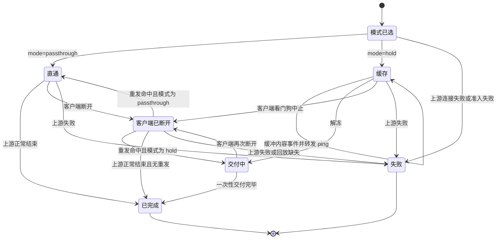
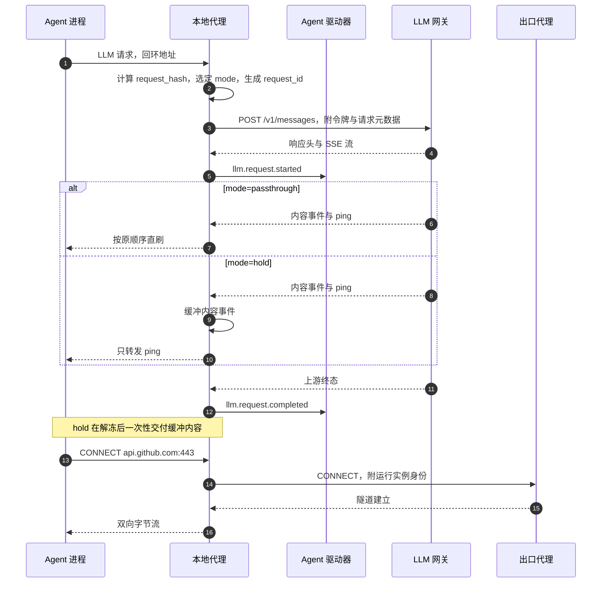

# 本地代理

[本地代理](../../../glossary.md)是[看守进程](../../../glossary.md)内不被冻结的 HTTP 代理，是 Agent 进程唯一的 LLM 与外部系统 HTTP 出口。它终止 Agent 的连接，把 LLM 请求附[运行实例令牌](../../../glossary.md)转发到 [LLM 网关](../../../glossary.md)，把外部系统请求以 CONNECT 或 HTTP 前置转发到[出口代理](../../../glossary.md)；按请求一次性选定直通或缓存模式，在[冻结](../../../glossary.md)期间持有上游连接并按模式直刷或缓冲，快照恢复后按 `request_id` 取回已完成响应。它不拥有凭据换取、代校验、在途请求表与回放存储，这些归 `llmgateway`；也不拥有[出口策略](../../../glossary.md)与凭据替换，这些归 `connectorhub` 与出口代理；它不做 MITM。心智模型：本地代理是沙箱内唯一能碰到外部网络的门，Agent 在门内，门在看守进程继续运行时保持开启（[ADR-two-tier-llm-proxy](../../../adr/adr-two-tier-llm-proxy.md)）。

文档较长，第一次阅读按以下顺序：职责、外部接口契约、走查、请求接入与模式选择、上游转发与流式处理、冻结与解冻期间的交付、客户端中止与重发、恢复后取回；术语表、依赖、UML 图、核心数据结构、错误与失败语义与并发与事务边界作为参考，在核对字段、事件顺序或失败路径时查阅。

## 职责

本地代理的职责穷举如下，每条先写执行的动作，再写产生的结果或边界；具体字段、状态与算法见后续章节。

- **终止 Agent 的出站连接**：在回环地址监听，接受 Agent 进程的 LLM 请求与外部系统请求，按请求形态分类；结果是 Agent 不需要、也不能直接到达回环地址之外的网络端点（I6）。
- **附加运行实例令牌**：为每个转发到 `llmgateway` 的 LLM 请求附加看守进程持有的运行实例令牌与请求元数据；结果是 Agent 进程不持有任何令牌，凭据换取与代校验在网关完成。
- **前置外部系统请求**：以 CONNECT 或 HTTP 前置把外部系统请求转发到出口代理，保持方法、路径、请求头与请求体不变，不替换凭据占位符；结果是出口策略与凭据替换只在托管侧执行，本地代理不做 MITM。
- **一次性选定请求模式**：在请求开始时选定 `passthrough` 或 `hold`，整个请求期间不再改变；结果是同一请求不会在直刷与缓冲之间切换，冻结上限由模式唯一决定。
- **直通转发**：在 `passthrough` 下按原顺序把 SSE 事件直刷给 Agent，冻结期间继续写入，写入受阻时对上游施加背压；结果是已向 Agent 转发内容的请求不进入缓冲，冻结不超过 `F_stream`，且一旦转发内容就不再延长。
- **缓存与保活**：在 `hold` 下缓冲全部内容事件，只向 Agent 转发 `ping` 保活事件，持有上游连接；结果是冻结期间客户端连接由保活事件维持，内容事件在解冻后一次性交付。
- **单次回放**：按 `(run_id, generation, request_hash)` 保存本地回放条目或进行中的上游流，客户端看门狗中止并重发时命中；结果是同一逻辑请求至多产生一次上游调用。
- **生成请求标识**：为每个逻辑请求生成 `request_id`，在同一运行实例内唯一（跨代不复用），不从 `request_hash` 派生；结果是请求事件、网关在途行与恢复取回共用同一标识。
- **上报请求事件**：向 Agent 驱动器发出 `llm.request.started`、`llm.first_token`、`llm.request.completed` 与 `llm.request.failed`；结果是 LLM 等待的主信号对托管环境可见，`mode` 决定 `runcontroller` 写入的冻结上限。
- **令牌轮换期间暂停转发**：令牌过期或临近到期且未收到 `TokenRotate` 时，不向上游发起新请求，已准入的请求继续；结果是沙箱内不出现长期凭据，也不使用过期令牌。
- **快照恢复后取回**：恢复后按 `request_id` 向 `llmgateway` 取回已完成响应，按已转发的事件序号续传；结果是半死的上游连接不会把恢复拖到读超时，已到达的内容不重复交付。
- **拒绝未放行目标**：对出口策略未放行的外部目标立即返回错误，不建立上游连接，不黑洞；结果是 Agent 的失败可见且可自行处理。

### 非职责

非职责的判定标准是职责清单之外、由其他模块拥有的事实与机制。

- LLM 凭据换取、代校验、在途请求表、回放存储与限流计费归 `llmgateway`；本地代理只生成 `request_id` 与 `request_hash`，持有本地回放条目，并按 `request_id` 取回。
- 出口策略的生成归 `connectorhub`，策略落地、凭据占位符替换与默认拒绝归出口代理；本地代理不读取或生成策略内容，只按放行结果转发或拒绝。
- TLS 终止、MITM、证书固定与请求头凭据注入不在本地代理；Substrate 路径的出口策略以出口网关的 EgressPolicy 落地，k8s 路径由平台出口代理落地。
- 挂起决策、冻结上限取值与冻结中复评归 `suspendpolicy`；`F_stream` 与 `F_cap(llm)` 的定义与取值由该模块给出，本地代理只按模式决定直刷或缓冲。
- 冻结与解冻的执行归 `sandboxprovider` 与节点冻结代理；本地代理不受冻结影响，也不发起冻结。
- 投递、回合位置、收件箱与唤醒谓词归 `runcontroller`；本地代理只把请求事件交给看守进程的出站流。
- 协议信封、消息序号、重放与按 `(generation, msg_seq)` 去重归 `agentprotocol`。
- Agent 的 LLM 配置、重试与看门狗语义归 Claude Code 驱动器；本地代理只提供回环地址、端口与流式行为。

## 术语表

| 术语 | 英文对照 | 适用范围 | 定义 |
| --- | --- | --- | --- |
| 请求模式 | request mode | warden 本地代理 | `passthrough` 或 `hold`；请求开始时一次性选定，整个请求期间不变，重发沿用原模式。 |
| 逻辑请求 | logical request | warden 本地代理 | 一次上游调用对应的请求；客户端看门狗中止后的重发仍是同一逻辑请求，不产生第二次上游调用。 |
| 内容事件 | content event | warden 本地代理 | SSE 流中除 `ping` 外的全部事件，携带模型输出或流的结构信息（[REF-anthropic-streaming](../../../references.md)）。 |
| 保活事件 | keepalive event | warden 本地代理 | SSE 流中的 `ping` 事件；不携带内容，缓存模式下唯一向 Agent 转发的事件。 |
| 客户端看门狗 | client watchdog | warden 本地代理 | Claude Code 的流式空闲超时；未收到任何内容时中止请求并重发一次，已收到部分内容时保留截断结果（[REF-claude-code-network-config](../../../references.md)）。 |
| 本地回放缓存 | local replay cache | warden 本地代理 | 本地代理按 `(run_id, generation, request_hash)` 保存的上游响应或进行中的上游流；权威回放条目归 `llmgateway`。 |

## 外部接口契约

本地代理对外的可调用面为：Agent 看到的回环端点、对 `llmgateway` 与出口代理的上游调用、向 Agent 驱动器上报的请求事件。回环端点与请求分类对 Agent 驱动器稳定；上游请求头名称、状态码区分与取回语义对 `llmgateway` 与出口代理稳定；请求事件的字段受 `agentprotocol` 的协议版本约束。新增或删除其中任一项都改变跨模块契约，须同步修改 `llmgateway`、出口代理或 `agentprotocol` 的对应文档。

### Agent 看到的回环地址与端口

本地代理只绑定回环地址 `127.0.0.1`，端口由看守进程在启动时选定，写入 Agent 进程的 `ANTHROPIC_BASE_URL` 与 `HTTP_PROXY`、`HTTPS_PROXY`、`NO_PROXY`；端口在沙箱生命周期内不变，快照恢复后继续使用同一端口。Agent 进程不持有令牌，连接不携带认证信息；本地代理按请求形态分类，不按调用方身份区分。

| 请求形态 | 目标 | 本地代理行为 |
| --- | --- | --- |
| `CONNECT host:port` | 外部系统 | 向出口代理建立隧道，双向转发字节流 |
| 绝对 URI 的 HTTP 请求 | 外部系统 | 以 HTTP 前置把完整请求转发到出口代理 |
| 其余 HTTP 请求 | LLM | 附运行实例令牌后转发到 `llmgateway` |

回环地址不暴露到沙箱之外。外部系统请求的放行集合由出口策略决定；本地代理对未放行的目标立即返回错误，不建立上游连接。

### 网关与出口代理的上游契约

**对 `llmgateway`。** LLM 请求以 Anthropic Messages API 的请求体同形发送，平台元数据放在请求头中，认证头由网关以换取的凭据替换。请求头与状态码的稳定承诺由 [llmgateway](../design-llmgateway.md) 定义，本地代理按其契约调用。

| 请求 | 携带 | 响应与处置 |
| --- | --- | --- |
| `POST /v1/messages` | `x-castworks-run-token`、`x-castworks-request-id`、`x-castworks-request-hash`、`x-castworks-mode`，以及 Agent 的 Anthropic 请求头 | 终态条目直接返回；`in_flight` 且由同一网关实例持有返回 `202`；由另一实例持有返回 `409`；`request_id` 跨代复用返回 `422`；上游流为 SSE |
| `GET /v1/requests/{request_id}` | 同一运行实例令牌 | `200` 返回终态条目；`202` 仍在途；`403` 归属不符；`404` 条目缺失或已过保留期；`409` 由另一实例持有 |

`202` 与 `409` 都不新建上游调用。本地代理在 `202` 时挂接已有的本地上游流或退避后再次取回；在 `409` 时不向上游重发，退避后取回。`422` 只表示 `request_id` 与运行实例内已有行冲突，本地代理重新生成 `request_id`、保持同一 `request_hash` 与模式后重发，不执行取回；`request_hash` 与唯一索引使重发仍命中同一逻辑请求。

**对出口代理。** 外部系统请求保持方法、路径、请求头与请求体不变，本地代理附加运行实例身份并转发；`Authorization` 等头中的凭据占位符原样保留，由出口代理在发往允许主机时替换。CONNECT 隧道建立后，本地代理只转发字节流，不解析隧道内的 TLS。k8s 路径的出口代理对每个请求按运行实例令牌校验代、终态与作废状态；Substrate 路径按以运行实例与代为键的出口策略放行（[REF-substrate](../../../references.md)）。出口代理的校验与撤销归 `connectorhub` 与 `sandboxprovider`，本地代理不缓存放行结果。

### 向驱动器上报的事件

请求事件由看守进程的出站流承载，消息序号、重放与去重归 `agentprotocol`；本地代理只决定事件的内容与时机。

| 事件 | 时机 | 字段 | 约束 |
| --- | --- | --- | --- |
| `llm.request.started` | 上游请求已发出且获得响应头，或已确认同一逻辑请求在途之后 | `request_id`、`request_hash`、`mode`、`predicted_ms` | 每个逻辑请求一次；在任何内容事件转发之前发出；`mode` 自此不再改变 |
| `llm.first_token` | 收到首个内容事件 | `request_id` | 每个逻辑请求至多一次；`ping` 不计入 |
| `llm.request.completed` | 上游流正常结束 | `request_id` | 每个逻辑请求一次；与网关的 `llm_completed` 命中同一阻塞条件 |
| `llm.request.failed` | 上游失败、取回缺失或不可重试的准入失败 | `request_id`、`reason` | 每个逻辑请求一次；客户端看门狗中止不单独构成失败 |

`predicted_ms` 为等待时长的预测值，由本地代理在请求开始时取得并随事件上报；预测来源与置信度归 `suspendpolicy` 与 `llmgateway`，本地代理不解释该值。事件在 `llm.request.started` 之后按 `first_token`、`completed` 或 `failed` 的顺序至多各出现一次；重发命中不重复上报 `started`。

## 依赖

代码依赖只有 `agentprotocol`，与[模块依赖图](../../architecture.md#模块依赖图)一致；对 `llmgateway` 与出口代理的调用是运行时 HTTP 调用，不是代码依赖。

- `agentprotocol`：请求事件的信封、消息类型、发送顺序与重放；本地代理只实现事件内容与时序。
- `llmgateway`：`POST /v1/messages` 与 `GET /v1/requests/{request_id}` 的请求头、状态码与回放取回语义；凭据换取、代校验、在途请求表与回放存储归该模块（[ADR-two-tier-llm-proxy](../../../adr/adr-two-tier-llm-proxy.md)）。
- 出口代理：CONNECT 与 HTTP 前置的目标、运行实例身份与凭据占位符语义；k8s 路径为 `connectorhub` 的平台出口代理，Substrate 路径为 Substrate 出口网关。
- Claude Code 的网络行为：流式空闲看门狗在未收到内容时中止并重发一次，已收到部分内容时保留截断结果（[REF-claude-code-network-config](../../../references.md)）。
- Anthropic Messages API 的 SSE 格式：内容事件与 `ping` 保活事件的区分（[REF-anthropic-streaming](../../../references.md)）。

方向约束：本地代理只依赖 `agentprotocol`，因此可独立于控制面模块演进；新增一个上游或一种 SSE 事件类型不改变本模块对 `runcontroller` 的事件集合。

## UML 图

下列图分别固定单个请求的状态与跨模块的转发顺序；图中不表达的约束由每张图后的正文给出。

### 请求状态图

状态闭集为 `selected`、`passthrough`、`hold`、`aborted`、`delivering`、`completed` 与 `failed`。冻结不是独立状态：`passthrough` 与 `hold` 都可以在冻结期间保持，区别只在内容事件是否已转发给 Agent。`aborted` 表示客户端连接已断开而上游可能仍在途；模式在重发时不变，重发不产生新的逻辑请求。`selected` 在上游连接失败或准入失败时直接进入 `failed`；`aborted` 在上游正常结束且无重发时进入 `completed`。`failed` 是终态，客户端之后的重发按新逻辑请求处理，除非本地回放缓存仍有可用条目。

### 与 Agent、网关、出口代理的时序图

图固定 LLM 与外部系统流量的分界：LLM 请求只到达 `llmgateway`，外部系统请求只到达出口代理，两者不交叉。`mode` 只改变本地代理向 Agent 转发内容事件的方式，网关对直通与缓存执行相同的转发与回放写入。外部系统请求不产生 `llm.request.*` 事件；同步连接器操作的在途信号由平台 MCP 服务器的 `request.completed` 与 `request.failed` 表达。

## 核心数据结构

### 请求记录

| 字段 | 含义 |
| --- | --- |
| `run_id`、`generation` | 运行实例与请求开始时的代；代递增后旧记录不再接受新数据 |
| `request_id` | 逻辑请求标识，在同一运行实例内唯一（跨代不复用），不从 `request_hash` 派生 |
| `request_hash` | 对影响上游结果的请求体计算的稳定摘要；同一逻辑请求的重发保持一致 |
| `mode` | `passthrough` 或 `hold`；选定后不变 |
| `state` | 请求状态闭集中的一个值 |
| `upstream` | 到 `llmgateway` 的连接句柄；快照恢复后为空 |
| `forwarded_seq` | 已向 Agent 转发的 SSE 事件序号；快照恢复后据此续传 |
| `buffer` | `hold` 模式下尚未交付的内容事件序列 |
| `first_token_at`、`finished_at` | 首个内容事件与上游终态的时刻 |
| `replay_key` | `(run_id, generation, request_hash)`；本地回放缓存的索引 |

请求记录只在看守进程内存中存在，不写入工作区，也不进入控制面数据库。快照保留内存，请求记录与 `forwarded_seq` 随快照恢复；销毁重建不保留请求记录，销毁前的 I9 检查要求本代无在途请求。

### 状态一览

| 状态 | 一句话含义 | 当前动作（本地代理） | 直觉画面 |
| --- | --- | --- | --- |
| `selected` | 请求已到达且模式已一次性选定 | 建立上游连接并转发请求 | 道岔已锁定 |
| `passthrough` | 内容事件已开始发往 Agent | 按原顺序直刷，写入受阻时施加背压 | 水管直连，边流边看 |
| `hold` | 内容事件全部留在本地 | 缓冲内容，只转发 `ping`，持有上游连接 | 蓄水池只冒泡不出水 |
| `aborted` | 客户端连接已断开而上游可能仍在途 | 继续读取上游并写入本地回放缓存；`passthrough` 已转发内容后客户端中止时结束请求、释放本地缓冲，上游由网关继续到终态 | 收件人离开，信件仍送到前台 |
| `delivering` | 解冻后正在交付缓冲内容 | 从 `forwarded_seq` 之后顺序写出 | 开闸放水 |
| `completed` | 上游终态已到且内容已全部交付 | 释放上游连接与缓冲，保留回放条目至请求关闭 | 水位归零，回执归档 |
| `failed` | 请求以失败终止 | 返回错误，释放上游连接，保留失败原因 | 断管 |

### 事件分类

| 类别 | 取值 | 处理 |
| --- | --- | --- |
| 保活事件 | `ping` | 直通与缓存都向 Agent 转发；`hold` 下是冻结期间唯一转发的事件 |
| 内容事件 | 除 `ping` 外的全部 SSE 事件 | `passthrough` 按原顺序直刷；`hold` 全部缓冲，解冻后按序交付 |

本地代理不合并、不重排、不改写事件；`ping` 不参与 `first_token` 判定、不进入缓冲、不计入用量。新增 SSE 事件类型时，默认归入内容事件，只有明确声明为保活的事件才按保活处理。

## 核心算法与流程

### 走查

**缓存模式下冻结、客户端看门狗中止、重发命中与解冻交付。** 初始条件：运行实例 `run-7` 处于第 6 代，本地代理监听回环端口，`llm_request` 中没有 `request_id` 为 `r-3` 的行；Agent 发出一个 `stream=true` 的 LLM 请求，请求体摘要为 `h-9`。

| 步骤 | 事件或调用 | 请求记录 | 本地回放缓存 | 出站事件 |
| --- | --- | --- | --- | --- |
| 1 | Agent 向回环地址发送请求 | 请求形态为 LLM；计算 `request_hash=h-9`，选定 `mode=hold`，生成 `request_id=r-3`；状态 `selected` | 无 | 无 |
| 2 | 本地代理向网关发送 `POST /v1/messages`，携带令牌、`r-3`、`h-9`、`hold` | 状态仍为 `selected`；建立上游连接 | 无 | 无 |
| 3 | 网关返回响应头并开始转发 SSE | 状态转 `hold`；`buffer` 为空 | 建立进行中的条目，键为 `(run-7, 6, h-9)` | `llm.request.started{request_id=r-3, request_hash=h-9, mode=hold, predicted_ms}` |
| 4 | 首个内容事件到达 | 写入 `buffer`；`forwarded_seq` 不前进 | 条目追加事件 | `llm.first_token{request_id=r-3}` |
| 5 | `runcontroller` 决定冻结，节点冻结代理冻结 Agent 进程树 | 本地代理不被冻结，上游连接保持；继续缓冲内容事件，只向 Agent 转发 `ping` | 条目继续增长 | 无 |
| 6 | Claude Code 的看门狗在 300 s 未收到内容后中止并重发同一请求 | 状态转 `aborted`；上游不取消，继续读入本地缓存 | 条目仍为进行中 | 无 |
| 7 | 重发到达，`request_hash` 仍为 `h-9` | 命中进行中的条目，挂接同一上游流；不生成新的 `request_id`，不发起第二次上游请求 | 条目被两个连接共享 | 无重复 `started` |
| 8 | 上游 `message_stop`，网关提交终态并写 `llm_completed` | 条目转终态；`finished_at` 写入 | 条目完整 | `llm.request.completed{request_id=r-3}` |
| 9 | 控制面解冻，看守进程处理 `Resumed` 后通知本地代理 | 状态转 `delivering`；从 `forwarded_seq` 之后交付全部内容事件 | 条目保留至请求关闭 | 无 |
| 10 | 交付完毕 | 状态转 `completed`；释放上游连接与缓冲 | 条目按本地保留策略保留 | 无 |

走查确认模式、重发与完成事件的结论。模式在步骤 1 选定后在步骤 6、7、9 都没有改变，冻结与重发都不触发重新选择。重发命中依赖 `(run-7, 6, h-9)`，不依赖 `request_id` 相同；`request_id` 由首次请求生成，重发通过 `request_hash` 找到它。`llm.request.completed` 在上游终态时发出，早于步骤 9 的交付；它满足 LLM 等待的阻塞条件，解冻与交付由 `runcontroller` 与看守进程驱动。

**直通模式的对照。** 同一运行实例的另一个请求预测等待低于冻结门槛，`mode=passthrough`。内容事件到达后立即转发，`forwarded_seq` 逐事件前进；冻结期间继续写入，冻结上限取 `F_stream`，到达上限后由 `runcontroller` 解冻，本地代理不改变模式。客户端在收到内容后中止时不重发，本地代理结束请求并释放本地缓冲，上游由网关继续到终态，回放条目保留至保留期结束。

### 请求接入与分类

本地代理在回环地址上接受连接，按请求行分类：`CONNECT` 方法或请求目标为绝对 URI 时按外部系统请求处理，其余按 LLM 请求处理。分类在读取完整请求头之后、建立上游连接之前完成，分类结果写入请求记录并决定后续路径；同一连接上的后续请求重新分类。

LLM 请求的请求体原样转发，不解析模型、消息或工具字段。`request_hash` 对影响上游结果的请求体计算，同一逻辑请求的重发得到相同值；具体摘要算法不属于跨模块契约，网关只要求同一请求得到同一值。外部系统请求的请求体与请求头原样转发，本地代理不解析协议内容。

复杂度：分类与请求记录创建为 O(1)，请求体摘要为 O(B)，B 为请求体字节数；外部系统的 CONNECT 隧道建立后按字节转发，为 O(N)。

### 模式选择

模式在请求开始时一次性选定，判据为等待时长的保守预测：保守值低于冻结门槛时选 `passthrough`，否则选 `hold`。冻结门槛、预测来源与置信度归 `suspendpolicy` 与 `llmgateway`；本地代理只消费预测结果，并把 `predicted_ms` 随 `llm.request.started` 上报。

模式选定后写入请求记录、上游请求头与 `llm.request.started`，之后不再改变：

- 冻结与解冻不改变模式；`hold` 在解冻后一次性交付，`passthrough` 在解冻后继续直刷。
- 客户端中止与重发不改变模式；重发按原模式继续。
- 上游重试不改变模式；网关在未转发任何内容前的上游重试仍使用同一 `request_id` 与同一模式。

### 上游转发与流式处理

LLM 请求转发到 `llmgateway` 时，本地代理设置平台请求头（`x-castworks-run-token`、`x-castworks-request-id`、`x-castworks-request-hash`、`x-castworks-mode`）并透传 Agent 的 Anthropic 请求头；认证头由网关替换，本地代理不读取、不记录凭据。响应为 SSE 时，本地代理按到达顺序解析事件，`ping` 归保活事件，其余归内容事件，按模式处理：

- `passthrough`：每个事件立即写入 Agent 连接；写入返回阻塞时暂停读取上游，形成背压，不把该请求转为缓冲。
- `hold`：内容事件追加到请求记录的 `buffer`，`ping` 立即写入 Agent 连接；`buffer` 的顺序与上游一致。

`first_token` 在首个内容事件到达时上报，`ping` 不触发。上游终态到达时，`hold` 可能仍有未交付的内容，`completed` 仍在此刻上报；交付由解冻事件驱动，与上游终态解耦。

复杂度：每个事件的处理为 O(1)，`buffer` 的写入与交付为 O(E)，E 为事件数；内存占用与未交付内容的事件总量成正比。

### 冻结与解冻期间的交付

冻结只作用于 Agent 子 cgroup，本地代理继续运行并持有上游连接。直通与缓存在冻结期间的行为不同：

- `passthrough`：内容事件继续写入 Agent 连接。Agent 不读取时写入阻塞，本地代理对上游施加背压，上游连接不关闭；冻结不超过 `F_stream`，到达上限由 `runcontroller` 解冻，本地代理不自行中止。
- `hold`：内容事件继续缓冲，`ping` 继续转发。客户端连接由保活事件维持，冻结上限取 `F_cap(llm)`；上游可能在冻结期间完成，`completed` 照常上报。

收到看守进程的解冻通知（处理 `Resumed` 之后）时，本地代理对每个处于 `hold` 且 `buffer` 非空的请求转入 `delivering`，从 `forwarded_seq` 之后按序写出全部缓冲事件，写完后转 `completed`。多个请求各自交付，不合并、不重排；同一 Agent 连接上的事件顺序保持。若解冻由 DRAIN 触发，本地代理按同一规则交付已到达的内容；上游尚未完成时继续转发后续事件直到终态，DRAIN 不改变模式。

### 客户端中止与重发

客户端连接的写失败或读端关闭表示中止。本地代理不因客户端中止取消上游请求；网关同样继续读取到终态并提交回放条目。按模式与已转发状态处置：

| 情形 | 处置 |
| --- | --- |
| `hold`，未交付任何内容 | 状态转 `aborted`，继续读入本地回放缓存；重发按 `request_hash` 命中同一进行中条目或已完成的本地条目 |
| `passthrough`，尚未转发内容 | 状态转 `aborted`，继续读入本地回放缓存；重发命中同一逻辑请求，按原模式重新直刷 |
| `passthrough`，已转发内容 | Claude Code 保留截断结果且不重发；本地代理结束请求，释放本地缓冲，上游由网关继续到终态 |
| 重发命中本地回放缓存 | 挂接同一条目，不发起第二次上游请求，不重复上报 `started` |
| 重发未命中本地缓存 | 以同一 `request_hash`、同一 `request_id` 再次 `POST`；网关按唯一索引返回终态条目、`202`、`409`，或 `422`（`request_id` 冲突，重新生成后重发），都不新建上游调用 |
| 网关返回 `409` | 不由本地代理重发上游，退避后 `GET /v1/requests/{request_id}` 取回 |

单次回放的保证是同一 `(run_id, generation, request_hash)` 至多产生一次上游调用，不限制同一响应被交付的次数；本地回放条目在请求关闭前可被多次重发命中，交付内容一致。

### 令牌轮换

本地代理为每个新上游请求读取当前运行实例令牌。令牌过期或临近到期且未收到 `TokenRotate` 时，本地代理不向上游发起新请求，把它们按到达顺序排队；排队期间不建立到网关的连接，也不向 Agent 返回成功。收到 `TokenRotate` 后，本地代理原子替换令牌并按队列顺序转发。

已准入的请求不因令牌轮换中断：令牌在准入时校验，已换取的凭据由网关按其到期时间使用。排队请求在客户端请求超时之前仍未获得新令牌时，本地代理返回可重试错误并上报 `llm.request.failed`；`Shutdown` 或 `Fenced` 到达时，排队请求按失败返回，不再转发。

### 恢复后取回

快照恢复保留看守进程内存，请求记录与 `forwarded_seq` 随快照恢复；到网关的上游连接在快照时已断开。恢复后看守进程先校时、断开 Agent 进程的旧 TCP 连接，再通知本地代理与驱动器。本地代理对每个非终态请求执行：

1. 以运行实例令牌调用 `GET /v1/requests/{request_id}`。
2. `200` 返回终态条目：按请求记录中的 `mode` 与 `forwarded_seq` 续传。`passthrough` 从 `forwarded_seq` 之后继续直刷；`hold` 把尚未交付的内容事件一次性交付，`ping` 可重复转发。
3. `202` 表示条目仍在途：本地代理不重发上游，退避后再次取回。
4. `403`、`404` 或超过保留期的条目：本地代理上报 `llm.request.failed`，按失败释放请求。
5. `409` 表示条目由另一网关实例持有：本地代理不重发上游，退避后再次取回。
6. 条目为完成时，若该请求尚未上报完成，补发 `llm.request.completed`；条目为失败时补发 `llm.request.failed`；已上报过的事件不重复。

取回完成之前，本地代理不向 Agent 交付该请求的后续内容。销毁重建路径不保留请求记录，I9 检查要求销毁前本代无在途请求，因此该路径不产生按 `request_id` 的取回。

复杂度：取回为每个在途请求一次 HTTP 调用，退避重试的轮次由实现配置；处理回放条目为 O(E)，E 为条目事件数。

## 错误与失败语义

失败的处置由模式、本地回放缓存与网关回放组合表达。下表列出已明确处置路径的失败，各行是举例。

| 失败 | 处置 |
| --- | --- |
| 网关不可达或连接被拒 | 上报 `llm.request.failed`；向 Agent 返回错误；不建立本地回放条目 |
| 网关返回 `401`、`403` 或 `503` | 按不可重试或暂时性错误分类：`401` 与 `403` 失败并上报；`503` 按退避重试，重试耗尽后失败 |
| 上游返回错误或流中断 | 网关提交失败回放条目并写 `llm_failed`；本地代理上报 `llm.request.failed`；已到达的内容按模式交付或丢弃 |
| 网关返回 `202` | 不新建上游调用；挂接已有本地上游流，或退避后取回 |
| 网关返回 `409` | 不重发上游；退避后取回条目 |
| 网关返回 `422` | `request_id` 与运行实例内已有行冲突；重新生成 `request_id`，保持 `request_hash` 与模式后重发，不取回 |
| 客户端在未收到内容时中止 | 状态转 `aborted`，上游继续；重发按 `request_hash` 命中同一逻辑请求 |
| 客户端在 `passthrough` 已收到内容后中止 | 不重发；本地代理结束请求，上游由网关继续到终态 |
| 冻结到达 `F_stream` 或 `F_cap(llm)` | 由 `runcontroller` 解冻或升级；本地代理不改变模式，继续按原模式处理后续事件 |
| 令牌过期且未收到 `TokenRotate` | 新请求排队，不向网关转发；排队请求在客户端超时后失败；已准入请求继续 |
| 网关失联 | 先按 `request_id` 调用 `GET /v1/requests/{request_id}`：`200` 按回放交付并补发 `llm.request.completed`；`404` 或超过保留期才上报 `llm.request.failed`；`202` 与 `409` 退避后再次取回；网关不可达期间不新建上游调用 |
| 取回返回 `404` | 上报 `llm.request.failed`；Agent 以新的逻辑请求重试，本地代理不自行重发上游 |
| 外部目标未被出口策略放行 | 立即返回错误，不建立上游连接，不黑洞 |
| `Fenced` 或 `Shutdown{graceful=false}` | 停止接受新请求，排队请求按失败返回；在途上游连接按看守进程的终止语义处理 |
| `Shutdown{graceful=true}` | 停止接受新请求，等待在途请求按截止时间完成；未完成的请求返回错误 |

错误呈现的边界：本地代理只向 Agent 返回 HTTP 错误或中断流，不生成面向人的文案；面向人的状态由 `runcontroller` 与 `humanchannel` 呈现。失败原因写入 `llm.request.failed` 的 `reason`，供记录与告警使用，不改变 `runcontroller` 的处理路径。

## 并发与事务边界

本地代理不参与数据库事务，也不写入工作区。它的持久化边界是快照保留的进程内存与网关侧的回放条目；网关是在途请求与回放的权威，本地回放缓存只是同一保证的本地快路径。

- **每请求单写者**：一个请求记录的全部状态转移由该请求的连接处理协程串行执行；`buffer`、`forwarded_seq`、`state` 与 `mode` 不跨协程并发写。
- **模式不可变**：`mode` 在 `selected` 状态写入后只读；冻结、解冻、重发与令牌轮换都不改写它。
- **上游连接归属**：每个请求持有自己的上游连接；冻结期间连接保持打开，解冻与重发不重建已存在的连接。请求之间不共享上游连接。
- **事件顺序**：同一逻辑请求的 `started`、`first_token`、`completed` 或 `failed` 按该顺序至多各一次；事件写入看守进程的出站流是串行的，跨请求的相对顺序不做保证。
- **本地回放缓存**：按 `replay_key` 加锁；同一键的创建、追加与交付串行；不同键之间并发。缓存条目在请求关闭或保留期到期后释放。
- **令牌快照**：令牌替换以原子引用完成；每个新请求读取一次当前令牌，已有请求不重新读取。替换与排队队列的操作串行。
- **快照与恢复**：快照保留请求记录与 `forwarded_seq`；恢复期间的取回与交付在看守进程完成校时和旧连接清理之后开始，之前不产生新事件。
- **销毁边界**：I9 检查通过前不得销毁；本地代理的在途请求由看守进程的投递与安全点检查纳入，销毁后不保留请求记录。

## 扩展点

### 新增 Agent 的流式协议

新增 Agent 的 SSE 协议时，须定义内容事件与保活事件的闭集、客户端看门狗的中止与重发语义、以及单次回放的键。模式选择、回环端点与请求事件不变；保活事件必须能被识别为不携带内容的独立事件，否则冻结期间无法维持连接。

### 新增上游 API 形态

新增 LLM API 形态时，须定义请求分类、请求头元数据、响应事件分类与终态判定；`request_id`、`request_hash`、`mode` 的语义与回放键保持不变。新增外部系统协议时，须由出口代理定义转发形态；本地代理只支持 CONNECT 与 HTTP 前置，不解析隧道内容。

### 新增回放缓存后端

本地回放缓存可替换为其他内存或工作区存储，但须保持 `(run_id, generation, request_hash)` 键、同一逻辑请求至多一次上游调用、以及快照恢复后按 `forwarded_seq` 续传的语义。权威回放条目仍归 `llmgateway`，本地缓存不得成为跨代唯一事实源。

## 实现状态

| 能力 | 状态 | 代码 |
| --- | --- | --- |
| 回环监听与请求分类 | 未实现 | — |
| 模式选择与直通转发 | 未实现 | — |
| 缓存模式与保活转发 | 未实现 | — |
| 本地回放缓存与重发命中 | 未实现 | — |
| 请求事件上报 | 未实现 | — |
| 令牌轮换期间排队 | 未实现 | — |
| 快照恢复后按 `request_id` 取回 | 未实现 | — |
| 外部系统 CONNECT 与 HTTP 前置 | 未实现 | — |
| 未放行目标拒绝 | 未实现 | — |
