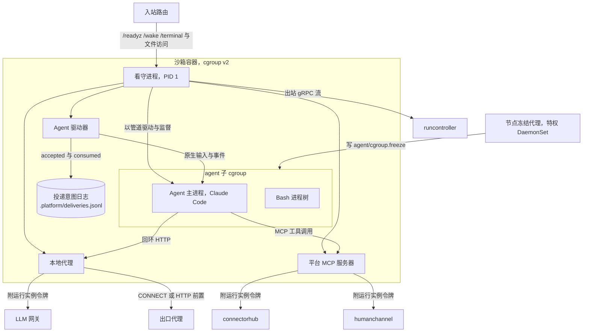
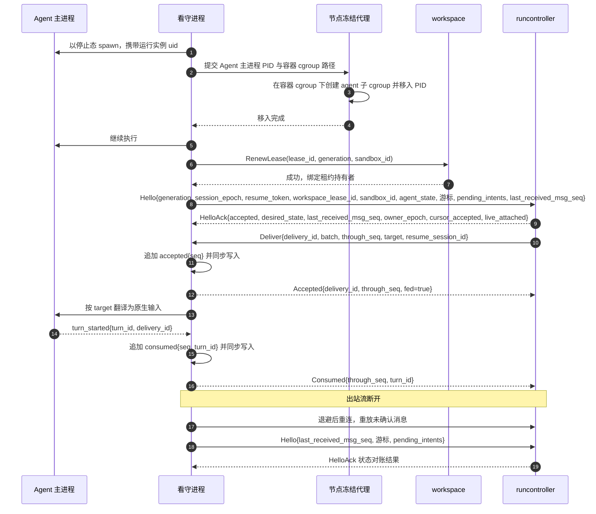
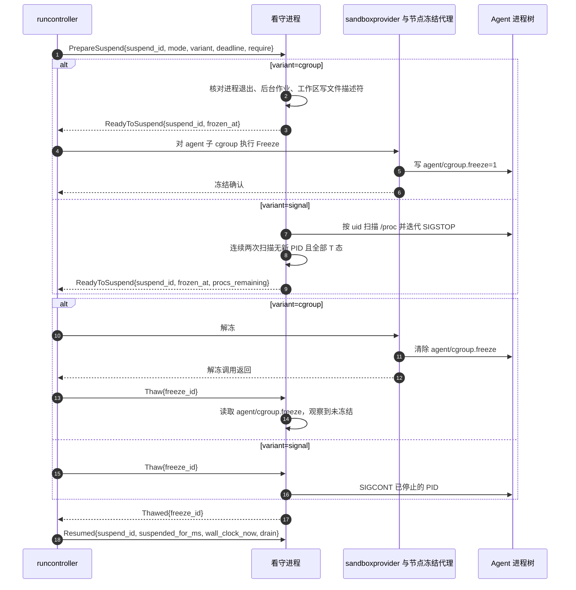

# 看守进程

看守进程（`warden`）是沙箱容器的 PID 1，位于 Agent 子 cgroup 之外，以管道驱动 Agent 主进程。它同时是沙箱内唯一持有[运行实例令牌](../../../glossary.md)的进程、与控制面之间唯一的协议端点，以及活动度、工作区租约、投递状态与冻结动作在沙箱侧的观察点和执行点。它不拥有运行实例的状态机、挂起决策、沙箱生命周期与工作区租约表，这些分别归 `runcontroller`、`suspendpolicy`、`sandboxprovider` 与 `workspace`。心智模型：Agent 进程树在它下面运行并可被冻结，而它留在冻结边界之外继续服务控制面（[ADR-warden-is-pid1](../../../adr/adr-warden-is-pid1.md)）。

文档较长，按顺序阅读：先读核心概念、职责与子模块分工，用来建立边界；再读外部接口契约与依赖，用来核对本模块向谁承诺什么；然后读 UML 图、核心数据结构与核心算法与流程，其中走查给出一次启动、投递与重连的落盘轨迹，其余小节按能力逐项展开；最后读错误与失败语义、并发与事务边界与扩展点，作为对前述流程的完备性自测。

## 核心概念

冻结边界只包围 Agent 进程树，看守进程留在边界之外。Agent 的进程树运行在 `agent` 子 cgroup 中，冻结与解冻只对这个子 cgroup 生效；看守进程、[本地代理](../../../glossary.md)、[平台 MCP 服务器](../../../glossary.md)与活动度采集位于父 cgroup，Agent 被冻结时它们照常运行。系统需要这条边界，是因为挂起释放的是 Agent 的计算，而沙箱对控制面的可服务性必须保留：冻结期间仍要应答就绪探针与恢复触发、续约工作区租约、采集活动度并维持[出站流](../../../glossary.md)，依赖解除后才能立即恢复。看守进程因此能在 Agent 静止时继续工作，Agent 进程树在它之下运行并可被整体冻结（[ADR-warden-is-pid1](../../../adr/adr-warden-is-pid1.md)）。

## 职责

看守进程的职责穷举如下，每条先写执行的动作，再写产生的结果或边界；具体消息字段、表结构与算法见后续章节。

- **进程监督**：作为 PID 1 以停止态启动 Agent 主进程，协调节点冻结代理把它移入 `agent` 子 cgroup 后继续执行；回收子进程、转发信号、维护进程组，并把 Agent 驱动器报告的后台作业与工具调用登记到进程监督记录。Agent 退出时上报 `turn_ended{agent_exited=true}` 并保持监督；收到 `SIGTERM` 时以退出码 143 终止、杀死 Bash 进程树并执行 `SessionEnd` hook。结果是 Agent 进程树始终有唯一监督者，退出与信号处理、僵尸回收都由本进程完成（[REF-claude-code-hooks](../../../references.md)）。
- **冻结与解冻执行**：按 `PrepareSuspend.variant` 执行 `Freeze{cgroup}` 的沙箱侧协调或 `Freeze{signal}` 的降级路径；以 `freeze_id` 幂等，向控制面上报 `ReadyToSuspend`、`Thawed` 或 `Busy`；收到 `Thaw` 后解冻进程树或观察 `agent` 子 cgroup 已解冻。结果是冻结只作用于 Agent 进程树，看守进程自身继续应答探针、续约租约并维持出站流（[ADR-freeze-via-node-agent](../../../adr/adr-freeze-via-node-agent.md)）。
- **活动度采集**：按固定周期采集 `Activity` 的字段，包括 PSI、进程态、`throttled_usec`、`last_fork_at`、`ws_write_fds`、I/O 与网络字节、冻结状态与 `freeze_id`。结果是控制面获得不依赖 Agent 配合的忙闲证据，`suspendpolicy` 与 `runcontroller` 据此判断能否挂起。
- **工作区租约续约**：以 `lease_id` 与代周期调用 `workspace.RenewLease`，首次成功续约绑定持有者；在租约到期前无法续约时停止向工作区写入、冻结或杀死 Agent 进程树，并上报 `LeaseLost{lease_id, expires_at}`。结果是每一代沙箱对工作区保持单写者边界。
- **投递意图日志**：`Deliver` 到达后先在 `.platform/deliveries.jsonl` 追加 `accepted{seq}` 并同步写入，按日志去重后把事件喂给 Agent；观察到回合开始后追加 `consumed{seq, turn_id}` 并同步写入，再发出 `Consumed`。结果是至少一次投递在跨代重建后仍可由日志去重，重建后不重复处理已消费事件（[ADR-delivery-intent-log](../../../adr/adr-delivery-intent-log.md)）。
- **平台 MCP 服务器**：向 Agent 暴露闭集工具，把订阅、阻塞等待、人类输入、定时与外部系统操作翻译为对 `connectorhub`、`humanchannel` 的带令牌调用；阻塞型调用临近冻结上限时返回已转为订阅或定时的结果。结果是 Agent 每一次可能阻塞的对外交互对托管环境可见（I1）。
- **ToolExec API**：在已认证的出站流上接收控制面循环驱动器经 `runcontroller` 转发的 exec、文件读写、流式输出与后台作业帧，按代校验；不接受沙箱地址上的直接调用。结果是沙箱内没有 Agent 进程时，沙箱仍可作为工具执行器使用，且驱动器无需持有运行实例令牌。
- **出站流与状态对账**：始终维持一条主动外连 `runcontroller` 的 gRPC 双向流，发送 `Hello`、`AgentEvent`、`Activity`、`Accepted`、`Consumed`、`DeliveryFailed`、`ReadyToSuspend`、`Busy`、`Thawed`、`LeaseLost`、本地代理与平台 MCP 服务器的请求事件与 `ToolExec` 响应/数据帧，处理 `HelloAck`、`Deliver`、`PrepareSuspend`、`CancelSuspend`、`Thaw`、`Resumed`、`LiveState`、`Shutdown`、`Fenced`、`TokenRotate` 与 `ToolExec` 请求/取消帧；断连后退避重连、重放未确认消息并以 `Hello` 做状态对账。结果是控制面以持久化状态而非事件历史恢复一致（I10）。
- **令牌持有与轮换**：持有沙箱内唯一的运行实例令牌，按 `TokenRotate` 替换；令牌过期且未收到新令牌之前，不向 `llmgateway`、`connectorhub` 与 `humanchannel` 发请求。结果是沙箱内不出现长期凭据或 LLM 密钥（I6）。
- **快照恢复后的清理**：恢复后先校时、主动断开 Agent 进程的旧 TCP 连接，再通知 Agent 驱动器；本地代理按 `request_id` 向 `llmgateway` 取回已完成响应。结果是半死连接不会把恢复拖到读超时。
- **DRAIN 处置**：收到 `Resumed{drain=true}` 后按 `suspend_id` 幂等，把已等待与之后发起的阻塞型审批、`wait_for` 与阻塞型 `sleep_until` 立即按终止等待的结果返回，使当前回合能够结束。结果是控制面能在回合边界执行以挂起为目的的销毁（[ADR-turn-boundary-destroy](../../../adr/adr-turn-boundary-destroy.md)）。
- **入站服务**：在沙箱内监听 80 端口，提供 `/readyz`、`/wake`、`/terminal` 与文件访问；入站端点不承载事件内容。结果是提供者恢复、探针与人类接入有稳定入口，事件投递仍只走出站流。

### 子模块分工

各子模块有独立文档，模块文档只固定边界。

- **本地代理**：看守进程内不被冻结的 HTTP 代理，终止 Agent 的 LLM 与外部系统 HTTP 连接，附加运行实例令牌后转发到 `llmgateway` 或出口代理，按请求选择直通或缓存模式，并在快照与销毁路径下按 `request_id` 取回已完成响应。它与 Agent 进程树冻结无关，细节见 [design-warden-llmproxy.md](design-warden-llmproxy.md)（[ADR-two-tier-llm-proxy](../../../adr/adr-two-tier-llm-proxy.md)）。
- **Claude Code 驱动器**：以无头 `stream-json` 协议驱动 Claude Code，把回合、工具、权限询问、等待与后台作业翻译为协议事件，把投递翻译为原生输入，并管理会话续接与退出。细节见 [design-warden-driver-claude-code.md](design-warden-driver-claude-code.md)（[REF-claude-code-headless](../../../references.md)）。
- **控制面循环驱动器**：控制面循环驱动器使用 `ToolExec` 的接口与语义，不假定沙箱内存在 Agent 进程。细节见 [design-warden-driver-native.md](design-warden-driver-native.md)（[ADR-dual-agent-loop-location](../../../adr/adr-dual-agent-loop-location.md)）。

### 非职责

非职责的判定标准是职责清单之外、由其他模块拥有的事实与机制。

- 沙箱的预配、挂起、恢复、销毁、预热池、原地缩放与出口策略落地归 `sandboxprovider`；看守进程只执行沙箱内的冻结与进程动作，并以 `ReadyToSuspend`、`Busy`、`Thawed` 应答。
- 挂起决策与策略参数归 `suspendpolicy`：何时挂起、选择冻结或快照或销毁、冻结上限、冻结中升级、恢复准入与活动度阈值都不由看守进程判断；看守进程只提供活动度样本与执行结果。
- 运行实例状态机、收件箱、唤醒信号、等待、定时器、投递游标、代递增与纠正性对账归 `runcontroller`；看守进程只实现协议消息在沙箱侧的效果。
- 工作区租约表、绑定、接管与持久化确认归 `workspace`；看守进程只续约并上报 `LeaseLost`。
- 运行实例令牌的签发、签名与轮换签名归 `secrets`；看守进程只持有、使用并替换令牌。
- 协议信封、序列化、重放与按 `(generation, msg_seq)` 去重的规则归 `agentprotocol`；看守进程只声明每条消息的沙箱侧效果。
- LLM 凭据换取、在途请求与回放存储归 `llmgateway`；外部系统定义、订阅、事件日志与出口策略生成归 `connectorhub`；人类会话、身份与审批决定归 `humanchannel`。看守进程只发起附运行实例令牌的运行时 HTTP 调用。
- Agent 会话记录的内容归 Agent 自身；看守进程只保证状态目录位于工作区内，并在销毁安全点要求持久化完成。
- 出口的凭据替换与默认拒绝归出口代理；本地代理不做 MITM，不替换凭据。

## 术语表

| 术语 | 英文对照 | 适用范围 | 定义 |
| --- | --- | --- | --- |
| 冻结变体 | freeze variant | warden | `Freeze{cgroup}` 与 `Freeze{signal}` 的统称：`Freeze{cgroup}` 由节点冻结代理写 `agent/cgroup.freeze`，`Freeze{signal}` 由看守进程按运行实例 uid 扫描 `/proc` 并迭代 `SIGSTOP`。 |
| 停止态启动 | stopped-state spawn | warden | 看守进程先让 Agent 主进程以停止态出现，待节点冻结代理把它移入 `agent` 子 cgroup 后再继续执行；其后的 fork 自动继承该子 cgroup。 |
| 投递意图日志条目 | delivery intent log entry | warden | 工作区 `.platform/deliveries.jsonl` 中的一行，取值为 `accepted{seq}` 或 `consumed{seq, turn_id}`；`accepted{seq}` 在喂给 Agent 之前同步写入，`consumed{seq, turn_id}` 在观察到回合开始后同步写入。 |
| DRAIN 处置 | DRAIN disposition | warden | 收到 `Resumed{drain=true}` 后，把阻塞型审批、`wait_for` 与阻塞型 `sleep_until` 立即按终止等待的结果返回，使当前回合能够结束并转入回合边界。 |
| 活动度样本 | activity sample | warden | 固定周期采集并随 `Activity` 上报的一组观测值，含 PSI、进程态、`throttled_usec`、`last_fork_at`、`ws_write_fds`、I/O 与网络字节、冻结状态与 `freeze_id`。 |
| 冻结执行记录 | freeze execution record | warden | 按 `freeze_id` 保存的冻结变体、冻结时刻、SIGSTOP 扫描轮次与已停止 PID 集合，用于幂等解冻与迟到请求判定。 |

## 外部接口契约

看守进程对外的可调用面为：与控制面的协议消息、平台 MCP 工具、`ToolExec` 与文件 API、入站端点。协议消息的名称、字段与稳定性由 `agentprotocol` 的协议版本约束；平台 MCP 工具名与 `ToolExec` 操作对 Agent 驱动器与控制面循环驱动器稳定；文件 API 对 `workspace` 稳定；入站端点对 `sandboxprovider` 与入站路由稳定。新增或删除其中任一项都改变跨模块契约，须同步修改 `agentprotocol` 或对应模块文档。

### 与控制面的协议

信封、`msg_seq`、`ack_msg_seq`、重放与按代去重的规则见 [agentprotocol](../design-agentprotocol.md)。看守进程实现的消息穷举如下，表中只写沙箱侧效果。

| 方向 | 消息 | 沙箱侧效果 |
| --- | --- | --- |
| 发出 | `Hello` | 建立或重建出站流时携带代、`session_epoch`、`resume_token`、`workspace_lease_id`、`sandbox_id`、`agent_state`、`cursor_accepted`、`cursor_consumed`、`pending_intents` 与 `last_received_msg_seq`；首次续约成功之后才发出 |
| 发出 | `AgentEvent` | 回合开始与结束、工具开始与结束、权限询问、订阅创建、定时请求、等待开始与后台作业变化 |
| 发出 | `Activity` | 固定周期的活动度样本与冻结状态 |
| 发出 | `Accepted`、`Consumed`、`DeliveryFailed` | 投递接受、常规投递的消费与投递失败；接受与消费记录的同步写入先于对应消息 |
| 发出 | `ReadyToSuspend`、`Busy`、`Thawed` | 挂起就绪、挂起前置不满足或取消确认、解冻完成；均以 `suspend_id` 或 `freeze_id` 幂等 |
| 发出 | `LeaseLost` | 工作区租约在到期前无法续约 |
| 发出 | `llm.request.started`、`llm.first_token`、`llm.request.completed`、`llm.request.failed` | 本地代理的 LLM 在途状态；`mode` 决定冻结上限取 `F_stream` 还是 `F_cap(llm)` |
| 发出 | `request.completed`、`request.failed` | 平台 MCP 服务器代理的同步连接器操作完成或失败 |
| 接收 | `HelloAck` | `accepted`、`fenced{current_generation}`、`desired_state`、`last_received_msg_seq`、`owner_epoch`、游标与实时接入状态；决定是否继续投递与重连 |
| 接收 | `Deliver` | 一批投递事件、`through_seq`、`target` 与 `resume_session_id`；投递只在此消息上到达 |
| 接收 | `PrepareSuspend`、`CancelSuspend`、`Thaw` | 挂起前置、冻结变体、截止时间与强制选项；取消与解冻 |
| 接收 | `Resumed` | 解冻或恢复完成、冻结时长与 `drain` 标志 |
| 接收 | `LiveState` | 实时接入状态，按 `as_of` 取最新 |
| 接收 | `Shutdown`、`Fenced`、`TokenRotate` | 关闭、代过期与令牌替换 |

稳定性承诺按类别给出：协议消息受协议版本约束，看守进程不自行增删字段；`Hello` 与 `HelloAck` 的状态摘要字段是状态对账的唯一依据，字段变化须同时修改 `runcontroller` 的进入规则与本模块文档；`Shutdown`、`Fenced` 与不可重试认证失败关闭是三种不同的终止语义，不得合并。

### ToolExec API

控制面循环驱动器在沙箱内没有 Agent 进程时使用该接口。可调用操作是闭集；帧在已认证的出站流上传输，由链接进 `runcontroller` 的驱动器经宿主写入，不接受沙箱地址上的直接调用。鉴权由出站流承担，帧的代必须等于当前代；命令在运行实例 uid 下执行，`no_new_privs` 与 capability 约束与沙箱内工具一致。

| 操作 | 结果 |
| --- | --- |
| exec | 在沙箱内启动命令，返回执行标识、退出码与标准输出、标准错误流 |
| 文件读 | 返回运行实例子目录内文件的字节流与元数据 |
| 文件写 | 在运行实例子目录内写入或覆盖文件 |
| 流式输出 | 按输出偏移续传一次执行或后台作业的标准输出与标准错误 |
| 后台作业 | 列出、查询与终止由 exec 启动的后台作业；未结束的作业使运行实例保持活动 |

帧格式与关联由 [agentprotocol](../design-agentprotocol.md) 的 `ToolExecRequest`、`ToolExecResponse`、`ToolExecData` 与 `ToolExecCancel` 定义，操作语义由 [design-warden-driver-native.md](design-warden-driver-native.md) 定义；本模块承诺上表的操作语义、路径边界与鉴权边界。`ToolExec` 帧不建立第二条协议会话，不参与投递与状态机。`Shutdown` 与 `Fenced` 到达时，在途执行与后台作业按终止语义处理，不再接受新的 `ToolExec` 请求。

### 文件 API 与回环代理端点

文件 API 为界面提供工作区文件的读取，包括列目录与读文件；路径限定在运行实例子目录内，请求经入站路由到达，按入站路由的调用方身份（`humanchannel` 完成用户身份与项目归属校验）与实时接入状态鉴权。看守进程以自身持有的运行实例令牌核对请求携带的代，并校验当前租约的持有者为自身；请求本身不携带令牌。文件 API 不提供事件通道。

本地代理监听回环地址，是 Agent 进程唯一的 LLM 与外部系统 HTTP 出口。Agent 不持有令牌，本地代理在转发时附加运行实例令牌；LLM 请求转到 `llmgateway`，外部系统请求以 CONNECT 或 HTTP 前置转到出口代理。本地代理不做 MITM，不替换凭据，模式选择、缓冲与回放见 [design-warden-llmproxy.md](design-warden-llmproxy.md)。

### 平台 MCP 工具

平台 MCP 服务器提供的工具名与作用穷举如下；服务器本身遵循 MCP 规范（[REF-mcp](../../../references.md)），工具名对 Agent 驱动器稳定。

| 工具 | 结果 |
| --- | --- |
| `subscribe_event` | 在 `connectorhub` 登记订阅并返回 `sub_id`；登记事务对已到达事件回溯匹配，已终态的外部对象合成完成事件 |
| `wait_for` | 阻塞等待指定条件；临近冻结上限时返回已转为订阅与 `sub_id` 的结果，要求 Agent 结束回合 |
| `request_human_input` | 请求人类输入；异步渠道经回合边界承接，实时接入中阻塞等待 |
| `sleep_until` | 登记定时；阻塞型在 DRAIN 或临近上限时转为运行实例范围定时器并返回已转为定时的结果 |
| 外部系统操作 | 经 `connectorhub` 执行同步或异步操作，返回结果并登记预关联锚 |
| 附件取回 | 附运行实例令牌向存放方取回附件引用中的内容 |

per-server timeout 配置为 `F_cap(approval / wait_for / request)` 加安全余量，且不得大于 MCP 传输上限；`MCP_TOOL_TIMEOUT` 的默认值约 28 小时，不构成冻结上限，实际约束是 HTTP 首字节 60 s、HTTP idle 300 s 加 30 s 检查粒度与 stdio idle 1800 s 加 30 s 检查粒度；`F_cap(request)` 与 `F_cap(timer)` 由 `suspendpolicy` 按传输类型与等待种类独立定义。工具调用的开始与结束由 Agent 驱动器翻译为 `tool_started` 与 `tool_ended`，阻塞型工具调用在开始时另发 `wait_started{kind=...}`。新增工具改变闭集，须同时修改 `connectorhub` 或 `humanchannel` 的对应操作、驱动器的超时预算与本模块文档。

### 入站端点

| 端点 | 调用方 | 语义 |
| --- | --- | --- |
| `/readyz` | kubelet 就绪探针、Substrate 的 `wakeupProbe`（[REF-substrate](../../../references.md)） | 出站流已建立且看守进程可服务时返回就绪；否则返回未就绪 |
| `/wake` | Substrate 路由器 | 提供者恢复 actor 的触发入口；返回即表示出站流已重建，路由器在此之前停泊请求 |
| `/terminal` | `humanchannel` 经入站路由 | 人类 shell 终端接入；只在用户身份校验完成后建立 |
| 文件访问 | `workspace` 与平台界面经入站路由 | 到达文件 API，读取工作区文件 |

入站端点不承载事件内容，`Deliver` 只在出站流上进行；`/readyz` 只配置在看守进程上，不配置在被冻结的 Agent 进程上。k8s 提供者的恢复不经入站端点，由节点冻结代理解冻或把 Sandbox CR 改回运行态后，看守进程自行重连；Substrate 提供者的恢复经路由器调用 `/wake`。

## 依赖

代码依赖为 `agentprotocol` 与 `workspace` 的沙箱侧部分（文件 API、持久化确认与租约续约），与[模块依赖图](../../architecture.md#模块依赖图)一致；对 `llmgateway`、`connectorhub` 与 `humanchannel` 的调用是附运行实例令牌的运行时 HTTP 调用，不是代码依赖；对 `workspace` 的租约续约是运行时接口调用。没有模块依赖看守进程。

- `agentprotocol`：信封、消息类型、出站流客户端、未确认消息重放、按 `(generation, msg_seq)` 去重与协议版本。看守进程只实现每条消息的沙箱侧效果。
- `workspace`：`RenewLease(lease_id, generation, sandbox_id)` 的 CAS 语义与首次续约绑定持有者；租约到期前无法续约时由本模块执行本地保护动作并上报 `LeaseLost`。租约的建立、接管与释放不在本模块。
- `llmgateway`：本地代理转发的 LLM 请求以运行实例令牌鉴权；在途请求与回放存储归 `llmgateway`，恢复后按 `request_id` 取回（[ADR-two-tier-llm-proxy](../../../adr/adr-two-tier-llm-proxy.md)）。
- `connectorhub` 与 `humanchannel`：平台 MCP 服务器转发的订阅、审批与人类输入请求以运行实例令牌鉴权；订阅匹配与事件日志归 `connectorhub`。
- Linux cgroup v2 与 PSI：`Freeze{cgroup}` 的冻结状态观察与活动度采集的内核接口（[REF-linux-cgroup-v2](../../../references.md)、[REF-linux-psi](../../../references.md)）。
- Claude Code：无头模式、hooks、托管策略设置、环境变量、网络看门狗与 stream-json 消息（[REF-claude-code-settings](../../../references.md)、[REF-claude-code-env-vars](../../../references.md)、[REF-claude-code-network-config](../../../references.md)、[REF-claude-agent-sdk-typescript](../../../references.md)）。
- MCP：平台 MCP 服务器的工具与传输。

方向约束：看守进程只依赖 `agentprotocol`，因此可独立于控制面模块演进；它对其他模块的运行时调用不构成代码依赖，新增一个事件源不改变本模块。

## UML 图

下列图分别固定进程与组件边界、启动与重连的消息顺序、冻结与解冻在沙箱侧的观察点；图中不表达的约束由每张图后的正文给出。

### 进程树与组件图

看守进程、本地代理、平台 MCP 服务器与 Agent 驱动器位于同一个进程，本地代理与平台 MCP 服务器不是独立进程；节点冻结代理只对 `agent` 子 cgroup 写入，看守进程留在父 cgroup，因此冻结期间探针、租约续约、出站流与本地代理的上游连接继续工作。Agent 的 `bash` 子进程与后续 fork 继承 `agent` 子 cgroup，进程树因而整体冻结。投递意图日志位于工作区，不在容器 rootfs。

### 启动与重连时序

启动顺序的约束：首次 `RenewLease` 成功之后才发 `Hello`；`Hello` 的 `generation`、令牌与租约持有者必须一致，否则控制面回 `HelloAck.fenced` 或关闭流。`HelloAck.desired_state=frozen` 时看守进程不恢复 Agent 执行，直到收到 `Thaw` 或新的恢复消息。重连不重新执行 `PrepareSuspend`，未确认消息由发送方重放，接收方按 `(generation, msg_seq)` 去重。`Hello` 的 `pending_intents` 使控制面在新代推进 `cursor_accepted`，再按对账后的 `cursor_consumed` 决定重投起点。

### 冻结与解冻时序

冻结与解冻都以 `freeze_id` 标识，已执行过解冻的标识不再接受冻结；迟到的冻结请求因而不在解冻之后生效。`Freeze{cgroup}` 的冻结确认由节点冻结代理产生，看守进程只上报就绪与观察结果；`Freeze{signal}` 的冻结确认就是看守进程的 `ReadyToSuspend`。进程树从未冻结时，`Thaw` 到达后立即上报 `Thawed`。`Resumed` 之后看守进程才恢复 Agent 执行；`drain=true` 时按 DRAIN 处置。冻结期间看守进程继续采集活动度并维持出站流。

## 核心数据结构

以下结构位于看守进程内存或工作区，不属于控制面 PostgreSQL；控制面的权威状态以 `runcontroller` 的文档为准。

### 进程监督记录

| 字段 | 含义 |
| --- | --- |
| `agent_pid` | Agent 主进程的 PID；未启动时为空 |
| `agent_pgid` | Agent 主进程所在进程组，用于终止 Bash 进程树 |
| `exit_code` | 最近一次退出码；`SIGTERM` 终止为 143 |
| `session_id` | 最近一次观察到的会话标识，用于 `ReadyToSuspend` 的恢复句柄 |
| `bg_jobs` | Agent 驱动器登记的未结束后台作业与子代理集合 |
| `running_tools` | 未配对的 `tool_started` 调用集合 |
| `freeze` | 当前冻结执行记录；未冻结时为空 |

进程监督记录是看守进程的单一事实源：`Activity`、`Hello.agent_state` 与 `ReadyToSuspend` 都从这里取值；控制面不读取该结构，只接收派生消息。

### 活动度样本

| 字段 | 含义 |
| --- | --- |
| `psi.cpu`、`psi.io`、`psi.mem` | `agent` 子 cgroup 的 `cpu.pressure`、`io.pressure`、`memory.pressure` 的 `some` 值；`cpu` 或 `io` 的 `some` 大于零表示进程树在最近窗口内发生过资源停滞。读取 per-cgroup PSI，不读 `/proc/pressure` |
| `procs{R, D, S, T, Z}` | Agent 进程树中各进程态的计数；`R` 与 `D` 表示运行或不可中断等待，`T` 表示已停止 |
| `throttled_usec` | 容器父 cgroup 的 `cpu.stat` 累计限流微秒；相邻样本的增量表示采样窗口内发生过限流。`agent` 子 cgroup 的该值通常恒为 0，不能作为限流证据 |
| `last_fork_at` | 最近一次观察到 fork 的时刻 |
| `ws_write_fds` | 进程树持有的工作区写文件描述符数量 |
| `io_bytes`、`net_bytes` | 累计块设备 I/O 与网络字节 |
| `frozen`、`freeze_id` | Agent 子 cgroup 的冻结状态与当前冻结标识；`cgroup` 变体从 `agent/cgroup.events` 的 `frozen` 字段读取，`signal` 变体取看守进程的冻结执行记录。cgroup 冻结后进程态仍是 S，不能以 T 态判定冻结完成 |

活动度样本只含观测值，不含忙闲判定；判定规则与阈值归 `suspendpolicy`。`frozen` 在 `Active` 中为真且 `freeze_id` 不等于 `aborted_suspend_id` 时，控制面判定本代沙箱作废。

### 投递意图日志条目

日志文件为工作区内的 `.platform/deliveries.jsonl`，每行一个条目。

| 字段 | 含义 |
| --- | --- |
| `op` | `accepted` 或 `consumed` |
| `seq` | 收件箱序号 `inbox_seq` |
| `turn_id` | `consumed` 条目的回合标识；`accepted` 条目为空 |

写入规则：`accepted{seq}` 在事件交给 Agent 之前追加并同步写入；`consumed{seq, turn_id}` 在观察到该输入对应的回合开始后追加并同步写入。同一 `seq` 的重复条目以首次出现为准，重建后据此跳过已消费事件；已接受未消费的事件带 `redelivery=true` 重喂。日志的保留长度覆盖控制面的重投区间，清理策略由 `workspace` 与 `runcontroller` 约束，本模块不提前截断。

### 冻结执行记录

| 字段 | 含义 |
| --- | --- |
| `freeze_id` | 冻结标识，取 `suspend_id` |
| `variant` | `cgroup` 或 `signal` |
| `frozen_at` | 冻结完成的时刻，随 `ReadyToSuspend` 上报 |
| `scan_rounds` | `signal` 变体的扫描轮次 |
| `stopped_pids` | `signal` 变体已停止的 PID 集合 |
| `thawed` | 是否已执行解冻；为真时该标识拒绝新的冻结，缩小请求的幂等由 `sandboxprovider` 按同一标识维护 |

`cgroup` 变体的状态从 `agent/cgroup.events` 的 `frozen` 字段读取（写入仍为 `agent/cgroup.freeze`），`signal` 变体的状态从进程态 `T` 读取。cgroup 冻结后进程态仍为 S，冻结完成的判定必须轮询 `cgroup.events`。两种变体都以 `freeze_id` 幂等，`Thawed` 按同一标识上报。

## 核心算法与流程

### 走查

**重建后启动、投递与消费。** 初始条件：运行实例 `run-7` 的第 6 代沙箱 `sb-6` 刚预配，工作区内的投递意图日志已记 `consumed{10, turn-8}`，控制面游标 `cursor_accepted=10`、`cursor_consumed=10`，`run.session_id=ses-1`。

| 步骤 | 事件或调用 | 沙箱侧状态与持久写入 |
| --- | --- | --- |
| 1 | 看守进程以停止态启动 Agent 主进程，节点冻结代理把 PID 移入 `agent` 子 cgroup 后继续 | 进程监督记录 `agent_pid=4101`、`agent_pgid=4101`；`agent` 子 cgroup 含该进程 |
| 2 | `RenewLease(lease_id=L6, generation=6, sandbox_id=sb-6)` | 租约持有者绑定为 `sb-6`；续约成功之前不发 `Hello` |
| 3 | 发出 `Hello{generation=6, session_epoch=e6, workspace_lease_id=L6, sandbox_id=sb-6, cursor_accepted=10, cursor_consumed=10, pending_intents=[]}` | 出站流建立；控制面回 `HelloAck{accepted, desired_state=running}` |
| 4 | 收到 `Deliver{delivery_id=d-4, batch=[11], through_seq=11, target=next_user_message, resume_session_id=ses-1}` | 追加 `accepted{11}` 并同步写入；日志成为跨代去重依据 |
| 5 | 按日志去重：`11` 未被消费；先发出 `Accepted{d-4, 11, fed=true}`，再以 `--resume ses-1` 启动 Claude Code 并喂入事件 | `agent_state.phase=starting`，随后转为 `in_turn` |
| 6 | Agent 发出 `turn_started{turn_id=turn-9, delivery_id=d-4}` | 追加 `consumed{11, turn-9}` 并同步写入；随后发出 `Consumed{11, turn-9}` |
| 7 | 出站流在 `Consumed` 送达前断开，随后重连 | `Hello.pending_intents` 携带 `accepted{11}`、`Hello.cursor_consumed=11`；控制面先推进 `cursor_accepted` 到 11，再按 `Hello.cursor_consumed` 对齐 `cursor_consumed=11`，不重投 11 |

走查结束时，沙箱侧日志含 `consumed{10, turn-8}`、`accepted{11}` 与 `consumed{11, turn-9}`；租约持有者为 `sb-6`；Agent 主进程 PID 为 4101。控制面因 `pending_intents` 与 `cursor_consumed` 的对账，不会把已消费的事件再次喂入。

**`Freeze{signal}` 降级路径。** 初始条件：运行实例 uid 为 2001，Agent 进程树 PID 为 101、103、104；收到 `PrepareSuspend{suspend_id=s-3, mode=freeze, variant=signal}`。

| 步骤 | 事件或调用 | 沙箱侧状态 |
| --- | --- | --- |
| 1 | 按 uid 2001 扫描 `/proc`，得到 `{101, 103, 104}`，逐 PID 发送 `SIGSTOP` | `stopped_pids={101,103,104}`、`scan_rounds=1` |
| 2 | 第二次扫描发现新 PID 105，发送 `SIGSTOP` | `stopped_pids={101,103,104,105}`、`scan_rounds=2`；未收敛 |
| 3 | 第三次扫描无新 PID，且全部处于 T 态 | 收敛；上报 `ReadyToSuspend{suspend_id=s-3, frozen_at, procs_remaining=0}` |
| 4 | 收到 `Thaw{freeze_id=s-3}` | 对 `stopped_pids` 逐 PID 发送 `SIGCONT`；记录 `thawed=true`；上报 `Thawed{s-3}` |
| 5 | 若扫描轮次超过上限或截止到期 | 对已停止 PID 发送 `SIGCONT`，记录 `thawed=true`，回 `Busy{s-3, reason, retry_after}` |

该路径不是原子操作：扫描期间新 fork 的进程会逃逸，需要下一轮补停；SIGCHLD 与定时器信号在停止过程中产生噪声。设计只允许它承载短冻结，长期冻结使用 `cgroup` 变体。

### 进程监督

看守进程是沙箱容器的 PID 1，Agent 主进程是它直接 spawn 的子进程。启动顺序固定为：以运行实例 uid 创建 Agent 主进程并使其处于停止态；把 PID 与容器 cgroup 路径交给节点冻结代理；节点冻结代理在容器 cgroup 下创建 `agent` 子 cgroup 并移入 PID；看守进程继续执行，其后的 fork 自动继承子 cgroup。Agent 进程启动时设置 `no_new_privs` 并清空 capability bounding set，镜像内没有 sudo 与 setuid 二进制。

监督职责包括：回收全部子进程并处理 `SIGCHLD`；维护 Agent 主进程的进程组，使 `SIGTERM` 能覆盖 Bash 进程树；在 Agent 退出时记录退出码并上报 `turn_ended{agent_exited=true}`，不就地重启同名进程，下一次投递以恢复句柄重新启动；登记 Agent 驱动器报告的后台作业与子代理，未结束时视为活动；收到 `SIGTERM` 时以退出码 143 终止，杀死 Bash 进程树并执行 `SessionEnd` hook，该路径只用于失效判定与超时。

以挂起为目的的销毁走正常退出路径：收到 `PrepareSuspend{mode=destroy}` 后关闭 Agent 的 stdin，等待进程正常退出并取得退出码；完整的安全点检查项见 [Claude Code 驱动器](design-warden-driver-claude-code.md)的销毁安全点，任一检查不满足时回 `Busy`。`force` 只终止 Agent 主进程之外的进程。

复杂度：回收与信号处理按每次 `SIGCHLD` 的待回收子进程数计为 O(k)；杀死进程树按进程数计为 O(P)。这些操作都不在投递路径上。

### 出站流建立、重连与状态对账

看守进程运行时始终维持一条主动外连 `runcontroller` 的 gRPC 双向流。流建立顺序为：首次 `RenewLease` 成功；发送 `Hello`；处理 `HelloAck`；按 `desired_state` 决定是否恢复 Agent 执行。`HelloAck` 的 `accepted` 表示接管成功，`fenced{current_generation}` 表示本代已过期，`Shutdown` 表示运行实例已终态或本代作废；令牌签名、`run_id` 或代不符时控制面以不可重试认证失败关闭流，不回 `HelloAck`，看守进程停止重连并上报。

断连后的重连：按退避重试；重连后重放未确认的发出消息；接收方按 `(generation, msg_seq)` 去重；`Hello` 携带 `last_received_msg_seq`、`cursor_accepted`、`cursor_consumed`、`pending_intents` 与 `agent_state`，`HelloAck` 返回控制面的 `last_received_msg_seq`、游标与实时接入状态；双方以对方的 `last_received_msg_seq` 裁剪重放缓冲，并据此对账。可重试关闭（例如依赖调用失败）不终止 Agent 进程树；`Fenced` 与 `Shutdown{graceful=false}` 要求停止投递与副作用，并对 Agent 进程树执行强制终止。

令牌轮换：`Hello` 中令牌已过期或临近到期而签名、代与租约校验通过时，控制面在同一事务写 `TokenRotate`；看守进程收到后替换本地令牌。替换之前，看守进程不向 `llmgateway`、`connectorhub` 与 `humanchannel` 发请求，以免使用过期令牌。

`Activity` 按固定周期发送，与流是否刚重连无关；控制面以样本判断忙闲与冻结状态。`Shutdown{graceful=true}` 时看守进程停止接受新的 `Deliver`，按正常退出路径关闭 Agent，并在 `deadline` 之前结束；`Shutdown{graceful=false}` 时直接终止进程树。

### 投递处理与投递意图日志

`Deliver` 只在出站流上到达，按以下顺序处理。

1. 校验信封的代与当前代一致；不一致时丢弃并计入旧代拒绝。
2. 对批次中的每个 `inbox_seq`，若日志中已有 `consumed` 条目则跳过；否则追加 `accepted{seq}` 并同步写入。同步写入失败时不回 `Accepted`、不喂事件，回 `DeliveryFailed{retryable=true}`。
3. 按日志去重后若没有需要喂入的事件，回 `Accepted{delivery_id, through_seq, fed=false}`，不为本批启动 Agent。
4. 若存在需要喂入的事件，先回 `Accepted{delivery_id, through_seq, fed=true}`，再按 `target` 翻译为 Agent 原生输入：`next_user_message` 作为下一条用户消息，`tool_result{call_id}` 作为工具结果，`permission_decision{id}` 作为权限决定。
5. 对 `target=next_user_message` 的常规投递，观察到 `turn_started` 后追加 `consumed{seq, turn_id}` 并同步写入，写入成功后才发 `Consumed{through_seq, turn_id}`。定向投递与回合边界续接的消费只写日志，不发 `Consumed`。
6. 目标等待点在沙箱内已失效（调用的 `tool_ended` 已发出、hook 已返回）时，回 `DeliveryFailed{reason=target_gone}`；控制面把事件回退为常规投递。

去重规则：日志已记 `consumed` 的事件不再喂入；已记 `accepted` 未记 `consumed` 的事件带 `redelivery=true` 重喂；状态不确定时一律带 `redelivery=true`，由 Agent 侧识别可能重复的输入。日志条目按 `seq` 索引，内存索引在进程启动时由工作区日志重建，重建复杂度为 O(N)，N 为日志行数；单条写入为 O(1)，同步写入的时延计入投递路径。

### 冻结与解冻

`PrepareSuspend` 携带 `suspend_id`、`mode`、`variant`、`deadline` 与 `require{process_exit, no_bg_procs, no_ws_write_fds, sync}`，可选 `force`。看守进程先核对前置条件：`process_exit` 要求 Agent 已正常退出；`no_bg_procs` 要求后台作业集合为空；`no_ws_write_fds` 要求进程树没有工作区写文件描述符；`sync` 要求工作区持久化确认完成。任一不满足时回 `Busy{suspend_id, reason, retry_after}`。

`Freeze{cgroup}`：看守进程不写 cgroup，只上报 `ReadyToSuspend`；节点冻结代理在收到控制面的冻结调用后写 `agent/cgroup.freeze`；控制面以冻结确认作为 `Suspended` 的依据。收到 `Thaw{freeze_id}` 后，看守进程读取 `agent/cgroup.events` 的 `frozen` 字段，观察到未冻结即上报 `Thawed{freeze_id}`；进程树从未冻结时立即上报。

`Freeze{signal}`：按运行实例 uid 扫描 `/proc`，对不在 `stopped_pids` 中的 PID 发送 `SIGSTOP`，直到连续两次扫描没有新 PID 且全部处于 T 态；每轮扫描后记录 `scan_rounds`。轮次上限由 `suspendpolicy` 的冻结参数给出；超限或截止到期时对已停止 PID 发送 `SIGCONT`，记录 `thawed=true`，回 `Busy{suspend_id, reason, retry_after}`。收敛后上报 `ReadyToSuspend{suspend_id, frozen_at, procs_remaining}`。收到 `Thaw{freeze_id}` 后对 `stopped_pids` 发送 `SIGCONT`，上报 `Thawed`。

`CancelSuspend`：未越过不可撤销点时回 `Busy{suspend_id, reason=cancelled}`；已越过时照常回 `ReadyToSuspend`，由控制面处理迟到应答。两种变体都以 `freeze_id` 幂等：已执行过解冻的标识不再接受冻结，迟到的冻结请求不生效；缩小请求的幂等由 `sandboxprovider` 按同一标识维护。

复杂度：`Freeze{cgroup}` 为 O(1) 次 cgroup 文件读写；`Freeze{signal}` 每轮扫描为 O(P)，总复杂度 O(R·P)，P 为进程数、R 为轮次上限。

### 活动度采集

看守进程按固定周期读取 cgroup v2 与 `/proc`，组装 `Activity` 样本：`agent` 子 cgroup 的 `cpu.pressure`、`io.pressure`、`memory.pressure` 的 `some` 值；Agent 进程树中 R、D、S、T、Z 态的计数；容器父 cgroup 的 `cpu.stat` 的 `throttled_usec` 累计值；最近 fork 时刻；工作区写文件描述符数量；累计 I/O 与网络字节；冻结状态与 `freeze_id`。`cgroup` 变体从 `agent/cgroup.events` 读取冻结状态，`signal` 变体从冻结执行记录读取。

采集只上报观测值，不判断忙闲。`suspendpolicy` 把以下信号解释为忙：PSI 的 `cpu` 或 `io` 的 `some` 大于零；存在 R 或 D 态进程；S 态进程的 `wchan` 为 `nanosleep` 或 `hrtimer`；`throttled_usec` 在采样窗口内增长；最近 fork 时刻在窗口内；工作区写文件描述符变化。静默窗与迟滞由策略给出，采集周期由策略与配置共同约束。

采集复杂度为每次采样 O(P)，P 为进程数；采样与冻结、进程启动并发，可能观察到中间状态，控制面以连续样本与策略阈值判断。

### 工作区租约续约与 LeaseLost

看守进程持有 `lease_id` 与代，按小于租约有效期的周期调用 `workspace.RenewLease(lease_id, generation, sandbox_id)`。CAS 条件为 `lease_id` 与代匹配、`released=false`、`expires_at` 未过，且持有者为空或等于 `sandbox_id`；持有者为空时由本次续约绑定为该沙箱。首次续约成功之后才发 `Hello`。

在租约到期前无法续约时，看守进程停止向工作区写入，冻结或杀死 Agent 进程树，并通过出站流上报 `LeaseLost{lease_id, expires_at}`；流不可用时继续重连，恢复后补发。租约的接管、释放与新代接管不属于本模块；看守进程不自行删除或改写租约记录。

### 平台 MCP 服务器

平台 MCP 服务器把 Agent 的工具调用翻译为对托管侧的带令牌调用，并向 Agent 驱动器提供事件。`subscribe_event` 在 `connectorhub` 登记订阅，登记事务对事件日志回溯匹配；`wait_for` 阻塞到条件满足或临近冻结上限，临近上限时返回已转为订阅与 `sub_id` 的结果；`request_human_input` 在异步渠道以回合边界承接，在实时接入中阻塞等待；`sleep_until` 登记定时，阻塞型在 DRAIN 或临近上限时转为运行实例范围定时器；外部系统操作经 `connectorhub` 执行并登记预关联锚；附件取回附运行实例令牌向存放方请求。

工具调用的开始与结束由 Agent 驱动器翻译为 `tool_started` 与 `tool_ended`，阻塞型工具调用在开始时另发 `wait_started{kind=...}`，`wait_for` 的 `ref` 只取 `lifetime: once` 的订阅，`sleep_until` 以 `scope=run` 发出定时请求。per-server timeout 配置为 `F_cap(approval / wait_for / request)` 加安全余量，且不得大于 MCP 传输上限；工具超时返回错误结果，不无限占用回合。

### ToolExec 与文件访问

控制面循环驱动器没有沙箱内 Agent 进程，通过 `ToolExec` 使用沙箱：`exec` 在运行实例 uid 下启动命令并返回执行标识与输出流；文件读与文件写在运行实例子目录内进行；流式输出按偏移续传，支持断线后从上次偏移继续；后台作业可列出、查询与终止，未结束的作业使运行实例保持活动。帧经该运行实例的出站流往返，由 `runcontroller` 从进程内驱动器转发；驱动器不持有运行实例令牌，帧的代按当前代校验；`Shutdown` 与 `Fenced` 到达后终止在途执行并拒绝新请求。

文件 API 经入站路由提供界面对工作区文件的读取，路径限定在运行实例子目录内，按入站路由的调用方身份与实时接入状态鉴权；看守进程以自身持有的运行实例令牌核对请求携带的代，并校验当前租约的持有者为自身，请求本身不携带令牌。文件访问会唤醒快照态与销毁态的沙箱，接入状态由 `runcontroller` 记录。

### 快照恢复后的校时与连接清理

快照恢复后，看守进程先按 `Resumed.wall_clock_now` 校准本地时钟，再主动断开 Agent 进程的旧 TCP 连接，最后通知 Agent 驱动器恢复。旧连接可能处于半死状态，等待读超时会拖长恢复；主动断开使 Agent 重新建立连接。在途 LLM 请求的上游连接在快照时已断开，本地代理在恢复后按 `request_id` 向 `llmgateway` 取回已完成响应；取回完成之前不向 Agent 交付该请求的结果。

### DRAIN 处置

收到 `Resumed{drain=true}` 后，看守进程按 `suspend_id` 幂等记录 DRAIN 标志。已处于等待的与之后发起的阻塞型审批、`wait_for` 与阻塞型 `sleep_until` 立即返回终止等待的结果：审批以「需人工批准，批准后以消息通知」拒绝；`wait_for` 返回「已转为订阅，请结束本回合」；阻塞型 `sleep_until` 先转为运行实例范围定时器，再返回「已转为定时，请结束本回合」。之后发起的阻塞型 `sleep_until` 仍照常发出 `wait_started`，但定时范围变为运行实例范围。

DRAIN 不约束回合时长；控制面在 `Draining` 截止时按 `T_drain` 周期重发 `Resumed{drain=true}`，看守进程只按 `suspend_id` 幂等处理，不中断回合、不销毁沙箱。LLM 等待由本地代理回放跑完本次请求到回合末；同步连接器操作的结果由平台 MCP 服务器直接返回，不进入 DRAIN。

## 错误与失败语义

失败的处置由状态对账、幂等重驱动、至少一次投递与失效判定组合表达。下表列出已明确处置路径的失败，各行是举例。

| 失败 | 处置 |
| --- | --- |
| Agent 主进程异常退出 | 上报 `turn_ended{agent_exited=true}`；清理本回合未配对的工具与后台作业；下一次 `Deliver` 以 `resume_session_id` 重新启动 Agent，不就地重启 |
| 投递意图日志同步写入失败 | 不喂事件、不回 `Accepted` 或 `Consumed`，回 `DeliveryFailed{retryable=true}`；控制面以新 `delivery_id` 退避重投 |
| 投递目标已失效 | 回 `DeliveryFailed{reason=target_gone}`；控制面把事件回退为常规投递，不放弃事件 |
| `PrepareSuspend` 前置不满足 | 回 `Busy{reason, retry_after}`；控制面回到 `Active`，由策略在 `retry_after` 之后复评 |
| `SIGSTOP` 扫描超限或截止到期 | 对已停止 PID 发送 `SIGCONT`，记录已解冻，回 `Busy`；不留下部分冻结的进程树 |
| `CancelSuspend` | 未越过不可撤销点时回 `Busy{reason=cancelled}`；已越过时回 `ReadyToSuspend`，由控制面按迟到应答处理 |
| 工作区租约无法续约 | 停止工作区写入，冻结或杀死 Agent 进程树，上报 `LeaseLost`；流不可用时重连后补发 |
| 出站流断开 | 退避重连，重放未确认消息；不终止 Agent 进程树；控制面以 `Hello` 对账恢复一致 |
| 可重试关闭 | 不终止 Agent 进程树；退避重连后重放未确认消息 |
| `Fenced` | 停止投递与副作用，对 Agent 进程树执行强制终止；不再接受本代消息 |
| `Shutdown{graceful=false}` | 停止投递，强制终止 Agent 进程树并关闭流；不再接受本代消息 |
| `Shutdown{graceful=true}` | 停止接受新 `Deliver`，关闭 stdin，按正常退出路径结束，在 `deadline` 之前完成 |
| 不可重试认证失败 | 停止重连并上报；不回 `HelloAck`，不携带当前代 |
| 令牌过期且未收到 `TokenRotate` | 不向 `llmgateway`、`connectorhub` 与 `humanchannel` 发请求；等待轮换后恢复 |
| 看守进程崩溃 | 沙箱崩溃，控制面按沙箱丢失处理，重建并投递「回合被中断」；看守进程不就地重启（[ADR-warden-is-pid1](../../../adr/adr-warden-is-pid1.md)） |
| 快照恢复后时钟跳变 | 以 `Resumed.wall_clock_now` 校时，再通知驱动器；恢复期间的超时以校时后的时钟计算 |
| MCP 传输定时器（首字节、idle）或 per-server timeout 到期 | 工具返回错误结果，不无限占用回合；阻塞型等待已转为订阅或定时时按转换结果返回 |

接口层的错误语义见外部接口契约：`Shutdown`、`Fenced` 与不可重试认证失败是三种终止语义；可重试关闭不终止 Agent；`Busy` 与 `DeliveryFailed` 都携带重试依据。

## 并发与事务边界

看守进程不参与控制面数据库事务。它的持久化边界是工作区内的投递意图日志同步写入、Agent 自身的会话记录，以及 `workspace` 的租约 CAS；控制面 PostgreSQL 是运行实例状态的唯一事实源，但看守进程不读写它。

- **出站流单写者**：同一时刻只有一条出站流被处理；`msg_seq` 单调递增，未确认消息在重连后重放。`Hello` 与 `HelloAck` 的交换不与普通消息并发。
- **进程监督串行**：Agent 的启动、正常退出、强制终止与冻结共用进程监督锁；持有该锁时不执行网络调用与日志同步写入。冻结与解冻按 `freeze_id` 串行，`Thaw` 只作用于已记录的冻结。
- **投递串行**：同一时刻只有一个投递批被喂入 Agent；追加 `accepted`、喂入、追加 `consumed` 与发送确认按固定顺序执行，日志写入串行化。不同批的 `Deliver` 在流上按到达顺序处理。
- **租约续约独立**：续约周期任务独立于投递与冻结；续约失败只触发一次本地保护动作与一次 `LeaseLost`，后续由控制面的重建路径接管。
- **本地代理不被冻结**：本地代理、平台 MCP 服务器与活动度采集在看守进程内继续运行；被冻结的只有 `agent` 子 cgroup 中的进程树。本地代理在冻结期间持有上游连接并缓冲或直通响应（[ADR-two-tier-llm-proxy](../../../adr/adr-two-tier-llm-proxy.md)）。
- **DRAIN 标志**：DRAIN 按 `suspend_id` 幂等设置；设置之后到达的阻塞型调用按 DRAIN 规则返回，设置之前已进入等待的调用同样被唤醒并按规则返回。
- **入站与出站协调**：`/wake` 在出站流重建之后才返回；`/readyz` 反映流与关键组件的就绪状态。入站请求与出站消息并发时，以运行实例令牌与代的校验结果为准。

## 扩展点

### 新增 Agent 驱动器

新增驱动器（例如 Codex、OpenHands 或 Gemini CLI）实现同一套 Agent 驱动器接口：把该 Agent 的原生回合、工具、权限询问、等待与后台作业翻译为协议事件；把 `Deliver` 的 `target` 翻译为原生输入；定义以挂起为目的的退出路径与恢复句柄。新增驱动器不修改 `runcontroller`、`suspendpolicy` 或本模块文档的协议消息；接口变更须同时覆盖进程驱动器与控制面循环驱动器（[ADR-dual-agent-loop-location](../../../adr/adr-dual-agent-loop-location.md)）。

### 新增平台 MCP 工具

新增工具须给出：工具名与参数闭集；对应的唤醒源（`connectorhub`、`humanchannel` 或定时器）；阻塞型调用的冻结上限与 DRAIN 行为；运行实例令牌的鉴权方式；超时预算。工具名属于对外闭集，新增须同步修改 `connectorhub` 或 `humanchannel` 的操作定义、Agent 驱动器的超时配置与本模块文档。

### 新增冻结变体

新增冻结变体须扩展沙箱提供者的能力集合，并定义：冻结与解冻的执行者；`freeze_id` 的幂等语义；看守进程观察冻结与解冻的方式；`ReadyToSuspend` 与 `Thawed` 的触发点。变体不得冻结看守进程自身，也不得要求看守进程写入非特权容器不可写的 cgroup 文件。

### 新增活动度字段

新增活动度字段须扩展 `Activity` 消息与本模块文档的活动度样本，并同步修改 `suspendpolicy` 对该字段的忙闲解释与阈值。字段只增加观测值，不在看守进程内做挂起判断。

## 实现状态

| 能力 | 状态 | 代码 |
| --- | --- | --- |
| 进程监督 | 未实现 | — |
| `Freeze{signal}` 降级路径 | 未实现 | — |
| 冻结协调与解冻确认 | 未实现 | — |
| 活动度采集 | 未实现 | — |
| 工作区租约续约 | 未实现 | — |
| 投递意图日志 | 未实现 | — |
| 平台 MCP 服务器 | 未实现 | — |
| `ToolExec` API | 未实现 | — |
| 文件 API | 未实现 | — |
| 出站流与重连 | 未实现 | — |
| 令牌轮换 | 未实现 | — |
| 快照恢复后的校时与连接清理 | 未实现 | — |
| DRAIN 处置 | 未实现 | — |
| 入站端点 | 未实现 | — |
