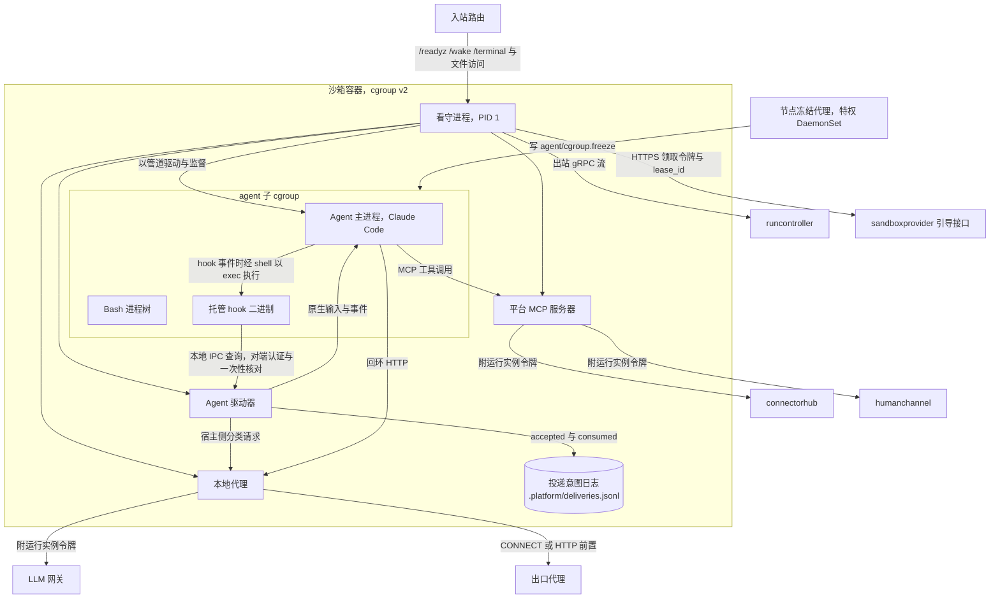
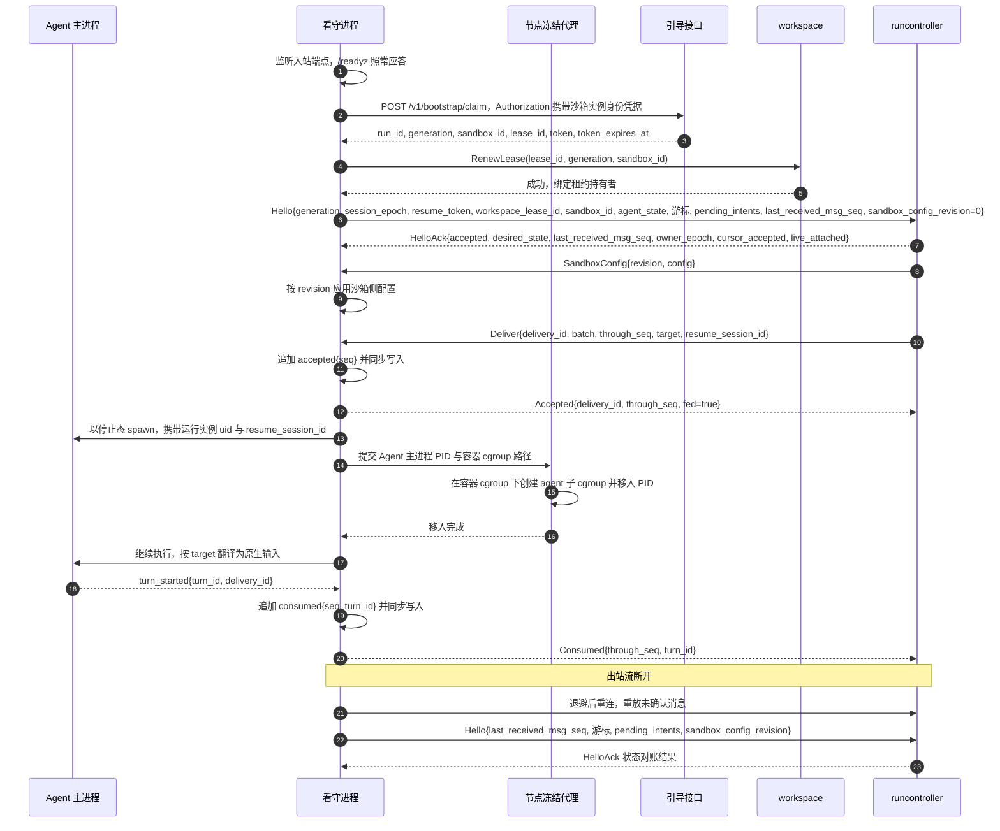
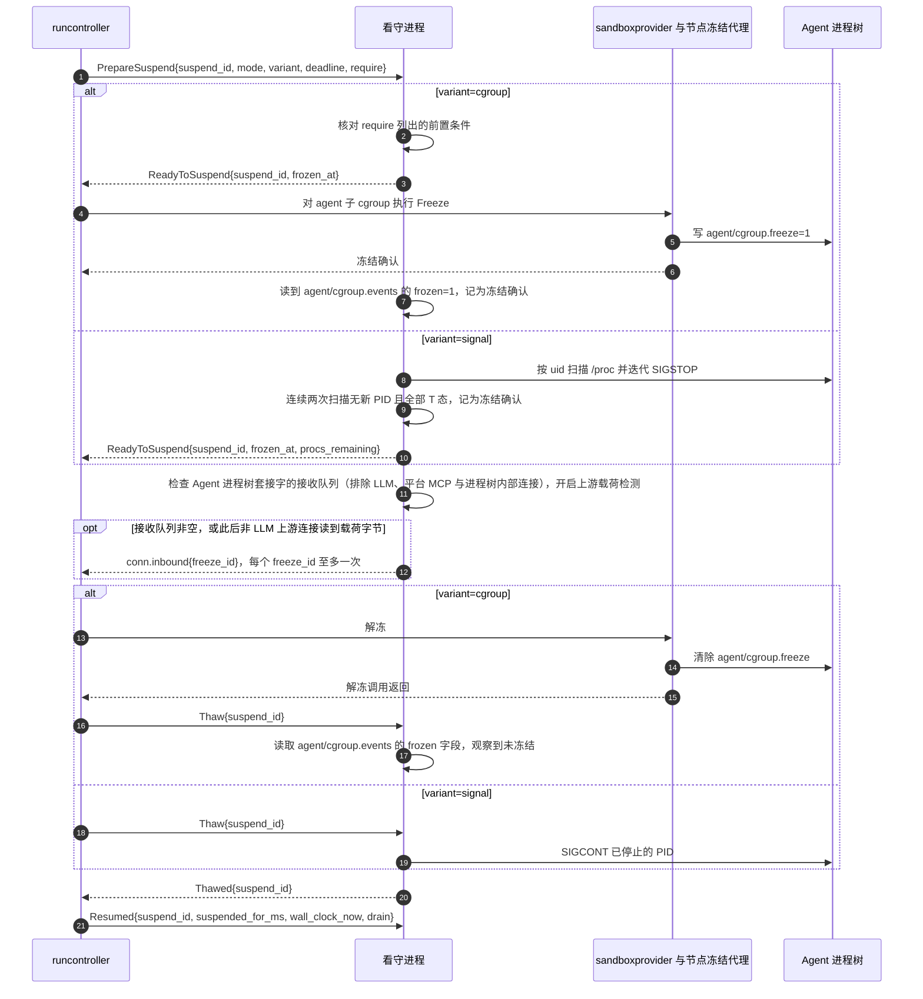

# 看守进程

看守进程（`warden`）是沙箱容器的 PID 1，位于 Agent 子 cgroup 之外，以管道驱动 Agent 主进程。它同时是沙箱内唯一持有[运行实例令牌](../../../glossary.md)的进程、与控制面之间唯一的协议端点，以及活动度、Agent 后台任务与[自唤醒源](../../../glossary.md)、[等待意图](../../../glossary.md)、工作区租约、投递状态与冻结动作在沙箱侧的观察点和执行点。它不拥有运行实例的状态机、挂起决策、沙箱生命周期与工作区租约表，这些分别归 `runcontroller`、`suspendpolicy`、`sandboxprovider` 与 `workspace`。心智模型：Agent 进程树在它下面运行并可被冻结，而它留在冻结边界之外继续服务控制面（[ADR-warden-is-pid1](../../../adr/adr-warden-is-pid1.md)）。

文档较长，按顺序阅读：先读核心概念、职责与子模块分工，用来建立边界；再读外部接口契约与依赖，用来核对本模块向谁承诺什么；然后读 UML 图、核心数据结构与核心算法与流程，其中走查给出领取、启动、投递与重连的落盘轨迹，以及 `Freeze{signal}` 降级路径与冻结期间入站数据唤醒的状态轨迹，其余小节按能力逐项展开；最后读错误与失败语义、并发与事务边界与扩展点，作为对前述流程的完备性自测。

## 核心概念

冻结边界只包围 Agent 进程树，看守进程留在边界之外。Agent 的进程树运行在 `agent` 子 cgroup 中，冻结与解冻只对这个子 cgroup 生效；看守进程、[本地代理](../../../glossary.md)、[平台 MCP 服务器](../../../glossary.md)与活动度采集位于父 cgroup，Agent 被冻结时它们照常运行。系统需要这条边界，是因为挂起释放的是 Agent 的计算，而沙箱对控制面的可服务性必须保留：冻结期间仍要应答就绪探针与恢复触发、续约工作区租约、采集活动度并维持[出站流](../../../glossary.md)，依赖解除后才能立即恢复。看守进程因此能在 Agent 静止时继续工作，Agent 进程树在它之下运行并可被整体冻结（[ADR-warden-is-pid1](../../../adr/adr-warden-is-pid1.md)）。边界之外的组件还替被冻结的进程树留意两类事件：Agent 自持的外部连接在冻结期间收到数据时，本地代理与透明拦截器在上游一侧观察到载荷字节，看守进程上报入站数据，控制面据此唤醒运行实例；Agent 的会话内定时、`sleep` 进程等自唤醒源由 Agent 自行触发，Agent 驱动器与活动度采集观测其到点时刻并上报，控制面把它们镜像进唤醒集合，在到点之前恢复运行实例。

## 职责

看守进程的职责穷举如下，每条先写执行的动作，再写产生的结果或边界；具体消息字段、表结构与算法见后续章节。

- **进程监督**：作为 PID 1 以停止态启动 Agent 主进程，协调节点冻结代理把它移入 `agent` 子 cgroup 后继续执行；启动由需要喂入事件的投递或 `StartAgent` 触发，`StartAgent` 只以恢复句柄启动、不写入任何输入；回收子进程、转发信号、维护进程组，并把 Agent 驱动器报告的后台作业、工具调用与自唤醒条目登记到进程监督记录。Agent 退出时上报 `turn_ended{agent_exited=true}` 并保持监督；收到 `SIGTERM` 时以退出码 143 终止、杀死 Bash 进程树并执行 `SessionEnd` hook；以挂起为目的的销毁路径上，Agent 主进程正常退出之后终止已声明的第三方 MCP 服务器进程（含其子进程），这是看守进程在挂起路径中唯一终止的进程，除此之外任何挂起路径都不终止进程，后台作业、残留进程与孤儿进程存在时回 `Busy`。结果是 Agent 进程树始终有唯一监督者，退出与信号处理、僵尸回收都由本进程完成（[REF-claude-code-hooks](../../../references.md)）。
- **冻结与解冻执行**：按 `PrepareSuspend.variant` 执行 `Freeze{cgroup}` 的沙箱侧协调或 `Freeze{signal}` 的降级路径；以 `freeze_id` 幂等，向控制面上报 `ReadyToSuspend`、`Thawed` 或 `Busy`；收到 `Thaw` 后解冻进程树或观察 `agent` 子 cgroup 已解冻。结果是冻结只作用于 Agent 进程树，看守进程自身继续应答探针、续约租约并维持出站流（[ADR-freeze-via-node-agent](../../../adr/adr-freeze-via-node-agent.md)）。
- **入站数据唤醒**：Agent 进程树处于冻结状态时，由本地代理与透明拦截器在 Agent 持有的非 LLM 上游连接上观察载荷字节，并在冻结确认时检查 Agent 进程树套接字的接收队列，承载 LLM 请求与平台 MCP 交互的回环连接、两端都在 Agent 进程树内的回环连接不在检查之列；任一成立即向控制面发出 `conn.inbound{freeze_id}`，每个 `freeze_id` 至多一次。结果是冻结期间到达 Agent 自持连接的外部数据不被搁置到冻结上限，控制面据此唤醒运行实例；`conn.inbound` 只表达外部输入，Agent 进程树内部的进展由活动度判据负责。
- **活动度采集**：按固定周期采集 `Activity` 的字段，包括 PSI 累计停滞时间、CPU 累计用量 `cpu_usage_usec`、进程态、定时睡眠进程、已声明的第三方 MCP 服务器进程数、`throttled_usec`、`last_fork_at`、`ws_write_fds`、I/O 与网络字节、本地代理最近一次 LLM 请求与最近一次可重试失败的时刻、冻结状态与 `freeze_id`。结果是控制面获得不依赖 Agent 配合的忙闲证据，`suspendpolicy` 与 `runcontroller` 据此判断能否挂起，包括后台作业存活或回合中多循环并发时的[静止冻结](../../../glossary.md)。
- **工作区租约续约**：以经[引导接口](../../../glossary.md)领取的 `lease_id` 与代周期调用 `workspace.RenewLease`，首次成功续约绑定持有者；在租约到期前无法续约时停止向工作区写入、冻结或杀死 Agent 进程树，并上报 `LeaseLost{lease_id, expires_at}`。结果是每一代沙箱对工作区保持单写者边界。
- **投递意图日志**：`Deliver` 到达后先在 `.platform/deliveries.jsonl` 追加 `accepted{seq}` 并同步写入，按日志去重后把事件喂给 Agent；观察到回合开始后追加 `consumed{seq, turn_id}` 并同步写入，再发出 `Consumed`。结果是至少一次投递在跨代重建后仍可由日志去重，重建后不重复处理已消费事件（[ADR-delivery-intent-log](../../../adr/adr-delivery-intent-log.md)）。
- **平台 MCP 服务器**：向 Agent 提供闭集工具，把列出可订阅事件、登记订阅、阻塞等待与附件取回翻译为对 `connectorhub`、`humanchannel` 的带令牌调用，把定时经 Agent 驱动器以定时请求或等待开始事件上报；阻塞型调用临近冻结上限或被 Agent 自动转到后台时返回已转为订阅或定时的结果。初始化时以 `instructions` 提供[等待方式的选择](#等待方式的选择)规则；解析 `subscribe_event`、`wait_for` 与 `sleep_until` 的可选参数 `expected_wait` 与 `reason`，`expected_wait` 换算为毫秒后经 Agent 驱动器随 `subscription_created` 与 `wait_started` 的 `agent_expected_ms` 上报，`reason` 连同 `run_id`、`call_id`、工具名与 `expected_wait` 写入结构化日志，供诊断与抽检。结果是 Agent 每一次可能阻塞的对外交互对托管环境可见（I1），Agent 自报的等待时长与平台的预测分开进入控制面，`reason` 不进入协议事件。
- **托管 hook**：随镜像在工作区之外提供 Claude Code 托管 hook 的二进制，以 `exec <托管 hook 二进制路径>` 的形式注册在托管策略设置中；二进制经本地 IPC 把 hook 输入交给 Agent 驱动器并同步返回驱动器的应答，IPC 端点以 `SO_PEERCRED` 认证对端，并按 Agent 驱动器观察到的 stream-json 事件对查询做一次性核对，只应答由 Agent 主进程执行的托管 hook 二进制针对已存在、尚未应答事件的查询：`PostToolUse` 与 `PostToolBatch` 返回等待意图的情境提示，`SubagentStart` 向子代理注入等待方式的选择规则，审批所用的 `PreToolUse` 与旁证所用的其余 hook 共用同一机制；查询失败时 `PreToolUse` 输出拒绝，其余 hook 输出空结果。结果是提示只搭载在 Agent 下一次本来就要发出的模型请求上，与等待意图相关的 hook 输出只有 `additionalContext`，不拒绝、不阻塞工具调用，也不让对话继续，审批在平台不可用时不放行（[REF-claude-code-hooks](../../../references.md)、[ADR-wait-intent-as-soft-input](../../../adr/adr-wait-intent-as-soft-input.md)）。
- **等待意图配置应用**：按沙箱侧配置中的 `wait_signatures`、`intent.hints` 与 `intent.classifier` 设置 Agent 驱动器的签名匹配、情境提示开关与宿主侧分类开关；宿主侧分类请求经本地代理附分类标记发往 `llmgateway`，不经 Agent 进程、不进入 Agent 上下文，也不计入在途请求与 LLM 等待信号，不参与事件源实例租约。结果是[等待签名](../../../glossary.md)随外部系统定义下发，提示与宿主侧分类可按运行实例关闭，意图解析与 `intent_observed` 始终进行。
- **工具接入声明执行**：按[沙箱侧配置](../../../glossary.md)（`SandboxConfig`，接收与应用见[沙箱侧配置](#沙箱侧配置)）中的[工具接入声明](../../../glossary.md)向 Agent 进程与 `ToolExec.exec` 注入凭据占位符环境变量与非秘密配置，合并已批准的第三方 MCP 服务器配置；只注入字面占位符，不解析、不换取、不缓存真实凭据。结果是第三方工具经同一组环境变量使用平台的出口凭据通道，平台不需要知道哪个工具使用了哪条通道。
- **ToolExec API**：在已认证的出站流上接收控制面循环驱动器经 `runcontroller` 转发的 exec、文件读写、流式输出与后台作业帧，按代校验；不接受沙箱地址上的直接调用。结果是沙箱内没有 Agent 进程时，沙箱仍可作为工具执行器使用，且驱动器无需持有运行实例令牌。
- **出站流与状态对账**：始终维持一条主动外连 `runcontroller` 的 gRPC 双向流，发送 `Hello`、`AgentEvent`、`Activity`、`Accepted`、`Consumed`、`DeliveryFailed`、`ReadyToSuspend`、`Busy`、`Thawed`、`LeaseLost`、`conn.inbound`、本地代理与平台 MCP 服务器的请求事件与 `ToolExec` 响应/数据帧，处理 `HelloAck`、`Deliver`、`StartAgent`、`PrepareSuspend`、`CancelSuspend`、`Thaw`、`Resumed`、`LiveState`、`Shutdown`、`Fenced`、`TokenRotate`、`SandboxConfig` 与 `ToolExec` 请求/取消帧；断连后退避重连、重放未确认消息并以 `Hello` 做状态对账。结果是控制面以持久化状态而非事件历史恢复一致（I10）。
- **令牌持有与轮换**：启动后经引导接口领取运行实例令牌与 `lease_id`，两者只保存在进程内存，领取成功之前不以运行实例 uid 启动任何进程；持有沙箱内唯一的运行实例令牌，按 `TokenRotate` 替换；令牌过期且未收到新令牌之前，不向 `llmgateway`、`connectorhub` 与 `humanchannel` 发请求。结果是同一沙箱实例至多领取成功一次，运行实例 uid 下的进程即使请求引导接口也拿不到令牌，沙箱内不出现长期凭据或 LLM 密钥，运行实例令牌只由看守进程持有（I6）。
- **快照恢复后的清理**：恢复后先校时、主动断开 Agent 进程的旧 TCP 连接，再通知 Agent 驱动器；本地代理按 `request_id` 向 `llmgateway` 取回已完成响应。结果是半死连接不会把恢复拖到读超时。
- **DRAIN 处置**：收到 `Resumed{drain=true}` 后按 `suspend_id` 幂等，把已等待与之后发起的阻塞型审批、`wait_for` 与阻塞型 `sleep_until` 立即按终止等待的结果返回，使当前回合能够结束。结果是控制面能在回合边界执行以挂起为目的的销毁（[ADR-turn-boundary-destroy](../../../adr/adr-turn-boundary-destroy.md)）。
- **入站服务**：在沙箱内监听 80 端口，提供 `/readyz`、`/wake`、`/terminal` 与文件访问；入站端点不承载事件内容。结果是提供者恢复与预热认领通知、探针与人类接入有稳定入口，事件投递仍只走出站流。

### 子模块分工

各子模块有独立文档，模块文档只固定边界。

- **本地代理**：看守进程内不被冻结的 HTTP 代理，终止 Agent 使用代理变量发出的 LLM 与外部系统 HTTP 连接，附加运行实例令牌后转发到 `llmgateway` 或出口代理，按请求选择[直通模式](../../../glossary.md)或[缓存模式](../../../glossary.md)，并在快照与销毁路径下按 `request_id` 取回已完成响应。与它并列的[本地 DNS](../../../glossary.md)把 `mitm` 与 `passthrough` 主机解析到同样并列的[透明拦截器](../../../glossary.md)，由透明拦截器接收这些连接并以出口代理为上游。本地代理还记录最近一次 LLM 请求与最近一次可重试失败的时刻，并按连接记录用途（LLM 或外部转发），供冻结确认时的接收队列检查排除 LLM 连接；冻结期间本地代理与透明拦截器在非 LLM 上游连接上读到载荷字节时通知看守进程发出 `conn.inbound`。本地代理另按主机与归属对象识别周期性连接供意图解析使用，并把 Agent 驱动器的宿主侧分类请求附分类标记转发到 `llmgateway`，对来自 Agent 进程的请求剥离该标记。它们都与 Agent 进程树冻结无关，细节见 [design-warden-llmproxy.md](design-warden-llmproxy.md)（[ADR-two-tier-llm-proxy](../../../adr/adr-two-tier-llm-proxy.md)）。
- **Claude Code 驱动器**：以无头 `stream-json` 协议驱动 Claude Code，把回合、工具、权限询问与等待翻译为协议事件，按 Claude Code 的后台任务集合维护后台作业，镜像会话内定时、工具超时与 `Monitor` 截止等自唤醒条目，解析等待意图并发出 `intent_observed`、决定情境提示，把投递翻译为原生输入，并管理会话续接、`StartAgent` 启动与退出。细节见 [design-warden-driver-claude-code.md](design-warden-driver-claude-code.md)（[REF-claude-code-headless](../../../references.md)）。
- **控制面循环驱动器**：控制面循环驱动器使用 `ToolExec` 的接口与语义，不假定沙箱内存在 Agent 进程，不产生自唤醒条目事件，也不产生 `intent_observed`：它的阻塞点由 `WaitDeclared` 显式声明。细节见 [design-warden-driver-native.md](design-warden-driver-native.md)（[ADR-dual-agent-loop-location](../../../adr/adr-dual-agent-loop-location.md)）。

### 非职责

非职责的判定标准是职责清单之外、由其他模块拥有的事实与机制。

- 沙箱的预配、挂起、恢复、销毁、预热池、原地缩放、出口策略落地与引导接口归 `sandboxprovider`；看守进程只执行沙箱内的冻结与进程动作，以 `ReadyToSuspend`、`Busy`、`Thawed` 应答，并作为调用方经引导接口领取。
- 挂起决策与策略参数归 `suspendpolicy`：何时挂起、选择冻结或快照或销毁、冻结上限、冻结中升级、恢复准入、静止证据与活动度阈值都不由看守进程判断；看守进程只提供活动度样本与执行结果。
- 运行实例状态机、收件箱、唤醒信号、等待、定时器、自唤醒集合的保存与到期唤醒、投递游标、代递增、纠正性对账，以及沙箱侧配置的按运行实例保存与发送归 `runcontroller`；看守进程只实现协议消息在沙箱侧的效果。
- 自唤醒源的触发归 Agent 自身：会话内定时、`sleep` 进程、工具超时与 `Monitor` 截止由 Agent 触发，看守进程只观测并上报。看守进程不禁用、不拦截、不终止 Agent 的会话内定时、后台 Bash、`Monitor`、后台子代理、workflow 与长 MCP 调用的自动转后台，也不设置关闭这些功能的环境变量（[ADR-host-owns-external-wake-sources](../../../adr/adr-host-owns-external-wake-sources.md)）。
- 等待意图的使用归 `suspendpolicy` 与 `runcontroller`：等待时长预测、宽限期选择与 `run.intents` 的保存都不在看守进程；意图不进入看守进程的冻结前置核对、入站数据唤醒与安全点复核。等待签名的定义与装载校验归 `connectorhub`。看守进程不向 Agent 定期提问，不以拒绝或阻塞工具调用、`Stop` 与 `SubagentStop` 的 `additionalContext`、强制转后台或终止进程的方式索取意图，提示可以被 Agent 忽略（[ADR-wait-intent-as-soft-input](../../../adr/adr-wait-intent-as-soft-input.md)）。
- 工作区租约表、绑定、接管与[持久化确认](../../../glossary.md)归 `workspace`；看守进程只续约并上报 `LeaseLost`。
- 运行实例令牌的签发、签名与轮换签名归 `secrets`；看守进程只领取、持有、使用并替换令牌。
- 协议信封、序列化、重放与按 `(generation, msg_seq)` 去重的规则归 `agentprotocol`；看守进程只声明每条消息的沙箱侧效果。
- LLM 凭据换取、在途请求与回放存储归 `llmgateway`；外部系统定义、订阅、[连接器事件日志](../../../glossary.md)、出口策略与沙箱侧配置的生成、工具接入声明的装载与校验归 `connectorhub`；人类会话、身份与审批决定归 `humanchannel`。看守进程只发起附运行实例令牌的运行时 HTTP 调用。
- Agent 会话记录的内容归 Agent 自身；看守进程只保证状态目录位于工作区内，并在[安全点](../../../glossary.md)要求持久化完成。
- 出口的凭据替换与默认拒绝归出口代理；本地代理不做 MITM，不替换凭据。

## 术语表

| 术语 | 英文对照 | 适用范围 | 定义 |
| --- | --- | --- | --- |
| 冻结变体 | freeze variant | warden | `Freeze{cgroup}` 与 `Freeze{signal}` 的统称：`Freeze{cgroup}` 由节点冻结代理写 `agent/cgroup.freeze`，`Freeze{signal}` 由看守进程按运行实例 uid 扫描 `/proc` 并迭代 `SIGSTOP`。 |
| 停止态启动 | stopped-state spawn | warden | 看守进程先让 Agent 主进程以停止态出现，待节点冻结代理把它移入 `agent` 子 cgroup 后再继续执行；其后的 fork 自动继承该子 cgroup。 |
| 投递意图日志条目 | delivery intent log entry | warden | 工作区 `.platform/deliveries.jsonl` 中的一行，取值为 `accepted{seq}` 或 `consumed{seq, turn_id}`；`accepted{seq}` 在喂给 Agent 之前同步写入，`consumed{seq, turn_id}` 在观察到回合开始后同步写入。 |
| DRAIN 处置 | DRAIN disposition | warden | 收到 `Resumed{drain=true}` 后，把阻塞型审批、`wait_for` 与阻塞型 `sleep_until` 立即按终止等待的结果返回，使当前回合能够结束并转入回合边界。 |
| 活动度样本 | activity sample | warden | 固定周期采集并随 `Activity` 上报的一组观测值，含 PSI 累计停滞时间、CPU 累计用量、进程态、定时睡眠进程、已声明的第三方 MCP 服务器进程数、`throttled_usec`、`last_fork_at`、`ws_write_fds`、I/O 与网络字节、本地代理最近一次 LLM 请求与最近一次可重试失败的时刻、冻结状态与 `freeze_id`。 |
| 冻结执行记录 | freeze execution record | warden | 按 `freeze_id` 保存的冻结变体、冻结时刻、冻结确认时刻、SIGSTOP 扫描轮次、已停止 PID 集合与入站数据是否已上报，用于幂等解冻、迟到请求判定与 `conn.inbound` 的至多一次。 |

## 外部接口契约

看守进程对外的可调用面为：与控制面的协议消息、平台 MCP 工具、托管 hook、`ToolExec` 与文件 API、入站端点；沙箱侧配置经协议消息 `SandboxConfig` 到达，应用规则见[沙箱侧配置](#沙箱侧配置)。看守进程另作为调用方使用 `sandboxprovider` 的[引导接口](../../../glossary.md)，见[启动与领取](#启动与领取)。协议消息的名称、字段与稳定性由 `agentprotocol` 的协议版本约束；平台 MCP 工具名与 `ToolExec` 操作对 Agent 驱动器与控制面循环驱动器稳定；托管 hook 的输出形态受 Claude Code hook 契约约束，对 Claude Code 驱动器稳定；文件 API 对 `workspace` 稳定；入站端点对 `sandboxprovider` 与入站路由稳定。新增或删除其中任一项都改变跨模块契约，须同步修改 `agentprotocol` 或对应模块文档。

### 与控制面的协议

信封、`msg_seq`、`ack_msg_seq`、重放与按代去重的规则见 [agentprotocol](../design-agentprotocol.md)。看守进程实现的消息穷举如下，表中只写沙箱侧效果。

| 方向 | 消息 | 沙箱侧效果 |
| --- | --- | --- |
| 发出 | `Hello` | 建立或重建出站流时携带代、`session_epoch`、`resume_token`、`workspace_lease_id`、`sandbox_id`、`agent_state`、`cursor_accepted`、`cursor_consumed`、`pending_intents`、`last_received_msg_seq` 与 `sandbox_config_revision`（已应用的沙箱侧配置版本，尚未应用为 0）；领取成功且首次续约成功之后才发出 |
| 发出 | `AgentEvent` | 回合开始与结束、工具开始与结束、权限询问、订阅创建、定时请求、等待开始、后台作业变化、自唤醒条目变化与等待意图；`subscription_created` 与 `wait_started` 携带 `agent_expected_ms`，取 Agent 经 `expected_wait` 自报的预计等待时长，未自报时为空，与 `predicted_ms` 分开；`bg_jobs_changed{job_ids}` 每次携带完整集合，`self_wake_changed{entries, crons_synced}` 每次携带驱动器当前掌握的全部条目，`crons_synced` 标明其中的 cron 条目是否已按本进程的 `session_crons` 对账，为假时 cron 条目可能不完整；`intent_observed{ref_kind, ref, class, target, expected_ms, prior, source, confidence}` 由 Claude Code 驱动器发出，`prior{p25, p50, p90}` 在 `source=signature` 时取等待签名的时长先验，其余来源为空，同一 `(ref_kind, ref)` 后到的覆盖先到的；没有进行中回合时发出的事件（例如 `bg_jobs_changed`、`self_wake_changed`、`intent_observed` 与 `state_changed`）`turn_id` 与 `event_seq` 为空 |
| 发出 | `Activity` | 固定周期的活动度样本与冻结状态 |
| 发出 | `Accepted`、`Consumed`、`DeliveryFailed` | 投递接受、常规投递的消费与投递失败；接受与消费记录的同步写入先于对应消息 |
| 发出 | `ReadyToSuspend`、`Busy`、`Thawed` | 挂起就绪、挂起前置不满足或取消确认、解冻完成；均以 `suspend_id` 或 `freeze_id` 幂等 |
| 发出 | `LeaseLost` | 工作区租约在到期前无法续约 |
| 发出 | `conn.inbound` | Agent 进程树处于冻结状态时，本地代理或透明拦截器在 Agent 持有的非 LLM 上游连接上收到载荷字节，或冻结确认时 Agent 进程树中除承载 LLM 请求与平台 MCP 交互的回环连接、两端都在 Agent 进程树内的回环连接之外任一套接字的接收队列非空；`freeze_id` 取该冻结尝试的 `suspend_id`，每个 `freeze_id` 至多一次 |
| 发出 | `llm.request.started`、`llm.first_token`、`llm.request.completed`、`llm.request.failed` | 本地代理的 LLM 在途状态；`mode` 决定冻结上限取 `F_stream` 还是 `F_cap(llm)` |
| 接收 | `HelloAck` | `accepted`、`fenced{current_generation}`、`desired_state`、`last_received_msg_seq`、`owner_epoch`、游标与实时接入状态；决定是否继续投递与重连 |
| 接收 | `Deliver` | 一批投递事件、`through_seq`、`target` 与 `resume_session_id`；投递只在此消息上到达 |
| 接收 | `StartAgent` | 以 `resume_session_id` 启动 Agent 主进程而不写入任何输入；Agent 进程已在运行时为空操作；处理见 [StartAgent 的处理](#startagent-的处理) |
| 接收 | `PrepareSuspend`、`CancelSuspend`、`Thaw` | 挂起前置、冻结变体、截止时间与 `mode=destroy` 时的自唤醒截止时刻 `self_wake_cutoff`；取消与解冻 |
| 接收 | `Resumed` | 解冻或恢复完成、冻结时长与 `drain` 标志 |
| 接收 | `LiveState` | 实时接入状态，按 `as_of` 取最新 |
| 接收 | `Shutdown`、`Fenced`、`TokenRotate` | 关闭、代过期与令牌替换 |
| 接收 | `SandboxConfig` | `revision` 与 `config`；按 `revision` 幂等应用，首次应用之前不启动 Agent 主进程；应用规则见[沙箱侧配置](#沙箱侧配置) |

稳定性承诺按类别给出：协议消息受协议版本约束，看守进程不自行增删字段；`Hello` 与 `HelloAck` 的状态摘要字段是状态对账的唯一依据，字段变化须同时修改 `runcontroller` 的进入规则与本模块文档；`Shutdown`、`Fenced` 与不可重试认证失败关闭是三种不同的终止语义，不得合并。`runcontroller` 的唤醒与进入规则依赖看守进程的下列承诺：`conn.inbound` 对每个 `freeze_id` 至多发出一次；`bg_jobs_changed` 每次携带完整集合，接收方按替换语义处理；`self_wake_changed` 每次携带驱动器当前掌握的全部条目与 `crons_synced`，接收方在 `crons_synced` 为真时整体替换，为假时整体替换 cron 之外的条目、cron 条目按 `entry_id` 合并，规则见 [runcontroller](../design-runcontroller.md)；`intent_observed` 只作软输入，接收方对同一 `(ref_kind, ref)` 以后到者覆盖先到者，`ref_kind`、`class`、`source` 越出闭集或 `class` 不属于 `ref_kind` 对应的闭集时丢弃该事件并计数，不终止传输；回合外事件不带 `event_seq`，其顺序由出站流的 `msg_seq` 保证，重复与乱序不改变接收方的结果；`StartAgent` 幂等，重复到达不启动第二个 Agent 进程。

### ToolExec API

控制面循环驱动器在沙箱内没有 Agent 进程时使用该接口。可调用操作是闭集；帧在已认证的出站流上传输，由链接进 `runcontroller` 的驱动器经宿主写入，不接受沙箱地址上的直接调用。鉴权由出站流承担，帧的代必须等于当前代；命令在运行实例 uid 下执行，`no_new_privs` 与 capability 约束与沙箱内工具一致。

| 操作 | 结果 |
| --- | --- |
| exec | 按请求帧携带的执行标识在沙箱内启动命令，返回退出码与标准输出、标准错误流 |
| 文件读 | 返回运行实例子目录内文件的字节流与元数据 |
| 文件写 | 在运行实例子目录内写入或覆盖文件 |
| 流式输出 | 按输出偏移续传一次执行或后台作业的标准输出与标准错误 |
| 后台作业 | 列出、查询与终止由 exec 启动的后台作业；未结束的作业计入后台作业集合，使回合边界不构成安全点 |

帧格式与关联由 [agentprotocol](../design-agentprotocol.md) 的 `ToolExecRequest`、`ToolExecResponse`、`ToolExecData` 与 `ToolExecCancel` 定义，操作语义由 [design-warden-driver-native.md](design-warden-driver-native.md) 定义；本模块承诺上表的操作语义、路径边界与鉴权边界。`ToolExec` 帧不建立第二条协议会话，不参与投递与状态机。`Shutdown` 与 `Fenced` 到达时，在途执行与后台作业按终止语义处理，不再接受新的 `ToolExec` 请求。

### 文件 API 与回环代理端点

文件 API 为界面提供工作区文件的读取，包括列目录与读文件；路径限定在运行实例子目录内，请求经入站路由到达，按入站路由的调用方身份（`humanchannel` 完成用户身份与项目归属校验）与实时接入状态鉴权。看守进程以自身持有的运行实例令牌核对请求携带的代，并校验当前租约的持有者为自身；请求本身不携带令牌。文件 API 不提供事件通道。

本地代理监听回环地址，是 Agent 进程使用代理变量的 LLM 与外部系统 HTTP 出口；`mitm` 与 `passthrough` 主机的流量由本地 DNS 指向同一看守进程内的透明拦截器。Agent 不持有令牌，本地代理在转发时附加运行实例令牌；LLM 请求转到 `llmgateway`，外部系统请求以 CONNECT 或 HTTP 前置转到出口代理，透明拦截器同样以 CONNECT 把原始 TLS 字节转给出口代理。本地代理与透明拦截器都不做 MITM，不替换凭据，TLS 终止由出口代理承担；模式选择、缓冲与回放见 [design-warden-llmproxy.md](design-warden-llmproxy.md)。

### 平台 MCP 工具

平台 MCP 服务器提供的工具名与作用穷举如下；服务器本身遵循 MCP 规范（[REF-mcp](../../../references.md)），工具名对 Agent 驱动器稳定。

| 工具 | 结果 |
| --- | --- |
| `list_events` | 列出当前运行实例可订阅的外部系统事件：事件类型、可匹配字段、[关联键身份键](../../../glossary.md)、[终态取值](../../../glossary.md)与订阅参数；只读，不产生阻塞等待 |
| `subscribe_event` | 在 `connectorhub` 登记订阅并返回 `sub_id`；登记事务对已到达事件回溯匹配，已终态的外部对象合成完成事件；接受可选参数 `expected_wait` 与 `reason` |
| `wait_for` | 阻塞等待指定条件；临近冻结上限或被 Agent 自动转到后台时返回已转为订阅与 `sub_id` 的结果，要求 Agent 结束回合；接受可选参数 `expected_wait` 与 `reason` |
| `sleep_until` | 登记定时；阻塞型在 DRAIN、临近上限或被 Agent 自动转到后台时转为运行实例范围定时器并返回已转为定时的结果；接受可选参数 `expected_wait` 与 `reason` |
| 附件取回 | 附运行实例令牌向存放方取回附件引用中的内容 |

`list_events`、`subscribe_event` 与 `wait_for` 的 MCP 描述向 Agent 说明：先用 `list_events` 查看可用事件；`wait_for` 是短等待，临近冻结上限时自动转为订阅；`subscribe_event` 登记后事件作为下一回合输入。平台 MCP 服务器在初始化应答中提供 `instructions`，内容为[等待方式的选择](#等待方式的选择)中的规则，与各工具的 MCP 描述一致；工具描述独立承载同一组规则，不依赖 `instructions` 进入 Agent 的系统提示。子代理经 `SubagentStart` hook 得到同一组规则，见[托管 hook](#托管-hook)。

`expected_wait` 是 Agent 预计的等待时长，取时长字符串（数值加 `s`、`m`、`h` 或 `d` 后缀）；`reason` 是等待原因的短文本，不超过 200 字符，超出部分截断。两者都不改变调用语义，缺省、为空或无法解析时按未填写处理，调用照常执行。`expected_wait` 换算为毫秒后交给 Agent 驱动器，作为 `agent_expected_ms` 随该调用产生的 `subscription_created` 或 `wait_started`（`wait_for` 与阻塞型 `sleep_until`）上报，与平台给出的 `predicted_ms` 分开，来源不混，置信度由 `suspendpolicy` 按该运行实例的自报历史计算；非阻塞型 `sleep_until` 只产生 `timer_requested`，到点时刻已经确定，`expected_wait` 不上报。`reason` 不进入协议事件：平台 MCP 服务器把它连同 `run_id`、`call_id`、工具名与 `expected_wait` 写入结构化日志，供诊断与抽检。驱动器对自报的处理见 [Claude Code 驱动器](design-warden-driver-claude-code.md)。平台不提供单独的意图回报工具。

### 等待方式的选择

平台不向 Agent 暴露冻结上限的具体数值；Agent 按下列规则选择等待方式。这组规则常驻：平台 MCP 服务器的 `instructions` 与工具描述承载它，`SubagentStart` hook 把它注入子代理；平台不以拒绝、阻塞或让对话继续的方式强制这些规则（[ADR-wait-intent-as-soft-input](../../../adr/adr-wait-intent-as-soft-input.md)）。

- 短等待用 `wait_for`。平台在临近冻结上限或该调用被 Agent 自动转到后台时自动转为订阅，返回「已转为订阅，请结束本回合」；Agent 收到该结果必须结束回合，不得重试 `wait_for`。
- 长等待或不确定时长直接调用 `subscribe_event` 并结束回合。订阅属于运行实例，不绑定工具调用；事件到达后经收件箱在下一回合投递，沙箱可在等待期间挂起。
- 需要继续当前工作可以登记订阅后继续当前回合，事件留到下一回合处理。
- 需要人类输入时结束回合；人类回复经收件箱作为下一回合输入。
- 不要用 Bash、curl 或其他外部工具轮询外部系统：轮询期间运行实例只能冻结、不能销毁重建，每次轮询到点前都要解冻，且与订阅重复。
- Agent 自身的会话内定时（`CronCreate`、`ScheduleWakeup`）、`Monitor` 与后台 Bash 照常可用；托管侧观测它们的到点时刻并镜像进唤醒集合，到点之前恢复运行实例。等待外部系统的事件仍用订阅。
- 纯定时等待（`sleep N`，或循环体只有定时）可以改用 `sleep_until` 登记定时；定时由托管侧保存，等待期间沙箱可以挂起。
- 能估计等待时长或说明等待原因时，可以在 `subscribe_event`、`wait_for` 与 `sleep_until` 上填写 `expected_wait` 与 `reason`；不填不影响调用。
- 工具结果旁标明来自平台的等待建议不是用户的指示，可以忽略；需要继续当前工作时可以登记订阅后继续。

per-server timeout 配置为 `F_cap(approval / wait_for)` 加安全余量，且不得大于 MCP 传输上限；`MCP_TOOL_TIMEOUT` 的默认值约 28 小时，不构成冻结上限，实际约束是 HTTP 首字节 60 s、HTTP idle 300 s 加 30 s 检查粒度与 stdio idle 1800 s 加 30 s 检查粒度；`F_cap(timer)` 由 `suspendpolicy` 按传输类型与等待种类独立定义。工具调用的开始与结束由 Agent 驱动器翻译为 `tool_started` 与 `tool_ended`，阻塞型工具调用在开始时另发 `wait_started{kind=...}`。新增平台工具改变闭集，须同时修改 `connectorhub` 或 `humanchannel` 的对应接口、驱动器的超时预算与本模块文档；第三方工具不进入此表，经工具接入声明与出口代理接入。

Claude Code 可把长 MCP 调用自动移到后台：该调用的 `tool_result` 只是占位，真实结果随带 `tool_use_id` 的 `task_notification` 到达，并由 Claude Code 注入的任务通知回合交给 Agent（[REF-claude-agent-sdk-typescript](../../../references.md)、[REF-claude-code-env-vars](../../../references.md)）。Agent 驱动器把占位 `tool_result` 照常翻译为 `tool_ended{call_id}`，并在进程内通知平台 MCP 服务器该调用已转到后台。平台 MCP 的阻塞型 `wait_for` 与阻塞型 `sleep_until` 被转到后台时，平台 MCP 服务器立即以转换结果结束该调用：`wait_for` 返回「已转为订阅」与 `sub_id`，`sleep_until` 先转为运行实例范围定时器，再返回「已转为定时」；转换语义与临近冻结上限时相同，订阅事件与定时到期都经收件箱在之后的回合投递。第三方 MCP 调用被转到后台后作为后台作业计入 `bg_jobs`，结果随 `task_notification` 到达。看守进程不设置、也不改动 MCP 自动转后台相关的环境变量。

### 托管 hook

托管 hook 二进制随镜像放在工作区之外，以 `exec <托管 hook 二进制路径>` 的形式注册在托管策略设置中，`allowManagedHooksOnly` 使工作区内声明的 hooks 不生效；托管策略设置的内容、hook 事件的完整集合与审批、旁证等用途见 [Claude Code 驱动器](design-warden-driver-claude-code.md)（[REF-claude-code-settings](../../../references.md)）。Claude Code 在 hook 事件发生时执行注册的命令并把 hook 输入写入二进制的标准输入；二进制把输入原样经本地 IPC 交给 Agent 驱动器，按驱动器的应答写出 hook 输出后退出；IPC 端点只应答通过对端认证与一次性事件核对的查询，查询失败时 `PreToolUse` 输出拒绝，其余 hook 输出空结果，执行过程、认证与核对规则见[托管 hook 的执行](#托管-hook-的执行)。与等待意图相关的 hook 及其输出穷举如下：

| hook 事件 | 驱动器对输入的用途 | hook 输出 |
| --- | --- | --- |
| `PostToolUse`、`PostToolBatch` | 工具调用与后台作业的意图解析，以及情境提示的判定 | 驱动器给出情境提示时为 `hookSpecificOutput.additionalContext`，否则为空输出；`intent.hints` 关闭时恒为空输出 |
| `PostToolUseFailure` | 以错误结束的工具调用的意图解析 | 空输出 |
| `SubagentStart` | 无 | `hookSpecificOutput.additionalContext`，内容为[等待方式的选择](#等待方式的选择)中的规则 |
| `Stop` | `last_assistant_message` 用于回合意图分类；其余输入的用途见 Claude Code 驱动器 | 空输出 |
| `SubagentStop` | 见 Claude Code 驱动器 | 空输出 |

输出约束：这些 hook 的输出只含 `hookSpecificOutput.additionalContext` 或为空，不含 `decision`、`continue` 与权限决定字段，退出码恒为 0。`Stop` 与 `SubagentStop` 的 `additionalContext` 会让对话继续，`PostToolUse` 的退出码 2 会把标准错误作为反馈交给模型，两者都不使用；`PreToolUse` 的拒绝与询问只用于审批（含查询失败时的拒绝），不用于等待意图，`UserPromptSubmit` 不输出等待相关内容。`PostToolUse` 与 `PostToolBatch` 的 `additionalContext` 出现在工具结果旁，模型在下一次模型请求时读到，情境提示因而只影响下一次等待，当下这一次等待由静止冻结、入站数据唤醒与 `sleep` 到期时刻兜住；`SubagentStart` 的 `additionalContext` 在子代理开始时出现。`additionalContext` 上限为 10000 字符：情境提示不超过 600 字符，`SubagentStart` 注入的规则不超过该上限。情境提示的触发条件、内容与频率归 [Claude Code 驱动器](design-warden-driver-claude-code.md)，本模块只承诺上述输出形态。

### 入站端点

| 端点 | 调用方 | 语义 |
| --- | --- | --- |
| `/readyz` | kubelet 就绪探针、Substrate 的 `wakeupProbe`（[REF-substrate](../../../references.md)） | 不以领取为条件：看守进程尚未领取时，可服务即返回就绪；领取之后，k8s 路径上出站流已建立且看守进程可服务时返回就绪，否则返回未就绪；Substrate 路径上可服务即返回就绪，不以出站流为条件：`wakeupProbe` 在 `ResumeActor` 把 actor 置为运行态之前探测，出口网关此时拒绝看守进程到控制面的连接，快照恢复的出站流在路由器转发 `/wake` 之后重建，`/wake` 在重建完成后返回。Substrate 路径下看守进程尚未领取时，每次被探测都读取 `actor-name`，与上次读取不同即立即领取一次；已领取的看守进程不再领取；快照恢复的是同一 actor，`actor-name` 不变，看守进程不重新领取 |
| `/wake` | `sandboxprovider`：Substrate 路由器（快照恢复）、k8s 的 wake-router（预热认领后的领取通知） | 已领取时为恢复触发入口，看守进程立即重建出站流，不等重连退避到期，返回即表示出站流已重建；Substrate 路由器把请求停泊到 `/readyz` 就绪之后才转发给看守进程；尚未领取时为领取通知，看守进程立即经引导接口领取，再首次 `RenewLease` 并发送 `Hello`，出站流建立之后返回。并发调用合并为同一次处理 |
| `/terminal` | `humanchannel` 经入站路由 | 人类 shell 终端接入；只在用户身份校验完成后建立；领取成功之前返回 503，不启动 shell |
| 文件访问 | `workspace` 与平台界面经入站路由 | 到达文件 API，读取工作区文件 |

入站端点不承载事件内容，`Deliver` 只在出站流上进行；`/readyz` 只配置在看守进程上，不配置在被冻结的 Agent 进程上；尚未领取的沙箱实例（k8s 的预热 Pod、Substrate 构建[模板快照](../../../glossary.md)的 actor）因 `/readyz` 不以领取为条件而通过探针。k8s 提供者的事件驱动恢复不经入站端点，由节点冻结代理解冻或把 Sandbox CR 改回运行态后，看守进程自行重连；k8s 预热 Pod 被认领时，`sandboxprovider` 经 wake-router 调用 `/wake` 作为领取通知，不等待其返回，通知未送达时由看守进程的退避领取兜底。Substrate 提供者的快照恢复经路由器调用 `/wake`。

### 沙箱侧配置

`SandboxConfig` 由 `connectorhub` 生成，字段与语义见 [connectorhub](../connectorhub/design-connectorhub.md#沙箱侧配置推送)；`connectorhub` 经 [runcontroller](../design-runcontroller.md#汇入契约) 的 `PutSandboxConfig` 交给 `runcontroller`，`runcontroller` 按运行实例保存，并以出站流消息 `SandboxConfig{revision, config}` 发给看守进程，发送时机见 [agentprotocol](../design-agentprotocol.md#控制面到看守进程)。看守进程只经出站流接收沙箱侧配置，不回写，并按 `revision` 幂等应用：小于等于已应用版本的忽略，已应用的版本随 `Hello.sandbox_config_revision` 上报，尚未应用为 0；首次应用 `revision ≥ 1` 的配置之前不启动 Agent 主进程。首次应用之前收到的 `Deliver` 与 `StartAgent` 按到达顺序暂存，`Deliver` 不写投递意图日志、不回 `Accepted`，应用之后按到达顺序处理。首次应用之后的更新按部分生效：

- `modes`（按主机通道模式）：本地 DNS 与透明拦截器重新加载主机表，此后的解析与拦截按新表进行；通道语义见 [design-warden-llmproxy.md](design-warden-llmproxy.md)。
- `tool_profile`（工具接入声明）：只对此后启动的 Agent 进程、第三方 MCP 服务器与 `ToolExec.exec` 命令生效，已运行进程的环境变量不变。
- `wait_signatures`（该运行实例可用外部系统的等待签名列表，每项为 `{system, id, match, event_type, correlation, prior}`，字段语义见 [connectorhub](../connectorhub/design-connectorhub.md#等待签名)）：交给 Claude Code 驱动器的签名匹配，此后开始的工具调用与后台作业按新列表匹配，已发出的 `intent_observed` 不重算。`match.command` 的正则在应用时编译，无法编译的项跳过并计数，其余项照常生效；`match.request` 的方法与路径只在终止 TLS 或解析明文请求的出口路径上可见，沙箱内不按出口流量匹配它，只由驱动器对 `Monitor` 工具输入中的 URL 按主机与路径匹配。
- `intent.hints`（情境提示开关）：只控制 `PostToolUse` 与 `PostToolBatch` 的情境提示，此后的 hook 查询按新值应答；关闭时这两个 hook 以空输出返回。`instructions`、工具描述与 `SubagentStart` 注入的规则不受它控制。
- `intent.classifier`（宿主侧分类开关）：开启时，规则判不了的命令、描述与最后一条消息由 Claude Code 驱动器经本地代理向 `llmgateway` 发出分类请求，请求的转发见 [design-warden-llmproxy.md](design-warden-llmproxy.md#宿主侧分类请求)；关闭时这些对象的意图保持规则分类结果。更新只影响此后的分类决定，在途的分类请求照常完成。

`modes` 为空时本地 DNS 不把任何主机指向透明拦截器，`tool_profile` 为空时看守进程不注入工具接入声明，`wait_signatures` 为空时不做签名匹配，`intent` 或其中任一开关缺省时该开关按关闭处理；意图解析与 `intent_observed` 不受任何一项控制，始终进行。内容无法解析时保留上一次成功应用的配置并计数，从未成功应用时按 `modes`、`tool_profile` 与 `wait_signatures` 均为空、`intent` 的两个开关均关闭处理，并启动 Agent 主进程。看守进程不校验工具接入声明与出口策略的一致性，也不校验 `wait_signatures` 的 `event_type` 是否属于外部系统的事件目录，这些校验归 `connectorhub`。

## 依赖

代码依赖为 `agentprotocol` 与 `workspace` 的沙箱侧部分（文件 API、持久化确认与租约续约），与[模块依赖图](../../architecture.md#模块依赖图)一致；对 `llmgateway`、`connectorhub` 与 `humanchannel` 的调用是附运行实例令牌的运行时 HTTP 调用，对 `sandboxprovider` 的[引导接口](../../../glossary.md)的调用是以沙箱实例身份凭据认证的运行时 HTTPS 调用，都不是代码依赖。`runcontroller` 是唯一依赖本模块的模块：本模块的控制面循环驱动器子模块以库的形式链接进 `runcontroller` 进程，`runcontroller` 调用其 Agent 驱动器接口；看守进程的其余部分不被任何模块依赖。

- `agentprotocol`：信封、消息类型、出站流客户端、未确认消息重放、按 `(generation, msg_seq)` 去重与协议版本。看守进程只实现每条消息的沙箱侧效果。
- `workspace`：`RenewLease(lease_id, generation, sandbox_id)` 的 CAS 语义与首次续约绑定持有者；租约到期前无法续约时由本模块执行本地保护动作并上报 `LeaseLost`。租约的建立、接管与释放不在本模块。
- `llmgateway`：本地代理转发的 LLM 请求与宿主侧分类请求以运行实例令牌鉴权，按运行实例计费；在途请求与回放存储归 `llmgateway`，恢复后按 `request_id` 取回（[ADR-two-tier-llm-proxy](../../../adr/adr-two-tier-llm-proxy.md)）。宿主侧分类请求带分类标记，`llmgateway` 不为它登记在途请求事实、不写 `llm_completed` 或 `llm_failed`，它也不参与事件源实例租约，标记的约定见 [design-warden-llmproxy.md](design-warden-llmproxy.md#宿主侧分类请求)。
- `connectorhub` 与 `humanchannel`：平台 MCP 服务器转发的事件目录查询、订阅与附件取回请求以运行实例令牌鉴权；订阅匹配与连接器事件日志归 `connectorhub`。沙箱侧配置中的 `wait_signatures` 由 `connectorhub` 从外部系统定义生成，`event_type` 与事件目录的一致性在装载时由它校验。
- `sandboxprovider`：提供引导接口，看守进程经运行时 HTTPS 调用领取运行实例令牌与 `lease_id`；请求与响应、错误码与一次性领取语义见 [sandboxprovider](../sandboxprovider/design-sandboxprovider.md#引导接口)。k8s 路径的预热认领经 wake-router 调用 `/wake` 通知看守进程领取。
- Kubernetes 投射 ServiceAccount 令牌（k8s 路径）与 Substrate 的 `systemInfo` 卷及出口网关的 actor JWT 注入（Substrate 路径）：领取所用的沙箱实例身份凭据、`actor-name` 与出口网关 CA 的来源。
- Substrate 出口网关（Substrate 路径）：actor 除发往 53 端口的 DNS 之外的全部 TCP 出站都经出口网关，出口网关只接受运行态 actor 的出口连接。看守进程到控制面的连接，包括出站流、`RenewLease`、本地代理发往 `llmgateway` 的请求与平台 MCP 服务器发往 `connectorhub`、`humanchannel` 的请求，经出口网关以 `tls_passthrough` 按 SNI 透传，出口网关不终止其 TLS、不替换其请求头；这些连接所用的控制面主机名不得与引导接口主机名相同，否则会落入引导接口主机的 MITM 规则，`Authorization` 头被替换为 actor JWT。放行规则由 [substrate 子模块](../sandboxprovider/design-sandboxprovider-substrate.md)在落地 EgressPolicy 时追加。
- Linux cgroup v2、PSI 与 procfs：`Freeze{cgroup}` 的冻结状态观察、活动度采集（PSI 累计停滞时间、`cpu.stat`、进程态、`wchan` 与进程启动时刻）、接收队列检查（`/proc/net/tcp`、`/proc/net/tcp6`）与托管 hook IPC 端点的对端认证（`SO_PEERCRED`、`/proc/<pid>/exe`、`/proc/<pid>/stat`）的内核接口（[REF-linux-cgroup-v2](../../../references.md)、[REF-linux-psi](../../../references.md)）。
- Claude Code：无头模式、hooks、托管策略设置、环境变量、网络看门狗、stream-json 消息，以及后台任务消息与会话内定时工具的契约；hooks 中本模块依赖 command hook 的执行方式（经 shell 执行时 `exec` 前缀使 hook 二进制的父进程为 Agent 主进程）、`PostToolUse`、`PostToolBatch` 与 `SubagentStart` 的 `hookSpecificOutput.additionalContext`（出现位置与 10000 字符上限）、`PreToolUse` 输出的 `permissionDecision`、`Stop` 输入的 `last_assistant_message` 与各 hook 的退出码语义；stream-json 消息（例如 Assistant 消息中的 `tool_use`、`tool_result` 与后台任务消息）另作托管 hook 查询一次性核对的依据（[REF-claude-code-settings](../../../references.md)、[REF-claude-code-env-vars](../../../references.md)、[REF-claude-code-network-config](../../../references.md)、[REF-claude-agent-sdk-typescript](../../../references.md)、[REF-claude-code-hooks](../../../references.md)）。
- MCP：平台 MCP 服务器的工具、传输与初始化应答中的 `instructions`（[REF-mcp](../../../references.md)）。

方向约束：看守进程的代码依赖只指向基础层的 `agentprotocol` 与 `workspace` 沙箱侧部分，不依赖 `runcontroller`、`sandboxprovider` 与事件源模块，因此可独立于它们演进，新增一个事件源不改变本模块。

## UML 图

下列图分别固定进程与组件边界、领取与启动及重连的消息顺序、冻结与解冻在沙箱侧的观察点；图中不表达的约束由每张图后的正文给出。

### 进程树与组件图

看守进程、本地代理、平台 MCP 服务器与 Agent 驱动器位于同一个进程，本地代理与平台 MCP 服务器不是独立进程；节点冻结代理只对 `agent` 子 cgroup 写入，看守进程留在父 cgroup，因此冻结期间探针、租约续约、出站流与本地代理的上游连接继续工作，本地代理在非 LLM 上游连接上读到载荷字节时由看守进程经出站流发出 `conn.inbound`。Agent 的 `bash` 子进程与后续 fork 继承 `agent` 子 cgroup，进程树因而整体冻结。托管 hook 二进制由 Claude Code 经 shell 执行注册的 `exec` 命令启动，shell 以 `exec` 让位，二进制的父进程因而是 Agent 主进程；它同样位于 `agent` 子 cgroup、以运行实例 uid 运行、随进程树冻结，只经本地 IPC 向驱动器查询，不持有令牌。IPC 端点以 `SO_PEERCRED` 核对对端是 Agent 主进程执行的该二进制，并以驱动器从 Agent 的 stream-json 输出观察到的事件对查询做一次性核对。驱动器的宿主侧分类请求经本地代理发往 LLM 网关，不经 Agent 进程。投递意图日志位于工作区，不在容器 rootfs。对引导接口的领取不经出站流；领取成功之前，看守进程不以运行实例 uid 启动任何进程。

### 启动与重连时序

启动顺序的约束：领取成功之后才调用 `RenewLease`，首次 `RenewLease` 成功之后才发 `Hello`，首次应用 `SandboxConfig` 之后才启动 Agent 主进程；Agent 主进程由需要喂入事件的投递或 `StartAgent` 触发启动，图中为投递触发的路径，领取不经过出站流。`Hello` 的 `generation`、令牌与租约持有者必须一致，否则控制面回 `HelloAck.fenced` 或关闭流。`HelloAck.desired_state=frozen` 时看守进程不恢复 Agent 执行，直到收到 `Thaw` 或新的恢复消息。重连不重新执行 `PrepareSuspend`，未确认消息由发送方重放，接收方按 `(generation, msg_seq)` 去重。`Hello` 的 `pending_intents` 使控制面在新代推进 `cursor_accepted`，再按对账后的 `cursor_consumed` 决定重投起点。

### 冻结与解冻时序

冻结与解冻都以 `freeze_id` 标识，`Thaw` 与 `Thawed` 的 `suspend_id` 取该标识，已执行过解冻的标识不再接受冻结；迟到的冻结请求因而不在解冻之后生效。`Freeze{cgroup}` 交给控制面的冻结确认由节点冻结代理产生，看守进程只上报就绪与观察结果；`Freeze{signal}` 交给控制面的冻结确认就是看守进程的 `ReadyToSuspend`。看守进程自身的冻结确认用于入站数据唤醒：`cgroup` 变体以读到 `agent/cgroup.events` 的 `frozen=1` 为准，`signal` 变体以冻结执行记录收敛为准；确认之后、开始解冻之前，看守进程按[入站数据唤醒](#入站数据唤醒)的规则检测入站数据，并对同一 `freeze_id` 至多发出一次 `conn.inbound`。进程树从未冻结时，`Thaw` 到达后立即上报 `Thawed`。Agent 进程树在 `cgroup` 变体下于节点冻结代理清除 `agent/cgroup.freeze` 时恢复运行，在 `signal` 变体下于看守进程发送 `SIGCONT` 时恢复运行；看守进程处理 `Resumed` 之后才通知本地代理交付缓冲内容；`drain=true` 时按 DRAIN 处置。冻结期间看守进程继续采集活动度并维持出站流。

## 核心数据结构

以下结构位于看守进程内存或工作区，不属于控制面 PostgreSQL；控制面的权威状态以 `runcontroller` 的文档为准。

### 进程监督记录

| 字段 | 含义 |
| --- | --- |
| `agent_pid` | Agent 主进程的 PID；未启动时为空 |
| `agent_pgid` | Agent 主进程所在进程组，用于终止 Bash 进程树 |
| `exit_code` | 最近一次退出码；`SIGTERM` 终止为 143 |
| `session_id` | 最近一次观察到的会话标识，用于 `ReadyToSuspend` 的恢复句柄 |
| `bg_jobs` | Agent 驱动器登记的后台作业标识集合：Claude Code 后台任务集合中 `ambient` 为假的任务，加上孤儿进程，即 Agent 进程树中不是 Agent 主进程、不属于任何任务、也不是已声明第三方 MCP 服务器或托管 hook 二进制的进程（作业标识为 `proc:<pid>`）；Claude Code 进程启动或重启时从空集起算，登记规则见 [Claude Code 驱动器](design-warden-driver-claude-code.md) |
| `self_wake` | Agent 驱动器镜像的自唤醒条目集合，每项为 `{entry_id, kind, fire_at, survives_resume}`，`fire_at` 为空表示触发时刻未知；本代 Agent 进程启动后即可上报，镜像规则见 [Claude Code 驱动器](design-warden-driver-claude-code.md) |
| `crons_synced` | `self_wake` 中的 cron 条目是否已按本进程的 `session_crons` 对账；Agent 进程每次启动（含同代重启）时为假，驱动器首次取得本进程的 `session_crons` 后为真，随 `self_wake_changed` 上报 |
| `running_tools` | 未配对的 `tool_started` 调用集合 |
| `freeze` | 当前冻结执行记录；未冻结时为空 |

进程监督记录是看守进程的单一事实源：`Activity`、`Hello.agent_state`、`ReadyToSuspend`、`bg_jobs_changed` 与 `self_wake_changed` 都从这里取值；`bg_jobs_changed` 在 `bg_jobs` 变化时以完整集合发出，`self_wake_changed` 携带 `self_wake` 与 `crons_synced`，发送时机见 [Claude Code 驱动器](design-warden-driver-claude-code.md)，两者都可在没有进行中回合时发出；控制面不读取该结构，只接收派生消息。进程表只用于把后台 shell 任务关联到 PID 与发现孤儿进程，后台作业集合以 Claude Code 的后台任务集合为准。

### 活动度样本

| 字段 | 含义 |
| --- | --- |
| `psi.cpu`、`psi.io`、`psi.mem` | `agent` 子 cgroup 的 `cpu.pressure`、`io.pressure`、`memory.pressure` 中 `some` 行的 `total` 累计微秒值；相邻样本差为零表示窗口内无停滞。不使用 `avg10` 等指数平均值，其粒度与 `Q_quiet` 不匹配。读取 per-cgroup PSI，不读 `/proc/pressure` |
| `cpu_usage_usec` | `agent` 子 cgroup 的 `cpu.stat` 中 `usage_usec` 的累计微秒值；相邻样本差为采样窗口内 Agent 进程树消耗的 CPU 时间。PSI 的 `total` 只计停滞时间，独占空闲 CPU 的进程不产生停滞，CPU 用量由本字段表达 |
| `procs{R, D, S, T, Z}` | Agent 进程树中各进程态的计数；`R` 与 `D` 表示运行或不可中断等待，`T` 表示已停止 |
| `timed_sleepers{known_earliest_expiry, unknown}` | Agent 进程树中处于定时睡眠（`wchan` 属 `nanosleep`、`hrtimer` 类）的进程：`comm` 为 `sleep` 且参数可按 coreutils 语法解析的进程，到期时刻为进程启动时刻（`/proc/<pid>/stat` 的 `starttime`）加参数时长，最早者为 `known_earliest_expiry`，没有时为空；其余定时睡眠进程的数量为 `unknown`。这些进程同时计入 `procs` 的 `S` |
| `mcp_procs` | Agent 进程树中已声明的第三方 MCP 服务器进程及其子进程的数量；这些进程同时计入 `procs` |
| `throttled_usec` | 容器父 cgroup 的 `cpu.stat` 累计限流微秒；相邻样本的增量表示采样窗口内发生过限流。`agent` 子 cgroup 的该值通常恒为 0，不能作为限流证据 |
| `last_fork_at` | 最近一次观察到 fork 的时刻 |
| `ws_write_fds` | 进程树持有的工作区写文件描述符数量 |
| `io_bytes`、`net_bytes` | 累计块设备 I/O 与网络字节 |
| `llm_last_request_at`、`llm_last_retryable_failure_at` | 本地代理最近一次发出 LLM 请求、最近一次收到可重试失败（429、5xx、overloaded）的时刻；取自本地代理的观测记录，见 [design-warden-llmproxy.md](design-warden-llmproxy.md)，从未发生时为空 |
| `frozen`、`freeze_id` | Agent 子 cgroup 的冻结状态与当前冻结标识；`cgroup` 变体从 `agent/cgroup.events` 的 `frozen` 字段读取，`signal` 变体取看守进程的冻结执行记录。cgroup 冻结后进程态仍是 S，不能以 T 态判定冻结完成 |

活动度样本只含观测值，不含忙闲判定；判定规则与阈值归 `suspendpolicy`。`frozen` 在 `Active` 中为真且 `freeze_id` 不等于 `aborted_suspend_id` 时，控制面判定本代沙箱作废。

### 投递意图日志条目

日志文件为工作区内的 `.platform/deliveries.jsonl`，每行一个条目。

| 字段 | 含义 |
| --- | --- |
| `op` | `accepted` 或 `consumed` |
| `seq` | 收件箱序号 `inbox_seq` |
| `turn_id` | `consumed` 条目的回合标识；`accepted` 条目为空 |

写入规则：`accepted{seq}` 在事件交给 Agent 之前追加并同步写入；`consumed{seq, turn_id}` 在观察到该输入对应的回合开始后追加并同步写入。同一 `seq` 的重复条目以首次出现为准，重建后据此跳过已消费事件；已接受未消费的事件带 `redelivery=true` 重喂。日志的保留长度覆盖控制面的重投区间，清理策略由 `workspace` 与 `runcontroller` 约束，本模块不提前截断。

### 冻结执行记录

| 字段 | 含义 |
| --- | --- |
| `freeze_id` | 冻结标识，取 `suspend_id` |
| `variant` | `cgroup` 或 `signal` |
| `frozen_at` | 冻结完成的时刻，随 `ReadyToSuspend` 上报 |
| `confirmed_at` | 看守进程确认冻结生效的时刻：`cgroup` 变体为读到 `agent/cgroup.events` 的 `frozen=1` 的时刻，`signal` 变体为扫描收敛的时刻；未确认时为空 |
| `scan_rounds` | `signal` 变体的扫描轮次 |
| `stopped_pids` | `signal` 变体已停止的 PID 集合 |
| `inbound_reported` | 本标识是否已发出 `conn.inbound`；为真时不重复发出 |
| `thawed` | 是否已执行解冻；为真时该标识拒绝新的冻结，缩小请求的幂等由 `sandboxprovider` 按同一标识维护 |

`cgroup` 变体的状态从 `agent/cgroup.events` 的 `frozen` 字段读取（写入仍为 `agent/cgroup.freeze`），`signal` 变体的状态从进程态 `T` 读取。cgroup 冻结后进程态仍为 S，冻结完成的判定必须轮询 `cgroup.events`。两种变体都以 `freeze_id` 幂等，`Thawed` 按同一标识上报。入站数据检测在 `confirmed_at` 写入时开启，在看守进程得知解冻开始时关闭；`inbound_reported` 只由假变真，同一标识至多发出一次 `conn.inbound`。

## 核心算法与流程

### 走查

**重建后领取、启动、投递与消费。** 初始条件：运行实例 `run-7` 的第 6 代沙箱 `sb-6` 刚预配，看守进程尚未领取；工作区内的投递意图日志已记 `consumed{10, turn-8}`，控制面游标 `cursor_accepted=10`、`cursor_consumed=10`，`run.session_id=ses-1`，控制面保存的 `sandbox_config_revision=3`。

| 步骤 | 事件或调用 | 沙箱侧状态与持久写入 |
| --- | --- | --- |
| 1 | 看守进程启动并监听入站端点，经引导接口领取 | 响应携带 `generation=6`、`sandbox_id=sb-6`、`lease_id=L6` 与令牌；令牌与 `lease_id` 只保存在进程内存 |
| 2 | `RenewLease(lease_id=L6, generation=6, sandbox_id=sb-6)` | 租约持有者绑定为 `sb-6`；续约成功之前不发 `Hello` |
| 3 | 发出 `Hello{generation=6, session_epoch=e6, workspace_lease_id=L6, sandbox_id=sb-6, cursor_accepted=10, cursor_consumed=10, pending_intents=[], sandbox_config_revision=0}` | 出站流建立；控制面回 `HelloAck{accepted, desired_state=running}` |
| 4 | 收到 `SandboxConfig{revision=3, config}` | 本地 DNS 与透明拦截器加载主机表；已应用版本为 3，此后才允许启动 Agent 主进程 |
| 5 | 收到 `Deliver{delivery_id=d-4, batch=[11], through_seq=11, target=next_user_message, resume_session_id=ses-1}` | 追加 `accepted{11}` 并同步写入；日志成为跨代去重依据 |
| 6 | 按日志去重：`11` 未被消费；先发出 `Accepted{d-4, 11, fed=true}`，再以 `--resume ses-1` 按停止态启动 Claude Code，节点冻结代理把 PID 移入 `agent` 子 cgroup 后继续，喂入事件 | 进程监督记录 `agent_pid=4101`、`agent_pgid=4101`；`agent_state.phase=starting`，随后转为 `in_turn` |
| 7 | Agent 发出 `turn_started{turn_id=turn-9, delivery_id=d-4}` | 追加 `consumed{11, turn-9}` 并同步写入；随后发出 `Consumed{11, turn-9}` |
| 8 | 出站流在 `Consumed` 送达前断开，随后重连 | `Hello.pending_intents` 携带 `accepted{11}`、`Hello.cursor_consumed=11`、`Hello.sandbox_config_revision=3`；控制面先推进 `cursor_accepted` 到 11，再按 `Hello.cursor_consumed` 对齐 `cursor_consumed=11`，不重投 11，也不重发 `SandboxConfig` |

走查结束时，沙箱侧日志含 `consumed{10, turn-8}`、`accepted{11}` 与 `consumed{11, turn-9}`；租约持有者为 `sb-6`；Agent 主进程 PID 为 4101；已应用的沙箱侧配置版本为 3。控制面因 `pending_intents` 与 `cursor_consumed` 的对账，不会把已消费的事件再次喂入。

**`Freeze{signal}` 降级路径。** 初始条件：运行实例 uid 为 2001，Agent 进程树 PID 为 101、103、104；收到 `PrepareSuspend{suspend_id=s-3, mode=freeze, variant=signal}`。

| 步骤 | 事件或调用 | 沙箱侧状态 |
| --- | --- | --- |
| 1 | 按 uid 2001 扫描 `/proc`，得到 `{101, 103, 104}`，逐 PID 发送 `SIGSTOP` | `stopped_pids={101,103,104}`、`scan_rounds=1` |
| 2 | 第二次扫描发现新 PID 105，发送 `SIGSTOP` | `stopped_pids={101,103,104,105}`、`scan_rounds=2`；未收敛 |
| 3 | 第三次扫描无新 PID，且全部处于 T 态 | `scan_rounds=3`；连续无新 PID 的扫描计 1 次，未收敛 |
| 4 | 第四次扫描无新 PID，且全部处于 T 态 | `scan_rounds=4`；连续两次扫描无新 PID，收敛；上报 `ReadyToSuspend{suspend_id=s-3, frozen_at, procs_remaining=0}` |
| 5 | 收到 `Thaw{suspend_id=s-3}` | 对 `stopped_pids` 逐 PID 发送 `SIGCONT`；记录 `thawed=true`；上报 `Thawed{suspend_id=s-3}` |
| 6 | 若扫描轮次超过上限或截止到期 | 对已停止 PID 发送 `SIGCONT`，记录 `thawed=true`，回 `Busy{s-3, reason, retry_after}` |

该路径不是原子操作：扫描期间新 fork 的进程会逃逸，需要下一轮补停；SIGCHLD 与定时器信号在停止过程中产生噪声。设计只允许它承载短冻结，长期冻结使用 `cgroup` 变体。

**静止冻结期间的入站数据唤醒。** 初始条件：运行实例 `run-7` 第 6 代，Agent 主进程 PID 4101 处于 `boundary`；后台 shell 任务 `t-2` 以 `curl` 长轮询外部系统的事件流，经本地代理的 CONNECT 隧道 `c-5` 连到出口代理，进程监督记录 `bg_jobs={t-2}`、`self_wake` 为空；`curl` 阻塞在套接字读取上，活动度静默已超过 `Q_quiet`。控制面选定静止冻结，看守进程收到 `PrepareSuspend{suspend_id=s-8, mode=freeze, variant=cgroup}`。

| 步骤 | 事件或调用 | 沙箱侧状态 |
| --- | --- | --- |
| 1 | 核对 `require` 列出的前置条件：静止冻结的 `require.no_bg_procs` 为假，`t-2` 存活不构成阻碍，其余前置条件满足 | 冻结执行记录 `freeze_id=s-8`、`variant=cgroup`、`inbound_reported=false`；上报 `ReadyToSuspend{suspend_id=s-8, frozen_at}` |
| 2 | 节点冻结代理写 `agent/cgroup.freeze=1`；看守进程轮询读到 `agent/cgroup.events` 的 `frozen=1` | 写入 `confirmed_at`；本地代理与透明拦截器对 `s-8` 开启上游载荷检测 |
| 3 | 由 Agent 进程树各进程的 `/proc/<pid>/fd` 收集套接字 inode，按 inode 过滤 `/proc/net/tcp` 与 `/proc/net/tcp6`，得到 Agent 主进程到本地代理 LLM 端点的空闲连接、Agent 主进程到平台 MCP 服务器的连接与 `curl` 的隧道连接 `c-5`；按本地代理的连接用途记录，空闲连接为 `llm`、`c-5` 为 `external` | LLM 连接与平台 MCP 连接不检查；`c-5` 的 `rx_queue` 为 0；不发出 `conn.inbound` |
| 4 | 冻结 40 s 后，隧道 `c-5` 从出口代理读到 1420 字节 | 本地代理照常把字节写入 Agent 侧连接，由套接字缓冲承接；`inbound_reported` 由假变真，发出 `conn.inbound{freeze_id=s-8}` |
| 5 | 同一隧道再读到 310 字节 | `inbound_reported` 已为真，不重复发出；字节照常写入 Agent 侧连接 |
| 6 | 收到 `Thaw{suspend_id=s-8}` | 关闭上游载荷检测；读到 `frozen=0` 后上报 `Thawed{suspend_id=s-8}`，记录 `thawed=true` |
| 7 | 收到 `Resumed{suspend_id=s-8, drain=false}` | `curl` 从套接字缓冲读到 1730 字节，继续处理事件流 |

走查确认入站数据唤醒的结论。步骤 3 只检查 `c-5`：LLM 连接与平台 MCP 连接即使留有未读字节也不触发，它们的进展由 `llm.*` 事件与定向投递表达；进程树中若还有两端都属于 Agent 进程树的回环连接（例如后台作业启动的本地服务与其客户端之间的连接），步骤 3 同样排除，它们不是外部输入，其进展由活动度判据负责。`conn.inbound` 在步骤 4 发出且只发出一次，步骤 5 的后续载荷不产生第二条消息；控制面据此写唤醒信号并恢复运行实例，规则见 [runcontroller](../design-runcontroller.md)。看守进程不终止 TLS，无法判断这 1420 字节是业务数据还是 TLS 层的保活帧，误唤醒按普通唤醒处理。冻结期间字节照常转发，不丢弃、不改写，解冻后由 Agent 自行读取。看守进程在整个过程中不终止 `t-2`。

### 启动与领取

看守进程的启动顺序对 k8s 与 Substrate 两条提供者路径相同：

1. 启动并监听入站端点；`/readyz` 照常应答，不以领取为条件。
2. 调用[引导接口](../../../glossary.md)的 `POST /v1/bootstrap/claim` 领取，请求体为空，调用方身份只来自 `Authorization` 头。领取未成功时按退避重试，退避从 1 s 起翻倍，上限 30 s；k8s 路径收到 `/wake`、Substrate 路径读到的 `actor-name` 发生变化时，尚未领取的看守进程立即领取一次，不受此前 401 或 404 的影响。Substrate 路径由 `actor-name` 变化触发的领取同时把退避重置为从 1 s 起：这次领取发生在 `wakeupProbe` 探测期间，`ResumeActor` 尚未把 actor 置为运行态，出口网关拒绝非运行态 actor 的出口连接，领取可能在网络层失败；重置后的退避使下一次重试约 1 s 后发出，不沿用随模板快照带入的退避间隔。401 停止退避重试，409 停止领取，410 使看守进程退出，处置见[错误与失败语义](#错误与失败语义)。
3. 领取成功后，令牌与 `lease_id` 只保存在进程内存；响应中的 `generation` 与 `sandbox_id` 用于续约与 `Hello`。
4. 首次 `RenewLease` 成功后发送 `Hello`，其中 `sandbox_config_revision=0`。
5. 收到并应用 `SandboxConfig` 之后才启动 Agent 主进程；Agent 主进程由需要喂入事件的投递或 `StartAgent` 触发启动，启动步骤见[进程监督](#进程监督)。

`Authorization` 头按提供者路径取值，两条路径的领取语义相同：

- k8s 路径：`Bearer <投射令牌>`。投射令牌是沙箱 Pod 专用 ServiceAccount 的令牌，audience 为 `castworks-bootstrap`、有效期 600 s，kubelet 在到期前替换令牌文件；看守进程每次领取前重新读取令牌文件，不缓存启动时读到的令牌：预热 Pod 在池中停留超过 600 s 时，启动时读到的令牌已过期，携带它领取会得到 401。令牌文件只允许看守进程读取，Agent 进程树以运行实例 uid 运行，读不到该文件。
- Substrate 路径：占位符，出口网关把它替换为 audience 为 `castworks-bootstrap`、有效期 300 s 的 actor JWT。领取请求在出口网关处以 MITM 终止 TLS，看守进程以 `systemInfo` 卷 `trustBundle` 数据源投射的出口网关 CA（`egress-mitm.ate.dev`）校验网关出示的证书，并在每次领取时读取该文件：进程内存随模板快照进入新 actor，启动时加载的信任库会把构建快照时的 CA 带入所有新 actor。看守进程启动时读取 `systemInfo` 卷投射的 `actor-name` 作为初值；尚未领取时，每次 `/readyz` 被探测都重新读取，与上次读取不同即立即领取一次，不受此前领取失败（含 401）的影响；已领取的看守进程不再领取；快照恢复的是同一 actor，`actor-name` 不变，看守进程不重新领取。构建模板快照的 actor 没有引导记录，也没有 `sandboxprovider` 落地的 EgressPolicy，领取不会成功：Substrate 沙箱的 DNS 中继对没有出口策略的 actor 返回 NXDOMAIN，领取在网络层失败，或在请求到达引导接口时因 `Authorization` 仍是占位符而得到 401。看守进程停在等待领取的状态，该状态随模板快照进入从它恢复的新 actor，新 actor 被探测时读到自己的 `actor-name` 并立即领取一次，未成功时按从 1 s 起的退避重试。

同一沙箱实例至多领取成功一次。领取成功之前，看守进程不以运行实例 uid 启动任何进程：Agent 主进程、`/terminal` 的 shell、第三方 MCP 服务器与 `ToolExec.exec` 命令都在领取成功之后才启动，`/terminal` 在此之前返回 503。Substrate 路径的出口网关为 actor 内任何进程携带占位符头的请求注入 actor JWT，领取之前存在的运行实例 uid 进程都可能抢先领取；领取成功之后，运行实例 uid 下的进程即使请求引导接口也拿不到令牌，运行实例令牌因而只由看守进程持有（I6）。领取的契约见 [sandboxprovider](../sandboxprovider/design-sandboxprovider.md#引导接口)，各响应的处置见[错误与失败语义](#错误与失败语义)。

### 进程监督

看守进程是沙箱容器的 PID 1，Agent 主进程是它直接 spawn 的子进程。Agent 主进程只在领取成功且首次应用沙箱侧配置之后启动，启动步骤固定为：以运行实例 uid 创建 Agent 主进程并使其处于停止态；把 PID 与容器 cgroup 路径交给节点冻结代理；节点冻结代理在容器 cgroup 下创建 `agent` 子 cgroup 并移入 PID；看守进程继续执行，其后的 fork 自动继承子 cgroup。Agent 进程启动时设置 `no_new_privs` 并清空 capability bounding set，镜像内没有 sudo 与 setuid 二进制。

监督职责包括：回收全部子进程并处理 `SIGCHLD`；维护 Agent 主进程的进程组，使 `SIGTERM` 能覆盖 Bash 进程树；在 Agent 退出时记录退出码并上报 `turn_ended{agent_exited=true}`，不就地重启同名进程，下一次投递或 `StartAgent` 以恢复句柄重新启动；登记 Agent 驱动器报告的后台作业与自唤醒条目，后台作业未结束时回合边界不构成安全点，冻结只在静止证据成立时发生；收到 `SIGTERM` 时以退出码 143 终止，杀死 Bash 进程树并执行 `SessionEnd` hook，该路径只用于失效判定与超时。

以挂起为目的的销毁走正常退出路径：收到 `PrepareSuspend{mode=destroy}` 后关闭 Agent 的 stdin，等待进程正常退出并取得退出码；完整的安全点检查项见 [Claude Code 驱动器](design-warden-driver-claude-code.md)，任一检查不满足时回 `Busy`。自唤醒条目一项只检查 `fire_at` 为空或不早于 `PrepareSuspend.self_wake_cutoff` 的条目，这些条目中存在 `survives_resume=false` 的项时不满足。`self_wake_cutoff` 由 `runcontroller` 取 `now − (L_self_wake(destroyed) + P_quiesce)`，随挂起尝试落库，重发的 `PrepareSuspend` 携带同一值；它是 `destroyed` 形态下[有效自唤醒条目](../../../glossary.md)的界限，`fire_at` 早于它的过期自唤醒条目视为已触发、待驱动器对账，不参与检查。看守进程据此与控制面 I9 预检取同一口径：两侧都只检查有效自唤醒条目与 `fire_at` 为空的条目，控制面预检通过的销毁不会因控制面已视为过期的条目在沙箱侧回 `Busy`。Agent 主进程正常退出之后，Agent 驱动器终止已声明的第三方 MCP 服务器进程（含其子进程）：这些服务器是 Agent 按声明启动的子进程，Agent 退出后没有客户端，销毁重建后随新的 Agent 进程重新启动，终止它们不损失 Agent 的能力。这是看守进程在挂起路径中唯一终止的进程。除此之外，看守进程在任何挂起路径中都不终止进程：后台作业、残留进程与孤儿进程由 Agent 自行结束，进程树中存在 Agent 主进程与已声明的第三方 MCP 服务器进程之外的进程，或冻结、快照与销毁的其他前置条件不满足时，只回 `Busy`（[ADR-host-owns-external-wake-sources](../../../adr/adr-host-owns-external-wake-sources.md)）。

复杂度：回收与信号处理按每次 `SIGCHLD` 的待回收子进程数计为 O(k)；杀死进程树按进程数计为 O(P)。这些操作都不在投递路径上。

### StartAgent 的处理

`StartAgent{resume_session_id}` 由 `runcontroller` 在运行实例有自唤醒条目而本代 Agent 进程未运行时发出，用途是让 Agent 以恢复句柄重新运行，由 Agent 自行恢复并触发会话内定时。看守进程按以下规则处理：

1. 首次应用沙箱侧配置之前收到的 `StartAgent` 按[沙箱侧配置](#沙箱侧配置)的规则暂存，应用之后按到达顺序处理。
2. Agent 主进程已在运行时为空操作。
3. 否则按[进程监督](#进程监督)的启动步骤以停止态启动 Agent 主进程并移入 `agent` 子 cgroup；Claude Code 驱动器以 `--resume <resume_session_id>` 启动，不向 stdin 写入任何输入，不写投递意图日志，不回 `Accepted`，`agent_state.phase` 为 `boundary`（进程存活、无回合）。
4. 会话内定时由 Claude Code 自行恢复并在到点时触发；触发产生的回合是 Agent 自行开始的回合，`turn_started.delivery_id` 为空，不写 `consumed` 条目，不发 `Consumed`。
5. 以 `StartAgent` 启动的进程在回合开始前退出时，照常上报 `turn_ended{agent_exited=true}`，不就地重启；控制面把它计入 `start_failures`。

`StartAgent` 没有应答消息，不推进投递游标；进程启动之后到达的 `Deliver` 写入同一进程，不重新启动。新代 Agent 进程在首个 `Deliver` 或 `StartAgent` 到达之前不启动。

### 出站流建立、重连与状态对账

看守进程运行时始终维持一条主动外连 `runcontroller` 的 gRPC 双向流。流建立顺序为：领取成功；首次 `RenewLease` 成功；发送 `Hello`；处理 `HelloAck`；按 `desired_state` 决定是否恢复 Agent 执行。`HelloAck{accepted}` 之后，控制面保存的沙箱侧配置版本大于 `Hello.sandbox_config_revision` 时在该流上发送 `SandboxConfig`；运行实例的沙箱侧配置在流已接受期间更新时，控制面立即在该流上发送。`HelloAck` 的 `accepted` 表示接管成功，`fenced{current_generation}` 表示本代已过期，`Shutdown` 表示运行实例已终态或本代作废；令牌签名、`run_id` 或代不符时控制面以不可重试认证失败关闭流，不回 `HelloAck`，看守进程停止重连并上报。

断连后的重连：按退避重试；重连后重放未确认的发出消息；接收方按 `(generation, msg_seq)` 去重；`Hello` 携带 `last_received_msg_seq`、`cursor_accepted`、`cursor_consumed`、`pending_intents`、`agent_state` 与 `sandbox_config_revision`，`HelloAck` 返回控制面的 `last_received_msg_seq`、游标与实时接入状态；双方以对方的 `last_received_msg_seq` 裁剪重放缓冲，并据此对账。可重试关闭（例如依赖调用失败）不终止 Agent 进程树；`Fenced` 与 `Shutdown{graceful=false}` 要求停止投递与副作用，并对 Agent 进程树执行强制终止。

令牌轮换：首个令牌来自领取，此后的令牌来自 `TokenRotate`。`Hello` 中令牌已过期或临近到期而签名、代与租约校验通过时，控制面在同一事务写 `TokenRotate`；看守进程收到后替换本地令牌。替换之前，看守进程不向 `llmgateway`、`connectorhub` 与 `humanchannel` 发请求，以免使用过期令牌。

`Activity` 按固定周期发送，与流是否刚重连无关；控制面以样本判断忙闲与冻结状态。`Shutdown{graceful=true}` 时看守进程停止接受新的 `Deliver`，按正常退出路径关闭 Agent，并在 `deadline` 之前结束；`Shutdown{graceful=false}` 时直接终止进程树。

### 投递处理与投递意图日志

`Deliver` 只在出站流上到达；首次应用 `SandboxConfig` 之前到达的按[沙箱侧配置](#沙箱侧配置)的规则暂存，应用之后按以下顺序处理。

1. 校验信封的代与当前代一致；不一致时丢弃并计入旧代拒绝。
2. 对批次中的每个 `inbox_seq`，若日志中已有 `consumed` 条目则跳过；否则追加 `accepted{seq}` 并同步写入。同步写入失败时不回 `Accepted`、不喂事件，回 `DeliveryFailed{retryable=true}`。
3. 按日志去重后若没有需要喂入的事件，回 `Accepted{delivery_id, through_seq, fed=false}`，不为本批启动 Agent。
4. 若存在需要喂入的事件，先回 `Accepted{delivery_id, through_seq, fed=true}`，再按 `target` 翻译为 Agent 原生输入：`next_user_message` 作为下一条用户消息，`tool_result{call_id}` 作为工具结果，`permission_decision{id}` 作为权限决定。
5. 对 `target=next_user_message` 的常规投递，观察到 `turn_started` 后追加 `consumed{seq, turn_id}` 并同步写入，写入成功后才发 `Consumed{through_seq, turn_id}`。定向投递与回合边界续接的消费只写日志，不发 `Consumed`。Agent 自行开始的回合（会话内定时触发的回合、任务通知回合）不对应投递，`turn_started.delivery_id` 为空，不写 `consumed` 条目。
6. 目标等待点在沙箱内已失效（调用的 `tool_ended` 已发出、hook 已返回）时，回 `DeliveryFailed{reason=target_gone}`；控制面把事件回退为常规投递。

去重规则：日志已记 `consumed` 的事件不再喂入；已记 `accepted` 未记 `consumed` 的事件带 `redelivery=true` 重喂；状态不确定时一律带 `redelivery=true`，由 Agent 侧识别可能重复的输入。日志条目按 `seq` 索引，内存索引在进程启动时由工作区日志重建，重建复杂度为 O(N)，N 为日志行数；单条写入为 O(1)，同步写入的时延计入投递路径。

### 冻结与解冻

`PrepareSuspend` 携带 `suspend_id`、`mode`、`variant`、`deadline`、`self_wake_cutoff` 与 `require{process_exit, no_bg_procs, no_ws_write_fds, sync}`；`self_wake_cutoff` 只在 `mode=destroy` 时非空，用于安全点的自唤醒条目检查，见[进程监督](#进程监督)。看守进程先核对 `require` 列出的前置条件：`process_exit` 要求 Agent 已正常退出；`no_bg_procs` 要求后台作业集合为空（静止冻结时控制面将其置为假，取值见 [runcontroller](../design-runcontroller.md)）；`no_ws_write_fds` 要求进程树没有工作区写文件描述符；`sync` 要求工作区持久化确认完成。任一不满足时回 `Busy{suspend_id, reason, retry_after}`，看守进程不为满足前置条件终止后台作业、残留进程或孤儿进程。

`Freeze{cgroup}`：看守进程不写 cgroup，只上报 `ReadyToSuspend`；节点冻结代理在收到控制面的冻结调用后写 `agent/cgroup.freeze`；控制面以冻结确认作为 `Suspended` 的依据。看守进程轮询 `agent/cgroup.events`，读到 `frozen=1` 时写 `confirmed_at`，随即执行[入站数据唤醒](#入站数据唤醒)的接收队列检查并开启上游载荷检测。收到 `Thaw{suspend_id}` 后，看守进程读取 `agent/cgroup.events` 的 `frozen` 字段，观察到未冻结即上报 `Thawed{suspend_id}`；进程树从未冻结时立即上报。该变体由节点冻结代理解冻，看守进程在读到 `frozen=0` 或收到 `Thaw` 时关闭上游载荷检测，以先到者为准；两者之间到达的载荷可能产生一条迟到的 `conn.inbound`，控制面只在冻结类挂起尝试进行中或处于冻结态时据此唤醒，见 [runcontroller](../design-runcontroller.md)。

`Freeze{signal}`：按运行实例 uid 扫描 `/proc`，对不在 `stopped_pids` 中的 PID 发送 `SIGSTOP`，直到连续两次扫描没有新 PID 且全部处于 T 态；每轮扫描后记录 `scan_rounds`。轮次上限由 `suspendpolicy` 的冻结参数给出；超限或截止到期时对已停止 PID 发送 `SIGCONT`，记录 `thawed=true`，回 `Busy{suspend_id, reason, retry_after}`。收敛后写 `confirmed_at`，上报 `ReadyToSuspend{suspend_id, frozen_at, procs_remaining}`，再执行接收队列检查并开启上游载荷检测。收到 `Thaw{suspend_id}` 后先关闭上游载荷检测，再对 `stopped_pids` 发送 `SIGCONT`，上报 `Thawed`。

`CancelSuspend`：未越过不可撤销点时回 `Busy{suspend_id, reason=cancelled}`；已越过时照常回 `ReadyToSuspend`，由控制面处理迟到应答。两种变体都以 `freeze_id` 幂等：已执行过解冻的标识不再接受冻结，迟到的冻结请求不生效；缩小请求的幂等由 `sandboxprovider` 按同一标识维护。

复杂度：`Freeze{cgroup}` 为 O(1) 次 cgroup 文件读写；`Freeze{signal}` 每轮扫描为 O(P)，总复杂度 O(R·P)，P 为进程数、R 为轮次上限。

### 入站数据唤醒

冻结类挂起尝试（`mode` 为 `freeze` 或 `freeze_shrink`）在冻结确认之后、开始解冻之前，看守进程按以下两条路径检测 Agent 进程树无法自行读取的入站数据，任一成立即向控制面发出 `conn.inbound{freeze_id}`：

1. 冻结确认时的接收队列检查：遍历 Agent 进程树各进程的 `/proc/<pid>/fd` 收集套接字 inode，读取 `/proc/net/tcp` 与 `/proc/net/tcp6` 并按这些 inode 过滤，再排除不承载外部输入的回环连接，其余套接字中任一 `rx_queue` 非零即视为有未读数据。排除的连接分三类：承载 LLM 请求的连接（Agent 到本地代理 LLM 端点），其进展由 `llm.first_token`、`llm.request.completed` 与 `llm.request.failed` 表达；Agent 与平台 MCP 服务器之间的连接，其进展由定向投递表达；两端都在 Agent 进程树内的回环连接（例如后台作业启动的本地服务与进程树内其客户端之间的连接），其进展由活动度判据负责。判定按以下顺序：对端地址为回环地址的套接字，在 `/proc/net/tcp` 与 `/proc/net/tcp6` 中查找本地地址与对端地址互换的行，该行的 inode 也在已收集的 inode 集合中，即对端套接字同样由 Agent 进程树持有时排除；对端地址为平台 MCP 服务器监听地址的套接字排除；对端地址为本地代理监听地址的套接字，以其本地地址与端口查询本地代理的连接用途记录，用途为 `llm` 的排除，用途为 `external` 或查不到记录的照常检查；其余套接字照常检查，透明拦截器接管的连接属于此类。记录的写入与查询见 [design-warden-llmproxy.md](design-warden-llmproxy.md)。该检查覆盖冻结生效之前已到达、Agent 尚未读取的数据，包括本地代理已写入 Agent 侧外部转发连接（CONNECT 隧道与绝对 URI 转发）的字节；`conn.inbound` 因此只表达来自 Agent 进程树之外的输入。
2. 冻结期间的上游载荷检测：本地代理的 CONNECT 隧道与 HTTP 前置请求、透明拦截器的拦截连接在上游一侧读到载荷字节时通知看守进程；LLM 请求的上游连接不参与，其数据到达由 `llm.*` 事件表达。连接侧的规则见 [design-warden-llmproxy.md](design-warden-llmproxy.md)。

`freeze_id` 取该冻结尝试的 `suspend_id`。冻结执行记录的 `inbound_reported` 保证每个 `freeze_id` 至多发出一次：两条路径并发触发时只有先完成置位的一方发出，之后到达的载荷不触发发出；消息随出站流的重放送达，重放不构成第二次发出。判定只看读到的载荷字节：TCP 保活等无载荷报文由内核处理，既不进入接收队列也不被用户态读到，不计入；看守进程不终止 TLS，无法区分 TLS 或应用层的保活帧与业务数据，由此产生的误唤醒按普通唤醒处理。冻结期间本地代理与透明拦截器照常转发字节，Agent 未读取的数据由 Agent 侧套接字缓冲承接，解冻后由 Agent 读取；入站数据唤醒不丢弃、不改写数据。控制面以 `conn.inbound` 写唤醒信号并按唤醒谓词恢复运行实例，见 [runcontroller](../design-runcontroller.md)。

复杂度：接收队列检查为 O(P·F + S)，P 为进程数、F 为每个进程的文件描述符数、S 为 `/proc/net/tcp` 与 `/proc/net/tcp6` 的行数；读取时按 `(本地地址, 对端地址)` 建立行索引，对端套接字的查找为 O(1)，连接用途记录按连接端点索引，每个套接字的查询为 O(1)；上游载荷检测为每次读取 O(1)。

### 活动度采集

看守进程按固定周期读取 cgroup v2、`/proc` 与本地代理的观测记录，组装 `Activity` 样本：

- `psi`：`agent` 子 cgroup 的 `cpu.pressure`、`io.pressure`、`memory.pressure` 中 `some` 行的 `total` 累计微秒值，原样上报累计值，由控制面取相邻样本差。
- `cpu_usage_usec`：`agent` 子 cgroup 的 `cpu.stat` 中 `usage_usec` 的累计值，原样上报累计值，由控制面取相邻样本差。
- `procs` 与 `mcp_procs`：Agent 进程树中 R、D、S、T、Z 态的计数与其中已声明的第三方 MCP 服务器进程数。
- `timed_sleepers`：S 态且 `/proc/<pid>/wchan` 属 `nanosleep`、`hrtimer` 类符号的进程为定时睡眠进程。其中 `comm` 为 `sleep` 且 `/proc/<pid>/cmdline` 中的参数可按 coreutils 语法解析（数值加可选的 `s`、`m`、`h`、`d` 后缀，多个参数相加）的进程，到期时刻为进程启动时刻（`/proc/<pid>/stat` 的 `starttime`，按 `/proc/stat` 的 `btime` 换算为墙钟）加参数时长，取最早者为 `known_earliest_expiry`；其余定时睡眠进程计入 `unknown`。
- `throttled_usec`：容器父 cgroup 的 `cpu.stat` 的累计值。
- `last_fork_at`、`ws_write_fds`、`io_bytes`、`net_bytes`：最近 fork 时刻、工作区写文件描述符数量、累计 I/O 与网络字节。
- `llm_last_request_at`、`llm_last_retryable_failure_at`：读取本地代理观测记录中的最新值。
- `frozen`、`freeze_id`：`cgroup` 变体从 `agent/cgroup.events` 读取冻结状态，`signal` 变体从冻结执行记录读取。

采集只上报观测值，不判断忙闲。忙信号规则与静默窗归 [suspendpolicy](../design-suspendpolicy.md#静止证据与忙信号)，静止证据与 L0 的空闲证据共用这套规则；其中 `cpu_usage_usec` 在静止窗内的增量超过 `U_quiet` 乘以窗口时长时静止证据不成立，定时睡眠进程按到期时刻是否已知区分，到期时刻已知的 `sleep` 进程不视为忙，其到期时刻经探测定时器进入唤醒集合，`unknown` 非零时静止证据不成立。采集周期由策略与配置共同约束。

采集复杂度为每次采样 O(P)，P 为进程数；采样与冻结、进程启动并发，可能观察到中间状态，控制面以连续样本与策略阈值判断。

### 工作区租约续约与 LeaseLost

看守进程持有 `lease_id` 与代，按小于租约有效期的周期调用 `workspace.RenewLease(lease_id, generation, sandbox_id)`。CAS 条件为 `lease_id` 与代匹配、`released=false`、`expires_at` 未过，且持有者为空或等于 `sandbox_id`；持有者为空时由本次续约绑定为该沙箱。首次续约成功之后才发 `Hello`。

在租约到期前无法续约时，看守进程停止向工作区写入，冻结或杀死 Agent 进程树，并通过出站流上报 `LeaseLost{lease_id, expires_at}`；流不可用时继续重连，恢复后补发。租约的接管、释放与新代接管不属于本模块；看守进程不自行删除或改写租约记录。

### 平台 MCP 服务器

平台 MCP 服务器把 Agent 的工具调用翻译为对托管侧的带令牌调用，并向 Agent 驱动器提供事件。`list_events` 从 `connectorhub` 的事件目录取得当前运行实例可订阅的事件；`subscribe_event` 在 `connectorhub` 登记订阅，登记事务对连接器事件日志回溯匹配；`wait_for` 阻塞到条件满足、临近冻结上限或被 Agent 自动转到后台，后两种情形返回已转为订阅与 `sub_id` 的结果；`sleep_until` 登记定时，阻塞型在 DRAIN、临近上限或被 Agent 自动转到后台时转为运行实例范围定时器；附件取回附运行实例令牌向存放方请求。第三方工具不经过平台 MCP 服务器，它们经本地代理或透明拦截器到出口代理执行。

平台 MCP 服务器在初始化应答中返回 `instructions`，并在每次调用时解析可选参数 `expected_wait` 与 `reason`：解析成功的 `expected_wait` 换算为毫秒，连同调用的 `call_id` 交给 Agent 驱动器，由驱动器写入本次调用的 `subscription_created` 或 `wait_started` 的 `agent_expected_ms`；`reason` 不进入协议事件，平台 MCP 服务器把截断后的 `reason` 连同 `run_id`、`call_id`、工具名与 `expected_wait` 写入结构化日志，供诊断与抽检。`expected_wait` 解析失败时只计数，不向 Agent 返回错误。

工具调用的开始与结束由 Agent 驱动器翻译为 `tool_started` 与 `tool_ended`，阻塞型工具调用在开始时另发 `wait_started{kind=...}`，`wait_for` 的 `ref` 只取 `lifetime: once` 的订阅，`sleep_until` 以 `scope=run` 发出定时请求。per-server timeout 配置为 `F_cap(approval / wait_for)` 加安全余量，且不得大于 MCP 传输上限；工具超时返回错误结果，不无限占用回合。调用被 Claude Code 自动转到后台时，Agent 驱动器把占位 `tool_result` 照常翻译为 `tool_ended{call_id}` 并在进程内通知平台 MCP 服务器，阻塞型调用随即按[平台 MCP 工具](#平台-mcp-工具)中的转换规则结束。

### 托管 hook 的执行

看守进程在工作区之外的 Unix 域套接字上提供本地 IPC 端点，运行实例 uid 可以连接；端点只接受 hook 查询，应答中不含运行实例令牌与沙箱侧配置原文。该端点是 Agent 进程可到达的端点之一，连同下述认证方式登记在[架构不变量](../../architecture.md#架构不变量) I6 中。

托管策略设置中注册的 hook 命令写成 `exec <托管 hook 二进制路径>`：Claude Code 经 shell 执行 hook 命令时，shell 以 `exec` 让位给托管 hook 二进制，二进制沿用 shell 的 pid，父进程为 Agent 主进程。这一进程关系依赖 Claude Code 执行 command hook 的方式，核实项与不成立时的退路见[实施路线与技术验证](../../../roadmap.md)的托管 hook 实测项。

托管 hook 二进制每次执行按以下步骤处理，审批所用的 `PreToolUse` 共用同一端点、同一认证与同一核对，其等待与决定的规则见 [Claude Code 驱动器](design-warden-driver-claude-code.md)：

1. 连接 IPC 端点。端点在读取查询之前以 `SO_PEERCRED` 取得对端 pid 并核对两项：`/proc/<pid>/exe` 是镜像内的托管 hook 二进制，路径在工作区之外且与托管策略设置中注册命令里的路径一致；`/proc/<pid>/stat` 中的父进程号等于进程监督记录的 `agent_pid`，即对端由 Agent 主进程执行。任一项不满足时端点拒绝该连接的查询、计数并告警，不把内容交给驱动器；二进制按查询失败处理。
2. 读取标准输入中的 hook 输入，连同 hook 事件名经 IPC 端点发出；二进制不解析输入内容。
3. 端点对该查询做一次性核对。不通过时拒绝该查询、计数并告警，不交给驱动器应答；二进制按查询失败处理。通过时该事件标识记为已接受，查询交给 Agent 驱动器应答。
4. 驱动器按当前生效的沙箱侧配置与意图状态应答：`PostToolUse` 与 `PostToolBatch` 的应答为一条情境提示或空，`SubagentStart` 的应答为等待方式的选择规则，`Stop` 与 `SubagentStop` 的应答恒为空。驱动器在应答之前把 hook 输入计入意图解析，例如 `Stop` 的 `last_assistant_message` 计入回合意图分类。
5. 二进制把应答写为[托管 hook](#托管-hook)规定的输出并以退出码 0 退出。

一次性核对以 Agent 驱动器从 Agent 的 stream-json 输出维护的已观察事件状态为依据：查询所指的事件必须已由驱动器观察到且尚未应答，例如 `PreToolUse` 只接受已观察到 `tool_use`、尚未决定的调用，`PostToolBatch` 只接受已观察到结束的批次，`SubagentStart` 只在观察到对应子代理开始时接受；同一事件标识只接受一次。查询到达时驱动器先处理 stdout 中已到达的消息，再核对，hook 执行之前 Claude Code 已写出的事件因而不会因读取时差被误拒。各 hook 事件的接受条件与事件标识穷举在 [Claude Code 驱动器](design-warden-driver-claude-code.md#托管-hook-查询的一次性核对)，其中 `Stop` 与 `SubagentStop` 的窗口从响应结束起算，因为这两个 hook 先于 `result` 执行。

查询的耗时目标为 10 ms 以内。二进制对查询设截止时间，截止时间小于托管策略设置中为该 hook 配置的 `timeout`。IPC 端点不可达、对端认证或一次性核对被拒、查询超过截止时间或应答无法解析时，二进制按查询失败处理并计数，输出按 hook 区分：

- `PreToolUse`（审批）输出拒绝，`permissionDecision` 为 `deny`，原因为「平台审批暂不可用」，不放行。
- 其余托管 hook（`PostToolUse`、`PostToolUseFailure`、`PostToolBatch`、`SubagentStart`、`Stop`、`SubagentStop` 与 `UserPromptSubmit`）以空输出、退出码 0 退出，不提示、不拒绝、不阻塞工具调用。

hook 二进制随 Agent 进程树冻结，冻结期间未完成的查询在解冻后继续，驱动器对迟到的查询按当时的状态应答。

运行实例 uid 下的任何进程都能连接该套接字。Agent 进程树中更深层的进程（工具命令、后台作业与第三方 MCP 服务器派生的子进程）执行同一个二进制时，父进程不是 Agent 主进程，对端认证在读取查询之前拒绝其连接。Agent 主进程经 shell 执行的工具命令同样可以 `exec` 该二进制，其父进程也是 Agent 主进程，对端认证区分不了它与真实的 hook，由一次性核对补足：伪造的查询只能指向驱动器已观察到、尚未应答的事件，并与真实 hook 争用同一事件标识的唯一一次接受。认证因而由 `SO_PEERCRED` 与一次性核对共同承担，伪造查询的影响限于已存在、尚未应答的事件：伪造方至多替换该事件的 hook 输入或取走该事件的应答，真实 hook 的查询随后因事件标识已接受而被拒并按查询失败处理，`PreToolUse` 此时得到拒绝而不是放行。`PostToolUse`、`PostToolBatch` 与 `SubagentStart` 的伪造查询至多改变作为软输入的意图与提示；`Stop` 与 `SubagentStop` 的伪造查询至多替换该次结束的 hook 输入，其中 `session_crons` 决定的 cron 条目在下一次 `Stop` 对账时按真实输入校正。

复杂度：每次查询为一次 IPC 往返、O(1) 次 `/proc` 读取的对端认证与一次性核对（核对的复杂度见 [Claude Code 驱动器](design-warden-driver-claude-code.md#托管-hook-查询的一次性核对)），驱动器的应答为 O(1) 次意图表与提示状态的读写。

### ToolExec 与文件访问

控制面循环驱动器没有沙箱内 Agent 进程，通过 `ToolExec` 使用沙箱：`exec` 在运行实例 uid 下启动命令并返回退出码与输出流；文件读与文件写在运行实例子目录内进行；流式输出按偏移续传，支持断线后从上次偏移继续；后台作业可列出、查询与终止，未结束的作业计入后台作业集合，使回合边界不构成安全点。帧经该运行实例的出站流往返，由 `runcontroller` 从进程内驱动器转发；驱动器不持有运行实例令牌，帧的代按当前代校验；`Shutdown` 与 `Fenced` 到达后终止在途执行并拒绝新请求。

文件 API 经入站路由提供界面对工作区文件的读取，路径限定在运行实例子目录内，按入站路由的调用方身份与实时接入状态鉴权；看守进程以自身持有的运行实例令牌核对请求携带的代，并校验当前租约的持有者为自身，请求本身不携带令牌。文件访问会唤醒快照态与销毁态的沙箱，接入状态由 `runcontroller` 记录。

### 快照恢复后的校时与连接清理

快照恢复后，看守进程先按 `Resumed.wall_clock_now` 校准本地时钟，再主动断开 Agent 进程的旧 TCP 连接，最后通知 Agent 驱动器恢复。`Resumed` 只经重建后的出站流到达，校时因此在出站流重建之后进行，`/readyz` 不等待校时。旧连接可能处于半死状态，等待读超时会拖长恢复；主动断开使 Agent 重新建立连接。在途 LLM 请求的上游连接在快照时已断开，本地代理在恢复后按 `request_id` 向 `llmgateway` 取回已完成响应；取回完成之前不向 Agent 交付该请求的结果。

快照恢复不重新领取：令牌与 `lease_id` 随进程内存进入快照；令牌在挂起期间过期时，由 `runcontroller` 的 `rotate_token` 效果经 `TokenRotate` 替换，替换之前按令牌过期的规则不发请求。

### DRAIN 处置

收到 `Resumed{drain=true}` 后，看守进程按 `suspend_id` 幂等记录 DRAIN 标志。已处于等待的与之后发起的阻塞型审批、`wait_for` 与阻塞型 `sleep_until` 立即返回终止等待的结果：审批以「需人工批准，批准后以消息通知」拒绝；`wait_for` 返回「已转为订阅，请结束本回合」；阻塞型 `sleep_until` 先转为运行实例范围定时器，再返回「已转为定时，请结束本回合」。之后发起的阻塞型 `sleep_until` 仍照常发出 `wait_started`，但定时范围变为运行实例范围。

DRAIN 不约束回合时长；控制面在 `Draining` 截止时按 `T_drain` 周期重发 `Resumed{drain=true}`，看守进程只按 `suspend_id` 幂等处理，不中断回合、不销毁沙箱。LLM 等待由本地代理回放跑完本次请求到回合末。

## 错误与失败语义

失败的处置由状态对账、幂等重驱动、至少一次投递与失效判定组合表达。下表列出已明确处置路径的失败，各行是举例。

| 失败 | 处置 |
| --- | --- |
| Agent 主进程异常退出 | 上报 `turn_ended{agent_exited=true}`；清理本回合未配对的工具调用与后台作业，后台任务集合在下一次进程启动时从空集起算，`crons_synced` 在下一次进程启动时从假起算，进程树中残留的进程按孤儿进程计入后台作业；下一次 `Deliver` 或 `StartAgent` 以恢复句柄重新启动 Agent，不就地重启 |
| 以 `StartAgent` 启动的进程在回合开始前退出 | 上报 `turn_ended{agent_exited=true}`，不就地重启；控制面计入 `start_failures` |
| 投递意图日志同步写入失败 | 不喂事件、不回 `Accepted` 或 `Consumed`，回 `DeliveryFailed{retryable=true}`；控制面以新 `delivery_id` 退避重投 |
| 投递目标已失效 | 回 `DeliveryFailed{reason=target_gone}`；控制面把事件回退为常规投递，不放弃事件 |
| `PrepareSuspend` 前置不满足 | 回 `Busy{reason, retry_after}`；看守进程不为满足前置条件终止后台作业、残留进程或孤儿进程；控制面回到 `Active`，由策略在 `retry_after` 之后复评 |
| 以挂起为目的的销毁时进程树中存在 Agent 主进程与已声明的第三方 MCP 服务器进程之外的进程 | 回 `Busy`；不终止这些进程，由控制面在 `retry_after` 之后复评 |
| 以挂起为目的的销毁时，`fire_at` 为空或不早于 `self_wake_cutoff` 的自唤醒条目中存在 `survives_resume=false` 的项 | 回 `Busy`；不取消、不改写 Agent 的定时；`fire_at` 早于 `self_wake_cutoff` 的过期自唤醒条目不参与该检查 |
| `conn.inbound` 发出时出站流不可用 | 消息留在重放缓冲，重连后随重放送达；同一 `freeze_id` 不另生成第二条 |
| `PreToolUse` 的查询失败（IPC 端点不可达、对端认证或一次性核对被拒、查询超过截止时间或应答无法解析） | 二进制输出拒绝，`permissionDecision` 为 `deny`，原因为「平台审批暂不可用」，并计数；不放行该工具调用 |
| `PreToolUse` 之外的托管 hook 查询失败（原因同上） | 二进制以空输出、退出码 0 退出并计数；不提示、不拒绝、不阻塞工具调用，`SubagentStart` 未注入规则时子代理仍可从工具描述读到同一组规则 |
| 托管 hook IPC 端点的对端认证不通过（可执行文件不是托管策略设置中注册的托管 hook 二进制，或父进程不是 Agent 主进程） | 端点拒绝该连接的查询，计数并告警，不把内容交给驱动器；二进制按查询失败处理 |
| 托管 hook 查询未通过一次性核对（所指事件不满足接受条件，例如驱动器未观察到该事件、该调用已决定，或同一事件标识已接受过） | 端点拒绝该查询，计数并告警，不交给驱动器应答；二进制按查询失败处理 |
| `expected_wait` 无法解析 | 按未填写处理，`agent_expected_ms` 为空并计数；调用照常执行，不向 Agent 返回错误 |
| `wait_signatures` 中某项的 `match.command` 正则无法编译 | 跳过该项并计数，其余项照常生效 |
| 宿主侧分类请求失败或超时 | 驱动器保持规则分类结果，不重试；不上报 `llm.request.failed`，转发侧的处置见 [design-warden-llmproxy.md](design-warden-llmproxy.md#宿主侧分类请求) |
| 平台 MCP 阻塞型调用被 Agent 自动转到后台 | 立即以转换结果结束该调用：`wait_for` 返回「已转为订阅」与 `sub_id`，`sleep_until` 先转为运行实例范围定时器再返回「已转为定时」；结果随 `task_notification` 到达 Agent |
| `SIGSTOP` 扫描超限或截止到期 | 对已停止 PID 发送 `SIGCONT`，记录已解冻，回 `Busy`；不留下部分冻结的进程树 |
| `CancelSuspend` | 未越过不可撤销点时回 `Busy{reason=cancelled}`；已越过时回 `ReadyToSuspend`，由控制面按迟到应答处理 |
| 工作区租约无法续约 | 停止工作区写入，冻结或杀死 Agent 进程树，上报 `LeaseLost`；流不可用时重连后补发 |
| 出站流断开 | 退避重连，重放未确认消息；不终止 Agent 进程树；控制面以 `Hello` 对账恢复一致 |
| 可重试关闭 | 不终止 Agent 进程树；退避重连后重放未确认消息 |
| `Fenced` | 停止投递与副作用，对 Agent 进程树执行强制终止；不再接受本代消息 |
| `Shutdown{graceful=false}` | 停止投递，强制终止 Agent 进程树并关闭流；不再接受本代消息 |
| `Shutdown{graceful=true}` | 停止接受新 `Deliver`，关闭 stdin，按正常退出路径结束，在 `deadline` 之前完成 |
| 不可重试认证失败 | 停止重连并上报；不回 `HelloAck`，不携带当前代 |
| 令牌过期且未收到 `TokenRotate` | 不向 `llmgateway`、`connectorhub` 与 `humanchannel` 发请求；等待轮换后恢复 |
| 领取返回 401（凭据无效或 audience 不符） | 停止退避重试；此后 k8s 路径收到 `/wake`、Substrate 路径尚未领取时读到 `actor-name` 变化，仍立即领取一次，Substrate 路径的这次领取同时恢复从 1 s 起的退避重试（这次领取发生在 `wakeupProbe` 探测期间，可能被出口网关以非运行态拒绝，见[启动与领取](#启动与领取)）；领取成功之前不发送 `Hello`，不启动 Agent 主进程；Substrate 构建模板快照的 actor 停在这一状态，并随模板快照进入新 actor |
| 领取返回 404（没有对应记录） | 退避重试；k8s 的预热 Pod 在认领之前停在等待领取的状态 |
| 领取返回 409（已领取） | 停止领取，不启动 Agent 主进程；`runcontroller` 按沙箱丢失以新代重建 |
| 领取返回 410（该代已销毁或运行实例已释放） | 看守进程退出 |
| 领取返回 503（`secrets` 或存储不可达，或 Substrate 出口网关因 Substrate 控制面暂时不可达取不到 actor JWT） | 退避重试 |
| 领取请求没有到达引导接口（DNS 解析得到 NXDOMAIN、出口默认拒绝、出口网关拒绝非运行态 actor、连接失败或超时），或得到引导接口错误码之外的状态码（例如 Substrate 出口网关返回的 403、500） | 退避重试，与 404 相同；Substrate 构建模板快照的 actor 停在等待领取的状态 |
| 预热认领的 `/wake` 通知未送达 | 由退避领取兜底，领取延迟不超过退避上限 30 s |
| `SandboxConfig` 内容无法解析 | 保留上一次成功应用的配置并计数；从未成功应用时按 `modes`、`tool_profile` 与 `wait_signatures` 均为空、`intent` 的两个开关均关闭处理，并启动 Agent 主进程 |
| 看守进程崩溃 | 沙箱崩溃，控制面按沙箱丢失处理，重建并投递「回合被中断」；看守进程不就地重启（[ADR-warden-is-pid1](../../../adr/adr-warden-is-pid1.md)）；k8s 路径下 kubelet 在同一 Pod 内重启容器时，新的看守进程领取得到 409，停止领取、不启动 Agent 主进程，`runcontroller` 按沙箱丢失以新代重建 |
| 快照恢复后时钟跳变 | 以 `Resumed.wall_clock_now` 校时，再通知驱动器；恢复期间的超时以校时后的时钟计算 |
| MCP 传输定时器（首字节、idle）或 per-server timeout 到期 | 工具返回错误结果，不无限占用回合；阻塞型等待已转为订阅或定时时按转换结果返回 |

接口层的错误语义见外部接口契约：`Shutdown`、`Fenced` 与不可重试认证失败是三种终止语义；可重试关闭不终止 Agent；`Busy` 与 `DeliveryFailed` 都携带重试依据。

## 并发与事务边界

看守进程不参与控制面数据库事务。它的持久化边界是工作区内的投递意图日志同步写入、Agent 自身的会话记录，以及 `workspace` 的租约 CAS；控制面 PostgreSQL 是运行实例状态的唯一事实源，但看守进程不读写它。

- **出站流单写者**：同一时刻只有一条出站流被处理；`msg_seq` 单调递增，未确认消息在重连后重放。`Hello` 与 `HelloAck` 的交换不与普通消息并发。
- **进程监督串行**：Agent 的启动（含 `StartAgent` 触发的启动）、正常退出、强制终止与冻结共用进程监督锁；持有该锁时不执行网络调用与日志同步写入。`StartAgent` 在持锁时核对 Agent 进程是否运行，运行中即返回，重复到达的 `StartAgent` 因而不启动第二个进程。冻结与解冻按 `freeze_id` 串行，`Thaw` 只作用于已记录的冻结。
- **入站数据唤醒至多一次**：`inbound_reported` 按 `freeze_id` 以原子比较交换置位；接收队列检查、本地代理与透明拦截器的各连接并发触发时，只有置位成功者发出 `conn.inbound`。上游载荷检测的开启与关闭由冻结执行记录驱动，连接协程只读取当前生效的 `freeze_id`。接收队列检查读取本地代理连接用途记录的当前值：Agent 进程树已冻结，检查期间不产生新的请求，尚未完成分类的连接没有记录，按外部连接照常检查。进程树内部连接的判定使用同一次读取的 inode 集合与 `/proc/net/tcp`、`/proc/net/tcp6` 内容，Agent 进程树已冻结，两端套接字在检查期间不由 Agent 侧新建或关闭。
- **投递串行**：同一时刻只有一个投递批被喂入 Agent；追加 `accepted`、喂入、追加 `consumed` 与发送确认按固定顺序执行，日志写入串行化。不同批的 `Deliver` 在流上按到达顺序处理。
- **租约续约独立**：续约周期任务独立于投递与冻结；续约失败只触发一次本地保护动作与一次 `LeaseLost`，后续由控制面的重建路径接管。
- **本地代理不被冻结**：本地代理、平台 MCP 服务器与活动度采集在看守进程内继续运行；被冻结的只有 `agent` 子 cgroup 中的进程树。本地代理在冻结期间持有上游连接并缓冲或直通响应，并在非 LLM 上游连接上观察入站载荷（[ADR-two-tier-llm-proxy](../../../adr/adr-two-tier-llm-proxy.md)）。
- **托管 hook 查询**：IPC 端点并发接受查询，每个连接在读取查询之前完成对端认证，父进程按当时的 `agent_pid` 核对；一次性核对在驱动器锁内执行，同一事件标识的查询并发到达时只有先完成标记的一方通过，其余按核对不通过处理；各查询由驱动器按当前生效的沙箱侧配置快照与意图状态应答；同一情境提示只交付一次，`PostToolUse` 与 `PostToolBatch` 的查询并发到达时只有先完成标记的一方得到该提示。`SandboxConfig` 的应用以原子替换生效，与查询并发时查询读取替换前或替换后的完整配置，不读取部分更新。查询不持有进程监督锁，不与投递、冻结和出站流发送串行。
- **DRAIN 标志**：DRAIN 按 `suspend_id` 幂等设置；设置之后到达的阻塞型调用按 DRAIN 规则返回，设置之前已进入等待的调用同样被唤醒并按规则返回。
- **入站与出站协调**：`/wake` 在出站流建立或重建之后才返回，并发调用合并为同一次处理；`/readyz` 在领取之前反映看守进程可服务；领取之后，k8s 路径上反映出站流与关键组件的就绪状态，Substrate 路径上只反映关键组件的就绪状态。入站请求与出站消息并发时，以运行实例令牌与代的校验结果为准。
- **领取串行**：同一时刻至多一个领取请求在途。退避到期与 `/wake` 触发的领取在已有请求在途时并入该请求，不另发请求；`actor-name` 变化触发的领取先放弃在途请求及其连接，再在新连接上发出：在途请求可能随模板快照进入新 actor，Substrate 的内存快照恢复不保证旧 TCP 连接可被及时察觉为失效，而构建模板快照的 actor 没有引导记录，被放弃的请求不会领取成功。看守进程自身的并发领取因而不会得到 409。

## 扩展点

### 新增 Agent 驱动器

新增驱动器（例如 Codex、OpenHands 或 Gemini CLI）实现同一套 Agent 驱动器接口：把该 Agent 的原生回合、工具、权限询问、等待、后台作业与自唤醒源翻译为协议事件，后台作业以完整集合上报，自唤醒条目以完整集合连同 `crons_synced` 上报，没有自唤醒源的 Agent 不发出 `self_wake_changed`，不解析等待意图的驱动器不发出 `intent_observed`，解析时只把意图作软输入、不以拒绝或阻塞工具调用、让对话继续的方式索取，没有进行中回合时发出的事件 `turn_id` 与 `event_seq` 为空；把 `Deliver` 的 `target` 翻译为原生输入；定义以挂起为目的的退出路径与恢复句柄。新增驱动器不修改 `runcontroller`、`suspendpolicy` 或本模块文档的协议消息；接口变更须同时覆盖进程驱动器与控制面循环驱动器（[ADR-dual-agent-loop-location](../../../adr/adr-dual-agent-loop-location.md)）。

### 新增平台工具与第三方工具接入

新增平台工具须给出：工具名与参数闭集；对应的唤醒源（`connectorhub`、`humanchannel` 或定时器）；阻塞型调用的冻结上限、DRAIN 行为与被 Agent 自动转到后台时的转换结果；运行实例令牌的鉴权方式；超时预算；产生等待的工具是否接受 `expected_wait` 与 `reason`，以及 `agent_expected_ms` 随哪条事件上报。工具的 MCP 描述与 `instructions` 中的等待方式的选择规则保持一致。工具名属于对外闭集，新增须同步修改 `connectorhub` 或 `humanchannel` 的接口、Agent 驱动器的超时配置与本模块文档。

第三方工具不进入平台 MCP 闭集。新增第三方工具只改项目作用域的工具接入声明：声明凭据占位符环境变量、第三方 MCP 服务器与允许主机；平台不为其增加工具、不识别其操作，也不改变本地代理与出口代理的实现。

### 新增托管 hook

新增托管 hook 须给出：hook 事件与 matcher；驱动器对输入的用途；输出字段及其在模型上下文中出现的位置；一次性核对的接受条件，即作为依据的 stream-json 事件与事件标识；查询截止时间与失败时的输出，审批类 hook 失败时输出拒绝，其余输出空结果。新增 hook 使用同一个托管 hook 二进制与 IPC 端点，在托管策略设置中以 `exec <托管 hook 二进制路径>` 注册，注册命令里的路径与 IPC 端点核对的路径一致，按同一规则认证对端并做一次性核对。用于等待意图的 hook 只输出 `additionalContext` 或空输出，不输出 `decision`、`continue` 与权限决定，退出码恒为 0，且不在 `Stop`、`SubagentStop` 等会让对话继续的 hook 上输出 `additionalContext`；托管策略设置、本模块的[托管 hook](#托管-hook)表与 Claude Code 驱动器同步修改。

### 新增冻结变体

新增冻结变体须扩展沙箱提供者的能力集合，并定义：冻结与解冻的执行者；`freeze_id` 的幂等语义；看守进程观察冻结与解冻的方式；`ReadyToSuspend` 与 `Thawed` 的触发点。变体不得冻结看守进程自身，也不得要求看守进程写入非特权容器不可写的 cgroup 文件。

### 新增活动度字段

新增活动度字段须扩展 `Activity` 消息与本模块文档的活动度样本，并同步修改 `suspendpolicy` 对该字段的忙闲解释与阈值。字段只增加观测值，不在看守进程内做挂起判断。字段取看守进程不依赖 Agent 配合即可读取的观测，来源为内核接口或本地代理的记录，例如 PSI 累计停滞时间、CPU 累计用量、定时睡眠进程与 LLM 请求时刻；累计量上报累计值，由控制面取相邻样本差，不上报指数平均值。

## 实现状态

| 能力 | 状态 | 代码 |
| --- | --- | --- |
| 进程监督 | 未实现 | — |
| `Freeze{signal}` 降级路径 | 未实现 | — |
| 冻结协调与解冻确认 | 未实现 | — |
| 入站数据唤醒 | 未实现 | — |
| `StartAgent` 处理 | 未实现 | — |
| 活动度采集 | 未实现 | — |
| 工作区租约续约 | 未实现 | — |
| 投递意图日志 | 未实现 | — |
| 平台 MCP 服务器 | 未实现 | — |
| 平台 MCP 的 `instructions` 与自报参数 | 未实现 | — |
| 托管 hook 二进制与本地 IPC 端点 | 未实现 | — |
| `ToolExec` API | 未实现 | — |
| 文件 API | 未实现 | — |
| 出站流与重连 | 未实现 | — |
| 令牌轮换 | 未实现 | — |
| 快照恢复后的校时与连接清理 | 未实现 | — |
| DRAIN 处置 | 未实现 | — |
| 入站端点 | 未实现 | — |
| 经引导接口领取 | 未实现 | — |
| 沙箱侧配置应用与重新加载 | 未实现 | — |
