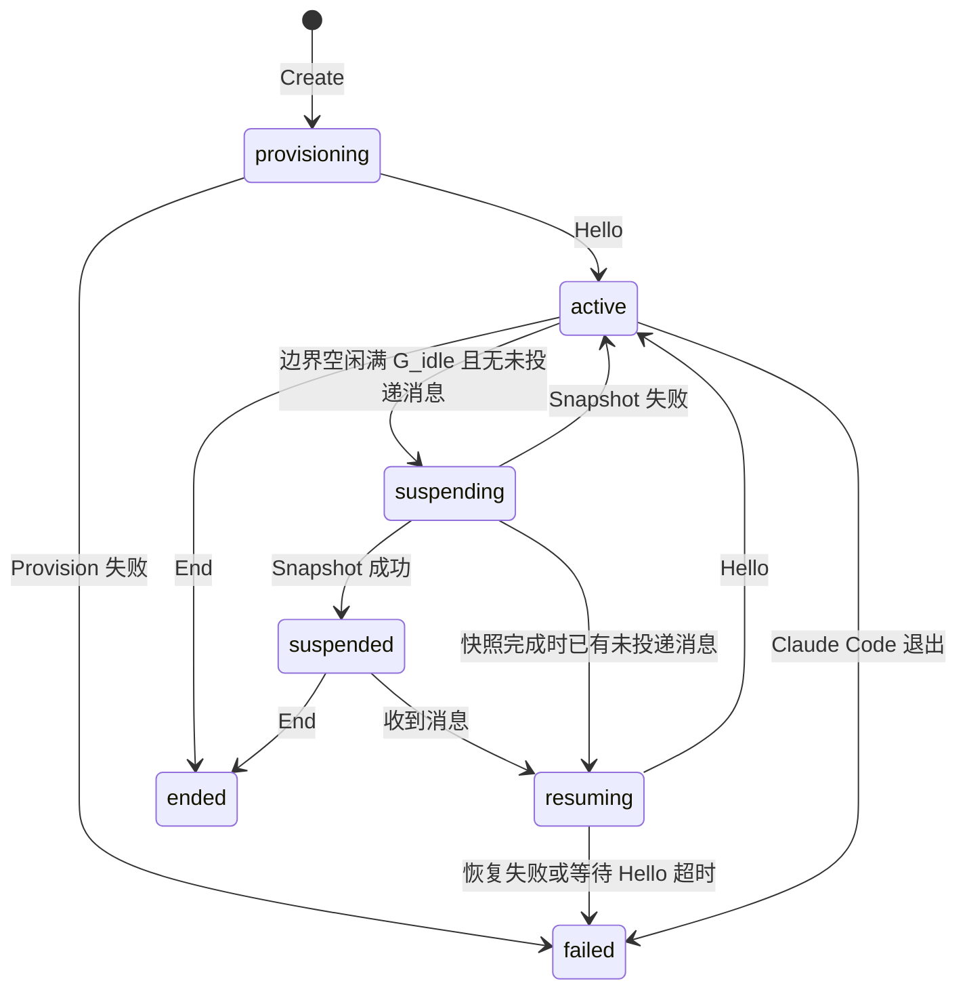

# runcontroller（v0.1.0）

v0.1.0 中，`runcontroller` 保存运行实例与收件箱，维护简化状态机，决定何时挂起与恢复，并经出站流投递消息。挂起规则直接写在本模块中，不单独实现 `suspendpolicy`。版本范围见 [v0.1.0](README.md)。

## 职责

- 保存运行实例、收件箱与回合记录。
- 实现[状态机](#状态机)，状态名取自设计中的[状态与回合字段的闭集](../../design/modules/design-runcontroller.md#状态与回合字段的闭集)。
- 提供 `agentprotocol` 的服务端，见 [agentprotocol](agentprotocol.md)。
- 回合边界空闲满 `G_idle` 时挂起，挂起状态下收到消息时恢复。
- 记录每次挂起与恢复的耗时，作为技术验证的实测数据。

## 接口

供 `humanchannel` 调用，进程内函数调用：

| 方法 | 输入 | 输出 | 说明 |
| --- | --- | --- | --- |
| `RunService.Create` | 第一条提示 | `run_id` | 写入运行实例与收件箱第 1 条，提交后调用 `sandboxprovider.Provision` |
| `RunService.Get` | `run_id` | 状态、子状态、回合列表、挂起记录 | 只读 |
| `RunService.List` | 无 | 运行实例列表 | 只读 |
| `RunService.End` | `run_id` | 无 | 幂等 |
| `AppendInbox` | `run_id`、文本 | `inbox_seq` | 设计中汇入契约的子集，只有 `kind=message` |

调用 `sandboxprovider` 的 `Provision`、`Snapshot`、`RestoreSnapshot`、`Destroy` 与 `GetSandbox`，见 [sandboxprovider](sandboxprovider.md)。

## 数据

`run_id` 为 12 位小写 base32 随机串，actor 名由它派生，见 [sandboxprovider](sandboxprovider.md)。

| 表 | 主要列 | 说明 |
| --- | --- | --- |
| `run` | `run_id`、`state`、`substate`、`actor_name`、`next_inbox_seq`、`delivered_through`、`idle_since`、`failure_reason`、`created_at`、`ended_at` | `delivered_through` 是已确认写入 Claude Code 的最大 `inbox_seq` |
| `inbox` | `run_id`、`inbox_seq`、`text`、`created_at` | 主键 `(run_id, inbox_seq)`；`inbox_seq` 从 1 起，由 `run.next_inbox_seq` 在同一事务内分配 |
| `turn` | `run_id`、`turn_id`、`delivery_id`、`started_at`、`ended_at`、`output`、`is_error` | 主键 `(run_id, turn_id)` |
| `suspension` | `run_id`、`started_at`、`snapshot_ms`、`resume_requested_at`、`restore_ms`、`hello_ms`、`error` | 每次挂起一行；`hello_ms` 是恢复调用返回到收到 `Hello` 的时长 |

`inbox_seq` 大于 `delivered_through` 的消息称为未投递消息。

## 状态机

| `state` | `substate` | 含义 |
| --- | --- | --- |
| `provisioning` | 空 | 已请求创建 actor，等待首个 `Hello` |
| `active` | `in_turn` | 回合进行中 |
| `active` | `delivering` | 已发出 `Deliver`，等待 `Accepted` |
| `active` | `boundary` | 回合边界，等待下一条消息；`idle_since` 从进入时起算 |
| `suspending` | 空 | 已决定挂起，正在调用 `Snapshot` |
| `suspended` | `snapshotted` | 快照完成，actor 已释放计算资源 |
| `resuming` | `snapshotted` | 正在调用 `RestoreSnapshot`，或在等待恢复后的 `Hello` |
| `ended` | 空 | 终态，已结束 |
| `failed` | 空 | 终态，`failure_reason` 说明原因 |

## 行为

每条规则在一个数据库事务内执行，事务开始时以 `SELECT ... FOR UPDATE` 锁住运行实例行。调用 `sandboxprovider` 一律在事务提交之后进行，调用前先把状态写成 `suspending` 或 `resuming`，同一运行实例因此不会出现两个并发的提供者调用。

### 创建与接入

1. `RunService.Create` 写入 `provisioning` 状态的运行实例和收件箱第 1 条，提交后调用 `Provision`。失败时转 `failed`。
2. 收到 `Hello`：
   - 状态为 `provisioning`、`resuming` 或 `active` 时转 `active`，子状态按 `agent_state.phase` 取：`starting` 与 `boundary` 取 `boundary`，`in_turn` 取 `in_turn`，`exited` 转 `failed`。
   - `delivered_through` 取它与 `Hello.last_accepted_seq` 中的较大者。
   - `last_turn` 对应的回合尚未记录结果时，补记结果。
   - 状态为 `suspending` 或 `suspended` 时，只登记这条流，不改变状态。
   - 应答 `HelloAck`，携带控制面配置的 LLM 凭据及其种类，见 [agentprotocol](agentprotocol.md)。
3. 恢复时，从 `RestoreSnapshot` 返回起等待 `Hello`，等满 `T_hello` 仍未收到则转 `failed`。

### 投递

- 运行实例处于 `active`、`boundary`，有未投递消息且出站流已连接时，把全部未投递消息作为一批发出 `Deliver`，子状态转 `delivering`。
- 收到 `Accepted` 后，`delivered_through` 取 `through_seq`，子状态转 `in_turn`。
- 收到 `turn_started` 时写入回合记录；收到 `turn_ended` 时补记结果，子状态转 `boundary`，`idle_since` 置为当前时刻，随后检查有无未投递消息。`turn_ended.agent_exited` 为真时转 `failed`。
- 出站流断开时，子状态为 `delivering` 的运行实例退回 `boundary`。下一条流的 `Hello` 会给出实际的写入位置，未写入的消息随后重新投递。

### 挂起

后台扫描每 `P_scan` 执行一次，对 `active`、`boundary` 且 `idle_since` 早于当前时刻减 `G_idle` 的运行实例逐个执行：

1. 事务内重新检查条件，并确认没有未投递消息，然后转 `suspending`，写入一行 `suspension`。
2. 提交后调用 `Snapshot`，同步等到快照写完。
3. 成功时，事务内转 `suspended`。此时如果已有未投递消息，同一事务改转 `resuming`，提交后调用 `RestoreSnapshot`。
4. 失败时退回 `active`、`boundary`，`idle_since` 置为当前时刻，在 `suspension.error` 中记录原因；`GetSandbox` 报告 actor 已崩溃时转 `failed`。

### 新消息与恢复

`AppendInbox` 在事务内分配 `inbox_seq` 并写入收件箱，然后按当前状态处理：

| 状态 | 处理 |
| --- | --- |
| `active`、`boundary` | 提交后投递 |
| `active`、`in_turn` 或 `delivering` | 只写入，回合结束后投递 |
| `suspending` | 只写入，由挂起第 3 步发现并恢复 |
| `suspended` | 同一事务转 `resuming`，提交后调用 `RestoreSnapshot` |
| `provisioning`、`resuming` | 只写入，收到 `Hello` 后投递 |
| `ended`、`failed` | 拒绝 |

挂起的决定（第 1 步）与写入消息都锁住同一运行实例行，所以两者串行发生：消息先写入时，第 1 步看到它而不挂起；第 1 步先提交时，消息写入看到 `suspending`，由第 3 步接手。两种顺序下消息都不会滞留在一个已挂起、不再恢复的运行实例里。

### 结束

`RunService.End` 在事务内转 `ended`；出站流已连接时发 `Shutdown`；提交后调用 `Destroy`。运行实例处于 `suspended` 时直接 `Destroy`。重复调用不报错。

### 控制面重启

启动时不改写任何运行实例。`suspended` 的运行实例照常等待消息；`active` 的运行实例等看守进程重连，子状态为 `delivering` 的退回 `boundary`。处于 `provisioning`、`suspending` 或 `resuming` 的运行实例可能停在该状态，属于 [v0.1.0 的已知限制](README.md#已知限制)。

## 参数

| 参数 | 取值 | 含义 |
| --- | --- | --- |
| `G_idle` | 30 s | 回合边界空闲多久之后挂起 |
| `P_scan` | 5 s | 挂起扫描的周期 |
| `T_hello` | 60 s | 恢复后等待 `Hello` 的上限 |

## 与设计的差异

- 状态只用设计闭集中的一部分，没有 `wake_queued` 与 `degraded`；`active` 的子状态只有 `in_turn`、`delivering` 与 `boundary`；`suspended` 的子状态只有 `snapshotted`。
- 没有代，没有失效判定。快照恢复不递增代，每个运行实例只有一代。
- 不写效果记录，没有对账器；提供者调用在事务提交后直接执行，执行中途重启会使运行实例停在过渡状态。
- 唤醒谓词只有一种形式：已挂起且有未投递消息。
- 投递只有一级确认 `Accepted`，没有 `Consumed`。

## 测试

在假的 `sandboxprovider`（可控制耗时与失败）与假的看守进程上测试：

- `Snapshot` 进行中写入消息：快照完成后立即恢复，消息被投递一次。
- 同一运行实例连续挂起、恢复 10 次，每次恢复后发一条消息：每条消息恰好被写入一次，`turn` 与 `inbox` 一一对应。
- 运行实例处于 `suspended` 时重启控制面，之后写入的消息使它恢复并被投递。
- 丢弃 `Accepted` 或 `turn_ended` 之后断线重连：位置与回合结果由 `Hello` 补齐。
- `Snapshot` 失败、`RestoreSnapshot` 失败与等待 `Hello` 超时三种情形的状态转移符合上文。
